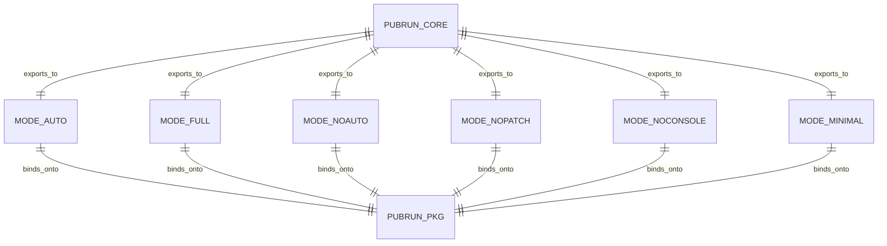

# IPD: Import-mode API parity for file registration

- Date: 2026-11-21
- Kind: child
- Concern: Re-exporting external file registration application programming interface (API) functions across all six `pubrun` import modes and verifying parity
- Scope: Re-export `register_file`, `register_input`, and `register_output` in `src/pubrun/auto.py`, `src/pubrun/full.py`, `src/pubrun/noauto.py`, `src/pubrun/nopatch.py`, `src/pubrun/noconsole.py`, and `src/pubrun/minimal.py`, and expand `tests/test_import_modes.py`.
- Scope-Paths: src/pubrun/auto.py, src/pubrun/full.py, src/pubrun/noauto.py, src/pubrun/nopatch.py, src/pubrun/noconsole.py, src/pubrun/minimal.py, tests/test_import_modes.py
- Item-Dependencies: executed:52dl55
- Status: reviewed
- Readiness: go-pending-approval
- Review-Depth: standard
- Short-Description: Re-export external file registration APIs across all six pubrun import modes with parity tests
- Work-Kind: feature
- Priority: medium
- From-Backlog: x6alw4
- Set: file-prov
- Order: 3
- Highest E allocated: 03
- Author: agent
- Id: 98j0a3

> Write and proofread this plan per the technical writing standard, `.aw/system/workflows/technical-writing/technical-writing.md` (`.agents/workflows/technical-writing/technical-writing.md` in a legacy-layout install), including requirement 12 (diagrams).

## Workflow history

- 2026-11-22 /plan-review (Gemini 4 Neon (High)): APPROVE WITH REVISIONS APPLIED; PR-001, PR-002, PR-003, PR-004
- 2026-11-21 to-review (agent): authored child plan 03 of Set `file-prov` graduating backlog item `x6alw4`.

## Goal

Ensure every `pubrun` import mode (`import pubrun.auto as pubrun`, `full`, `noauto`, `nopatch`, `noconsole`, and `minimal`) exposes `register_file`, `register_input`, and `register_output` on both the mode alias and the parent `pubrun` package namespace identically to root `import pubrun`. Prove via isolated subprocess tests that explicit external file registration works in hook-free modes (`nopatch`, `minimal`) without patching `builtins.open` or eagerly importing `pubrun.capture.file_io`.

### Mode-alias re-export relationships

This diagram shows how all six import-mode modules re-export the registration functions from `src/pubrun/core.py` and bind them back onto the parent `pubrun` package namespace. The text below is normative.



## Detailed Implementation Checklist (TODO)

Execution-state rule: mark an `E-*` item complete only after performing the action. That mark is not validation. Right-sizing rule: write for a modest executor that cannot hold much in its head. Each E-item is one step (one concern, about one file, executable in one focused pass) and its V-item names each unit it covers with its own check; a plan stays at about 5 E-items and 8 work Scope-Paths, else split it into more child plans (guidance, `IPD-Z603`). Accepted execution states: blocked, failed, pending, performed; terminal gate demands 'performed'.

### Task group 1: Re-export in auto-start and explicit-start modes

- [ ] E-01 Re-export `register_file`, `register_input`, and `register_output` in `src/pubrun/auto.py`, `src/pubrun/full.py`, and `src/pubrun/noauto.py`.
  - Depends on: none
  - Expected outcome: Each of `src/pubrun/auto.py`, `src/pubrun/full.py`, and `src/pubrun/noauto.py` imports `register_file`, `register_input`, and `register_output` from `src/pubrun/core.py` and binds `_pkg.register_file`, `_pkg.register_input`, and `_pkg.register_output` on the parent `pubrun` package. Each module preserves `import pubrun.report` so `pubrun.report` remains a `CallableModule` subpackage and does not eagerly import `pubrun.capture.file_io`.
  - Execution state: pending

### Task group 2: Re-export in restricted-hook modes

- [ ] E-02 Re-export `register_file`, `register_input`, and `register_output` in `src/pubrun/nopatch.py`, `src/pubrun/noconsole.py`, and `src/pubrun/minimal.py`.
  - Depends on: none
  - Expected outcome: Each of `src/pubrun/nopatch.py`, `src/pubrun/noconsole.py`, and `src/pubrun/minimal.py` imports `register_file`, `register_input`, and `register_output` from `src/pubrun/core.py` and binds `_pkg.register_file`, `_pkg.register_input`, and `_pkg.register_output` on the parent `pubrun` package. Each module preserves `import pubrun.report` so `pubrun.report` remains a `CallableModule` subpackage and does not eagerly import `pubrun.capture.file_io`.
  - Execution state: pending

### Task group 3: Subprocess parity and hook-free behavioral tests

- [ ] E-03 Update `tests/test_import_modes.py` to enforce alias and parent-package parity for `register_file`, `register_input`, and `register_output` across all six import modes and prove registration works in `nopatch` and `minimal` modes.
  - Depends on: E-01, E-02
  - Expected outcome: `tests/test_import_modes.py::TestModeAliasApiParity._PUBLIC` includes `"register_file"`, `"register_input"`, and `"register_output"`, and `tests/test_import_modes.py::TestModeAliasApiParity.test_mode_alias_exposes_full_api` asserts that every name in `_PUBLIC` exists on BOTH the imported `pubrun.<mode>` alias and the parent `pubrun` package namespace (`import pubrun as base`, verifying `getattr(base, n) is getattr(pubrun, n)` for non-`report` symbols). New isolated subprocess tests (running with `cwd=str(tmp_path)` and cleared `PUBRUN_IMPORT_MODE`/`PUBRUN_AUTO_START` env vars) verify that `import pubrun.nopatch as pubrun` and `import pubrun.minimal as pubrun` (with explicit `pubrun.start()`/`stop()`) do not eagerly import `pubrun.capture.file_io`, leave `builtins.open` unpatched, and record external input and output files in `manifest.json`.
  - Execution state: pending

## Project conventions discovered (Step 0)

- All six import-mode modules (`src/pubrun/auto.py`, `src/pubrun/full.py`, `src/pubrun/noauto.py`, `src/pubrun/nopatch.py`, `src/pubrun/noconsole.py`, `src/pubrun/minimal.py`) import public symbols from `src/pubrun/core.py` and assign them onto `_pkg` (`import pubrun as _pkg`) so both `pubrun_alias.X` and subsequent `from pubrun import X` work.
- Every mode module preserves `import pubrun.report` (never `_pkg.report = report`) so `pubrun.report` stays a `CallableModule` subpackage, verified across all six modes by `tests/test_report_subpackage_integrity.py`.
- `tests/test_import_modes.py::TestModeAliasApiParity` runs every mode alias in a fresh subprocess (because import mode selection is process-global); currently `test_mode_alias_exposes_full_api` checks only `hasattr(alias, n)` and does not verify parent-package `_pkg.<name>` rebinding.
- Prerequisite reviewed child plan `52dl55` (explicit external file registration API and lifecycle semantics, `Order: 2`) defines `src/pubrun/core.py::register_file`, `src/pubrun/core.py::register_input`, and `src/pubrun/core.py::register_output` with lazy `pubrun.capture.file_io` loading and exports them in `src/pubrun/__init__.py`.

## Findings

1. **Manual re-export drift risk:** Each of the six mode submodules explicitly enumerates the symbols imported from `src/pubrun/core.py` and rebound onto `_pkg`. Without updating all six modules and `tests/test_import_modes.py::TestModeAliasApiParity`, users importing `pubrun.noauto`, `pubrun.nopatch`, `pubrun.noconsole`, `pubrun.minimal`, `pubrun.auto`, or `pubrun.full` would get `AttributeError` when calling `pubrun.register_file()`, `pubrun.register_input()`, or `pubrun.register_output()`.
2. **Unchecked parent-package rebinding in parity tests:** `tests/test_import_modes.py::TestModeAliasApiParity.test_mode_alias_exposes_full_api` currently checks `hasattr(pubrun_alias, n)` only, so a missing `_pkg.register_* = register_*` assignment would slip past parity tests while breaking subsequent `from pubrun import register_input` statements.

## Proposed changes (ordered, validatable)

1. **`src/pubrun/auto.py`, `src/pubrun/full.py`, `src/pubrun/noauto.py`:**
   - Add `register_file`, `register_input`, and `register_output` to the `from pubrun.core import (...)` list and bind `_pkg.register_file = register_file`, `_pkg.register_input = register_input`, and `_pkg.register_output = register_output`.
   - Leave `import pubrun.report` untouched.
2. **`src/pubrun/nopatch.py`, `src/pubrun/noconsole.py`, `src/pubrun/minimal.py`:**
   - Add `register_file`, `register_input`, and `register_output` to the `from pubrun.core import (...)` list and bind `_pkg.register_file = register_file`, `_pkg.register_input = register_input`, and `_pkg.register_output = register_output`.
   - Leave `import pubrun.report` untouched.
3. **`tests/test_import_modes.py`:**
   - Add `"register_file"`, `"register_input"`, and `"register_output"` to `TestModeAliasApiParity._PUBLIC`.
   - Extend `TestModeAliasApiParity.test_mode_alias_exposes_full_api` to also `import pubrun as base` and assert that every symbol in `_PUBLIC` is present on `base` (and matches `getattr(pubrun, n)` for all non-`report` symbols) so `_pkg.<name>` bindings are verified across all six modes.
   - Add subprocess behavioral tests in `TestModeAliasApiParity` (using `cwd=str(tmp_path)` and clearing `PUBRUN_IMPORT_MODE`/`PUBRUN_AUTO_START` in `env`) exercising `pubrun.register_input()` and `pubrun.register_output()` via `pubrun.nopatch` and `pubrun.minimal` (with explicit `pubrun.start()`/`stop()`), confirming `'pubrun.capture.file_io' not in sys.modules` immediately after import, `builtins.open` remains untouched, and `data_files` records appear in `manifest.json`.

## Deferred / out of scope (with reason)

- Refactoring the six mode modules to share a single re-export helper: deferred to avoid touching unrelated import-bootstrap invariants while maintaining minimal diff scope for backlog item `x6alw4` (external file registration and explicit hashing guarantees).
  - Carrier-Declined: intentional scope boundary to preserve existing per-mode bootstrap files without altering import-bootstrap invariants during `x6alw4`.

## Scope check

- Over-scope: none. Touches only the six import-mode modules and `tests/test_import_modes.py` (7 Scope-Paths, 3 E-items).
- Under-scope: none. Covers all six import modes, verifies both alias and parent-package parity, preserves `pubrun.report` subpackage integrity and lazy `file_io` import, and proves runtime registration in hook-free modes.

## Required tests / validation

Run inside the repository root and capture actual runner output and exit code:

```bash
pytest tests/test_import_modes.py tests/test_report_subpackage_integrity.py -v
```

## Spec / documentation sync

- Deferred to downstream child plan `4gpguy` (external file example, stat-vs-hash benchmarks, docs sync, and whole-Set verification, `Order: 5`), which updates user-facing API documentation (`docs/api.md`, `docs/manifest.md`, `docs/functional_spec.md`) across all import modes.

## Open questions

None. (Public API names `register_file`, `register_input`, and `register_output` were approved by the maintainer on 2026-11-21 in Set orchestrator `vtkkn1` `OQ-01`.)

## Validation and cross-check (verify before reporting done)

Validation-state rule: inspect evidence in a separate pass. Do not mark a `V-*` item complete from memory or from the matching execution checkmark. Accepted validation results: blocked, failed, pass, pending; terminal gate demands 'pass'. Runtime-demonstration reachability rule: for each `V-*` item demanding the software be observed acting (such as a run, a dispatch, or a transition) (as distinct from items demanding a diff, a file's content, or a test result, which are reachable by construction), name the code path that produces the observation or the sibling `E-*` that creates it, else the demand is UNDER-SCOPE.

- [ ] V-01 validates E-01
  - Required evidence: Diff of `src/pubrun/auto.py`, `src/pubrun/full.py`, and `src/pubrun/noauto.py` showing `register_file`, `register_input`, and `register_output` imported from `pubrun.core` and bound onto `_pkg` while preserving `import pubrun.report`, plus pasted `pytest tests/test_import_modes.py tests/test_report_subpackage_integrity.py -k "auto or full or noauto" -v` output (exit code 0, run after `E-03` updates `_PUBLIC` and parent-package checks).
  - Observed evidence:
  - Result: pending

- [ ] V-02 validates E-02
  - Required evidence: Diff of `src/pubrun/nopatch.py`, `src/pubrun/noconsole.py`, and `src/pubrun/minimal.py` showing `register_file`, `register_input`, and `register_output` imported from `pubrun.core` and bound onto `_pkg` while preserving `import pubrun.report`, plus pasted `pytest tests/test_import_modes.py tests/test_report_subpackage_integrity.py -k "nopatch or noconsole or minimal" -v` output (exit code 0, run after `E-03` updates `_PUBLIC` and parent-package checks).
  - Observed evidence:
  - Result: pending

- [ ] V-03 validates E-03
  - Required evidence: Diff of `tests/test_import_modes.py` showing updated `_PUBLIC`, parent-package rebinding assertion, and isolated `nopatch`/`minimal` subprocess tests (with `cwd=str(tmp_path)`, lazy `pubrun.capture.file_io` check, and unpatched `builtins.open` check), plus pasted full `pytest tests/test_import_modes.py tests/test_report_subpackage_integrity.py -v` output showing exit code 0 and zero failures.
  - Observed evidence:
  - Result: pending

## Approval and execution gate

- Size assessment: standard
- Cohesion rationale: not required

Execution contract:
1. Open questions: none (`vtkkn1` `OQ-01` approved the API names on 2026-11-21); do not execute until prerequisite child plan `52dl55` (explicit external file registration API and lifecycle semantics) is `executed` and a human approves this plan (`- Status: approved`).
2. Scope declaration: expected modified files are `- Scope-Paths:` (`src/pubrun/auto.py`, `src/pubrun/full.py`, `src/pubrun/noauto.py`, `src/pubrun/nopatch.py`, `src/pubrun/noconsole.py`, `src/pubrun/minimal.py`, `tests/test_import_modes.py`). If execution genuinely requires editing an out-of-scope file, justify it with `--scope-reason` at finalization; if a declared file requires no edit, acknowledge it with `--scope-ack`. Stop only for a genuinely unsafe condition such as an unresolvable concurrent-edit conflict or missing prerequisite symbols.
3. Honesty rule (HARD MUST): paste actual `pytest` runner output and exit codes into each `V-*` `Observed evidence:` field; never claim tests passed without running them.
4. Commit and push discipline: commit only the files changed for this plan using `aw commit 98j0a3 -- <paths>`; never use `git add -A`, `git add .`, or `git commit -a`; never push without explicit human instruction.
5. Lifecycle transition on completion: this plan must reach `.aw/records/plans/executed/` with `- Status: executed` through `aw ipd finalize` once all `E-*` items are `performed` and all `V-*` items are `pass`. In a runner-managed lane with `self_finalize=True`, leave lifecycle finalization to the runner's post-turn finalize step; in standalone execution, run `aw ipd finalize 98j0a3` directly. Never hand-roll a raw `git mv` to `.aw/records/plans/executed/`.
