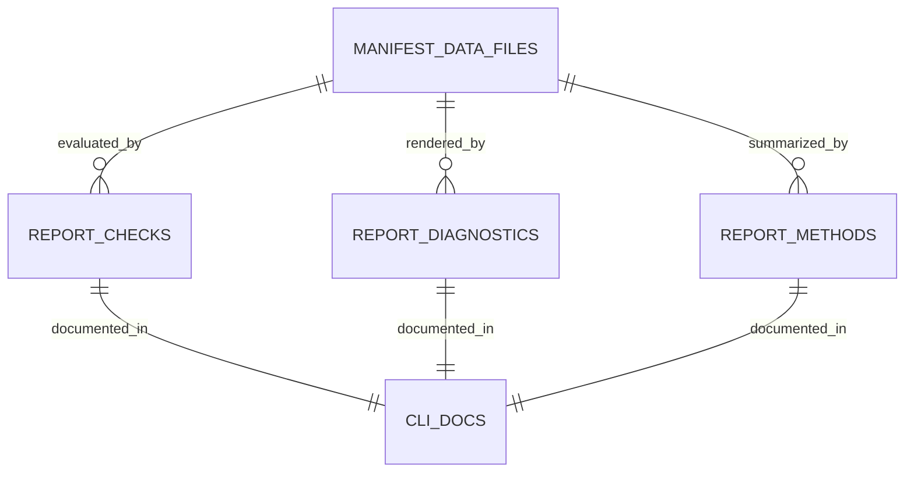

# IPD: Report, inspect, and methods file-provenance evidence distinction

- Date: 2026-11-21
- Kind: child
- Concern: Distinguishing identified paths, caller-asserted digests, verified content hashes, over-budget skips, failures, and changed files across `pubrun inspect`, `pubrun show`, `pubrun methods`, and command-line interface (CLI) documentation
- Scope: Update `src/pubrun/report/checks.py`, `src/pubrun/report/diagnostics.py`, `src/pubrun/report/methods.py`, `docs/cli.md`, and behavioral tests in `tests/test_checks_commands.py`, `tests/test_reports.py`, and `tests/test_show_sections.py`.
- Scope-Paths: src/pubrun/report/checks.py, src/pubrun/report/diagnostics.py, src/pubrun/report/methods.py, docs/cli.md, tests/test_checks_commands.py, tests/test_reports.py, tests/test_show_sections.py
- Item-Dependencies: executed:52dl55
- Status: reviewed
- Readiness: go-pending-approval
- Review-Depth: complex
- Short-Description: Distinguish identified paths, asserted digests, and verified hashes in checks, diagnostics, methods, and CLI docs
- Work-Kind: feature
- Priority: medium
- From-Backlog: x6alw4
- Set: file-prov
- Order: 4
- Highest E allocated: 04
- Author: agent
- Id: hm32d9

> Write and proofread this plan per the technical writing standard, `.aw/system/workflows/technical-writing/technical-writing.md` (`.agents/workflows/technical-writing/technical-writing.md` in a legacy-layout install), including requirement 12 (diagrams).

## Workflow history

- 2026-11-22 /plan-review (Antigravity / Gemini 4 Neon (High)): APPROVE WITH REVISIONS APPLIED; PR-001, PR-002, PR-003, PR-004, PR-005, PR-006, PR-007
- 2026-11-21 to-review (agent): authored child plan 04 of Set `file-prov` graduating backlog item `x6alw4`.

## Goal

Update `pubrun`'s reporting, inspection, and academic methods consumers so they distinguish identified paths (name or stat metadata only) and caller-asserted digests from independently verified content hashes. Surface over-budget skips, failures, unavailable targets, pending outputs, and changed files accurately across all supported digest algorithms. Degrade honestly on legacy or malformed manifests, keep user-facing CLI output accessible under `NO_COLOR`, and preserve `import pubrun` isolation from `pubrun.report.checks`.

### Report consumer data flow

This diagram shows how manifest `data_files` records flow into the three report consumers and CLI documentation updated in this plan. The text in `## Proposed changes (ordered, validatable)` is normative.

## Detailed Implementation Checklist (TODO)

Execution-state rule: mark an `E-*` item complete only after performing the action. That mark is not validation. Right-sizing rule: write for a modest executor that cannot hold much in its head. Each E-item is one step (one concern, about one file, executable in one focused pass) and its V-item names each unit it covers with its own check; a plan stays at about 5 E-items and 8 work Scope-Paths, else split it into more child plans (guidance, `IPD-Z603`). Accepted execution states: blocked, failed, pending, performed; terminal gate demands 'performed'.

### Task group 1: Inspect findings and legacy-manifest compatibility

- [ ] E-01 Update `src/pubrun/report/checks.py::manifest_findings` to classify `data_files` (`inputs`, `outputs`, `mixed`) by evidence strength and hashing outcome.
  - Depends on: none
  - Expected outcome: `src/pubrun/report/checks.py::manifest_findings` inspects `data_files.inputs`, `data_files.outputs`, and `data_files.mixed` defensively (tolerating missing, `None`, or non-dict `data_files`, non-list sections, non-dict entries, and legacy manifests omitting `mixed` or `hash_status`). When all three lists are empty, `no_file_provenance` (`info`) recommends both `pubrun.open()` and `pubrun.register_input()` / `pubrun.register_output()`. When records exist, `manifest_findings()` emits distinct findings: `file_provenance_changed` (`warn`, when `hash_status == "file_changed"` or `change_detected is True`), `file_provenance_hash_failed` (`warn`, when `hash_status in ("failed", "unavailable")`, including `caller_digest_mismatch`), `file_provenance_over_budget` (`info`, when `hash_status == "over_budget"`), `file_provenance_asserted_only` (`info`, when unverified caller-supplied digests are present via `hash_status == "asserted"` or `evidence_source == "asserted"` with `hash_status != "completed"`), and `file_provenance_unverified_paths` (`info`, when entries are `metadata_only`, `path_only`, `hash_status in ("disabled", "pending")` without caller digest, or legacy records lacking `hash_status`/`evidence_strength`/`evidence_source` and lacking a digest). Verified non-SHA-256 records (`hash_status == "completed"` with `digest` set and `sha256: None`) are classified as verified and do not trigger `file_provenance_unverified_paths`. Existing finding codes, never-raise behavior, CLI-only import isolation, and coexistence with sibling plan `0b8i7x` (shared reproducibility evidence model) and `26euz0` (partial-manifest diagnostics) are preserved without duplicate findings.
  - Execution state: pending

### Task group 2: Diagnostic report rendering

- [ ] E-02 Update `src/pubrun/report/diagnostics.py::print_report` to display a File Provenance breakdown separating verified content from identified paths, asserted digests, pending outputs, and anomalies.
  - Depends on: E-01
  - Expected outcome: In `src/pubrun/report/diagnostics.py::print_report`, the Standard section prints a concise `Data Files` summary line showing counts by evidence category (`verified`, `asserted`, `identified-only`, `over-budget`, `changed`, `failed/unavailable`, `pending`) whenever `data_files` has records. The Deep section prints a `[ Data Files ]` subsection listing individual `inputs`, `outputs`, and `mixed` entries with sanitized path, optional label, role/mode, authoritative textual evidence badge (`[verified]`, `[asserted]`, `[metadata-only]`, `[path-only]`, `[over-budget]`, `[changed]`, `[unavailable]`, `[failed]`, `[pending]`), bounded `hash_status_detail` on anomaly states, and abbreviated `<alg>:<prefix12>` digest (from `digest` or `sha256`, and `caller_digest` only on `[asserted]`, never presented as verified on `failed`/`changed`/`over_budget`/`unavailable`/`disabled`/`pending`). New output never uses `Colors.DIM`, emits zero ANSI escapes under `NO_COLOR`, handles legacy or malformed `data_files` cleanly without raising, and preserves any sibling `26euz0` or `vrr1fv` report sections.
  - Execution state: pending

### Task group 3: Methods generation and CLI documentation

- [ ] E-03 Update `src/pubrun/report/methods.py` and `docs/cli.md` to reflect honest file-provenance evidence levels.
  - Depends on: E-02
  - Expected outcome: `src/pubrun/report/methods.py::generate_report` and `src/pubrun/report/methods.py::generate_report_multi` produce byte-identical output when `data_files` has no entries across all manifests in scope (preserving `tests/test_reports.py`, `tests/test_methods_multi.py`, and `tests/test_templates.py`). When `data_files` has entries, `generate_report()` inserts one factual, restrained sentence into the methods body (before `**References:**` in Markdown and before `%% Ensure you add` in LaTeX, escaping LaTeX special characters) distinguishing independently verified content digests from caller-asserted digests, path/metadata-only identifications, over-budget skips, pending outputs, and changed/failed entries without ever claiming unverified or asserted files were content-verified. `generate_report_multi()` aggregates file-provenance evidence across all manifests in `manifests` (including when `manifests[0]` has empty `data_files` and `manifests[1:]` has tracked files, or when runs vary), preserving any sibling `26euz0` partial-provenance disclosures. `docs/cli.md` updates the `pubrun inspect`, `pubrun show`, and `pubrun methods` sections to document `pubrun.register_input()` / `register_output()` / `register_file()`, file-provenance findings, evidence badges, and methods provenance notes without introducing em or en dashes.
  - Execution state: pending

### Task group 4: Behavioral tests and import-isolation verification

- [ ] E-04 Add behavioral tests in `tests/test_checks_commands.py`, `tests/test_reports.py`, and `tests/test_show_sections.py`.
  - Depends on: E-03
  - Expected outcome: Targeted behavioral tests pass via `pytest` confirming: (1) `manifest_findings()` emits distinct codes for empty `data_files`, verified SHA-256 and non-SHA-256 (`sha512`) content (no unverified-path finding), stat-only/path-only records, caller-asserted digests (including `verify_digest=True` on unavailable targets), over-budget skips, pending outputs, failed/unavailable records (including `caller_digest_mismatch`), changed/replaced files, mixed-role entries, legacy manifests, and malformed `data_files`, and `pubrun inspect --strict` exits non-zero on `WARN` file-provenance findings while exiting 0 when only `INFO` file-provenance findings occur; (2) `pubrun show` (standard) and `pubrun show --deep` (plus `print_report(..., depth="deep")`) render the File Provenance breakdown with authoritative textual badges, sanitized labels/paths, zero ANSI escapes under `NO_COLOR=1`, and intact `SHOW_SECTIONS` filtering; (3) `generate_report()` and `generate_report_multi()` (Markdown and LaTeX) stay byte-identical for empty `data_files` and distinguish verified, asserted, unverified, and anomaly file records when populated; (4) `test_import_pubrun_does_not_import_checks` continues to pass.
  - Execution state: pending

## Project conventions discovered (Step 0)

- `src/pubrun/report/checks.py::manifest_findings` returns dicts `{"severity": "info"|"warn", "code": str, "message": str, "suggestion": Optional[str]}` and is strictly CLI-only (pinned by `tests/test_checks_commands.py::test_import_pubrun_does_not_import_checks`). `pubrun inspect --strict` (`src/pubrun/__main__.py::_run_inspect`) exits 1 if any finding has `severity == "warn"` and exits 0 when only `"info"` findings fire.
- `tests/test_checks_commands.py::TestManifestFindings.test_no_file_provenance_finding_mentions_open` asserts `"pubrun.open" in (nf["suggestion"] or "") or "open()" in nf["message"]`; updating the wording to mention both `pubrun.open()` and `pubrun.register_input()` / `pubrun.register_output()` preserves that assertion.
- `src/pubrun/report/diagnostics.py::print_report` uses `Colors` gated by `_has_color()` (`NO_COLOR`) and prints Basic, Standard, and Deep sections; `src/pubrun/__main__.py` (`show_parser` and `report_parser`) accepts `--basic`, `--standard`, and `--deep` (there is no `--depth` CLI option). `src/pubrun/report/diagnostics.py::SHOW_SECTIONS = ("logs", "env", "packages")` is pinned by `tests/test_show_sections.py`.
- `src/pubrun/report/output.py` and `docs/cli.md#Output conventions` require textual labels to be authoritative, prohibit ANSI `DIM` (`\033[2m`) on load-bearing output, and suppress all ANSI escapes when `NO_COLOR` is set.
- `src/pubrun/report/methods.py::generate_report` and `generate_report_multi` format `src/pubrun/report/templates.py::MARKDOWN_TEMPLATE` (ending with `**References:**`) and `LATEX_TEMPLATE` (ending with `%% Ensure you add...` BibTeX comments), escape underscores in LaTeX (`replace("_", "\\_")`), and are pinned by `tests/test_reports.py`, `tests/test_methods_multi.py`, and `tests/test_templates.py`.
- `docs/cli.md` currently states under `### inspect` that file-I/O provenance is recorded only via `pubrun.open()`, and under `### show` and `### methods` does not describe file-provenance evidence levels. Per `AGENTS.md`, user-facing prose in `docs/cli.md` must contain no newly introduced em dashes or en dashes.
- Prerequisite reviewed plans `xxi3nc` (file provenance engine, `Order: 1`) and `52dl55` (explicit external file registration API, `Order: 2`) define `$defs.file_provenance_record` fields (`hash_status`, `hash_status_detail`, `hash_algorithm`, `digest`, `caller_digest`, `evidence_source`, `evidence_strength`, `change_detected`, `label`, `role`, `mode`, `data_files.mixed`, `data_files.hashing_summary`), including non-SHA-256 `digest` records where `sha256` is `None`.
- Sibling reviewed plans `0b8i7x` (Set `repro-check`, editing `checks.py`), `26euz0` (Set `cap-isolation`, editing `checks.py`, `diagnostics.py`, `methods.py`), and `vrr1fv` (Set `timing-acc`, editing `diagnostics.py`) have no cross-Set execution dependency on `file-prov` and may land before or after `hm32d9`.

## Findings

1. **`src/pubrun/report/checks.py::manifest_findings`**: Checks only whether `data_files.inputs` and `data_files.outputs` are both empty. It ignores `data_files.mixed` and never inspects whether recorded files have verified content hashes, caller-asserted digests, metadata-only or path-only records, pending outputs, over-budget skips, failed or unavailable hashes, or file-change detections.
2. **`src/pubrun/report/diagnostics.py::print_report`**: Does not render `data_files` in Standard or Deep views, so users running `pubrun show` or `pubrun show --deep` cannot inspect registered inputs, outputs, or mixed-role files or distinguish verified hashes from unhashed paths and asserted digests.
3. **`src/pubrun/report/methods.py::generate_report` and `generate_report_multi`**: Do not summarize tracked file provenance when `data_files` is populated, and require careful placement and wording so path-only, asserted, pending, over-budget, failed, or changed entries are never represented as content-verified datasets.
4. **`docs/cli.md`**: Still describes file provenance as `pubrun.open()`-only under `### inspect` and omits file-provenance reporting details under `### show` and `### methods`.

## Proposed changes (ordered, validatable)

1. **`src/pubrun/report/checks.py`**:
   - Add pure defensive helpers `_iter_data_file_records(manifest)` (safely yielding `(section_role, rec)` dict entries across `inputs`, `outputs`, and `mixed`, tolerating missing/`None`/non-dict `data_files` and non-list/non-dict entries) and `_classify_file_record(rec: Dict[str, Any]) -> str` with deterministic precedence:
     1. `"changed"`: `hash_status == "file_changed"` or `change_detected is True`.
     2. `"failed"`: `hash_status == "failed"` (including `hash_status_detail == "caller_digest_mismatch"` or `caller_digest.verified is False`).
     3. `"unavailable"`: `hash_status == "unavailable"`.
     4. `"over_budget"`: `hash_status == "over_budget"`.
     5. `"verified"`: `hash_status == "completed"` or `evidence_strength == "verified_content"` (valid for any algorithm in `digest` such as `sha256` or `sha512`, even when `sha256` is `None`).
     6. `"asserted"`: `hash_status == "asserted"` or `evidence_strength == "asserted_content"` or `evidence_source == "asserted"`.
     7. `"pending"`: `hash_status == "pending"`.
     8. `"identified_only"`: `hash_status == "disabled"` or `evidence_strength in ("metadata_only", "path_only")`.
     9. Legacy fallback (ONLY when `hash_status is None and evidence_strength is None and evidence_source is None`): non-empty string in `digest.value` or `sha256` -> `"verified"`, else `"identified_only"`.
   - Update `manifest_findings()` to inspect all records yielded by `_iter_data_file_records(manifest)`:
     - When zero records exist across `inputs`, `outputs`, and `mixed`: emit `no_file_provenance` (`INFO`) mentioning both `pubrun.open()` and `pubrun.register_input()` / `pubrun.register_output()`.
     - When records exist, emit distinct findings (each at most once, reporting the count of affected records and concise actionable guidance):
       - `file_provenance_changed` (`WARN`): when any record classifies as `"changed"`.
       - `file_provenance_hash_failed` (`WARN`): when any record classifies as `"failed"` or `"unavailable"` (noting caller-digest mismatches when present).
       - `file_provenance_over_budget` (`INFO`): when any record classifies as `"over_budget"`.
       - `file_provenance_asserted_only` (`INFO`): when any record classifies as `"asserted"` OR carries `evidence_source == "asserted"` with `hash_status != "completed"` (covering compound `52dl55` records such as unverified caller digests on unavailable/pending targets).
       - `file_provenance_unverified_paths` (`INFO`): when any record classifies as `"identified_only"` or `"pending"` (without an asserted caller digest).
   - **Cross-Set coexistence**: if sibling plan `0b8i7x` (Set `repro-check`) has already wired `manifest_findings()` to delegate to `pubrun.report.reproducibility.assess_manifest_reproducibility(...)` or sibling plan `26euz0` (Set `cap-isolation`) has added capture-error findings, preserve those integrations and deduplicate by finding `code` (replacing or updating `no_file_provenance` so it mentions `register_input()`/`register_output()` and appending any missing `file_provenance_*` findings without duplicating existing codes).

2. **`src/pubrun/report/diagnostics.py`**:
   - Add pure helpers `_sanitize_inline(val: Any, max_len: int = 200) -> str` (collapsing newlines/CR/tabs to spaces, stripping ANSI/control characters, and bounding length), `_classify_file_record_display(rec)` (using the exact precedence in Proposed changes #1, splitting `"identified_only"` into `"path-only"` when `evidence_strength == "path_only"` and `"metadata-only"` otherwise), `_extract_display_digest(rec, badge)` (returning `f"{alg}:{val[:12]}"` from `rec["digest"]` or `sha256` for `[verified]`, and from `rec["caller_digest"]` or `rec["digest"]` ONLY for `[asserted]`; returning `None` for all anomaly/unverified states so failed or changed files never display a verified-looking hash), and `_summarize_data_files(data_files)` producing counts (`total`, `verified`, `asserted`, `identified_only`, `over_budget`, `changed`, `failed_or_unavailable`, `pending`) whose sum equals `total`.
   - In `print_report()` Standard section: when `total > 0`, print a `Data Files` summary line (aligned with `Packages` / `Env Vars`) breaking down verified content hashes versus caller-asserted digests, identified paths/metadata only, and any non-zero over-budget, pending, changed, or failed/unavailable counts.
   - In `print_report()` Deep section: print a `[ Data Files ]` subsection listing `inputs`, `outputs`, and `mixed` records (showing `(None captured)` when all three are empty) with sanitized path, optional `[label=<sanitized>]`, role/mode, authoritative textual badge (`[verified]`, `[asserted]`, `[metadata-only]`, `[path-only]`, `[over-budget]`, `[changed]`, `[unavailable]`, `[failed]`, `[pending]`), optional `<alg>:<prefix12>` from `_extract_display_digest`, and bounded sanitized `hash_status_detail` on anomaly badges (`[failed]`, `[changed]`, `[unavailable]`, `[over-budget]`).
   - Respect `_has_color()` (`NO_COLOR`) with zero ANSI escapes when disabled, never use `Colors.DIM` on File Provenance lines, keep `SHOW_SECTIONS = ("logs", "env", "packages")` unchanged, and preserve any sibling `26euz0` partial-capture warnings or `vrr1fv` timing lines already present.

3. **`src/pubrun/report/methods.py`**:
   - Add pure helpers `_summarize_manifest_data_files(manifest)` (reusing the exact classification precedence from Proposed changes #1, safely tolerating missing/malformed `data_files`) and `_format_file_provenance_note(counts, format_type, *, multi_run_count: Optional[int] = None) -> str` returning `""` when `counts["total"] == 0`.
   - Add a helper `_escape_latex(text: str) -> str` escaping `_` -> `\_` and `%` -> `\%` for any generated LaTeX note text.
   - In `generate_report(manifest, format_type="markdown")`:
     - When `data_files` has zero entries across `inputs`, `outputs`, and `mixed`, return the exact existing formatted template output (byte-identical).
     - When `data_files` has entries, insert one concise, restrained sentence into the methods body directly before `**References:**` (Markdown) or directly before `%% Ensure you add` (LaTeX), stating the total tracked file record count and accurately breaking down independently verified content digests versus caller-asserted digests, path/metadata-only identifications, over-budget skips, pending records, and any changed or failed/unavailable hashes (never claiming unhashed, asserted, or failed files were content-verified).
   - In `generate_report_multi(manifests, format_type="markdown")`:
     - When `len(manifests) == 1`, delegate to `generate_report(manifests[0], format_type)` unchanged.
     - When `len(manifests) >= 2` and all manifests have empty `data_files`, keep output byte-identical to existing behavior.
     - When `len(manifests) >= 2` and any manifest in `manifests` has `data_files` entries, compute aggregate counts across all manifests in scope (and the count of runs recording files) and emit a concise multi-run file-provenance note (Markdown italic/bullet note or LaTeX `% ...` comment matching `generate_report_multi`'s existing note convention) distinguishing verified content digests from caller-asserted, path/metadata-only, and anomaly records across the aggregated set.
   - Preserve any sibling `26euz0` partial-provenance disclosures if already present.

4. **`docs/cli.md`**:
   - Update `### inspect` (especially the Honesty note around line 170) to document explicit external file registration (`pubrun.register_input()`, `pubrun.register_output()`, `pubrun.register_file()`) alongside `pubrun.open()`, and summarize the file-provenance finding codes and `WARN` vs `INFO` (`--strict`) semantics.
   - Update `### show` (depth table and description) to note the Standard-depth `Data Files` evidence summary and Deep-depth `[ Data Files ]` listing with evidence badges.
   - Update `### methods` to note that when a run records `data_files`, `pubrun methods` appends an honest file-provenance evidence breakdown distinguishing verified content hashes from asserted digests and identified paths.
   - Use zero em dashes or en dashes in all new or edited prose in `docs/cli.md`.

5. **`tests/test_checks_commands.py`, `tests/test_reports.py`, `tests/test_show_sections.py`**:
   - `tests/test_checks_commands.py`: add unit tests covering every new `manifest_findings()` code, verified SHA-256 and `sha512` records (no unverified-path finding), compound `52dl55` records (`caller_digest_mismatch`, `verify_digest=True` on unavailable target, `pending` deferred outputs), `mixed` entries, legacy manifests, malformed `data_files`, updated `no_file_provenance` text (preserving `test_no_file_provenance_finding_mentions_open`), `pubrun inspect --strict` CLI exit codes (`WARN` vs `INFO`), and `test_import_pubrun_does_not_import_checks`.
   - `tests/test_show_sections.py`: add CLI and `print_report()` tests covering `pubrun show <run_dir>` (standard), `pubrun show <run_dir> --deep`, `NO_COLOR=1` (zero `\033[` escapes and no `Colors.DIM`), all badge classes, non-SHA-256 `digest`, sanitized multiline/control-char `label`/`path`, legacy manifests without `mixed`/`hash_status`, and intact `env`/`packages`/`logs` section filtering.
   - `tests/test_reports.py`: add unit tests for `generate_report()` and `generate_report_multi()` (Markdown and LaTeX) verifying byte-identical output for empty `data_files`, accurate verified-vs-asserted-vs-unverified-vs-anomaly wording placed before `**References:**` / `%% Ensure you add`, LaTeX underscore escaping, and multi-run aggregation when `manifests[0]` is empty and `manifests[1]` has tracked files.

## Deferred / out of scope (with reason)

- Reproducibility preflight assessment (`src/pubrun/report/reproducibility.py`): owned by sibling backlog item `q3bll1` (reproducibility gap assessment and rerun preflight, Set `repro-check`, reviewed child plan `0b8i7x`). Our manifest field names (`hash_status`, `evidence_source`, `evidence_strength`) align with `0b8i7x` without modifying files outside this plan's scope.
  - Carrier: 0b8i7x
- Terminal user interface (TUI) tab redesign for `data_files`: not required by backlog item `x6alw4` (explicit external file registration and hashing guarantees); CLI `inspect`, `show`, and `methods` cover all reporting requirements without adding `textual` coupling.
  - Carrier-Declined: TUI data_files tab redesign is outside backlog item x6alw4 scope; CLI inspect, show, and methods satisfy acceptance criterion 5 without adding textual coupling.

## Scope check

- Over-scope: none. Updates only `src/pubrun/report/checks.py`, `src/pubrun/report/diagnostics.py`, `src/pubrun/report/methods.py`, `docs/cli.md`, and their three test files.
- Under-scope: none. Satisfies backlog item `x6alw4` acceptance criterion 5 ("Reports distinguish identified paths from verified content") and CLI/methods reporting and documentation requirements, including coexistence with sibling Sets (`repro-check`, `cap-isolation`, `timing-acc`).

## Required tests / validation

- Run `pytest tests/test_checks_commands.py tests/test_reports.py tests/test_show_sections.py tests/test_methods_multi.py tests/test_templates.py tests/test_example_minimal_research_workflow.py -v` and paste actual runner output.
- Inspect `git diff -- docs/cli.md` and confirm zero newly added em dashes (`—`) or en dashes (`–`).

## Spec / documentation sync

- `docs/cli.md` (`inspect`, `show`, and `methods` sections) is updated in `E-03` of this plan.
- Remaining documentation (`docs/api.md`, `docs/configuration.md`, `docs/manifest.md`, `docs/functional_spec.md`, `docs/performance.md`) is synchronized in child plan `4gpguy` (external-file example, stat-vs-hash benchmarks, docs sync, and whole-Set verification, `Order: 5`).

## Open questions

None.

## Validation and cross-check (verify before reporting done)

Validation-state rule: inspect evidence in a separate pass. Do not mark a `V-*` item complete from memory or from the matching execution checkmark. Accepted validation results: blocked, failed, pass, pending; terminal gate demands 'pass'. Runtime-demonstration reachability rule: for each `V-*` item demanding the software be observed acting (such as a run, a dispatch, or a transition) (as distinct from items demanding a diff, a file's content, or a test result, which are reachable by construction), name the code path that produces the observation or the sibling `E-*` that creates it, else the demand is UNDER-SCOPE.

- [ ] V-01 validates E-01
  - Required evidence: Paste `pytest tests/test_checks_commands.py -v` output (exit code 0) confirming all existing checks tests pass alongside new tests for `no_file_provenance` (mentioning `open()` and `register_input()`/`register_output()`), `file_provenance_unverified_paths`, `file_provenance_asserted_only`, `file_provenance_over_budget`, `file_provenance_changed`, `file_provenance_hash_failed` (including `caller_digest_mismatch`), verified SHA-256 and non-SHA-256 (`sha512`) records, `pending` outputs, `mixed` entries, legacy and malformed manifests, `pubrun inspect --strict` (`WARN` vs `INFO`), and `test_import_pubrun_does_not_import_checks`.
  - Observed evidence:
  - Result: pending

- [ ] V-02 validates E-02
  - Required evidence: Paste `pytest tests/test_show_sections.py -v` output (exit code 0) confirming `pubrun show` (standard) and `pubrun show --deep` (plus `print_report(..., depth="deep")`) render the File Provenance breakdown separating verified content hashes (including non-SHA-256), caller-asserted digests, identified paths/metadata only, over-budget skips, pending outputs, changed files, and failed/unavailable records with authoritative textual badges, sanitized strings, zero ANSI escapes under `NO_COLOR=1`, no `Colors.DIM` usage, and intact `SHOW_SECTIONS` filters.
  - Observed evidence:
  - Result: pending

- [ ] V-03 validates E-03
  - Required evidence: Paste `pytest tests/test_reports.py tests/test_methods_multi.py tests/test_templates.py tests/test_example_minimal_research_workflow.py -v` output (exit code 0) confirming `generate_report()` and `generate_report_multi()` (Markdown and LaTeX) remain byte-identical when `data_files` is empty and distinguish verified, asserted, unverified, and anomaly file records when populated (including `manifests[1:]` in multi-run aggregation and LaTeX escaping), plus `git diff -- docs/cli.md` confirming updated `inspect`, `show`, and `methods` CLI documentation with zero newly introduced em or en dashes.
  - Observed evidence:
  - Result: pending

- [ ] V-04 validates E-04
  - Required evidence: Paste full output of `pytest tests/test_checks_commands.py tests/test_reports.py tests/test_show_sections.py tests/test_methods_multi.py tests/test_templates.py tests/test_example_minimal_research_workflow.py -v` (exit code 0, zero failures).
  - Observed evidence:
  - Result: pending

## Approval and execution gate

- Size assessment: standard
- Cohesion rationale: not required

Execution contract:
1. Open questions: none (`vtkkn1` `OQ-01` and `OQ-02` resolved by the maintainer on 2026-11-21); do not execute until prerequisite `52dl55` (explicit external file registration API and lifecycle semantics) is `executed` and a human approves this plan (`- Status: approved`).
2. Scope fence: restrict edits to `- Scope-Paths:` (`src/pubrun/report/checks.py`, `src/pubrun/report/diagnostics.py`, `src/pubrun/report/methods.py`, `docs/cli.md`, `tests/test_checks_commands.py`, `tests/test_reports.py`, `tests/test_show_sections.py`). If an out-of-scope edit is genuinely required, justify it with `--scope-reason` at finalization; if a declared path needs no edit, acknowledge it with `--scope-ack`. Stop and report only for genuinely unsafe conditions (such as an unresolvable concurrent-edit conflict or a missing prerequisite symbol).
3. Honesty rule (HARD MUST): paste actual `pytest` and `git diff` runner output and exit codes into each `V-*` `Observed evidence:` field; never claim tests passed without running them.
4. Commit and push discipline: commit only the files changed for this plan through `aw commit hm32d9 -- <paths>`; never use `git add -A`, `git add .`, or `git commit -a`, and never push without explicit human authorization.
5. Lifecycle transition: this plan must reach `.aw/records/plans/executed/` with `- Status: executed` through `aw ipd finalize` once all `E-*` are `performed` and all `V-*` are `pass`. In a runner-managed lane, the runner performs `aw ipd finalize`; in standalone execution, run `aw ipd lint --phase pre-transition` and finalize directly through `aw ipd finalize`. Never hand-roll a raw `git mv` to `executed/`.
