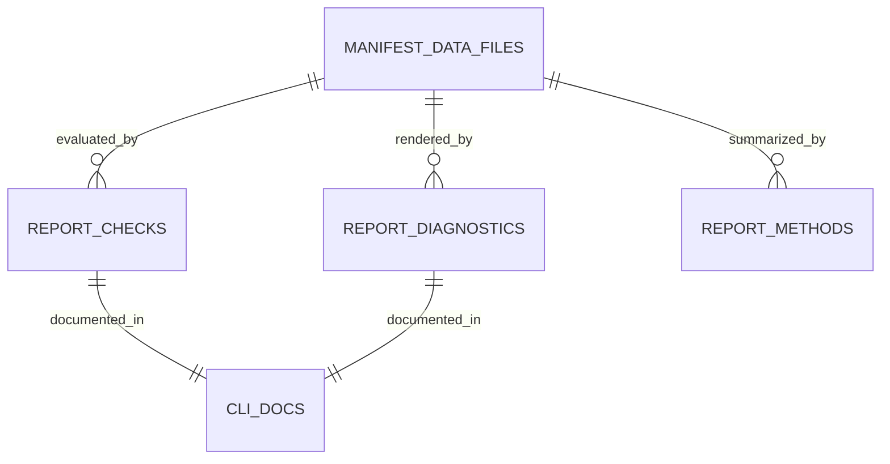

# IPD: Report, inspect, and methods file-provenance evidence distinction

- Date: 2026-11-21
- Kind: child
- Concern: Distinguishing identified paths, caller-asserted digests, verified content hashes, over-budget skips, failures, and changed files across `pubrun inspect`, `pubrun show`, `pubrun methods`, and command-line interface (CLI) documentation
- Scope: Update `src/pubrun/report/checks.py`, `src/pubrun/report/diagnostics.py`, `src/pubrun/report/methods.py`, `docs/cli.md`, and behavioral tests in `tests/test_checks_commands.py`, `tests/test_reports.py`, and `tests/test_show_sections.py`.
- Scope-Paths: src/pubrun/report/checks.py, src/pubrun/report/diagnostics.py, src/pubrun/report/methods.py, docs/cli.md, tests/test_checks_commands.py, tests/test_reports.py, tests/test_show_sections.py
- Item-Dependencies: executed:52dl55
- Status: to-review
- Short-Description: Distinguish identified paths, asserted digests, and verified hashes in checks, diagnostics, methods, and CLI docs
- Work-Kind: feature
- Priority: medium
- From-Backlog: x6alw4
- Set: file-prov
- Order: 4
- Highest E allocated: 04
- Author: agent
- Id: hm32d9

> Write and proofread this plan per the technical writing standard, `.aw/system/workflows/technical-writing/technical-writing.md` (`.agents/workflows/technical-writing/technical-writing.md` in a legacy-layout install), including requirement 12 (diagrams).

## Workflow history

- 2026-11-21 to-review (agent): authored child plan 04 of Set `file-prov` graduating backlog item `x6alw4`.

## Goal

Update `pubrun`'s reporting, inspection, and academic methods consumers so they clearly distinguish identified paths (name or stat metadata only) and caller-asserted digests from independently verified content hashes, surface over-budget skips, failures, unavailable targets, and changed files accurately, degrade honestly on legacy manifests, and preserve `import pubrun` isolation from `pubrun.report.checks`.

### Report consumer data flow

This diagram shows how manifest `data_files` records flow into the three report consumers and CLI documentation updated in this plan. The text below is normative.

## Detailed Implementation Checklist (TODO)

Execution-state rule: mark an `E-*` item complete only after performing the action. That mark is not validation. Right-sizing rule: write for a modest executor that cannot hold much in its head. Each E-item is one step (one concern, about one file, executable in one focused pass) and its V-item names each unit it covers with its own check; a plan stays at about 5 E-items and 8 work Scope-Paths, else split it into more child plans (guidance, `IPD-Z603`). Accepted execution states: blocked, failed, pending, performed; terminal gate demands 'performed'.

### Task group 1: Inspect findings and legacy-manifest compatibility

- [ ] E-01 Update `src/pubrun/report/checks.py` (`manifest_findings`) to classify `data_files` (`inputs`, `outputs`, `mixed`) by evidence strength and hashing outcome.
  - Depends on: none
  - Expected outcome: `manifest_findings()` inspects `data_files.inputs`, `data_files.outputs`, and `data_files.mixed` (tolerating legacy manifests that omit `mixed` or `hash_status`), updates `no_file_provenance` to recommend both `pubrun.open()` and `pubrun.register_input()`/`register_output()`, and emits distinct findings for: `file_provenance_unverified_paths` (`info`, when entries are `metadata_only`/`path_only` or legacy `sha256: None`), `file_provenance_asserted_only` (`info`, when entries carry `evidence_source == "asserted"` without independent verification), `file_provenance_over_budget` (`info`, when entries were skipped due to hashing budgets), `file_provenance_changed` (`warn`, when `hash_status == "file_changed"` or `change_detected is True`), and `file_provenance_hash_failed` (`warn`, when `hash_status in ("failed", "unavailable")`). All existing finding codes and `manifest_findings()` never-raise behavior remain intact.
  - Execution state: pending

### Task group 2: Diagnostic report rendering

- [ ] E-02 Update `src/pubrun/report/diagnostics.py` (`print_report`) to display a File Provenance breakdown separating verified content from identified paths, asserted digests, and anomalies.
  - Depends on: E-01
  - Expected outcome: In `print_report()`, the Standard section includes a concise `Data Files` summary line showing counts by evidence strength (for example, verified content hashes vs caller-asserted digests vs identified paths/metadata only vs skipped/changed/failed) whenever `data_files` has records, and the Deep section lists individual `inputs`, `outputs`, and `mixed` entries showing path, optional label, role, `hash_status`, `evidence_strength`, and abbreviated digest (clearly tagged `[verified]` vs `[asserted]` vs `[path/metadata only]` vs `[changed]`/`[over_budget]`/`[unavailable]`/`[failed]`). Handles legacy manifests cleanly without raising.
  - Execution state: pending

### Task group 3: Methods generation and CLI documentation

- [ ] E-03 Update `src/pubrun/report/methods.py` and `docs/cli.md` to reflect honest file-provenance evidence levels.
  - Depends on: E-02
  - Expected outcome: `src/pubrun/report/methods.py` (`generate_report` and `generate_report_multi`) produces byte-identical output when `data_files` has no entries (preserving all existing methods tests and `examples/minimal-research-workflow/expected_methods.md`), and when `data_files` has entries appends an accurate, restrained note in Markdown and LaTeX distinguishing how many files have independently verified content digests versus identified paths/metadata only or caller-asserted digests (never claiming unhashed or asserted files were content-verified). `docs/cli.md` updates the `pubrun inspect` and `pubrun show` descriptions to document explicit external file registration and the distinction between identified paths, asserted digests, and verified content.
  - Execution state: pending

### Task group 4: Behavioral tests and import-isolation verification

- [ ] E-04 Add behavioral tests in `tests/test_checks_commands.py`, `tests/test_reports.py`, and `tests/test_show_sections.py`.
  - Depends on: E-03
  - Expected outcome: Behavioral tests pass via `pytest` confirming: (1) `manifest_findings()` emits distinct codes for empty `data_files`, verified content (no unverified-path finding), stat-only/path-only records, caller-asserted digests, over-budget skips, failed/unavailable records, changed/replaced files, mixed-role entries, and legacy manifests; (2) `pubrun show --depth deep` and `pubrun show` display the File Provenance breakdown distinguishing verified content from identified paths and asserted digests; (3) `generate_report()` (Markdown and LaTeX) stays unchanged for empty `data_files` and distinguishes verified vs unverified/asserted file records when populated; (4) `test_import_pubrun_does_not_import_checks` continues to pass.
  - Execution state: pending

## Project conventions discovered (Step 0)

- `src/pubrun/report/checks.py` (`manifest_findings`) returns dicts `{"severity": "info"|"warn", "code": str, "message": str, "suggestion": Optional[str]}` and is strictly CLI-only (pinned by `test_import_pubrun_does_not_import_checks` in `tests/test_checks_commands.py`).
- `tests/test_checks_commands.py` (`test_no_file_provenance_finding_mentions_open`) asserts `"pubrun.open" in (nf["suggestion"] or "") or "open()" in nf["message"]`; updating the text to mention both `pubrun.open()` and `pubrun.register_input()`/`register_output()` preserves that assertion.
- `src/pubrun/report/diagnostics.py` (`print_report`) uses `Colors` gated by `_has_color()` (`NO_COLOR`) and prints Basic, Standard, and Deep sections; `SHOW_SECTIONS = ("logs", "env", "packages")` is tested by `tests/test_show_sections.py`.
- `src/pubrun/report/methods.py` (`generate_report` and `generate_report_multi`) escapes underscores in LaTeX output (`replace("_", "\\_")`) and is pinned by `tests/test_reports.py`, `tests/test_methods_multi.py`, and `tests/test_example_minimal_research_workflow.py`.
- `docs/cli.md` currently notes that file provenance is recorded only via `pubrun.open()`.

## Findings

1. **`src/pubrun/report/checks.py` (`manifest_findings`)**: Only checks whether `data_files.inputs` and `data_files.outputs` are both empty. It ignores `data_files.mixed` and never inspects whether recorded files have verified content hashes, caller-asserted digests, metadata-only records, over-budget skips, failed hashes, or file-change detections.
2. **`src/pubrun/report/diagnostics.py` (`print_report`)**: Does not render `data_files` at all in Standard or Deep views, so users running `pubrun show` cannot see registered inputs/outputs or distinguish verified hashes from unhashed paths.
3. **`src/pubrun/report/methods.py` (`generate_report`)**: Does not mention tracked file provenance when `data_files` is populated, and needs careful wording so path-only or asserted entries are never misrepresented as content-verified datasets.

## Proposed changes (ordered, validatable)

1. **`src/pubrun/report/checks.py`**:
   - Add a pure helper `_classify_file_record(rec: Dict[str, Any]) -> str` that reads `hash_status` / `evidence_source` / `evidence_strength` (with honest fallback for legacy records lacking `hash_status`: non-empty `sha256` -> `"verified"`, else `"path_or_metadata_only"`).
   - Update `manifest_findings()` to collect records from `data_files.inputs`, `data_files.outputs`, and `data_files.mixed`.
   - When all three lists are empty, emit `no_file_provenance` mentioning both `pubrun.open()` and `pubrun.register_input()`/`pubrun.register_output()`.
   - When records exist, tally counts and emit findings:
     - `file_provenance_changed` (`WARN`): when any record has `hash_status == "file_changed"` or `change_detected is True`.
     - `file_provenance_hash_failed` (`WARN`): when any record has `hash_status in ("failed", "unavailable")`.
     - `file_provenance_over_budget` (`INFO`): when any record has `hash_status == "over_budget"`.
     - `file_provenance_asserted_only` (`INFO`): when any record has `evidence_source == "asserted"` (unverified caller-supplied digest).
     - `file_provenance_unverified_paths` (`INFO`): when any record has `evidence_strength in ("metadata_only", "path_only")` or `hash_status == "disabled"` (or legacy `sha256 is None`).

2. **`src/pubrun/report/diagnostics.py`**:
   - Add a helper `_summarize_data_files(data_files)` producing counts (`total`, `verified`, `asserted`, `identified_only`, `over_budget`, `changed`, `failed_or_unavailable`, `pending`).
   - In `print_report()` Standard section: when `total > 0`, print a `Data Files` summary line breaking down verified content hashes versus identified paths/metadata, asserted digests, and any changed/over-budget/failed records.
   - In `print_report()` Deep section: print a `[ Data Files ]` subsection listing `inputs`, `outputs`, and `mixed` records with path, optional `[label=...]`, role/mode, explicit evidence badge (`verified`, `asserted`, `metadata-only`, `path-only`, `over-budget`, `changed`, `unavailable`, `failed`, `pending`), and short digest prefix (first 12 hex characters) when present. Respect `NO_COLOR`.

3. **`src/pubrun/report/methods.py`**:
   - Add helper `_format_file_provenance_note(manifest, format_type)` returning `""` when `data_files` has no entries (preserving exact output for all runs without tracked files).
   - When `data_files` has entries, append one factual sentence in Markdown or LaTeX (properly escaping underscores for LaTeX) stating the count of tracked file records and distinguishing independently verified content digests from caller-asserted digests and path/metadata-only identifications (and noting any changed or failed-hash entries honestly).

4. **`docs/cli.md`**:
   - Update the `pubrun inspect` and `pubrun show` notes to reflect `pubrun.register_input()`/`register_output()`/`register_file()` alongside `pubrun.open()` and document the file-provenance findings and evidence badges.

5. **`tests/test_checks_commands.py`, `tests/test_reports.py`, `tests/test_show_sections.py`**:
   - Add unit and CLI tests covering every finding code, legacy-manifest handling, `pubrun show` Standard and Deep file-provenance output, `generate_report()` Markdown and LaTeX behavior with empty vs populated `data_files`, and import isolation.

## Deferred / out of scope (with reason)

- Reproducibility preflight assessment (`src/pubrun/report/reproducibility.py`): owned by sibling backlog item `q3bll1` (Set `repro-check`, pending). Our manifest field names (`hash_status`, `evidence_source`, `evidence_strength`) align with `0b8i7x` without modifying files that do not yet exist in this branch.
- Terminal user interface (TUI) tab redesign for `data_files`: not required by `x6alw4`; CLI `inspect`, `show`, and `methods` cover all reporting requirements without adding `textual` coupling.

## Scope check

- Over-scope: none. Updates only `checks.py`, `diagnostics.py`, `methods.py`, `docs/cli.md`, and their three test files.
- Under-scope: none. Fully satisfies `x6alw4` acceptance criterion 5 ("Reports distinguish identified paths from verified content") and CLI/methods documentation requirements.

## Required tests / validation

- Run `pytest tests/test_checks_commands.py tests/test_reports.py tests/test_show_sections.py tests/test_methods_multi.py tests/test_example_minimal_research_workflow.py -v` and paste actual runner output.

## Spec / documentation sync

- `docs/cli.md` is updated in `E-03` of this plan.
- Remaining docs (`docs/api.md`, `docs/configuration.md`, `docs/manifest.md`, `docs/functional_spec.md`, `docs/performance.md`) are updated in child plan `4gpguy` (`Order: 5`).

## Open questions

None.

## Validation and cross-check (verify before reporting done)

Validation-state rule: inspect evidence in a separate pass. Do not mark a `V-*` item complete from memory or from the matching execution checkmark. Accepted validation results: blocked, failed, pass, pending; terminal gate demands 'pass'. Runtime-demonstration reachability rule: for each `V-*` item demanding the software be observed acting (such as a run, a dispatch, or a transition)—as distinct from items demanding a diff, a file's content, or a test result, which are reachable by construction—name the code path that produces the observation or the sibling `E-*` that creates it, else the demand is UNDER-SCOPE.

- [ ] V-01 validates E-01
  - Required evidence: Paste `pytest tests/test_checks_commands.py -v` output (exit code 0) confirming all existing checks tests pass alongside new tests for `file_provenance_unverified_paths`, `file_provenance_asserted_only`, `file_provenance_over_budget`, `file_provenance_changed`, `file_provenance_hash_failed`, `mixed` entries, legacy manifests, and `test_import_pubrun_does_not_import_checks`.
  - Observed evidence:
  - Result: pending

- [ ] V-02 validates E-02
  - Required evidence: Paste `pytest tests/test_show_sections.py -v` output (exit code 0) confirming `pubrun show` (standard and `--depth deep`) renders the File Provenance breakdown separating verified content hashes, caller-asserted digests, identified paths/metadata only, over-budget skips, and changed files without breaking existing section filters.
  - Observed evidence:
  - Result: pending

- [ ] V-03 validates E-03
  - Required evidence: Paste `pytest tests/test_reports.py tests/test_methods_multi.py tests/test_example_minimal_research_workflow.py -v` output (exit code 0) confirming Markdown and LaTeX methods remain unchanged when `data_files` is empty and distinguish verified versus unverified/asserted file records when populated, plus `git diff -- docs/cli.md` confirming updated CLI documentation.
  - Observed evidence:
  - Result: pending

- [ ] V-04 validates E-04
  - Required evidence: Paste full output of `pytest tests/test_checks_commands.py tests/test_reports.py tests/test_show_sections.py tests/test_methods_multi.py tests/test_example_minimal_research_workflow.py -v` (exit code 0).
  - Observed evidence:
  - Result: pending

## Approval and execution gate

- Size assessment: standard
- Cohesion rationale: not required

Execution requires explicit human approval (`- Status: approved`). Commit only the scoped files through `aw commit hm32d9 -- <paths>`, paste actual runner output into `Observed evidence`, and run the post-gate `aw ipd` lifecycle transition to `.aw/records/plans/executed/`.
