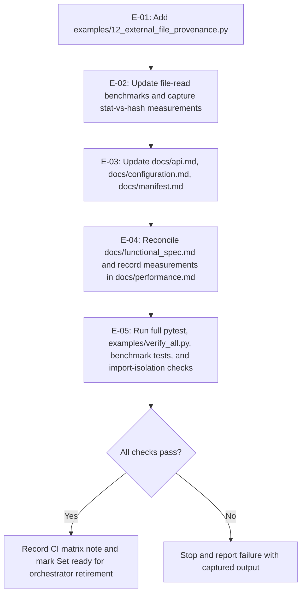

# IPD: External-file example, stat-vs-hash benchmarks, docs sync, and whole-Set verification

- Date: 2026-11-21
- Kind: child
- Concern: Dependency-free external-file example, reproducible stat-versus-hash latency and bytes-read benchmarks, documentation and specification reconciliation, and whole-Set validation
- Scope: Add `examples/12_external_file_provenance.py`, update `benchmarks/workloads/file_read.py` and `benchmarks/scenarios.py`, synchronize `docs/api.md`, `docs/configuration.md`, `docs/manifest.md`, `docs/functional_spec.md`, and `docs/performance.md`, and run whole-Set validation across the repository.
- Scope-Paths: examples/12_external_file_provenance.py, benchmarks/workloads/file_read.py, benchmarks/scenarios.py, docs/api.md, docs/configuration.md, docs/manifest.md, docs/functional_spec.md, docs/performance.md
- Item-Dependencies: executed:98j0a3, executed:hm32d9
- Status: to-review
- Short-Description: Add dependency-free example, stat-vs-hash latency/bytes benchmarks, doc reconciliation, and full suite validation
- Work-Kind: feature
- Priority: medium
- From-Backlog: x6alw4
- Set: file-prov
- Order: 5
- Highest E allocated: 05
- Author: agent
- Id: 4gpguy

> Write and proofread this plan per the technical writing standard, `.aw/system/workflows/technical-writing/technical-writing.md` (`.agents/workflows/technical-writing/technical-writing.md` in a legacy-layout install), including requirement 12 (diagrams).

## Workflow history

- 2026-11-21 to-review (agent): authored child plan 05 of Set `file-prov` graduating backlog item `x6alw4`.

## Goal

Deliver a runnable dependency-free example demonstrating external file registration around a library-style component, replace stale "patched `open()`" benchmark code with reproducible stat-only versus full-hashing measurements reporting close-time latency and extra bytes read, reconcile all affected documentation and specifications against implemented code, and complete whole-Set verification for backlog item `x6alw4`.

### Verification and documentation workflow

This diagram summarizes the sequence of example authoring, benchmarking, documentation reconciliation, and whole-Set validation performed in this plan. The text below is normative.

## Detailed Implementation Checklist (TODO)

Execution-state rule: mark an `E-*` item complete only after performing the action. That mark is not validation. Right-sizing rule: write for a modest executor that cannot hold much in its head. Each E-item is one step (one concern, about one file, executable in one focused pass) and its V-item names each unit it covers with its own check; a plan stays at about 5 E-items and 8 work Scope-Paths, else split it into more child plans (guidance, `IPD-Z603`). Accepted execution states: blocked, failed, pending, performed; terminal gate demands 'performed'.

### Task group 1: Dependency-free external file registration example

- [ ] E-01 Create `examples/12_external_file_provenance.py` demonstrating external input and output registration around an unmodified library-style component.
  - Depends on: none
  - Expected outcome: `examples/12_external_file_provenance.py` uses only the Python standard library (zero pandas/PyArrow dependency), defines a library-style CSV/binary processor that reads and writes files directly with unmodified `builtins.open()`, registers the external input (verified hash), an external reference file (caller-supplied asserted digest), and the external output (registered before creation or after creation) using `pubrun.register_input()` and `pubrun.register_output()`, asserts the resulting `manifest.json` distinguishes verified content from caller-asserted evidence, cleans up its temporary dataset files, and exits 0 both standalone and via `python examples/verify_all.py`.
  - Execution state: pending

### Task group 2: Stat-versus-hash benchmarks and empirical measurements

- [ ] E-02 Update `benchmarks/workloads/file_read.py` and `benchmarks/scenarios.py` to benchmark stat-only versus full hashing and capture close-time latency and extra bytes read.
  - Depends on: E-01
  - Expected outcome: `benchmarks/workloads/file_read.py` removes the stale "patched `open()`" assumption and supports environment-selected modes (`baseline` using `builtins.open`, `open-stat` using `pubrun.open` at `level="stat"`, `open-hash-stream` using `pubrun.open` at `level="hash"` sequential binary read, `open-hash-fallback` using `pubrun.open` at `level="hash"` with `seek()` forcing post-close reopen, `register-stat` and `register-hash` using `pubrun.register_input`) while reporting measured close/registration latency and manifest `hash_stats.extra_read_bytes` (plus `/proc/self/io` delta when on Linux). `benchmarks/scenarios.py` wires the updated scenarios cleanly so `pytest benchmarks/test_benchmarks.py -v` passes. Run repeated controlled measurements (at least 1 cold warmup pass + >= 2 warm passes with >= 10 repetitions per mode) capturing environment (OS, CPU, Python version, filesystem), git revision, workload byte size, baseline, repetitions, cold/warm separation, median, interquartile range (IQR) or standard deviation, 95th percentile (p95), close/registration latency, and additional bytes read.
  - Execution state: pending

### Task group 3: Documentation and specification reconciliation

- [ ] E-03 Update `docs/api.md`, `docs/configuration.md`, and `docs/manifest.md` to match the implemented file-provenance contract.
  - Depends on: E-02
  - Expected outcome: `docs/api.md` documents `pubrun.register_file()`, `pubrun.register_input()`, and `pubrun.register_output()`, clearly separates them from `pubrun.artifact()` (run-internal file writer) and `pubrun.open()` (per-file stream wrapper), updates the API Summary table, documents streaming-versus-fallback semantics for `pubrun.open()`, and documents file-change detection and race limits. `docs/configuration.md` documents `[capture.file_io]` keys `level`, `max_hash_bytes`, `max_total_hash_bytes`, `max_total_hash_seconds`, and `hash_algorithm`, and corrects the `fstat`/budget description. `docs/manifest.md` documents `data_files.inputs`, `data_files.outputs`, `data_files.mixed`, `data_files.hashing_summary`, and every new record field (`hash_status`, `evidence_source`, `evidence_strength`, `observation_time`, `digest`, `caller_digest`, `change_detected`, `access_observations`, `hash_stats`) plus documented race limits. All user-facing prose follows the repository dash rule (no em or en dashes).
  - Execution state: pending

- [ ] E-04 Reconcile `docs/functional_spec.md` and `docs/performance.md` against the current code and measured benchmark results.
  - Depends on: E-03
  - Expected outcome: `docs/functional_spec.md` section 14.1 adds `open`, `artifact`, `report`, `print`, `subprocess`, `popen`, `register_file`, `register_input`, and `register_output`, and section 14.3 retires the stale `register_artifact()` placeholder (noting it is superseded by `pubrun.artifact()` for run-internal files and `pubrun.register_output()`/`register_file()` for external files). `docs/performance.md` removes the stale "patched `open()`" description and records the measured stat-only versus full-hashing results (additional bytes read, close-time/registration latency, environment, git revision, workload size, baseline, repetitions, cold vs warm passes, and dispersion), making zero unmeasured speedup claims. All user-facing prose contains no em or en dashes.
  - Execution state: pending

### Task group 4: Whole-Set validation

- [ ] E-05 Execute full repository validation (`pytest tests/ -v`, `python examples/verify_all.py`, `pytest benchmarks/test_benchmarks.py -v`, and import-isolation checks) and record pre-release CI matrix scope.
  - Depends on: E-04
  - Expected outcome: Full `pytest tests/ -v`, `python examples/verify_all.py`, `pytest benchmarks/test_benchmarks.py -v`, and import-isolation verification (`import pubrun` neither patches `builtins.open` nor imports `pubrun.report.checks` or `pubrun.capture.file_io`) all exit 0 with actual output captured in `Observed evidence`, and the pre-release requirement to pass the repository's supported OS/Python CI matrix (`.github/workflows/ci.yml`: Linux, macOS, Windows across Python 3.8 through 3.14) is recorded honestly.
  - Execution state: pending

## Project conventions discovered (Step 0)

- `examples/verify_all.py` automatically discovers and executes every `examples/[0-9]*.py` script in sorted order; existing numbered examples go from `00_auto_start.py` through `11_cli_report.py`, so `examples/12_external_file_provenance.py` integrates automatically.
- `benchmarks/workloads/file_read.py` currently calls `builtins.open(path, "rb")` with a stale docstring claiming `pubrun` patches `open()` and hashes incrementally; `docs/performance.md` repeats the stale "patched `open()`" phrasing.
- `benchmarks/test_benchmarks.py` validates `benchmarks/scenarios.py` scenario definitions and harness invariants.
- `docs/functional_spec.md` section 14.3 still lists `register_artifact()` as unimplemented future work and omits `pubrun.open()`, `pubrun.artifact()`, and external file registration from section 14.1.
- Per `AGENTS.md`, user-facing documentation (`docs/*.md`) must contain no em dashes or en dashes.

## Findings

1. **Stale benchmark workload (`benchmarks/workloads/file_read.py`, `benchmarks/scenarios.py`, `docs/performance.md`)**: Calls builtin `open()` while claiming to measure patched-open hashing overhead, so it neither exercises `pubrun.open()` nor measures stat-versus-hash latency or additional bytes read.
2. **Stale specification (`docs/functional_spec.md`)**: Section 14.1 omits `open()`, `artifact()`, and the new registration APIs; section 14.3 lists `register_artifact()` as unimplemented.
3. **Missing dependency-free external-registration example**: `examples/07_file_capture.py` demonstrates only `sys.argv` heuristic discovery (`invocation.inputs`), not explicit registration of external library inputs and outputs into `data_files`.

## Proposed changes (ordered, validatable)

1. **`examples/12_external_file_provenance.py`** (new file):
   - Dependency-free Python script using `PUBRUN_AUTO_START="false"` and `with pubrun.tracked_run(...)` (matching `examples/07_file_capture.py`).
   - Implements a small helper class (`CsvTableLibrary`) that reads and writes CSV files directly using `builtins.open()` (simulating an external library whose I/O `pubrun` does not wrap).
   - Demonstrates:
     - `pubrun.register_input(raw_csv, label="raw_observations")` at `level="hash"` (independently verified content digest).
     - `pubrun.register_input(ref_csv, label="reference_lookup", digest=precomputed_sha, digest_algorithm="sha256")` (caller-supplied asserted digest; `evidence_source == "asserted"`, `sha256 is None`).
     - `pubrun.register_output(out_csv, label="aggregated_summary")` called before `CsvTableLibrary.write_summary(out_csv)` creates the file (pending output finalized automatically on `tracked_run` exit with verified SHA-256).
   - Loads the resulting `manifest.json`, asserts all three records have distinct honest `hash_status`, `evidence_source`, and `evidence_strength` values, cleans up temporary CSV files, and prints `[PASS] PASS: 12_external_file_provenance.py`.

2. **`benchmarks/workloads/file_read.py` and `benchmarks/scenarios.py`**:
   - Update `benchmarks/workloads/file_read.py` to support `PUBRUN_BENCH_FILE_MODE` (`baseline`, `open-stat`, `open-hash-stream`, `open-hash-fallback`, `register-stat`, `register-hash`) on an 8 MiB temporary file (configurable via `PUBRUN_BENCH_FILE_BYTES`), keeping default `baseline` / `open-stat` clean and fast, and adding an optional `--measure-detail` CLI mode that prints JSON metrics (`total_s`, `close_or_register_s`, `extra_read_bytes`, `hash_status`, `observation_time`, and Linux `/proc/self/io` `rchar`/`read_bytes` delta when available).
   - Update `benchmarks/scenarios.py` Group 3 (`hotpath`) to replace the stale `hotpath-open-pubrun` description/config with explicit scenarios:
     - `hotpath-open-baseline` (`baseline`, `file_read.py`, `PUBRUN_BENCH_FILE_MODE=baseline`)
     - `hotpath-open-stat` (`auto`, `file_read.py`, `level="stat"`, `PUBRUN_BENCH_FILE_MODE=open-stat`)
     - `hotpath-open-hash-stream` (`auto`, `file_read.py`, `level="hash"`, `PUBRUN_BENCH_FILE_MODE=open-hash-stream`)
     - `hotpath-open-hash-fallback` (`auto`, `file_read.py`, `level="hash"`, `PUBRUN_BENCH_FILE_MODE=open-hash-fallback`)
     - `hotpath-register-stat` (`auto`, `file_read.py`, `level="stat"`, `PUBRUN_BENCH_FILE_MODE=register-stat`)
     - `hotpath-register-hash` (`auto`, `file_read.py`, `level="hash"`, `PUBRUN_BENCH_FILE_MODE=register-hash`)
   - Execute controlled measurements (cold pass + warm passes, >= 10 repetitions) and verify `pytest benchmarks/test_benchmarks.py -v` stays green.

3. **`docs/api.md`, `docs/configuration.md`, `docs/manifest.md`, `docs/functional_spec.md`, `docs/performance.md`**:
   - Update all five docs cleanly with exact symbol names, config defaults, manifest field tables, race-limit disclosures, and measured benchmark tables (environment, git revision, workload size, baseline, repetitions, cold/warm separation, median, dispersion, close/registration latency, and additional bytes read).
   - Check every modified doc to confirm zero em dashes (`—`) or en dashes (`–`) in new or updated user-facing prose.

4. **Whole-Set validation**:
   - Run `pytest tests/ -v`, `python examples/verify_all.py`, `pytest benchmarks/test_benchmarks.py -v`, and fresh-subprocess import-isolation checks.

## Deferred / out of scope (with reason)

- Cross-machine aggregated benchmark publication into `benchmarks/data/accepted/`: requires multi-machine submissions outside this single worktree; local measured results with full environment disclosure are recorded in `docs/performance.md` and `Observed evidence` without claiming cross-machine representativeness.
- Multi-OS/multi-Python CI matrix execution (`.github/workflows/ci.yml`): cannot run inside this single Linux worktree; required before release on pull request or push.

## Scope check

- Over-scope: none. Touches only the new example, the file-read benchmark workload and scenario catalog, and the five affected documentation files.
- Under-scope: none. Completes all remaining acceptance criteria (dependency-free example, stat-vs-hash benchmark with extra bytes read and close-time latency, doc/spec reconciliation, and whole-Set verification) from `x6alw4`.

## Required tests / validation

- Run `python examples/12_external_file_provenance.py` and `python examples/verify_all.py`.
- Run `pytest benchmarks/test_benchmarks.py -v` and capture the stat-versus-hash benchmark run output (latency, extra bytes read, cold/warm passes, dispersion).
- Run `pytest tests/ -v` across the full test suite and paste actual runner output.
- Verify import isolation in a fresh Python subprocess (`builtins.open` unpatched; `pubrun.report.checks` and `pubrun.capture.file_io` not imported by bare `import pubrun`).

## Spec / documentation sync

- Synchronizes `docs/api.md`, `docs/configuration.md`, `docs/manifest.md`, `docs/functional_spec.md`, and `docs/performance.md` in `E-03` and `E-04`.

## Open questions

None.

## Validation and cross-check (verify before reporting done)

Validation-state rule: inspect evidence in a separate pass. Do not mark a `V-*` item complete from memory or from the matching execution checkmark. Accepted validation results: blocked, failed, pass, pending; terminal gate demands 'pass'. Runtime-demonstration reachability rule: for each `V-*` item demanding the software be observed acting (such as a run, a dispatch, or a transition)—as distinct from items demanding a diff, a file's content, or a test result, which are reachable by construction—name the code path that produces the observation or the sibling `E-*` that creates it, else the demand is UNDER-SCOPE.

- [ ] V-01 validates E-01
  - Required evidence: Paste actual command output of `python examples/12_external_file_provenance.py` (printing `[PASS] PASS: 12_external_file_provenance.py`, exit code 0) and `python examples/verify_all.py` (printing `[SUCCESS] All examples passed.`, exit code 0).
  - Observed evidence:
  - Result: pending

- [ ] V-02 validates E-02
  - Required evidence: Paste `pytest benchmarks/test_benchmarks.py -v` output (exit code 0) plus actual output of the controlled stat-versus-hash benchmark run showing environment, git revision, workload size, baseline, repetitions, cold vs warm passes, median, dispersion (IQR/stdev and p95), close/registration latency, and additional bytes read (`extra_read_bytes`).
  - Observed evidence:
  - Result: pending

- [ ] V-03 validates E-03
  - Required evidence: Paste `git diff --stat -- docs/api.md docs/configuration.md docs/manifest.md` and command output confirming updated sections cover `register_file`/`register_input`/`register_output`, `pubrun.artifact()` boundary, `[capture.file_io]` budgets, `data_files.mixed`/`hashing_summary`, race limits, and contain no newly added em or en dashes.
  - Observed evidence:
  - Result: pending

- [ ] V-04 validates E-04
  - Required evidence: Paste `git diff --stat -- docs/functional_spec.md docs/performance.md` and command output confirming `register_artifact()` placeholder is reconciled in `docs/functional_spec.md`, measured benchmark results (with environment/revision/dispersion) are recorded in `docs/performance.md`, and no newly added em or en dashes appear.
  - Observed evidence:
  - Result: pending

- [ ] V-05 validates E-05
  - Required evidence: Paste full `pytest tests/ -v` summary and exit code (0), `python examples/verify_all.py` exit code (0), `pytest benchmarks/test_benchmarks.py -v` exit code (0), and subprocess output of `python -c "import builtins, sys; orig = builtins.open; import pubrun; assert builtins.open is orig; assert 'pubrun.report.checks' not in sys.modules and 'pubrun.capture.file_io' not in sys.modules; pubrun.stop(); print('WHOLE_SET_ISOLATED')"` printing `WHOLE_SET_ISOLATED` with exit code 0, plus explicit note of the pre-release `.github/workflows/ci.yml` OS/Python matrix gate.
  - Observed evidence:
  - Result: pending

## Approval and execution gate

- Size assessment: standard
- Cohesion rationale: not required

Execution requires explicit human approval (`- Status: approved`). Commit only the scoped files through `aw commit 4gpguy -- <paths>`, paste actual runner output into `Observed evidence`, and run the post-gate `aw ipd` lifecycle transition to `.aw/records/plans/executed/`.
