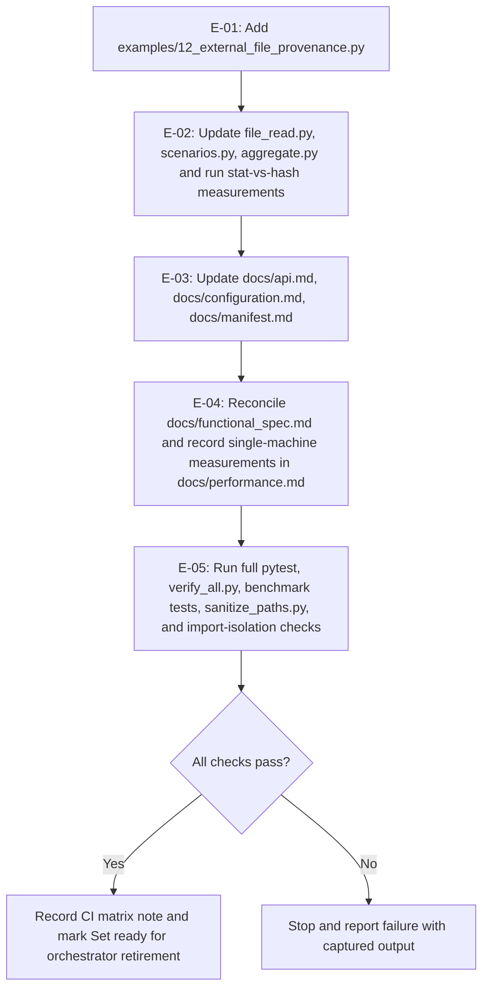

# IPD: External-file example, stat-vs-hash benchmarks, docs sync, and whole-Set verification

- Date: 2026-11-21
- Kind: child
- Concern: Dependency-free external-file example, reproducible stat-versus-hash latency and bytes-read benchmarks, documentation and specification reconciliation, and whole-Set validation
- Scope: Add `examples/12_external_file_provenance.py`, update `benchmarks/workloads/file_read.py`, `benchmarks/scenarios.py`, and `benchmarks/aggregate.py`, synchronize `docs/api.md`, `docs/configuration.md`, `docs/manifest.md`, `docs/functional_spec.md`, and `docs/performance.md`, and run whole-Set validation across the repository.
- Scope-Paths: examples/12_external_file_provenance.py, benchmarks/workloads/file_read.py, benchmarks/scenarios.py, benchmarks/aggregate.py, docs/api.md, docs/configuration.md, docs/manifest.md, docs/functional_spec.md, docs/performance.md
- Item-Dependencies: executed:98j0a3, executed:hm32d9
- Status: approved
- Readiness: go-pending-approval
- Review-Depth: complex
- Short-Description: Add dependency-free example, stat-vs-hash latency/bytes benchmarks, doc reconciliation, and full suite validation
- Work-Kind: feature
- Priority: medium
- From-Backlog: x6alw4
- Set: file-prov
- Order: 5
- Highest E allocated: 05
- Author: agent
- Id: 4gpguy
- Approval: 2026-11-22, recorded via aw ipd set: status set to approved

> Write and proofread this plan per the technical writing standard, `.aw/system/workflows/technical-writing/technical-writing.md` (`.agents/workflows/technical-writing/technical-writing.md` in a legacy-layout install), including requirement 12 (diagrams).

## Workflow history

- 2026-11-22 approved (aw set): status set to approved
- 2026-11-22 /plan-review (Gemini 4 Neon (High)): APPROVE WITH REVISIONS APPLIED; PR-001, PR-002, PR-003, PR-004, PR-005, PR-006
- 2026-11-21 to-review (agent): authored child plan 05 of Set `file-prov` graduating backlog item `x6alw4`.

## Goal

Deliver a runnable, dependency-free example demonstrating external file registration around an unmodified library-style component. Replace stale "patched `open()`" benchmark code and baseline pairings with reproducible stat-only versus full-hashing measurements reporting close-time or registration latency and additional bytes read. Reconcile all affected user documentation and specifications against implemented code while preserving concurrent sibling-Set additions and the multi-machine placeholder table in `docs/performance.md`, then complete whole-Set verification for backlog item `x6alw4`.

### Verification and documentation workflow

This diagram summarizes the sequence of example authoring, benchmarking, documentation reconciliation, and whole-Set validation performed in this plan. The text below is normative.



## Detailed Implementation Checklist (TODO)

Execution-state rule: mark an `E-*` item complete only after performing the action. That mark is not validation. Right-sizing rule: write for a modest executor that cannot hold much in its head. Each E-item is one step (one concern, about one file, executable in one focused pass) and its V-item names each unit it covers with its own check; a plan stays at about 5 E-items and 8 work Scope-Paths, else split it into more child plans (guidance, `IPD-Z603`). Accepted execution states: blocked, failed, pending, performed; terminal gate demands 'performed'.

### Task group 1: Dependency-free external file registration example

- [ ] E-01 Create `examples/12_external_file_provenance.py` demonstrating external input and output registration around an unmodified library-style component.
  - Depends on: none
  - Expected outcome: `examples/12_external_file_provenance.py` uses only the Python standard library (zero pandas or PyArrow dependency) and defines a library-style Comma-Separated Values (CSV) processor reading and writing files with unmodified `builtins.open()`. It registers an external input (verified hash), an external reference file (caller-supplied asserted digest), and an external output (registered before creation) using `pubrun.register_input()` and `pubrun.register_output()`. It asserts that `manifest.json` distinguishes verified content from caller-asserted evidence, cleans up its temporary dataset files, and exits 0 both standalone and via `python3 examples/verify_all.py`.
  - Execution state: pending

### Task group 2: Stat-versus-hash benchmarks and empirical measurements

- [ ] E-02 Update `benchmarks/workloads/file_read.py`, `benchmarks/scenarios.py`, and `benchmarks/aggregate.py` to benchmark stat-only versus full hashing and capture close-time latency and extra bytes read.
  - Depends on: E-01
  - Expected outcome: `benchmarks/workloads/file_read.py` removes the stale "patched `open()`" assumption, imports `pubrun` lazily only when `PUBRUN_BENCH_FILE_MODE != "baseline"` (keeping `hotpath-open-baseline` completely free of `pubrun` imports), supports modes `baseline`, `open-stat`, `open-hash-stream`, `open-hash-fallback`, `register-stat`, and `register-hash`, and provides a standalone `--measure-detail` command-line interface (CLI) mode printing JavaScript Object Notation (JSON) metrics (`total_s`, `close_or_register_s`, `extra_read_bytes`, `hash_status`, `observation_time`, and Linux `/proc/self/io` deltas when available) while cleaning up its temporary run and dataset files. `benchmarks/scenarios.py` replaces `hotpath-open-pubrun` with the explicit `_off_plus({"capture": {"file_io": {"level": ...}}})` scenarios, and `benchmarks/aggregate.py::_HOTPATH_BASELINE` pairs all five new scenarios to `hotpath-open-baseline` while keeping legacy `"hotpath-open-pubrun"` for older committed results. `pytest benchmarks/test_benchmarks.py benchmarks/test_share_safety.py -o addopts="" -v` exits 0. Local non-publishing measurements (at least 1 cold warmup pass plus >= 2 warm passes with >= 10 repetitions per mode; zero `--contribute`, GitHub Gist, or High-Performance Computing (HPC) scheduler runs, and zero leftover files in `benchmarks/results/`) capture environment (Operating System (OS), Central Processing Unit (CPU), Python version, filesystem type without local hostnames or home paths), Git revision, workload byte size, baseline, repetitions, cold versus warm separation, median, interquartile range (IQR) or standard deviation, 95th percentile (p95), close/registration latency, and `extra_read_bytes`.
  - Execution state: pending

### Task group 3: Documentation and specification reconciliation

- [ ] E-03 Update `docs/api.md`, `docs/configuration.md`, and `docs/manifest.md` to match the implemented file-provenance contract.
  - Depends on: E-02
  - Expected outcome: `docs/api.md` documents `pubrun.register_file()`, `pubrun.register_input()`, and `pubrun.register_output()`, clearly separates them from `pubrun.artifact()` (run-internal file writer) and `pubrun.open()` (per-file stream wrapper), updates the API Summary table, documents streaming-versus-fallback semantics for `pubrun.open()`, and documents file-change detection and race limits. `docs/configuration.md` documents `[capture.file_io]` keys `level`, `max_hash_bytes`, `max_total_hash_bytes`, `max_total_hash_seconds`, and `hash_algorithm`, and corrects the open-file-descriptor `fstat` and budget description. `docs/manifest.md` documents `data_files.inputs`, `data_files.outputs`, `data_files.mixed`, `data_files.hashing_summary`, and every `$defs.file_provenance_record` field (`role`, `label`, `open_disposition`, `registration_source`, `entry_type`, `hash_status`, `hash_status_detail`, `hash_algorithm`, `evidence_source`, `evidence_strength`, `observation_time`, `digest`, `caller_digest`, `change_detected`, `change_details`, `access_observations`, `hash_stats`, `registration_count`, `registered_before_creation`, `metadata`) plus documented race limits. All edits preserve concurrent sibling-Set additions already on disk and introduce zero em dashes (`U+2014`) or en dashes (`U+2013`) in added or modified lines.
  - Execution state: pending

- [ ] E-04 Reconcile `docs/functional_spec.md` and `docs/performance.md` against the current code and measured benchmark results.
  - Depends on: E-03
  - Expected outcome: `docs/functional_spec.md` section 14.1 adds `open`, `artifact`, `report`, `print`, `subprocess`, `popen`, `register_file`, `register_input`, and `register_output`, and section 14.3 retires the stale `register_artifact()` placeholder (noting it is superseded by `pubrun.artifact()` for run-internal files and `pubrun.register_output()`/`register_file()` for external files). `docs/performance.md` replaces the stale "patched `open()`" descriptions in `## How overhead is measured` and `## Representative results`, preserves `## Representative results` intact as a multi-machine `_TBD_` placeholder, preserves any sibling-Set measurement subsections already on disk, and adds a clearly labeled single-machine subsection recording the measured stat-only versus full-hashing results (additional bytes read, close-time/registration latency, environment without personal paths or hostnames, Git revision, workload size, baseline, repetitions, cold versus warm passes, and dispersion) with zero unmeasured speedup claims. Added or modified lines in both files introduce zero em dashes (`U+2014`) or en dashes (`U+2013`).
  - Execution state: pending

### Task group 4: Whole-Set validation

- [ ] E-05 Execute full repository validation (`pytest tests/ -v`, `python3 examples/verify_all.py`, `pytest benchmarks/test_benchmarks.py benchmarks/test_share_safety.py -o addopts="" -v`, `python3 scripts/sanitize_paths.py --check --all`, `git status --short`, and import-isolation checks) and record the pre-release Continuous Integration (CI) matrix scope.
  - Depends on: E-04
  - Expected outcome: Full `pytest tests/ -v`, `python3 examples/verify_all.py`, `pytest benchmarks/test_benchmarks.py benchmarks/test_share_safety.py -o addopts="" -v`, `python3 scripts/sanitize_paths.py --check --all`, and fresh-subprocess import-isolation verification (`import pubrun` neither patches `builtins.open` nor imports `pubrun.report.checks` or `pubrun.capture.file_io`) all exit 0 with actual output captured in `Observed evidence`. `git status --short` shows only declared Scope-Paths (zero stray benchmark results or temporary files), and the pre-release requirement to pass the repository's supported OS/Python CI matrix (`.github/workflows/ci.yml`: Linux, macOS, Windows across Python 3.8 through 3.14) is recorded honestly.
  - Execution state: pending

## Project conventions discovered (Step 0)

- `examples/verify_all.py` automatically discovers and executes every `examples/[0-9]*.py` script in sorted order; existing numbered examples go from `00_auto_start.py` through `11_cli_report.py`, so `examples/12_external_file_provenance.py` integrates automatically.
- `benchmarks/workloads/file_read.py` currently calls `builtins.open(path, "rb")` with a stale docstring claiming `pubrun` patches `open()` and hashes incrementally; `docs/performance.md` repeats the stale "patched `open()`" phrasing on lines 23 and 71, while `docs/performance.md#Representative results` explicitly prohibits overwriting its multi-machine `_TBD_` placeholder with single-machine numbers.
- `benchmarks/harness.py::_build_child_command` passes `Scenario.env` into child processes and runs `baseline` scenarios without importing `pubrun`, while running `auto` scenarios by importing `pubrun` first and executing the workload via `runpy.run_path` with `.pubrun.toml` generated from `Scenario.config`.
- `benchmarks/aggregate.py::_HOTPATH_BASELINE` maps hotpath scenario names explicitly to their baseline (`"hotpath-open-pubrun": "hotpath-open-baseline"`). New `hotpath-*` scenarios must be registered there (keeping `"hotpath-open-pubrun"` for older committed `/5` JSON files in `benchmarks/data/accepted/`) so `aggregate.py` computes `overhead_ms` and `overhead_pct`.
- `pyproject.toml` sets `addopts = "--cov=src --cov-report=term-missing --cov-report=xml -p no:randomly"`, so `benchmarks/test_benchmarks.py` and `benchmarks/test_share_safety.py` must be invoked with `-o addopts=""` as documented in `benchmarks/test_benchmarks.py`.
- `docs/functional_spec.md` section 14.3 still lists `register_artifact()` as unimplemented future work and section 14.1 omits `open`, `artifact`, `report`, `print`, `subprocess`, `popen`, and external file registration.
- Concurrent reviewed sibling plans (`ckc3vl` in Set `startup-perf`, `3tvesf` in Set `timing-acc`, `zp2yyu` in Set `cap-isolation`, `iflqsl` in Set `dep-capture`, `sdg31l` in Set `repro-check`) also edit subsets of `docs/api.md`, `docs/configuration.md`, `docs/manifest.md`, `docs/functional_spec.md`, and `docs/performance.md`. Edits here must be additive/targeted and preserve sibling-Set additions.
- Per `AGENTS.md`, newly authored or edited lines in user-facing documentation (`docs/*.md`) must contain zero em dashes (`U+2014`) or en dashes (`U+2013`), and `scripts/sanitize_paths.py --check --all` verifies zero local paths or hostnames leak into tracked files.

## Findings

1. **Stale benchmark workload and hotpath aggregation (`benchmarks/workloads/file_read.py`, `benchmarks/scenarios.py`, `benchmarks/aggregate.py`, `docs/performance.md`)**: Calls builtin `open()` while claiming to measure patched-open hashing overhead, so it neither exercises `pubrun.open()` nor measures stat-versus-hash latency or additional bytes read; adding new hotpath scenarios also requires pairing them in `benchmarks/aggregate.py::_HOTPATH_BASELINE`.
2. **Stale specification (`docs/functional_spec.md`)**: Section 14.1 omits `open()`, `artifact()`, `report()`, `print()`, `subprocess`, `popen()`, and the new registration application programming interfaces (APIs); section 14.3 still lists `register_artifact()` as unimplemented.
3. **Missing dependency-free external-registration example**: `examples/07_file_capture.py` demonstrates only `sys.argv` heuristic discovery (`invocation.inputs`), not explicit registration of external library inputs and outputs into `data_files`.

## Proposed changes (ordered, validatable)

1. **`examples/12_external_file_provenance.py`** (new file):
   - Dependency-free Python script using `PUBRUN_AUTO_START="false"` and `with pubrun.tracked_run(...)` (matching `examples/07_file_capture.py`).
   - Implements a small helper class (`CsvTableLibrary`) that reads and writes CSV files directly using `builtins.open()` (simulating an external library whose input/output (I/O) `pubrun` does not wrap).
   - Demonstrates:
     - `pubrun.register_input(raw_csv, label="raw_observations")` at `level="hash"` (independently verified content digest).
     - `pubrun.register_input(ref_csv, label="reference_lookup", digest=precomputed_sha, digest_algorithm="sha256")` (caller-supplied asserted digest; `evidence_source == "asserted"`, `sha256 is None`).
     - `pubrun.register_output(out_csv, label="aggregated_summary")` called before `CsvTableLibrary.write_summary(out_csv)` creates the file (pending output finalized automatically on `tracked_run` exit with verified Secure Hash Algorithm 256-bit (SHA-256) digest).
   - Loads the resulting `manifest.json`, asserts all three records have distinct honest `hash_status`, `evidence_source`, and `evidence_strength` values, cleans up temporary CSV files, and prints `[PASS] PASS: 12_external_file_provenance.py`.

2. **`benchmarks/workloads/file_read.py`, `benchmarks/scenarios.py`, and `benchmarks/aggregate.py`**:
   - Update `benchmarks/workloads/file_read.py` to support `PUBRUN_BENCH_FILE_MODE` (`baseline` default, `open-stat`, `open-hash-stream`, `open-hash-fallback`, `register-stat`, `register-hash`) on an 8 MiB temporary file (configurable via `PUBRUN_BENCH_FILE_BYTES`). Import `pubrun` lazily ONLY when `mode != "baseline"` so `hotpath-open-baseline` never imports `pubrun`. Add an optional `--measure-detail` CLI mode that runs inside a cleaned-up temporary `pubrun.tracked_run(...)` (with matching `[capture.file_io].level`), reads the finalized `manifest.json`, and prints JSON metrics (`total_s`, `close_or_register_s`, `extra_read_bytes`, `hash_status`, `observation_time`, and Linux `/proc/self/io` `rchar`/`read_bytes` delta when available).
   - Update `benchmarks/scenarios.py` Group 3 (`hotpath`) to replace the stale `hotpath-open-pubrun` scenario with explicit scenarios using `_off_plus({"capture": {"file_io": {"level": ...}}})`:
     - `hotpath-open-baseline` (`baseline`, `file_read.py`, `env={"PUBRUN_BENCH_FILE_MODE": "baseline"}`)
     - `hotpath-open-stat` (`auto`, `file_read.py`, `config=_off_plus({"capture": {"file_io": {"level": "stat"}}})`, `env={"PUBRUN_BENCH_FILE_MODE": "open-stat"}`)
     - `hotpath-open-hash-stream` (`auto`, `file_read.py`, `config=_off_plus({"capture": {"file_io": {"level": "hash"}}})`, `env={"PUBRUN_BENCH_FILE_MODE": "open-hash-stream"}`)
     - `hotpath-open-hash-fallback` (`auto`, `file_read.py`, `config=_off_plus({"capture": {"file_io": {"level": "hash"}}})`, `env={"PUBRUN_BENCH_FILE_MODE": "open-hash-fallback"}`)
     - `hotpath-register-stat` (`auto`, `file_read.py`, `config=_off_plus({"capture": {"file_io": {"level": "stat"}}})`, `env={"PUBRUN_BENCH_FILE_MODE": "register-stat"}`)
     - `hotpath-register-hash` (`auto`, `file_read.py`, `config=_off_plus({"capture": {"file_io": {"level": "hash"}}})`, `env={"PUBRUN_BENCH_FILE_MODE": "register-hash"}`)
   - Update `benchmarks/aggregate.py::_HOTPATH_BASELINE` to pair all five new scenarios (`hotpath-open-stat`, `hotpath-open-hash-stream`, `hotpath-open-hash-fallback`, `hotpath-register-stat`, `hotpath-register-hash`) to `"hotpath-open-baseline"` while keeping `"hotpath-open-pubrun": "hotpath-open-baseline"` so older committed `/5` JSON files in `benchmarks/data/accepted/` continue aggregating cleanly.
   - Execute controlled local non-publishing measurements (1 cold warmup pass + >= 2 warm passes, >= 10 repetitions per mode; pass `--redacted-out /tmp/pubrun-file-prov-bench.redacted.json` if invoking `benchmarks/harness.py` and delete it afterward so zero files are written to `benchmarks/results/`) and verify `pytest benchmarks/test_benchmarks.py benchmarks/test_share_safety.py -o addopts="" -v` stays green.

3. **`docs/api.md`, `docs/configuration.md`, `docs/manifest.md`, `docs/functional_spec.md`, `docs/performance.md`**:
   - Update all five docs additively with exact symbol names, config defaults, manifest field tables matching `$defs.file_provenance_record` from `xxi3nc` and `52dl55`, race-limit disclosures, and a dedicated single-machine stat-versus-hash measurement subsection in `docs/performance.md` (recording OS, CPU, Python version, detected filesystem type via `src/pubrun/capture/filesystem.py::get_filesystem` with zero local hostnames or home paths, Git revision, workload size, baseline, repetitions, cold/warm separation, median, dispersion, close/registration latency, and `extra_read_bytes`, while leaving `## Representative results` as a `_TBD_` placeholder and preserving any sibling-Set doc additions).
   - Check added (`+`) lines of `git diff -U0 -- docs/api.md docs/configuration.md docs/manifest.md docs/functional_spec.md docs/performance.md` with Python to confirm zero em dashes (`U+2014`) or en dashes (`U+2013`).

4. **Whole-Set validation**:
   - Run `pytest tests/ -v`, `python3 examples/verify_all.py`, `pytest benchmarks/test_benchmarks.py benchmarks/test_share_safety.py -o addopts="" -v`, `python3 scripts/sanitize_paths.py --check --all`, `git status --short`, and fresh-subprocess import-isolation checks.

## Deferred / out of scope (with reason)

- Cross-machine aggregated benchmark publication into `benchmarks/data/accepted/`: requires multi-machine submissions outside this single worktree; local measured results with full environment disclosure are recorded in a single-machine subsection of `docs/performance.md` and `Observed evidence` without claiming cross-machine representativeness or invoking `--contribute` / GitHub Gists / HPC scheduler scripts.
  - Carrier-Declined: prohibited without explicit maintainer authorization and multi-machine collection outside this single worktree.
- Multi-OS and multi-Python CI matrix execution (`.github/workflows/ci.yml`): cannot run inside this single Linux worktree; required before release on pull request or push.
  - Carrier-Declined: executed automatically by GitHub Actions CI (.github/workflows/ci.yml) on pull request or push; unavailable in a single local Linux worktree.

## Scope check

- Over-scope: none. Touches only the new example, the file-read benchmark workload, scenario catalog, and hotpath aggregator pairing, and the five affected documentation files (9 Scope-Paths, 5 E-items, zero `src/pubrun/` application edits).
- Under-scope: none. Completes all remaining acceptance criteria (dependency-free example, stat-vs-hash benchmark with extra bytes read and close-time latency, doc/spec reconciliation, path sanitization, and whole-Set verification) from `x6alw4`.

## Required tests / validation

Run inside the repository root and capture actual runner output and exit codes:

```bash
python3 examples/12_external_file_provenance.py
python3 examples/verify_all.py
pytest benchmarks/test_benchmarks.py benchmarks/test_share_safety.py -o addopts="" -v
pytest tests/ -v
python3 scripts/sanitize_paths.py --check --all
git status --short
```

Also capture the controlled stat-versus-hash benchmark output (close/registration latency, `extra_read_bytes`, environment without local hostnames/paths, Git revision, repetitions, cold/warm passes, and dispersion), verify zero `U+2014`/`U+2013` characters in added (`+`) lines of `git diff -U0 -- docs/api.md docs/configuration.md docs/manifest.md docs/functional_spec.md docs/performance.md`, and run the fresh-subprocess import-isolation check.

## Spec / documentation sync

- Synchronizes `docs/api.md`, `docs/configuration.md`, `docs/manifest.md`, `docs/functional_spec.md`, and `docs/performance.md` in `E-03` and `E-04`.

## Open questions

None. (Public API names, `[capture.file_io]` config keys, and manifest field names were approved by the maintainer on 2026-11-21 in Set orchestrator `vtkkn1` `OQ-01` and `OQ-02`.)

## Validation and cross-check (verify before reporting done)

Validation-state rule: inspect evidence in a separate pass. Do not mark a `V-*` item complete from memory or from the matching execution checkmark. Accepted validation results: blocked, failed, pass, pending; terminal gate demands 'pass'. Runtime-demonstration reachability rule: for each `V-*` item demanding the software be observed acting (such as a run, a dispatch, or a transition) (as distinct from items demanding a diff, a file's content, or a test result, which are reachable by construction), name the code path that produces the observation or the sibling `E-*` that creates it, else the demand is UNDER-SCOPE.

- [ ] V-01 validates E-01
  - Required evidence: Paste actual command output of `python3 examples/12_external_file_provenance.py` (printing `[PASS] PASS: 12_external_file_provenance.py`, exit code 0) and `python3 examples/verify_all.py` (printing `[SUCCESS] All examples passed.`, exit code 0).
  - Observed evidence:
  - Result: pending

- [ ] V-02 validates E-02
  - Required evidence: Paste `git diff --stat -- benchmarks/workloads/file_read.py benchmarks/scenarios.py benchmarks/aggregate.py` (confirming lazy `pubrun` import in `file_read.py`, updated hotpath scenarios, and `_HOTPATH_BASELINE` pairings preserving legacy `hotpath-open-pubrun`), `pytest benchmarks/test_benchmarks.py benchmarks/test_share_safety.py -o addopts="" -v` output (exit code 0), plus actual output of the controlled stat-versus-hash benchmark run showing environment (without personal paths or hostnames), Git revision, workload size, baseline, repetitions, cold versus warm passes, median, dispersion (IQR/stdev and p95), close/registration latency, and additional bytes read (`extra_read_bytes`), and confirmation that zero temporary files remain in `benchmarks/results/`.
  - Observed evidence:
  - Result: pending

- [ ] V-03 validates E-03
  - Required evidence: Paste `git diff --stat -- docs/api.md docs/configuration.md docs/manifest.md` and key diff excerpts confirming updated sections cover `register_file`/`register_input`/`register_output`, `pubrun.artifact()` boundary, `[capture.file_io]` budgets, `data_files.mixed`/`hashing_summary` and `$defs.file_provenance_record` fields, and race limits, plus output of a Python check over added (`+`) lines of `git diff -U0 -- docs/api.md docs/configuration.md docs/manifest.md` reporting zero `U+2014` or `U+2013` characters.
  - Observed evidence:
  - Result: pending

- [ ] V-04 validates E-04
  - Required evidence: Paste `git diff --stat -- docs/functional_spec.md docs/performance.md` and key diff excerpts confirming `docs/functional_spec.md` section 14.1/14.3 reconciliation, intact `## Representative results` `_TBD_` placeholder and single-machine stat-versus-hash measurement subsection (with environment, Git revision, dispersion, latency, and `extra_read_bytes`, zero local hostnames/paths) in `docs/performance.md`, plus output of a Python check over added (`+`) lines of `git diff -U0 -- docs/functional_spec.md docs/performance.md` reporting zero `U+2014` or `U+2013` characters.
  - Observed evidence:
  - Result: pending

- [ ] V-05 validates E-05
  - Required evidence: Paste full `pytest tests/ -v` summary and exit code (0), `python3 examples/verify_all.py` exit code (0), `pytest benchmarks/test_benchmarks.py benchmarks/test_share_safety.py -o addopts="" -v` exit code (0), `python3 scripts/sanitize_paths.py --check --all` exit code (0), `git status --short` (only declared Scope-Paths, zero stray files), and subprocess output of `python3 -c "import builtins, sys; orig = builtins.open; import pubrun; assert builtins.open is orig; assert 'pubrun.report.checks' not in sys.modules and 'pubrun.capture.file_io' not in sys.modules; pubrun.stop(); print('WHOLE_SET_ISOLATED')"` printing `WHOLE_SET_ISOLATED` with exit code 0, plus explicit note of the pre-release `.github/workflows/ci.yml` OS/Python matrix gate.
  - Observed evidence:
  - Result: pending

## Approval and execution gate

- Size assessment: standard
- Cohesion rationale: not required

Execution contract:
1. Open questions: none (`vtkkn1` `OQ-01` and `OQ-02` resolved by the maintainer on 2026-11-21); do not execute until prerequisites `98j0a3` (import-mode API parity for file registration) and `hm32d9` (report, inspect, and methods file-provenance evidence distinction) are `executed` and a human approves this plan (`- Status: approved`).
2. Scope declaration: expected created or modified files are `- Scope-Paths:` (`examples/12_external_file_provenance.py`, `benchmarks/workloads/file_read.py`, `benchmarks/scenarios.py`, `benchmarks/aggregate.py`, `docs/api.md`, `docs/configuration.md`, `docs/manifest.md`, `docs/functional_spec.md`, `docs/performance.md`). If execution genuinely requires editing an out-of-scope file or leaving a declared file unmodified, justify it via `--scope-reason` or `--scope-ack` at finalization. Stop only for genuinely unsafe conditions (such as an unresolvable concurrent-edit conflict, missing prerequisite symbols, or a whole-Set test regression).
3. Honesty rule (HARD MUST): paste actual `pytest`, `examples/verify_all.py`, `scripts/sanitize_paths.py`, benchmark, subprocess, and `git diff` runner outputs and exit codes into each `V-*` `Observed evidence:` field; never claim tests or measurements passed without running them.
4. Commit and push discipline: commit only the files changed for this plan using `aw commit 4gpguy -- <paths>`; never use `git add -A`, `git add .`, or `git commit -a`; never push or publish benchmark results without explicit human instruction.
5. Lifecycle transition on completion: this plan must reach `.aw/records/plans/executed/` with `- Status: executed` through `aw ipd finalize` once all `E-*` items are `performed` and all `V-*` items are `pass`. In a runner-managed lane, leave lifecycle finalization to the runner's post-turn finalize step; in standalone execution, run `aw ipd lint --phase pre-transition` and finalize directly through `aw ipd finalize 4gpguy`. Never hand-roll a raw `git mv` to `.aw/records/plans/executed/`.
