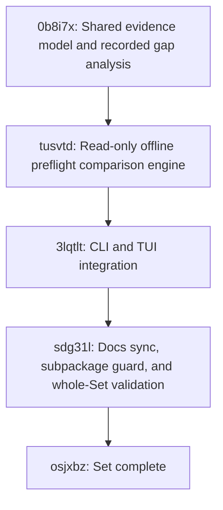

# IPD: Reproducibility gap assessment and rerun preflight

- Date: 2026-11-21
- Kind: orchestrator
- Concern: Reproducibility evidence assessment, parent hydration transparency, and read-only offline rerun preflight comparison
- Scope: Orchestrate four child plans implementing a shared reproducibility evidence model, read-only offline preflight comparison, CLI and TUI integration with strict exit options, and documentation plus whole-Set validation for backlog item `q3bll1`.
- Scope-Paths: src/pubrun/report/utils.py, src/pubrun/report/reproducibility.py, src/pubrun/report/checks.py, src/pubrun/capture/packages.py, src/pubrun/__main__.py, src/pubrun/report/diagnostics.py, src/pubrun/tui/widgets/details.py, src/pubrun/tui/widgets/actions.py, docs/cli.md, docs/hpc.md, docs/manifest.md, docs/api.md, tests/test_reproducibility_assessment.py, tests/test_reproducibility_preflight.py, tests/test_checks_commands.py, tests/test_cli.py, tests/test_tui.py, tests/test_report_subpackage_integrity.py, tests/test_reproducibility_e2e.py
- Item-Dependencies: executed:0b8i7x, executed:tusvtd, executed:3lqtlt, executed:sdg31l
- Status: reviewed
- Readiness: go-pending-approval
- Review-Depth: orchestrator
- Coverage: pass
- Coverage-Fingerprint: 8696997d119f2c1f5663918c5b567e5e0f0111c1f426fa3f3ca925a690c39967
- Coverage-Checked: 2026-11-22 by uri/its_direct/pt3-claude-opus-5.5-1m-us
- Work-Kind: feature
- Priority: medium
- From-Backlog: q3bll1
- Set: repro-check
- Order: 0
- Highest E allocated: 04
- Author: agent
- Id: osjxbz
- Short-Description: Orchestrate shared reproducibility assessment, offline preflight comparison, CLI/TUI integration, and documentation sync

> Write and proofread this plan per the technical writing standard, `.aw/system/workflows/technical-writing/technical-writing.md` (`.agents/workflows/technical-writing/technical-writing.md` in a legacy-layout install), including requirement 12 (diagrams).

## Workflow history

- 2026-11-22 /plan-review (Gemini 4 Neon (High)): APPROVE WITH REVISIONS APPLIED; PR-001, PR-002, PR-003, PR-004
- 2026-11-22 coverage pass (aw oc run): fingerprint 8696997d119f, model uri/its_direct/pt3-claude-opus-5.5-1m-us
- 2026-11-22 coverage pass (aw oc run): fingerprint 08fbb549a367, model uri/its_direct/pt3-claude-opus-5.5-1m-us
- 2026-11-22 coverage pass (aw oc run): fingerprint 5953754ea333, model uri/its_direct/pt3-claude-opus-5.5-1m-us
- 2026-11-21 to-review (agent): created orchestrator plan for Set `repro-check` graduating backlog item `q3bll1`.

## Goal

Deliver graduated backlog item `q3bll1` (`.aw/records/backlog/graduated/20261121-pubrun-improve-01-q3bll1-repro-preflight.backlog.md`) through four ordered, independently verifiable child plans. Together, the four child plans add a shared reproducibility gap assessment and an explicitly invoked, read-only, offline preflight check across the command-line interface (CLI), terminal user interface (TUI), and machine-readable JavaScript Object Notation (JSON) output. All four child plans preserve one-import adoption (`import pubrun` must not import report or preflight modules), the lightweight Python standard-library runtime (Python 3.8 or newer), redaction, offline operation, and backwards-compatible `pubrun rerun` piping.

### Plan Set dependency flow

This diagram summarizes the execution order of the four child plans. The text and table below are normative.

## Detailed Implementation Checklist (TODO)

Execution-state rule: mark an `E-*` item complete only after performing the action. That mark is not validation. Right-sizing rule: write for a modest executor that cannot hold much in its head. Each E-item is one step (one concern, about one file, executable in one focused pass) and its V-item names each unit it covers with its own check; a plan stays at about 5 E-items and 8 work Scope-Paths, else split it into more child plans (guidance, `IPD-Z603`). Accepted execution states: blocked, failed, pending, performed; terminal gate demands 'performed'.

### Task group 1: Confirm child IPD execution

- [ ] E-01 CONFIRM 0b8i7x REACHED executed
  - Depends on: none
  - Expected outcome: Child plan `0b8i7x` (`20261121-repro-check-01-0b8i7x-shared-reproducibility-evidence-model-and-recorded-gap-analy.ipd.md`) is in `.aw/records/plans/executed/` with `- Status: executed` and all validation items passing.
  - Execution state: pending

- [ ] E-02 CONFIRM tusvtd REACHED executed
  - Depends on: E-01
  - Expected outcome: Child plan `tusvtd` (`20261121-repro-check-02-tusvtd-read-only-offline-rerun-preflight-comparison-engine.ipd.md`) is in `.aw/records/plans/executed/` with `- Status: executed` and all validation items passing.
  - Execution state: pending

- [ ] E-03 CONFIRM 3lqtlt REACHED executed
  - Depends on: E-02
  - Expected outcome: Child plan `3lqtlt` (`20261121-repro-check-03-3lqtlt-cli-and-tui-integration-for-reproducibility-assessment-and-p.ipd.md`) is in `.aw/records/plans/executed/` with `- Status: executed` and all validation items passing.
  - Execution state: pending

- [ ] E-04 CONFIRM sdg31l REACHED executed
  - Depends on: E-03
  - Expected outcome: Child plan `sdg31l` (`20261121-repro-check-04-sdg31l-documentation-sync-subpackage-guard-and-whole-set-validation.ipd.md`) is in `.aw/records/plans/executed/` with `- Status: executed` and all validation items passing.
  - Execution state: pending

## Child IPDs, sequence, and dependencies

| Order | Id | File | What it does | Depends on |
|---|---|---|---|---|
| 01 | `0b8i7x` | `20261121-repro-check-01-0b8i7x-shared-reproducibility-evidence-model-and-recorded-gap-analy.ipd.md` | Adds structured parent hydration reporting (`src/pubrun/report/utils.py::hydrate_manifest_with_report`), creates the shared reproducibility evidence model (`src/pubrun/report/reproducibility.py`) with recorded-manifest gap analysis across all seven structured evidence categories, integrates `src/pubrun/report/checks.py::manifest_findings` with it, and adds unit tests. | none |
| 02 | `tusvtd` | `20261121-repro-check-02-tusvtd-read-only-offline-rerun-preflight-comparison-engine.ipd.md` | Adds shared Python Enhancement Proposal (PEP) 503 package normalization and lookup helpers in `src/pubrun/capture/packages.py`, implements read-only offline preflight comparison (`src/pubrun/report/reproducibility.py::compare_with_current_environment`), wires `assess_run(preflight=...)` and `should_fail_strict` through `src/pubrun/report/checks.py`, and adds preflight unit and side-effect tests. | 01 |
| 03 | `3lqtlt` | `20261121-repro-check-03-3lqtlt-cli-and-tui-integration-for-reproducibility-assessment-and-p.ipd.md` | Wires shared assessment and opt-in `--preflight` into `pubrun inspect`, `pubrun rerun`, `pubrun show`, and the TUI (`RunDetailsView`, `ActionsPanel` with separate `#lbl-rerun-advisory` and `format_redacted_rerun_advisory`), adds `--strict` and `--fail-on` exit options (plus exit code `2` on invalid `rerun` flag combinations without `--preflight` and lock-file fallback) without breaking default exit, `NO_COLOR`, or piping contracts, and adds CLI and TUI tests. | 02 |
| 04 | `sdg31l` | `20261121-repro-check-04-sdg31l-documentation-sync-subpackage-guard-and-whole-set-validation.ipd.md` | Updates `docs/cli.md`, `docs/hpc.md`, `docs/manifest.md`, and `docs/api.md` (zero added em or en dashes), guards `pubrun.report.reproducibility` and six-mode import isolation in `tests/test_report_subpackage_integrity.py`, adds end-to-end tests for all eight `q3bll1` scenarios, and runs `pytest tests/ -v`, `tests/test_manifest_schema.py`, and `python3 scripts/sanitize_paths.py --check --all`. | 03 |

## Completion criteria (the whole Set is done only when)

- The shared reproducibility evidence model distinguishes `observed`, `inferred`, `asserted`, `inherited`, `unavailable`, and `not_checked` evidence across all seven structured categories (`source`, `runtime`, `dependencies`, `inputs_outputs`, `capture_completeness`, `parent_metadata`, `invocation`) without an unexplained numerical score. Owner: `0b8i7x`
- Parent metadata (`meta_ref`) assessment evaluates snapshot availability, policy rules, age, and identity against the child run, and distinguishes inherited sections from direct child observations. It never treats script modification time (`mtime`) alone as proof of matching dependencies, and handles missing, moved, blocked, or invalid snapshots without inventing completeness. Owner: `0b8i7x`
- Explicitly invoked preflight comparison runs read-only and offline over supported recorded evidence only (Python and platform, package versions, source state, accessible input identity, working directory, and redaction). It separates material mismatches from incidental or portability differences and unknowns, provides `should_fail_strict`, and never executes recorded commands, installs packages, fetches data, or mutates seeds or files. Owner: `tusvtd`
- CLI (`pubrun inspect`, `pubrun rerun`, `pubrun show`), TUI (`RunDetailsView`, `ActionsPanel`), and `--json` output consume the single shared assessment model, explain the highest-value next step, and state the non-guarantee disclaimer. Optional `--strict` and `--fail-on` exit behavior (including exit code `2` on invalid `rerun` flag combinations without `--preflight` and lock-file fallback) keeps default exit codes, `NO_COLOR` accessibility, and `pubrun rerun` stdout piping backwards compatible. Owner: `3lqtlt`
- Documentation (`docs/cli.md`, `docs/hpc.md`, `docs/manifest.md`, `docs/api.md`, with zero added em or en dashes), six-mode subpackage import-isolation guards, all eight scenario examples from `q3bll1`, `tests/test_manifest_schema.py`, `python3 scripts/sanitize_paths.py --check --all`, and the full `pytest tests/ -v` suite pass with captured output. Owner: `sdg31l`

## Cross-IPD validation

- Verify that `src/pubrun/report/checks.py::manifest_findings` and `src/pubrun/report/reproducibility.py::assess_run` (`preflight=False`) produce consistent finding codes and evidence categories with no duplicate package resolution or schema loading. Owner: `tusvtd`
- Verify that CLI (`pubrun inspect --json`, `pubrun inspect --preflight --json`, `pubrun rerun --preflight --json`), `pubrun show`, and the TUI formatter all consume `pubrun.report.reproducibility` and agree on categories, findings, and next actions. Owner: `3lqtlt`
- Verify that `import pubrun` under every import mode (`auto`, `noauto`, `full`, `nopatch`, `noconsole`, `minimal`) never imports `pubrun.report.checks` or `pubrun.report.reproducibility`, while `pubrun.report.reproducibility` remains importable alongside callable `pubrun.report()`. Owner: `sdg31l`
- Verify that all eight backlog scenarios (adequate recorded evidence with non-guarantee disclaimer, dirty source without recorded diff, missing dependencies, package mismatch, missing or changed input, redacted arguments, unavailable parent snapshot, and partial or failed capture) pass end-to-end through the real CLI and Python application programming interface (API) alongside the full `pytest tests/ -v` suite. Owner: `sdg31l`

## Deferred / out of scope (with reason)

- Manifest schema changes (`schemas/manifest.schema.json`): deferred; `q3bll1` reads existing manifest v1.0 fields and degrades honestly on older or sparse manifests while consuming optional richer fields from sibling items `w4hxkh` (Set `dep-capture`, orchestrator `6s7k9e`) and `x6alw4` (Set `file-prov`, orchestrator `vtkkn1`) when present.
  - Carrier-Declined: backlog item q3bll1 does not require manifest schema changes; sibling schema extensions are owned separately by Sets dep-capture (6s7k9e) and file-prov (vtkkn1).
- Automatic environment restoration, package installation, data fetching, random-seed modification, and automatic replay of historical commands: explicitly prohibited by `q3bll1`.
  - Carrier-Declined: explicitly prohibited by backlog item q3bll1.
- Hosted services, schedulers, web dashboards, and mandatory scientific-framework dependencies: explicitly prohibited by `q3bll1`.
  - Carrier-Declined: explicitly prohibited by backlog item q3bll1.
- Multi-operating-system (OS) and multi-Python continuous integration (CI) matrix execution (`ubuntu-latest`, `ubuntu-24.04`, `windows-latest`, `macos-latest` across Python 3.8 through 3.14 in `.github/workflows/ci.yml`): cannot be executed inside a single local Linux worktree and must pass on pull request or push before release; noted explicitly by `sdg31l`.
  - Carrier-Declined: executed automatically by GitHub Actions CI (.github/workflows/ci.yml) on pull request or push; unavailable in a single local Linux worktree.

## Scope check

- Over-scope: none. Every child plan maps directly to requirements in `q3bll1` without modifying manifest capture on the `import pubrun` hot path or adding runtime dependencies.
- Under-scope: none. All six implementation guidance items, all five acceptance-criteria bullets, and all shared documentation and validation requirements in `q3bll1` are assigned to child plans `0b8i7x`, `tusvtd`, `3lqtlt`, and `sdg31l`.

## Required tests / validation

This orchestrator plan runs no tests directly. Whole-Set validation is performed by its child plans:

- Child `0b8i7x` runs `pytest tests/test_reproducibility_assessment.py tests/test_checks_commands.py tests/test_profile_deprecation.py tests/test_reports.py tests/test_hpc_hydration_e2e.py tests/test_quality.py -v` and a fresh-subprocess import-isolation check.
- Child `tusvtd` runs `pytest tests/test_reproducibility_preflight.py tests/test_reproducibility_assessment.py tests/test_capture_engines.py tests/test_checks_commands.py -v` (including read-only, offline, and no-replay tests) and a fresh-subprocess import-isolation check.
- Child `3lqtlt` runs `pytest tests/test_checks_commands.py tests/test_cli.py tests/test_tui.py tests/test_reports.py tests/test_show_sections.py -v` and a fresh-subprocess import-isolation check.
- Child `sdg31l` runs `pytest tests/test_report_subpackage_integrity.py tests/test_reproducibility_e2e.py tests/test_manifest_schema.py -v`, the full `pytest tests/ -v` suite, `python3 scripts/sanitize_paths.py --check --all`, six-mode import-isolation verification, and the diff-scoped em/en dash check over updated documentation.

## Open questions

### OQ-01: Future coordination with sibling backlog items `w4hxkh`, `x6alw4`, and `6hp1zu`

- Blocking: no
- Status: resolved
- Owner: plan author (confirmed by evidence 2026-11-21)
- Resolution or deferral rationale: Backlog item `q3bll1` states that reproducibility assessment must ship using existing manifest fields without blocking on sibling improvements (`w4hxkh` for dependency capture, `x6alw4` for external file registration and hashing guarantees, `6hp1zu` for timing accuracy). Child plans `0b8i7x` and `tusvtd` read existing manifest fields first and inspect optional richer fields defensively if present. RESOLVED 2026-11-21 by evidence via /askme: Confirmed per backlog item `q3bll1` and the user's `vtkkn1` OQ-01 approval (`evidence_source`, `hash_status`) that `repro-check` ships without cross-Set blocking and inspects optional richer fields defensively.

## Validation and cross-check (verify before reporting the Set complete)

Validation-state rule: inspect evidence in a separate pass. Do not mark a `V-*` item complete from memory or from the matching execution checkmark. Accepted validation results: blocked, failed, pass, pending; terminal gate demands 'pass'. Runtime-demonstration reachability rule: for each `V-*` item demanding the software be observed acting (such as a run, a dispatch, or a transition) (as distinct from items demanding a diff, a file's content, or a test result, which are reachable by construction), name the code path that produces the observation or the sibling `E-*` that creates it, else the demand is UNDER-SCOPE.

- [ ] V-01 validates E-01
  - Required evidence: Confirm `.aw/records/plans/executed/20261121-repro-check-01-0b8i7x-shared-reproducibility-evidence-model-and-recorded-gap-analy.ipd.md` exists with `- Status: executed`, all `E-*` marked `performed`, all `V-*` marked `pass`, and `aw ipd lint --phase post-transition` exits 0 on it.
  - Observed evidence:
  - Result: pending

- [ ] V-02 validates E-02
  - Required evidence: Confirm `.aw/records/plans/executed/20261121-repro-check-02-tusvtd-read-only-offline-rerun-preflight-comparison-engine.ipd.md` exists with `- Status: executed`, all `E-*` marked `performed`, all `V-*` marked `pass`, and `aw ipd lint --phase post-transition` exits 0 on it.
  - Observed evidence:
  - Result: pending

- [ ] V-03 validates E-03
  - Required evidence: Confirm `.aw/records/plans/executed/20261121-repro-check-03-3lqtlt-cli-and-tui-integration-for-reproducibility-assessment-and-p.ipd.md` exists with `- Status: executed`, all `E-*` marked `performed`, all `V-*` marked `pass`, and `aw ipd lint --phase post-transition` exits 0 on it.
  - Observed evidence:
  - Result: pending

- [ ] V-04 validates E-04
  - Required evidence: Confirm `.aw/records/plans/executed/20261121-repro-check-04-sdg31l-documentation-sync-subpackage-guard-and-whole-set-validation.ipd.md` exists with `- Status: executed`, all `E-*` marked `performed`, all `V-*` marked `pass`, and `aw ipd lint --phase post-transition` exits 0 on it.
  - Observed evidence:
  - Result: pending

## Approval and execution gate

- Size assessment: standard
- Cohesion rationale: not required

This orchestrator plan coordinates Set `repro-check` (`0b8i7x`, `tusvtd`, `3lqtlt`, `sdg31l`) and executes no application code directly.

Execution contract:
1. Open questions: all open questions (`OQ-01`) are resolved by evidence; execution of this Set requires explicit human approval (`- Status: approved`).
2. Scope declaration: `- Scope-Paths:` records the union of files modified by child plans `0b8i7x`, `tusvtd`, `3lqtlt`, and `sdg31l`; this orchestrator executes no application code directly and adds no non-confirmation checklist items.
3. Honesty rule (HARD MUST): confirm child completion only by inspecting the executed child plan files on disk and running `aw ipd lint --phase post-transition`, pasting actual runner output and exit codes into each `V-*` `Observed evidence:` field; never claim a child reached `executed` without verifying its file state.
4. Commit and push discipline: retire this orchestrator via `aw commit` path-scoped to its moved plan file (or let the `aw` runner retire it); never use `git add -A`, `git add .`, or `git commit -a`; never push without explicit human authorization.
5. Lifecycle transition on completion: once all four child plans (`0b8i7x`, `tusvtd`, `3lqtlt`, `sdg31l`) reach `executed` on disk, this orchestrator must reach `.aw/records/plans/executed/` with `- Status: executed` through `aw ipd finalize`. Under an `aw` runner, the runner automatically retires the orchestrator once every child is `executed` and coverage passes; in standalone execution, run `aw ipd finalize osjxbz` directly. Never hand-roll a raw `git mv` to `.aw/records/plans/executed/`.
