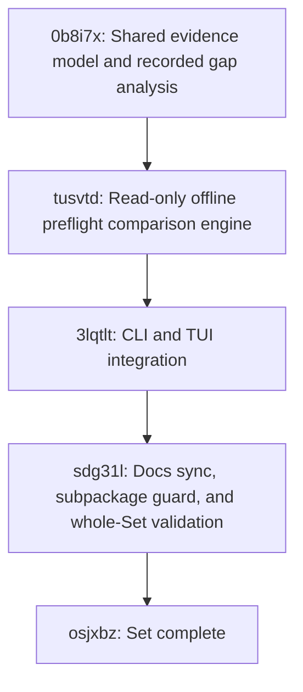

# IPD: Reproducibility gap assessment and rerun preflight

- Date: 2026-11-21
- Kind: orchestrator
- Concern: Reproducibility evidence assessment, parent hydration transparency, and read-only offline rerun preflight comparison
- Scope: Orchestrate four child plans implementing a shared reproducibility evidence model, read-only offline preflight comparison, CLI and TUI integration with strict exit options, and documentation plus whole-Set validation for backlog item `q3bll1`.
- Scope-Paths: src/pubrun/report/utils.py, src/pubrun/report/reproducibility.py, src/pubrun/report/checks.py, src/pubrun/capture/packages.py, src/pubrun/__main__.py, src/pubrun/report/diagnostics.py, src/pubrun/tui/widgets/details.py, src/pubrun/tui/widgets/actions.py, docs/cli.md, docs/hpc.md, docs/manifest.md, docs/api.md, tests/test_reproducibility_assessment.py, tests/test_reproducibility_preflight.py, tests/test_checks_commands.py, tests/test_cli.py, tests/test_tui.py, tests/test_report_subpackage_integrity.py, tests/test_reproducibility_e2e.py
- Item-Dependencies: executed:0b8i7x, executed:tusvtd, executed:3lqtlt, executed:sdg31l
- Status: to-review
- Coverage: pass
- Coverage-Fingerprint: 08fbb549a3677790a16edc93b195490caa38ad814bb045888ba63012f1404cbf
- Coverage-Checked: 2026-11-22 by uri/its_direct/pt3-claude-opus-5.5-1m-us
- Work-Kind: feature
- Priority: medium
- From-Backlog: q3bll1
- Set: repro-check
- Order: 0
- Highest E allocated: 04
- Author: agent
- Id: osjxbz
- Short-Description: Orchestrate shared reproducibility assessment, offline preflight comparison, CLI/TUI integration, and documentation sync

> Write and proofread this plan per the technical writing standard, `.aw/system/workflows/technical-writing/technical-writing.md` (`.agents/workflows/technical-writing/technical-writing.md` in a legacy-layout install), including requirement 12 (diagrams).

## Workflow history

- 2026-11-22 coverage pass (aw oc run): fingerprint 08fbb549a367, model uri/its_direct/pt3-claude-opus-5.5-1m-us
- 2026-11-22 coverage pass (aw oc run): fingerprint 5953754ea333, model uri/its_direct/pt3-claude-opus-5.5-1m-us
- 2026-11-21 to-review (agent): created orchestrator plan for Set `repro-check` graduating backlog item `q3bll1`.

## Goal

Graduate open backlog item `q3bll1` (`.aw/records/backlog/open/20261121-pubrun-improve-01-q3bll1-repro-preflight.backlog.md`) through four ordered, independently verifiable child plans that add a shared reproducibility gap assessment and an explicitly invoked, read-only, offline preflight check across the command-line interface (CLI), terminal user interface (TUI), and machine-readable JavaScript Object Notation (JSON) output. All four child plans preserve one-import adoption (`import pubrun` must not import report or preflight modules), the lightweight Python standard-library runtime (Python 3.8 or newer), redaction, offline operation, and backwards-compatible `pubrun rerun` piping.

### Plan Set dependency flow

This diagram summarizes the execution order of the four child plans. The text and table below are normative.

## Detailed Implementation Checklist (TODO)

Execution-state rule: mark an `E-*` item complete only after performing the action. That mark is not validation. Right-sizing rule: write for a modest executor that cannot hold much in its head. Each E-item is one step (one concern, about one file, executable in one focused pass) and its V-item names each unit it covers with its own check; a plan stays at about 5 E-items and 8 work Scope-Paths, else split it into more child plans (guidance, `IPD-Z603`). Accepted execution states: blocked, failed, pending, performed; terminal gate demands 'performed'.

### Task group 1: Confirm child IPD execution

- [ ] E-01 CONFIRM 0b8i7x REACHED executed
  - Depends on: none
  - Expected outcome: Child plan `0b8i7x` (`20261121-repro-check-01-0b8i7x-shared-reproducibility-evidence-model-and-recorded-gap-analy.ipd.md`) is in `.aw/records/plans/executed/` with `- Status: executed` and all validation items passing.
  - Execution state: pending

- [ ] E-02 CONFIRM tusvtd REACHED executed
  - Depends on: E-01
  - Expected outcome: Child plan `tusvtd` (`20261121-repro-check-02-tusvtd-read-only-offline-rerun-preflight-comparison-engine.ipd.md`) is in `.aw/records/plans/executed/` with `- Status: executed` and all validation items passing.
  - Execution state: pending

- [ ] E-03 CONFIRM 3lqtlt REACHED executed
  - Depends on: E-02
  - Expected outcome: Child plan `3lqtlt` (`20261121-repro-check-03-3lqtlt-cli-and-tui-integration-for-reproducibility-assessment-and-p.ipd.md`) is in `.aw/records/plans/executed/` with `- Status: executed` and all validation items passing.
  - Execution state: pending

- [ ] E-04 CONFIRM sdg31l REACHED executed
  - Depends on: E-03
  - Expected outcome: Child plan `sdg31l` (`20261121-repro-check-04-sdg31l-documentation-sync-subpackage-guard-and-whole-set-validation.ipd.md`) is in `.aw/records/plans/executed/` with `- Status: executed` and all validation items passing.
  - Execution state: pending

## Child IPDs, sequence, and dependencies

| Order | Id | File | What it does | Depends on |
|---|---|---|---|---|
| 01 | `0b8i7x` | `20261121-repro-check-01-0b8i7x-shared-reproducibility-evidence-model-and-recorded-gap-analy.ipd.md` | Adds structured parent hydration reporting (`hydrate_manifest_with_report`), the shared reproducibility evidence model (`pubrun.report.reproducibility`), recorded-manifest gap analysis across all six domains, and unit tests. | none |
| 02 | `tusvtd` | `20261121-repro-check-02-tusvtd-read-only-offline-rerun-preflight-comparison-engine.ipd.md` | Adds shared PEP 503 package normalization/lookup helpers in `pubrun.capture.packages`, implements read-only offline preflight comparison (`compare_with_current_environment`), wires `assess_run(preflight=...)`, and adds preflight unit and side-effect tests. | 01 |
| 03 | `3lqtlt` | `20261121-repro-check-03-3lqtlt-cli-and-tui-integration-for-reproducibility-assessment-and-p.ipd.md` | Wires shared assessment and opt-in `--preflight` into `pubrun inspect`, `pubrun rerun`, `pubrun show`, and the TUI (`RunDetailsView`, `ActionsPanel`), adds strict exit options without breaking default exit or piping contracts, and adds CLI/TUI tests. | 02 |
| 04 | `sdg31l` | `20261121-repro-check-04-sdg31l-documentation-sync-subpackage-guard-and-whole-set-validation.ipd.md` | Updates `docs/cli.md`, `docs/hpc.md`, `docs/manifest.md`, and `docs/api.md`, adds `reproducibility` to `tests/test_report_subpackage_integrity.py`, adds end-to-end tests for all eight `q3bll1` scenarios, and runs the full `pytest tests/ -v` validation suite. | 03 |

## Completion criteria (the whole Set is done only when)

- Shared reproducibility evidence model distinguishes `observed`, `inferred`, `asserted`, `inherited`, `unavailable`, and `not_checked` evidence across source, runtime, dependencies, inputs and outputs, capture completeness, parent metadata, and invocation without an unexplained numerical score. Owner: `0b8i7x`
- Parent metadata (`meta_ref`) assessment evaluates snapshot availability, policy rules, age, and identity against the child run, distinguishes inherited sections from direct child observations, never treats script modification time (`mtime`) alone as proof of matching dependencies, and handles missing or moved snapshots without inventing completeness. Owner: `0b8i7x`
- Explicitly invoked preflight comparison runs read-only and offline, compares only supported recorded evidence (Python and platform, package versions, source state, accessible input identity, working directory, and redaction), separates material mismatches from incidental or portability differences and unknowns, and never executes recorded commands, installs packages, fetches data, or mutates seeds or files. Owner: `tusvtd`
- CLI (`pubrun inspect`, `pubrun rerun`, `pubrun show`), TUI (`RunDetailsView`, `ActionsPanel`), and `--json` output consume the single shared assessment model, explain the highest-value next step, state the non-guarantee disclaimer, and provide optional `--strict` / `--fail-on` exit behavior while keeping default exit codes and `pubrun rerun` stdout piping backwards compatible. Owner: `3lqtlt`
- Documentation (`docs/cli.md`, `docs/hpc.md`, `docs/manifest.md`, `docs/api.md`), subpackage import-isolation guards, all eight scenario examples from `q3bll1`, and the full repository test suite pass with captured output. Owner: `sdg31l`

## Cross-IPD validation

- Verify that `pubrun.report.checks.manifest_findings()` and `pubrun.report.reproducibility.assess_run()` produce consistent finding codes and evidence categories with no duplicate package resolution or schema loading. Owner: `tusvtd`
- Verify that CLI (`pubrun inspect --json`, `pubrun inspect --preflight --json`, `pubrun rerun --preflight --json`), `pubrun show`, and the TUI formatter all consume `pubrun.report.reproducibility` and agree on categories, findings, and next actions. Owner: `3lqtlt`
- Verify that `import pubrun` under every import mode (`auto`, `noauto`, `full`, `nopatch`, `noconsole`, `minimal`) never imports `pubrun.report.checks` or `pubrun.report.reproducibility`, while `pubrun.report.reproducibility` remains importable alongside callable `pubrun.report()`. Owner: `sdg31l`
- Verify that all eight backlog scenarios (adequate recorded evidence with non-guarantee disclaimer, dirty source without recorded diff, missing dependencies, package mismatch, missing or changed input, redacted arguments, unavailable parent snapshot, and partial or failed capture) pass end-to-end through the real CLI and Python API alongside the full `pytest tests/ -v` suite. Owner: `sdg31l`

## Deferred / out of scope (with reason)

- Manifest schema changes (`schemas/manifest.schema.json`): deferred; `q3bll1` reads existing manifest v1.0 fields and degrades honestly on older or sparse manifests while consuming optional richer fields from sibling items `w4hxkh` and `x6alw4` when present.
- Automatic environment restoration, package installation, data fetching, random-seed modification, and automatic replay of historical commands: explicitly prohibited by `q3bll1`.
- Hosted services, schedulers, web dashboards, and mandatory scientific-framework dependencies: explicitly prohibited by `q3bll1`.
- Multi-OS and multi-Python continuous integration (CI) matrix execution (`ubuntu-latest`, `ubuntu-24.04`, `windows-latest`, `macos-latest` across Python 3.8 through 3.14 in `.github/workflows/ci.yml`): cannot be executed inside a single local Linux worktree and must pass on pull request or push before release; noted explicitly by `sdg31l`.

## Scope check

- Over-scope: none. Every child plan maps directly to requirements in `q3bll1` without modifying manifest capture on the `import pubrun` hot path or adding runtime dependencies.
- Under-scope: none. All six implementation guidance items, all five acceptance-criteria bullets, and all shared documentation and validation requirements in `q3bll1` are assigned to child plans `0b8i7x`, `tusvtd`, `3lqtlt`, and `sdg31l`.

## Required tests / validation

This orchestrator plan runs no tests directly. Whole-Set end-to-end validation, import-isolation verification, and full `pytest tests/ -v` execution are performed by child plan `sdg31l`.

## Open questions

### OQ-01: Future coordination with sibling backlog items `w4hxkh`, `x6alw4`, and `6hp1zu`

- Blocking: no
- Status: open
- Owner: none
- Resolution or deferral rationale: Backlog item `q3bll1` states that reproducibility assessment must ship using existing manifest fields without blocking on sibling improvements (`w4hxkh` for dependency capture, `x6alw4` for external file registration and hashing guarantees, `6hp1zu` for timing accuracy). Child plans `0b8i7x` and `tusvtd` read existing manifest fields first and inspect optional richer fields defensively if present.

## Validation and cross-check (verify before reporting the Set complete)

Validation-state rule: inspect evidence in a separate pass. Do not mark a `V-*` item complete from memory or from the matching execution checkmark. Accepted validation results: blocked, failed, pass, pending; terminal gate demands 'pass'. Runtime-demonstration reachability rule: for each `V-*` item demanding the software be observed acting (such as a run, a dispatch, or a transition)—as distinct from items demanding a diff, a file's content, or a test result, which are reachable by construction—name the code path that produces the observation or the sibling `E-*` that creates it, else the demand is UNDER-SCOPE.

- [ ] V-01 validates E-01
  - Required evidence: Confirm `.aw/records/plans/executed/20261121-repro-check-01-0b8i7x-shared-reproducibility-evidence-model-and-recorded-gap-analy.ipd.md` exists with `- Status: executed`, all `E-*` marked `performed`, and all `V-*` marked `pass`.
  - Observed evidence:
  - Result: pending

- [ ] V-02 validates E-02
  - Required evidence: Confirm `.aw/records/plans/executed/20261121-repro-check-02-tusvtd-read-only-offline-rerun-preflight-comparison-engine.ipd.md` exists with `- Status: executed`, all `E-*` marked `performed`, and all `V-*` marked `pass`.
  - Observed evidence:
  - Result: pending

- [ ] V-03 validates E-03
  - Required evidence: Confirm `.aw/records/plans/executed/20261121-repro-check-03-3lqtlt-cli-and-tui-integration-for-reproducibility-assessment-and-p.ipd.md` exists with `- Status: executed`, all `E-*` marked `performed`, and all `V-*` marked `pass`.
  - Observed evidence:
  - Result: pending

- [ ] V-04 validates E-04
  - Required evidence: Confirm `.aw/records/plans/executed/20261121-repro-check-04-sdg31l-documentation-sync-subpackage-guard-and-whole-set-validation.ipd.md` exists with `- Status: executed`, all `E-*` marked `performed`, and all `V-*` marked `pass`.
  - Observed evidence:
  - Result: pending

## Approval and execution gate

- Size assessment: standard
- Cohesion rationale: not required

Execution of this Set requires explicit human approval (`- Status: approved`). The runner executes child plans `0b8i7x`, `tusvtd`, `3lqtlt`, and `sdg31l` in dependency order and retires this orchestrator plan to `.aw/records/plans/executed/` only after all four child plans reach `executed` on disk and pass post-transition validation.
