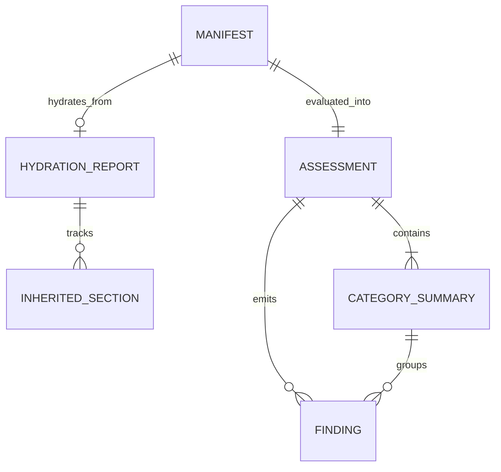

# IPD: Shared reproducibility evidence model and recorded gap analysis

- Date: 2026-11-21
- Kind: child
- Concern: Shared reproducibility evidence taxonomy, parent metadata hydration assessment, and recorded-manifest gap analysis
- Scope: Add structured parent hydration metadata in `src/pubrun/report/utils.py`, create `src/pubrun/report/reproducibility.py` with the shared evidence model and recorded-manifest gap engine, integrate it into `src/pubrun/report/checks.py`, and add unit tests in `tests/test_reproducibility_assessment.py`.
- Scope-Paths: src/pubrun/report/utils.py, src/pubrun/report/reproducibility.py, src/pubrun/report/checks.py, tests/test_reproducibility_assessment.py
- Item-Dependencies: none
- Status: to-review
- Work-Kind: feature
- Priority: medium
- From-Backlog: q3bll1
- Set: repro-check
- Order: 1
- Highest E allocated: 04
- Author: agent
- Id: 0b8i7x
- Short-Description: Build shared evidence taxonomy, structured parent hydration report, and recorded-manifest gap assessment

> Write and proofread this plan per the technical writing standard, `.aw/system/workflows/technical-writing/technical-writing.md` (`.agents/workflows/technical-writing/technical-writing.md` in a legacy-layout install), including requirement 12 (diagrams).

## Workflow history

- 2026-11-21 to-review (agent): created child plan 01 of Set `repro-check` graduating backlog item `q3bll1`.

## Goal

Establish a single, read-only, Python standard-library reproducibility evidence model and recorded-manifest gap engine shared by the command-line interface (CLI), terminal user interface (TUI), and JavaScript Object Notation (JSON) output. This plan upgrades parent `meta_ref` hydration reporting so inherited context stays distinct from direct child observations, explains recorded gaps across six provenance domains with explicit evidence statuses and next actions, and never claims guaranteed scientific reproduction.

### Data model and assessment relationships

This diagram summarizes the entities introduced or extended in this plan. The text below is normative.

## Detailed Implementation Checklist (TODO)

Execution-state rule: mark an `E-*` item complete only after performing the action. That mark is not validation. Right-sizing rule: write for a modest executor that cannot hold much in its head. Each E-item is one step (one concern, about one file, executable in one focused pass) and its V-item names each unit it covers with its own check; a plan stays at about 5 E-items and 8 work Scope-Paths, else split it into more child plans (guidance, `IPD-Z603`). Accepted execution states: blocked, failed, pending, performed; terminal gate demands 'performed'.

### Task group 1: Structured parent hydration reporting

- [ ] E-01 Add `HydrationReport` and `hydrate_manifest_with_report` to `src/pubrun/report/utils.py` while keeping `hydrate_manifest` backwards compatible.
  - Depends on: none
  - Expected outcome: `hydrate_manifest_with_report(manifest_path, manifest)` returns `(hydrated_manifest, warnings, report)` without mutating the caller's raw `manifest` dictionary in place, records `status` (`none`, `hydrated`, `missing`, `blocked_by_policy`, `invalid_extension`, `invalid_json`, `invalid_type`, `failed`), lists `inherited_sections` versus `direct_sections`, captures parent snapshot path/timestamp/age relative to child `timing.started_at_utc` (including when parent is newer than child), compares parent versus child `host`/`python`/`git` identity when both exist, and preserves `hydrate_manifest(manifest_path, manifest)` returning `(hydrated_manifest, warnings)` for all existing callers.
  - Execution state: pending

### Task group 2: Shared reproducibility evidence model and recorded gap engine

- [ ] E-02 Create `src/pubrun/report/reproducibility.py` with the shared evidence taxonomy, recorded-manifest gap analyzer, next-action prioritizer, and plain-text formatters.
  - Depends on: E-01
  - Expected outcome: `src/pubrun/report/reproducibility.py` (CLI/report-only, Python standard library only, never imported by `import pubrun`) defines `EVIDENCE_STATUSES` (`observed`, `inferred`, `asserted`, `inherited`, `unavailable`, `not_checked`), `CATEGORY_STATUSES` (`adequate`, `gaps`, `mismatch`, `uncertain`, `not_checked`), `IMPACT_LEVELS` (`material`, `portability`, `incidental`, `informational`), `COMPARISON_OUTCOMES` (`match`, `mismatch`, `portability_diff`, `unknown`, `not_checked`), `NON_GUARANTEE_DISCLAIMER`, `assess_manifest_reproducibility(...)`, `format_reproducibility_summary(...)`, and `format_reproducibility_detail(...)` covering all six recorded evidence domains and emitting zero numerical reproducibility scores.
  - Execution state: pending

### Task group 3: Integrate into shared checks module

- [ ] E-03 Integrate `assess_manifest_reproducibility` into `src/pubrun/report/checks.py` as the single shared findings engine.
  - Depends on: E-02
  - Expected outcome: `pubrun.report.checks.manifest_findings(manifest, current_hostname=None)` delegates to or enriches from the shared engine while preserving every existing finding code (`different_host`, `netfs_*`, `resources_off`, `resources_process_scope`, `console_off`, `hardware_off`, `packages_off`, `git_off`, `mode_no_subprocess_patch`, `subprocess_tracking_off`, `subprocess_unknown`, `no_file_provenance`, config notice codes) and dict keys (`severity`, `code`, `message`, `suggestion`), and `pubrun.report.checks` exposes `assess_run` without duplicating completeness checks or breaking `summarize()`.
  - Execution state: pending

### Task group 4: Behavioral unit tests and import-isolation verification

- [ ] E-04 Add behavioral unit tests in `tests/test_reproducibility_assessment.py` covering every recorded-evidence scenario, parent hydration case, and import-isolation invariant.
  - Depends on: E-03
  - Expected outcome: `tests/test_reproducibility_assessment.py` passes via `pytest` and proves behavior for adequate manifests (with explicit non-guarantee disclaimer), sparse/legacy manifests, dirty git state without recorded diff, missing/suppressed/partial/failed/timeout capture, package mode caveats and future optional fields, unhashed/stat-only/asserted vs observed file provenance, redacted arguments/env vars, valid/stale/mismatched/missing/policy-blocked `meta_ref` snapshots, and zero import of `pubrun.report.reproducibility` or `pubrun.report.checks` during `import pubrun`.
  - Execution state: pending

## Project conventions discovered (Step 0)

- `pubrun.report.checks` is CLI-only and must never be imported by `import pubrun` or the runtime capture path (enforced by `test_import_pubrun_does_not_import_checks` in `tests/test_checks_commands.py`).
- `pubrun.report.utils.hydrate_manifest` currently enforces `_is_meta_ref_allowed`, rejects non-`.json` targets, compares `invocation.script.mtime` (file modification time) against `meta.timing.started_at_utc`, and sets `manifest[sec]["is_hydrated"] = True` for sections in `["hardware", "process", "python", "packages", "environment", "git"]` when missing or in `["suppressed", "off", "unavailable", "unknown", "partial"]`.
- Manifest fields follow `schemas/manifest.schema.json` v1.0: `capture_state.status` uses `complete`, `partial`, `unavailable`, `suppressed`, `failed`, `timeout`, `pending`; redacted values use `{"representation": "redacted"|"hashed"|"plain"|...}` and CLI arguments use `[REDACTED]` strings (`pubrun.capture.redaction.redact_argv`).
- Default `pubrun.open()` level is `stat`, so `data_files.inputs[*].sha256` and `data_files.outputs[*].sha256` are `null` unless `[capture.file_io].level = "hash"`; `invocation.inputs[*].md5` is absent unless `[capture.inputs].compute_md5 = true`.
- Runtime code supports Python 3.8 or newer using only the Python standard library (`tomli` on Python < 3.11 is the sole third-party dependency in `pyproject.toml`).
- Existing tests in `tests/test_checks_commands.py`, `tests/test_reports.py`, and `tests/test_hpc_hydration_e2e.py` assert current `manifest_findings()` and `hydrate_manifest()` contracts.

## Findings

1. `pubrun.report.checks.manifest_findings` currently checks only `different_host`, config notices, `filesystem` network mounts, `resources`, `console`, suppressed `hardware`/`packages`/`git`, `pubrun_imports.selected_behavior.patch_subprocesses`, `subprocesses_enabled`, and empty `data_files`. It does not inspect `git.dirty`, missing `git.commit`, `git` timeout/failed/unavailable states, `invocation.script.sha256`, `packages.mode` coverage limits (`imported-only` vs `full-environment`), editable packages, unhashed `data_files`/`invocation.inputs`, redacted `argv`/`rerun_command`/`environment` entries, non-completed `status.outcome`, `meta_ref` hydration status/age/identity, or unrecorded `determinism` seeds.
2. `pubrun.report.utils.hydrate_manifest` mutates the caller's `manifest` dictionary in place, returns only `(manifest, list[str])` warnings, and uses only `invocation.script.mtime > meta.timing.started_at_utc` as a drift heuristic. It does not report which sections were inherited, how old the parent snapshot was relative to the child run, or whether parent `host`/`python`/`git` identity differed from directly observed child fields.
3. No shared structured evidence taxonomy (`observed`, `inferred`, `asserted`, `inherited`, `unavailable`, `not_checked`) or prioritized next-action summary exists today.

## Proposed changes (ordered, validatable)

1. **`src/pubrun/report/utils.py`**:
   - Add a `HydrationReport` dataclass (with `.to_dict()`) capturing: `meta_ref`, `resolved_path`, `status` (`none`, `hydrated`, `missing`, `blocked_by_policy`, `invalid_extension`, `invalid_json`, `invalid_type`, `failed`), `inherited_sections` (list of section names copied from parent), `direct_sections` (list of sections already directly observed in child), `parent_started_at_utc`, `child_started_at_utc`, `age_seconds` (`child_started_at_utc - parent_started_at_utc` when both exist), `script_modified_after_parent` (bool or `None`), `identity_mismatches` (list of structured diffs where both parent and child directly recorded `host.hostname`, `host.os_name`, `python.version`, or `git.commit` and they differ), and `warnings` (list of strings).
   - Implement `hydrate_manifest_with_report(manifest_path: str, manifest: Dict[str, Any]) -> Tuple[Dict[str, Any], List[str], HydrationReport]`. Deep-copy top-level hydrated sections (or shallow-copy `manifest` and copied section dicts) so the caller's raw input dictionary is not mutated silently. Validate that loaded JSON is a dict and flag unexpected `manifest_type` (when present and not `"pubrun-meta-snapshot"`) as `invalid_type` without inventing completeness.
   - Re-implement `hydrate_manifest(manifest_path, manifest)` as a thin wrapper over `hydrate_manifest_with_report` that preserves existing warning text patterns and `(hydrated_manifest, warnings)` return value so all tests in `tests/test_reports.py` and `tests/test_hpc_hydration_e2e.py` remain green.

2. **`src/pubrun/report/reproducibility.py`** (new module):
   - Define module-level string constants/tuples:
     - `EVIDENCE_STATUSES = ("observed", "inferred", "asserted", "inherited", "unavailable", "not_checked")`
     - `CATEGORY_STATUSES = ("adequate", "gaps", "mismatch", "uncertain", "not_checked")`
     - `IMPACT_LEVELS = ("material", "portability", "incidental", "informational")`
     - `COMPARISON_OUTCOMES = ("match", "mismatch", "portability_diff", "unknown", "not_checked")`
     - `NON_GUARANTEE_DISCLAIMER`: plain-language statement that recorded provenance and an absence of findings support reproduction analysis but do not guarantee equivalent scientific or bitwise results, especially for legacy or sparse manifests.
   - Define finding builder `_make_finding(severity, code, message, suggestion=None, *, category, evidence_status, impact="informational", comparison=None, details=None)` returning a JSON-serializable dict that preserves all four legacy `pubrun.report.checks` keys (`severity`, `code`, `message`, `suggestion`).
   - Implement `assess_manifest_reproducibility(manifest, *, manifest_path=None, hydration_report=None, current_hostname=None) -> Dict[str, Any]` (never raises; tolerates empty/legacy/malformed manifests):
     - Evaluates all seven structured categories (`source`, `runtime`, `dependencies`, `inputs_outputs`, `capture_completeness`, `parent_metadata`, `invocation`):
       - **Source (`source`)**: inspect `git` (`capture_state`, `commit`, `branch`, `dirty`, `repo_root`, `is_hydrated`) and `invocation.script` (`path`, `sha256`, `sha256_skipped`, `size`, `mtime`, `entrypoint_type`). Flag `git_dirty_unrecorded` (WARN, `material`, `observed`) when `git.dirty is True` without recorded diff/patch; flag `git_dirty_not_checked` (INFO, `not_checked`) when `git.dirty is None` with a commit; flag `git_unavailable`/`git_timeout`/`git_failed`/`git_off`; flag `script_unhashed` when `entrypoint_type == "script"` and `sha256` is absent; mark evidence `inherited` when `git.is_hydrated` is true.
       - **Runtime (`runtime`)**: inspect `python` (`version`, `implementation`, `environment_kind`, `capture_state`, `is_hydrated`), `host` (`os_name`, `os_version`, `hostname`, `capture_state`, `is_hydrated`), `hardware` (`capture_state`, `cpu.architecture`, `is_hydrated`), and `different_host` when `current_hostname` differs from recorded `host.hostname`.
       - **Dependencies (`dependencies`)**: inspect `packages` (`mode`, `records`, `capture_state`, `is_hydrated`). Flag `packages_off`, `packages_partial`, `packages_failed`, `packages_empty`, `packages_imported_only_scope` (INFO, `observed`, explaining that `imported-only` captures only imported modules and may miss unrecorded environment packages), `packages_editable_present` (INFO/WARN noting editable installs depend on local source state), and degrade gracefully for optional future fields from `w4hxkh` (for example, `unresolved` entries or startup-only markers if present).
       - **Inputs and outputs (`inputs_outputs`)**: inspect `data_files.inputs`, `data_files.outputs`, and `invocation.inputs`. Distinguish `observed` content digests (`sha256`/`md5`), `asserted` caller-supplied digests (if a future record from `x6alw4` carries an `evidence_source`/`source == "asserted"` or `hash_status`), `inferred` argv inputs (`invocation.inputs`), `observed` stat-only metadata (explicitly noting content hash is `not_checked`), and `no_file_provenance` when neither `data_files` nor `invocation.inputs` has entries.
       - **Capture completeness (`capture_completeness`)**: inspect `status.outcome` (flag non-completed outcomes such as `failed`, `interrupted`, `partial`, `ghost`, `unknown`), every section's `capture_state` (`partial`, `failed`, `timeout`, `pending`, `suppressed`), `resources`, `console`, `subprocesses_enabled` (honestly distinguishing `False` vs absent on legacy manifests), `config.notices`, `filesystem` network mounts, `pubrun_imports.selected_behavior.patch_subprocesses`, and `determinism` (`not_checked`: random seeds are not captured). Detect sparse/legacy manifests (missing schema/capture flags) and note that absence of warnings on sparse records does not imply completeness.
       - **Parent metadata (`parent_metadata`)**: inspect `hydration_report` (or raw `meta_ref` when `hydration_report` is absent). Distinguish `inherited` sections from direct child observations, report `meta_ref` missing/moved/blocked/invalid as `unavailable` (WARN, `material`) without inventing completeness, report stale/post-dated parent snapshots and parent-vs-child identity mismatches, and explicitly note when `meta_ref` hydrated sections that script `mtime` alone does not prove dependencies matched at child runtime.
       - **Invocation (`invocation`)**: inspect `argv`, `rerun_command`, `working_directory`, and `environment.variables`. Detect `[REDACTED]` markers in `argv` or `rerun_command` (`rerun_command_redacted`, WARN, `material`, `observed`: command is not directly executable as printed without supplying redacted arguments) and redacted environment variables (`env_vars_redacted`, INFO, `observed`).
     - Compute `next_action` (single highest-value concrete next step) and `next_actions` (ordered deduplicated list) by deterministic priority: unavailable/broken evidence -> material recorded gaps (redacted command, dirty source, failed/partial capture, missing parent snapshot, missing dependencies) -> capture-completeness improvements.
     - Return a stable JSON-serializable dict with keys: `schema_version` (`"1.0"`), `mode` (`"manifest"`), `summary`, `next_action`, `next_actions`, `disclaimer`, `categories` (list of category summary dicts), `findings` (list of finding dicts), `parent_metadata` (dict from `HydrationReport` or `None`), and `preflight` (`{"requested": False, "status": "not_checked", "checks": []}`).
   - Implement pure-text formatters `format_reproducibility_summary(assessment)` (terse summary + highest-value next step + disclaimer) and `format_reproducibility_detail(assessment, *, use_color=False)` (category table + per-finding lines with evidence status and concrete suggestions + disclaimer), usable by both CLI and TUI with zero `textual` dependency.

3. **`src/pubrun/report/checks.py`**:
   - Keep `live_findings()` and `live_checks()` untouched.
   - Update `manifest_findings(manifest, current_hostname=None)` to delegate to `assess_manifest_reproducibility(manifest, current_hostname=current_hostname)["findings"]` (ensuring every existing finding code and message contract in `tests/test_checks_commands.py` continues to pass verbatim or compatibly).
   - Export `assess_run` facade (calling `pubrun.report.reproducibility.assess_manifest_reproducibility` in this plan; extended with `preflight=True` in child plan `tusvtd`).

4. **`tests/test_reproducibility_assessment.py`** (new test file):
   - Add targeted behavioral tests for `hydrate_manifest_with_report`, `assess_manifest_reproducibility`, `format_reproducibility_summary`, `format_reproducibility_detail`, backwards compatibility of `manifest_findings`, and subprocess import-isolation (`import pubrun` must not import `pubrun.report.reproducibility` or `pubrun.report.checks`).

## Deferred / out of scope (with reason)

- Live environment preflight comparison (`compare_with_current_environment`): implemented in child plan `tusvtd` (`Order: 2`).
- CLI flag wiring (`pubrun inspect --preflight`, `pubrun rerun --preflight`, `--fail-on`) and TUI widget integration: implemented in child plan `3lqtlt` (`Order: 3`).
- User documentation updates and whole-Set end-to-end validation: implemented in child plan `sdg31l` (`Order: 4`).

## Scope check

- Over-scope: none. Only touches `utils.py`, new `reproducibility.py`, `checks.py`, and its unit test file; never modifies runtime capture paths or `schemas/manifest.schema.json`.
- Under-scope: none. Delivers the complete shared evidence taxonomy, structured hydration assessment, and recorded-manifest gap engine required by `q3bll1` items 1, 2, 5, and 6.

## Required tests / validation

- Run `pytest tests/test_reproducibility_assessment.py tests/test_checks_commands.py tests/test_reports.py tests/test_hpc_hydration_e2e.py -v` and paste actual runner output.
- Verify import isolation in a fresh Python subprocess confirming neither `pubrun.report.checks` nor `pubrun.report.reproducibility` appears in `sys.modules` after `import pubrun`.

## Spec / documentation sync

- Documentation sync for `docs/cli.md`, `docs/hpc.md`, `docs/manifest.md`, and `docs/api.md` is scheduled in child plan `sdg31l` after CLI and TUI integration completes in `3lqtlt`.
- `schemas/manifest.schema.json`: N/A (this plan reads existing manifest v1.0 fields and does not alter `manifest.json` on disk).

## Open questions

### OQ-01: Severity of `git_dirty_unrecorded` on existing `pubrun inspect --strict` callers

- Blocking: no
- Status: open
- Owner: none
- Resolution or deferral rationale: Existing tests in `tests/test_checks_commands.py` build fake manifests with `git: {"capture_state": {"status": "complete"}}` (no `dirty` key) or clean runs, so flagging `git.dirty is True` as `warn` with `impact="material"` preserves all existing tests while surfacing genuine dirty-source gaps under `--strict`.

## Validation and cross-check (verify before reporting done)

Validation-state rule: inspect evidence in a separate pass. Do not mark a `V-*` item complete from memory or from the matching execution checkmark. Accepted validation results: blocked, failed, pass, pending; terminal gate demands 'pass'. Runtime-demonstration reachability rule: for each `V-*` item demanding the software be observed acting (such as a run, a dispatch, or a transition)—as distinct from items demanding a diff, a file's content, or a test result, which are reachable by construction—name the code path that produces the observation or the sibling `E-*` that creates it, else the demand is UNDER-SCOPE.

- [ ] V-01 validates E-01
  - Required evidence: Paste `pytest tests/test_reports.py tests/test_hpc_hydration_e2e.py tests/test_reproducibility_assessment.py -k hydration -v` output showing exit code 0 and passing assertions that `hydrate_manifest_with_report` leaves the caller's input dict unmutated, separates inherited vs direct sections, computes parent age and identity mismatches, handles missing/blocked/invalid parent snapshots without inventing completeness, and keeps `hydrate_manifest` backwards compatible.
  - Observed evidence:
  - Result: pending

- [ ] V-02 validates E-02
  - Required evidence: Paste `pytest tests/test_reproducibility_assessment.py -v` output showing exit code 0 with behavioral tests covering all six evidence statuses (`observed`, `inferred`, `asserted`, `inherited`, `unavailable`, `not_checked`), all seven categories, no numerical reproducibility score, non-guarantee disclaimer on adequate and sparse/legacy manifests, prioritized `next_action`, and plain-text summary/detail formatters.
  - Observed evidence:
  - Result: pending

- [ ] V-03 validates E-03
  - Required evidence: Paste `pytest tests/test_checks_commands.py -v` output showing exit code 0 and all existing `manifest_findings`, `live_findings`, `live_checks`, and `inspect` tests passing after integrating `pubrun.report.checks` with `pubrun.report.reproducibility`.
  - Observed evidence:
  - Result: pending

- [ ] V-04 validates E-04
  - Required evidence: Paste actual command output of `python -c "import pubrun, sys; assert 'pubrun.report.checks' not in sys.modules and 'pubrun.report.reproducibility' not in sys.modules; print('ISOLATED')"` (printing `ISOLATED`, exit code 0) and full output of `pytest tests/test_reproducibility_assessment.py tests/test_checks_commands.py tests/test_reports.py tests/test_hpc_hydration_e2e.py -v` (exit code 0).
  - Observed evidence:
  - Result: pending

## Approval and execution gate

- Size assessment: standard
- Cohesion rationale: not required

Execution requires explicit human approval (`- Status: approved`). Commit only the scoped files through `aw commit 0b8i7x -- <paths>`, paste actual test runner output into `Observed evidence`, and run the post-gate `aw ipd` lifecycle transition to `.aw/records/plans/executed/`.
