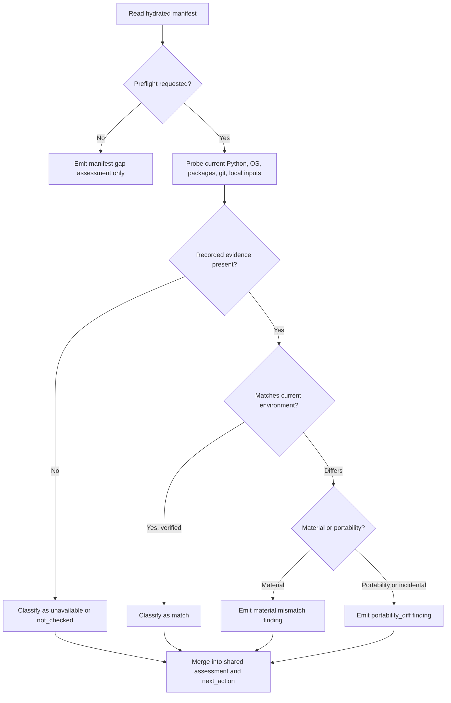

# IPD: Read-only offline rerun preflight comparison engine

- Date: 2026-11-21
- Kind: child
- Concern: Read-only offline comparison of recorded run requirements against the current environment
- Scope: Add shared package-name normalization and distribution lookup helpers in `src/pubrun/capture/packages.py`, implement `compare_with_current_environment` in `src/pubrun/report/reproducibility.py`, wire `preflight=True` into `assess_run` in `src/pubrun/report/reproducibility.py` and `src/pubrun/report/checks.py`, and add unit and safety-invariant tests in `tests/test_reproducibility_preflight.py`.
- Scope-Paths: src/pubrun/capture/packages.py, src/pubrun/report/reproducibility.py, src/pubrun/report/checks.py, tests/test_reproducibility_preflight.py
- Item-Dependencies: executed:0b8i7x
- Status: to-review
- Work-Kind: feature
- Priority: medium
- From-Backlog: q3bll1
- Set: repro-check
- Order: 2
- Highest E allocated: 04
- Author: agent
- Id: tusvtd
- Short-Description: Add read-only offline comparison of recorded runtime, package, source, and input evidence against current environment

> Write and proofread this plan per the technical writing standard, `.aw/system/workflows/technical-writing/technical-writing.md` (`.agents/workflows/technical-writing/technical-writing.md` in a legacy-layout install), including requirement 12 (diagrams).

## Workflow history

- 2026-11-21 to-review (agent): created child plan 02 of Set `repro-check` graduating backlog item `q3bll1`.

## Goal

Provide an explicitly invoked, strictly read-only, offline preflight comparison engine that compares supported recorded manifest evidence against the current local environment without ever executing recorded commands, installing packages, fetching remote data, or modifying files, environment variables, or random seeds. The engine separates material mismatches from incidental or expected portability differences and clearly distinguishes verified matches from `unknown` and `not_checked` outcomes.

### Preflight comparison flow

This diagram summarizes the preflight decision flow. The text below is normative.

## Detailed Implementation Checklist (TODO)

Execution-state rule: mark an `E-*` item complete only after performing the action. That mark is not validation. Right-sizing rule: write for a modest executor that cannot hold much in its head. Each E-item is one step (one concern, about one file, executable in one focused pass) and its V-item names each unit it covers with its own check; a plan stays at about 5 E-items and 8 work Scope-Paths, else split it into more child plans (guidance, `IPD-Z603`). Accepted execution states: blocked, failed, pending, performed; terminal gate demands 'performed'.

### Task group 1: Shared package normalization and read-only lookup

- [ ] E-01 Add `normalize_package_name` and `get_installed_distribution_versions` in `src/pubrun/capture/packages.py` without changing `get_packages()` runtime behavior.
  - Depends on: none
  - Expected outcome: `pubrun.capture.packages` provides Python Enhancement Proposal (PEP) 503 name normalization (`re.sub(r"[-_.]+", "-", name).lower()`) and a read-only `importlib.metadata.distributions()` lookup returning `{normalized_name: {"name": ..., "version": ..., "editable": ...}}` without importing any user package, so preflight reuses `packages.py` instead of duplicating package resolution logic.
  - Execution state: pending

### Task group 2: Read-only offline preflight comparison engine

- [ ] E-02 Implement `compare_with_current_environment` in `src/pubrun/report/reproducibility.py` covering Python and platform, package versions, source state, accessible input identity, working directory, and command redaction.
  - Depends on: E-01
  - Expected outcome: `compare_with_current_environment(manifest, *, manifest_path=None, cwd=None, check_hashes=True, max_hash_bytes=104857600, git_timeout=5.0)` runs strictly read-only and offline, compares only supported recorded evidence, classifies every check with explicit `comparison` (`match`, `mismatch`, `portability_diff`, `unknown`, `not_checked`), `evidence_status`, and `impact` (`material`, `portability`, `incidental`, `informational`), and never executes recorded commands, installs packages, accesses the network, or mutates disk state.
  - Execution state: pending

### Task group 3: Integrate preflight into shared `assess_run` facade

- [ ] E-03 Wire `preflight=True` into `assess_run` in `src/pubrun/report/reproducibility.py` and re-export it cleanly through `src/pubrun/report/checks.py` alongside `should_fail_strict`.
  - Depends on: E-02
  - Expected outcome: `assess_run(manifest, ..., preflight=True)` merges preflight checks and findings into the same categories, findings list, `next_action`, and formatters without duplicate logic; `should_fail_strict(assessment, fail_on="warn")` implements deterministic strict-exit evaluation (`warn`, `mismatch`, `unknown`) ready for CLI consumers.
  - Execution state: pending

### Task group 4: Behavioral preflight and side-effect safety tests

- [ ] E-04 Add behavioral unit tests in `tests/test_reproducibility_preflight.py` covering all comparison dimensions, classification boundaries, and read-only/offline/no-replay guarantees.
  - Depends on: E-03
  - Expected outcome: `tests/test_reproducibility_preflight.py` passes via `pytest` and proves behavior for matching environment, Python major.minor vs patch and OS/hostname portability differences, package version match/mismatch/missing/normalization/editable caveats, git commit/dirty/unavailable and script hash/size/missing checks, accessible input verified hash match vs content mismatch vs missing vs stat-only unverified vs over-cap `not_checked` vs asserted digest basis, redacted command non-executability, strict evaluation modes, and strict no-network/no-replay/read-only guarantees.
  - Execution state: pending

## Project conventions discovered (Step 0)

- `pubrun.capture.packages.get_packages` uses `importlib.metadata` (standard library on Python 3.8+) and checks `direct_url.json` for `"dir_info"` to detect editable installs.
- `pubrun.capture.python_runtime.environment_kind()` classifies the current interpreter (`conda`, `venv`, `virtualenv`, `system`, `frozen`) using only standard-library checks with no path exposure.
- `pubrun.capture.git.get_git` invokes `git` with a bounded timeout (default `5.0`s) via `subprocess.run(["git", ...])` and disables `pubrun.capture.subprocesses` spying via `disable_spy()`.
- `pubrun.capture.invocation.get_invocation` computes script SHA-256 up to 1 MiB (`_max_hash_size = 1_048_576`) and stores `invocation.inputs` with optional `md5` and `data_files.inputs` with optional `sha256`.
- `pubrun.report.checks` and `pubrun.report.reproducibility` are CLI/report-only and must never be imported during `import pubrun`.

## Findings

1. `pubrun.report.checks` currently has `live_findings()` (machine health for `self-check`) and `manifest_findings()` (post-hoc manifest inspection), with no function that compares recorded manifest requirements against the current environment.
2. `pubrun.capture.packages` currently compares names with `.lower()` rather than PEP 503 normalization (`-`/`_`/`.` equivalence), which would cause false package mismatches (for example `scikit_learn` vs `scikit-learn`) if preflight did naive string matching.
3. Preflight must never run automatically during normal `pubrun inspect` or `pubrun rerun`; it must be explicitly requested and must remain read-only, offline, bounded in time and I/O, and free of any replay or mutation side effects.

## Proposed changes (ordered, validatable)

1. **`src/pubrun/capture/packages.py`**:
   - Add `normalize_package_name(name: str) -> str` applying PEP 503 normalization (`re.sub(r"[-_.]+", "-", name).lower()`).
   - Add `get_installed_distribution_versions() -> Dict[str, Dict[str, Any]]` iterating `importlib.metadata.distributions()` once (read-only, never importing third-party modules) and returning a dict keyed by normalized package name with `name`, `version`, and `editable` (using the same `direct_url.json` check already in `get_packages`). Keep `get_packages()` output and performance unchanged.

2. **`src/pubrun/report/reproducibility.py`**:
   - Implement `compare_with_current_environment(manifest, *, manifest_path=None, cwd=None, check_hashes=True, max_hash_bytes=104_857_600, git_timeout=5.0) -> Dict[str, Any]` (never raises):
     - **Python and platform**:
       - Parse recorded `python.version` major.minor.patch tuple and compare against `sys.version_info[:3]`, plus `python.implementation` vs `sys.implementation.name`, and `python.environment_kind` vs `pubrun.capture.python_runtime.environment_kind()`.
       - Classify Python major.minor or implementation change as `comparison="mismatch"`, `impact="material"`, `severity="warn"`, `evidence_status="observed"` (without claiming blanket incompatibility; state the exact versions).
       - Classify Python patch change or `environment_kind` difference as `comparison="portability_diff"`, `impact="portability"`, `severity="info"`, `evidence_status="observed"`.
       - Compare `host.os_name` vs `platform.system()`, `hardware.cpu.architecture` vs `platform.machine()`, and `host.hostname` vs `socket.gethostname()`. Classify OS family or CPU architecture difference as `comparison="portability_diff"`, `impact="portability"`, `severity="info"` (factual description, no blanket incompatibility claim); classify hostname or OS minor release change as `comparison="portability_diff"`, `impact="incidental"`, `severity="info"`.
       - When recorded `python` or `host` section is missing/suppressed/unavailable, emit `comparison="unknown"`, `evidence_status="unavailable"` or `"not_checked"` (never a verified match).
     - **Package versions**:
       - Call `get_installed_distribution_versions()` once.
       - For each entry in `packages.records` (using `normalize_package_name`):
         - Missing in current environment -> `mismatch` (`material`, `warn`).
         - Installed version differs from recorded version -> `mismatch` (`material`, `warn`), recording both versions in `details`.
         - Recorded version is `null`/`unknown` -> `unknown` (`informational`, `info`).
         - Matching version -> count as verified match (note caveat if `editable` is true on either side or if `packages.mode` was `imported-only`, because unrecorded packages were not checked).
       - If `packages` was suppressed/unavailable or had zero records, classify comparison as `unknown` / `not_checked` rather than verified match.
     - **Source state**:
       - Probe current git state read-only (`["git", "-C", target_dir, "rev-parse", "HEAD"]`, `["git", "-C", target_dir, "status", "--porcelain"]`) using bounded `git_timeout` and `disable_spy()`. Choose `target_dir` as recorded `git.repo_root` if it exists locally, else `cwd` (or `Path.cwd()`). Never invoke `git fetch`, `git checkout`, or any network/write git command.
       - Compare recorded `git.commit` vs current `HEAD`: mismatch -> `mismatch` (`material`, `warn`); matching `HEAD` when recorded `git.dirty is True` -> `unknown` (`material`, `warn`, explaining uncommitted changes from the recorded run were not captured so HEAD equality does not prove identical source); matching `HEAD` when current repo is dirty -> `mismatch` (`material`, `warn`); missing `git` binary or non-git directory -> `unknown` (`unavailable`, `info`).
       - Compare recorded `invocation.script` (`real_path` or `path` resolved against `cwd`): if accessible and `sha256` was recorded, compute local SHA-256 (bounded by `max_hash_bytes`) and report `match` or `mismatch` (`material`, `warn`); if file is missing locally, report `mismatch` or `portability_diff` (`unavailable`, `warn` when script cannot be located for rerun); if recorded script had no `sha256`, compare size and explicitly report content hash `not_checked`.
     - **Accessible input identity**:
       - Collect unique input records from `data_files.inputs` and `invocation.inputs` (preserving source: `observed` vs `inferred` vs `asserted`).
       - For each input path:
         - Resolve local path (recorded `realpath`/`path`, or relative to `cwd` if relative). If absent or unreadable -> `mismatch` (`material`, `warn`, `evidence_status="unavailable"`).
         - If recorded digest exists (`sha256` or `md5`) and `check_hashes=True`: if local file size exceeds `max_hash_bytes`, classify as `not_checked` (`informational`, `info`, stating the cap); otherwise stream-hash read-only in 64 KiB chunks and compare (`match` if equal, `mismatch` with `material`/`warn` if different; if recorded digest was `asserted`, note that comparison is against an asserted digest).
         - If no recorded digest exists: compare `size_bytes`/`size` (size difference -> `mismatch`, `material`, `warn`; same size -> `unknown` with `evidence_status="not_checked"` explaining metadata-only check cannot verify content identity).
     - **Working directory and command executability**:
       - Check whether recorded `invocation.working_directory.path` exists locally (`portability_diff`, `portability`, `info` if relocated/missing).
       - Surface redacted `rerun_command` / `argv` markers as `mismatch` / `material` (`warn`) warning that the recorded command cannot be executed verbatim without supplying redacted values.
   - Implement `assess_run(manifest, *, manifest_path=None, hydration_report=None, current_hostname=None, preflight=False, cwd=None, check_hashes=True, max_hash_bytes=104_857_600, git_timeout=5.0)` combining `assess_manifest_reproducibility` and (when `preflight=True`) `compare_with_current_environment` into one coherent assessment dictionary, updating category statuses, `next_action`, and `preflight` summary block (`requested`, `status`, `counts`, `checks`).
   - Implement `should_fail_strict(assessment, *, fail_on="warn") -> bool`:
     - `fail_on="warn"`: returns `True` if any finding has `severity == "warn"` (matches existing `inspect --strict` behavior).
     - `fail_on="mismatch"`: returns `True` if any finding has `comparison == "mismatch"` or (`impact == "material"` and `severity == "warn"`).
     - `fail_on="unknown"`: returns `True` if `fail_on="mismatch"` is true OR any preflight check has `comparison in ("unknown", "not_checked")`.

3. **`src/pubrun/report/checks.py`**:
   - Re-export `assess_run` and `should_fail_strict` from `pubrun.report.reproducibility` so CLI and Python callers have a single import point in `pubrun.report.checks`.

4. **`tests/test_reproducibility_preflight.py`** (new test file):
   - Add targeted behavioral tests for every preflight comparison dimension, PEP 503 package name normalization, `should_fail_strict` modes, and an explicit side-effect guard test that monkeypatches `socket.create_connection`, `urllib.request.urlopen`, and `subprocess.Popen` (allowing only read-only `git rev-parse`/`status` calls) while verifying zero files are created/modified in `tmp_path` and a recorded script containing a sentinel side effect is never executed.

## Deferred / out of scope (with reason)

- CLI flag parsing (`--preflight`, `--fail-on`, `rerun --preflight`) and TUI display: implemented in child plan `3lqtlt` (`Order: 3`).
- Documentation updates and whole-Set end-to-end tests: implemented in child plan `sdg31l` (`Order: 4`).
- Remote object-store or URL input fetching during preflight: explicitly out of scope (preflight is offline and local-only).

## Scope check

- Over-scope: none. Only adds pure standard-library read-only helpers in `packages.py`, preflight logic in `reproducibility.py`, facade wiring in `checks.py`, and preflight tests.
- Under-scope: none. Covers every comparison dimension, classification rule, and read-only/offline/no-replay requirement in `q3bll1` items 3, 4, and 6.

## Required tests / validation

- Run `pytest tests/test_reproducibility_preflight.py tests/test_reproducibility_assessment.py tests/test_capture_engines.py tests/test_checks_commands.py -v` and paste actual runner output.
- Verify import isolation in a fresh Python subprocess confirming `import pubrun` does not import `pubrun.report.reproducibility` or `pubrun.report.checks`.

## Spec / documentation sync

- CLI, HPC, manifest, and API documentation updates are performed in child plan `sdg31l` after CLI and TUI integration completes in `3lqtlt`.
- `schemas/manifest.schema.json`: N/A (preflight is strictly read-only and introduces no manifest schema changes).

## Open questions

### OQ-01: Default file-hashing size cap during preflight

- Blocking: no
- Status: resolved
- Owner: none
- Resolution or deferral rationale: Defaulting `max_hash_bytes` to 100 MiB (`104_857_600` bytes, overridable by callers and tests) bounds preflight latency on large scientific datasets while still hashing typical inputs; files above the cap are explicitly reported as `not_checked` with the reason rather than skipped silently. RESOLVED 2026-11-21 by the user via /askme: Default preflight `max_hash_bytes` to 100 MiB (`104_857_600` bytes), overridable by callers and tests, reporting larger files as `not_checked`. No reason was given.

## Validation and cross-check (verify before reporting done)

Validation-state rule: inspect evidence in a separate pass. Do not mark a `V-*` item complete from memory or from the matching execution checkmark. Accepted validation results: blocked, failed, pass, pending; terminal gate demands 'pass'. Runtime-demonstration reachability rule: for each `V-*` item demanding the software be observed acting (such as a run, a dispatch, or a transition)—as distinct from items demanding a diff, a file's content, or a test result, which are reachable by construction—name the code path that produces the observation or the sibling `E-*` that creates it, else the demand is UNDER-SCOPE.

- [ ] V-01 validates E-01
  - Required evidence: Paste `pytest tests/test_reproducibility_preflight.py -k package -v` and `pytest tests/test_capture_engines.py -v` output showing exit code 0, proving `normalize_package_name` and `get_installed_distribution_versions` handle PEP 503 variants (`-`, `_`, `.`, mixed case) without importing target modules and without regressing `get_packages()`.
  - Observed evidence:
  - Result: pending

- [ ] V-02 validates E-02
  - Required evidence: Paste `pytest tests/test_reproducibility_preflight.py -v` output showing exit code 0 with passing behavioral tests for Python/platform material vs portability differences, package match/mismatch/missing, clean/dirty/unavailable git and script hash checks, accessible input hash match/mismatch/missing/stat-only/over-cap, and redacted rerun command warning.
  - Observed evidence:
  - Result: pending

- [ ] V-03 validates E-03
  - Required evidence: Paste `pytest tests/test_reproducibility_preflight.py tests/test_checks_commands.py -v` output showing exit code 0, verifying `pubrun.report.checks.assess_run(..., preflight=True)` merges preflight outcomes into the shared assessment schema and `should_fail_strict` behaves accurately for `warn`, `mismatch`, and `unknown`.
  - Observed evidence:
  - Result: pending

- [ ] V-04 validates E-04
  - Required evidence: Paste actual test output from `pytest tests/test_reproducibility_preflight.py -k "offline or readonly or no_replay" -v` (exit code 0) proving no network call, no file mutation, and no execution of recorded commands occurs during preflight, plus `python -c "import pubrun, sys; assert 'pubrun.report.reproducibility' not in sys.modules; print('ISOLATED')"` printing `ISOLATED` (exit code 0).
  - Observed evidence:
  - Result: pending

## Approval and execution gate

- Size assessment: standard
- Cohesion rationale: not required

Execution requires explicit human approval (`- Status: approved`) and completion of dependency `0b8i7x`. Commit only the scoped files through `aw commit tusvtd -- <paths>`, paste actual runner output into `Observed evidence`, and run the post-gate `aw ipd` lifecycle transition to `.aw/records/plans/executed/`.
