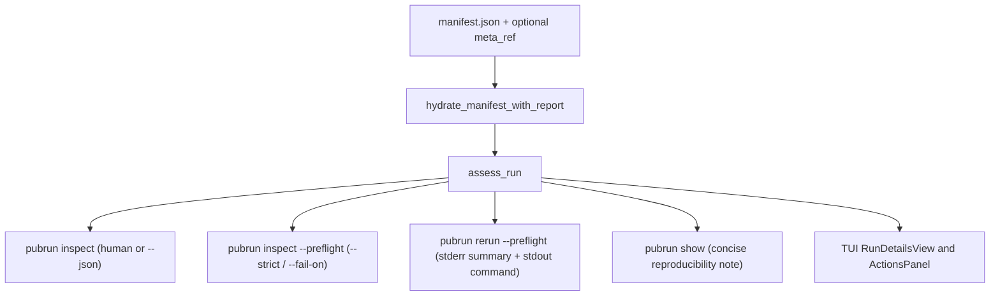

# IPD: CLI and TUI integration for reproducibility assessment and preflight

- Date: 2026-11-21
- Kind: child
- Concern: Command-line interface (CLI), terminal user interface (TUI), and machine-readable JSON integration with backwards-compatible exit and piping contracts
- Scope: Wire the shared reproducibility assessment and opt-in `--preflight` engine into `pubrun inspect`, `pubrun rerun`, `pubrun show`, and TUI widgets (`RunDetailsView`, `ActionsPanel`), add `--strict` / `--fail-on` exit options without breaking default exit codes or `pubrun rerun` stdout piping, and add CLI and TUI behavioral tests.
- Scope-Paths: src/pubrun/__main__.py, src/pubrun/report/diagnostics.py, src/pubrun/tui/widgets/details.py, src/pubrun/tui/widgets/actions.py, tests/test_checks_commands.py, tests/test_cli.py, tests/test_tui.py
- Item-Dependencies: executed:tusvtd
- Status: to-review
- Work-Kind: feature
- Priority: medium
- From-Backlog: q3bll1
- Set: repro-check
- Order: 3
- Highest E allocated: 05
- Author: agent
- Id: 3lqtlt
- Short-Description: Integrate shared reproducibility assessment and preflight into inspect, rerun, show, and TUI with strict exit behavior

> Write and proofread this plan per the technical writing standard, `.aw/system/workflows/technical-writing/technical-writing.md` (`.agents/workflows/technical-writing/technical-writing.md` in a legacy-layout install), including requirement 12 (diagrams).

## Workflow history

- 2026-11-21 to-review (agent): created child plan 03 of Set `repro-check` graduating backlog item `q3bll1`.

## Goal

Expose the shared reproducibility gap assessment and opt-in offline preflight comparison through existing `pubrun` user surfaces (`pubrun inspect`, `pubrun rerun`, `pubrun show`, and the interactive TUI) so human summaries, TUI views, and `--json` output all come from one engine. Preserve backwards compatibility for `pubrun rerun` stdout piping, default exit codes, `NO_COLOR` / non-TTY accessibility, and optional TUI dependency isolation.

### CLI and TUI dispatch flow

This diagram summarizes how existing commands and TUI widgets consume the shared assessment engine. The text below is normative.

## Detailed Implementation Checklist (TODO)

Execution-state rule: mark an `E-*` item complete only after performing the action. That mark is not validation. Right-sizing rule: write for a modest executor that cannot hold much in its head. Each E-item is one step (one concern, about one file, executable in one focused pass) and its V-item names each unit it covers with its own check; a plan stays at about 5 E-items and 8 work Scope-Paths, else split it into more child plans (guidance, `IPD-Z603`). Accepted execution states: blocked, failed, pending, performed; terminal gate demands 'performed'.

### Task group 1: Wire `pubrun inspect` and `pubrun rerun` in CLI

- [ ] E-01 Update `_run_inspect` and `inspect` argument parser in `src/pubrun/__main__.py` to hydrate `meta_ref`, run `assess_run(preflight=...)`, render concise/detailed human output with highest-value next step and non-guarantee disclaimer, emit structured `--json` preserving top-level `"findings"`, and support `--preflight` and `--fail-on {warn,mismatch,unknown}` with `--strict`.
  - Depends on: none
  - Expected outcome: `pubrun inspect` hydrates `meta_ref` via `hydrate_manifest_with_report`, shows the different-host banner when applicable, prints a concise summary plus next step (terse default) or category-grouped detail (`-v`/`--show-suggestions`), emits full structured JSON with `--json` (retaining `"findings"` alongside `"categories"`, `"next_action"`, `"disclaimer"`, `"parent_metadata"`, and `"preflight"`), runs offline preflight only when `--preflight` is passed, exits `0` by default, and exits `1` when `--strict` (or `--fail-on`) triggers.
  - Execution state: pending

- [ ] E-02 Update `_run_rerun` and `rerun` argument parser in `src/pubrun/__main__.py` to add opt-in `--preflight`, `--strict`, `--fail-on`, and `--json` while keeping default `pubrun rerun` output and piping 100% backwards compatible.
  - Depends on: E-01
  - Expected outcome: Default `pubrun rerun [RUN_DIR]` prints only `rerun_command` to `stdout` with exit code `0` (safe for `pubrun rerun | bash`); `pubrun rerun --preflight` prints the preflight summary and any redacted-command warning to `stderr` while still printing `rerun_command` to `stdout` (never executing the command); `pubrun rerun --preflight --strict` exits `1` without printing `rerun_command` to `stdout` when the strict condition triggers; `pubrun rerun --preflight --json` prints structured JSON (`rerun_command`, `executable_as_printed`, `assessment`) to `stdout`.
  - Execution state: pending

### Task group 2: Surface shared summary in `pubrun show` and TUI widgets

- [ ] E-03 Update `src/pubrun/report/diagnostics.py`, `src/pubrun/tui/widgets/details.py`, and `src/pubrun/tui/widgets/actions.py` to display the shared reproducibility summary and redacted-rerun advisory using `pubrun.report.reproducibility` formatters.
  - Depends on: E-01
  - Expected outcome: `print_report` in `src/pubrun/report/diagnostics.py` (at `standard` and `deep` depths, never breaking `logs`/`env`/`packages` section extracts) displays a concise reproducibility assessment line and highest-value next step (and inherited-section note when `meta_ref` hydrated sections); `RunDetailsView` in `src/pubrun/tui/widgets/details.py` displays the shared reproducibility summary section; `ActionsPanel` in `src/pubrun/tui/widgets/actions.py` displays an explicit advisory when `rerun_command` contains `[REDACTED]` markers. No duplicate assessment logic is introduced and TUI stays optional.
  - Execution state: pending

### Task group 3: CLI and TUI behavioral tests

- [ ] E-04 Expand `tests/test_checks_commands.py` and `tests/test_cli.py` with behavioral CLI tests for `pubrun inspect`, `pubrun inspect --preflight`, `--json`, `--strict`, `--fail-on`, `NO_COLOR`, and `pubrun rerun` piping plus `--preflight` / `--strict` / `--json`.
  - Depends on: E-02
  - Expected outcome: All existing CLI tests pass unchanged, and new tests verify `pubrun inspect` with `meta_ref` hydration, `pubrun inspect --preflight` (terse, `-v`, `--json`, `--strict`, `--fail-on mismatch`, `--fail-on unknown`), default `pubrun rerun` stdout cleanliness for piping, `pubrun rerun --preflight` writing diagnostics only to `stderr`, `pubrun rerun --preflight --strict` aborting with exit code `1` and empty `stdout` on material mismatch or redacted command, and zero ANSI escape sequences under `NO_COLOR=1`.
  - Execution state: pending

- [ ] E-05 Expand `tests/test_tui.py` with behavioral tests verifying `RunDetailsView` reproducibility summary rendering and `ActionsPanel` redacted-rerun advisory (both unit-level and via Textual `Pilot` when `textual` is installed).
  - Depends on: E-03
  - Expected outcome: `tests/test_tui.py` passes via `pytest` (including graceful skip when `textual` is absent and full `Pilot` verification when installed), proving TUI output matches the shared formatter from `pubrun.report.reproducibility` and never breaks non-TUI environments.
  - Execution state: pending

## Project conventions discovered (Step 0)

- `src/pubrun/__main__.py` routes `_run_inspect` and `_run_rerun` through `_get_manifest_path`, handles `RunInProgressOrCrashedError` (reconstructing a rerun command from `.pubrun.lock` in `_run_rerun`), respects `NO_COLOR` / `--no-color` globally, and uses `pubrun.report.output` (`[INFO ]`, `[WARN ]`, `[ERROR]`, `[ OK  ]`) for status prefixes.
- `pubrun inspect` currently supports `run_dir`, `--show-suggestions` / `-v`, `--json`, `--strict`, and shared run filters (`_add_run_filter_args`). Its `--json` output currently emits `{"findings": findings}`.
- `pubrun rerun` currently supports `run_dir` and shared run filters (`_add_run_filter_args`) and prints only `rerun_command` to `stdout` (warnings go to `stderr`), as documented in `docs/cli.md` (`pubrun rerun ./runs/pubrun-A | bash`).
- `pubrun show` supports `--basic`, `--standard`, `--deep`, `--utc`, and bare section tokens `SHOW_SECTIONS = ("logs", "env", "packages")` plus `show config` / `show run config` / `show default config`.
- `tests/test_tui.py` tests pure-Python text formatters unconditionally and uses `pytest.importorskip("textual")` with `app.run_test()` for live widget rendering.

## Findings

1. `_run_inspect` in `src/pubrun/__main__.py` currently reads raw `manifest.json` without calling `hydrate_manifest`, so high-performance computing (HPC) child runs with `meta_ref` appear to have missing hardware/packages even when a valid parent `meta.json` exists.
2. `_run_rerun` prints a `[REDACTED]` command with no preflight check option and no advisory that redacted arguments make the command non-executable verbatim.
3. Neither `print_report` (`src/pubrun/report/diagnostics.py`) nor the TUI (`RunDetailsView`, `ActionsPanel`) surfaces reproducibility gaps or inherited `meta_ref` context today.

## Proposed changes (ordered, validatable)

1. **`src/pubrun/__main__.py` (`inspect`)**:
   - Add `--preflight` (`action="store_true"`, help explaining read-only offline comparison of supported recorded requirements against the current environment) and `--fail-on` (`choices=["warn", "mismatch", "unknown"]`, default `None`, help explaining strict exit threshold; passing `--fail-on` implies strict exit checking, and `--strict` without `--fail-on` defaults to `warn` for 100% backwards compatibility).
   - In `_run_inspect`: call `hydrate_manifest_with_report(manifest_path, manifest)` before calling `assess_run(hydrated, manifest_path=manifest_path, hydration_report=hydration_report, current_hostname=current_hostname, preflight=preflight)`.
   - Keep the different-host banner behavior intact for human output.
   - In `--json` mode: print JSON containing `"findings"` (top-level list, preserving existing contract) plus `"schema_version"`, `"mode"`, `"summary"`, `"next_action"`, `"next_actions"`, `"disclaimer"`, `"categories"`, `"parent_metadata"`, and `"preflight"`.
   - In human mode: print concise summary + highest-value next step + non-guarantee disclaimer by default (terse), and category summaries + per-item findings with evidence status and suggestions under `--show-suggestions` / `-v`. Respect `NO_COLOR` and non-TTY streams (no `DIM` ANSI codes).
   - Exit `1` if `strict` or `fail_on` is set and `should_fail_strict(assessment, fail_on=fail_on or "warn")` is `True`; otherwise exit `0`.

2. **`src/pubrun/__main__.py` (`rerun`)**:
   - Add opt-in flags on `rerun_parser`: `--preflight` (`action="store_true"`), `--strict` (`action="store_true"`), `--fail-on` (`choices=["warn", "mismatch", "unknown"]`, default `None`), and `--json` (`action="store_true"`, dest `"as_json"`).
   - Guard invalid combinations cleanly: if `--strict` or `--fail-on` or `--json` is passed without `--preflight`, emit a clear error on `stderr` explaining `--preflight` is required and exit `2` (or treat `--fail-on` as requiring `--preflight`).
   - When `--preflight` is NOT set: execute the exact existing `rerun` code path (stdout contains only `rerun_command`; exit `0`).
   - When `--preflight` IS set:
     - Hydrate manifest via `hydrate_manifest_with_report` and call `assess_run(..., preflight=True)`.
     - Evaluate `strict_failed = (strict or fail_on is not None) and should_fail_strict(assessment, fail_on=fail_on or "warn")`.
     - Detect `executable_as_printed = ("[REDACTED]" not in rerun_cmd)`.
     - If `as_json`: print JSON `{"rerun_command": rerun_cmd, "executable_as_printed": executable_as_printed, "assessment": assessment}` to `stdout`; exit `1` if `strict_failed`, else `0`.
     - Else (human/pipe mode): print preflight summary and highest-value next step (plus explicit warning if `not executable_as_printed`) to `stderr`. If `strict_failed`, exit `1` WITHOUT printing `rerun_command` to `stdout` (preventing downstream pipes from running on failed preflight). Otherwise print `rerun_command` to `stdout` and exit `0`.
     - If `RunInProgressOrCrashedError` occurs with `--preflight`, emit an honest `stderr` warning that preflight cannot run without a finalized `manifest.json` (lock-file command is `inferred`) and exit `1` if `--strict`, else print the reconstructed command as before.

3. **`src/pubrun/report/diagnostics.py`, `src/pubrun/tui/widgets/details.py`, and `src/pubrun/tui/widgets/actions.py`**:
   - In `diagnostics.print_report`: use `hydrate_manifest_with_report` (preserving all existing warning lines) and, in `standard` and `deep` depths (after the standard summary block, never inside `logs`/`env`/`packages` section extracts or `basic` mode), print a concise `Reproducibility` block using `format_reproducibility_summary` plus a nudge to run `pubrun inspect --preflight` for environment comparison.
   - In `RunDetailsView.update_general_pane`: when `r.manifest` exists, hydrate safely with `hydrate_manifest_with_report`, call `assess_run(hydrated, manifest_path=..., hydration_report=..., preflight=False)`, and render a `=== REPRODUCIBILITY & EVIDENCE ===` section from `format_reproducibility_summary` (never running live preflight on every sidebar click to keep TUI browsing fast and non-blocking).
   - In `ActionsPanel.display_run`: when `rerun_cmd` contains `[REDACTED]`, display an explicit advisory beneath the rerun command stating that redacted arguments must be supplied manually before executing.

4. **`tests/test_checks_commands.py`, `tests/test_cli.py`, and `tests/test_tui.py`**:
   - Add subprocess CLI tests exercising `pubrun inspect` (hydration, concise output, `-v`, `--json`, `--preflight`, `--strict`, `--fail-on`, `NO_COLOR`), `pubrun rerun` (unchanged default stdout piping, `--preflight` stderr vs stdout separation, `--preflight --strict` empty stdout + exit `1`, `--preflight --json`, redacted command handling), `pubrun show` (standard/deep summary line, unaffected section extracts), and TUI widget tests (`RunDetailsView` and `ActionsPanel`).

## Deferred / out of scope (with reason)

- User documentation updates (`docs/cli.md`, `docs/hpc.md`, `docs/manifest.md`, `docs/api.md`): performed in child plan `sdg31l` (`Order: 4`).
- Subpackage import-integrity regression update (`tests/test_report_subpackage_integrity.py`) and whole-Set scenario test suite (`tests/test_reproducibility_e2e.py`): performed in child plan `sdg31l` (`Order: 4`).
- Interactive TUI button to trigger live preflight on demand: deferred to keep TUI browsing strictly non-blocking and lightweight; CLI `pubrun inspect --preflight` and `pubrun rerun --preflight` provide explicit on-demand preflight.

## Scope check

- Over-scope: none. Only wires the already-built shared engine into existing CLI commands, `diagnostics.py`, and TUI widgets with behavioral tests.
- Under-scope: none. Covers CLI, TUI, JSON agreement, backwards-compatible `rerun` piping, and optional strict exit behavior required by `q3bll1` items 1, 4, and 6.

## Required tests / validation

- Run `pytest tests/test_checks_commands.py tests/test_cli.py tests/test_tui.py tests/test_reports.py -v` and paste actual runner output.
- Confirm `import pubrun` still does not import `pubrun.report.checks` or `pubrun.report.reproducibility`.

## Spec / documentation sync

- User-facing CLI, HPC, manifest, and API docs are updated in child plan `sdg31l` (`Order: 4`).
- `schemas/manifest.schema.json`: N/A (unchanged).

## Open questions

### OQ-01: `--fail-on` flag behavior when passed without `--strict`

- Blocking: no
- Status: resolved
- Owner: none
- Resolution or deferral rationale: Passing `--fail-on <level>` expresses an explicit non-zero exit criterion, so treating `--fail-on` as activating strict exit checking (without forcing users to type both `--strict --fail-on mismatch`) avoids silent no-op flags while keeping `--strict` alone mapped to `warn` for backwards compatibility. RESOLVED 2026-11-21 by the user via /askme: Treat `--fail-on <level>` as implicitly activating strict exit checking, while keeping `--strict` alone mapped to `warn` for backward compatibility. No reason was given.

## Validation and cross-check (verify before reporting done)

Validation-state rule: inspect evidence in a separate pass. Do not mark a `V-*` item complete from memory or from the matching execution checkmark. Accepted validation results: blocked, failed, pass, pending; terminal gate demands 'pass'. Runtime-demonstration reachability rule: for each `V-*` item demanding the software be observed acting (such as a run, a dispatch, or a transition)—as distinct from items demanding a diff, a file's content, or a test result, which are reachable by construction—name the code path that produces the observation or the sibling `E-*` that creates it, else the demand is UNDER-SCOPE.

- [ ] V-01 validates E-01
  - Required evidence: Paste `pytest tests/test_checks_commands.py -v` output showing exit code 0 with passing CLI subprocess tests for `pubrun inspect`, `pubrun inspect --preflight`, `pubrun inspect --json`, `pubrun inspect --strict`, `pubrun inspect --preflight --fail-on mismatch`, and `meta_ref` hydration inside `inspect`.
  - Observed evidence:
  - Result: pending

- [ ] V-02 validates E-02
  - Required evidence: Paste `pytest tests/test_cli.py -k rerun -v` output showing exit code 0, proving default `pubrun rerun` prints only the rerun command to `stdout`, `pubrun rerun --preflight` prints diagnostics only to `stderr`, `pubrun rerun --preflight --strict` exits `1` with empty `stdout` on mismatch or redacted command, and `pubrun rerun --preflight --json` emits valid JSON with `executable_as_printed`.
  - Observed evidence:
  - Result: pending

- [ ] V-03 validates E-03
  - Required evidence: Paste `pytest tests/test_reports.py tests/test_show_sections.py tests/test_tui.py -v` output showing exit code 0, confirming `print_report` surfaces the concise reproducibility note without breaking `logs`/`env`/`packages` section extracts and TUI views render the shared summary and redacted-rerun advisory.
  - Observed evidence:
  - Result: pending

- [ ] V-04 validates E-04
  - Required evidence: Paste full output of `pytest tests/test_checks_commands.py tests/test_cli.py -v` showing exit code 0 and zero regressions across existing CLI tests (including `NO_COLOR=1` ANSI suppression).
  - Observed evidence:
  - Result: pending

- [ ] V-05 validates E-05
  - Required evidence: Paste full output of `pytest tests/test_tui.py -v` showing exit code 0 (and noting whether `textual` was installed in the test environment).
  - Observed evidence:
  - Result: pending

## Approval and execution gate

- Size assessment: standard
- Cohesion rationale: not required

Execution requires explicit human approval (`- Status: approved`) and completion of dependency `tusvtd`. Commit only the scoped files through `aw commit 3lqtlt -- <paths>`, paste actual runner output into `Observed evidence`, and run the post-gate `aw ipd` lifecycle transition to `.aw/records/plans/executed/`.
