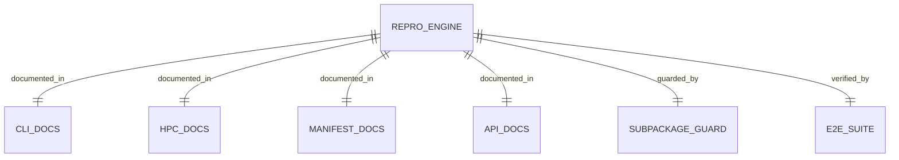

# IPD: Documentation sync, subpackage guard, and whole-Set validation

- Date: 2026-11-21
- Kind: child
- Concern: Documentation accuracy, subpackage import-integrity regression guard, and whole-Set end-to-end validation
- Scope: Update `docs/cli.md`, `docs/hpc.md`, `docs/manifest.md`, and `docs/api.md` for reproducibility assessment and preflight, add `reproducibility` to `tests/test_report_subpackage_integrity.py`, add end-to-end tests in `tests/test_reproducibility_e2e.py` covering all eight `q3bll1` scenarios, and run the full repository test suite.
- Scope-Paths: docs/cli.md, docs/hpc.md, docs/manifest.md, docs/api.md, tests/test_report_subpackage_integrity.py, tests/test_reproducibility_e2e.py
- Item-Dependencies: executed:3lqtlt
- Status: approved
- Readiness: go-pending-approval
- Review-Depth: complex
- Work-Kind: feature
- Priority: medium
- From-Backlog: q3bll1
- Set: repro-check
- Order: 4
- Highest E allocated: 04
- Author: agent
- Id: sdg31l
- Approval: 2026-11-22, recorded via aw ipd set: status set to approved
- Short-Description: Update CLI/HPC/manifest/API docs, guard subpackage imports, and run whole-Set end-to-end validation

> Write and proofread this plan per the technical writing standard, `.aw/system/workflows/technical-writing/technical-writing.md` (`.agents/workflows/technical-writing/technical-writing.md` in a legacy-layout install), including requirement 12 (diagrams).

## Workflow history

- 2026-11-22 approved (aw set): status set to approved
- 2026-11-22 /plan-review (Antigravity / Gemini 4 Neon (High)): APPROVE WITH REVISIONS APPLIED; PR-001, PR-002, PR-003, PR-004
- 2026-11-21 to-review (agent): created child plan 04 of Set `repro-check` graduating backlog item `q3bll1`.

## Goal

Synchronize user and developer documentation with the shipped reproducibility assessment and preflight behavior from prerequisite child plans `0b8i7x` (shared evidence model), `tusvtd` (read-only offline preflight comparison), and `3lqtlt` (CLI and TUI integration). Guard the new `pubrun.report.reproducibility` submodule against import-mode shadowing regressions while proving all six import modes never load report or preflight modules on import. Verify all eight acceptance scenarios from backlog item `q3bll1` end-to-end through the real command-line interface (CLI) and Python application programming interface (API), and validate the complete repository test suite.

### Documentation sync and validation relationships

The text in `## Proposed changes (ordered, validatable)` is normative. This diagram summarizes how the four synchronized documentation files and two verification suites cover Set `repro-check`.

## Detailed Implementation Checklist (TODO)

Execution-state rule: mark an `E-*` item complete only after performing the action. That mark is not validation. Right-sizing rule: write for a modest executor that cannot hold much in its head. Each E-item is one step (one concern, about one file, executable in one focused pass) and its V-item names each unit it covers with its own check; a plan stays at about 5 E-items and 8 work Scope-Paths, else split it into more child plans (guidance, `IPD-Z603`). Accepted execution states: blocked, failed, pending, performed; terminal gate demands 'performed'.

### Task group 1: Documentation synchronization

- [ ] E-01 Update `docs/cli.md` and `docs/hpc.md` to document `pubrun inspect --preflight`, `pubrun rerun --preflight`, `--strict` / `--fail-on`, the structured JavaScript Object Notation (JSON) contracts, `pubrun show` and `pubrun ui` reproducibility views, evidence statuses, non-guarantee disclaimer, exit codes, and high-performance computing (HPC) parent `meta_ref` hydration diagnostics.
  - Depends on: none
  - Expected outcome: `docs/cli.md` (`inspect`, `rerun`, `show`, `ui`, and `Exit Codes`) and `docs/hpc.md` (`Diagnosing a finished run`) accurately describe all new flags, `--fail-on` activating strict exit checking, exit code `2` on invalid `rerun` flag combinations without `--preflight`, lock-file fallback behavior, stdout/stderr piping guarantees, full `--json` schemas (`inspect` 10-key schema and `rerun --preflight --json`), evidence statuses (`observed`, `inferred`, `asserted`, `inherited`, `unavailable`, `not_checked`), non-guarantee disclaimer, and HPC parent-snapshot inheritance limits. Edits preserve any sibling-Set documentation already on disk and introduce zero em dashes (`U+2014`) or en dashes (`U+2013`) in added or modified user-facing prose.
  - Execution state: pending

- [ ] E-02 Update `docs/manifest.md` and `docs/api.md` to document parent `meta_ref` inheritance semantics, the documented diagnostic helpers (`pubrun.report.checks.assess_run`, `pubrun.report.checks.should_fail_strict`, `pubrun.report.utils.hydrate_manifest_with_report`), and the read-only offline boundary of reproducibility assessment.
  - Depends on: E-01
  - Expected outcome: `docs/manifest.md## Meta Snapshot` clarifies that hydrated sections are marked `is_hydrated` at report time and carry `inherited` evidence status rather than direct child observation, and that script modification time (`mtime`) alone does not prove matching dependencies. `docs/api.md` adds a concise read-only post-hoc diagnostics/preflight reference naming `pubrun.report.checks.assess_run`, `pubrun.report.checks.should_fail_strict`, and `pubrun.report.utils.hydrate_manifest_with_report` while reinforcing that report modules are never loaded by `import pubrun`. Edits preserve any sibling-Set documentation already on disk and introduce zero em dashes (`U+2014`) or en dashes (`U+2013`) in added or modified user-facing prose.
  - Execution state: pending

### Task group 2: Subpackage regression guard and end-to-end scenario coverage

- [ ] E-03 Update `tests/test_report_subpackage_integrity.py` to guard `pubrun.report.reproducibility` (including six-mode import-isolation verification) and create `tests/test_reproducibility_e2e.py` exercising all eight `q3bll1` acceptance scenarios end-to-end via real `pubrun` runs and CLI invocations.
  - Depends on: E-02
  - Expected outcome: `tests/test_report_subpackage_integrity.py` adds `"reproducibility"` to `_REPORT_SUBMODULES`, verifies BEFORE importing submodules that `import pubrun.<mode>` under all six import modes (`auto`, `noauto`, `full`, `nopatch`, `noconsole`, `minimal`) never imports `pubrun.report.checks` or `pubrun.report.reproducibility`, and verifies `pubrun.report.reproducibility` remains importable alongside callable `pubrun.report()` in both single-process and six-mode subprocess tests (satisfying orchestrator `osjxbz` cross-IPD validation). `tests/test_reproducibility_e2e.py` passes all eight `q3bll1` scenarios (adequate recorded evidence with non-guarantee disclaimer, dirty source without recorded diff, missing dependencies, package mismatch, missing or changed input, redacted arguments, unavailable parent snapshot, and partial or failed capture) using isolated `git` config in `tmp_path`, plus an offline/read-only/no-replay CLI proof and CLI-vs-`assess_run()` consistency checks.
  - Execution state: pending

### Task group 3: Whole-Set validation

- [ ] E-04 Run the complete test suite (`pytest tests/ -v`), manifest schema conformance tests (`tests/test_manifest_schema.py`), six-mode import-isolation checks, and path-sanitization check, and record the Continuous Integration (CI) matrix readiness requirement.
  - Depends on: E-03
  - Expected outcome: `pytest tests/ -v` exits `0` with zero failures (confirming `test_reproducibility_assessment.py`, `test_reproducibility_preflight.py`, `test_report_subpackage_integrity.py`, `test_reproducibility_e2e.py`, `test_checks_commands.py`, `test_cli.py`, `test_tui.py`, and `test_manifest_schema.py` all pass), `python3 scripts/sanitize_paths.py --check --all` exits `0`, six-mode import-isolation checks confirm `import pubrun` never loads `pubrun.report.checks` or `pubrun.report.reproducibility`, and the execution report explicitly states that the GitHub Actions multi-OS/Python matrix (`.github/workflows/ci.yml`: Linux, Windows, and macOS across Python 3.8 through 3.14) must pass on pull request or push before release.
  - Execution state: pending

## Project conventions discovered (Step 0)

- User-facing documentation (`docs/cli.md`, `docs/hpc.md`, `docs/manifest.md`, `docs/api.md`, `README.md`) must contain no em dashes (`U+2014`) or en dashes (`U+2013`) in newly authored or edited text (per `AGENTS.md` agent execution contract) and must follow `.aw/system/workflows/technical-writing/technical-writing.md`. Because existing untouched lines in these docs already contain em dashes, verification checks added (`+`) diff lines.
- `tests/test_report_subpackage_integrity.py` maintains `_REPORT_SUBMODULES = ["output", "checks", "diagnostics", "methods", "utils"]` and tests every import mode (`auto`, `noauto`, `full`, `nopatch`, `noconsole`, `minimal`) in a fresh subprocess so `pubrun.report` callable shadowing cannot break submodule imports.
- Prerequisite reviewed plans `0b8i7x` (`Order: 1`), `tusvtd` (`Order: 2`), and `3lqtlt` (`Order: 3`) establish `pubrun.report.utils::hydrate_manifest_with_report`, `pubrun.report.checks::assess_run`, `pubrun.report.checks::should_fail_strict`, `pubrun.report.reproducibility::format_reproducibility_summary` / `format_reproducibility_detail` / `NON_GUARANTEE_DISCLAIMER`, `pubrun inspect` 10-key `--json` schema and `--fail-on`, `pubrun rerun --preflight` (including exit code `2` on invalid flag combinations and lock-file handling), `pubrun show` standard/deep summary, and TUI `RunDetailsView` / `ActionsPanel` updates.
- Concurrent sibling plans (`hm32d9` and `4gpguy` in Set `file-prov`, `iflqsl` in Set `dep-capture`, `3tvesf` in Set `timing-acc`, `ckc3vl` in Set `startup-perf`, `zp2yyu` in Set `cap-isolation`) also edit `docs/cli.md`, `docs/manifest.md`, and `docs/api.md`; all edits in this plan must remain strictly additive/targeted and preserve sibling-Set documentation already on disk.
- `tests/test_manifest_schema.py` validates real manifests against `schemas/manifest.schema.json` using `jsonschema`.
- `.github/workflows/ci.yml` defines the repository's supported OS and Python matrix (`ubuntu-latest`, `ubuntu-24.04`, `windows-latest`, `macos-latest` across Python `3.8` through `3.14`) running `pytest tests/ -v`.

## Findings

1. Adding `pubrun.report.reproducibility` without adding `"reproducibility"` to `_REPORT_SUBMODULES` and asserting six-mode import isolation in `tests/test_report_subpackage_integrity.py` would leave the new submodule unguarded against callable-subpackage shadowing and host-path import leaks.
2. `docs/cli.md` currently documents `pubrun inspect` without `--preflight`, `--fail-on`, `meta_ref` hydration, or the 10-key JSON schema; documents `pubrun rerun` without `--preflight`, `--strict`, `--fail-on`, `--json`, exit code `2` validation, or lock-file fallback; omits reproducibility summaries in `### show` and `### ui`; and lists only exit codes `0` and `1` in `## Exit Codes`.
3. `docs/hpc.md` (`## Diagnosing a finished run`) and `docs/manifest.md` (`## Meta Snapshot`) describe `meta_ref` hydration without explaining `is_hydrated`, `inherited` versus direct `observed` evidence, parent age/identity checks, or why script `mtime` alone does not prove matching dependencies.
4. `docs/api.md` does not yet point readers to the read-only post-hoc diagnostic helpers (`pubrun.report.checks.assess_run`, `pubrun.report.checks.should_fail_strict`, `pubrun.report.utils.hydrate_manifest_with_report`) or their isolation from `import pubrun`.

## Proposed changes (ordered, validatable)

1. **`docs/cli.md`**:
   - Update `### inspect` with `meta_ref` hydration, `--preflight`, `--fail-on {warn,mismatch,unknown}` (noting that `--fail-on` implies strict exit checking and works with or without `--preflight`, while `--strict` alone defaults to `warn`), the full 10-key structured JSON output (`schema_version`, `mode`, `summary`, `next_action`, `next_actions`, `disclaimer`, `categories`, `findings`, `parent_metadata`, `preflight`), evidence statuses (`observed`, `inferred`, `asserted`, `inherited`, `unavailable`, `not_checked`), explicit non-guarantee note, and concrete examples.
   - Update `### rerun` with opt-in `--preflight`, `--strict`, `--fail-on`, and `--json`, explicitly documenting that default `pubrun rerun | bash` piping is unchanged, that passing `--strict`/`--fail-on`/`--json` without `--preflight` exits `2` with empty `stdout`, that `--preflight` prints diagnostics and redacted-command advisories to `stderr`, that `--preflight --strict` (or `--fail-on`) exits `1` with empty `stdout` on failure, that `--preflight --json` emits `{"rerun_command", "executable_as_printed", "assessment"}`, that crashed/running lock-file runs surface an `inferred` command warning (or JSON with `preflight.status = "unknown"`), and that `pubrun` never executes the recorded command automatically.
   - Update `### show` to note the concise reproducibility summary and inherited-section note in `standard` and `deep` reports (omitted from `basic` and `logs`/`env`/`packages` section extracts).
   - Update `### ui` to note the shared reproducibility summary in Run Details (no live preflight on browse) and the separate redacted-command advisory in Actions (keeping copied rerun commands clean).
   - Update `## Exit Codes` to document `0`, `1` (errors and triggered `--strict`/`--fail-on`), and `2` (invalid CLI arguments or unsupported flag combinations such as `pubrun rerun --strict` without `--preflight`).
   - Preserve any sibling-Set additions (such as `hm32d9` file-provenance documentation) and introduce zero `U+2014` or `U+2013` characters.

2. **`docs/hpc.md`**:
   - Update `## Diagnosing a finished run` (including `### The "different system" banner` and `### Capture-completeness`) to cover `pubrun inspect --preflight` on clusters (explaining how cross-node inspection separates expected portability/hostname differences from material package, Python, source, and input mismatches) and how `meta_ref` parent snapshots are assessed for availability, age, identity, and `inherited` versus `observed` status. Introduce zero `U+2014` or `U+2013` characters.

3. **`docs/manifest.md` and `docs/api.md`**:
   - Update `docs/manifest.md## Meta Snapshot` to explain `is_hydrated` (applied at report time without mutating `manifest.json`), `inherited` evidence classification versus direct child observation, parent snapshot availability/age/identity diagnostics, and why script `mtime` alone does not prove matching dependencies.
   - Update `docs/api.md` (adding a concise post-hoc diagnostics/preflight subsection before `## API Summary` and preserving any sibling-Set additions) documenting `pubrun.report.checks.assess_run`, `pubrun.report.checks.should_fail_strict`, and `pubrun.report.utils.hydrate_manifest_with_report` as read-only offline diagnostic helpers that are never loaded by `import pubrun`.
   - Introduce zero `U+2014` or `U+2013` characters in added or modified lines.

4. **`tests/test_report_subpackage_integrity.py`**:
   - Add `"reproducibility"` to `_REPORT_SUBMODULES`.
   - In `test_report_is_callable_and_subpackage_under_every_mode`, assert BEFORE importing `_REPORT_SUBMODULES` that `'pubrun.report.checks' not in sys.modules and 'pubrun.report.reproducibility' not in sys.modules` across all six import modes (`auto`, `noauto`, `full`, `nopatch`, `noconsole`, `minimal`).
   - In `test_report_call_and_submodule_coexist_same_process`, also import `pubrun.report.reproducibility` after calling `base.report(...)` and completing a run cycle.

5. **`tests/test_reproducibility_e2e.py`** (new test file):
   - Exercise all eight scenarios required by `q3bll1` acceptance criteria using real `tmp_path` fixtures, real manifests, isolated real Git repos (`git init` with explicit `-c user.name=... -c user.email=...` so tests pass on CI runners without global git config), and real `sys.executable -m pubrun` subprocess calls:
     1. Adequate recorded evidence (verifying `NON_GUARANTEE_DISCLAIMER` is present and sparse/legacy manifests also avoid claiming reproduction is guaranteed).
     2. Dirty source without recorded diff/patch.
     3. Missing dependencies (`packages` suppressed or empty).
     4. Package version mismatch and missing package on preflight.
     5. Missing and content-changed input file on preflight (plus stat-only `not_checked` distinct from verified hash match).
     6. Redacted CLI arguments (`rerun_command` contains `[REDACTED]`, warned as not directly executable; `rerun --preflight --strict` exits `1` with empty `stdout`).
     7. Unavailable / moved / policy-blocked parent `meta_ref` snapshot (and available stale/inherited snapshot distinct from direct observation).
     8. Partial or failed capture (`capture_state.status` = `partial`/`failed`/`timeout`, non-completed run outcome).
   - Verify offline/read-only/no-replay CLI safety: invoking `pubrun rerun --preflight` on a recorded script containing a side-effect sentinel (writing a marker file) never executes the script and leaves `tmp_path` unmodified.
   - Verify CLI (`inspect --json`, `inspect --preflight --json`, `rerun --preflight --json`) and Python `pubrun.report.checks.assess_run()` produce matching category statuses, finding codes, and `next_action`.

## Deferred / out of scope (with reason)

- Running the GitHub Actions Windows and macOS CI matrix locally: unavailable on a single Linux workstation; tracked as a required pre-merge CI gate via `.github/workflows/ci.yml`.
  - Carrier-Declined: local Linux worktree cannot execute Windows/macOS runners; enforced via `.github/workflows/ci.yml` on push/PR.
- Performance speedup benchmarks: not applicable because Set `repro-check` adds read-only diagnostic/preflight tooling off the `import pubrun` path and claims no speedup; six-mode import-path isolation (`import pubrun.<mode>` never imports `pubrun.report.checks` or `pubrun.report.reproducibility`) is verified instead.
  - Carrier-Declined: no runtime hot-path change or speedup claim; import-path isolation is verified across all six modes in `tests/test_report_subpackage_integrity.py`.

## Scope check

- Over-scope: none. Only updates the four affected documentation files, guards the new report submodule across all six import modes, adds the eight `q3bll1` acceptance scenarios, and runs whole-Set validation.
- Under-scope: none. Closes every documentation, cross-IPD consistency (`osjxbz`), and whole-Set validation requirement for Set `repro-check` and backlog item `q3bll1`.

## Required tests / validation

- Run `pytest tests/test_report_subpackage_integrity.py tests/test_reproducibility_e2e.py tests/test_manifest_schema.py -v`.
- Run the full repository test suite `pytest tests/ -v` (confirming `test_reproducibility_assessment.py`, `test_reproducibility_preflight.py`, `test_checks_commands.py`, `test_cli.py`, `test_tui.py`, `test_report_subpackage_integrity.py`, `test_reproducibility_e2e.py`, and `test_manifest_schema.py` pass).
- Run `python3 scripts/sanitize_paths.py --check --all`.
- Verify added (`+`) lines of `git diff -U0 -- docs/cli.md docs/hpc.md docs/manifest.md docs/api.md` contain zero `U+2014` or `U+2013` characters.

## Spec / documentation sync

- Updates `docs/cli.md`, `docs/hpc.md`, `docs/manifest.md`, and `docs/api.md` in `E-01` and `E-02`.
- `schemas/manifest.schema.json`: unchanged and validated by `tests/test_manifest_schema.py` in `E-04`.

## Open questions

### OQ-01: Multi-OS and multi-Python CI matrix execution

- Blocking: no
- Status: resolved
- Owner: plan author (confirmed by evidence 2026-11-21)
- Resolution or deferral rationale: Per `q3bll1` shared validation requirements, CLI and platform-dependent changes require the repository's supported OS/Python CI matrix (`.github/workflows/ci.yml`: Linux, Windows, macOS across Python 3.8 through 3.14) before completion. Local validation runs on the current Linux Python version; full matrix verification occurs when pushed to GitHub Actions CI. RESOLVED 2026-11-21 by evidence via /askme: Confirmed per `AGENTS.md` matrix-validation discipline, backlog item `q3bll1`, and `.github/workflows/ci.yml` (21-job Linux/Windows/macOS x Python 3.8-3.14 matrix) that local validation runs on Linux and full matrix validation runs on GitHub Actions CI on push.

## Validation and cross-check (verify before reporting done)

Validation-state rule: inspect evidence in a separate pass. Do not mark a `V-*` item complete from memory or from the matching execution checkmark. Accepted validation results: blocked, failed, pass, pending; terminal gate demands 'pass'. Runtime-demonstration reachability rule: for each `V-*` item demanding the software be observed acting (such as a run, a dispatch, or a transition) (as distinct from items demanding a diff, a file's content, or a test result, which are reachable by construction), name the code path that produces the observation or the sibling `E-*` that creates it, else the demand is UNDER-SCOPE.

- [ ] V-01 validates E-01
  - Required evidence: Paste `git diff --stat -- docs/cli.md docs/hpc.md` plus key diff excerpts confirming all new `inspect`/`rerun`/`show`/`ui` flags, exit codes (`0`, `1`, `2`), JSON schemas, lock-file fallback, evidence statuses, and HPC parent-hydration notes match implemented `pubrun inspect --help` / `pubrun rerun --help` output, and paste output of a Python check over added (`+`) lines of `git diff -U0 -- docs/cli.md docs/hpc.md` reporting zero `U+2014` or `U+2013` characters.
  - Observed evidence:
  - Result: pending

- [ ] V-02 validates E-02
  - Required evidence: Paste `git diff --stat -- docs/manifest.md docs/api.md` plus key diff excerpts confirming `meta_ref` inheritance semantics (`is_hydrated`, `inherited` vs `observed`, script `mtime` limit) and documented read-only helpers (`assess_run`, `should_fail_strict`, `hydrate_manifest_with_report`) match `src/pubrun/report/utils.py`, `src/pubrun/report/checks.py`, and `src/pubrun/report/reproducibility.py`, and paste output of a Python check over added (`+`) lines of `git diff -U0 -- docs/manifest.md docs/api.md` reporting zero `U+2014` or `U+2013` characters.
  - Observed evidence:
  - Result: pending

- [ ] V-03 validates E-03
  - Required evidence: Paste actual runner output of `pytest tests/test_report_subpackage_integrity.py tests/test_reproducibility_e2e.py -v` showing exit code 0, confirming all six import modes (`auto`, `noauto`, `full`, `nopatch`, `noconsole`, `minimal`) keep `pubrun.report.checks` and `pubrun.report.reproducibility` unimported on `import pubrun.<mode>` while allowing `pubrun.report.reproducibility` to coexist with callable `pubrun.report()`, and confirming all eight `q3bll1` end-to-end scenarios plus offline/read-only/no-replay and CLI-vs-API consistency tests pass.
  - Observed evidence:
  - Result: pending

- [ ] V-04 validates E-04
  - Required evidence: Paste actual runner output (all exit code 0) of `pytest tests/ -v` (confirming `test_reproducibility_assessment.py`, `test_reproducibility_preflight.py`, `test_report_subpackage_integrity.py`, `test_reproducibility_e2e.py`, `test_checks_commands.py`, `test_cli.py`, `test_tui.py`, and `test_manifest_schema.py` pass), `python3 scripts/sanitize_paths.py --check --all`, and `python3 -c "import pubrun, sys; assert 'pubrun.report.checks' not in sys.modules and 'pubrun.report.reproducibility' not in sys.modules; print('ISOLATED')"` printing `ISOLATED`, plus an explicit note recording the pending GitHub Actions multi-OS/Python CI matrix gate (`.github/workflows/ci.yml`).
  - Observed evidence:
  - Result: pending

## Approval and execution gate

- Size assessment: standard
- Cohesion rationale: not required

Execution contract:
1. Open questions: all open questions are resolved (`OQ-01` confirmed by evidence on 2026-11-21); do not execute until prerequisite `3lqtlt` (CLI and TUI integration for reproducibility assessment and preflight) is `executed` and a human approves this plan (`- Status: approved`).
2. Scope declaration: expected modified or created files are `docs/cli.md`, `docs/hpc.md`, `docs/manifest.md`, `docs/api.md`, `tests/test_report_subpackage_integrity.py`, and `tests/test_reproducibility_e2e.py`. Keep edits within this scope; if execution genuinely requires an out-of-scope path or leaves a declared path unmodified, justify it via `--scope-reason` or `--scope-ack` at finalize rather than stopping mid-run. Stop and report only for genuinely unsafe conditions (such as an unresolvable concurrent-edit conflict or missing prerequisite symbols from `3lqtlt`).
3. Honesty rule (HARD MUST): paste actual `pytest`, Python, and `git diff` runner output and exit codes into each `V-*` `Observed evidence:` field; never claim tests passed without running them.
4. Commit and push discipline: commit only the files changed for this plan through `aw commit sdg31l -- <paths>`; never use `git add -A`, `git add .`, or `git commit -a`; never push without explicit human authorization.
5. Lifecycle transition on completion: this plan must reach `.aw/records/plans/executed/` with `- Status: executed` through `aw ipd finalize` once all `E-*` are `performed` and all `V-*` are `pass`. In a runner-managed lane, the runner performs `aw ipd finalize`; in standalone execution, run `aw ipd lint --phase pre-transition` and finalize directly through `aw ipd finalize`. Never hand-roll a raw `git mv` to `.aw/records/plans/executed/`.
