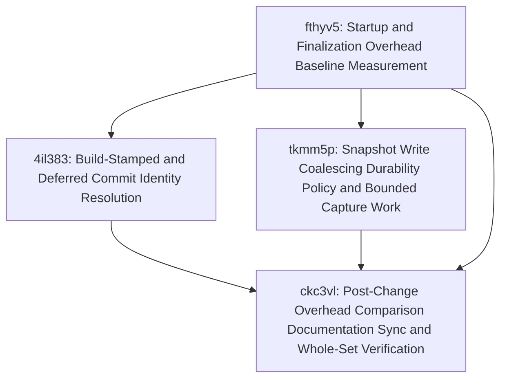
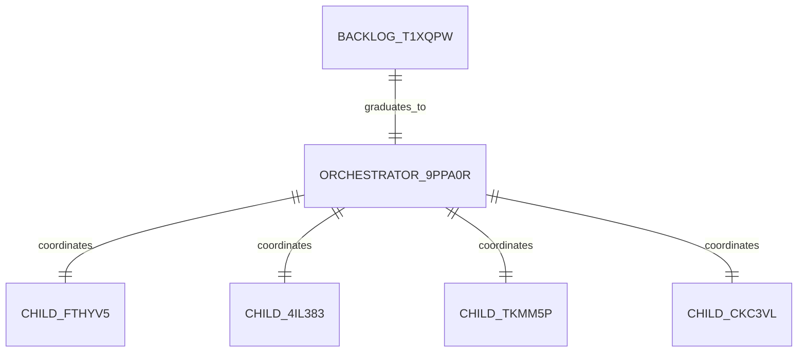

# IPD: Startup Overhead Bounding and Artifact Write Coalescing

- Date: 2026-11-21
- Kind: orchestrator
- Concern: Startup overhead bounding, truthful build-stamped and deferred commit identity, redundant artifact write elimination, explicit durability policy, and bounded capture work.
- Scope: Full-Set coordination for backlog item `t1xqpw` across baseline measurement, commit identity and boot configuration loading, snapshot write coalescing, explicit durability policy, bounded Git and hardware capture budgets, post-change benchmark comparison, documentation reconciliation, and whole-Set verification.
- Scope-Paths: .aw/records/plans/pending/20261121-startup-perf-00-9ppa0r-startup-overhead-bounding-and-artifact-write-coalescing.ipd.md
- Item-Dependencies: none
- Status: to-review
- Coverage: pass
- Coverage-Fingerprint: dd7a784cfa1b8ef42077785d4db149076e3945e37aee10119d895544a4a4c560
- Coverage-Checked: 2026-11-22 by uri/its_direct/pt3-claude-opus-5.5-1m-us
- Short-Description: Coordinate baseline measurement, deferred commit identity, write coalescing, durability policy, and docs/verification
- Work-Kind: followup
- Priority: high
- From-Backlog: t1xqpw
- Set: startup-perf
- Order: 0
- Highest E allocated: 04
- Author: agent
- Id: 9ppa0r

> Write and proofread this plan per the technical writing standard, `.aw/system/workflows/technical-writing/technical-writing.md` (`.agents/workflows/technical-writing/technical-writing.md` in a legacy-layout install), including requirement 12 (diagrams).

## Workflow history

- 2026-11-22 coverage pass (aw oc run): fingerprint dd7a784cfa1b, model uri/its_direct/pt3-claude-opus-5.5-1m-us
- 2026-11-22 draft (agent): created.
- 2026-11-22 to-review (agent): authored review-ready orchestrator plan graduating backlog item `t1xqpw` into Set `startup-perf` with four child plans (`fthyv5`, `4il383`, `tkmm5p`, `ckc3vl`).

## Goal

Graduate open backlog item `t1xqpw` into four bounded, verifiable child Implementation Plan Documents (IPDs) that establish pre-change startup and finalization baselines, remove avoidable Git process spawns at import time while preserving truthful package identity, eliminate redundant configuration snapshot writes and coalesce hardware refreshes, expose an explicit artifact durability policy separate from atomic visibility, bound total Git and hardware capture work, and verify post-change gains with synchronized documentation.

### Set structure and execution sequence

The child table and text below are normative. These diagrams summarize the execution sequence and entity relationships in Set `startup-perf`.

## Detailed Implementation Checklist (TODO)

Execution-state rule: mark an `E-*` item complete only after performing the action. That mark is not validation. Right-sizing rule: write for a modest executor that cannot hold much in its head. Each E-item is one step (one concern, about one file, executable in one focused pass) and its V-item names each unit it covers with its own check; a plan stays at about 5 E-items and 8 work Scope-Paths, else split it into more child plans (guidance, `IPD-Z603`). Accepted execution states: blocked, failed, pending, performed; terminal gate demands 'performed'.

### Task group 1: Confirm child IPD completion

- [ ] E-01 CONFIRM fthyv5 REACHED executed
  - Depends on: none
  - Expected outcome: Child plan `fthyv5` is moved to `.aw/records/plans/executed/` with `- Status: executed`, all `E-*` items marked `performed`, and all `V-*` items marked `pass`.
  - Execution state: pending

- [ ] E-02 CONFIRM 4il383 REACHED executed
  - Depends on: E-01
  - Expected outcome: Child plan `4il383` is moved to `.aw/records/plans/executed/` with `- Status: executed`, all `E-*` items marked `performed`, and all `V-*` items marked `pass`.
  - Execution state: pending

- [ ] E-03 CONFIRM tkmm5p REACHED executed
  - Depends on: E-01
  - Expected outcome: Child plan `tkmm5p` is moved to `.aw/records/plans/executed/` with `- Status: executed`, all `E-*` items marked `performed`, and all `V-*` items marked `pass`.
  - Execution state: pending

- [ ] E-04 CONFIRM ckc3vl REACHED executed
  - Depends on: E-02, E-03
  - Expected outcome: Child plan `ckc3vl` is moved to `.aw/records/plans/executed/` with `- Status: executed`, all `E-*` items marked `performed`, and all `V-*` items marked `pass`.
  - Execution state: pending

## Child IPDs, sequence, and dependencies

| Order | Id | File | What it does | Depends on |
|---|---|---|---|---|
| 01 | `fthyv5` | `20261121-startup-perf-01-fthyv5-startup-and-finalization-overhead-baseline-measurement.ipd.md` | Builds a local, non-publishing startup/finalization breakdown benchmark (`benchmarks/startup_breakdown.py`), extends `benchmarks/scenarios.py` and `benchmarks/README.md`, adds behavioral benchmark tests, and records pre-change baseline measurements with baseline-derived targets. | none |
| 02 | `4il383` | `20261121-startup-perf-02-4il383-build-stamped-and-deferred-commit-identity-resolution.ipd.md` | Replaces eager import-time Git execution in `src/pubrun/__init__.py` with lazy PEP 562 `__commit__` resolution, prefers validated build-stamped metadata for installed wheels, enforces repository ownership and bounded Git lookup for verified checkouts, avoids duplicate Tom's Obvious Minimal Language (TOML) boot reads in `src/pubrun/_config_boot.py`, updates `hatch_build.py`, `pyproject.toml`, and `scripts/update_commit_file.py`, and adds commit-identity tests. | 01 |
| 03 | `tkmm5p` | `20261121-startup-perf-03-tkmm5p-snapshot-write-coalescing-durability-policy-and-bounded-capt.ipd.md` | Eliminates redundant `config.resolved.json` rewrites while preserving early crash evidence and mid-run reconfiguration updates, coalesces startup and background hardware snapshot writes safely, adds an explicit `[core].artifact_durability` policy separate from atomic visibility, bounds total Git and hardware capture time in `src/pubrun/capture/git.py` and `src/pubrun/capture/hardware.py`, and adds behavioral tests. | 01 |
| 04 | `ckc3vl` | `20261121-startup-perf-04-ckc3vl-post-change-overhead-comparison-documentation-sync-and-whole.ipd.md` | Runs post-change benchmarks against the `fthyv5` baseline across default and opt-in durability policies, reconciles `docs/performance.md`, `docs/configuration.md`, `docs/architecture.md`, `docs/functional_spec.md`, and `docs/manifest.md`, and runs whole-Set verification. | 01, 02, 03 |

## Completion criteria (the whole Set is done only when)

- Pre-change baseline measurements separate import-only (`noauto` and `minimal`), auto-start, startup capture, workload, finalization, subprocess creation, serialization, and synchronization across cold and warm passes with environment, revision, filesystem type, repetitions, median, and dispersion recorded, and derive concrete numerical targets from that baseline rather than invented budgets. Owner: `fthyv5`.
- Minimal and `noauto` imports of an installed package do not launch Git solely to identify `pubrun`, and wheel versus source-checkout cases report accurate or explicitly unknown (`None`) identity across nested repositories, missing Git, Git timeout, and stale build metadata without polluting the source tree or parsing `.pubrun.toml` twice during boot mode resolution. Owner: `4il383`.
- Unchanged configuration snapshots (`config.resolved.json`) are not rewritten during background hardware refresh or finalization, mid-run configuration changes update `config.resolved.json` accurately, startup crash evidence, read-only ghost mode, concurrent readers, atomic replacement, and slow hardware finishing after `stop()` retain correct behavior, explicit durability policy (`[core].artifact_durability`) is separated from atomic visibility without silently weakening the default, and total Git and hardware capture work is bounded without deferring source-state capture past user modifications. Owner: `tkmm5p`.
- Post-change measurements compare against the `fthyv5` baseline with separate fixed startup and finalization costs plus absolute milliseconds and relative overhead for short and long workloads under default and opt-in durability policies, no unauthorized benchmark submission, GitHub Gist publication, or High-Performance Computing (HPC) scheduler job occurs, documentation and specifications (`docs/performance.md`, `docs/configuration.md`, `docs/architecture.md`, `docs/functional_spec.md`, `docs/manifest.md`) match the implemented behavior, and whole-Set regression checks pass. Owner: `ckc3vl`.

## Cross-IPD validation

- Baseline-to-implementation measurement contract: child `fthyv5` establishes the reproducible local breakdown measurement tool and pre-change baseline numbers, and child `ckc3vl` runs that exact tool after `4il383` and `tkmm5p` land to produce an apples-to-apples before/after table without changing default durability.
- Import-identity and writer integration check: child `4il383` verifies lazy `__commit__` resolution across wheel and checkout paths, child `tkmm5p` verifies startup/refresh/finalization manifest and config write behavior including `run.library_commit` persistence, and child `ckc3vl` runs the full repository test suite (`pytest tests/ -v`) and benchmark conformance tests to verify both changes compose cleanly.
- Documentation, example, and hygiene check: child `ckc3vl` runs `pytest tests/ -v`, `pytest benchmarks/test_benchmarks.py benchmarks/test_share_safety.py -o addopts="" -v`, `python examples/verify_all.py`, and `python3 scripts/sanitize_paths.py --check --all` after `fthyv5`, `4il383`, and `tkmm5p` are executed.

## Deferred / out of scope (with reason)

- Monotonic run/phase/subprocess timing and workload-versus-overhead manifest fields belong to sibling Set `timing-acc` (`nr63qr`, backlog item `6hp1zu`). Set `startup-perf` coordinates with `timing-acc` by reading additive manifest timing fields when present and avoiding any second `manifest.json` write at finalization while remaining independently executable.
- Runs-index performance optimization and unrelated backlog items (`w4hxkh`, `x21s6w`, `x6alw4`, `q3bll1`) are out of scope.
- External benchmark submission, GitHub Gist creation, GitHub Issue posting, and HPC scheduler job submission (`benchmarks/submit_bench*.sh`, `pubrun bench --contribute`) are prohibited unless explicitly authorized by the maintainer.
- Multi-operating-system and multi-Python Continuous Integration (CI) matrix execution (`ubuntu-latest`, `ubuntu-24.04`, `windows-latest`, `macos-latest` across Python 3.8 through 3.14 in `.github/workflows/ci.yml`) runs in GitHub Actions after local execution and is recorded as a required post-merge gate by child `ckc3vl`.

## Scope check

- Over-scope: none. Every child plan maps directly to the startup overhead, commit identity, snapshot write coalescing, durability policy, capture budget, benchmarking, and documentation requirements of backlog item `t1xqpw`.
- Under-scope: none. Every requirement and acceptance criterion in `t1xqpw` is assigned to a named child plan (`fthyv5`, `4il383`, `tkmm5p`, or `ckc3vl`).

## Required tests / validation

This orchestrator plan runs no tests directly. Whole-Set validation is performed by its child plans:

- Child `fthyv5` runs `pytest tests/test_startup_benchmark.py -v`, `pytest benchmarks/test_benchmarks.py benchmarks/test_share_safety.py -o addopts="" -v`, and the pre-change baseline benchmark via `python benchmarks/startup_breakdown.py`.
- Child `4il383` runs `pytest tests/test_commit_identity.py tests/test_import_modes.py tests/test_cli.py tests/test_tracker.py -v`.
- Child `tkmm5p` runs `pytest tests/test_startup_overhead_writes.py tests/test_writer.py tests/test_tracker.py tests/test_capture_engines.py tests/test_hardware.py tests/test_edge_cases.py tests/test_manifest_schema.py -v`.
- Child `ckc3vl` runs the post-change comparison benchmark (`python benchmarks/startup_breakdown.py` and local non-publishing `python benchmarks/harness.py`), `pytest tests/ -v`, `pytest benchmarks/test_benchmarks.py benchmarks/test_share_safety.py -o addopts="" -v`, `python examples/verify_all.py`, and `python3 scripts/sanitize_paths.py --check --all`.

## Open questions

### OQ-01: Proposed configuration key names for durability policy and total capture budgets

- Blocking: no
- Status: resolved
- Owner: maintainer (confirmed upon plan approval)
- Resolution or deferral rationale: Backlog item `t1xqpw` notes that new configuration names are proposals rather than pre-approved contracts. Child `tkmm5p` proposes `[core].artifact_durability` (`"fsync"` default, plus `"finalize"`, `"atomic"`, `"strict"`), `[capture.git].total_timeout` (default `5`), and `[capture.hardware].total_timeout` (default `10`). Keeping `"fsync"` as default preserves existing file-synchronization durability with zero silent weakening. The maintainer may rename any proposed key during review before approving `tkmm5p`.

### OQ-02: Shared-filesystem measurement availability in local execution

- Blocking: no
- Status: resolved
- Owner: maintainer (confirmed upon plan approval)
- Resolution or deferral rationale: Local developer machines and CI runners typically expose only local filesystems (such as `ext4` or `tmpfs`), whereas shared Network File System (NFS) or Lustre mounts live on HPC clusters where scheduler submission requires explicit authorization. Child `fthyv5` and child `ckc3vl` record detected filesystem types via `get_filesystem()`, document local-storage scope honestly, support an optional `--workdir` flag so the maintainer can run the exact same breakdown script on a shared filesystem without modifying code, and never submit scheduler jobs automatically.

## Validation and cross-check (verify before reporting the Set complete)

Validation-state rule: inspect evidence in a separate pass. Do not mark a `V-*` item complete from memory or from the matching execution checkmark. Accepted validation results: blocked, failed, pass, pending; terminal gate demands 'pass'. Runtime-demonstration reachability rule: for each `V-*` item demanding the software be observed acting (such as a run, a dispatch, or a transition)—as distinct from items demanding a diff, a file's content, or a test result, which are reachable by construction—name the code path that produces the observation or the sibling `E-*` that creates it, else the demand is UNDER-SCOPE.

- [ ] V-01 validates E-01
  - Required evidence: Path `.aw/records/plans/executed/20261121-startup-perf-01-fthyv5-startup-and-finalization-overhead-baseline-measurement.ipd.md` exists, shows `- Status: executed`, has all `E-*` items `performed` and all `V-*` items `pass`, and `aw ipd lint --phase post-transition` exits 0 on it.
  - Observed evidence:
  - Result: pending

- [ ] V-02 validates E-02
  - Required evidence: Path `.aw/records/plans/executed/20261121-startup-perf-02-4il383-build-stamped-and-deferred-commit-identity-resolution.ipd.md` exists, shows `- Status: executed`, has all `E-*` items `performed` and all `V-*` items `pass`, and `aw ipd lint --phase post-transition` exits 0 on it.
  - Observed evidence:
  - Result: pending

- [ ] V-03 validates E-03
  - Required evidence: Path `.aw/records/plans/executed/20261121-startup-perf-03-tkmm5p-snapshot-write-coalescing-durability-policy-and-bounded-capt.ipd.md` exists, shows `- Status: executed`, has all `E-*` items `performed` and all `V-*` items `pass`, and `aw ipd lint --phase post-transition` exits 0 on it.
  - Observed evidence:
  - Result: pending

- [ ] V-04 validates E-04
  - Required evidence: Path `.aw/records/plans/executed/20261121-startup-perf-04-ckc3vl-post-change-overhead-comparison-documentation-sync-and-whole.ipd.md` exists, shows `- Status: executed`, has all `E-*` items `performed` and all `V-*` items `pass`, and `aw ipd lint --phase post-transition` exits 0 on it.
  - Observed evidence:
  - Result: pending

## Approval and execution gate

- Size assessment: standard
- Cohesion rationale: not required

This orchestrator plan coordinates Set `startup-perf` (`fthyv5`, `4il383`, `tkmm5p`, `ckc3vl`) and executes no application code directly.

Execution contract:
1. All open questions (OQ-01, OQ-02) are resolved for review and become binding upon human approval of this Set.
2. Scope fence: this orchestrator modifies only its own plan file during lifecycle retirement; do not expand scope or add non-confirmation steps to this orchestrator.
3. Honesty rule: confirm child completion only by inspecting the executed child plan files on disk and running `aw ipd lint --phase post-transition`; never claim a child reached `executed` without verifying its file state.
4. Commit discipline: retire this orchestrator via `aw commit` path-scoped to its moved plan file; never use `git add -A`, `git add .`, or `git commit -a`; never push without explicit human instruction.
5. Lifecycle move on completion: after all four child plans (`fthyv5`, `4il383`, `tkmm5p`, `ckc3vl`) reach `executed` on disk, move this orchestrator from `.aw/records/plans/pending/` to `.aw/records/plans/executed/`, set `- Status: executed`, and append a dated `## Workflow history` line.
