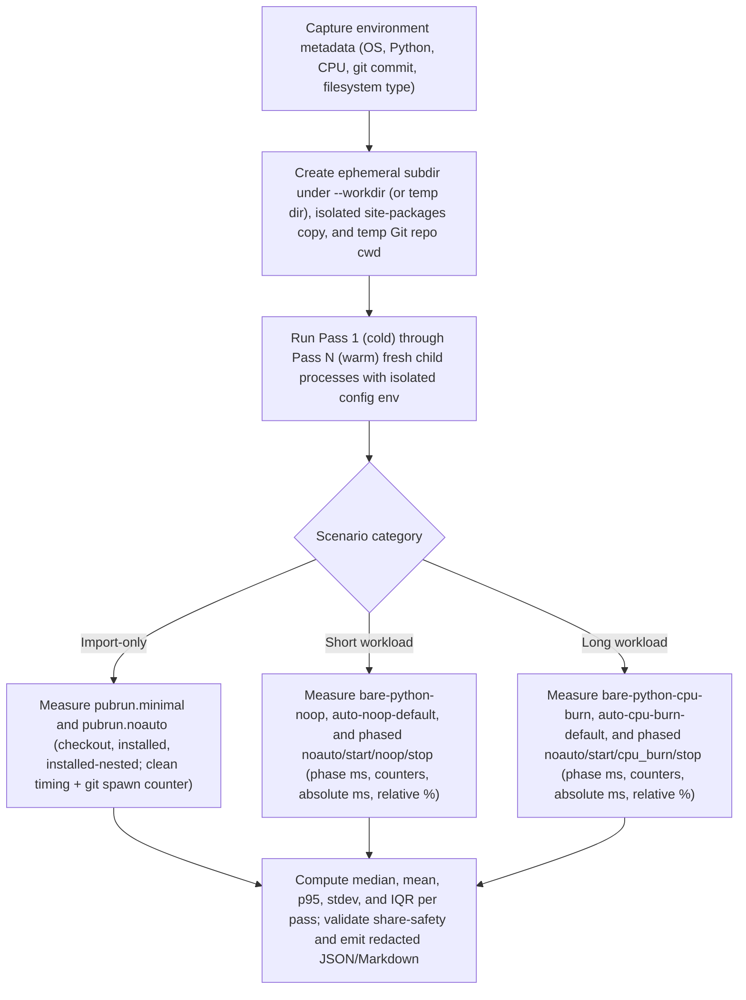

# IPD: Startup and Finalization Overhead Baseline Measurement

- Date: 2026-11-21
- Kind: child
- Concern: Reproducible pre-change measurement of import, startup capture, finalization, subprocess spawn, serialization, and synchronization costs.
- Scope: Add a stdlib-only, non-publishing startup and finalization breakdown benchmark (`benchmarks/startup_breakdown.py`), add installed-layout and short-versus-long workload coverage in `benchmarks/scenarios.py` and `benchmarks/README.md`, add behavioral tests in `tests/test_startup_benchmark.py`, and execute the pre-change baseline to establish baseline-derived numerical targets.
- Scope-Paths: benchmarks/startup_breakdown.py, benchmarks/scenarios.py, benchmarks/README.md, tests/test_startup_benchmark.py
- Item-Dependencies: none
- Status: approved
- Readiness: go-pending-approval
- Review-Depth: standard
- Short-Description: Add startup/finalization breakdown benchmark and record pre-change baseline measurements and derived targets
- Work-Kind: followup
- Priority: high
- From-Backlog: t1xqpw
- Set: startup-perf
- Order: 1
- Highest E allocated: 05
- Author: agent
- Id: fthyv5
- Approval: 2026-11-22, recorded via aw ipd set: status set to approved

> Write and proofread this plan per the technical writing standard, `.aw/system/workflows/technical-writing/technical-writing.md` (`.agents/workflows/technical-writing/technical-writing.md` in a legacy-layout install), including requirement 12 (diagrams).

## Workflow history

- 2026-11-22 approved (aw set): status set to approved
- 2026-11-22 /plan-review (Antigravity / Gemini): APPROVE WITH REVISIONS APPLIED; PR-001, PR-002, PR-003, PR-004, PR-005, PR-006, PR-007
- 2026-11-22 draft (agent): created.
- 2026-11-22 to-review (agent): authored review-ready child plan from backlog item `t1xqpw`.

## Goal

Measure `pubrun` startup, import, capture, finalization, subprocess creation, serialization, and synchronization overhead before modifying any production code, and establish baseline-derived numerical targets that later plans in Set `startup-perf` verify against: `4il383` (build-stamped and deferred commit identity), `tkmm5p` (snapshot write coalescing, durability policy, and bounded capture work), and `ckc3vl` (post-change overhead comparison and documentation sync).

### Baseline measurement workflow

The text in `## Proposed changes (ordered, validatable)` is normative. This diagram summarizes the local, non-publishing measurement flow in `benchmarks/startup_breakdown.py`.



## Detailed Implementation Checklist (TODO)

Execution-state rule: mark an `E-*` item complete only after performing the action. That mark is not validation. Right-sizing rule: write for a modest executor that cannot hold much in its head. Each E-item is one step (one concern, about one file, executable in one focused pass) and its V-item names each unit it covers with its own check; a plan stays at about 5 E-items and 8 work Scope-Paths, else split it into more child plans (guidance, `IPD-Z603`). Accepted execution states: blocked, failed, pending, performed; terminal gate demands 'performed'.

### Task group 1: Measurement harness and scenario coverage

- [ ] E-01 Create `benchmarks/startup_breakdown.py` to measure import-only, auto-start, startup capture, workload, finalization, subprocess spawns, serialization, and synchronization costs in fresh child processes.
  - Depends on: none
  - Expected outcome: `benchmarks/startup_breakdown.py` uses Python standard library modules only (compatible with Python 3.8 through 3.14) and supports `--iterations`, `--passes`, `--warmup`, `--workdir`, `--durability-policies`, and `--out` with explicit CLI input validation. It creates and cleans up only a dedicated ephemeral subdirectory inside `--workdir`, isolates child `PUBRUN_*` and user-config environment variables, and never invokes GitHub, Gist, or scheduler commands. It runs clean uninstrumented timing probes alongside dedicated instrumented counter/serialization probes so `subprocess`/`json` wrappers do not distort wall-clock timings, separates import, startup capture, workload, and finalization costs, counts spawned `git` processes, `manifest.json`/`config.resolved.json` atomic writes, and `os.fsync` calls, compares source-checkout layout against isolated installed-package and nested-user-repo layouts (verifying `pubrun.__file__`), and reports Pass 1 (cold) through Pass N (warm) median, mean, 95th percentile (p95), standard deviation (stdev), and Interquartile Range (IQR) in milliseconds alongside absolute overhead (ms) and relative overhead (%) for short (`noop.py`) and long (`cpu_burn.py`) workloads. All emitted JSON and Markdown output omits raw paths, scrubs hostname, username, home directory, `--workdir`, and repository root substrings, and passes `benchmarks/share_safety.py::check_share_safe` before emission.
  - Execution state: pending

- [ ] E-02 Update `benchmarks/scenarios.py` to add a realistic default-config startup scenario (`startup-auto-default`, measuring `auto` with default config rather than `_ALL_OFF` only) while preserving full `pubrun-benchmark/5` schema conformance and existing scenario names.
  - Depends on: E-01
  - Expected outcome: `benchmarks/scenarios.py::all_scenarios` retains all existing scenarios unchanged and adds `startup-auto-default` in group `"startup"` so `benchmarks/harness.py` tracks default auto-start overhead alongside `_ALL_OFF` `import-auto`. `benchmarks/test_benchmarks.py`, `benchmarks/test_share_safety.py`, and `tests/test_bench_command.py` pass without error.
  - Execution state: pending

- [ ] E-03 Update `benchmarks/README.md` to document `benchmarks/startup_breakdown.py`, how to run it locally or on a shared filesystem via `--workdir`, how cold versus warm passes and dispersion metrics are reported, and that no submission or scheduler job is executed automatically.
  - Depends on: E-02
  - Expected outcome: `benchmarks/README.md` documents the breakdown script flags, output schema, and local-versus-shared filesystem testing instructions without em or en dashes in newly added prose.
  - Execution state: pending

### Task group 2: Behavioral tests and pre-change baseline capture

- [ ] E-04 Create `tests/test_startup_benchmark.py` with behavioral tests exercising `benchmarks/startup_breakdown.py` end-to-end on small iteration counts.
  - Depends on: E-03
  - Expected outcome: Tests execute `benchmarks/startup_breakdown.py` via Python function calls and subprocess CLI (`--iterations 2 --passes 2 --warmup 0`, plus `--iterations 1` edge case and invalid CLI argument rejection). They verify phase breakdown keys (import, startup, workload, finalization), `git`/write/`fsync`/serialization counters, installed-layout and nested-repo scenarios, cold-versus-warm pass arrays, dispersion statistics (median, mean, p95, stdev, IQR), absolute ms and relative overhead %, environment/filesystem metadata, redaction of home paths, hostnames, and custom `--workdir` paths (validated via `check_share_safe`), and preservation of pre-existing sibling files inside `--workdir` after cleanup.
  - Execution state: pending

- [ ] E-05 Run `tests/test_startup_benchmark.py`, `tests/test_bench_command.py`, `benchmarks/test_benchmarks.py`, `benchmarks/test_share_safety.py`, and the pre-change baseline measurement (`python benchmarks/startup_breakdown.py --passes 3 --iterations 15 --warmup 1`) against unmodified `src/pubrun/`, record the full baseline summary and proposed baseline-derived targets in `V-05`, and leave no stray unredacted files in the working tree.
  - Depends on: E-04
  - Expected outcome: All targeted test suites exit 0. The redacted pre-change baseline output is pasted in `V-05` with environment, git revision, filesystem type, repetitions, cold/warm pass medians, mean, p95, stdev, IQR, subprocess/write/fsync/serialization counters, absolute milliseconds, and relative overhead percentages for short and long workloads. `V-05` records concrete baseline-derived improvement targets for `4il383` (commit identity) and `tkmm5p` (write coalescing, durability, and capture budgets) proposed for maintainer agreement, and `git status -s` is clean of stray or unredacted result files.
  - Execution state: pending

## Project conventions discovered (Step 0)

- `benchmarks/harness.py` is stdlib-only and runs each scenario in a fresh child subprocess across an uncaptured baseline pass plus N measured passes (`pubrun-benchmark/5`), recording `machine.filesystem` via `src/pubrun/capture/filesystem.py::get_filesystem` and redacting hostnames, usernames, and home paths via `benchmarks/harness.py::redact_result` (note: `redact_result` scrubs `~` and `getpass.getuser()` substrings and `_REDACT_KEYS` fields, but does not substring-scrub `platform.node()` or arbitrary non-home `--workdir` paths, so `startup_breakdown.py` must apply stricter redaction and run `benchmarks/share_safety.py::check_share_safe`).
- `benchmarks/scenarios.py::all_scenarios` currently sets `config=_ALL_OFF` (`benchmarks/scenarios.py::_ALL_OFF`) on `import-auto`, `import-nopatch`, and `import-noconsole`, which hides default startup capture costs (such as Git capture and background hardware capture).
- `benchmarks/test_benchmarks.py` validates `pubrun-benchmark/5` results against `schemas/benchmark.schema.json` and is run explicitly with `pytest benchmarks/test_benchmarks.py -o addopts="" -v`; `tests/test_bench_command.py` also imports `benchmarks/scenarios.py::all_scenarios`.
- `benchmarks/workloads/noop.py` provides a near-zero short workload and `benchmarks/workloads/cpu_burn.py` provides a deterministic CPU-bound longer workload.
- `src/pubrun/__init__.py` executes `_resolve_commit()` and `_execute_boot_sequence()` synchronously during `import pubrun`, while `src/pubrun/capture/git.py::get_git` spawns up to five `git` subprocesses only when the working directory is inside a Git repository and `src/pubrun/config.py::resolve_config` loads `~/.config/pubrun/config.toml` (via `XDG_CONFIG_HOME`/`APPDATA`) and `PUBRUN_*` environment variables.
- Existing committed results under `benchmarks/results/` and `benchmarks/data/` are historical single-machine measurements and cannot serve as the baseline for backlog item `t1xqpw` (startup overhead bounding and artifact write coalescing).
- `AGENTS.md` prohibits em dashes and en dashes in user-facing documentation and requires testing observable behavior rather than code structure; `pyproject.toml` supports Python `>=3.8` through `3.14`.

## Findings

- **F-01 (No phase-level startup/finalization breakdown):** `benchmarks/harness.py` times only total child-process wall time. It does not separate Python startup, `import pubrun`, `Run.__init__` capture, user workload, `stop()`/writer finalization, Git subprocess count, serialization time, or artifact write/`fsync` counts.
- **F-02 (No installed-package vs source-checkout comparison):** `benchmarks/harness.py::_build_child_command` injects `PYTHONPATH=<repo>/src`, so it only measures the editable source-checkout path and never isolates an installed-wheel layout (where `pubrun` lives outside a Git checkout or inside a nested user repository).
- **F-03 (Default auto-start startup scenario absent):** `benchmarks/scenarios.py::all_scenarios` measures `import-auto` with `_ALL_OFF`, omitting default capture overhead at startup.

## Proposed changes (ordered, validatable)

1. **`benchmarks/startup_breakdown.py` (new stdlib-only measurement script, Python 3.8+ compatible):**
   - **CLI flags and validation:** Provide `--iterations` (int >= 1, default `15`), `--passes` (int >= 1, default `3`), `--warmup` (int >= 0, default `1`), `--workdir` (optional parent directory for testing local storage or a user-specified shared filesystem mount), `--durability-policies` (comma-separated subset of `default,fsync,finalize,atomic,strict`, defaulting to `"default"` so pre-change code runs cleanly, and supporting `"fsync,finalize,atomic,strict"` once `tkmm5p` lands), and `--out` (optional path for writing a redacted JSON report; stdout prints a concise redacted Markdown summary table). Reject invalid policy names or out-of-range numeric flags with a clear error message and non-zero exit code.
   - **Non-publishing invariant:** Never call `gh`, `git push`, Gist APIs, or batch schedulers (`sbatch`, `qsub`, `bsub`).
   - **Safe workdir handling and child-environment isolation:**
     - Create a dedicated ephemeral subdirectory via `tempfile.TemporaryDirectory(prefix="pubrun-startup-bench-", dir=workdir)` (creating `workdir` only if it does not yet exist, and verifying writability). Clean up ONLY that ephemeral subdirectory on exit so `--workdir` and any pre-existing files inside it are never deleted.
     - Strip inherited `PUBRUN_IMPORT_MODE`, `PUBRUN_AUTO_START`, `PUBRUN_PROFILE`, and `PUBRUN_META_REF` from child process environments, and point `XDG_CONFIG_HOME` (POSIX) and `APPDATA` (Windows) to an empty directory inside the ephemeral workdir so user-level `~/.config/pubrun/config.toml` never contaminates measurements.
     - For `--durability-policies`: `"default"` writes no `.pubrun.toml` override (measuring built-in defaults); each explicit policy (`"fsync"`, `"finalize"`, `"atomic"`, `"strict"`) writes `[core]\nartifact_durability = "<policy>"\n` into the child scenario's temporary `.pubrun.toml`.
   - **Run context and strict redaction:**
     - Capture run context using `src/pubrun/capture/filesystem.py::get_filesystem({}, paths)` for `workdir`, `tmpdir`, and `pubrun` install location, recording ONLY `fstype` and `is_network` (never emitting raw `path` or `mount_point` fields), alongside OS name/release, Python version, CPU model/core count, and current git commit SHA.
     - Redact all emitted JSON and Markdown text by omitting raw path fields, scrubbing `"hostname"`, `"username"`, `"workdir"`, and all `_REDACT_KEYS` fields, and deep-scrubbing substrings for `platform.node()`, `getpass.getuser()`, `os.path.expanduser("~")`, the resolved `--workdir` path, and the repository root path.
     - Run `benchmarks/share_safety.py::check_share_safe` on the redacted result before writing `--out` or printing stdout; fail closed (non-zero exit, write nothing to `--out`) if the self-check reports any violation.
   - **Isolated layouts and deterministic Git-repo working directory:**
     - **Source-checkout layout:** strip any other `pubrun` path from `PYTHONPATH` and prepend `<repo>/src`.
     - **Installed-package layout:** copy `src/pubrun` into `<ephemeral_workdir>/installed/site-packages/pubrun` with a valid synthetic 40-hex `COMMIT` file and NO `.git` directory in its ancestor chain (verified when `workdir` itself is outside a Git tree; otherwise note ancestor `.git` presence in metadata).
     - **Installed-nested layout:** initialize a small temporary user Git repository at `<ephemeral_workdir>/nested_repo/` (one commit) and copy `src/pubrun` into `<ephemeral_workdir>/nested_repo/.venv/site-packages/pubrun` with a distinct synthetic `COMMIT` file to measure the enclosing-repository import case.
     - **Child layout guard:** each child probe verifies `Path(pubrun.__file__).resolve()` lives under the expected root (`<repo>/src/pubrun` vs the intended isolated `site-packages/pubrun`) and exits non-zero if an editable install shadowed the intended layout.
     - **Auto-run working directory:** initialize a small deterministic temporary Git repository at `<ephemeral_workdir>/sample_repo/` (one tracked file, one commit, one local origin URL) and run `auto-noop-default`, `auto-cpu-burn-default`, and their phased equivalents with `cwd` inside that repository so `src/pubrun/capture/git.py::get_git` executes its real repository path (measuring all pre-change `git` subprocesses) rather than short-circuiting on a non-Git directory.
   - **Clean timing probes vs dedicated instrumented counter probes:**
     - Run wall-clock timing iterations in **uninstrumented** fresh child processes (no pre-imported `subprocess` or `json` wrappers) so instrumentation never masks pre-change `subprocess` import cost or inflates wall-clock timings.
     - Run a dedicated **instrumented counter probe** (per scenario, outside the timed samples) that wraps `subprocess.Popen`, `os.replace`, `os.fsync`, and `json.dump`/`json.dumps` (recording serialization calls attributed to `pubrun.writer`) to collect exact counts and serialization time:
       - `git` subprocess invocations
       - `manifest.json` atomic writes (`os.replace` targeting `manifest.json`)
       - `config.resolved.json` atomic writes (`os.replace` targeting `config.resolved.json`)
       - `os.fsync` calls during startup and finalization
       - JSON serialization time (ms) inside `pubrun.writer`
     - **Scenarios measured across Pass 1 (cold) through Pass N (warm) with `warmup` discarded iterations per pass:**
       1. `bare-python-noop` and `bare-python-cpu-burn`: bare Python running `benchmarks/workloads/noop.py` and `benchmarks/workloads/cpu_burn.py` (cost floors).
       2. `import-minimal-checkout`, `import-minimal-installed`, and `import-minimal-installed-nested`: `import pubrun.minimal` only; records clean wall time (ms) and instrumented `git` subprocess count.
       3. `import-noauto-checkout`, `import-noauto-installed`, and `import-noauto-installed-nested`: `import pubrun.noauto` only; records clean wall time (ms) and instrumented `git` subprocess count.
       4. `auto-noop-default` (short workload) and `auto-cpu-burn-default` (long workload), run per requested durability policy: measures clean end-to-end child wall time for `import pubrun` + workload + exit, AND runs matched phased probes (`import pubrun.noauto` -> `pubrun.start()` -> workload body -> `pubrun.stop()`) using `time.perf_counter()` around each phase to separate (a) package import, (b) startup capture and startup manifest write (`Run.__init__`), (c) workload body, and (d) finalization (`pubrun.stop()`), while recording additive `manifest["timing"]` fields when present (coordinating cleanly with sibling Set `timing-acc`, orchestrator `nr63qr`).
   - **Statistics, small-`n` safety, and failure handling:**
     - For each scenario and each pass (Pass 1 cold through Pass N warm), compute `n`, `failures`, `median_ms`, `mean_ms`, `p95_ms`, `stdev_ms`, and `iqr_ms` (`Q3 - Q1`). Handle small sample counts safely without raising `StatisticsError` (`n == 0` -> `None`; `n == 1` -> `stdev_ms = 0.0`, `iqr_ms = 0.0`, `p95_ms = s[0]`; `n >= 2` -> deterministic sorted percentile/quartile calculation).
     - For `auto-noop-default` and `auto-cpu-burn-default` (per durability policy), compute absolute overhead (ms above matched `bare-python-*` baseline) and relative overhead (% of matched baseline).
     - Record failed child invocations in `failures` and exit non-zero with a clear diagnostic if any scenario finishes a pass with `n == 0` successful samples.
2. **`benchmarks/scenarios.py`:**
   - Add `Scenario("startup-auto-default", "startup", "auto", "noop.py", config={})` right after the `import-<mode>` loop in `benchmarks/scenarios.py::all_scenarios` (Group 1) so `benchmarks/harness.py` tracks default auto-start startup cost without altering any existing scenario definition or breaking `pubrun-benchmark/5` validation.
3. **`benchmarks/README.md`:**
   - Add a concise subsection describing `benchmarks/startup_breakdown.py`, its CLI flags (`--iterations`, `--passes`, `--warmup`, `--workdir`, `--durability-policies`, `--out`), how to test local versus shared storage via `--workdir /path/to/shared/tmp`, cold/warm pass and dispersion reporting, and noting that it is strictly local and non-publishing (with zero em or en dashes in added prose).
4. **`tests/test_startup_benchmark.py`:**
   - Exercise `benchmarks/startup_breakdown.py` with small parameters (`--iterations 2 --passes 2 --warmup 0`, plus `--iterations 1` and invalid CLI flags) and assert on real structured output:
     - Presence of environment metadata (`os`, `python_version`, `git_commit`, `filesystem`) with no raw home path, hostname, or custom `--workdir` path leaked in redacted output, verified by `benchmarks/share_safety.py::check_share_safe`.
     - Presence of cold (pass 1) and warm (pass 2) per-pass statistics (`median_ms`, `mean_ms`, `p95_ms`, `stdev_ms`, `iqr_ms`) and safe handling of `--iterations 1`.
     - Presence of separate import, startup, workload, and finalization timings plus `git` spawn, config write, manifest write, `fsync`, and serialization counters across checkout, installed, and installed-nested layouts.
     - Presence of absolute overhead (ms) and relative overhead (%) for both short (`noop.py`) and long (`cpu_burn.py`) workloads.
     - `--workdir` creates temporary artifacts inside an ephemeral subdirectory under the requested directory, cleans up that subdirectory on exit, and leaves pre-existing sibling files inside `--workdir` intact.
     - Invalid `--durability-policies` or non-positive `--iterations`/`--passes` exit non-zero cleanly.
5. **Pre-change baseline execution and baseline-derived target table:**
   - Run `python benchmarks/startup_breakdown.py --passes 3 --iterations 15 --warmup 1` on the unmodified codebase.
   - Paste the complete redacted measurement summary into `V-05`, and record concrete proposed numerical targets derived directly from the measured baseline for maintainer agreement (per backlog item `t1xqpw` Acceptance Criterion #5: structural invariants such as zero `git` spawns on installed `minimal`/`noauto` import and `config.resolved.json` write count dropping from 2-3 to 1 for unchanged config, plus millisecond/percentage reduction targets anchored to the measured baseline rather than invented universal budgets).

## Deferred / out of scope (with reason)

- Modifying any file under `src/pubrun/`, `hatch_build.py`, or `pyproject.toml` is strictly out of scope for this plan so the baseline is guaranteed to reflect unmodified production code (`4il383` owns build-stamped/deferred commit identity and `tkmm5p` owns snapshot write coalescing, durability policy, and bounded capture work).
- Submitting benchmark results to GitHub Issues/Gists or running HPC scheduler scripts (`benchmarks/submit_bench*.sh`) is prohibited without explicit maintainer authorization.
- Updating `docs/performance.md` with before/after tables belongs to child plan `ckc3vl` (post-change overhead comparison and documentation sync) after `4il383` and `tkmm5p` land.

## Scope check

- Over-scope: none. Touches only benchmark measurement tooling, benchmark documentation, and its direct behavioral test file (4 Scope-Paths, 5 E-items).
- Under-scope: none. Covers every pre-change measurement dimension required by backlog item `t1xqpw` (startup overhead bounding and artifact write coalescing), Implementation guidance #1 and Acceptance Criteria #5 and #6.

## Required tests / validation

Run inside the repository root and capture actual runner output and exit codes:

```bash
pytest tests/test_startup_benchmark.py tests/test_bench_command.py -v
pytest benchmarks/test_benchmarks.py benchmarks/test_share_safety.py -o addopts="" -v
python benchmarks/startup_breakdown.py --passes 3 --iterations 15 --warmup 1
```

## Spec / documentation sync

Updates `benchmarks/README.md` for the new measurement script. User-facing performance documentation (`docs/performance.md`) is synchronized by child plan `ckc3vl` (post-change overhead comparison and documentation sync) once post-change measurements are available.

## Open questions

### OQ-01: Default iteration count for local pre-change and post-change breakdown runs

- Blocking: no
- Status: resolved
- Owner: plan author (overridable via CLI flags or upon plan approval)
- Resolution or deferral rationale: Defaulting `benchmarks/startup_breakdown.py` to 3 passes x 15 iterations (+1 discarded warmup per pass) balances statistical stability (capturing pass-1 cold vs pass-3 warm behavior plus stdev and IQR) with reasonable local runtime (~1-2 minutes), while `--iterations` and `--passes` allow larger sweeps on demand.

## Validation and cross-check (verify before reporting done)

Validation-state rule: inspect evidence in a separate pass. Do not mark a `V-*` item complete from memory or from the matching execution checkmark. Accepted validation results: blocked, failed, pass, pending; terminal gate demands 'pass'. Runtime-demonstration reachability rule: for each `V-*` item demanding the software be observed acting (such as a run, a dispatch, or a transition)—as distinct from items demanding a diff, a file's content, or a test result, which are reachable by construction—name the code path that produces the observation or the sibling `E-*` that creates it, else the demand is UNDER-SCOPE.

- [ ] V-01 validates E-01
  - Required evidence: Diff or file inspection confirming `benchmarks/startup_breakdown.py` is stdlib-only (Python 3.8+ safe), non-publishing, separates clean wall-clock timing probes from instrumented counter/serialization probes, separates import, startup capture, workload, and finalization phases, covers checkout, installed, and installed-nested layouts with `pubrun.__file__` verification and temp Git-repo cwd for auto scenarios, isolates child `PUBRUN_*` and config env vars, cleans up only an ephemeral subdirectory under `--workdir`, runs `benchmarks/share_safety.py::check_share_safe`, and validates CLI flags, plus pasted `python benchmarks/startup_breakdown.py --help` output (exit code 0).
  - Observed evidence:
  - Result: pending

- [ ] V-02 validates E-02
  - Required evidence: Diff of `benchmarks/scenarios.py` showing `startup-auto-default` added without modifying existing scenarios, plus pasted `pytest benchmarks/test_benchmarks.py benchmarks/test_share_safety.py -o addopts="" -v` and `pytest tests/test_bench_command.py -v` output (exit code 0).
  - Observed evidence:
  - Result: pending

- [ ] V-03 validates E-03
  - Required evidence: Diff of `benchmarks/README.md` showing usage documentation for `benchmarks/startup_breakdown.py`, `--workdir` shared-filesystem instructions, cold/warm and dispersion explanation, non-publishing notice, and zero em or en dashes in added lines.
  - Observed evidence:
  - Result: pending

- [ ] V-04 validates E-04
  - Required evidence: Pasted `pytest tests/test_startup_benchmark.py -v` output showing exit code 0 and all behavioral tests passing (phase breakdown, counters, checkout/installed/nested layouts, cold/warm passes, dispersion stats including `--iterations 1`, redaction and `check_share_safe`, `--workdir` ephemeral cleanup preserving sibling files, and invalid CLI argument rejection).
  - Observed evidence:
  - Result: pending

- [ ] V-05 validates E-05
  - Required evidence: Pasted full redacted output of `python benchmarks/startup_breakdown.py --passes 3 --iterations 15 --warmup 1` (exit code 0) containing environment, git revision, filesystem type, cold/warm pass medians, mean, p95, stdev, IQR, subprocess/write/fsync/serialization counts, absolute ms and relative overhead % for short (`noop.py`) and long (`cpu_burn.py`) workloads, plus concrete baseline-derived numerical targets proposed for `4il383` and `tkmm5p` and `git status -s` confirming no stray or unredacted result artifacts remain.
  - Observed evidence:
  - Result: pending

## Approval and execution gate

- Size assessment: standard
- Cohesion rationale: not required

Execution contract:
1. All open questions (OQ-01) are resolved for review; do not execute until a human approves this plan (`- Status: approved`).
2. Scope fence: this plan declares `benchmarks/startup_breakdown.py`, `benchmarks/scenarios.py`, `benchmarks/README.md`, and `tests/test_startup_benchmark.py` as its Scope-Paths, and keeps `src/pubrun/`, `hatch_build.py`, and `pyproject.toml` unmodified so measurements reflect the pre-change baseline. Any unavoidable out-of-scope edit or unmodified declared path must be justified at finalization via `--scope-reason` or `--scope-ack`; stop and report only for genuinely unsafe conditions (such as an unresolvable concurrent-edit conflict or missing prerequisite).
3. Honesty rule: paste actual runner output and exit codes for `pytest` and `benchmarks/startup_breakdown.py` into `V-*` `Observed evidence:`; never invent measurements or claim speedups.
4. Commit discipline: commit only the files changed for this plan using `aw commit fthyv5 -- <paths>`; never use `git add -A`, `git add .`, or `git commit -a`; never push or submit benchmarks externally without explicit human instruction.
5. Lifecycle transition on completion: when running under an `aw` runner, the runner owns the lifecycle transition via `aw ipd finalize`; when executing manually outside a runner, run `aw ipd lint --phase pre-transition` and, once it passes, finalize through `aw ipd finalize` (never a hand-rolled `git mv` to `executed/`).
