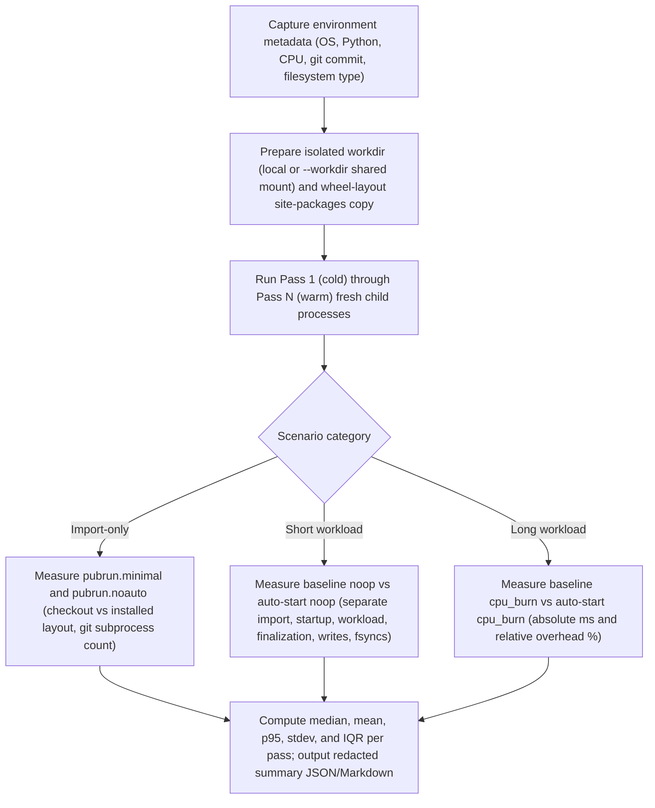

# IPD: Startup and Finalization Overhead Baseline Measurement

- Date: 2026-11-21
- Kind: child
- Concern: Reproducible pre-change measurement of import, startup capture, finalization, subprocess spawn, serialization, and synchronization costs.
- Scope: Add a stdlib-only, non-publishing startup and finalization breakdown benchmark (`benchmarks/startup_breakdown.py`), add installed-layout and short-versus-long workload coverage in `benchmarks/scenarios.py` and `benchmarks/README.md`, add behavioral tests in `tests/test_startup_benchmark.py`, and execute the pre-change baseline to establish baseline-derived numerical targets.
- Scope-Paths: benchmarks/startup_breakdown.py, benchmarks/scenarios.py, benchmarks/README.md, tests/test_startup_benchmark.py
- Item-Dependencies: none
- Status: to-review
- Short-Description: Add startup/finalization breakdown benchmark and record pre-change baseline measurements and derived targets
- Work-Kind: followup
- Priority: high
- From-Backlog: t1xqpw
- Set: startup-perf
- Order: 1
- Highest E allocated: 05
- Author: agent
- Id: fthyv5

> Write and proofread this plan per the technical writing standard, `.aw/system/workflows/technical-writing/technical-writing.md` (`.agents/workflows/technical-writing/technical-writing.md` in a legacy-layout install), including requirement 12 (diagrams).

## Workflow history

- 2026-11-22 draft (agent): created.
- 2026-11-22 to-review (agent): authored review-ready child plan from backlog item `t1xqpw`.

## Goal

Measure `pubrun` startup, import, capture, finalization, subprocess creation, serialization, and synchronization overhead before modifying any production code, and establish baseline-derived numerical targets that later plans (`4il383`, `tkmm5p`, `ckc3vl`) verify against.

### Baseline measurement workflow

The text in `## Proposed changes (ordered, validatable)` is normative. This diagram summarizes the local, non-publishing measurement flow in `benchmarks/startup_breakdown.py`.



## Detailed Implementation Checklist (TODO)

Execution-state rule: mark an `E-*` item complete only after performing the action. That mark is not validation. Right-sizing rule: write for a modest executor that cannot hold much in its head. Each E-item is one step (one concern, about one file, executable in one focused pass) and its V-item names each unit it covers with its own check; a plan stays at about 5 E-items and 8 work Scope-Paths, else split it into more child plans (guidance, `IPD-Z603`). Accepted execution states: blocked, failed, pending, performed; terminal gate demands 'performed'.

### Task group 1: Measurement harness and scenario coverage

- [ ] E-01 Create `benchmarks/startup_breakdown.py` to measure import-only, auto-start, startup capture, workload, finalization, subprocess spawns, serialization, and synchronization costs in fresh child processes.
  - Depends on: none
  - Expected outcome: `benchmarks/startup_breakdown.py` uses Python standard library modules only, supports `--iterations`, `--passes`, `--warmup`, `--workdir`, `--durability-policies`, and `--out` (writing redacted, share-safe JSON with no personal paths or hostnames and never invoking GitHub, Gist, or scheduler commands), separates fixed startup cost from workload and finalization cost, counts spawned `git` processes, artifact writes, and `os.fsync` calls, compares source-checkout layout against an isolated wheel/installed-package layout, reports cold (pass 1) versus warm (pass N) passes, and computes median, mean, p95, standard deviation (stdev), and Interquartile Range (IQR) in milliseconds alongside relative overhead percentages for short (`noop.py`) and long (`cpu_burn.py`) workloads.
  - Execution state: pending

- [ ] E-02 Update `benchmarks/scenarios.py` to add a realistic default-config startup scenario (`startup-auto-default`, measuring `auto` with default config rather than `_ALL_OFF` only) while preserving full `pubrun-benchmark/5` schema conformance and existing scenario names.
  - Depends on: E-01
  - Expected outcome: `benchmarks/scenarios.py` retains all existing scenarios unchanged and adds `startup-auto-default` in group `"startup"` so `benchmarks/harness.py` also tracks default auto-start overhead alongside `_ALL_OFF` `import-auto`; `benchmarks/test_benchmarks.py` and `benchmarks/test_share_safety.py` pass without error.
  - Execution state: pending

- [ ] E-03 Update `benchmarks/README.md` to document `benchmarks/startup_breakdown.py`, how to run it locally or on a shared filesystem via `--workdir`, how cold versus warm passes and dispersion metrics are reported, and that no submission or scheduler job is executed automatically.
  - Depends on: E-02
  - Expected outcome: `benchmarks/README.md` documents the breakdown script flags, output schema, and local-versus-shared filesystem testing instructions without em or en dashes in newly added prose.
  - Execution state: pending

### Task group 2: Behavioral tests and pre-change baseline capture

- [ ] E-04 Create `tests/test_startup_benchmark.py` with behavioral tests exercising `benchmarks/startup_breakdown.py` end-to-end on small iteration counts.
  - Depends on: E-03
  - Expected outcome: Tests run `benchmarks/startup_breakdown.py` via Python function calls and subprocess CLI (`--iterations 2 --passes 2 --warmup 0`), verifying that phase breakdown keys (import, startup, workload, finalization), subprocess/write/fsync counters, cold-versus-warm pass arrays, dispersion statistics (median, stdev, IQR), environment/filesystem metadata, and redaction of home paths and hostnames all behave correctly with exit code 0.
  - Execution state: pending

- [ ] E-05 Run `tests/test_startup_benchmark.py`, `benchmarks/test_benchmarks.py`, `benchmarks/test_share_safety.py`, and the pre-change baseline measurement (`python benchmarks/startup_breakdown.py --passes 3 --iterations 15 --warmup 1`) against unmodified `src/pubrun/`, record the full baseline summary and baseline-derived targets in `V-05`, and leave no stray unredacted files in the working tree.
  - Depends on: E-04
  - Expected outcome: All targeted test suites exit 0, the pre-change baseline output is pasted in `V-05` with environment, git revision, filesystem type, repetitions, cold/warm pass medians, stdev, IQR, subprocess/write/fsync counts, absolute milliseconds, relative overhead percentages for short and long workloads, and concrete baseline-derived improvement targets for `4il383` and `tkmm5p`, with `git status` clean of unredacted result files.
  - Execution state: pending

## Project conventions discovered (Step 0)

- `benchmarks/harness.py` is stdlib-only and runs each scenario in a fresh child subprocess across an uncaptured baseline pass plus N measured passes (`pubrun-benchmark/5`), recording `machine.filesystem` via `pubrun.capture.filesystem.get_filesystem()` and redacting hostnames, usernames, and home paths via `redact_result()`.
- `benchmarks/scenarios.py` currently sets `config=_ALL_OFF` on `import-auto`, `import-nopatch`, and `import-noconsole`, which hides default startup capture costs (such as Git capture and background hardware capture).
- `benchmarks/test_benchmarks.py` validates `pubrun-benchmark/5` results against `schemas/benchmark.schema.json` and is run explicitly with `pytest benchmarks/test_benchmarks.py -o addopts="" -v`.
- `benchmarks/workloads/noop.py` provides a near-zero short workload and `benchmarks/workloads/cpu_burn.py` provides a deterministic CPU-bound longer workload.
- Existing committed results under `benchmarks/results/` and `benchmarks/data/` are historical single-machine measurements and cannot serve as the baseline for `t1xqpw`.
- `AGENTS.md` prohibits em dashes and en dashes in user-facing documentation and requires testing observable behavior rather than code structure.

## Findings

- **F-01 (No phase-level startup/finalization breakdown):** `benchmarks/harness.py` times only total child-process wall time. It does not separate Python startup, `import pubrun`, `Run.__init__` capture, user workload, `stop()`/writer finalization, Git subprocess count, or artifact write/`fsync` counts.
- **F-02 (No installed-package vs source-checkout comparison):** `benchmarks/harness.py` injects `PYTHONPATH=<repo>/src`, so it only measures the editable source-checkout path and never isolates an installed-wheel layout (where `pubrun` lives outside a Git checkout or inside a nested user repository).
- **F-03 (Default auto-start startup scenario absent):** `benchmarks/scenarios.py` measures `import-auto` with `_ALL_OFF`, omitting default capture overhead at startup.

## Proposed changes (ordered, validatable)

1. **`benchmarks/startup_breakdown.py` (new stdlib-only measurement script):**
   - Provide CLI flags: `--iterations` (default `15`), `--passes` (default `3`), `--warmup` (default `1`), `--workdir` (optional base directory for testing local storage or a user-specified shared filesystem mount; defaults to a temporary directory cleaned up on exit), `--durability-policies` (comma-separated list, defaulting to `"default"` so pre-change code runs cleanly, and supporting `"fsync,finalize,atomic,strict"` once `tkmm5p` lands), and `--out` (optional path for writing a redacted JSON report; defaults to printing a concise Markdown summary table to stdout).
   - Never call `gh`, `git push`, Gist APIs, or batch schedulers (`sbatch`, `qsub`, `bsub`).
   - Capture run context using `pubrun.capture.filesystem.get_filesystem()` (for `workdir`, `tmpdir`, and `pubrun` install location, recording `fstype` and `is_network` while redacting absolute paths/hostnames), OS name/release, Python version, CPU model/core count, and current git commit SHA.
   - Build an isolated temporary "installed-package" copy of `src/pubrun` into `<workdir>/site-packages/pubrun` (with a valid synthetic `COMMIT` file and NO `.git` directory in its parent, plus a nested-user-repo working directory test case) so every run compares **both** source-checkout import and installed-package import in fresh Python subprocesses.
   - Measure and report each scenario across Pass 1 (cold) through Pass N (warm) with `warmup` discarded iterations per pass:
     1. `bare-python-noop`: bare Python running `benchmarks/workloads/noop.py` (cost floor).
     2. `import-minimal-checkout` and `import-minimal-installed`: `import pubrun.minimal` only; records wall time (ms) and counts `git` subprocess launches via a lightweight child-process tracer (`subprocess.Popen` wrapper installed before importing `pubrun` inside the probe script).
     3. `import-noauto-checkout` and `import-noauto-installed`: `import pubrun.noauto` only; records wall time (ms) and `git` subprocess count.
     4. `auto-noop-default` (short workload) and `auto-cpu-burn-default` (long workload) paired with `bare-python-cpu-burn`: uses child-process monotonic timers (`time.perf_counter()`) around (a) package import, (b) explicit/auto startup (`Run.__init__` / startup manifest write), (c) workload body (`noop.py` or `cpu_burn.py`), and (d) finalization (`pubrun.stop()`), plus records additive `manifest["timing"]` fields when present (coordinating cleanly with Set `timing-acc`). Also instruments child-process counters for:
        - `git` subprocess invocations
        - `manifest.json` atomic writes (`os.replace` targeting `manifest.json`)
        - `config.resolved.json` atomic writes (`os.replace` targeting `config.resolved.json`)
        - `os.fsync` calls during startup and finalization
        - JSON serialization time (`json.dump`/`json.dumps` inside `pubrun.writer`)
   - For each scenario and each pass (Pass 1 cold vs Pass N warm), compute: `n`, `median_ms`, `mean_ms`, `p95_ms`, `stdev_ms`, `iqr_ms` (`Q3 - Q1`), plus for `auto-noop-default` and `auto-cpu-burn-default` compute absolute overhead (ms above matched baseline) and relative overhead (% of matched baseline).
   - Redact all hostnames, usernames, and home-directory paths before emitting output, reusing the same redaction discipline as `benchmarks/harness.py`.
2. **`benchmarks/scenarios.py`:**
   - Add `Scenario("startup-auto-default", "startup", "auto", "noop.py", config={})` right after `import-minimal` in Group 1 so `benchmarks/harness.py` also tracks default auto-start startup cost without altering any existing scenario definition or breaking `pubrun-benchmark/5` validation.
3. **`benchmarks/README.md`:**
   - Add a concise subsection describing `benchmarks/startup_breakdown.py`, its CLI flags (`--iterations`, `--passes`, `--warmup`, `--workdir`, `--durability-policies`, `--out`), how to test local versus shared storage via `--workdir /path/to/shared/tmp`, and noting that it is strictly local and non-publishing.
4. **`tests/test_startup_benchmark.py`:**
   - Exercise `benchmarks/startup_breakdown.py` with small parameters (`--iterations 2 --passes 2 --warmup 0`) and assert on real structured output:
     - Presence of environment metadata (`os`, `python_version`, `git_commit`, `filesystem`) with no raw home path or hostname leaked in redacted output.
     - Presence of cold (pass 1) and warm (pass 2) per-pass statistics (`median_ms`, `mean_ms`, `p95_ms`, `stdev_ms`, `iqr_ms`).
     - Presence of separate startup, workload, and finalization timings plus `git` spawn, config write, manifest write, and `fsync` counts.
     - Presence of absolute overhead (ms) and relative overhead (%) for both short (`noop`) and long (`cpu_burn`) workloads.
     - `--workdir` routes temporary artifacts to the requested directory and cleans them up.
5. **Pre-change baseline execution and baseline-derived target table:**
   - Run `python benchmarks/startup_breakdown.py --passes 3 --iterations 15 --warmup 1` on the unmodified codebase.
   - Paste the complete redacted measurement summary into `V-05`, and record concrete numerical targets derived directly from the measured baseline (for example: zero `git` spawns on installed `minimal`/`noauto` import, config write count dropping from 2-3 to 1 for unchanged config, and target millisecond/percentage reductions anchored to the measured baseline rather than invented universal numbers).

## Deferred / out of scope (with reason)

- Modifying any file under `src/pubrun/`, `hatch_build.py`, or `pyproject.toml` is strictly out of scope for this plan so the baseline is guaranteed to reflect unmodified production code (`4il383` and `tkmm5p` own code changes).
- Submitting benchmark results to GitHub Issues/Gists or running HPC scheduler scripts (`benchmarks/submit_bench*.sh`) is prohibited without explicit maintainer authorization.
- Updating `docs/performance.md` with before/after tables belongs to child plan `ckc3vl` after `4il383` and `tkmm5p` land.

## Scope check

- Over-scope: none. Touches only benchmark measurement tooling, benchmark documentation, and its direct behavioral test file (4 Scope-Paths, 5 E-items).
- Under-scope: none. Covers every pre-change measurement dimension required by `t1xqpw` Guidance #1 and Acceptance Criteria #5 and #6.

## Required tests / validation

Run inside the repository root and capture actual runner output and exit codes:

```bash
pytest tests/test_startup_benchmark.py -v
pytest benchmarks/test_benchmarks.py benchmarks/test_share_safety.py -o addopts="" -v
python benchmarks/startup_breakdown.py --passes 3 --iterations 15 --warmup 1
```

## Spec / documentation sync

Updates `benchmarks/README.md` for the new measurement script. User-facing performance documentation (`docs/performance.md`) is synchronized by child plan `ckc3vl` once post-change measurements are available.

## Open questions

### OQ-01: Default iteration count for local pre-change and post-change breakdown runs

- Blocking: no
- Status: resolved
- Owner: maintainer (confirmed upon plan approval)
- Resolution or deferral rationale: Defaulting `benchmarks/startup_breakdown.py` to 3 passes x 15 iterations (+1 discarded warmup per pass) balances statistical stability (capturing pass-1 cold vs pass-3 warm behavior plus stdev and IQR) with reasonable local runtime (~1-2 minutes), while `--iterations` and `--passes` allow larger sweeps on demand.

## Validation and cross-check (verify before reporting done)

Validation-state rule: inspect evidence in a separate pass. Do not mark a `V-*` item complete from memory or from the matching execution checkmark. Accepted validation results: blocked, failed, pass, pending; terminal gate demands 'pass'. Runtime-demonstration reachability rule: for each `V-*` item demanding the software be observed acting (such as a run, a dispatch, or a transition)—as distinct from items demanding a diff, a file's content, or a test result, which are reachable by construction—name the code path that produces the observation or the sibling `E-*` that creates it, else the demand is UNDER-SCOPE.

- [ ] V-01 validates E-01
  - Required evidence: Diff or file inspection confirming `benchmarks/startup_breakdown.py` is stdlib-only, non-publishing, separates import, startup capture, workload, finalization, subprocess spawns, writes, and `fsync` counts across checkout and installed layouts, and supports `--workdir`, plus pasted `python benchmarks/startup_breakdown.py --help` output (exit code 0).
  - Observed evidence:
  - Result: pending

- [ ] V-02 validates E-02
  - Required evidence: Diff of `benchmarks/scenarios.py` showing `startup-auto-default` added without modifying existing scenarios, plus pasted `pytest benchmarks/test_benchmarks.py benchmarks/test_share_safety.py -o addopts="" -v` output (exit code 0).
  - Observed evidence:
  - Result: pending

- [ ] V-03 validates E-03
  - Required evidence: Diff of `benchmarks/README.md` showing usage documentation for `benchmarks/startup_breakdown.py`, `--workdir` shared-filesystem instructions, and zero em or en dashes in added lines.
  - Observed evidence:
  - Result: pending

- [ ] V-04 validates E-04
  - Required evidence: Pasted `pytest tests/test_startup_benchmark.py -v` output showing exit code 0 and all behavioral tests passing (phase breakdown, counters, cold/warm passes, dispersion stats, redaction, and `--workdir`).
  - Observed evidence:
  - Result: pending

- [ ] V-05 validates E-05
  - Required evidence: Pasted full redacted output of `python benchmarks/startup_breakdown.py --passes 3 --iterations 15 --warmup 1` (exit code 0) containing environment, git revision, filesystem type, cold/warm pass medians, stdev, IQR, subprocess/write/fsync counts, absolute ms and relative overhead % for short (`noop`) and long (`cpu_burn`) workloads, plus concrete baseline-derived numerical targets and `git status -s` confirming no unredacted result artifacts remain.
  - Observed evidence:
  - Result: pending

## Approval and execution gate

- Size assessment: standard
- Cohesion rationale: not required

Execution contract:
1. All open questions (OQ-01) are resolved for review; do not execute until a human approves this plan (`- Status: approved`).
2. Scope fence: edit only `benchmarks/startup_breakdown.py`, `benchmarks/scenarios.py`, `benchmarks/README.md`, and `tests/test_startup_benchmark.py`. Do not touch `src/pubrun/`, `hatch_build.py`, or `pyproject.toml` in this plan; if additional files seem required, STOP and report.
3. Honesty rule: paste actual runner output and exit codes for `pytest` and `benchmarks/startup_breakdown.py` into `V-*` `Observed evidence:`; never invent measurements or claim speedups.
4. Commit discipline: commit only the files listed in `- Scope-Paths:` using `aw commit fthyv5 -- <paths>`; never use `git add -A`, `git add .`, or `git commit -a`; never push or submit benchmarks externally without explicit human instruction.
5. Lifecycle move on completion: after `aw ipd lint --phase pre-transition` passes, move this plan from `.aw/records/plans/pending/` to `.aw/records/plans/executed/`, set `- Status: executed`, append a dated `## Workflow history` line, and commit the lifecycle move path-scoped.
