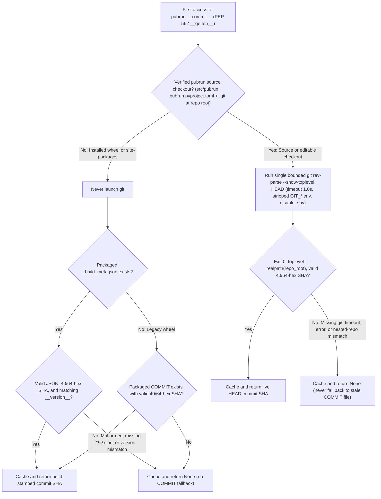

# IPD: Build-Stamped and Deferred Commit Identity Resolution

- Date: 2026-11-21
- Kind: child
- Concern: Eliminating avoidable import-time Git subprocess execution, preventing parent-repository misattribution, and validating build-stamped versus live checkout commit identity.
- Scope: Defer `pubrun.__commit__` via Python Enhancement Proposal 562 (PEP 562) module `__getattr__` in `src/pubrun/__init__.py`, enforce verified checkout ownership and bounded Git lookup, prefer version-checked build-stamped metadata for installed artifacts via `hatch_build.py`, `pyproject.toml`, and `scripts/update_commit_file.py`, eliminate duplicate `.pubrun.toml` parsing in `src/pubrun/_config_boot.py`, and add behavioral tests in `tests/test_commit_identity.py`.
- Scope-Paths: src/pubrun/__init__.py, src/pubrun/_config_boot.py, hatch_build.py, pyproject.toml, scripts/update_commit_file.py, tests/test_commit_identity.py
- Item-Dependencies: executed:fthyv5
- Status: reviewed
- Readiness: go-pending-approval
- Review-Depth: standard
- Short-Description: Defer pubrun.__commit__ resolution, prefer build-stamped identity for wheels, validate checkout ownership, and avoid duplicate boot TOML parsing
- Work-Kind: followup
- Priority: high
- From-Backlog: t1xqpw
- Set: startup-perf
- Order: 2
- Highest E allocated: 05
- Author: agent
- Id: 4il383

> Write and proofread this plan per the technical writing standard, `.aw/system/workflows/technical-writing/technical-writing.md` (`.agents/workflows/technical-writing/technical-writing.md` in a legacy-layout install), including requirement 12 (diagrams).

## Workflow history

- 2026-11-22 /plan-review (Antigravity / Gemini): APPROVE WITH REVISIONS APPLIED; PR-001, PR-002, PR-003, PR-004, PR-005, PR-006, PR-007, PR-008
- 2026-11-22 draft (agent): created.
- 2026-11-22 to-review (agent): authored review-ready child plan from backlog item `t1xqpw`.

## Goal

Stop `src/pubrun/__init__.py` from spawning `git rev-parse HEAD` during package import (so `import pubrun.minimal`, `import pubrun.noauto`, and non-auto-start `import pubrun` never launch Git at import time). Ensure installed packages use version-checked build-stamped commit metadata without invoking Git or misreporting an enclosing repository's commit. Ensure verified `pubrun` source checkouts resolve live `HEAD` lazily with repository-ownership validation and no stale fallback. Eliminate duplicate `.pubrun.toml` parsing during boot import-mode resolution.

### Commit identity resolution flow

The text in `## Proposed changes (ordered, validatable)` is normative. This diagram summarizes how `pubrun.__commit__` resolves on first access.



## Detailed Implementation Checklist (TODO)

Execution-state rule: mark an `E-*` item complete only after performing the action. That mark is not validation. Right-sizing rule: write for a modest executor that cannot hold much in its head. Each E-item is one step (one concern, about one file, executable in one focused pass) and its V-item names each unit it covers with its own check; a plan stays at about 5 E-items and 8 work Scope-Paths, else split it into more child plans (guidance, `IPD-Z603`). Accepted execution states: blocked, failed, pending, performed; terminal gate demands 'performed'.

### Task group 1: Build-time metadata stamping and hook hygiene

- [ ] E-01 Update `hatch_build.py`, `pyproject.toml`, and `scripts/update_commit_file.py` so wheel and source distribution (sdist) builds stamp ownership-verified, package-version-tagged commit metadata without leaving stale `src/pubrun/COMMIT` files in the working tree.
  - Depends on: none
  - Expected outcome: `hatch_build.py::CustomBuildHook.initialize` skips editable builds (`version == "editable"`), reads the package version from `self.metadata.version`, and strips `GIT_DIR`/`GIT_WORK_TREE`/`GIT_COMMON_DIR`/`GIT_INDEX_FILE` before running `git -C <self.root> rev-parse --show-toplevel HEAD`. When `self.root` is a verified checkout (`os.path.realpath(toplevel) == os.path.realpath(self.root)` and valid 40- or 64-character hex Secure Hash Algorithm (SHA)), the hook writes `_build_meta.json` (`{"commit": "<sha>", "version": "<self.metadata.version>"}`) and `COMMIT` into a `tempfile.TemporaryDirectory` registered via `build_data["force_include"]` and cleaned up in `finalize(self, version, build_data, artifact_path)`. When building without `.git` (an unpacked sdist), the hook reuses `src/pubrun/_build_meta.json` only when its `version` equals `self.metadata.version` and its `commit` is a valid hex SHA. When Git fails or ownership mismatches inside a checkout, the hook attaches no commit files. `hatch_build.py` remains importable in environments without `hatchling` installed via a fallback `BuildHookInterface` base class. `pyproject.toml` removes static `src/pubrun/COMMIT` `force-include` entries and excludes `src/pubrun/COMMIT` and `src/pubrun/_build_meta.json` from default wheel and sdist discovery so stale on-disk files cannot leak into artifacts. `scripts/update_commit_file.py` removes any stale untracked `src/pubrun/COMMIT` best-effort and exits 0 quietly without creating or staging `src/pubrun/COMMIT`.
  - Execution state: pending

### Task group 2: Lazy, ownership-validated runtime commit resolution and boot config optimization

- [ ] E-02 Refactor `src/pubrun/__init__.py` to remove eager `_resolve_commit()` execution at import time and implement PEP 562 module `__getattr__` and `__dir__` with thread-safe cached, ownership-validated `_resolve_commit()` logic.
  - Depends on: E-01
  - Expected outcome: Top-level execution of `src/pubrun/__init__.py` does not import `subprocess` or `importlib.resources` and never spawns `git`. Importing `pubrun.minimal` or `pubrun.noauto` (or `import pubrun` configured as `minimal` or `noauto`) spawns zero `git` processes during import. Accessing `pubrun.__commit__` or running `from pubrun import __commit__` resolves lazily, caches the result under a lock, and preserves `"__commit__"` in both `pubrun.__all__` and `dir(pubrun)`. Installed packages read version-checked `_build_meta.json` without ever launching `git`, falling back to legacy `COMMIT` only when `_build_meta.json` is absent (never when malformed or version-mismatched). Verified `pubrun` source checkouts run one bounded (`1.0s` timeout) `git rev-parse --show-toplevel HEAD` call with `GIT_DIR`/`GIT_WORK_TREE`/`GIT_COMMON_DIR`/`GIT_INDEX_FILE` stripped and `disable_spy()` active whenever `pubrun.capture.subprocesses` is already loaded, returning `None` on missing Git, timeout, ownership mismatch, or error without falling back to an on-disk `COMMIT` file.
  - Execution state: pending

- [ ] E-03 Optimize `src/pubrun/_config_boot.py` so `resolve_import_mode()` reads and parses `./.pubrun.toml` at most once instead of opening and parsing it twice when `[imports].mode` is absent.
  - Depends on: E-02
  - Expected outcome: `src/pubrun/_config_boot.py` adds a single-read `_load_local_toml()` helper and a defensive `_extract_toml_key(data, section, key)` helper that handles non-dict sections safely. `resolve_import_mode()` calls `_load_local_toml()` at most once when checking `[imports].mode` then `[core].auto_start`. `_read_local_toml_key(section, key)` is preserved for backward compatibility with `src/pubrun/_bootstrap.py::_resolve_conflict_policy`, and all existing `tests/test_import_modes.py::TestConfigBootResolver` tests pass.
  - Execution state: pending

### Task group 3: Behavioral tests and verification

- [ ] E-04 Create `tests/test_commit_identity.py` with comprehensive behavioral tests covering installed-package imports, source checkouts, nested repositories, missing Git, Git timeout, stale build metadata, `SubprocessSpy` isolation, `hatch_build.py`, and single-read boot configuration parsing.
  - Depends on: E-03
  - Expected outcome: `tests/test_commit_identity.py` verifies through real subprocesses and temporary package and repository fixtures that: (a) `import pubrun.minimal` and `import pubrun.noauto` never launch `git` in either source checkouts or simulated installed wheels; (b) an installed wheel nested inside an unrelated Git repository reports its packaged commit with zero `git` invocations and preserves `"__commit__" in dir(pubrun)`; (c) an installed wheel returns `None` for missing, malformed, or version-mismatched `_build_meta.json` (without falling back to `COMMIT`), while a legacy wheel containing only valid `COMMIT` returns that SHA and a malformed `COMMIT` returns `None`; (d) a verified source checkout returns live `HEAD`, caches repeat access, resists inherited `GIT_DIR` overrides, does not record its internal `git` lookup in `manifest["subprocesses"]` when `SubprocessSpy` is active, and returns `None` on missing Git, timeout, error, or toplevel mismatch even when a stale `src/pubrun/COMMIT` exists on disk; (e) `hatch_build.py::CustomBuildHook` stamps `self.metadata.version` cleanly into build-scoped temp files, cleans up in `finalize()`, skips `version == "editable"`, omits commit files on checkout Git failure or mismatch, and enforces version matching on sdist-to-wheel builds without requiring `hatchling` in the test environment; and (f) `src/pubrun/_config_boot.py::resolve_import_mode` opens `.pubrun.toml` once when falling through to `[core].auto_start` and handles non-dict TOML sections safely.
  - Execution state: pending

- [ ] E-05 Run targeted regression suites covering commit identity, import modes, public module exports, Command-Line Interface (CLI) version reporting, and tracker manifest integration.
  - Depends on: E-04
  - Expected outcome: `pytest tests/test_commit_identity.py tests/test_import_modes.py tests/test_api.py tests/test_cli.py tests/test_tracker.py -v` exits 0 with zero failures.
  - Execution state: pending

## Project conventions discovered (Step 0)

- `src/pubrun/__init__.py::_resolve_commit` currently executes eagerly at top-level import (`__commit__ = _resolve_commit()`) before `src/pubrun/_bootstrap.py::is_mode_submodule_import_in_progress`, spawning `git -C _repo rev-parse HEAD` with `timeout=5` where `_repo` is three parent directories above `__file__`.
- Note on `subprocess` module imports: `src/pubrun/core.py` and `src/pubrun/tracker.py` (via `src/pubrun/capture/git.py`, `src/pubrun/capture/subprocesses.py`, and `src/pubrun/capture/hardware.py`) still import `subprocess` at module level, and auto-start modes (`import pubrun`, `pubrun.auto`, `pubrun.nopatch`, `pubrun.noconsole`, `pubrun.full`) intentionally run `_execute_boot_sequence()` -> `Run.__init__()` -> `get_git()`. Removing eager `_resolve_commit()` stops `src/pubrun/__init__.py` from importing `subprocess`/`importlib.resources` or spawning `git` on import, and ensures `minimal`/`noauto` imports spawn zero `git` processes.
- Consumers of `pubrun.__commit__` are: `src/pubrun/tracker.py::Run.to_manifest_dict` (`from pubrun import __version__, __commit__`), `src/pubrun/__main__.py::main` (`from pubrun import __commit__ as _commit`), `benchmarks/harness.py` (`getattr(pubrun, "__commit__", None)`), `tests/test_api.py::TestModuleExports.test_all_symbols_exist` (`hasattr(pubrun, name)` for `name in pubrun.__all__`), `tests/test_cli.py::TestCliBasic.test_version_includes_commit_when_available`, and `tests/test_tracker.py::test_tracker_lifecycle_and_writer`.
- `pyproject.toml` supports Python `>=3.8` through `3.14` (all versions support PEP 562 module-level `__getattr__` and `__dir__`, plus standard-library `json`, `os`, `pathlib`, `re`, `threading`, and `importlib.resources`). `[project.optional-dependencies].dev` does NOT install `hatchling`, so `hatch_build.py` tests executed under `pytest` (including `.github/workflows/ci.yml`) run without `hatchling` installed.
- `hatch_build.py::CustomBuildHook` subclasses `hatchling.builders.hooks.plugin.interface.BuildHookInterface`. In Hatchling, `initialize(self, version, build_data)` receives the build version (`"standard"` or `"editable"`), NOT the package version; the package version lives on `self.metadata.version`, and the target name lives on `self.target_name` (`"wheel"` or `"sdist"`). `finalize(self, version, build_data, artifact_path)` runs after artifact assembly.
- `src/pubrun/COMMIT` is listed in `.gitignore`, while `scripts/update_commit_file.py` (wired in `.pre-commit-config.yaml` as a `post-commit` hook and mentioned in `CONTRIBUTING.md`) currently writes and runs `git add` on `src/pubrun/COMMIT`.
- `src/pubrun/_config_boot.py::resolve_import_mode` calls `src/pubrun/_config_boot.py::_read_local_toml_key("imports", "mode")` and then `_read_local_toml_key("core", "auto_start")`, reading and parsing `.pubrun.toml` twice whenever `[imports].mode` is absent. `src/pubrun/_bootstrap.py::_resolve_conflict_policy` also imports and calls `_read_local_toml_key`.

## Findings

- **F-01 (Eager import-time subprocess spawn):** Top-level `src/pubrun/__init__.py` unconditionally calls `_resolve_commit()`, importing `subprocess` and launching `git rev-parse HEAD` (up to 5 seconds timeout) before import-mode routing, imposing fixed process-creation cost even on `pubrun.minimal`, `pubrun.noauto`, and installed wheels.
- **F-02 (Parent-repository misattribution):** Computing `_repo = dirname(dirname(dirname(abspath(__file__))))` walks above `site-packages` when `pubrun` is installed in a virtual environment inside a user project's Git repository; `git -C` then climbs to the enclosing project's `.git` and reports the user's commit hash as `pubrun.__commit__`.
- **F-03 (Stale `COMMIT` fallback in source checkouts and builds):** Falling back from a failed Git call to an on-disk `COMMIT` file in a source checkout can report a stale hash from an earlier commit as live `HEAD`; similarly, `hatch_build.py` ignoring errors or `pyproject.toml` bundling `src/pubrun/` without excluding `COMMIT`/`_build_meta.json` allows a pre-existing stale file on disk to be packaged into a newer wheel.
- **F-04 (Duplicate boot Tom's Obvious Minimal Language (TOML) parse):** `src/pubrun/_config_boot.py::resolve_import_mode` parses `.pubrun.toml` twice whenever `[imports].mode` is absent.

## Proposed changes (ordered, validatable)

1. **`hatch_build.py`, `pyproject.toml`, and `scripts/update_commit_file.py`:**
   - In `hatch_build.py`:
     - Import `BuildHookInterface` from `hatchling.builders.hooks.plugin.interface` inside `try ... except ImportError:` with a minimal compatible fallback base class storing `root`, `config`, `build_config`, `metadata`, `directory`, `target_name`, and `app` so unit tests in dev and CI environments (where `hatchling` is not installed) can import and exercise `CustomBuildHook` directly.
     - Define `_GIT_ENV_STRIP = ("GIT_DIR", "GIT_WORK_TREE", "GIT_COMMON_DIR", "GIT_INDEX_FILE")` and `_SHA_RE = re.compile(r"^[0-9a-fA-F]{40}(?:[0-9a-fA-F]{24})?$")`.
     - In `hatch_build.py::CustomBuildHook.initialize(self, version, build_data)`:
       - Initialize `self._temp_dir = None` (if not already set).
       - If `version == "editable"`: return immediately (editable installs run from the verified source checkout and must not stamp static build metadata).
       - Read `pkg_version = str(self.metadata.version)`. Determine target destination paths from `self.target_name`: `"pubrun/_build_meta.json"` and `"pubrun/COMMIT"` for `"wheel"`, or `"src/pubrun/_build_meta.json"` and `"src/pubrun/COMMIT"` for `"sdist"` (return immediately for unknown targets).
       - Detect whether `os.path.exists(os.path.join(self.root, ".git"))` (matches both `.git/` directories and `.git` worktree/submodule files).
       - If `.git` exists at `self.root`: build a clean environment copy with `_GIT_ENV_STRIP` keys removed and run `["git", "-C", self.root, "rev-parse", "--show-toplevel", "HEAD"]` with `capture_output=True`, `text=True`, `timeout=5`, `env=clean_env`. Accept the commit SHA only when exit code is 0, stdout contains two non-empty lines `(toplevel, sha)`, `os.path.normcase(os.path.realpath(toplevel)) == os.path.normcase(os.path.realpath(self.root))`, and `_SHA_RE.fullmatch(sha)` matches. When accepted, create `self._temp_dir = tempfile.TemporaryDirectory(prefix="pubrun-build-meta-")`, write `_build_meta.json` (`json.dumps({"commit": sha, "version": pkg_version}) + "\n"`) and `COMMIT` (`sha + "\n"`) inside `self._temp_dir.name`, and register both paths in `build_data.setdefault("force_include", {})`. If Git fails or ownership mismatches inside a checkout, attach NO commit files so a stale hash is never packaged.
       - If `.git` does NOT exist at `self.root` (building a wheel from an unpacked sdist): inspect `os.path.join(self.root, "src", "pubrun", "_build_meta.json")` (if present). Parse as JSON and accept only when it is a dict whose `version` equals `pkg_version` and whose `commit` matches `_SHA_RE`; only then write validated `_build_meta.json` and `COMMIT` into `self._temp_dir` and register them in `build_data.setdefault("force_include", {})`. Do not reuse an unversioned on-disk `src/pubrun/COMMIT` without matching `_build_meta.json`.
     - In `hatch_build.py::CustomBuildHook.finalize(self, version, build_data, artifact_path)`:
       - Clean up `self._temp_dir` if created (`self._temp_dir.cleanup(); self._temp_dir = None`).
   - In `pyproject.toml`:
     - Remove `[tool.hatch.build.targets.wheel.force-include]` and `[tool.hatch.build.targets.sdist.force-include]` static entries for `"src/pubrun/COMMIT"`.
     - Add `exclude = ["src/pubrun/COMMIT", "src/pubrun/_build_meta.json"]` under `[tool.hatch.build.targets.wheel]` and `[tool.hatch.build.targets.sdist]` so stale on-disk files in a dirty checkout or version-bumped unpacked sdist cannot leak into built artifacts when `hatch_build.py` declines to stamp them (`build_data["force_include"]` explicitly overrides `exclude` when validated metadata is attached).
     - Keep `[tool.hatch.build.hooks.custom]` pointing at `hatch_build.py`.
   - In `scripts/update_commit_file.py`:
     - Replace the Git query and `git add` logic with a deterministic, quiet cleanup no-op: remove any pre-existing `src/pubrun/COMMIT` file best-effort (ignoring `FileNotFoundError` and `OSError`) and return `0` without spawning `git` or creating `src/pubrun/COMMIT`. Update the module docstring to explain that `hatch_build.py` stamps build artifacts at build time and that this script remains as a safe no-op for existing `post-commit` hook installations.
2. **`src/pubrun/__init__.py`:**
   - Remove the top-level `__commit__ = _resolve_commit()` call so `src/pubrun/__init__.py` itself imports neither `subprocess` nor `importlib.resources` and never launches `git` during package import.
   - Keep `"__commit__"` in `__all__` and add PEP 562 module-level `__getattr__(name: str)` and `__dir__()`:
     - Use a module sentinel `_COMMIT_UNSET = object()`, private `_cached_commit = _COMMIT_UNSET`, and a `threading.Lock()` `_commit_lock` (noting `threading` is already imported by `pubrun._bootstrap`, adding zero extra import cost).
     - `_get_commit()` uses double-checked locking around `_cached_commit is _COMMIT_UNSET`, calling `_resolve_commit()` once and caching the result (`Optional[str]`).
     - Provide `_reset_commit_cache()` (acquiring `_commit_lock`, resetting `_cached_commit = _COMMIT_UNSET`, and popping `"__commit__"` from `globals()` if present) for deterministic test isolation.
     - `__getattr__(name)` returns `_get_commit()` when `name == "__commit__"`; for any other attribute, raises `AttributeError(f"module {__name__!r} has no attribute {name!r}")`.
     - `__dir__()` returns `sorted(set(globals()) | set(__all__))` so `"__commit__" in dir(pubrun)` stays `True`.
   - Keep helper imports (`json`, `os`, `re`, `subprocess`, `importlib.resources`, `pathlib`) inside the helper functions so they load lazily only when `__commit__` is requested.
   - Implement `_is_verified_source_checkout(pkg_dir: Path) -> Optional[Path]`:
     - Pure filesystem checks (zero subprocesses): require `pkg_dir.name == "pubrun"`, `pkg_dir.parent.name == "src"`, `repo_root = pkg_dir.parent.parent`, `(repo_root / ".git").exists()`, and `(repo_root / "pyproject.toml").is_file()`.
     - Parse `(repo_root / "pyproject.toml")` via `tomllib` (Python 3.11+) or `tomli` (Python <3.11) and verify `data.get("project", {}).get("name") == "pubrun"`. Only if neither TOML library is importable, apply a `[project]`-section-scoped fallback parser that stops at the next `[section]` header and checks for `name = "pubrun"` or `name = 'pubrun'`. Catch all exceptions and return `repo_root` only if all checks pass; otherwise return `None`.
   - Implement `_read_packaged_commit(expected_version: Optional[str]) -> Optional[str]`:
     - Helper `_read_packaged_resource(filename)` reads from package `__name__` using `importlib.resources.files(__name__).joinpath(filename).read_text(encoding="utf-8")` on Python 3.9+ and `importlib.resources.read_text(__name__, filename, encoding="utf-8")` on Python 3.8.
     - First try reading `_build_meta.json`:
       - If `_build_meta.json` **exists**: parse JSON strictly and require a `dict` with string `commit` matching `^[0-9a-fA-F]{40}(?:[0-9a-fA-F]{24})?$` and non-empty string `version` equal to `expected_version` (when `expected_version` is non-empty). On ANY parse error, wrong type, invalid SHA, missing version, or version mismatch, return `None` immediately (do NOT fall back to `COMMIT`).
       - Only when `_build_meta.json` raises `FileNotFoundError` (legacy wheel containing only `COMMIT`): try reading `COMMIT` and return the stripped value only if it matches the 40- or 64-character hex SHA pattern; otherwise return `None`.
   - Implement `_resolve_checkout_commit(repo_root: Path, timeout: float = 1.0) -> Optional[str]`:
     - Strip `GIT_DIR`, `GIT_WORK_TREE`, `GIT_COMMON_DIR`, and `GIT_INDEX_FILE` from a copy of `os.environ` so inherited Git environment variables cannot redirect `-C <repo_root>` to an unrelated repository.
     - Run ONE bounded subprocess: `["git", "-C", str(repo_root), "rev-parse", "--show-toplevel", "HEAD"]` with `capture_output=True`, `text=True`, `timeout=timeout`, `env=clean_env`. If `"pubrun.capture.subprocesses"` is already present in `sys.modules`, wrap the subprocess call in `sys.modules["pubrun.capture.subprocesses"].disable_spy()` (without importing `pubrun.capture.subprocesses` if unloaded) so lazy resolution during an active tracked run never leaks an internal `git` call into `manifest["subprocesses"]`.
     - Require `returncode == 0`, exactly two non-empty lines `(toplevel, head)`, `os.path.normcase(os.path.realpath(toplevel)) == os.path.normcase(os.path.realpath(str(repo_root)))`, and valid 40- or 64-character hex `head`.
     - On `FileNotFoundError`, `subprocess.TimeoutExpired`, `OSError`, non-zero exit, malformed output, or path mismatch: return `None` (never fall back to an on-disk `COMMIT` or `_build_meta.json` file in a source checkout).
   - Implement `_resolve_commit() -> Optional[str]`:
     - Compute `repo_root = _is_verified_source_checkout(Path(__file__).resolve().parent)`.
     - If `repo_root is not None`: return `_resolve_checkout_commit(repo_root)`.
     - Otherwise: return `_read_packaged_commit(__version__)`.
3. **`src/pubrun/_config_boot.py`:**
   - Add `_load_local_toml() -> Optional[dict]` that checks `Path.cwd() / ".pubrun.toml"` once and parses it once (best-effort, returning `None` on missing file, missing parser, or parse error).
   - Add `_extract_toml_key(data: Optional[dict], section: str, key: str) -> Optional[str]` that safely checks `isinstance(data, dict)` and `isinstance(data.get(section), dict)` before reading `str(section_table.get(key, "")) or None`, preventing unhandled `AttributeError` on malformed non-dict sections while preserving boolean `False` -> `"False"` stringification.
   - Keep `src/pubrun/_config_boot.py::_read_local_toml_key(section, key)` delegating to `_extract_toml_key(_load_local_toml(), section, key)` so `src/pubrun/_bootstrap.py::_resolve_conflict_policy` continues working unchanged.
   - Update `src/pubrun/_config_boot.py::resolve_import_mode` to call `_load_local_toml()` once only after environment variables (`PUBRUN_IMPORT_MODE`, `PUBRUN_AUTO_START`) did not match, then inspect both `imports.mode` and `core.auto_start` from that single parsed dict via `_extract_toml_key`.
4. **`tests/test_commit_identity.py`:**
   - Behavioral tests only (zero production source inspection):
     - **Zero-Git import tests:** Run fresh subprocesses importing `pubrun.minimal` and `pubrun.noauto` in both the source checkout and a simulated installed wheel (`site-packages/pubrun` + matching `.dist-info/METADATA` so `importlib.metadata.version("pubrun")` resolves deterministically across both editable and clean environments) with a logging/failing fake `git` shim prepended to `PATH`, proving zero `git` invocations occur on import.
     - **Installed wheel and nested-repository isolation:** Place a simulated installed wheel (with valid `_build_meta.json` matching its `.dist-info` version) inside a parent Git repository carrying a different `HEAD` commit; verify `pubrun.__commit__` returns the packaged SHA with zero `git` invocations and `"__commit__" in dir(pubrun)`.
     - **Packaged metadata failure and legacy cases:** Verify that an installed wheel returns `None` when `_build_meta.json` is malformed JSON, lacks `"version"`, has an invalid SHA, or has a mismatched `"version"` (even when a valid `COMMIT` file sits alongside it); verify that a legacy wheel with no `_build_meta.json` and a valid `COMMIT` returns that SHA, and malformed/empty `COMMIT` returns `None`.
     - **Verified source checkout cases:** Create a temporary verified `pubrun` Git repository (`pyproject.toml` with `[project]\nname = "pubrun"`, `src/pubrun/...`) and verify: (1) live `HEAD` is returned on first `pubrun.__commit__` access and cached on repeat access; (2) an inherited `GIT_DIR` pointing at another repository is ignored in favor of the checkout's own `.git`; (3) resolving `pubrun.__commit__` lazily while `SubprocessSpy` is active does not record the internal `git` call in `SubprocessSpy.get_records()`; and (4) missing `git`, timed-out `git`, failing `git`, or enclosing-repo toplevel mismatch returns `None` even when a stale `src/pubrun/COMMIT` exists on disk.
     - **`hatch_build.py::CustomBuildHook` tests:** Import `hatch_build.CustomBuildHook` directly (verifying import works even without `hatchling` installed) and test: (1) verified checkout stamps `self.metadata.version` (not build version `"standard"`) into `_build_meta.json` and `COMMIT` inside `build_data["force_include"]` for both `"wheel"` and `"sdist"` targets and deletes temp files in `finalize(version, build_data, artifact_path)`; (2) `version == "editable"` is a clean no-op with empty `force_include`; (3) Git failure or toplevel mismatch inside a checkout attaches zero `force_include` entries even when stale `src/pubrun/COMMIT` exists on disk; (4) sdist-to-wheel build without `.git` preserves matching-version `_build_meta.json` and rejects version-mismatched or unversioned `COMMIT`-only metadata.
     - **Boot TOML single-read and safety tests:** Verify `src/pubrun/_config_boot.py::resolve_import_mode` opens `.pubrun.toml` only once when falling through from absent `[imports].mode` to `[core]\nauto_start = false`, and returns `("auto", "default")` without raising when `.pubrun.toml` contains a malformed non-dict `imports = "bad"` entry.

## Deferred / out of scope (with reason)

- Snapshot write coalescing, explicit durability policy, and Git/hardware capture budgets belong to child plan `tkmm5p` (snapshot write coalescing, durability policy, and bounded capture work).
  - Carrier: tkmm5p
- Post-change performance comparisons and user-facing documentation updates (`docs/manifest.md`, `docs/architecture.md`, `docs/functional_spec.md`, `docs/performance.md`) belong to child plan `ckc3vl` (post-change overhead comparison, documentation sync, and whole-Set verification).
  - Carrier: ckc3vl
- Package dependency capture changes belong to sibling backlog item `w4hxkh` (dependency capture).
  - Carrier: w4hxkh

## Scope check

- Over-scope: none. Touches only commit-identity resolution, boot TOML loading, build metadata hook/packaging, and commit-identity tests (6 Scope-Paths, 5 E-items).
- Under-scope: none. Covers every wheel, source-checkout, nested-repo, missing-Git, timeout, stale-metadata, `SubprocessSpy` isolation, and `noauto`/`minimal` import requirement in backlog item `t1xqpw` (startup overhead bounding and artifact write coalescing).

## Required tests / validation

Run inside the repository root and capture actual runner output and exit code:

```bash
pytest tests/test_commit_identity.py tests/test_import_modes.py tests/test_api.py tests/test_cli.py tests/test_tracker.py -v
```

## Spec / documentation sync

Deferred to child plan `ckc3vl` (post-change overhead comparison, documentation sync, and whole-Set verification), which updates `docs/manifest.md`, `docs/architecture.md`, `docs/functional_spec.md`, and `docs/performance.md` after both `4il383` (build-stamped and deferred commit identity) and `tkmm5p` (snapshot write coalescing, durability policy, and bounded capture) execute. Note: `CONTRIBUTING.md` (`### Local hooks and path hygiene`) and `.pre-commit-config.yaml` (`update-commit-file` comment) still reference the retired post-commit `src/pubrun/COMMIT` stamping behavior; keeping `scripts/update_commit_file.py` as a quiet cleanup no-op keeps existing hook installations working without expanding this plan's scope.

## Open questions

### OQ-01: Timeout bound for verified source-checkout Git lookup

- Blocking: no
- Status: resolved
- Owner: plan author (binding upon plan approval)
- Resolution or deferral rationale: Use a `1.0` second timeout (down from `5.0` seconds) for the single `git rev-parse --show-toplevel HEAD` call in verified source checkouts. Because the lookup is lazy (triggered only when `__commit__` is accessed, never during `minimal`/`noauto` import) and never runs for installed wheels, `1.0` second accommodates slower local or Windows checkouts while bounding worst-case latency tightly.

## Validation and cross-check (verify before reporting done)

Validation-state rule: inspect evidence in a separate pass. Do not mark a `V-*` item complete from memory or from the matching execution checkmark. Accepted validation results: blocked, failed, pass, pending; terminal gate demands 'pass'. Runtime-demonstration reachability rule: for each `V-*` item demanding the software be observed acting (such as a run, a dispatch, or a transition) (as distinct from items demanding a diff, a file's content, or a test result, which are reachable by construction), name the code path that produces the observation or the sibling `E-*` that creates it, else the demand is UNDER-SCOPE.

- [ ] V-01 validates E-01
  - Required evidence: Diff of `hatch_build.py`, `pyproject.toml`, and `scripts/update_commit_file.py` showing fallback `BuildHookInterface` importability without `hatchling`, `version == "editable"` skip, `self.metadata.version` stamping (not build `version`), stripped `GIT_*` env vars, ownership-verified build-scoped temporary files via `build_data["force_include"]`, 3-argument `finalize()` cleanup, sdist version check, `pyproject.toml` removal of static `COMMIT` `force-include` plus wheel/sdist `exclude` for stale `COMMIT`/`_build_meta.json`, and quiet stale-file cleanup no-op in `scripts/update_commit_file.py`.
  - Observed evidence:
  - Result: pending

- [ ] V-02 validates E-02
  - Required evidence: Diff of `src/pubrun/__init__.py` showing removal of top-level `_resolve_commit()`, PEP 562 `__getattr__("__commit__")` and `__dir__()` with lock-protected caching and `_reset_commit_cache()`, verified source-checkout layout and `[project].name == "pubrun"` checks, stripped `GIT_*` env vars with `disable_spy()` when `pubrun.capture.subprocesses` is loaded, strict `_build_meta.json` validation (no `COMMIT` fallback on malformed or version-mismatched metadata; legacy `COMMIT` only when `_build_meta.json` is absent), and no stale `COMMIT` fallback in source checkouts.
  - Observed evidence:
  - Result: pending

- [ ] V-03 validates E-03
  - Required evidence: Diff of `src/pubrun/_config_boot.py` showing `_load_local_toml()`, non-dict-safe `_extract_toml_key()`, single-read `.pubrun.toml` loading inside `resolve_import_mode()`, and preserved `_read_local_toml_key(section, key)`.
  - Observed evidence:
  - Result: pending

- [ ] V-04 validates E-04
  - Required evidence: Pasted `pytest tests/test_commit_identity.py -v` output showing exit code 0 with all behavioral tests passing (`minimal`/`noauto` zero-git import, nested-repo wheel isolation and `dir(pubrun)`, missing/malformed/stale metadata vs legacy `COMMIT`, source checkout live `HEAD`/caching/`GIT_DIR` resistance/`SubprocessSpy` isolation/missing Git/timeout/mismatch, `hatch_build.py` hook cases including editable skip and `self.metadata.version` without `hatchling`, and single-read + malformed-section `_config_boot`).
  - Observed evidence:
  - Result: pending

- [ ] V-05 validates E-05
  - Required evidence: Pasted `pytest tests/test_commit_identity.py tests/test_import_modes.py tests/test_api.py tests/test_cli.py tests/test_tracker.py -v` output showing exit code 0 and zero regressions.
  - Observed evidence:
  - Result: pending

## Approval and execution gate

- Size assessment: standard
- Cohesion rationale: not required

Execution contract:
1. All open questions (OQ-01) are resolved for review; do not execute until prerequisite child plan `fthyv5` (startup and finalization overhead baseline measurement) is `executed` and a human approves this plan (`- Status: approved`).
2. Scope declaration: expected modified or created files are `src/pubrun/__init__.py`, `src/pubrun/_config_boot.py`, `hatch_build.py`, `pyproject.toml`, `scripts/update_commit_file.py`, and `tests/test_commit_identity.py`. If execution requires editing an additional file or leaving a declared file unmodified, record the justification via `--scope-reason` or `--scope-ack` at finalize; stop only for a genuinely unsafe condition such as an unresolvable concurrent-edit conflict or missing prerequisite symbols.
3. Honesty rule: paste actual `pytest` runner output and exit code into each `V-*` `Observed evidence:`; never claim tests passed without running them.
4. Commit discipline: commit only the files changed for this plan using `aw commit 4il383 -- <paths>`; never use `git add -A`, `git add .`, or `git commit -a`; never push without explicit human instruction.
5. Lifecycle transition on completion: all `E-*` items must be `performed` and all `V-*` items `pass` before completion; when executed directly (outside an `aw` runner lane), run `aw ipd finalize 4il383` rather than a hand-rolled `git mv` to `.aw/records/plans/executed/`; when executed inside an `aw` runner lane, leave lifecycle finalization to the runner's post-turn finalize step.
