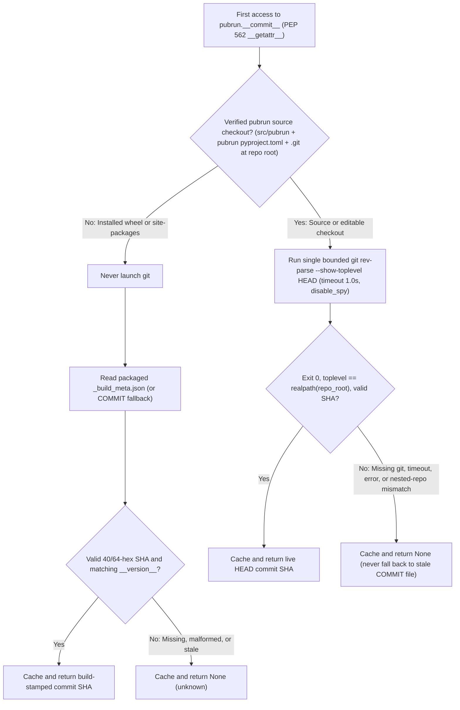

# IPD: Build-Stamped and Deferred Commit Identity Resolution

- Date: 2026-11-21
- Kind: child
- Concern: Eliminating avoidable import-time Git subprocess execution, preventing parent-repository misattribution, and validating build-stamped versus live checkout commit identity.
- Scope: Defer `pubrun.__commit__` via PEP 562 module `__getattr__` in `src/pubrun/__init__.py`, enforce verified checkout ownership and bounded Git lookup, prefer version-checked build-stamped metadata for installed artifacts via `hatch_build.py`, `pyproject.toml`, and `scripts/update_commit_file.py`, eliminate duplicate `.pubrun.toml` parsing in `src/pubrun/_config_boot.py`, and add behavioral tests in `tests/test_commit_identity.py`.
- Scope-Paths: src/pubrun/__init__.py, src/pubrun/_config_boot.py, hatch_build.py, pyproject.toml, scripts/update_commit_file.py, tests/test_commit_identity.py
- Item-Dependencies: executed:fthyv5
- Status: to-review
- Short-Description: Defer pubrun.__commit__ resolution, prefer build-stamped identity for wheels, validate checkout ownership, and avoid duplicate boot TOML parsing
- Work-Kind: followup
- Priority: high
- From-Backlog: t1xqpw
- Set: startup-perf
- Order: 2
- Highest E allocated: 05
- Author: agent
- Id: 4il383

> Write and proofread this plan per the technical writing standard, `.aw/system/workflows/technical-writing/technical-writing.md` (`.agents/workflows/technical-writing/technical-writing.md` in a legacy-layout install), including requirement 12 (diagrams).

## Workflow history

- 2026-11-22 draft (agent): created.
- 2026-11-22 to-review (agent): authored review-ready child plan from backlog item `t1xqpw`.

## Goal

Stop `import pubrun` (and especially `pubrun.minimal` and `pubrun.noauto`) from spawning `git rev-parse HEAD` before import-mode routing, ensure installed packages use verified build-stamped commit metadata without invoking Git or misreporting an enclosing repository's commit, and ensure genuine source checkouts resolve live HEAD lazily with repository-ownership validation and no stale fallback.

### Commit identity resolution flow

The text in `## Proposed changes (ordered, validatable)` is normative. This diagram summarizes how `pubrun.__commit__` resolves on first access.



## Detailed Implementation Checklist (TODO)

Execution-state rule: mark an `E-*` item complete only after performing the action. That mark is not validation. Right-sizing rule: write for a modest executor that cannot hold much in its head. Each E-item is one step (one concern, about one file, executable in one focused pass) and its V-item names each unit it covers with its own check; a plan stays at about 5 E-items and 8 work Scope-Paths, else split it into more child plans (guidance, `IPD-Z603`). Accepted execution states: blocked, failed, pending, performed; terminal gate demands 'performed'.

### Task group 1: Build-time metadata stamping and hook hygiene

- [ ] E-01 Update `hatch_build.py`, `pyproject.toml`, and `scripts/update_commit_file.py` so wheel and sdist builds stamp ownership-verified, version-tagged commit metadata without leaving stale `src/pubrun/COMMIT` files in the working tree.
  - Depends on: none
  - Expected outcome: `hatch_build.py` validates that `git -C self.root rev-parse --show-toplevel` matches `os.path.realpath(self.root)` before stamping, writes build-scoped `COMMIT` and `_build_meta.json` (`{"commit": "<sha>", "version": "<version>"}`) into a temporary build artifact registered via `build_data["force_include"]` (cleaned up in `finalize()`), reuses matching sdist build metadata only when building outside a `.git` checkout and the stamped version matches `version`, refuses to include stale metadata if Git fails inside a checkout, and removes static `src/pubrun/COMMIT` force-include reliance from `pyproject.toml`; `scripts/update_commit_file.py` is updated to avoid silently staging stale gitignored `src/pubrun/COMMIT` files as a source-checkout fallback.
  - Execution state: pending

### Task group 2: Lazy, ownership-validated runtime commit resolution and boot config optimization

- [ ] E-02 Refactor `src/pubrun/__init__.py` to remove eager `_resolve_commit()` execution at import time and implement PEP 562 module `__getattr__` with cached, ownership-validated `_resolve_commit()` logic.
  - Depends on: E-01
  - Expected outcome: Importing `pubrun`, `pubrun.minimal`, `pubrun.noauto`, `pubrun.auto`, `pubrun.nopatch`, `pubrun.noconsole`, or `pubrun.full` does not import `subprocess` or spawn `git` during package import; accessing `pubrun.__commit__` (or `from pubrun import __commit__`) resolves lazily, caches the result, reads validated packaged build metadata without spawning Git for installed packages, and performs a single bounded (`1.0s` timeout) ownership-verified `git rev-parse --show-toplevel HEAD` call (wrapped in `disable_spy()` when loaded) only for verified `pubrun` source checkouts, returning `None` on missing Git, timeout, ownership mismatch, or stale/malformed metadata.
  - Execution state: pending

- [ ] E-03 Optimize `src/pubrun/_config_boot.py` so `resolve_import_mode()` reads and parses `./.pubrun.toml` at most once instead of opening and parsing it twice when `[imports].mode` is absent.
  - Depends on: E-02
  - Expected outcome: `_config_boot.py` preserves `_read_local_toml_key(section, key)` for backward compatibility (`pubrun._bootstrap._resolve_conflict_policy`), adds a single-read `_read_local_toml()` helper used by `resolve_import_mode()` so checking `[imports].mode` then `[core].auto_start` opens and parses `.pubrun.toml` at most once, and passes all existing `TestConfigBootResolver` tests.
  - Execution state: pending

### Task group 3: Behavioral tests and verification

- [ ] E-04 Create `tests/test_commit_identity.py` with comprehensive behavioral tests covering installed-package imports, source checkouts, nested repositories, missing Git, Git timeout, stale build metadata, `hatch_build.py`, and single-read boot config parsing.
  - Depends on: E-03
  - Expected outcome: `tests/test_commit_identity.py` verifies via real subprocesses and temporary package/repository fixtures that (a) `import pubrun.minimal` and `import pubrun.noauto` never launch `git`, (b) an installed package nested inside an unrelated Git repository reports its packaged commit (not the parent repository's commit) and never launches `git`, (c) an installed package with missing, malformed, or version-mismatched `_build_meta.json`/`COMMIT` reports `None`, (d) a verified source checkout reports live HEAD when Git succeeds and returns `None` on missing Git, timeout, error, or toplevel mismatch even when a stale `COMMIT` file exists on disk, (e) `hatch_build.py` stamps verified metadata and rejects stale/enclosing-repo commits, and (f) `resolve_import_mode()` opens `.pubrun.toml` once when falling through from `[imports].mode` to `[core].auto_start`.
  - Execution state: pending

- [ ] E-05 Run targeted regression suites covering commit identity, import modes, CLI version reporting, and tracker manifest integration.
  - Depends on: E-04
  - Expected outcome: `pytest tests/test_commit_identity.py tests/test_import_modes.py tests/test_cli.py tests/test_tracker.py -v` exits 0 with zero failures.
  - Execution state: pending

## Project conventions discovered (Step 0)

- `src/pubrun/__init__.py` currently invokes `__commit__ = _resolve_commit()` at top-level import before `is_mode_submodule_import_in_progress()`, spawning `git -C _repo rev-parse HEAD` with `timeout=5` where `_repo` is three parent directories above `__file__`.
- Consumers of `pubrun.__commit__` are: `src/pubrun/tracker.py` (`Run.to_manifest_dict` via `from pubrun import __version__, __commit__`), `src/pubrun/__main__.py` (`from pubrun import __commit__ as _commit`), `benchmarks/harness.py` (`getattr(pubrun, "__commit__", None)`), `tests/test_cli.py`, and `tests/test_tracker.py`.
- `pyproject.toml` supports Python `>=3.8` through `3.14` (all versions support PEP 562 module-level `__getattr__` and standard library `json`, `os`, `pathlib`, `re`, `importlib.resources`).
- `hatch_build.py` subclasses `hatchling.builders.hooks.plugin.interface.BuildHookInterface` and currently writes `src/pubrun/COMMIT` inside the source tree and silently passes on exceptions.
- `src/pubrun/COMMIT` is listed in `.gitignore`, while `scripts/update_commit_file.py` attempts to write and `git add` `src/pubrun/COMMIT` from a post-commit hook.
- `src/pubrun/_config_boot.py` calls `_read_local_toml_key("imports", "mode")` and then `_read_local_toml_key("core", "auto_start")`, reading and parsing `.pubrun.toml` twice whenever `[imports].mode` is not set.

## Findings

- **F-01 (Eager import-time subprocess spawn):** Every `import pubrun`, `import pubrun.minimal`, or `import pubrun.noauto` unconditionally imports `subprocess` and launches `git rev-parse HEAD` (up to 5 seconds timeout), imposing fixed process-creation cost even for API-only imports and installed wheels.
- **F-02 (Parent-repository misattribution):** Computing `_repo = dirname(dirname(dirname(abspath(__file__))))` walks above `site-packages` when `pubrun` is installed in a virtual environment inside a user project's Git repository; `git -C` then climbs to the enclosing project's `.git` and reports the user's commit hash as `pubrun.__commit__`.
- **F-03 (Stale `COMMIT` fallback in source checkouts and builds):** Falling back from a failed Git call to an on-disk `COMMIT` file in a source checkout can report a stale hash from an earlier commit as live HEAD; similarly, `hatch_build.py` ignoring errors leaves any pre-existing `src/pubrun/COMMIT` on disk to be packaged into a newer wheel.
- **F-04 (Duplicate boot TOML parse):** `src/pubrun/_config_boot.py` parses `.pubrun.toml` twice during `resolve_import_mode()` when `[imports].mode` is absent.

## Proposed changes (ordered, validatable)

1. **`hatch_build.py`, `pyproject.toml`, and `scripts/update_commit_file.py`:**
   - In `hatch_build.py` (`CustomBuildHook.initialize` and `CustomBuildHook.finalize`):
     - Track temporary build files in `self._temp_dir` (via `tempfile.TemporaryDirectory`) and clean them up in `finalize()`.
     - Detect whether `self.root` has a `.git` entry (file or directory).
     - If `.git` exists at `self.root`: run `git -C <self.root> rev-parse --show-toplevel HEAD` with `timeout=5`. Accept the commit SHA only when exit code is 0, `os.path.realpath(toplevel) == os.path.realpath(self.root)`, and the SHA matches `^[0-9a-fA-F]{40}([0-9a-fA-F]{24})?$`. When accepted, write `_build_meta.json` (`{"commit": sha, "version": version}`) and `COMMIT` (`sha + "\n"`) into `self._temp_dir` and map them in `build_data["force_include"]` to `"pubrun/_build_meta.json"` and `"pubrun/COMMIT"` (for wheel) or `"src/pubrun/_build_meta.json"` and `"src/pubrun/COMMIT"` (for sdist). If Git fails or ownership mismatches inside a checkout, attach NO commit files so a stale hash is never packaged.
     - If `.git` does NOT exist at `self.root` (building a wheel from an unpacked sdist): inspect `src/pubrun/_build_meta.json` (if present) and verify `data["version"] == version` and valid hex SHA; only then include `_build_meta.json` and `COMMIT` via `build_data["force_include"]`.
   - In `pyproject.toml`: remove static `force-include` entries for `"src/pubrun/COMMIT"` so Hatchling does not fail when `src/pubrun/COMMIT` is absent or accidentally include a stale untracked `COMMIT` file; keep `[tool.hatch.build.hooks.custom]` pointing at `hatch_build.py`.
   - In `scripts/update_commit_file.py`: update the script to be an explicit no-op (or remove stale `src/pubrun/COMMIT` if present and exit 0 with a clear note that `hatch_build.py` stamps build artifacts at build time), preventing the post-commit hook from creating stale untracked `src/pubrun/COMMIT` files inside source checkouts.
2. **`src/pubrun/__init__.py`:**
   - Remove the top-level `__commit__ = _resolve_commit()` call so neither `subprocess` nor `importlib.resources` executes during package import.
   - Keep `"__commit__"` in `__all__` and add PEP 562 module-level `__getattr__(name: str)`:
     - When `name == "__commit__"`, return cached `_get_commit()` (using a module sentinel `_COMMIT_UNSET = object()` and private `_cached_commit = _COMMIT_UNSET` plus a `_reset_commit_cache()` test helper).
     - For any other unknown attribute, raise `AttributeError(f"module {__name__!r} has no attribute {name!r}")`.
   - Implement `_is_verified_source_checkout(pkg_dir: Path) -> Optional[Path]`:
     - Pure filesystem checks (zero subprocesses): require `pkg_dir.parent.name == "src"`, `repo_root = pkg_dir.parent.parent`, `(repo_root / ".git").exists()`, and `(repo_root / "pyproject.toml").is_file()`.
     - Read `(repo_root / "pyproject.toml")` (parsing via `tomllib`/`tomli` if available or matching `[project]` `name = "pubrun"`) and verify the project name is `"pubrun"`. Return `repo_root` only if all checks pass; otherwise return `None`.
   - Implement `_read_packaged_commit(expected_version: Optional[str]) -> Optional[str]`:
     - First try reading packaged resource `_build_meta.json` via `importlib.resources` (Python 3.8 `read_text` and Python 3.9+ `files`). Validate JSON object with valid 40- or 64-character hex `commit` and `version == expected_version` (when `expected_version` is known). If `version` is present and mismatches `expected_version`, treat the build metadata as stale and return `None` immediately (do NOT fall back to `COMMIT`).
     - If `_build_meta.json` does not exist (legacy wheel containing only `COMMIT`), read packaged resource `COMMIT` and return it only if it matches a valid 40- or 64-character hex SHA; otherwise return `None`.
   - Implement `_resolve_checkout_commit(repo_root: Path, timeout: float = 1.0) -> Optional[str]`:
     - Run ONE bounded subprocess: `["git", "-C", str(repo_root), "rev-parse", "--show-toplevel", "HEAD"]` with `timeout=timeout`, wrapped in `disable_spy()` if `pubrun.capture.subprocesses` is already imported in `sys.modules` (avoiding importing `subprocesses` unnecessarily).
     - Require `returncode == 0`, two non-empty output lines `(toplevel, head)`, `os.path.normcase(os.path.realpath(toplevel)) == os.path.normcase(os.path.realpath(str(repo_root)))`, and valid 40/64-char hex `head`.
     - On `FileNotFoundError`, `TimeoutExpired`, non-zero exit, or path mismatch: return `None` (never fall back to an on-disk `COMMIT` file in a source checkout).
   - Implement `_resolve_commit() -> Optional[str]`:
     - Compute `repo_root = _is_verified_source_checkout(Path(__file__).resolve().parent)`.
     - If `repo_root is not None`: return `_resolve_checkout_commit(repo_root)`.
     - Else: return `_read_packaged_commit(__version__)`.
3. **`src/pubrun/_config_boot.py`:**
   - Add `_load_local_toml() -> Optional[dict]` that checks `Path.cwd() / ".pubrun.toml"` once and parses it once (best-effort, returning `None` on missing file or error).
   - Keep `_read_local_toml_key(section, key)` delegating to `_load_local_toml()` so `pubrun._bootstrap._resolve_conflict_policy()` continues working unchanged.
   - Update `resolve_import_mode()` to call `_load_local_toml()` once only after environment variables (`PUBRUN_IMPORT_MODE`, `PUBRUN_AUTO_START`) did not match, then inspect both `imports.mode` and `core.auto_start` from the single parsed dict.
4. **`tests/test_commit_identity.py`:**
   - Behavioral tests (no source-code inspection):
     - Subprocess import of `pubrun.minimal` and `pubrun.noauto` in both source checkout and simulated installed wheel (`site-packages/pubrun` with a fake `git` binary on `PATH` that fails or logs invocations) proves zero `git` invocations occur on import.
     - Accessing `pubrun.__commit__` in a simulated installed wheel with valid `_build_meta.json` returns the stamped SHA with zero `git` invocations, even when placed inside a parent Git repository with a different commit SHA.
     - Installed wheel with legacy `COMMIT` file (no `_build_meta.json`) returns the valid SHA; malformed or empty `COMMIT` returns `None`.
     - Installed wheel with `_build_meta.json` whose `version` does not match `pubrun.__version__` returns `None` (stale build metadata rejected, even if `COMMIT` exists).
     - Verified source checkout (temporary Git repo with `pyproject.toml` `name = "pubrun"`, `src/pubrun/__init__.py`) returns live HEAD SHA on first `pubrun.__commit__` access and caches it on repeat access.
     - Verified source checkout with missing `git`, timed-out `git`, failing `git`, or enclosing-repo toplevel mismatch returns `None` even when a stale `src/pubrun/COMMIT` file exists on disk.
     - `CustomBuildHook` unit tests: verified checkout writes matching `_build_meta.json` and `COMMIT` into `build_data["force_include"]` and cleans temp files in `finalize()`; Git failure in a checkout produces no `force_include` entry even if a stale `COMMIT` sits on disk; sdist-to-wheel build without `.git` preserves matching-version metadata and rejects version-mismatched metadata.
     - `_config_boot.resolve_import_mode()` with a `.pubrun.toml` setting `[core]\nauto_start = false` opens `.pubrun.toml` only once.

## Deferred / out of scope (with reason)

- Snapshot write coalescing, explicit durability policy, and Git/hardware capture budgets belong to child plan `tkmm5p`.
- Post-change performance comparisons and user-facing documentation updates (`docs/manifest.md`, `docs/architecture.md`, `docs/performance.md`) belong to child plan `ckc3vl`.
- Package dependency capture changes belong to sibling backlog item `w4hxkh`.

## Scope check

- Over-scope: none. Touches only commit-identity resolution, boot TOML loading, build metadata hook/packaging, and commit-identity tests (6 Scope-Paths, 5 E-items).
- Under-scope: none. Covers every wheel, source-checkout, nested-repo, missing-Git, timeout, stale-metadata, and noauto/minimal import requirement in `t1xqpw`.

## Required tests / validation

Run inside the repository root and capture actual runner output and exit code:

```bash
pytest tests/test_commit_identity.py tests/test_import_modes.py tests/test_cli.py tests/test_tracker.py -v
```

## Spec / documentation sync

Deferred to child plan `ckc3vl`, which updates `docs/manifest.md`, `docs/architecture.md`, `docs/functional_spec.md`, and `docs/performance.md` after both `4il383` and `tkmm5p` execute.

## Open questions

### OQ-01: Timeout bound for verified source-checkout Git lookup

- Blocking: no
- Status: resolved
- Owner: maintainer (confirmed upon plan approval)
- Resolution or deferral rationale: Use a `1.0` second timeout (down from `5.0` seconds) for the single `git rev-parse --show-toplevel HEAD` call in verified source checkouts. Because the lookup is lazy (triggered only when `__commit__` is accessed, never during `minimal`/`noauto` import) and never runs for installed wheels, `1.0` second accommodates slower local or Windows checkouts while bounding worst-case latency tightly.

## Validation and cross-check (verify before reporting done)

Validation-state rule: inspect evidence in a separate pass. Do not mark a `V-*` item complete from memory or from the matching execution checkmark. Accepted validation results: blocked, failed, pass, pending; terminal gate demands 'pass'. Runtime-demonstration reachability rule: for each `V-*` item demanding the software be observed acting (such as a run, a dispatch, or a transition)—as distinct from items demanding a diff, a file's content, or a test result, which are reachable by construction—name the code path that produces the observation or the sibling `E-*` that creates it, else the demand is UNDER-SCOPE.

- [ ] V-01 validates E-01
  - Required evidence: Diff of `hatch_build.py`, `pyproject.toml`, and `scripts/update_commit_file.py` showing ownership-verified build-time stamping into build-scoped temporary files via `build_data["force_include"]`, cleanup in `finalize()`, sdist version check, and removal of static `src/pubrun/COMMIT` force-include reliance.
  - Observed evidence:
  - Result: pending

- [ ] V-02 validates E-02
  - Required evidence: Diff of `src/pubrun/__init__.py` showing removal of import-time `_resolve_commit()`, PEP 562 `__getattr__("__commit__")` caching, verified source-checkout layout and ownership checks, version-validated packaged metadata lookup without Git for wheels, and no stale `COMMIT` fallback in checkouts.
  - Observed evidence:
  - Result: pending

- [ ] V-03 validates E-03
  - Required evidence: Diff of `src/pubrun/_config_boot.py` showing single-read `.pubrun.toml` loading inside `resolve_import_mode()` with `_read_local_toml_key` preserved.
  - Observed evidence:
  - Result: pending

- [ ] V-04 validates E-04
  - Required evidence: Pasted `pytest tests/test_commit_identity.py -v` output showing exit code 0 with all behavioral tests passing (noauto/minimal zero-git import, nested-repo wheel isolation, missing/malformed/stale metadata, source checkout live HEAD/missing Git/timeout/mismatch, `hatch_build.py` hook cases, and single-read `_config_boot`).
  - Observed evidence:
  - Result: pending

- [ ] V-05 validates E-05
  - Required evidence: Pasted `pytest tests/test_commit_identity.py tests/test_import_modes.py tests/test_cli.py tests/test_tracker.py -v` output showing exit code 0 and zero regressions.
  - Observed evidence:
  - Result: pending

## Approval and execution gate

- Size assessment: standard
- Cohesion rationale: not required

Execution contract:
1. All open questions (OQ-01) are resolved for review; do not execute until prerequisite `fthyv5` is `executed` and a human approves this plan (`- Status: approved`).
2. Scope fence: edit only `src/pubrun/__init__.py`, `src/pubrun/_config_boot.py`, `hatch_build.py`, `pyproject.toml`, `scripts/update_commit_file.py`, and `tests/test_commit_identity.py`. Do not expand scope; if additional files seem required, STOP and report.
3. Honesty rule: paste actual `pytest` runner output and exit code into each `V-*` `Observed evidence:`; never claim tests passed without running them.
4. Commit discipline: commit only the files listed in `- Scope-Paths:` using `aw commit 4il383 -- <paths>`; never use `git add -A`, `git add .`, or `git commit -a`; never push without explicit human instruction.
5. Lifecycle move on completion: after `aw ipd lint --phase pre-transition` passes, move this plan from `.aw/records/plans/pending/` to `.aw/records/plans/executed/`, set `- Status: executed`, append a dated `## Workflow history` line, and commit the lifecycle move path-scoped.
