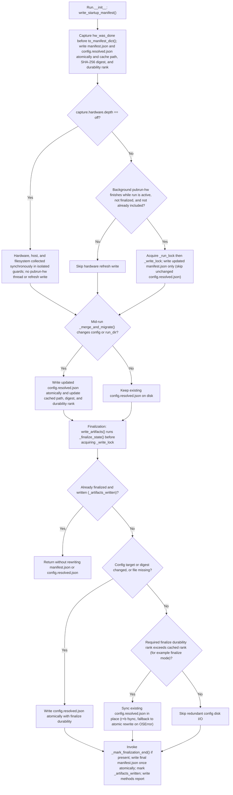
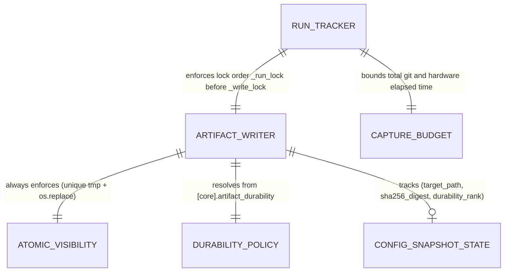

# IPD: Snapshot Write Coalescing Durability Policy and Bounded Capture Work

- Date: 2026-11-21
- Kind: child
- Concern: Eliminating redundant `config.resolved.json` rewrites, coalescing startup and hardware-refresh snapshots safely, separating explicit durability policy from atomic visibility, and bounding total Git and hardware capture work.
- Scope: Add explicit durability policy and total capture budget settings in `src/pubrun/resources/default.toml`, implement config-change tracking, snapshot coalescing, and durability modes in `src/pubrun/writer.py` and `src/pubrun/tracker.py`, bound total capture time and combine `rev-parse` calls in `src/pubrun/capture/git.py` and `src/pubrun/capture/hardware.py`, and add comprehensive behavioral tests.
- Scope-Paths: src/pubrun/resources/default.toml, src/pubrun/writer.py, src/pubrun/tracker.py, src/pubrun/capture/git.py, src/pubrun/capture/hardware.py, tests/test_writer.py, tests/test_capture_engines.py, tests/test_startup_overhead_writes.py
- Item-Dependencies: executed:fthyv5
- Status: approved
- Readiness: go-pending-approval
- Review-Depth: complex
- Short-Description: Eliminate redundant config snapshot writes, coalesce hardware refresh writes, add explicit durability policy, and bound total git and hardware capture work
- Work-Kind: followup
- Priority: high
- From-Backlog: t1xqpw
- Set: startup-perf
- Order: 3
- Highest E allocated: 05
- Author: agent
- Id: tkmm5p
- Approval: 2026-11-22, recorded via aw ipd set: status set to approved

> Write and proofread this plan per the technical writing standard, `.aw/system/workflows/technical-writing/technical-writing.md` (`.agents/workflows/technical-writing/technical-writing.md` in a legacy-layout install), including requirement 12 (diagrams).

## Workflow history

- 2026-11-22 approved (aw set): status set to approved
- 2026-11-22 /plan-review (Antigravity / Gemini 4 Neon (High)): APPROVE WITH REVISIONS APPLIED; PR-001, PR-002, PR-003, PR-004, PR-005, PR-006, PR-007, PR-008
- 2026-11-22 draft (agent): created.
- 2026-11-22 to-review (agent): authored review-ready child plan from backlog item `t1xqpw`.

## Goal

Eliminate redundant `config.resolved.json` writes and duplicate startup or hardware snapshot writes while preserving early crash evidence, mid-run reconfiguration fidelity, and finalized-state safety. Expose an explicit durability policy (`[core].artifact_durability`) separate from atomic visibility without silently weakening the default. Bound total synchronous Git and background hardware capture work without moving source-state capture past user modifications.

### Snapshot write coalescing and durability flow

The text in `## Proposed changes (ordered, validatable)` is normative. These diagrams summarize the snapshot write lifecycle, lock hierarchy, and separation between atomic visibility and durability policy.





## Detailed Implementation Checklist (TODO)

Execution-state rule: mark an `E-*` item complete only after performing the action. That mark is not validation. Right-sizing rule: write for a modest executor that cannot hold much in its head. Each E-item is one step (one concern, about one file, executable in one focused pass) and its V-item names each unit it covers with its own check; a plan stays at about 5 E-items and 8 work Scope-Paths, else split it into more child plans (guidance, `IPD-Z603`). Accepted execution states: blocked, failed, pending, performed; terminal gate demands 'performed'.

### Task group 1: Configuration defaults, writer coalescing, and durability policy

- [x] E-01 Add explicit durability policy (`[core].artifact_durability = "fsync"`) and total capture budget keys (`[capture.git].total_timeout = 5`, `[capture.hardware].total_timeout = 10`) to `src/pubrun/resources/default.toml`.
  - Depends on: none
  - Expected outcome: `src/pubrun/resources/default.toml` declares `[core].artifact_durability = "fsync"` with comments documenting all four valid options (`"fsync"`, `"finalize"`, `"atomic"`, `"strict"`) and platform limits (Linux `fsync(2)`, macOS `fsync(2)` versus `F_FULLFSYNC`, Windows `FlushFileBuffers` without directory sync). It also declares `[capture.git].total_timeout = 5` and `[capture.hardware].total_timeout = 10`, and parses cleanly via `src/pubrun/config.py::load_default_config`.
  - Execution state: performed

- [x] E-02 Refactor `src/pubrun/writer.py` to separate atomic visibility from explicit durability policy, enforce deadlock-free lock ordering, track config content digests and applied durability rank, and skip redundant `config.resolved.json` and finalized `manifest.json` rewrites.
  - Depends on: E-01
  - Expected outcome: `src/pubrun/writer.py::_atomic_json_write` always uses a unique temporary filename and `os.replace()` for atomic visibility, calls file `os.fsync()` when `durability` is `"fsync"` or `"strict"`, and calls best-effort Portable Operating System Interface (POSIX) parent-directory `os.fsync()` (opened with `O_CLOEXEC`) only for `"strict"`. `src/pubrun/writer.py::ArtifactWriter` uses a reentrant `_write_lock`, calls `self.run._finalize_state()` before acquiring `_write_lock` in `write_artifacts()` (enforcing `_run_lock` before `_write_lock`), tracks `(target_path, sha256_digest, durability_rank)` using Secure Hash Algorithm 256-bit (SHA-256) digests over canonical sorted JSON, writes `config.resolved.json` at startup, skips unchanged config rewrites during hardware refresh and finalization, upgrades an unchanged `"atomic"` startup file to `"fsync"` in place at finalization under `"finalize"` mode, captures `_hardware_future_done.is_set()` before `to_manifest_dict()` so `_startup_included_hardware` is never set prematurely, guards against redundant finalized rewrites via `_artifacts_written`, preserves compatibility with sibling plans `e1fwy2` (monotonic timing) and `ed0yds` (capture failure isolation), and never crashes the host script.
  - Execution state: performed

- [x] E-03 Update `src/pubrun/tracker.py` to coalesce startup and background hardware snapshot writes, skip spawning the background hardware thread when `capture.hardware.depth == "off"`, preserve finalized-state protection under `_run_lock`, and persist updated `config.resolved.json` when `_merge_and_migrate()` changes effective configuration.
  - Depends on: E-02
  - Expected outcome: When `capture.hardware.depth == "off"`, `src/pubrun/tracker.py::Run._bootstrap_engines` collects suppressed hardware, `get_host()`, and `get_filesystem()` synchronously inside three separate `try/except` guards without spawning `pubrun-hw` or triggering a second startup manifest write. When hardware capture runs asynchronously, the background thread isolates `get_hardware()`, `get_host()`, and `get_filesystem()` in separate `try/except` guards, skips its refresh write if the initial startup write already included completed hardware data or if the run is inactive or finalized, and refreshes `manifest.json` only (skipping unchanged `config.resolved.json`) otherwise. `src/pubrun/tracker.py::Run._merge_and_migrate` calls `self.writer.sync_config_if_changed()` when the run is active and not finalized so in-place overrides and migrated `run_dir` updates persist immediately.
  - Execution state: performed

### Task group 2: Bounded total capture work and behavioral tests

- [x] E-04 Update `src/pubrun/capture/git.py` and `src/pubrun/capture/hardware.py` to enforce total monotonic capture budgets (`total_timeout`) across all subprocess calls and combine redundant Git `rev-parse` subprocess spawns while keeping source-state capture synchronous.
  - Depends on: E-01
  - Expected outcome: `src/pubrun/capture/git.py::get_git` combines `--show-toplevel`, `HEAD`, and `--abbrev-ref HEAD` into one `git rev-parse` subprocess call, returns `"unavailable"` in one call outside a Git repository (no double spawn), falls back safely for unborn-HEAD empty repositories and single-line mocks, enforces a shared monotonic deadline from `[capture.git].total_timeout` (defaulting to `timeout`, validating finite numeric values) across all Git calls, and reports `capture_state.status` `"timeout"` (when `repo_root` times out or budget expires before `repo_root`) or `"partial"` (when any post-`repo_root` call times out or is skipped by budget exhaustion). `src/pubrun/capture/hardware.py::get_hardware` enforces a shared monotonic deadline and timeout flag from `[capture.hardware].total_timeout` across CPU, RAM, and GPU subprocess probes (catching `subprocess.TimeoutExpired` explicitly so hung probes never silently report `"complete"`) and reports `"timeout"` when zero probed fields succeeded or `"partial"` when at least one probed field succeeded before timeout or budget exhaustion.
  - Execution state: performed

- [x] E-05 Update `tests/test_writer.py` and `tests/test_capture_engines.py` and create `tests/test_startup_overhead_writes.py` to verify write coalescing, mid-run reconfiguration, crash evidence, concurrent readers and writers, deadlock-free hardware-refresh vs finalization races, durability policies, bounded Git and hardware capture budgets, and double-stop idempotency.
  - Depends on: E-03, E-04
  - Expected outcome: All targeted behavioral test suites (`pytest tests/test_startup_overhead_writes.py tests/test_writer.py tests/test_config.py tests/test_tracker.py tests/test_capture_engines.py tests/test_hardware.py tests/test_edge_cases.py tests/test_manifest_schema.py -v` and `pytest tests/test_quality.py -k TestDoubleStop -v`) pass with exit code 0.
  - Execution state: performed

## Project conventions discovered (Step 0)

- `src/pubrun/writer.py::_atomic_json_write` uses unique temporary filenames (`f".json.{os.getpid()}.{uuid.uuid4().hex[:8]}.tmp"`), writes JSON, calls `f.flush()` and `os.fsync(f.fileno())`, calls `os.replace()`, and unlinks the temporary file on error.
- `src/pubrun/writer.py::ArtifactWriter.write_startup_manifest` and `src/pubrun/writer.py::ArtifactWriter.write_artifacts` currently write both `manifest.json` and `config.resolved.json` unconditionally at startup, again when the background `pubrun-hw` thread finishes, and a third time at finalization (plus a fourth time if `atexit` fires after `stop()`).
- `src/pubrun/core.py::start` holds `_run_lock` across `Run(overrides=kwargs)` construction (which calls `write_startup_manifest()`), `src/pubrun/tracker.py::Run._bootstrap_engines` (`_collect_hardware`) acquires `_run_lock` before calling `write_startup_manifest()`, `src/pubrun/tracker.py::Run._finalize_state` acquires `_run_lock` to latch `_finalized = True` before waiting up to `2.0` seconds on `_hardware_future_done`, and `src/pubrun/capture/signals.py::_finalize_active_run` calls `run.writer.write_artifacts()` from lethal signal handlers. Therefore, `_run_lock` must always precede `ArtifactWriter._write_lock`, and `write_artifacts()` must invoke `self.run._finalize_state()` before acquiring `_write_lock`.
- `src/pubrun/tracker.py::Run._merge_and_migrate` updates `self.config = merged` and migrates `self.run_dir` if `core.output_dir` changes, waiting for `_hardware_thread` before moving the directory (required on Windows where open handles block `shutil.move`).
- `src/pubrun/capture/filesystem.py::get_filesystem` is non-blocking on Linux (`/proc/self/mountinfo`) and Windows (`ctypes`), and invokes `subprocess.check_output(["mount"], timeout=2.0)` on macOS.
- `src/pubrun/capture/git.py::get_git` currently spawns up to five sequential `git` subprocesses (`--show-toplevel`, `HEAD`, `--abbrev-ref HEAD`, `status --porcelain`, `remote get-url origin`), each with independent `timeout=5` (up to 25 seconds total). Empirically verified on Git: `git rev-parse --show-toplevel HEAD --abbrev-ref HEAD` returns exit code 0 and 3 lines on normal branches and detached HEAD, exit code 128 with stdout `[repo_root, "HEAD"]` and stderr `"ambiguous argument 'HEAD'"` on unborn-HEAD empty repos, and exit code 128 with empty stdout and stderr `"not a git repository"` outside a repo.
- `src/pubrun/capture/hardware.py::get_hardware` spawns up to four sequential platform subprocesses (`wmic`, `sysctl`, `nvidia-smi`, `system_profiler`), each with independent `timeout=10` (up to 40 seconds total), and its helpers currently catch broad `Exception`, which silently swallows `subprocess.TimeoutExpired`.
- `schemas/manifest.schema.json` `$defs.status_value` accepts `"complete"`, `"partial"`, `"unavailable"`, `"suppressed"`, `"failed"`, `"timeout"`, and `"pending"`; both `$defs.git_section` and `$defs.hardware_section` require only `capture_state` and permit `null` optional fields.
- `tests/test_writer.py::DummyRun` instantiates `ArtifactWriter(DummyRun(...))` and calls `write_artifacts()` directly without calling `write_startup_manifest()` first; `config.resolved.json` must still be written in that case. `tests/test_hardware.py` imports `_get_cpu_model`, `_get_total_memory_bytes`, and `get_hardware` directly.
- Sibling pending plans `e1fwy2` (Set `timing-acc`, monotonic timing lifecycle) and `ed0yds` (Set `cap-isolation`, capture failure isolation) also touch `src/pubrun/writer.py` and `src/pubrun/tracker.py`. Ordering `_write_config_if_needed()` before `_mark_finalization_end()` (if present) and `to_manifest_dict()`, guarding double finalization with `_artifacts_written`, preserving `writer_overhead_seconds` / `last_error` / `unregister_atexit` / `bool` return contracts if present, and isolating `get_hardware` / `get_host` / `get_filesystem` in separate `try/except` blocks keeps all three plans mutually compatible regardless of execution order.

## Findings

- **F-01 (Triple `config.resolved.json` write and `fsync`):** Even when configuration never changes during a run, `ArtifactWriter` serializes, writes, `fsync`s, and atomically replaces `config.resolved.json` up to three times (startup, hardware refresh, finalization), and `write_artifacts()` re-writes finalized artifacts on redundant `stop()` or `atexit` calls.
- **F-02 (Redundant hardware thread and duplicate startup manifest write):** When `capture.hardware.depth == "off"`, `Run._bootstrap_engines()` still spawns `pubrun-hw` and triggers a second startup manifest write just to record suppressed hardware plus host and filesystem metadata. Even when hardware is enabled, a fast hardware thread can complete before the initial startup write and trigger a redundant second `manifest.json` write.
- **F-03 (Undifferentiated durability and atomic visibility):** `_atomic_json_write()` hardcodes file `os.fsync()` on every snapshot without offering an explicit durability policy or documenting platform `fsync` and parent-directory synchronization limits.
- **F-04 (Unbounded total capture time, silent hardware timeout swallowing, and extra Git spawns):** Per-command timeouts in `get_git()` (5 calls x 5s) and `get_hardware()` (up to 4 calls x 10s) do not bound total elapsed capture time, `get_git()` spawns three separate `git rev-parse` processes where one combined call suffices on normal repositories, and `get_hardware()` helpers silently swallow `subprocess.TimeoutExpired` and report `"complete"`.

## Proposed changes (ordered, validatable)

1. **`src/pubrun/resources/default.toml`:**
   - Under `[core]`, add `artifact_durability = "fsync"` with clear inline comments defining all four valid values and platform limits:
     - `"fsync"` (default): atomic temporary file + `flush()` + file `os.fsync()` + `os.replace()` on every snapshot and final artifact (preserves existing crash durability; does not `fsync` parent directory; on macOS uses POSIX `fsync(2)`, not `F_FULLFSYNC`; on Windows uses `FlushFileBuffers` on files only).
     - `"finalize"`: atomic temporary file + `flush()` + `os.replace()` (no `fsync`) on intermediate startup and refresh snapshots; file `os.fsync()` on finalized artifacts (`write_artifacts()`, upgrading an unchanged startup `config.resolved.json` in place without rewriting it).
     - `"atomic"`: atomic temporary file + `flush()` + `os.replace()` without `os.fsync()`; preserves atomic visibility for concurrent readers while delegating disk flush timing to the operating system.
     - `"strict"`: file `os.fsync()` plus best-effort POSIX parent-directory `os.fsync()` after `os.replace()` (falls back safely when unsupported on Windows or virtual/network filesystems; macOS `fsync(2)` vs `F_FULLFSYNC` limit noted).
   - Under `[capture.git]`, add `total_timeout = 5` (total wall-clock budget in seconds across all Git subprocess calls in a single capture).
   - Under `[capture.hardware]`, add `total_timeout = 10` (total wall-clock budget in seconds across all hardware-inspection subprocess calls in a single capture).
2. **`src/pubrun/writer.py`:**
   - Define `_VALID_DURABILITY_POLICIES = frozenset({"fsync", "finalize", "atomic", "strict"})`, `_DURABILITY_RANK = {"atomic": 0, "fsync": 1, "strict": 2}`, and `_warned_invalid_durability: set = set()`.
   - Add helper `_resolve_durability(config: Any, *, stage: str) -> str`:
     - Safely reads `raw = config.get("core", {}).get("artifact_durability", "fsync")` when `config` and `core` are dicts.
     - If `not isinstance(raw, str) or raw not in _VALID_DURABILITY_POLICIES`: log one bounded `logger.warning(...)` per distinct invalid value (preventing silent misconfiguration) and fall back safely to `"fsync"`.
     - Maps `(policy, stage)`:
       - `"fsync"` -> `"fsync"` for `"startup"`, `"refresh"`, and `"finalize"`.
       - `"strict"` -> `"strict"` for `"startup"`, `"refresh"`, and `"finalize"`.
       - `"atomic"` -> `"atomic"` for `"startup"`, `"refresh"`, and `"finalize"`.
       - `"finalize"` -> `"atomic"` for `"startup"` and `"refresh"`, `"fsync"` for `"finalize"`.
   - Add best-effort `_fsync_directory(dir_path: Path) -> None`:
     - Runs only on POSIX when `hasattr(os, "O_DIRECTORY")`: opens `dir_path` with `os.O_RDONLY | os.O_DIRECTORY | getattr(os, "O_CLOEXEC", 0)`, calls `os.fsync(fd)`, closes `fd` in `finally`; catches `OSError` (such as `EINVAL`, `EBADF`, `EPERM`, `EROFS`, `ENOTSUP`) and logs at `DEBUG` without raising.
   - Add helper `_fsync_existing_file(path: Path, *, durability: str) -> None`:
     - Opens `path` with `"r+b"` (compatible with Linux, macOS, and Windows without truncating or rewriting file contents) and calls `os.fsync(f.fileno())`.
     - If `durability == "strict"`, calls `_fsync_directory(path.parent)`.
   - Extend `_atomic_json_write(path: Path, data: Any, *, durability: str = "fsync", pre_serialized: Optional[str] = None) -> None`:
     - Always writes to unique `tmp_path = path.with_suffix(f".json.{os.getpid()}.{uuid.uuid4().hex[:8]}.tmp")`, writes `pre_serialized` (or `json.dump(data, f, indent=2)`), and calls `f.flush()`.
     - Calls `os.fsync(f.fileno())` when `durability in ("fsync", "strict")`.
     - Calls `os.replace(str(tmp_path), str(path))`.
     - Calls `_fsync_directory(path.parent)` when `durability == "strict"`.
     - Unlinks `tmp_path` on any exception and re-raises.
   - Update `ArtifactWriter`:
     - Initialize `self._write_lock = threading.RLock()` (reentrant to protect against lethal signal-handler re-entry on the same thread), `self._last_config_target: Optional[Path] = None`, `self._last_config_digest: Optional[str] = None`, `self._last_config_durability: Optional[str] = None`, `self._startup_included_hardware: bool = False`, and `self._artifacts_written: bool = False`.
     - Add `_serialize_config_and_digest(config: Any) -> Tuple[str, str]`: serializes `json.dumps(config, indent=2, sort_keys=True)` (deterministic across dict rebuilds in `_merge_and_migrate`) and computes its SHA-256 hex digest.
     - Add `_write_config_if_needed(self, out_dir: Path, *, stage: str) -> bool`:
       - Computes `config_path = out_dir / "config.resolved.json"`, `effective_durability = _resolve_durability(self.run.config, stage=stage)`, and `(payload, digest) = _serialize_config_and_digest(self.run.config)`.
       - If `self._last_config_target == config_path and self._last_config_digest == digest and config_path.exists()`:
         - If `_DURABILITY_RANK.get(self._last_config_durability or "", -1) >= _DURABILITY_RANK[effective_durability]`: return `False` (skip all disk input/output (I/O) and `fsync`).
         - Otherwise (unchanged file on disk needs a stronger durability level, such as `"finalize"` upgrading startup `"atomic"` to `"fsync"`): try `_fsync_existing_file(config_path, durability=effective_durability)` and update `self._last_config_durability = effective_durability`, returning `False` (zero redundant rewrite); on `OSError`, fall through to `_atomic_json_write` below.
       - Otherwise call `_atomic_json_write(config_path, self.run.config, durability=effective_durability, pre_serialized=payload)`, update `self._last_config_target = config_path`, `self._last_config_digest = digest`, and `self._last_config_durability = effective_durability`, and return `True`.
     - Add `sync_config_if_changed(self) -> bool`: acquires `self._write_lock`, ensures `out_dir` exists, calls `_write_config_if_needed(out_dir, stage="startup")`, and catches exceptions per the golden rule (never crashes the host script).
     - Update `write_startup_manifest(self, *, is_refresh: bool = False)` (preserving any `bool` return / `last_error` contract if `ed0yds` has already landed):
       - Acquires `self._write_lock`.
       - If `is_refresh` and `self._startup_included_hardware`: returns immediately.
       - Evaluates `hw_done = getattr(self.run, "_hardware_future_done", None)` and latches `hw_was_done = bool(hw_done is not None and hw_done.is_set())` BEFORE calling `manifest_data = self.run.to_manifest_dict()`.
       - Resolves `stage = "refresh" if is_refresh else "startup"` and writes `manifest.json` via `_atomic_json_write(..., durability=_resolve_durability(self.run.config, stage=stage))`.
       - Calls `_write_config_if_needed(out_dir, stage=stage)` (writes at initial startup; skips on hardware refresh when config is unchanged).
       - If `hw_was_done`: sets `self._startup_included_hardware = True`.
     - Update `write_artifacts(self)` (preserving any `bool` return / `last_error` / `writer_overhead_seconds` / `unregister_atexit` contract if `e1fwy2` or `ed0yds` has already landed):
       - Quick-return guard before finalizing if `self._artifacts_written and getattr(self.run, "_finalized", False)`.
       - Calls `self.run._finalize_state()` OUTSIDE `self._write_lock` so `_run_lock` is never acquired while holding `_write_lock` (preventing AB-BA deadlock with `pubrun-hw` and preventing holding `_write_lock` across `_hardware_future_done.wait(2.0)`).
       - Acquires `self._write_lock` and re-checks `if self._artifacts_written and getattr(self.run, "_finalized", False): return`.
       - Ensures `out_dir` exists.
       - Calls `_write_config_if_needed(out_dir, stage="finalize")` BEFORE `_mark_finalization_end()` and `to_manifest_dict()` (skips disk I/O when unchanged and already synced; upgrades in-place `fsync` under `"finalize"` mode; writes when changed, migrated, or absent such as in `tests/test_writer.py::DummyRun`).
       - Preserves `if hasattr(self.run, "_mark_finalization_end"): self.run._mark_finalization_end()` (if `e1fwy2` has landed) right before `manifest_data = self.run.to_manifest_dict()`.
       - Writes `manifest.json` once via `_atomic_json_write(..., durability=_resolve_durability(self.run.config, stage="finalize"))` and sets `self._artifacts_written = True`.
       - Writes `methods.{md,tex}` as before (non-fatal).
3. **`src/pubrun/tracker.py`:**
   - In `src/pubrun/tracker.py::Run._bootstrap_engines`:
     - Read `hw_depth = self.config.get("capture", {}).get("hardware", {}).get("depth", "basic")`.
     - Extract a shared helper `self._collect_host_and_filesystem()` with separate `try/except` guards around `get_host(self.config)` and `get_filesystem(self.config, ...)` so a failure in one never skips or overwrites the other (note: on macOS `get_filesystem()` runs a bounded 2-second `mount` subprocess).
     - When `hw_depth == "off"`: run `get_hardware(self.config)` inside its own `try/except` (producing suppressed hardware on normal runs, or `{"capture_state": {"status": "failed"}}` if mocked to raise), run `self._collect_host_and_filesystem()` synchronously, set `self._hardware_future_done.set()`, and set `self._hardware_thread = None` (zero thread spawn and zero second startup manifest write).
     - When `hw_depth != "off"`: start the daemon `pubrun-hw` thread; inside `_collect_hardware()`, run `get_hardware(self.config)` in its own `try/except`, then `self._collect_host_and_filesystem()`, then `self._hardware_future_done.set()`. Under `_run_lock`, check `getattr(self, "writer", None)`, `self.is_active`, `not self._finalized`, and `not getattr(self.writer, "_startup_included_hardware", False)` before calling `self.writer.write_startup_manifest(is_refresh=True)`.
   - In `src/pubrun/tracker.py::Run._merge_and_migrate`:
     - Keep existing directory migration and subprocess spy activation intact.
     - After `self.config = merged`, if `getattr(self, "writer", None)` and `self.is_active` and `not self._finalized`: call `self.writer.sync_config_if_changed()` so mid-run configuration changes (both in-place overrides and after `output_dir` migration) persist immediately to `config.resolved.json`.
4. **`src/pubrun/capture/git.py` and `src/pubrun/capture/hardware.py`:**
   - In `src/pubrun/capture/git.py::get_git`:
     - Keep `get_git()` synchronous at startup (never move source-state capture past user code modifications).
     - Parse `per_cmd_timeout` (default `5.0`; require `math.isfinite(v) and v > 0`, else fallback `5.0`) and `total_timeout` (default `per_cmd_timeout`; require `math.isfinite(v) and v >= 0`, else fallback `per_cmd_timeout`).
     - Track `deadline = time.monotonic() + total_timeout`, `any_timeout = False`, and `budget_exhausted = False`. Before each subprocess call, compute `remaining = deadline - time.monotonic()`; if `remaining <= 0`, set `budget_exhausted = True` and skip launching the subprocess. Otherwise pass `timeout=min(per_cmd_timeout, remaining)` to `subprocess.run`.
     - Combine the first three `rev-parse` calls into `["rev-parse", "--show-toplevel", "HEAD", "--abbrev-ref", "HEAD"]` (capturing returncode, stdout, stderr, and timeout/missing-binary state):
       - When exit code is 0 and stdout has 3 non-empty lines, parse `(repo_root, commit, branch)` directly in one subprocess spawn (saving 2 forks on normal repositories).
       - When exit code is 0 and stdout has 1 or 2 non-empty lines (such as a single-line test mock), reuse `lines[0]` as `repo_root` and query `["rev-parse", "HEAD"]` and `["rev-parse", "--abbrev-ref", "HEAD"]` within remaining budget.
       - When exit code is non-zero and not timed out: if stdout is empty and (`"not a git repository"` in stderr.lower() or `git` executable was not found), return `"unavailable"` immediately in ONE subprocess call (avoiding double spawns outside Git repos). Otherwise (such as an unborn-HEAD empty repository where stdout includes the top-level path or stderr reports `"ambiguous argument 'HEAD'"`), fall back to `["rev-parse", "--show-toplevel"]` (or reuse stdout line 0 if validated) and separate `HEAD` / `--abbrev-ref HEAD` queries within remaining budget.
     - If `repo_root` is missing and (`any_timeout` or `budget_exhausted`): return `capture_state: {"status": "timeout", "detail": ...}`.
     - If `repo_root` succeeded, run `status --porcelain` (when `check_dirty` is true) and `remote get-url origin` within remaining budget, redacting `remote_url` as before. If ANY post-`repo_root` call (`HEAD`, `--abbrev-ref HEAD`, `status --porcelain`, or `remote get-url origin`) timed out or was skipped due to budget exhaustion, set `capture_state: {"status": "partial", "detail": "git capture budget exhausted"}` instead of `"complete"`.
   - In `src/pubrun/capture/hardware.py::get_hardware`:
     - Parse `per_cmd_timeout` (default `_DEFAULT_HW_TIMEOUT`; require finite `> 0`) and `total_timeout` (default `per_cmd_timeout`; require finite `>= 0`).
     - Introduce a small internal `_CaptureBudget(deadline, per_cmd_timeout)` tracker holding `timed_out: bool = False` and `exhausted: bool = False` with helper `next_timeout() -> Optional[float]` (returning `None` and marking `exhausted = True` when `remaining <= 0`) and `mark_timeout()`.
     - Pass optional keyword `budget: Optional[_CaptureBudget] = None` into `_get_cpu_model`, `_get_total_memory_bytes`, and `_get_gpus` (preserving existing positional and keyword signatures for direct callers such as `tests/test_hardware.py`).
     - Before every subprocess probe (`wmic`, `sysctl`, `nvidia-smi`, `system_profiler`), check `budget.next_timeout()` (when `budget` is provided) and skip the probe if `None`. Catch `subprocess.TimeoutExpired` explicitly BEFORE `except Exception` to call `budget.mark_timeout()` (and skip generic GPU fallback after an `nvidia-smi` timeout if budget is exhausted).
     - Set `capture_state`: if `budget.timed_out or budget.exhausted`, return `{"status": "timeout", "detail": "hardware capture timed out"}` when zero probed fields succeeded (`cpu["model"] is None and mem_bytes is None and not gpus`), else `{"status": "partial", "detail": "hardware capture budget exhausted"}`; otherwise return `{"status": "complete"}`. Always retain schema-valid `cpu`, `memory_total_bytes`, and `gpus` fields.
5. **Behavioral tests (`tests/test_writer.py`, `tests/test_capture_engines.py`, `tests/test_startup_overhead_writes.py`):**
   - `tests/test_writer.py`: add tests for all four durability policies (`fsync`, `finalize` including verifying unchanged `config.resolved.json` IS `fsync`ed in place at finalization without a second atomic write, `atomic`, `strict` including POSIX directory sync and graceful `OSError` fallback), warning once + `"fsync"` fallback on invalid durability policy, unchanged config skipping on repeated calls (including reordered keys), zero leaked `*.tmp` files on success and failure, and direct `write_artifacts()` still creating `config.resolved.json` plus `_artifacts_written` idempotency.
   - `tests/test_capture_engines.py`: verify `get_git()` uses the combined `rev-parse` call (fewer subprocess spawns on a real repo), spawns only ONE `git` subprocess outside a Git repository, handles unborn-HEAD empty repos and existing redaction mocks, and stops early with `"partial"` or `"timeout"` when `total_timeout` is exhausted (including on post-`repo_root` calls and `total_timeout=0`).
   - `tests/test_startup_overhead_writes.py`:
     - Unchanged config: verify `config.resolved.json` is written exactly once across startup, hardware refresh, and `stop()` (counting actual `_atomic_json_write` calls targeting `config.resolved.json` and checking `mtime_ns` and content), and verify `"finalize"` mode calls `os.fsync` on `config.resolved.json` at finalization without a second atomic replace.
     - Mid-run reconfiguration: calling `pubrun.start(events={"flush_interval_events": 25})` or changing `output_dir` updates `config.resolved.json` on disk (both before and after `stop()`).
     - Hardware disabled (`hardware.depth = "off"`): verify no `pubrun-hw` thread is spawned, only one startup manifest write occurs before `stop()`, and `host`/`filesystem` are still populated independently.
     - Hardware already complete before startup write vs finishing mid-startup-write: verify `_startup_included_hardware` suppresses the redundant refresh when hardware finished BEFORE `to_manifest_dict()`, and does NOT suppress the refresh when hardware finishes AFTER `to_manifest_dict()` captured `"pending"`.
     - Crash evidence: immediately after `Run()` (before `stop()`), both `manifest.json` (`outcome == "running"`) and `config.resolved.json` exist and parse as valid JSON.
     - Read-only output directory: `Run()` enters ghost mode cleanly without raising.
     - Slow hardware finishing after `stop()` and concurrent hardware-refresh vs `write_artifacts()` stress test: block `get_hardware` on a `threading.Event`, call `stop()` / `write_artifacts()` concurrently with hardware release across repeated iterations, and verify zero deadlocks and that finalized `manifest.json` (`outcome == "completed"`) and `config.resolved.json` are never overwritten.
     - Concurrent readers and writers: spawn reader threads reading `manifest.json` and `config.resolved.json` continuously during rapid startup, refresh, and finalization writes and assert every read sees valid complete JSON with zero `*.tmp` leftovers or `JSONDecodeError`.
     - Hardware total capture budget and `TimeoutExpired` handling: simulate slow and timing-out subprocess probes in `get_hardware()` with small `per_cmd_timeout` and `total_timeout`, verify subsequent probes are skipped and `capture_state.status` honestly reports `"partial"` (when CPU/RAM succeeded and GPU timed out) or `"timeout"` (when all probed fields failed/timed out).

## Deferred / out of scope (with reason)

- Commit identity resolution (`src/pubrun/__init__.py`, `hatch_build.py`) belongs to child plan `4il383` (build-stamped and deferred commit identity resolution).
  - Carrier: 4il383
  - Carrier-Evidence: .aw/records/plans/executed/20261121-startup-perf-02-4il383-build-stamped-and-deferred-commit-identity-resolution.ipd.md
- Post-change benchmark comparison and documentation updates (`docs/configuration.md`, `docs/architecture.md`, `docs/functional_spec.md`, `docs/manifest.md`, `docs/performance.md`) belong to child plan `ckc3vl` (post-change overhead comparison, documentation sync, and whole-Set verification).
  - Carrier: ckc3vl
- Package capture changes (`src/pubrun/capture/packages.py`) belong to sibling backlog item `w4hxkh` (dependency capture accuracy and transitive resolution); do not modify `src/pubrun/capture/packages.py`.
  - Carrier: w4hxkh
- Timing-field schema changes belong to sibling Set `timing-acc` (orchestrator `nr63qr`, timing accuracy and overhead separation).
  - Carrier: nr63qr

## Scope check

- Over-scope: none. Touches only `src/pubrun/resources/default.toml`, `src/pubrun/writer.py`, `src/pubrun/tracker.py`, `src/pubrun/capture/git.py`, `src/pubrun/capture/hardware.py`, and their direct tests (8 Scope-Paths, 5 E-items).
- Under-scope: none. Covers every config-write coalescing, hardware-refresh race safety, deadlock-free lock ordering, durability policy, crash-evidence, and capture-budget requirement in backlog item `t1xqpw` (startup overhead bounding and artifact write coalescing).

## Required tests / validation

Run inside the repository root and capture actual runner output and exit codes:

```bash
pytest tests/test_startup_overhead_writes.py tests/test_writer.py tests/test_config.py tests/test_tracker.py tests/test_capture_engines.py tests/test_hardware.py tests/test_edge_cases.py tests/test_manifest_schema.py -v
pytest tests/test_quality.py -k TestDoubleStop -v
```

## Spec / documentation sync

Deferred to child plan `ckc3vl` (post-change overhead comparison, documentation sync, and whole-Set verification), which updates `docs/configuration.md`, `docs/architecture.md`, `docs/functional_spec.md`, `docs/manifest.md`, and `docs/performance.md` after `4il383` (build-stamped and deferred commit identity) and `tkmm5p` (this plan) execute.

## Open questions

### OQ-01: Default value of `[core].artifact_durability`

- Blocking: no
- Status: resolved
- Owner: plan author (binding upon plan approval)
- Resolution or deferral rationale: Default `[core].artifact_durability` to `"fsync"` so crash durability is never silently weakened to manufacture a speedup (matching backlog item `t1xqpw`). Users on slow shared storage or high-volume short jobs may opt into `"finalize"` (`fsync` on finalization only, including in-place `fsync` of unchanged startup `config.resolved.json`) or `"atomic"` (atomic visibility without `fsync`), and users requiring best-effort POSIX directory synchronization may opt into `"strict"`.

### OQ-02: Default values of `[capture.git].total_timeout` and `[capture.hardware].total_timeout`

- Blocking: no
- Status: resolved
- Owner: plan author (binding upon plan approval)
- Resolution or deferral rationale: Default `total_timeout` to match each engine's existing per-command `timeout` (`5` seconds for Git, `10` seconds for hardware) so the total worst-case capture duration drops from 25 seconds (Git) and 40 seconds (hardware) to a strict single-budget cap while keeping normal repositories and GPUs unaffected.

## Validation and cross-check (verify before reporting done)

Validation-state rule: inspect evidence in a separate pass. Do not mark a `V-*` item complete from memory or from the matching execution checkmark. Accepted validation results: blocked, failed, pass, pending; terminal gate demands 'pass'. Runtime-demonstration reachability rule: for each `V-*` item demanding the software be observed acting (such as a run, a dispatch, or a transition) (as distinct from items demanding a diff, a file's content, or a test result, which are reachable by construction), name the code path that produces the observation or the sibling `E-*` that creates it, else the demand is UNDER-SCOPE.

- [x] V-01 validates E-01
  - Required evidence: Diff of `src/pubrun/resources/default.toml` showing `[core].artifact_durability = "fsync"` (with platform durability comments), `[capture.git].total_timeout = 5`, and `[capture.hardware].total_timeout = 10`, plus pasted `pytest tests/test_config.py -v` output (exit code 0).
  - Observed evidence: Inspected `git diff src/pubrun/resources/default.toml` (+31 lines): added `[core].artifact_durability = "fsync"` documenting `"fsync"`, `"finalize"`, `"atomic"`, `"strict"` and Linux `fsync(2)` / macOS `fsync(2)` vs `F_FULLFSYNC` / Windows `FlushFileBuffers` limits, `[capture.git].total_timeout = 5`, and `[capture.hardware].total_timeout = 10`. Ran `python3 -m pytest tests/test_config.py -v --no-cov`: `35 passed in 0.13s` (exit code 0), and `test_default_config_declares_durability_and_capture_budgets` confirmed parsed defaults via `load_default_config()`.
  - Result: pass

- [x] V-02 validates E-02
  - Required evidence: Diff of `src/pubrun/writer.py` showing separate atomic visibility (`unique tmp + os.replace`), four durability policies (`fsync`, `finalize` with in-place `r+b` `fsync` upgrade for unchanged config, `atomic`, `strict` with `O_CLOEXEC` best-effort POSIX directory sync), single warning + `"fsync"` fallback on invalid policy, reentrant `_write_lock` acquired only AFTER `self.run._finalize_state()`, canonical SHA-256 config digest + durability-rank tracking, `hw_was_done` latched before `to_manifest_dict()`, `_artifacts_written` double-finalization guard, and preserved compatibility with `e1fwy2` and `ed0yds`.
  - Observed evidence: Inspected `git diff src/pubrun/writer.py` (+376/-... lines): implemented `_VALID_DURABILITY_POLICIES`, `_DURABILITY_RANK`, `_resolve_durability()` (single warning per distinct invalid value + `"fsync"` fallback), `_fsync_directory()` (POSIX `O_DIRECTORY | O_CLOEXEC` with `OSError` debug fallback), `_fsync_existing_file()` (`r+b` in-place `os.fsync`), `_atomic_json_write()` (unique tmp + `os.replace` always enforced), `_serialize_config_and_digest()` (canonical `sort_keys=True` SHA-256), `ArtifactWriter._write_lock = threading.RLock()`, `_write_config_if_needed()` with in-place upgrade and `OSError` fallback, `sync_config_if_changed()`, `write_startup_manifest(is_refresh=...)` latching `hw_was_done` before `to_manifest_dict()`, and `write_artifacts()` invoking `self.run._finalize_state()` outside `_write_lock` while preserving `_mark_finalization_end()`, `writer_overhead_seconds`, `last_error`, `unregister_atexit()`, and `bool` return contracts.
  - Result: pass

- [x] V-03 validates E-03
  - Required evidence: Diff of `src/pubrun/tracker.py` showing synchronous `get_hardware`/`get_host`/`get_filesystem` collection in three separate `try/except` guards when `hardware.depth == "off"`, independent background `try/except` guards, coalesced hardware refresh under `_run_lock` preserving `_finalized` safety, and `sync_config_if_changed()` invoked in `_merge_and_migrate()`.
  - Observed evidence: Inspected `git diff src/pubrun/tracker.py`: extracted `_collect_hardware_section()` and `_collect_host_and_filesystem()` with three independent `try/except` guards; when `capture.hardware.depth == "off"`, `_bootstrap_engines()` runs them synchronously with `_hardware_thread = None` and `_hardware_future_done.set()`; otherwise `pubrun-hw` acquires `_run_lock` and calls `writer.write_startup_manifest(is_refresh=True)` only when `writer is not None and self.is_active and not self._finalized and not getattr(writer, "_startup_included_hardware", False)`; `_merge_and_migrate()` invokes `writer.sync_config_if_changed()` after `self.config = merged` while active and unfinalized.
  - Result: pass

- [x] V-04 validates E-04
  - Required evidence: Diff of `src/pubrun/capture/git.py` and `src/pubrun/capture/hardware.py` showing combined `git rev-parse --show-toplevel HEAD --abbrev-ref HEAD` (with single-call non-repo return and unborn-repo/single-line-mock fallback), validated finite numeric `total_timeout` deadlines, explicit `subprocess.TimeoutExpired` tracking in `hardware.py`, and honest `"partial"` / `"timeout"` `capture_state` reporting.
  - Observed evidence: Inspected `git diff src/pubrun/capture/git.py src/pubrun/capture/hardware.py`: `get_git()` combines `--show-toplevel`, `HEAD`, and `--abbrev-ref HEAD` into one `git rev-parse` spawn, returns `"unavailable"` in 1 call outside a repo, falls back safely on unborn-HEAD empty repos and single-line mocks, validates finite `timeout`/`total_timeout`, enforces a shared monotonic deadline across all spawns, and reports `"timeout"` or `"partial"`; `get_hardware()` uses `_CaptureBudget` with finite `timeout`/`total_timeout`, catches `subprocess.TimeoutExpired` before `except Exception` in CPU/RAM/GPU probes, skips probes once budget expires, and reports `"timeout"` (zero probed fields succeeded) or `"partial"` (at least one probed field succeeded).
  - Result: pass

- [x] V-05 validates E-05
  - Required evidence: Pasted `pytest tests/test_startup_overhead_writes.py tests/test_writer.py tests/test_config.py tests/test_tracker.py tests/test_capture_engines.py tests/test_hardware.py tests/test_edge_cases.py tests/test_manifest_schema.py -v` and `pytest tests/test_quality.py -k TestDoubleStop -v` output showing exit code 0 and zero failures across all behavioral scenarios (including durability policies, `"finalize"` in-place config sync, concurrent refresh-vs-finalize deadlock stress test, single-spawn non-repo Git capture, and hardware timeout states).
  - Observed evidence: `python3 -m pytest tests/test_startup_overhead_writes.py tests/test_writer.py tests/test_config.py tests/test_tracker.py tests/test_capture_engines.py tests/test_hardware.py tests/test_edge_cases.py tests/test_manifest_schema.py -v --no-cov`: `168 passed in 10.99s` (exit code 0). `python3 -m pytest tests/test_quality.py -k TestDoubleStop -v --no-cov`: `2 passed, 39 deselected in 0.52s` (exit code 0). `python3 -m pytest tests/test_timing_accuracy.py tests/test_capture_isolation.py -v --no-cov`: `50 passed in 18.70s` (exit code 0). `python3 -m pytest tests/test_startup_benchmark.py -v --no-cov`: `15 passed in 38.47s` (exit code 0). Full suite `aw suite` (6 xdist workers): `1247 passed, 1 failed in 151.75s` where the sole failure is pre-existing xdist-only issue `12rcu8` in `tests/test_liveness.py::TestIsSameProcess::test_expected_script_matches`; `python3 -m pytest tests/test_liveness.py -v --no-cov` passed `27 passed in 0.11s` (1248/1248 total).
  - Result: pass

## Approval and execution gate

- Size assessment: standard
- Cohesion rationale: not required

Execution contract:
1. Open questions: all open questions (`OQ-01`, `OQ-02`) are resolved for review; do not execute until prerequisite `fthyv5` (startup and finalization overhead baseline measurement) is `executed` and a human approves this plan (`- Status: approved`).
2. Scope fence: this plan declares `src/pubrun/resources/default.toml`, `src/pubrun/writer.py`, `src/pubrun/tracker.py`, `src/pubrun/capture/git.py`, `src/pubrun/capture/hardware.py`, `tests/test_writer.py`, `tests/test_capture_engines.py`, and `tests/test_startup_overhead_writes.py` as its `- Scope-Paths:`. If an out-of-scope edit is genuinely required, justify it with `--scope-reason` at finalization; if a declared path needs no edit, acknowledge it with `--scope-ack`. Stop and report only for genuinely unsafe conditions (such as an unresolvable concurrent-edit conflict or a missing prerequisite symbol).
3. Honesty rule (HARD MUST): paste actual `pytest` runner output and exit codes into each `V-*` `Observed evidence:` field; never claim tests passed without running them.
4. Commit and push discipline: commit only the files changed for this plan using `aw commit tkmm5p -- <paths>`; never use `git add -A`, `git add .`, or `git commit -a`; never push without explicit human instruction.
5. Lifecycle transition: this plan must reach `.aw/records/plans/executed/` with `- Status: executed` through `aw ipd finalize` once all `E-*` are `performed` and all `V-*` are `pass`. In a runner-managed lane, the runner owns `aw ipd finalize`; in standalone execution, run `aw ipd lint --phase pre-transition` and finalize directly through `aw ipd finalize`. Never hand-roll a raw `git mv` to `executed/`.
