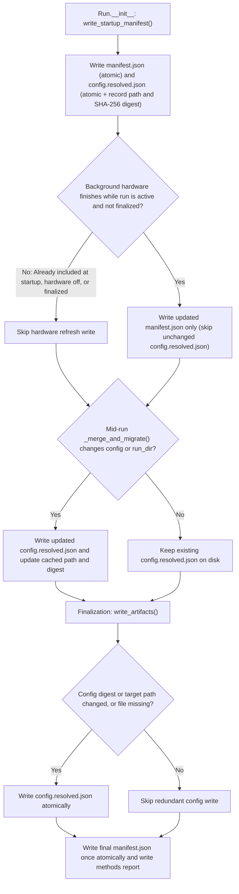

# IPD: Snapshot Write Coalescing Durability Policy and Bounded Capture Work

- Date: 2026-11-21
- Kind: child
- Concern: Eliminating redundant `config.resolved.json` rewrites, coalescing startup and hardware-refresh snapshots safely, separating explicit durability policy from atomic visibility, and bounding total Git and hardware capture work.
- Scope: Add explicit durability policy and total capture budget settings in `src/pubrun/resources/default.toml`, implement config-change tracking, snapshot coalescing, and durability modes in `src/pubrun/writer.py` and `src/pubrun/tracker.py`, bound total capture time and combine `rev-parse` calls in `src/pubrun/capture/git.py` and `src/pubrun/capture/hardware.py`, and add comprehensive behavioral tests.
- Scope-Paths: src/pubrun/resources/default.toml, src/pubrun/writer.py, src/pubrun/tracker.py, src/pubrun/capture/git.py, src/pubrun/capture/hardware.py, tests/test_writer.py, tests/test_capture_engines.py, tests/test_startup_overhead_writes.py
- Item-Dependencies: executed:fthyv5
- Status: to-review
- Short-Description: Eliminate redundant config snapshot writes, coalesce hardware refresh writes, add explicit durability policy, and bound total git and hardware capture work
- Work-Kind: followup
- Priority: high
- From-Backlog: t1xqpw
- Set: startup-perf
- Order: 3
- Highest E allocated: 05
- Author: agent
- Id: tkmm5p

> Write and proofread this plan per the technical writing standard, `.aw/system/workflows/technical-writing/technical-writing.md` (`.agents/workflows/technical-writing/technical-writing.md` in a legacy-layout install), including requirement 12 (diagrams).

## Workflow history

- 2026-11-22 draft (agent): created.
- 2026-11-22 to-review (agent): authored review-ready child plan from backlog item `t1xqpw`.

## Goal

Eliminate redundant `config.resolved.json` writes and duplicate startup/hardware snapshot writes while keeping early crash evidence, mid-run reconfiguration fidelity, and finalized-state safety intact; expose an explicit durability policy (`[core].artifact_durability`) separate from atomic visibility without silently weakening the default; and bound total synchronous Git and background hardware capture work without moving source-state capture past user modifications.

### Snapshot write coalescing and durability flow

The text in `## Proposed changes (ordered, validatable)` is normative. These diagrams summarize the snapshot write lifecycle and the separation between atomic visibility and durability policy.




## Detailed Implementation Checklist (TODO)

Execution-state rule: mark an `E-*` item complete only after performing the action. That mark is not validation. Right-sizing rule: write for a modest executor that cannot hold much in its head. Each E-item is one step (one concern, about one file, executable in one focused pass) and its V-item names each unit it covers with its own check; a plan stays at about 5 E-items and 8 work Scope-Paths, else split it into more child plans (guidance, `IPD-Z603`). Accepted execution states: blocked, failed, pending, performed; terminal gate demands 'performed'.

### Task group 1: Configuration defaults, writer coalescing, and durability policy

- [ ] E-01 Add explicit durability policy (`[core].artifact_durability = "fsync"`) and total capture budget keys (`[capture.git].total_timeout = 5`, `[capture.hardware].total_timeout = 10`) to `src/pubrun/resources/default.toml`.
  - Depends on: none
  - Expected outcome: `src/pubrun/resources/default.toml` declares `[core].artifact_durability = "fsync"` (preserving existing per-write file-synchronization durability as default, with documented options `"fsync"`, `"finalize"`, `"atomic"`, `"strict"`), `[capture.git].total_timeout = 5`, and `[capture.hardware].total_timeout = 10`, and parses cleanly via `load_default_config()`.
  - Execution state: pending

- [ ] E-02 Refactor `src/pubrun/writer.py` to separate atomic visibility from explicit durability policy, serialize snapshot writes, track config content digests (`config.resolved.json`), and skip unchanged config rewrites during hardware refresh and finalization.
  - Depends on: E-01
  - Expected outcome: `_atomic_json_write(path, data, *, durability="fsync")` always uses a unique temporary filename and `os.replace()` for atomic visibility, applies file `os.fsync()` according to `durability` (`"fsync"`, `"strict"`, `"atomic"`), and applies best-effort POSIX parent-directory `os.fsync()` only for `"strict"` (degrading safely on unsupported platforms/filesystems); `ArtifactWriter` tracks `(target_path, sha256_digest)` of the last written `config.resolved.json`, writes `config.resolved.json` at startup for crash diagnosis, skips rewriting unchanged `config.resolved.json` on hardware refresh and finalization (still writing it if changed, moved, or absent), coordinates cleanly with any `timing-acc` pre-manifest finalization ordering, and never crashes the host script.
  - Execution state: pending

- [ ] E-03 Update `src/pubrun/tracker.py` to coalesce startup and background hardware snapshot writes, skip spawning the background hardware thread when `capture.hardware.depth == "off"`, preserve finalized-state protection under `_run_lock`, and persist updated `config.resolved.json` when `_merge_and_migrate()` changes effective configuration.
  - Depends on: E-02
  - Expected outcome: When `capture.hardware.depth == "off"`, `Run._bootstrap_engines()` collects suppressed hardware plus cheap `get_host()` and `get_filesystem()` synchronously without spawning `pubrun-hw` or triggering a second startup write; when hardware capture runs asynchronously, the background thread skips its refresh write if the initial startup write already included completed hardware data or if the run is inactive/finalized, and refreshes `manifest.json` only (not unchanged `config.resolved.json`) otherwise; `_merge_and_migrate()` syncs `config.resolved.json` via `self.writer.sync_config_if_changed()` when effective config or `run_dir` changes.
  - Execution state: pending

### Task group 2: Bounded total capture work and behavioral tests

- [ ] E-04 Update `src/pubrun/capture/git.py` and `src/pubrun/capture/hardware.py` to enforce total monotonic capture budgets (`total_timeout`) across all subprocess calls and combine redundant Git `rev-parse` subprocess spawns while keeping source-state capture synchronous.
  - Depends on: E-01
  - Expected outcome: `get_git()` combines `--show-toplevel`, `HEAD`, and `--abbrev-ref HEAD` into one `git rev-parse` subprocess call (with safe fallback for unborn-HEAD empty repositories and single-line mocks), enforces a shared monotonic deadline from `[capture.git].total_timeout` (defaulting to `timeout`) across all Git calls so total Git capture cannot exceed the budget, and reports `capture_state.status` `"timeout"` or `"partial"` honestly on budget exhaustion; `get_hardware()` enforces a shared monotonic deadline from `[capture.hardware].total_timeout` (defaulting to `timeout`) across CPU, RAM, and GPU subprocess calls and reports `"partial"` or `"timeout"` honestly when exhausted.
  - Execution state: pending

- [ ] E-05 Update `tests/test_writer.py` and `tests/test_capture_engines.py` and create `tests/test_startup_overhead_writes.py` to verify write coalescing, mid-run reconfiguration, crash evidence, concurrent readers/writers, slow hardware after `stop()`, durability policies, and bounded Git/hardware capture budgets.
  - Depends on: E-03, E-04
  - Expected outcome: All targeted behavioral test suites (`pytest tests/test_startup_overhead_writes.py tests/test_writer.py tests/test_tracker.py tests/test_capture_engines.py tests/test_hardware.py tests/test_edge_cases.py tests/test_manifest_schema.py -v`) pass with exit code 0.
  - Execution state: pending

## Project conventions discovered (Step 0)

- `src/pubrun/writer.py` (`_atomic_json_write`) uses unique temporary filenames (`f".json.{os.getpid()}.{uuid.uuid4().hex[:8]}.tmp"`), writes JSON, calls `f.flush()` and `os.fsync(f.fileno())`, calls `os.replace()`, and unlinks the temporary file on error.
- `src/pubrun/writer.py` (`ArtifactWriter.write_startup_manifest` and `ArtifactWriter.write_artifacts`) currently writes both `manifest.json` and `config.resolved.json` unconditionally at startup, again when the background `pubrun-hw` thread finishes, and a third time at finalization.
- `src/pubrun/tracker.py` (`Run._bootstrap_engines` and `Run._finalize_state`) protects `_finalized` latching and the background hardware refresh under `pubrun._run_lock` to prevent a Time-Of-Check to Time-Of-Use (TOCTOU) race where slow hardware overwrites a finalized manifest.
- `src/pubrun/tracker.py` (`Run._merge_and_migrate`) updates `self.config = merged` and migrates `self.run_dir` if `core.output_dir` changes, waiting for `_hardware_thread` before moving the directory (required on Windows where open handles block `shutil.move`).
- `src/pubrun/capture/git.py` (`get_git`) currently spawns up to five sequential `git` subprocesses (`--show-toplevel`, `HEAD`, `--abbrev-ref HEAD`, `status --porcelain`, `remote get-url origin`), each with independent `timeout=5` (up to 25 seconds total).
- `src/pubrun/capture/hardware.py` (`get_hardware`) spawns up to four sequential platform subprocesses (`wmic`/`sysctl`/`nvidia-smi`/`system_profiler`), each with independent `timeout=10` (up to 40 seconds total).
- `tests/test_writer.py` instantiates `ArtifactWriter(DummyRun(...))` and calls `write_artifacts()` directly without calling `write_startup_manifest()` first; `config.resolved.json` must still be written in that case.
- Sibling plan `e1fwy2` (Set `timing-acc`) writes `config.resolved.json` before `manifest.json` inside `ArtifactWriter.write_artifacts()`; keeping `_write_config_if_needed()` before `manifest.json` keeps both plans fully compatible regardless of execution order.

## Findings

- **F-01 (Triple `config.resolved.json` write and `fsync`):** Even when configuration never changes during a run, `ArtifactWriter` serializes, writes, `fsync`s, and atomically replaces `config.resolved.json` up to three times (startup, hardware refresh, finalization).
- **F-02 (Redundant hardware thread and duplicate startup manifest write):** When `capture.hardware.depth == "off"`, `Run._bootstrap_engines()` still spawns `pubrun-hw` and triggers a second startup manifest write just to record suppressed hardware plus fast host/filesystem metadata. Even when hardware is enabled, a fast hardware thread can race the initial startup write and write `manifest.json` twice.
- **F-03 (Undifferentiated durability and atomic visibility):** `_atomic_json_write()` hardcodes file `os.fsync()` on every snapshot without offering an explicit durability policy or documenting that parent-directory `fsync` is not performed.
- **F-04 (Unbounded total capture time and extra Git spawns):** Per-command timeouts in `get_git()` (5 calls x 5s) and `get_hardware()` (up to 4 calls x 10s) do not bound total elapsed capture time, and `get_git()` spawns three separate `git rev-parse` processes where one combined call suffices on normal repositories.

## Proposed changes (ordered, validatable)

1. **`src/pubrun/resources/default.toml`:**
   - Under `[core]`, add:
     - `artifact_durability = "fsync"` with clear inline comments defining all four valid values:
       - `"fsync"` (default): atomic temporary file + `flush()` + file `os.fsync()` + `os.replace()` on every snapshot and final artifact (preserves existing crash durability; does not fsync parent directory).
       - `"finalize"`: atomic temporary file + `flush()` + `os.replace()` (no `fsync`) on intermediate startup/refresh snapshots; file `os.fsync()` on finalized artifacts (`write_artifacts()`).
       - `"atomic"`: atomic temporary file + `flush()` + `os.replace()` without `os.fsync()`; preserves atomic visibility for concurrent readers while delegating disk flush timing to the operating system.
       - `"strict"`: file `os.fsync()` plus best-effort parent-directory `os.fsync()` on POSIX after `os.replace()` (tolerable fallback when unsupported on Windows or virtual filesystems; macOS `fsync` limits documented).
   - Under `[capture.git]`, add `total_timeout = 5` (total wall-clock budget in seconds across all Git subprocess calls in a single capture).
   - Under `[capture.hardware]`, add `total_timeout = 10` (total wall-clock budget in seconds across all hardware-inspection subprocess calls in a single capture).
2. **`src/pubrun/writer.py`:**
   - Define `_VALID_DURABILITY_POLICIES = frozenset({"fsync", "finalize", "atomic", "strict"})` and helper `_resolve_durability(config, *, stage: str) -> str`:
     - Reads `config.get("core", {}).get("artifact_durability", "fsync")` (invalid/unknown values fall back safely to `"fsync"`).
     - Maps `(policy, stage)`:
       - `"fsync"` -> `"fsync"` for both `"startup"` and `"finalize"`.
       - `"strict"` -> `"strict"` for both `"startup"` and `"finalize"`.
       - `"atomic"` -> `"atomic"` for both `"startup"` and `"finalize"`.
       - `"finalize"` -> `"atomic"` for `"startup"`/`"refresh"`, `"fsync"` for `"finalize"`.
   - Add best-effort `_fsync_directory(dir_path: Path) -> None`:
     - Only runs on POSIX when `hasattr(os, "O_DIRECTORY")`: opens `dir_path` with `os.O_RDONLY | os.O_DIRECTORY`, calls `os.fsync(fd)`, closes `fd` in `finally`; catches `OSError` (such as `EINVAL`, `EBADF`, `EPERM` on filesystems that disallow directory fsync) and logs at `DEBUG` without raising.
   - Extend `_atomic_json_write(path: Path, data: Any, *, durability: str = "fsync", pre_serialized: Optional[str] = None) -> None`:
     - Always writes to unique `tmp_path = path.with_suffix(f".json.{os.getpid()}.{uuid.uuid4().hex[:8]}.tmp")`, writes `pre_serialized` (or `json.dump(data, f, indent=2)`), calls `f.flush()`.
     - Calls `os.fsync(f.fileno())` when `durability in ("fsync", "strict")`.
     - Calls `os.replace(str(tmp_path), str(path))`.
     - Calls `_fsync_directory(path.parent)` when `durability == "strict"`.
     - Unlinks `tmp_path` on any exception and re-raises.
   - Update `ArtifactWriter`:
     - Add `self._write_lock = threading.Lock()`, `self._last_config_target: Optional[Path] = None`, `self._last_config_digest: Optional[str] = None`, and `self._startup_included_hardware: bool = False`.
     - Add `_serialize_config_and_digest(config: Any) -> Tuple[str, str]`: serializes `json.dumps(config, indent=2)` and computes its Secure Hash Algorithm 256-bit (SHA-256) hex digest.
     - Add `_write_config_if_needed(self, out_dir: Path, *, stage: str) -> bool`:
       - Computes `config_path = out_dir / "config.resolved.json"` and `(payload, digest)`.
       - If `self._last_config_target == config_path and self._last_config_digest == digest and config_path.exists()`: returns `False` (skips all disk I/O and `fsync`).
       - Otherwise calls `_atomic_json_write(config_path, self.run.config, durability=..., pre_serialized=payload)`, updates `self._last_config_target = config_path` and `self._last_config_digest = digest`, and returns `True`.
     - Add `sync_config_if_changed(self) -> bool`: acquires `self._write_lock`, ensures `out_dir` exists, calls `_write_config_if_needed(out_dir, stage="startup")`, and catches exceptions per the golden rule (never crashes host script).
     - Update `write_startup_manifest(self, *, is_refresh: bool = False) -> None`:
       - Acquires `self._write_lock`.
       - If `is_refresh` and `self._startup_included_hardware`: returns immediately (initial startup write already captured completed hardware/host/filesystem state).
       - Checks `hw_done = getattr(self.run, "_hardware_future_done", None)` BEFORE serializing `manifest_data = self.run.to_manifest_dict()`.
       - Writes `manifest.json` via `_atomic_json_write(..., durability=_resolve_durability(self.run.config, stage="startup"))`.
       - Calls `_write_config_if_needed(out_dir, stage="startup")` (writes at initial startup; skips on hardware refresh when config is unchanged).
       - If `hw_done is not None and hw_done.is_set()`: sets `self._startup_included_hardware = True`.
     - Update `write_artifacts(self) -> None`:
       - Acquires `self._write_lock`.
       - Calls `self.run._finalize_state()` (preserving existing idempotency and any `timing-acc` `_mark_finalization_end()` hook if present on `self.run`).
       - Writes `config.resolved.json` via `_write_config_if_needed(out_dir, stage="finalize")` BEFORE building `manifest_data` (skips disk write when unchanged and already on disk; writes when changed, migrated, or absent such as in direct `ArtifactWriter` tests).
       - Builds `manifest_data = self.run.to_manifest_dict()` and writes `manifest.json` once via `_atomic_json_write(..., durability=_resolve_durability(self.run.config, stage="finalize"))`.
       - Writes `methods.{md,tex}` as before (non-fatal).
3. **`src/pubrun/tracker.py`:**
   - In `Run._bootstrap_engines()`:
     - Check `hw_depth = self.config.get("capture", {}).get("hardware", {}).get("depth", "basic")`.
     - Extract a shared helper `self._collect_host_and_filesystem()` so both synchronous (`hw_depth == "off"`) and background-thread paths populate `self.host_data` and `self.filesystem_data` identically.
     - When `hw_depth == "off"`: set `self.hardware_data = get_hardware(self.config)` (suppressed), run `self._collect_host_and_filesystem()` synchronously, set `self._hardware_future_done.set()`, and set `self._hardware_thread = None` (zero thread spawn, zero second startup manifest write!).
     - When `hw_depth != "off"`: start the daemon `pubrun-hw` thread as before; upon completion, under `_run_lock`, check `getattr(self, "writer", None)`, `self.is_active`, `not self._finalized`, and `not getattr(self.writer, "_startup_included_hardware", False)` before calling `self.writer.write_startup_manifest(is_refresh=True)`.
   - In `Run._merge_and_migrate(overrides)`:
     - Keep existing directory migration and subprocess spy activation intact.
     - After `self.config = merged`, if `getattr(self, "writer", None)` and `self.is_active` and `not self._finalized`: call `self.writer.sync_config_if_changed()` so mid-run configuration changes (both in-place and after `output_dir` migration) are immediately reflected in `config.resolved.json`.
4. **`src/pubrun/capture/git.py` and `src/pubrun/capture/hardware.py`:**
   - In `src/pubrun/capture/git.py` (`get_git`):
     - Keep `get_git()` synchronous at startup (never move source-state capture past user code modifications).
     - Parse `per_cmd_timeout = float(cfg.get("timeout", 5))` and `total_timeout = float(cfg.get("total_timeout", per_cmd_timeout))` with safe numeric fallbacks.
     - Track `deadline = time.monotonic() + max(0.0, total_timeout)`. Before each subprocess call, compute `remaining = deadline - time.monotonic()`; if `remaining <= 0`, record `budget_exhausted = True` and skip remaining subprocess calls instead of launching new processes. Pass `timeout=min(per_cmd_timeout, remaining)` to `subprocess.run`.
     - Combine the first three `rev-parse` calls into `["rev-parse", "--show-toplevel", "HEAD", "--abbrev-ref", "HEAD"]`:
       - When it returns 3 non-empty lines, parse `(repo_root, commit, branch)` directly in ONE subprocess spawn (saving 2 forks on every run!).
       - When it returns fewer than 3 lines (such as a single-line test mock) or fails (such as an unborn-HEAD repository with no commits yet), fall back safely to `["rev-parse", "--show-toplevel"]` and separate `HEAD`/`--abbrev-ref` queries within the remaining budget so unborn repos and existing mocks keep working.
     - If `repo_root` itself timed out or exhausted budget, return `capture_state: {"status": "timeout", "detail": ...}`. If `repo_root` succeeded but later calls (`status --porcelain` or `remote get-url origin`) timed out or exhausted the total budget, return the collected fields with `capture_state: {"status": "partial", "detail": "git capture budget exhausted"}` instead of falsely reporting `"complete"`.
   - In `src/pubrun/capture/hardware.py` (`get_hardware`):
     - Parse `per_cmd_timeout = float(hw_config_root.get("timeout", _DEFAULT_HW_TIMEOUT))` and `total_timeout = float(hw_config_root.get("total_timeout", per_cmd_timeout))`.
     - Pass a shared `deadline = time.monotonic() + max(0.0, total_timeout)` (or remaining-budget callable) into `_get_cpu_model`, `_get_total_memory_bytes`, and `_get_gpus` (preserving default keyword signatures so direct callers like `tests/test_hardware.py` stay backward compatible).
     - Before each subprocess call, clamp `timeout` to `min(per_cmd_timeout, remaining)` and stop probing when `remaining <= 0`, setting `capture_state` to `{"status": "partial", "detail": "hardware capture budget exhausted"}` (or `"timeout"` if no fields were collected due to timeout).
5. **Behavioral tests (`tests/test_writer.py`, `tests/test_capture_engines.py`, `tests/test_startup_overhead_writes.py`):**
   - `tests/test_writer.py`: add tests for durability modes (`fsync`, `finalize`, `atomic`, `strict` including graceful `OSError` handling on directory sync), unchanged config skipping on repeated calls, and direct `write_artifacts()` still creating `config.resolved.json`.
   - `tests/test_capture_engines.py`: verify `get_git()` uses the combined `rev-parse` call (fewer subprocess spawns on a real repo), handles unborn repos and existing redaction mocks, and stops early with `"partial"`/`"timeout"` when `total_timeout` is exhausted.
   - `tests/test_startup_overhead_writes.py`:
     - Unchanged config: verify `config.resolved.json` is written exactly ONCE across startup, hardware refresh, and `stop()` (counting actual `_atomic_json_write` calls targeting `config.resolved.json` and checking file `mtime_ns`/content).
     - Mid-run reconfiguration: calling `pubrun.start(events={"flush_interval_events": 25})` or changing `output_dir` updates `config.resolved.json` on disk (both before and after `stop()`).
     - Hardware disabled (`hardware.depth = "off"`): verify no `pubrun-hw` thread is spawned and only one startup manifest write occurs before `stop()`.
     - Crash evidence: immediately after `Run()` (before `stop()`), both `manifest.json` (`outcome == "running"`) and `config.resolved.json` exist and parse as valid JSON.
     - Read-only output directory: `Run()` enters ghost mode cleanly without raising.
     - Slow hardware finishing after `stop()`: block `get_hardware` on a `threading.Event`, call `stop()`, release `get_hardware`, wait for thread exit, and verify finalized `manifest.json` (`outcome == "completed"`) and `config.resolved.json` are NOT overwritten.
     - Concurrent readers and writers: spawn reader threads reading `manifest.json` and `config.resolved.json` continuously during rapid startup/refresh/finalization writes and assert every read sees valid complete JSON with zero temp-file collisions or `JSONDecodeError`.
     - Hardware total capture budget: simulate slow subprocess probes in `get_hardware` with small `total_timeout` and verify subsequent probes are skipped and `capture_state.status` reports `"partial"` or `"timeout"`.

## Deferred / out of scope (with reason)

- Commit identity resolution (`src/pubrun/__init__.py`, `hatch_build.py`) belongs to child plan `4il383`.
- Post-change benchmark comparison and documentation updates (`docs/configuration.md`, `docs/architecture.md`, `docs/functional_spec.md`, `docs/performance.md`) belong to child plan `ckc3vl`.
- Package capture changes (`src/pubrun/capture/packages.py`) belong to sibling backlog item `w4hxkh`; do not modify `packages.py`.
- Timing-field schema changes belong to sibling Set `timing-acc` (`nr63qr`).

## Scope check

- Over-scope: none. Touches only `default.toml`, `writer.py`, `tracker.py`, `capture/git.py`, `capture/hardware.py`, and their direct tests (8 Scope-Paths, 5 E-items).
- Under-scope: none. Covers every config-write coalescing, hardware-refresh race safety, durability policy, crash-evidence, and capture-budget requirement in `t1xqpw`.

## Required tests / validation

Run inside the repository root and capture actual runner output and exit code:

```bash
pytest tests/test_startup_overhead_writes.py tests/test_writer.py tests/test_tracker.py tests/test_capture_engines.py tests/test_hardware.py tests/test_edge_cases.py tests/test_manifest_schema.py -v
```

## Spec / documentation sync

Deferred to child plan `ckc3vl`, which updates `docs/configuration.md`, `docs/architecture.md`, `docs/functional_spec.md`, `docs/manifest.md`, and `docs/performance.md` after `4il383` and `tkmm5p` execute.

## Open questions

### OQ-01: Default value of `[core].artifact_durability`

- Blocking: no
- Status: resolved
- Owner: maintainer (confirmed upon plan approval)
- Resolution or deferral rationale: Default `[core].artifact_durability` to `"fsync"` so crash durability is never silently weakened to manufacture a speedup. Users on slow shared storage or high-volume short jobs may opt into `"finalize"` (fsync on finalization only) or `"atomic"` (atomic visibility without fsync), and users requiring best-effort POSIX directory synchronization may opt into `"strict"`.

### OQ-02: Default values of `[capture.git].total_timeout` and `[capture.hardware].total_timeout`

- Blocking: no
- Status: resolved
- Owner: maintainer (confirmed upon plan approval)
- Resolution or deferral rationale: Default `total_timeout` to match each engine's existing per-command `timeout` (`5` seconds for Git, `10` seconds for hardware) so the total worst-case capture duration drops from 25s (Git) and 40s (hardware) to a strict single-budget cap while keeping normal repositories and GPUs unaffected.

## Validation and cross-check (verify before reporting done)

Validation-state rule: inspect evidence in a separate pass. Do not mark a `V-*` item complete from memory or from the matching execution checkmark. Accepted validation results: blocked, failed, pass, pending; terminal gate demands 'pass'. Runtime-demonstration reachability rule: for each `V-*` item demanding the software be observed acting (such as a run, a dispatch, or a transition)—as distinct from items demanding a diff, a file's content, or a test result, which are reachable by construction—name the code path that produces the observation or the sibling `E-*` that creates it, else the demand is UNDER-SCOPE.

- [ ] V-01 validates E-01
  - Required evidence: Diff of `src/pubrun/resources/default.toml` showing `[core].artifact_durability = "fsync"`, `[capture.git].total_timeout = 5`, and `[capture.hardware].total_timeout = 10`, plus `pytest tests/test_config.py -v` output (exit code 0).
  - Observed evidence:
  - Result: pending

- [ ] V-02 validates E-02
  - Required evidence: Diff of `src/pubrun/writer.py` showing separate atomic visibility (`unique tmp + os.replace`), four durability policies (`fsync`, `finalize`, `atomic`, `strict` with best-effort POSIX directory sync), serialized write lock, and SHA-256 config digest check preventing redundant `config.resolved.json` rewrites.
  - Observed evidence:
  - Result: pending

- [ ] V-03 validates E-03
  - Required evidence: Diff of `src/pubrun/tracker.py` showing synchronous host/filesystem collection when `hardware.depth == "off"`, coalesced hardware refresh under `_run_lock` preserving `_finalized` safety, and `sync_config_if_changed()` invoked in `_merge_and_migrate()`.
  - Observed evidence:
  - Result: pending

- [ ] V-04 validates E-04
  - Required evidence: Diff of `src/pubrun/capture/git.py` and `src/pubrun/capture/hardware.py` showing combined `git rev-parse --show-toplevel HEAD --abbrev-ref HEAD` (with unborn-repo/mock fallback) and shared monotonic `total_timeout` deadlines reporting honest `"partial"`/`"timeout"` states.
  - Observed evidence:
  - Result: pending

- [ ] V-05 validates E-05
  - Required evidence: Pasted `pytest tests/test_startup_overhead_writes.py tests/test_writer.py tests/test_tracker.py tests/test_capture_engines.py tests/test_hardware.py tests/test_edge_cases.py tests/test_manifest_schema.py -v` output showing exit code 0 and zero failures across all behavioral scenarios.
  - Observed evidence:
  - Result: pending

## Approval and execution gate

- Size assessment: standard
- Cohesion rationale: not required

Execution contract:
1. All open questions (OQ-01, OQ-02) are resolved for review; do not execute until prerequisite `fthyv5` is `executed` and a human approves this plan (`- Status: approved`).
2. Scope fence: edit only `src/pubrun/resources/default.toml`, `src/pubrun/writer.py`, `src/pubrun/tracker.py`, `src/pubrun/capture/git.py`, `src/pubrun/capture/hardware.py`, `tests/test_writer.py`, `tests/test_capture_engines.py`, and `tests/test_startup_overhead_writes.py`. Do not expand scope; if additional files seem required, STOP and report.
3. Honesty rule: paste actual `pytest` runner output and exit code into each `V-*` `Observed evidence:`; never claim tests passed without running them.
4. Commit discipline: commit only the files listed in `- Scope-Paths:` using `aw commit tkmm5p -- <paths>`; never use `git add -A`, `git add .`, or `git commit -a`; never push without explicit human instruction.
5. Lifecycle move on completion: after `aw ipd lint --phase pre-transition` passes, move this plan from `.aw/records/plans/pending/` to `.aw/records/plans/executed/`, set `- Status: executed`, append a dated `## Workflow history` line, and commit the lifecycle move path-scoped.
