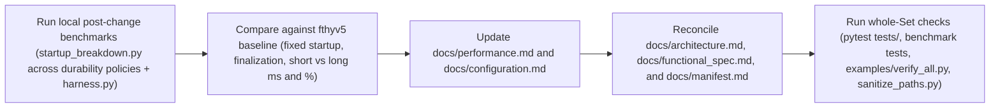

# IPD: Post-Change Overhead Comparison Documentation Sync and Whole-Set Verification

- Date: 2026-11-21
- Kind: child
- Concern: Post-change performance verification against the recorded baseline, specification and documentation reconciliation, and whole-Set regression validation.
- Scope: Run post-change local non-publishing benchmarks (`benchmarks/startup_breakdown.py` and `benchmarks/harness.py`) comparing default and opt-in durability policies against the `fthyv5` baseline, update `docs/performance.md`, `docs/configuration.md`, `docs/architecture.md`, `docs/functional_spec.md`, and `docs/manifest.md`, and run whole-Set verification.
- Scope-Paths: docs/performance.md, docs/configuration.md, docs/architecture.md, docs/functional_spec.md, docs/manifest.md
- Item-Dependencies: executed:fthyv5, executed:4il383, executed:tkmm5p
- Status: to-review
- Short-Description: Measure post-change overhead against baseline, reconcile documentation and specs, and run whole-Set validation
- Work-Kind: followup
- Priority: high
- From-Backlog: t1xqpw
- Set: startup-perf
- Order: 4
- Highest E allocated: 05
- Author: agent
- Id: ckc3vl

> Write and proofread this plan per the technical writing standard, `.aw/system/workflows/technical-writing/technical-writing.md` (`.agents/workflows/technical-writing/technical-writing.md` in a legacy-layout install), including requirement 12 (diagrams).

## Workflow history

- 2026-11-22 draft (agent): created.
- 2026-11-22 to-review (agent): authored review-ready child plan from backlog item `t1xqpw`.

## Goal

Measure post-change startup, import, capture, and finalization overhead against the `fthyv5` pre-change baseline (keeping default `fsync` durability separated from opt-in durability policies), synchronize all affected specifications and reference documentation, and run full repository regression, example, and path-hygiene verification.

### Post-change measurement, documentation, and verification pipeline

The text in `## Proposed changes (ordered, validatable)` is normative. This diagram summarizes the execution flow after `fthyv5`, `4il383`, and `tkmm5p` are executed.



## Detailed Implementation Checklist (TODO)

Execution-state rule: mark an `E-*` item complete only after performing the action. That mark is not validation. Right-sizing rule: write for a modest executor that cannot hold much in its head. Each E-item is one step (one concern, about one file, executable in one focused pass) and its V-item names each unit it covers with its own check; a plan stays at about 5 E-items and 8 work Scope-Paths, else split it into more child plans (guidance, `IPD-Z603`). Accepted execution states: blocked, failed, pending, performed; terminal gate demands 'performed'.

### Task group 1: Post-change performance measurement

- [ ] E-01 Run local, non-publishing post-change measurements using `benchmarks/startup_breakdown.py` (testing default `fsync` and opt-in `finalize`, `atomic`, `strict` policies separately) and `benchmarks/harness.py`, compare every metric against the executed `fthyv5` baseline, and verify all baseline-derived numerical targets.
  - Depends on: none
  - Expected outcome: Post-change measurements capture environment (OS, Python version, CPU model/core count, filesystem type), git revision, workload, baseline, repetitions (`passes >= 3`, `iterations >= 15`), cold (pass 1) versus warm (pass N) distinctions, median, mean, p95, standard deviation (stdev), and Interquartile Range (IQR), separate fixed startup cost from finalization cost, report absolute milliseconds and relative overhead percentages for short (`noop.py`) and long (`cpu_burn.py`) workloads, report default `fsync` gains separately from opt-in durability modes, perform zero external submissions or scheduler jobs, and leave no stray unredacted files in `benchmarks/results/`.
  - Execution state: pending

### Task group 2: Documentation and specification reconciliation

- [ ] E-02 Update `docs/performance.md` with a clearly scoped, environment-labeled startup/finalization overhead breakdown and durability-policy comparison grounded strictly in the measured `fthyv5` versus `ckc3vl` results.
  - Depends on: E-01
  - Expected outcome: `docs/performance.md` preserves the multi-machine placeholder table without fabricating representative cross-machine numbers, documents the measured before/after startup and finalization breakdown with full environment, revision, workload, baseline, repetitions, cold/warm passes, and dispersion, explains the difference between local storage and shared Network File System (NFS) or Lustre storage, documents durability policy trade-offs honestly, and contains no em or en dashes in modified/added user-facing prose.
  - Execution state: pending

- [ ] E-03 Update `docs/configuration.md` to document `[core].artifact_durability` (`"fsync"`, `"finalize"`, `"atomic"`, `"strict"`), `[capture.git].total_timeout`, and `[capture.hardware].total_timeout`.
  - Depends on: E-01
  - Expected outcome: `docs/configuration.md` documents the exact key names, types, defaults, valid values, crash-durability versus atomic-visibility behavior, and platform limits for each setting, with no em or en dashes in modified/added prose.
  - Execution state: pending

- [ ] E-04 Reconcile `docs/architecture.md`, `docs/functional_spec.md`, and `docs/manifest.md` against the implemented commit-identity, snapshot-write coalescing, durability-policy, and capture-budget behavior.
  - Depends on: E-03
  - Expected outcome: `docs/manifest.md` documents `run.library_commit` resolution semantics (build-stamped for installed wheels, verified live HEAD for source checkouts, `null` when unknown, timed out, nested, or stale) and `config.resolved.json` persistence; `docs/architecture.md` and `docs/functional_spec.md` document config snapshot coalescing, mid-run reconfiguration updates, atomic visibility versus explicit durability (`fsync`, POSIX parent-directory sync limits on Linux/macOS/Windows/NFS), and bounded synchronous Git and background hardware capture budgets (explicitly noting source-state capture remains synchronous before user code runs), with zero em or en dashes in modified/added prose.
  - Execution state: pending

### Task group 3: Whole-Set regression and hygiene verification

- [ ] E-05 Run whole-Set regression checks across the full test suite, benchmark conformance tests, examples verification, and path sanitizer, and record the remaining multi-OS/Python Continuous Integration (CI) matrix gate.
  - Depends on: E-02, E-04
  - Expected outcome: `pytest tests/ -v`, `pytest benchmarks/test_benchmarks.py benchmarks/test_share_safety.py -o addopts="" -v`, `python examples/verify_all.py`, and `python3 scripts/sanitize_paths.py --check --all` all exit 0 with complete actual runner output pasted into `V-05`, and `V-05` explicitly records the required `.github/workflows/ci.yml` multi-OS and Python 3.8 through 3.14 CI matrix gate before completion.
  - Execution state: pending

## Project conventions discovered (Step 0)

- `docs/performance.md` intentionally keeps its cross-machine "Representative results" table as a placeholder until multi-machine submissions are aggregated; single-machine measurements must be clearly labeled with environment, revision, workload, baseline, repetitions, cold/warm passes, and dispersion.
- Sibling Set `timing-acc` (child `3tvesf`) also updates `docs/performance.md`, `docs/manifest.md`, `docs/architecture.md`, and `docs/functional_spec.md` for monotonic timing fields; edits in this plan must merge additively into distinct subsections without removing or contradicting `timing-acc` documentation.
- `AGENTS.md` prohibits em dashes (`—`) and en dashes (`–`) in user-facing prose (`docs/`).
- `examples/verify_all.py` runs all repository example scripts and verifies exit code 0; `scripts/sanitize_paths.py --check --all` enforces absence of machine-local home paths and hostnames across tracked files.
- `.github/workflows/ci.yml` defines the supported OS/Python CI matrix (`ubuntu-latest`, `ubuntu-24.04`, `windows-latest`, `macos-latest` across Python 3.8 through 3.14).

## Findings

- **F-01 (Unverified post-change performance without structured comparison):** Without running the exact pre-change benchmark tool (`fthyv5`) after `4il383` and `tkmm5p` execute, any overhead reduction claim would be unsupported.
- **F-02 (Documentation drift on commit identity, writes, durability, and capture budgets):** `docs/configuration.md`, `docs/architecture.md`, `docs/functional_spec.md`, `docs/manifest.md`, and `docs/performance.md` do not yet document lazy build-stamped commit identity, config write coalescing, explicit durability policies and platform `fsync` limits, or total capture timeout budgets.

## Proposed changes (ordered, validatable)

1. **Post-change local benchmark execution (no production code edits):**
   - Run `python benchmarks/startup_breakdown.py --passes 3 --iterations 15 --warmup 1 --durability-policies fsync,finalize,atomic,strict`.
   - Run a local non-publishing `python benchmarks/harness.py --passes 3 --iterations 15 --redacted-out <temp_path>` (cleaning up the temporary file afterward so `benchmarks/results/` stays clean).
   - Compare every scenario side by side against the executed `fthyv5` baseline:
     - Installed and checkout `minimal` / `noauto` import time (ms) and `git` subprocess count (confirming zero `git` spawns on installed imports).
     - Fixed startup cost vs finalization cost (ms) separately.
     - Short workload (`noop.py`) and long workload (`cpu_burn.py`) absolute overhead (ms) and relative overhead (%).
     - `config.resolved.json` atomic write and `fsync` counts (confirming drop from 2-3 writes to 1 for unchanged config).
     - Separate durability-policy rows (`fsync` default vs `finalize` vs `atomic` vs `strict`) so default-durability gains are never conflated with opt-in `fsync` relaxation.
     - Cold (pass 1) versus warm (pass 3) medians, mean, p95, stdev, and IQR, plus full environment, git revision, and filesystem type.
2. **`docs/performance.md`:**
   - Add a dedicated, environment-scoped subsection ("Startup, finalization, and artifact durability overhead") reporting the measured before/after table, distinguishing cold/warm passes, short/long workloads, local versus shared storage considerations (pointing to `benchmarks/startup_breakdown.py --workdir`), and separate durability-policy measurements without altering the cross-machine placeholder table.
3. **`docs/configuration.md`:**
   - Document `[core].artifact_durability` (`"fsync"` default, `"finalize"`, `"atomic"`, `"strict"`) under `### [core]`, explicitly distinguishing atomic visibility from crash durability and noting platform `fsync` and directory-sync limits (Linux, macOS `F_FULLFSYNC`, Windows, NFS/Lustre).
   - Document `[capture.git].total_timeout` under `### [capture.git]` and `[capture.hardware].total_timeout` under `### [capture.hardware]`.
4. **`docs/architecture.md`, `docs/functional_spec.md`, and `docs/manifest.md`:**
   - In `docs/manifest.md`: document `run.library_commit` (including build-stamped wheel identity, verified live HEAD for source checkouts, and `null` for unknown/timed-out/nested/stale cases) and clarify that `config.resolved.json` is written at startup and updated only when effective configuration changes.
   - In `docs/architecture.md` and `docs/functional_spec.md`: update the Run Lifecycle, Race Safety and Durability, and Writer/Finalization sections to document:
     - Atomic visibility (always on via unique temporary file + `os.replace`) versus explicit durability policy (`[core].artifact_durability`).
     - Platform durability limits (POSIX directory `fsync` in `"strict"` mode, macOS `F_FULLFSYNC` distinction, Windows `FlushFileBuffers` without directory fsync, and NFS/Lustre writeback/RPC costs).
     - Config snapshot coalescing and mid-run `_merge_and_migrate()` updates.
     - Bounded total Git and hardware capture budgets, explicitly noting that Git and script source-state capture stays synchronous before user code runs.
   - Check all modified sections in all five docs files to confirm zero em dashes (`—`) or en dashes (`–`) were introduced.
5. **Whole-Set verification:**
   - Run `pytest tests/ -v`, `pytest benchmarks/test_benchmarks.py benchmarks/test_share_safety.py -o addopts="" -v`, `python examples/verify_all.py`, and `python3 scripts/sanitize_paths.py --check --all`.
   - Record full actual runner output and exit codes in `V-05`, and record the GitHub Actions CI matrix gate (`.github/workflows/ci.yml`: Ubuntu, Windows, macOS across Python 3.8 through 3.14) required before release/closure.

## Deferred / out of scope (with reason)

- Running the GitHub Actions multi-OS and Python 3.8 through 3.14 CI matrix requires GitHub Actions runners on pull request or push; local verification covers the host OS/Python and records the CI matrix gate explicitly.
- External benchmark submission, Gist creation, or HPC scheduler job submission is prohibited without explicit authorization.
- Unrelated backlog items (`6hp1zu`, `w4hxkh`, `x21s6w`, `x6alw4`, `q3bll1`) are out of scope.

## Scope check

- Over-scope: none. Touches only the five documentation files (5 Scope-Paths, 5 E-items).
- Under-scope: none. Covers before/after measurement verification, durability and platform-limit documentation, specification reconciliation, and whole-Set regression checks required by `t1xqpw` and orchestrator `9ppa0r`.

## Required tests / validation

Run inside the repository root and capture actual runner output and exit codes:

```bash
python benchmarks/startup_breakdown.py --passes 3 --iterations 15 --warmup 1 --durability-policies fsync,finalize,atomic,strict
pytest tests/ -v
pytest benchmarks/test_benchmarks.py benchmarks/test_share_safety.py -o addopts="" -v
python examples/verify_all.py
python3 scripts/sanitize_paths.py --check --all
```

## Spec / documentation sync

This plan IS the specification and documentation synchronization plan for Set `startup-perf`.

## Open questions

### OQ-01: Coordinating `docs/` edits with sibling Set `timing-acc` (`3tvesf`)

- Blocking: no
- Status: resolved
- Owner: maintainer (confirmed upon plan approval)
- Resolution or deferral rationale: Both `3tvesf` (Set `timing-acc`) and `ckc3vl` (Set `startup-perf`) update `docs/performance.md`, `docs/manifest.md`, `docs/architecture.md`, and `docs/functional_spec.md`. Keep edits in `ckc3vl` strictly additive to distinct sections (commit identity, durability policy, config snapshot coalescing, capture budgets, and startup/finalization breakdown measurements) and preserve any timing-accuracy text present on disk when executing.

## Validation and cross-check (verify before reporting done)

Validation-state rule: inspect evidence in a separate pass. Do not mark a `V-*` item complete from memory or from the matching execution checkmark. Accepted validation results: blocked, failed, pass, pending; terminal gate demands 'pass'. Runtime-demonstration reachability rule: for each `V-*` item demanding the software be observed acting (such as a run, a dispatch, or a transition)—as distinct from items demanding a diff, a file's content, or a test result, which are reachable by construction—name the code path that produces the observation or the sibling `E-*` that creates it, else the demand is UNDER-SCOPE.

- [ ] V-01 validates E-01
  - Required evidence: Pasted redacted output of `python benchmarks/startup_breakdown.py --passes 3 --iterations 15 --warmup 1 --durability-policies fsync,finalize,atomic,strict` (exit code 0) and a before-versus-after comparison table against `fthyv5` showing environment, git revision, filesystem type, cold/warm passes, median, stdev, IQR, separate fixed startup and finalization ms, short/long workload absolute ms and relative overhead %, subprocess/write/fsync counts, default `fsync` versus opt-in durability policies, and `git status -s` confirming no stray unredacted files remain.
  - Observed evidence:
  - Result: pending

- [ ] V-02 validates E-02
  - Required evidence: Diff of `docs/performance.md` showing environment-scoped measured startup/finalization breakdown and durability comparison matching `V-01`, intact cross-machine placeholder table, local-versus-shared storage guidance, and zero em or en dashes in added lines.
  - Observed evidence:
  - Result: pending

- [ ] V-03 validates E-03
  - Required evidence: Diff of `docs/configuration.md` showing `[core].artifact_durability`, `[capture.git].total_timeout`, and `[capture.hardware].total_timeout` with defaults, options, and platform durability limits, and zero em or en dashes in added lines.
  - Observed evidence:
  - Result: pending

- [ ] V-04 validates E-04
  - Required evidence: Diff of `docs/architecture.md`, `docs/functional_spec.md`, and `docs/manifest.md` showing reconciled commit-identity, config write coalescing, atomic visibility versus durability policy, platform `fsync`/directory-sync limits, and bounded synchronous/background capture semantics, with zero em or en dashes in added lines.
  - Observed evidence:
  - Result: pending

- [ ] V-05 validates E-05
  - Required evidence: Pasted actual runner output and exit code 0 for `pytest tests/ -v`, `pytest benchmarks/test_benchmarks.py benchmarks/test_share_safety.py -o addopts="" -v`, `python examples/verify_all.py`, and `python3 scripts/sanitize_paths.py --check --all`, plus an explicit note recording the `.github/workflows/ci.yml` multi-OS and Python 3.8 through 3.14 CI matrix gate required before completion.
  - Observed evidence:
  - Result: pending

## Approval and execution gate

- Size assessment: standard
- Cohesion rationale: not required

Execution contract:
1. All open questions (OQ-01) are resolved for review; do not execute until prerequisites `fthyv5`, `4il383`, and `tkmm5p` are `executed` and a human approves this plan (`- Status: approved`).
2. Scope fence: edit only `docs/performance.md`, `docs/configuration.md`, `docs/architecture.md`, `docs/functional_spec.md`, and `docs/manifest.md`. Do not expand scope; if additional files seem required, STOP and report.
3. Honesty rule: paste actual runner output and exit codes for `benchmarks/startup_breakdown.py`, `pytest`, `examples/verify_all.py`, and `scripts/sanitize_paths.py` into each `V-*` `Observed evidence:`; never claim unmeasured speedups or unrun tests.
4. Commit discipline: commit only the files listed in `- Scope-Paths:` using `aw commit ckc3vl -- <paths>`; never use `git add -A`, `git add .`, or `git commit -a`; never push or publish benchmark results without explicit human instruction.
5. Lifecycle move on completion: after `aw ipd lint --phase pre-transition` passes, move this plan from `.aw/records/plans/pending/` to `.aw/records/plans/executed/`, set `- Status: executed`, append a dated `## Workflow history` line, and commit the lifecycle move path-scoped.
