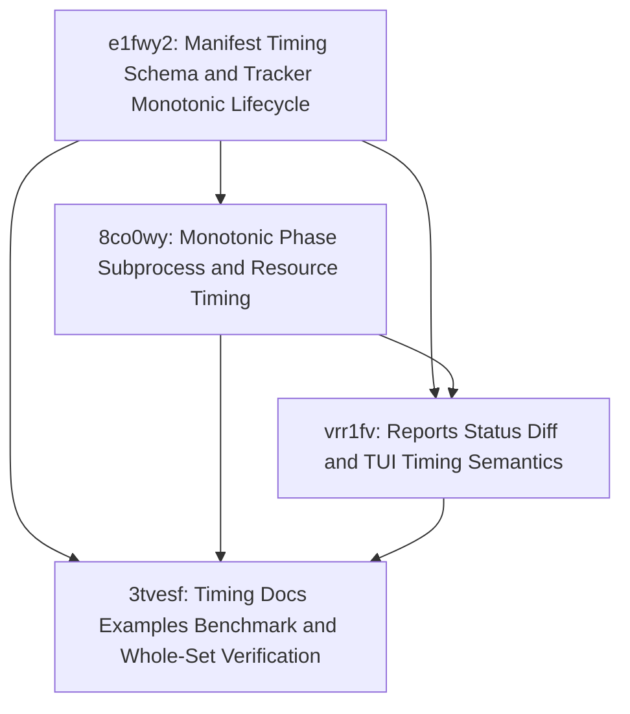
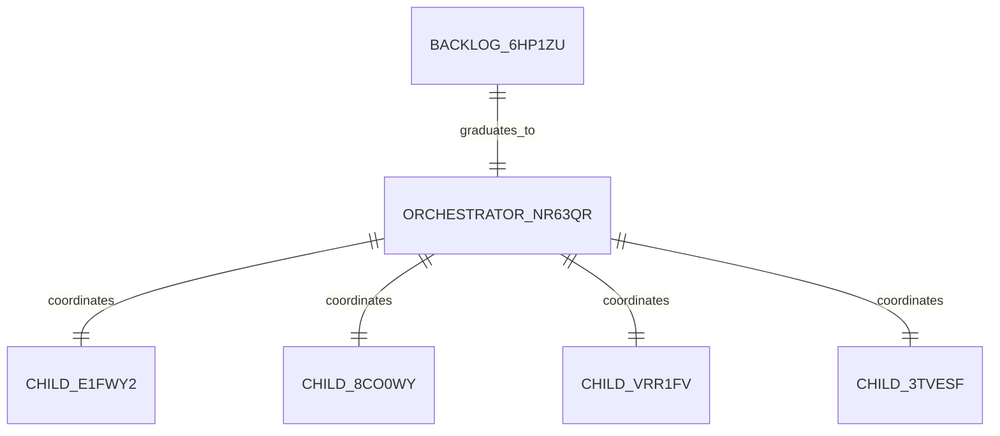

# IPD: Timing Accuracy and Overhead Separation

- Date: 2026-11-21
- Kind: orchestrator
- Concern: Monotonic duration measurement and separation of tracked workload time from capture overhead.
- Scope: Full-Set coordination for backlog item `6hp1zu` across manifest schema, tracker lifecycle, phase/subprocess/resource capture, status/diagnostics/diff/TUI consumers, documentation, examples, and instrumentation benchmarking.
- Scope-Paths: .aw/records/plans/pending/20261121-timing-acc-00-nr63qr-timing-accuracy-and-overhead-separation.ipd.md
- Item-Dependencies: none
- Status: approved
- Readiness: go-pending-approval
- Review-Depth: orchestrator
- Coverage: pass
- Coverage-Fingerprint: 2bb68f399dda78bf52b8fc298841d5cd84545fc1d1a4b94834b6b71cef4e8665
- Coverage-Checked: 2026-11-22 by uri/its_direct/pt3-claude-opus-5.5-1m-us
- Short-Description: Coordinate monotonic duration tracking and workload/overhead separation across schema, capture, consumers, and docs
- Work-Kind: bug
- Priority: high
- From-Backlog: 6hp1zu
- Blocks-Release: next
- Set: timing-acc
- Order: 0
- Highest E allocated: 04
- Author: agent
- Id: nr63qr
- Approval: 2026-11-22, recorded via aw ipd set: status set to approved

> Write and proofread this plan per the technical writing standard, `.aw/system/workflows/technical-writing/technical-writing.md` (`.agents/workflows/technical-writing/technical-writing.md` in a legacy-layout install), including requirement 12 (diagrams).

## Workflow history

- 2026-11-22 approved (aw set): status set to approved
- 2026-11-22 /plan-review (Gemini 4 Neon (High)): APPROVE WITH REVISIONS APPLIED; PR-001, PR-002, PR-003, PR-004
- 2026-11-22 coverage pass (aw oc run): fingerprint 2bb68f399dda, model uri/its_direct/pt3-claude-opus-5.5-1m-us
- 2026-11-22 coverage pass (aw oc run): fingerprint e35cd90b7a9b, model uri/its_direct/pt3-claude-opus-5.5-1m-us
- 2026-11-22 draft (agent): created.
- 2026-11-22 to-review (agent): authored review-ready orchestrator plan graduating backlog item `6hp1zu` into Set `timing-acc` with four child plans (`e1fwy2`, `8co0wy`, `vrr1fv`, `3tvesf`).

## Goal

Graduate open backlog item `6hp1zu` (use monotonic durations and separate workload time from capture overhead) into four bounded, sequentially verifiable child Implementation Plan Documents (IPDs). Together, the four child plans replace wall-clock duration subtraction with monotonic durations (`time.perf_counter()`), separate tracked workload duration from startup and finalization capture overhead, and preserve backward readability with explicit labeling for legacy manifests. They also synchronize specifications, documentation, examples, and local timing-instrumentation overhead measurements.

### Set structure and execution sequence

This diagram summarizes the dependency order of the four child plans in Set `timing-acc`. The child table and text below are normative.

## Detailed Implementation Checklist (TODO)

Execution-state rule: mark an `E-*` item complete only after performing the action. That mark is not validation. Right-sizing rule: write for a modest executor that cannot hold much in its head. Each E-item is one step (one concern, about one file, executable in one focused pass) and its V-item names each unit it covers with its own check; a plan stays at about 5 E-items and 8 work Scope-Paths, else split it into more child plans (guidance, `IPD-Z603`). Accepted execution states: blocked, failed, pending, performed; terminal gate demands 'performed'.

### Task group 1: Confirm child IPD completion

- [ ] E-01 CONFIRM e1fwy2 REACHED executed
  - Depends on: none
  - Expected outcome: Child plan `e1fwy2` is moved to `.aw/records/plans/executed/` with `- Status: executed`, all `E-*` items marked `performed`, and all `V-*` items marked `pass`.
  - Execution state: pending

- [ ] E-02 CONFIRM 8co0wy REACHED executed
  - Depends on: E-01
  - Expected outcome: Child plan `8co0wy` is moved to `.aw/records/plans/executed/` with `- Status: executed`, all `E-*` items marked `performed`, and all `V-*` items marked `pass`.
  - Execution state: pending

- [ ] E-03 CONFIRM vrr1fv REACHED executed
  - Depends on: E-01, E-02
  - Expected outcome: Child plan `vrr1fv` is moved to `.aw/records/plans/executed/` with `- Status: executed`, all `E-*` items marked `performed`, and all `V-*` items marked `pass`.
  - Execution state: pending

- [ ] E-04 CONFIRM 3tvesf REACHED executed
  - Depends on: E-01, E-02, E-03
  - Expected outcome: Child plan `3tvesf` is moved to `.aw/records/plans/executed/` with `- Status: executed`, all `E-*` items marked `performed`, and all `V-*` items marked `pass`.
  - Execution state: pending

## Child IPDs, sequence, and dependencies

| Order | Id | File | What it does | Depends on |
|---|---|---|---|---|
| 01 | `e1fwy2` | `20261121-timing-acc-01-e1fwy2-manifest-timing-schema-and-tracker-monotonic-lifecycle.ipd.md` | Defines the timing interval model, updates `$defs.timing` and `$defs.subprocess_record` additively in `schemas/manifest.schema.json`, implements monotonic startup/workload/finalization separation in `src/pubrun/tracker.py::Run` and `src/pubrun/writer.py::ArtifactWriter` (writing `config.resolved.json` before `manifest.json` with `_artifacts_written` double-stop guard and in-memory `writer_overhead_seconds`), and adds deterministic lifecycle and schema tests in `tests/test_timing_accuracy.py` and `tests/test_manifest_schema.py`. | none |
| 02 | `8co0wy` | `20261121-timing-acc-02-8co0wy-monotonic-phase-subprocess-and-resource-timing.ipd.md` | Updates `src/pubrun/core.py::phase` (excluding both profiler startup and dump teardown), `src/pubrun/capture/subprocesses.py::SubprocessSpy` (using lock-protected internal `id(rec)`-keyed `_start_monos`), and explicit subprocess wrappers (`pubrun.subprocess.run`, `pubrun.subprocess.Popen`, `pubrun.popen`, with schema-conformant `capture_state` and launch-failure recording) to emit monotonic durations, audits `src/pubrun/capture/resources.py::ResourceWatcher`, and adds deterministic wall-clock-step tests. | 01 |
| 03 | `vrr1fv` | `20261121-timing-acc-03-vrr1fv-reports-status-diff-and-tui-timing-semantics.ipd.md` | Updates `src/pubrun/status.py` (`classify_timing_semantics`, `_format_duration_detail`, nonnegative live/crashed clamping), `src/pubrun/report/diagnostics.py`, `src/pubrun/analysis/diff.py`, `src/pubrun/analysis/render.py`, `src/pubrun/tui/widgets/details.py`, and `src/pubrun/tui/widgets/diff.py` so legacy manifests remain readable, old and new timing semantics are labeled clearly across command-line interface (CLI) and Terminal User Interface (TUI) views, and incomplete or crashed timing states degrade safely. | 01, 02 |
| 04 | `3tvesf` | `20261121-timing-acc-04-3tvesf-timing-docs-examples-benchmark-and-whole-set-verification.ipd.md` | Reconciles specifications, docs (`docs/manifest.md`, `docs/architecture.md`, `docs/functional_spec.md`, `docs/api.md`, `docs/performance.md`, preserving `#Representative results` and adding zero em/en dashes), and examples (`examples/05_execution_phases.py`, `examples/minimal-research-workflow/manifest_excerpt.json`, `examples/minimal-research-workflow/README.md`); benchmarks timing instrumentation overhead locally (`benchmarks/harness.py --passes 3 --iterations 30 --redacted-out ...` plus ephemeral microbenchmark) with full environment and dispersion reporting; and runs whole-Set validation across tests, examples, and path sanitization. | 01, 02, 03 |

## Completion criteria (the whole Set is done only when)

- Manifest schema (`schemas/manifest.schema.json`) accepts both legacy v1.0 manifests and new additive `$defs.timing` and `$defs.subprocess_record` fields. `Run` and `ArtifactWriter` separate startup capture overhead, observed tracked workload, pre-manifest finalization overhead (writing `config.resolved.json` before `manifest.json` without double-writing `manifest.json`), and overlapping background hardware capture using `time.perf_counter()`, while retaining Coordinated Universal Time (UTC) epoch chronology and never persisting raw process-local monotonic counter values. Owner: `e1fwy2`.
- Deterministic fake-clock tests prove that forward and backward wall-clock jumps leave run durations nonnegative and equal to monotonic elapsed time, and that delaying the hardware worker or writer increases tracking overhead (`finalization_overhead_seconds`, `hardware_wait_seconds`, `writer_overhead_seconds`) without inflating `workload_seconds`. Tests cover short runs, automatic `atexit` exit, explicit `stop()`, double-`stop()` idempotency, nested reference-counted `start()`/`stop()`, `tracked_run`, `audit_run`, exceptions, signal/keyboard interruptions, and partial startup or ghost mode (validated against `$defs.timing`). Owner: `e1fwy2`.
- Phase timing (`pubrun.phase()`, excluding profiler startup and dump teardown), transparent subprocess capture (`SubprocessSpy` with internal `id(rec)`-keyed monotonic starts), and explicit subprocess wrappers (`pubrun.subprocess.run`, `pubrun.subprocess.Popen`, `pubrun.popen`, with schema-conformant `capture_state` and launch-failure recording) record nonnegative monotonic durations while preserving UTC timestamps and existing `ResourceWatcher` monotonic Central Processing Unit (CPU) sampling. Owner: `8co0wy`.
- Existing pre-change manifests remain readable without error across `pubrun status`, `pubrun inspect`, `pubrun report`, `pubrun diff`, `pubrun methods`, and the TUI (`RunDetailsView` and `DiffView`, with optional `textual` tests guarded by `pytest.importorskip("textual")`). Reports and CLI/TUI diffs label legacy wall-clock semantics, live estimates, crashed estimates, and new monotonic tracked-interval semantics accurately without summing overlapping intervals, describe late-import runs as tracked intervals rather than full application lifetime, and verify `methods` output does not overstate timing precision. Owner: `vrr1fv`.
- Documentation (`docs/manifest.md`, `docs/architecture.md`, `docs/functional_spec.md`, `docs/api.md`, `docs/performance.md`) and examples (`examples/05_execution_phases.py`, `examples/minimal-research-workflow/manifest_excerpt.json`, `examples/minimal-research-workflow/README.md`) explain the timing intervals and compatibility rules accurately with zero added em or en dashes while preserving `docs/performance.md#Representative results`. Local non-publishing timing instrumentation overhead is benchmarked with recorded environment, Git revision, workload, baseline, repetitions (`N >= 30`), cold versus warm passes, median, standard deviation, and Interquartile Range (IQR), and whole-Set verification passes. Owner: `3tvesf`.

## Cross-IPD validation

- Schema-to-producer contract check: child `e1fwy2` validates real startup, finalized, and legacy manifests (plus ghost-run `$defs.timing` subschema) against `schemas/manifest.schema.json` in `tests/test_manifest_schema.py`, and child `8co0wy` validates manifests containing both `SubprocessSpy` and explicit `pubrun.subprocess.*`/`pubrun.popen` records against `schemas/manifest.schema.json`.
- Producer-to-consumer contract check: child `vrr1fv` exercises manifests produced by `e1fwy2` and `8co0wy` alongside legacy manifests through `src/pubrun/status.py`, `src/pubrun/report/diagnostics.py`, `src/pubrun/analysis/diff.py`, `src/pubrun/analysis/render.py`, `src/pubrun/report/methods.py`, `src/pubrun/tui/widgets/details.py`, and `src/pubrun/tui/widgets/diff.py` in `tests/test_timing_consumers.py` and `tests/test_diff_usability.py`.
- End-to-end documentation, example, benchmark, and repository regression check: child `3tvesf` runs the full `pytest tests/ -v` test suite, `python3 examples/verify_all.py`, `python3 scripts/sanitize_paths.py --check --all`, `git status -s`, the diff-scoped em/en dash check, and the local non-publishing timing-instrumentation benchmarks after `e1fwy2`, `8co0wy`, and `vrr1fv` are executed.

## Deferred / out of scope (with reason)

- Startup commit-resolution optimization (`src/pubrun/__init__.py::_resolve_commit`) and redundant config-write coalescing belong to sibling Set `startup-perf` (orchestrator `9ppa0r`, backlog item `t1xqpw`). This Set coordinates by avoiding any second `manifest.json` write, while keeping `6hp1zu` and `t1xqpw` independently executable.
  - Carrier: 9ppa0r
- Runs-index performance optimization is out of scope for timing accuracy.
  - Carrier-Declined: out of scope for backlog item 6hp1zu (no separate runs-index backlog item exists in this checkout).
- Dependency capture accuracy (backlog item `w4hxkh`, Set `dep-capture`, orchestrator `6s7k9e`) is unrelated and remains out of scope.
  - Carrier: 6s7k9e
- Capture failure isolation and transactional hook rollback (backlog item `x21s6w`, Set `cap-isolation`, orchestrator `frzw20`) is a separate Set; `vrr1fv` preserves any partial-capture warning blocks in `src/pubrun/report/diagnostics.py` if `26euz0` lands first.
  - Carrier: frzw20
- Reproducibility preflight (backlog item `q3bll1`, Set `repro-check`, orchestrator `osjxbz`) is unrelated and remains out of scope.
  - Carrier: osjxbz
- File provenance (backlog item `x6alw4`, Set `file-prov`, orchestrator `vtkkn1`) is unrelated and remains out of scope.
  - Carrier: vtkkn1
- External benchmark submission, GitHub Gist publication, and High-Performance Computing (HPC) scheduler job submission are out of scope and prohibited without explicit authorization.
  - Carrier-Declined: prohibited by policy without explicit maintainer authorization.
- Multi-operating-system (OS) and multi-Python Continuous Integration (CI) matrix execution (`ubuntu-latest`, `ubuntu-24.04`, `windows-latest`, `macos-latest` across Python 3.8 through 3.14 in `.github/workflows/ci.yml`) runs on pull request or push in GitHub Actions after local work is completed and cannot be executed inside a single local Linux runner; child `3tvesf` records local validation results and documents the required CI matrix gate before release closure.
  - Carrier-Declined: executed automatically by GitHub Actions CI (.github/workflows/ci.yml) on pull request or push; unavailable in a single local Linux worktree.

## Scope check

- Over-scope: none. Every child plan is bounded to timing accuracy, interval separation, consumer compatibility, and documentation/benchmark synchronization required by backlog item `6hp1zu`.
- Under-scope: none. Every requirement in `6hp1zu` (monotonic clocks, interval definitions without summing overlaps, workload boundary before teardown, phase/subprocess/resource audit, additive schema and legacy compatibility, late-import tracked-interval wording, deterministic tests, docs/examples sync, and instrumentation benchmarking) is assigned to a named child plan.

## Required tests / validation

This orchestrator plan runs no tests directly. Whole-Set validation is performed by its child plans:

- Child `e1fwy2` runs `pytest tests/test_timing_accuracy.py tests/test_manifest_schema.py tests/test_tracker.py tests/test_writer.py -v`, `pytest tests/test_quality.py -k TestDoubleStop -v`, and `pytest tests/test_api.py -k test_timing_values_are_floats -v`.
- Child `8co0wy` runs `pytest tests/test_events.py tests/test_capture.py tests/test_explicit_api.py tests/test_api.py tests/test_resources.py tests/test_manifest_schema.py -v`.
- Child `vrr1fv` runs `pytest tests/test_timing_consumers.py tests/test_diff_usability.py tests/test_reports.py tests/test_status.py tests/test_tui.py tests/test_edge_cases.py tests/test_tracker.py tests/test_quality.py tests/test_show_sections.py tests/test_methods_multi.py -v`.
- Child `3tvesf` runs `python3 benchmarks/harness.py --passes 3 --iterations 30 --redacted-out /tmp/pubrun-timing-harness.redacted.json && rm -f /tmp/pubrun-timing-harness.redacted.json`, the ephemeral in-memory timing-instrumentation microbenchmark (`N >= 30`, 3 passes: pass 1 cold versus pass 3 warm), `pytest tests/ -v`, `python3 examples/verify_all.py`, `python3 scripts/sanitize_paths.py --check --all`, `git status -s`, and the diff-scoped em/en dash check over updated docs and examples.

## Open questions

### OQ-01: Timing field naming and `elapsed_seconds` compatibility policy

- Blocking: no
- Status: resolved
- Owner: plan author (binding upon plan approval)
- Resolution or deferral rationale: Backlog item `6hp1zu` notes that proposed field names are not pre-approved contracts and requires documenting compatibility if `elapsed_seconds` changes meaning. Child `e1fwy2` defines a self-describing, additive schema (`workload_started_at_utc`, `finalized_at_utc`, `workload_seconds`, `startup_overhead_seconds`, `finalization_overhead_seconds`, `session_seconds`, `hardware_wait_seconds`, `background_hardware_seconds`, `duration_clock`, `elapsed_basis`, `interval_scope`) and sets `elapsed_seconds` to `workload_seconds` (`elapsed_basis = "workload"`) so existing callers immediately avoid shutdown-overhead inflation while consumers (`vrr1fv`) detect and label legacy wall-clock manifests accurately. The maintainer may adjust any field name during review before approving `e1fwy2`.

## Validation and cross-check (verify before reporting the Set complete)

Validation-state rule: inspect evidence in a separate pass. Do not mark a `V-*` item complete from memory or from the matching execution checkmark. Accepted validation results: blocked, failed, pass, pending; terminal gate demands 'pass'. Runtime-demonstration reachability rule: for each `V-*` item demanding the software be observed acting (such as a run, a dispatch, or a transition) (as distinct from items demanding a diff, a file's content, or a test result, which are reachable by construction), name the code path that produces the observation or the sibling `E-*` that creates it, else the demand is UNDER-SCOPE.

- [ ] V-01 validates E-01
  - Required evidence: Path `.aw/records/plans/executed/20261121-timing-acc-01-e1fwy2-manifest-timing-schema-and-tracker-monotonic-lifecycle.ipd.md` exists, shows `- Status: executed`, has all `E-*` items `performed` and all `V-*` items `pass`, and `aw ipd lint --phase post-transition` exits 0 on it.
  - Observed evidence:
  - Result: pending

- [ ] V-02 validates E-02
  - Required evidence: Path `.aw/records/plans/executed/20261121-timing-acc-02-8co0wy-monotonic-phase-subprocess-and-resource-timing.ipd.md` exists, shows `- Status: executed`, has all `E-*` items `performed` and all `V-*` items `pass`, and `aw ipd lint --phase post-transition` exits 0 on it.
  - Observed evidence:
  - Result: pending

- [ ] V-03 validates E-03
  - Required evidence: Path `.aw/records/plans/executed/20261121-timing-acc-03-vrr1fv-reports-status-diff-and-tui-timing-semantics.ipd.md` exists, shows `- Status: executed`, has all `E-*` items `performed` and all `V-*` items `pass`, and `aw ipd lint --phase post-transition` exits 0 on it.
  - Observed evidence:
  - Result: pending

- [ ] V-04 validates E-04
  - Required evidence: Path `.aw/records/plans/executed/20261121-timing-acc-04-3tvesf-timing-docs-examples-benchmark-and-whole-set-verification.ipd.md` exists, shows `- Status: executed`, has all `E-*` items `performed` and all `V-*` items `pass`, and `aw ipd lint --phase post-transition` exits 0 on it.
  - Observed evidence:
  - Result: pending

## Approval and execution gate

- Size assessment: standard
- Cohesion rationale: not required

This orchestrator plan coordinates Set `timing-acc` (`e1fwy2`, `8co0wy`, `vrr1fv`, `3tvesf`) and executes no application code directly.

Execution contract:
1. Open questions: all open questions (`OQ-01`) are resolved for review and become binding upon human approval of this Set (`- Status: approved`).
2. Scope declaration: this orchestrator declares only its own plan file as `- Scope-Paths:` for lifecycle retirement; it executes no application code and adds no non-confirmation checklist items.
3. Honesty rule (HARD MUST): confirm child completion only by inspecting the executed child plan files on disk and running `aw ipd lint --phase post-transition`, pasting actual runner output and exit codes into each `V-*` `Observed evidence:` field; never claim a child reached `executed` without verifying its file state.
4. Commit and push discipline: retire this orchestrator via `aw commit` path-scoped to its moved plan file (or let the `aw` runner retire it); never use `git add -A`, `git add .`, or `git commit -a`; never push without explicit human instruction.
5. Lifecycle transition on completion: once all four child plans (`e1fwy2`, `8co0wy`, `vrr1fv`, `3tvesf`) reach `executed` on disk, this orchestrator must reach `.aw/records/plans/executed/` with `- Status: executed` through `aw ipd finalize`. Under an `aw` runner, the runner automatically retires the orchestrator once every child is `executed` and coverage passes; in standalone execution, run `aw ipd finalize nr63qr` directly. Never hand-roll a raw `git mv` to `.aw/records/plans/executed/`.
