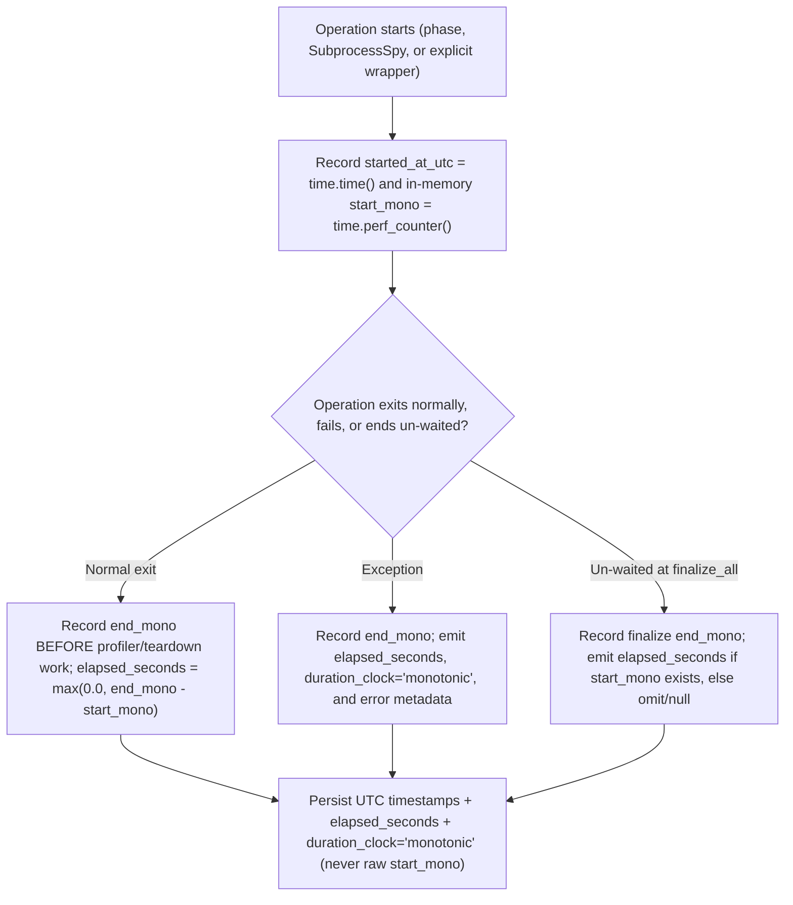

# IPD: Monotonic Phase Subprocess and Resource Timing

- Date: 2026-11-21
- Kind: child
- Concern: Consistent monotonic duration semantics across phases, transparent subprocess interception, explicit subprocess wrappers, and resource CPU sampling.
- Scope: Update `pubrun.phase()`, `pubrun.subprocess.run`, `pubrun.subprocess.Popen`, and `pubrun.popen` in `src/pubrun/core.py`; update `SubprocessSpy` in `src/pubrun/capture/subprocesses.py`; audit `ResourceWatcher` in `src/pubrun/capture/resources.py`; add deterministic wall-clock-step tests.
- Scope-Paths: src/pubrun/core.py, src/pubrun/capture/subprocesses.py, src/pubrun/capture/resources.py, tests/test_events.py, tests/test_capture.py, tests/test_explicit_api.py
- Item-Dependencies: executed:e1fwy2
- Status: to-review
- Short-Description: Use monotonic durations in phase(), SubprocessSpy, and explicit subprocess wrappers while preserving ResourceWatcher
- Work-Kind: bug
- Priority: high
- From-Backlog: 6hp1zu
- Blocks-Release: next
- Set: timing-acc
- Order: 2
- Highest E allocated: 05
- Author: agent
- Id: 8co0wy

> Write and proofread this plan per the technical writing standard, `.aw/system/workflows/technical-writing/technical-writing.md` (`.agents/workflows/technical-writing/technical-writing.md` in a legacy-layout install), including requirement 12 (diagrams).

## Workflow history

- 2026-11-22 draft (agent): created.
- 2026-11-22 to-review (agent): authored review-ready child plan from backlog item `6hp1zu`.

## Goal

Ensure phase timing (`pubrun.phase()`), transparent subprocess capture (`SubprocessSpy`), and explicit subprocess wrappers (`pubrun.subprocess.run`, `pubrun.subprocess.Popen`, `pubrun.popen`) compute nonnegative durations from `time.perf_counter()` while retaining UTC epoch chronology, and verify that `ResourceWatcher` preserves its existing monotonic CPU sampling behavior.

### Capture timing flow

The text in `## Proposed changes (ordered, validatable)` is normative. This diagram summarizes how `phase()` and subprocess capture paths separate monotonic duration computation from persisted UTC timestamps.



## Detailed Implementation Checklist (TODO)

Execution-state rule: mark an `E-*` item complete only after performing the action. That mark is not validation. Right-sizing rule: write for a modest executor that cannot hold much in its head. Each E-item is one step (one concern, about one file, executable in one focused pass) and its V-item names each unit it covers with its own check; a plan stays at about 5 E-items and 8 work Scope-Paths, else split it into more child plans (guidance, `IPD-Z603`). Accepted execution states: blocked, failed, pending, performed; terminal gate demands 'performed'.

### Task group 1: Phase and subprocess monotonic durations

- [ ] E-01 Update `phase.__enter__` and `phase.__exit__` in `src/pubrun/core.py` to record monotonic phase duration before profiler teardown.
  - Depends on: none
  - Expected outcome: `phase.__enter__` captures `self._start_mono = time.perf_counter()`; `phase.__exit__` captures `end_mono = time.perf_counter()` BEFORE stopping and dumping `cProfile` or `yappi` stats, then emits `phase_end` with `payload` containing `elapsed_seconds = max(0.0, end_mono - self._start_mono)` and `duration_clock = "monotonic"` (preserving `"error": exc_val.__class__.__name__` when an exception occurred, and never persisting `self._start_mono`).
  - Execution state: pending

- [ ] E-02 Update explicit subprocess wrappers (`_PubrunSubprocessNamespace.run`, `_PubrunSubprocessNamespace.Popen`, and `popen`) in `src/pubrun/core.py` to emit monotonic durations and schema-conformant `capture_state`.
  - Depends on: E-01
  - Expected outcome: Each wrapper captures `start_mono = time.perf_counter()` alongside `started_at_utc = time.time()`, computes `elapsed_seconds = max(0.0, time.perf_counter() - start_mono)`, sets `duration_clock = "monotonic"`, includes `"capture_state": {"status": "complete" | "failed"}` (schema-conformant per `$defs.subprocess_record` from `e1fwy2`), records failed invocations consistently, and never stores raw monotonic counter values.
  - Execution state: pending

- [ ] E-03 Update `SubprocessSpy` in `src/pubrun/capture/subprocesses.py` (`_patched_popen_init`, `_patched_popen_wait`, `_patched_os_system`, `finalize_all`, `uninstall`) to compute monotonic durations from an internal monotonic-start table.
  - Depends on: none
  - Expected outcome: `SubprocessSpy` tracks per-record `start_mono = time.perf_counter()` in an internal lock-protected structure (`_start_monos`) that is never serialized into `_records` and is cleared in `uninstall()`; `_patched_popen_wait`, `_patched_os_system`, and `finalize_all` compute `elapsed_seconds = max(0.0, time.perf_counter() - start_mono)` and `duration_clock = "monotonic"` whenever a monotonic start exists (gracefully leaving `elapsed_seconds` omitted or `None` for manually injected records without monotonic starts); failed `Popen.__init__` and `os.system` exceptions record `ended_at_utc`, `elapsed_seconds`, and `duration_clock`.
  - Execution state: pending

### Task group 2: Resource watcher audit and deterministic behavioral tests

- [ ] E-04 Audit `src/pubrun/capture/resources.py` (`ResourceWatcher._poll_cpu`, `ResourceWatcher._poll_tree_cpu`) to confirm monotonic CPU sampling is preserved intact, and add deterministic wall-clock-step tests to `tests/test_events.py`, `tests/test_capture.py`, and `tests/test_explicit_api.py`.
  - Depends on: E-01, E-02, E-03
  - Expected outcome: `ResourceWatcher` retains `time.perf_counter()` wall-delta calculation without modification (or with a targeted fix only if an audit defect is found); tests verify forward and backward wall-clock jumps during `phase()` (normal, exception, and profiler-enabled exit), `SubprocessSpy` (`Popen`, `os.system`, `finalize_all`), explicit `pubrun.subprocess.run`/`Popen`/`popen`, and `ResourceWatcher` CPU sampling, plus confirm zero raw monotonic counter readings are persisted and emitted manifests pass `schemas/manifest.schema.json`.
  - Execution state: pending

- [ ] E-05 Run targeted validation across events, capture, explicit API, resources, and schema conformance tests.
  - Depends on: E-04
  - Expected outcome: `pytest tests/test_events.py tests/test_capture.py tests/test_explicit_api.py tests/test_resources.py tests/test_manifest_schema.py -v` exits 0 with all tests passing.
  - Execution state: pending

## Project conventions discovered (Step 0)

- `src/pubrun/core.py` (`phase.__enter__`, `phase.__exit__`) currently emits `phase_start` and `phase_end` with only `timestamp_utc` from `EventStream.emit()` (`time.time()`); `phase_end` carries `payload={"error": ...}` only on exceptions and omits `payload` otherwise.
- `src/pubrun/core.py` (`_PubrunSubprocessNamespace.run`, `_PubrunSubprocessNamespace.Popen._log_pubrun_record`, `popen`) and `src/pubrun/capture/subprocesses.py` (`SubprocessSpy._patched_popen_init`, `_patched_popen_wait`, `_patched_os_system`, `finalize_all`) currently record only `started_at_utc` and `ended_at_utc` via `time.time()` and omit `elapsed_seconds`.
- `src/pubrun/capture/resources.py` (`ResourceWatcher._poll_cpu`, `ResourceWatcher._poll_tree_cpu`) already measures `wall_delta` with `time.perf_counter()`.
- `tests/test_capture.py` (`TestFinalizeAll`) constructs synthetic `_records` dicts directly without calling `_patched_popen_init`, so `finalize_all()` must tolerate records that have no entry in `_start_monos`.
- `tests/test_events.py` (`TestEventStreamCreation.test_creates_jsonl_file`) checks `ev5["payload"]["error"] == "ValueError"`, which remains valid when additive keys `elapsed_seconds` and `duration_clock` are merged into `phase_end` payload.

## Findings

- **F-01 (Wall-clock-dependent phase durations):** `pubrun.phase()` records no monotonic duration in `phase_end`, forcing downstream consumers to subtract wall-clock `timestamp_utc` values and mixing profiler dump time into the `phase_end` timestamp when profiling is enabled.
- **F-02 (Wall-clock-dependent subprocess durations):** Neither `SubprocessSpy` nor explicit `pubrun.subprocess.*` / `pubrun.popen` wrappers record monotonic `elapsed_seconds`, so consumers (`diagnostics.py`, `tui/widgets/details.py`) subtract `ended_at_utc - started_at_utc`, which breaks under clock steps.
- **F-03 (Manual subprocess schema parity):** Explicit `pubrun.subprocess.*` and `pubrun.popen` records in `src/pubrun/core.py` omit `capture_state`, unlike `SubprocessSpy` records required by `schemas/manifest.schema.json` `$defs.subprocess_record`.
- **F-04 (Resource watcher already monotonic):** `ResourceWatcher._poll_cpu()` and `ResourceWatcher._poll_tree_cpu()` already use `time.perf_counter()` and must be preserved.

## Proposed changes (ordered, validatable)

1. **`src/pubrun/core.py` (`phase`):**
   - In `phase.__enter__`: set `self._start_mono = time.perf_counter()` before returning (and after profiler startup if profiling is enabled, or before user body executes; document exact boundary consistently).
   - In `phase.__exit__`: capture `end_mono = time.perf_counter()` as the first line before stopping/dumping `cProfile` or `yappi` stats. Compute `elapsed = max(0.0, end_mono - self._start_mono)` when `self._start_mono is not None`.
   - Build `end_payload = {"elapsed_seconds": elapsed, "duration_clock": "monotonic"}` (adding `"error": exc_val.__class__.__name__` if `exc_type is not None`) and emit `phase_end` with `payload=end_payload`.
2. **`src/pubrun/core.py` (`_PubrunSubprocessNamespace.run`, `_PubrunSubprocessNamespace.Popen`, `popen`):**
   - Capture `start_mono = time.perf_counter()` alongside `started_at = time.time()`.
   - On completion (or exception in `run()`), compute `elapsed = max(0.0, time.perf_counter() - start_mono)` and populate `"elapsed_seconds": elapsed`, `"duration_clock": "monotonic"`, and `"capture_state": {"status": "complete" if exit_code == 0 else "failed"}` (using `"failed"` with `"detail": str(exc)` on exception in `run()`).
   - Keep `started_at_utc` and `ended_at_utc` as POSIX UTC epoch floats; never store `start_mono` in the record dict.
3. **`src/pubrun/capture/subprocesses.py` (`SubprocessSpy`):**
   - Add class-level `_start_monos: Dict[int, float] = {}` protected by `cls._lock`, initialized to `{}` in `install()` and cleared in `uninstall()`.
   - In `_patched_popen_init`: capture `start_mono = time.perf_counter()` alongside `start_time = time.time()`. On exception, include `"ended_at_utc": time.time()`, `"elapsed_seconds": max(0.0, time.perf_counter() - start_mono)`, and `"duration_clock": "monotonic"`. On success, store `SubprocessSpy._start_monos[idx] = start_mono` under `SubprocessSpy._lock`.
   - In `_patched_popen_wait`: when finalizing `rec`, compute `elapsed_seconds` from `SubprocessSpy._start_monos.pop(idx, None)` and set `"duration_clock": "monotonic"` when present.
   - In `_patched_os_system`: capture `start_mono = time.perf_counter()`, store in `_start_monos[idx]`, and record `"ended_at_utc"`, `"elapsed_seconds"`, and `"duration_clock": "monotonic"` in both success and exception paths.
   - In `finalize_all`: capture `now_ts = time.time()` and `now_mono = time.perf_counter()`. For each un-waited record at index `idx`, set `rec["ended_at_utc"] = now_ts`; if `idx` is present in `cls._start_monos`, pop `start_mono` and set `rec["elapsed_seconds"] = max(0.0, now_mono - start_mono)` and `rec["duration_clock"] = "monotonic"`. If `idx` is not present (e.g., synthetic test records), leave `elapsed_seconds` unset so existing tests remain intact.
4. **`src/pubrun/capture/resources.py` (`ResourceWatcher`):**
   - Audit `_poll_cpu()` and `_poll_tree_cpu()` to verify no wall-clock duration subtraction exists anywhere in `ResourceWatcher`; preserve existing `time.perf_counter()` logic unchanged.
5. **Tests (`tests/test_events.py`, `tests/test_capture.py`, `tests/test_explicit_api.py`):**
   - Add deterministic fake-clock tests injecting forward and backward `time.time()` jumps while advancing `time.perf_counter()` cleanly:
     - `tests/test_events.py`: `phase()` normal completion, exception path, and profiler-enabled exit (verifying profiler dump delay does not inflate `phase_end.payload["elapsed_seconds"]`, and raw monotonic offset is absent).
     - `tests/test_capture.py`: `SubprocessSpy` (`Popen`, `os.system`, `finalize_all`) emits nonnegative monotonic `elapsed_seconds`, `duration_clock == "monotonic"`, preserves UTC timestamps, and survives backward clock jumps; plus `ResourceWatcher._poll_cpu()` regression test under a backward `time.time()` jump.
     - `tests/test_explicit_api.py`: `pubrun.subprocess.run` (success + exception), `pubrun.subprocess.Popen` (`wait`/`communicate`/`poll`), and `pubrun.popen` emit monotonic `elapsed_seconds`, `duration_clock == "monotonic"`, and `capture_state`, and the resulting full manifest validates against `schemas/manifest.schema.json`.

## Deferred / out of scope (with reason)

- Manifest schema additions (`$defs.subprocess_record`) are implemented in prerequisite child `e1fwy2`.
- Diagnostic report and TUI rendering of subprocess `elapsed_seconds` (with fallback for legacy manifests) are implemented in child `vrr1fv`.
- Documentation and `examples/05_execution_phases.py` updates are implemented in child `3tvesf`.

## Scope check

- Over-scope: none. Touches only `core.py`, `capture/subprocesses.py`, `capture/resources.py`, and their direct test files (6 Scope-Paths, 5 E-items).
- Under-scope: none. Covers every phase, subprocess, and resource timing requirement in `6hp1zu`.

## Required tests / validation

Run inside the repository root and capture actual runner output and exit code:

```bash
pytest tests/test_events.py tests/test_capture.py tests/test_explicit_api.py tests/test_resources.py tests/test_manifest_schema.py -v
```

## Spec / documentation sync

Deferred to child plan `3tvesf`, which updates `docs/api.md`, `docs/manifest.md`, `docs/functional_spec.md`, and `examples/05_execution_phases.py`.

## Open questions

### OQ-01: Phase duration boundary when phase profiling is enabled

- Blocking: no
- Status: resolved
- Owner: maintainer (confirmed upon plan approval)
- Resolution or deferral rationale: `phase.__exit__` captures `end_mono = time.perf_counter()` before stopping and saving `.prof` files to disk so disk I/O from profiler serialization does not inflate the phase's reported `elapsed_seconds`. Profiling overhead during the phase body itself remains part of observed execution when profiling is enabled.

## Validation and cross-check (verify before reporting done)

Validation-state rule: inspect evidence in a separate pass. Do not mark a `V-*` item complete from memory or from the matching execution checkmark. Accepted validation results: blocked, failed, pass, pending; terminal gate demands 'pass'. Runtime-demonstration reachability rule: for each `V-*` item demanding the software be observed acting (such as a run, a dispatch, or a transition)—as distinct from items demanding a diff, a file's content, or a test result, which are reachable by construction—name the code path that produces the observation or the sibling `E-*` that creates it, else the demand is UNDER-SCOPE.

- [ ] V-01 validates E-01
  - Required evidence: Diff of `src/pubrun/core.py` (`phase.__enter__`, `phase.__exit__`) showing monotonic `elapsed_seconds` captured before profiler teardown and emitted with `duration_clock: "monotonic"`, plus pasted `pytest tests/test_events.py -v` output.
  - Observed evidence:
  - Result: pending

- [ ] V-02 validates E-02
  - Required evidence: Diff of `src/pubrun/core.py` (`_PubrunSubprocessNamespace.run`, `_PubrunSubprocessNamespace.Popen`, `popen`) showing monotonic `elapsed_seconds`, `duration_clock: "monotonic"`, and `capture_state`, plus pasted `pytest tests/test_explicit_api.py -v` output.
  - Observed evidence:
  - Result: pending

- [ ] V-03 validates E-03
  - Required evidence: Diff of `src/pubrun/capture/subprocesses.py` (`SubprocessSpy`) showing lock-protected internal `_start_monos` cleared on `uninstall()` and monotonic `elapsed_seconds` populated in `_patched_popen_wait`, `_patched_os_system`, and `finalize_all`, plus pasted `pytest tests/test_capture.py -v` output.
  - Observed evidence:
  - Result: pending

- [ ] V-04 validates E-04
  - Required evidence: Audit note confirming `src/pubrun/capture/resources.py` preserves `time.perf_counter()` CPU sampling, plus pasted test output proving wall-clock jump resilience across `phase()`, `SubprocessSpy`, explicit subprocess wrappers, and `ResourceWatcher`, and schema validation of emitted subprocess records.
  - Observed evidence:
  - Result: pending

- [ ] V-05 validates E-05
  - Required evidence: Pasted `pytest tests/test_events.py tests/test_capture.py tests/test_explicit_api.py tests/test_resources.py tests/test_manifest_schema.py -v` output showing exit code 0 and zero failures.
  - Observed evidence:
  - Result: pending

## Approval and execution gate

- Size assessment: standard
- Cohesion rationale: not required

Execution contract:
1. All open questions (OQ-01) are resolved; do not execute until prerequisite `e1fwy2` is `executed` and a human approves this plan (`- Status: approved`).
2. Scope fence: edit only `src/pubrun/core.py`, `src/pubrun/capture/subprocesses.py`, `src/pubrun/capture/resources.py`, `tests/test_events.py`, `tests/test_capture.py`, and `tests/test_explicit_api.py`. Do not expand scope; if additional files seem required, STOP and report.
3. Honesty rule: paste actual `pytest` runner output and exit code into each `V-*` `Observed evidence:` field; never claim tests passed without running them.
4. Commit discipline: commit only the files listed in `- Scope-Paths:` using `aw commit 8co0wy -- <paths>`; never use `git add -A`, `git add .`, or `git commit -a`; never push without explicit human instruction.
5. Lifecycle move on completion: after `aw ipd lint --phase pre-transition` passes, move this plan from `.aw/records/plans/pending/` to `.aw/records/plans/executed/`, set `- Status: executed`, append a dated `## Workflow history` line, and commit the lifecycle move path-scoped.
