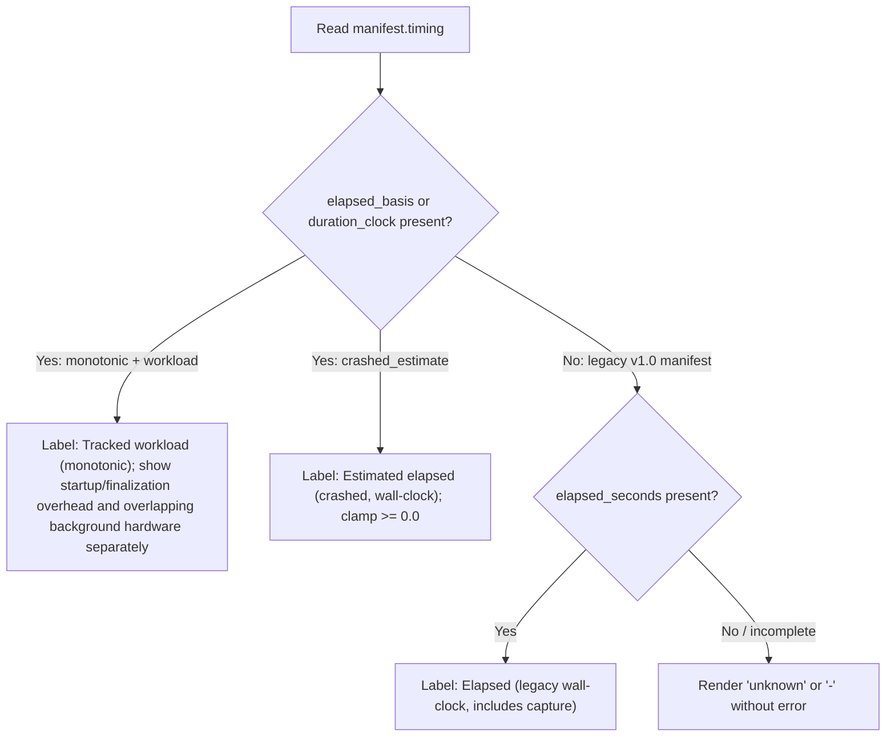

# IPD: Reports Status Diff and TUI Timing Semantics

- Date: 2026-11-21
- Kind: child
- Concern: Backward compatibility, explicit legacy-versus-monotonic semantic labeling, and tracked-interval clarity across status, diagnostic reports, diffs, methods verification, and TUI views.
- Scope: Update `src/pubrun/status.py`, `src/pubrun/report/diagnostics.py`, `src/pubrun/analysis/diff.py`, `src/pubrun/analysis/render.py`, and `src/pubrun/tui/widgets/details.py`; add behavioral compatibility and labeling tests in `tests/test_timing_consumers.py` and `tests/test_diff_usability.py`.
- Scope-Paths: src/pubrun/status.py, src/pubrun/report/diagnostics.py, src/pubrun/analysis/diff.py, src/pubrun/analysis/render.py, src/pubrun/tui/widgets/details.py, tests/test_timing_consumers.py, tests/test_diff_usability.py
- Item-Dependencies: executed:e1fwy2, executed:8co0wy
- Status: to-review
- Short-Description: Preserve legacy manifest readability and label old vs new timing semantics across status, diagnostics, diff, and TUI
- Work-Kind: bug
- Priority: high
- From-Backlog: 6hp1zu
- Blocks-Release: next
- Set: timing-acc
- Order: 3
- Highest E allocated: 05
- Author: agent
- Id: vrr1fv

> Write and proofread this plan per the technical writing standard, `.aw/system/workflows/technical-writing/technical-writing.md` (`.agents/workflows/technical-writing/technical-writing.md` in a legacy-layout install), including requirement 12 (diagrams).

## Workflow history

- 2026-11-22 draft (agent): created.
- 2026-11-22 to-review (agent): authored review-ready child plan from backlog item `6hp1zu`.

## Goal

Update all manifest timing consumers (`status.py`, `report/diagnostics.py`, `analysis/diff.py`, `analysis/render.py`, and `tui/widgets/details.py`) so pre-change legacy manifests remain fully readable, old wall-clock durations and new monotonic tracked-workload durations are labeled distinctly without summing overlapping intervals, late-import runs are described as tracked intervals rather than full application lifetime, and crashed or incomplete timing states render safely without negative durations.

### Timing classification across consumers

The text in `## Proposed changes (ordered, validatable)` is normative. This diagram summarizes how consumers classify timing records from legacy, monotonic, crashed, and incomplete manifests.



## Detailed Implementation Checklist (TODO)

Execution-state rule: mark an `E-*` item complete only after performing the action. That mark is not validation. Right-sizing rule: write for a modest executor that cannot hold much in its head. Each E-item is one step (one concern, about one file, executable in one focused pass) and its V-item names each unit it covers with its own check; a plan stays at about 5 E-items and 8 work Scope-Paths, else split it into more child plans (guidance, `IPD-Z603`). Accepted execution states: blocked, failed, pending, performed; terminal gate demands 'performed'.

### Task group 1: Status, diagnostics, diff, and TUI consumers

- [ ] E-01 Update `src/pubrun/status.py` (`RunInfo._load_from_manifest`, `RunInfo._load_from_lock`, `close_out_crashed_run`, `render_inspect`) for monotonic timing fields, legacy inference, nonnegative crashed closeout, and tracked-interval labeling.
  - Depends on: none
  - Expected outcome: `RunInfo` parses the new optional timing fields (`workload_seconds`, `startup_overhead_seconds`, `finalization_overhead_seconds`, `session_seconds`, `hardware_wait_seconds`, `background_hardware_seconds`, `duration_clock`, `elapsed_basis`, `interval_scope`), infers legacy wall-clock semantics when `elapsed_basis`/`duration_clock` are absent on a manifest that has `elapsed_seconds`, clamps live lock elapsed time with `max(0.0, ...)`, updates `close_out_crashed_run` to clamp `elapsed_seconds` to `>= 0.0` with `duration_clock="wall_clock_estimated"` and `elapsed_basis="crashed_estimate"`, and updates `render_inspect` to label old versus new timing semantics clearly and display overhead intervals separately without summing overlaps.
  - Execution state: pending

- [ ] E-02 Update `src/pubrun/report/diagnostics.py` (`print_report`) to display labeled tracked-interval timing, separate capture overheads, legacy fallback labels, and monotonic subprocess durations.
  - Depends on: E-01
  - Expected outcome: `print_report` labels elapsed duration accurately for new monotonic manifests (stating tracked workload interval, not full application lifetime) versus legacy wall-clock manifests versus crashed estimates; prints startup overhead, finalization overhead, hardware wait, and overlapping background hardware duration clearly when present; and renders deep-mode subprocess durations from recorded `elapsed_seconds` when present, falling back to `max(0.0, ended - started)` labeled as wall-clock fallback for legacy subprocess records.
  - Execution state: pending

- [ ] E-03 Update `src/pubrun/analysis/diff.py` (`_normalize_manifest`, `compare_manifests`) and `src/pubrun/analysis/render.py` (`_render_inline`, `_render_table`) so comparing legacy and new manifests surfaces timing semantic differences explicitly when `timing` is not ignored.
  - Depends on: E-01
  - Expected outcome: When `timing` is included in a diff (e.g., `--deep` or custom `ignores=[]`), `_normalize_manifest` synthesizes `timing.duration_clock = "wall_clock"` and `timing.elapsed_basis = "wall_clock_legacy"` for legacy manifests that carry `timing.elapsed_seconds` without those fields, and `compare_manifests` / `render.py` annotate mixed-definition `timing.elapsed_seconds` comparisons so users never silently compare legacy wall-clock totals against monotonic tracked-workload durations as equivalent quantities; when `timing` is ignored (default `basic` and `standard`), diff output remains unchanged.
  - Execution state: pending

- [ ] E-04 Update `src/pubrun/tui/widgets/details.py` (`RunDetailsView.update_general_pane`, `RunDetailsView.update_subprocesses_pane`) to label timing semantics, display capture overhead fields, and prefer monotonic subprocess `elapsed_seconds`.
  - Depends on: E-01
  - Expected outcome: `update_general_pane` displays labeled elapsed duration (tracked workload vs legacy wall-clock vs crashed estimate) plus startup and finalization overhead lines when present, and `update_subprocesses_pane` uses `sub.get("elapsed_seconds")` when present before falling back to `max(0.0, end_val - start_val)` for legacy records.
  - Execution state: pending

### Task group 2: Consumer compatibility tests and validation

- [ ] E-05 Add behavioral tests in `tests/test_timing_consumers.py` and `tests/test_diff_usability.py`, including verification that `pubrun.report.methods.generate_report` and `generate_report_multi` handle old and new manifests without overstating timing precision, then run the targeted test suite.
  - Depends on: E-02, E-03, E-04
  - Expected outcome: Tests cover legacy manifest readability, mixed legacy-vs-new `diff` semantic labeling (inline and table renderers), late-import tracked-interval labeling, incomplete timing data (`None` or missing keys), crashed closeout with backward `mtime`, TUI pane rendering, and `methods.py` precision check; `pytest tests/test_timing_consumers.py tests/test_diff_usability.py tests/test_reports.py tests/test_status.py tests/test_tui.py tests/test_edge_cases.py -v` exits 0.
  - Execution state: pending

## Project conventions discovered (Step 0)

- `src/pubrun/status.py` routes manifest numeric timing fields through `_as_float()` to reject `bool`, `str`, `NaN`, and infinity, and renders run tables (`render_short_list`, `render_verbose_list`) and single-run inspection (`render_inspect`).
- `src/pubrun/status.py` (`close_out_crashed_run`) currently sets `timing["elapsed_seconds"] = ended_at - timing["started_at_utc"]` without clamping negative values if lock-file `st_mtime` precedes `started_at_utc`.
- `src/pubrun/report/diagnostics.py` (`print_report`) prints `Elapsed : <str>` from `timing.get("elapsed_seconds")` and in deep mode computes subprocess elapsed time via `round(ended - started, 3)`.
- `src/pubrun/analysis/diff.py` (`_normalize_manifest`, `compare_manifests`) ignores `timing` by default at `basic` and `standard` depths (via `src/pubrun/resources/default.toml`) and includes `timing` at `deep` depth or when callers pass custom `ignores`.
- `src/pubrun/report/methods.py` and `src/pubrun/report/templates.py` currently report OS, CPU, RAM, Python, packages, Git commit, and `pubrun` version and do not report run durations, so verifying that methods output does not overstate timing precision requires behavioral tests rather than modifying `methods.py`.
- `src/pubrun/tui/widgets/details.py` (`RunDetailsView`) uses `RunInfo` and `manifest.get("subprocesses", [])`, currently subtracting `end_val - start_val` for subprocess elapsed time.

## Findings

- **F-01 (Silent semantic mismatch in diffs):** Comparing an older v1.0 manifest (where `elapsed_seconds` was wall-clock start-to-post-hardware-wait) with a new manifest (where `elapsed_seconds` is monotonic tracked workload) under `--deep` or custom `ignores` currently shows only a raw numeric change on `timing.elapsed_seconds` without signaling that the metric definition changed.
- **F-02 (Negative elapsed values in crashed closeout and live lock reads):** `close_out_crashed_run` and `RunInfo._load_from_lock` compute `ended_at - started_at_utc` and `time.time() - started_at_utc` without flooring to `0.0`, producing negative durations under backward clock steps or skewed filesystem `mtime`.
- **F-03 (Unlabeled durations in reports and TUI):** `render_inspect`, `print_report`, and `RunDetailsView` show a single bare `Elapsed` label without distinguishing tracked workload from capture overhead, legacy wall-clock totals, or late-import scope.
- **F-04 (Subprocess duration fallback):** `print_report` and `RunDetailsView.update_subprocesses_pane` unconditionally subtract `ended_at_utc - started_at_utc` instead of reading monotonic `elapsed_seconds` when present.

## Proposed changes (ordered, validatable)

1. **`src/pubrun/status.py`:**
   - Add a small helper (e.g., `classify_timing_semantics(timing: Dict[str, Any]) -> Dict[str, Any]`) reused by `status.py`, `report/diagnostics.py`, and `tui/widgets/details.py` to normalize:
     - `duration_clock`: explicit value if present, else `"wall_clock"` when `elapsed_seconds` is present on a legacy manifest, else `None`.
     - `elapsed_basis`: explicit value if present, else `"wall_clock_legacy"` when `elapsed_seconds` is present on a legacy manifest, else `None`.
     - `interval_scope`: explicit value if present, else `"tracked_interval"`.
     - Human-readable elapsed label:
       - `elapsed_basis == "workload"` and `duration_clock == "monotonic"` -> `"Tracked workload (monotonic)"`
       - `elapsed_basis == "crashed_estimate"` -> `"Estimated elapsed (crashed, wall-clock)"`
       - `elapsed_basis == "wall_clock_legacy"` -> `"Elapsed (legacy wall-clock, includes capture)"`
       - Missing/incomplete -> `"Elapsed"` with value `"unknown"` (or `"-"` in TUI).
   - In `RunInfo.__init__` and `RunInfo._load_from_manifest`: store `self.timing_semantics`, `self.workload_seconds`, `self.startup_overhead_seconds`, `self.finalization_overhead_seconds`, `self.session_seconds`, `self.hardware_wait_seconds`, and `self.background_hardware_seconds` (all via `_as_float`). Set `self.elapsed = self.workload_seconds if self.workload_seconds is not None else _as_float(timing.get("elapsed_seconds"))`.
   - In `RunInfo._load_from_lock`: clamp live running `self.elapsed = max(0.0, time.time() - self.started_at_utc)`.
   - In `close_out_crashed_run`: clamp `elapsed = max(0.0, ended_at - started_at)`, set `timing["duration_clock"] = "wall_clock_estimated"`, `timing["elapsed_basis"] = "crashed_estimate"`, `timing["interval_scope"] = "tracked_interval"`, and `timing["capture_state"] = {"status": "partial"}`.
   - In `render_inspect`: display the semantic elapsed label (plus note that it covers the tracked interval, not full process lifetime when imported late), and when present display separate indented or aligned lines for `Startup overhead`, `Finalization overhead` (noting `Hardware wait` as a sub-interval when present), `Tracked session`, and `Background hardware (overlaps workload)` without summing overlapping intervals.
2. **`src/pubrun/report/diagnostics.py`:**
   - In `print_report`: use `classify_timing_semantics(timing)` to render the labeled elapsed duration and separate startup/finalization/hardware-wait/overlapping-background-hardware breakdown when present; clearly state tracked-interval scope rather than application lifetime.
   - In deep-mode subprocess rendering: prefer `_as_float(sp.get("elapsed_seconds"))` (rendered as `(<val>s, monotonic)` when `duration_clock == "monotonic"`), falling back to `max(0.0, ended - started)` labeled `(<val>s, wall-clock)` when `elapsed_seconds` is absent on legacy manifests.
3. **`src/pubrun/analysis/diff.py` and `src/pubrun/analysis/render.py`:**
   - In `_normalize_manifest`: when `manifest.get("timing")` is a dict containing numeric `elapsed_seconds` and lacks `duration_clock` or `elapsed_basis`, and `"timing"` is not ignored, inject normalized keys `timing.duration_clock = "wall_clock"` and `timing.elapsed_basis = "wall_clock_legacy"` (respecting `_should_ignore` for each key).
   - In `compare_manifests`: when `timing.elapsed_seconds` is in `modified` and the two manifests differ in effective `elapsed_basis` or `duration_clock`, attach `"note": "timing definition changed (<old_basis>/<old_clock> -> <new_basis>/<new_clock>)"` to `diff_report["modified"]["timing.elapsed_seconds"]` (preserving `"type": "standard"`, `"old"`, and `"new"` so existing programmatic callers remain backward compatible).
   - In `render.py` (`_render_inline` and `_render_table`): when a modified entry carries a `"note"`, display that note alongside the change so human readers see immediately that legacy wall-clock and monotonic workload durations are not directly comparable.
4. **`src/pubrun/tui/widgets/details.py`:**
   - In `update_general_pane`: display the labeled elapsed duration via `classify_timing_semantics`, plus separate lines for startup overhead, finalization overhead, and overlapping background hardware when present.
   - In `update_subprocesses_pane`: use `sub.get("elapsed_seconds")` when numeric; otherwise fall back to `max(0.0, end_val - start_val)` when `start_val` and `end_val` are numeric.
5. **Tests (`tests/test_timing_consumers.py`, `tests/test_diff_usability.py`):**
   - Test legacy manifest fixture (`tests/fixtures/sample_manifest.json` and inline legacy dicts) through `RunInfo`, `render_inspect`, `print_report`, `compare_manifests`, `print_diff` (inline and table), `generate_report` / `generate_report_multi`, and `RunDetailsView`.
   - Test new monotonic manifest through all of the same consumers, asserting separate overhead display, no summing of overlapping background hardware time into workload time, and tracked-interval wording (never "full application lifetime").
   - Test mixed legacy-vs-new diff under `depth="deep"` and `ignores=[]`, verifying explicit old/new semantic labeling in both structured diff output and rendered inline/table output, and verify default `basic`/`standard` diffs still ignore `timing`.
   - Test incomplete timing data (`timing: {}`, `ended_at_utc: None`, `elapsed_seconds: None`, non-numeric values) and crashed closeout with lock `mtime < started_at_utc` (nonnegative elapsed, `crashed_estimate` basis).

## Deferred / out of scope (with reason)

- Producer timing mechanics (`tracker.py`, `writer.py`, `core.py`, `capture/subprocesses.py`) are implemented in prerequisites `e1fwy2` and `8co0wy`.
- Documentation, examples, and benchmarking are implemented in child plan `3tvesf`.
- `src/pubrun/report/methods.py` and `src/pubrun/report/templates.py` are not modified because they do not currently emit timing claims; `tests/test_timing_consumers.py` verifies they continue to read legacy and new manifests cleanly and do not overstate timing precision.

## Scope check

- Over-scope: none. Touches only the five consumer modules and two test modules (7 Scope-Paths, 5 E-items).
- Under-scope: none. Covers every report, status, diff, TUI, and methods-precision requirement in `6hp1zu`.

## Required tests / validation

Run inside the repository root and capture actual runner output and exit code:

```bash
pytest tests/test_timing_consumers.py tests/test_diff_usability.py tests/test_reports.py tests/test_status.py tests/test_tui.py tests/test_edge_cases.py -v
```

## Spec / documentation sync

Deferred to child plan `3tvesf`, which updates `docs/manifest.md`, `docs/architecture.md`, `docs/functional_spec.md`, `docs/api.md`, `docs/performance.md`, and `examples/`.

## Open questions

### OQ-01: Default diff ignore list for `timing`

- Blocking: no
- Status: resolved
- Owner: maintainer (confirmed upon plan approval)
- Resolution or deferral rationale: Keep `"timing"` in `ignore_basic` and `ignore_standard` in `src/pubrun/resources/default.toml` so two identical runs do not produce noisy timing diffs at default depths (`tests/test_diff_usability.py` `TestIgnoreMonotonicity`). When timing IS compared (`--deep` or custom `ignores`), synthesize legacy semantics and display the explicit definition-change note.

## Validation and cross-check (verify before reporting done)

Validation-state rule: inspect evidence in a separate pass. Do not mark a `V-*` item complete from memory or from the matching execution checkmark. Accepted validation results: blocked, failed, pass, pending; terminal gate demands 'pass'. Runtime-demonstration reachability rule: for each `V-*` item demanding the software be observed acting (such as a run, a dispatch, or a transition)—as distinct from items demanding a diff, a file's content, or a test result, which are reachable by construction—name the code path that produces the observation or the sibling `E-*` that creates it, else the demand is UNDER-SCOPE.

- [ ] V-01 validates E-01
  - Required evidence: Diff of `src/pubrun/status.py` showing `classify_timing_semantics`, nonnegative live/crashed elapsed clamping, `crashed_estimate` labeling, and separated overhead display in `render_inspect`, plus pasted `pytest tests/test_status.py tests/test_edge_cases.py -v` output.
  - Observed evidence:
  - Result: pending

- [ ] V-02 validates E-02
  - Required evidence: Diff of `src/pubrun/report/diagnostics.py` showing labeled tracked-interval timing, separate overhead lines, and monotonic subprocess duration preference with wall-clock fallback, plus pasted `pytest tests/test_reports.py -v` output.
  - Observed evidence:
  - Result: pending

- [ ] V-03 validates E-03
  - Required evidence: Diff of `src/pubrun/analysis/diff.py` and `src/pubrun/analysis/render.py` showing legacy timing semantics normalization and mixed-definition change notes in both inline and table renderers, plus pasted `pytest tests/test_diff_usability.py -v` output.
  - Observed evidence:
  - Result: pending

- [ ] V-04 validates E-04
  - Required evidence: Diff of `src/pubrun/tui/widgets/details.py` showing labeled timing breakdown and monotonic subprocess duration preference, plus pasted `pytest tests/test_tui.py -v` output.
  - Observed evidence:
  - Result: pending

- [ ] V-05 validates E-05
  - Required evidence: Pasted `pytest tests/test_timing_consumers.py tests/test_diff_usability.py tests/test_reports.py tests/test_status.py tests/test_tui.py tests/test_edge_cases.py -v` output showing exit code 0 and zero failures.
  - Observed evidence:
  - Result: pending

## Approval and execution gate

- Size assessment: standard
- Cohesion rationale: not required

Execution contract:
1. All open questions (OQ-01) are resolved; do not execute until prerequisites `e1fwy2` and `8co0wy` are `executed` and a human approves this plan (`- Status: approved`).
2. Scope fence: edit only `src/pubrun/status.py`, `src/pubrun/report/diagnostics.py`, `src/pubrun/analysis/diff.py`, `src/pubrun/analysis/render.py`, `src/pubrun/tui/widgets/details.py`, `tests/test_timing_consumers.py`, and `tests/test_diff_usability.py`. Do not expand scope; if additional files seem required, STOP and report.
3. Honesty rule: paste actual `pytest` runner output and exit code into each `V-*` `Observed evidence:` field; never claim tests passed without running them.
4. Commit discipline: commit only the files listed in `- Scope-Paths:` using `aw commit vrr1fv -- <paths>`; never use `git add -A`, `git add .`, or `git commit -a`; never push without explicit human instruction.
5. Lifecycle move on completion: after `aw ipd lint --phase pre-transition` passes, move this plan from `.aw/records/plans/pending/` to `.aw/records/plans/executed/`, set `- Status: executed`, append a dated `## Workflow history` line, and commit the lifecycle move path-scoped.
