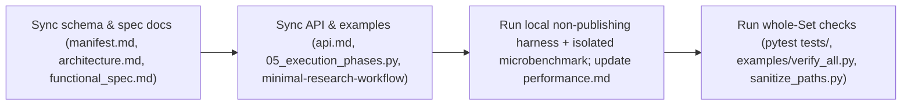
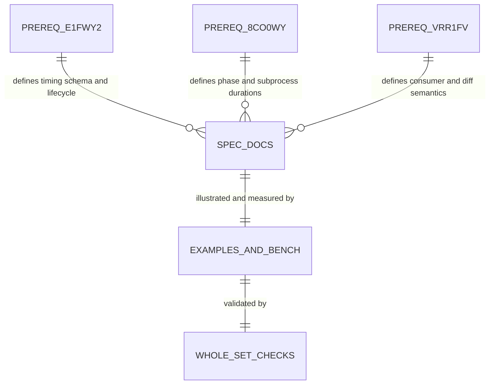

# IPD: Timing Docs Examples Benchmark and Whole-Set Verification

- Date: 2026-11-21
- Kind: child
- Concern: Specification and documentation reconciliation, understandable timing examples, timing-instrumentation cost benchmarking, and whole-Set verification.
- Scope: Reconcile `docs/manifest.md`, `docs/architecture.md`, `docs/functional_spec.md`, `docs/api.md`, and `docs/performance.md`; update `examples/05_execution_phases.py`, `examples/minimal-research-workflow/manifest_excerpt.json`, and `examples/minimal-research-workflow/README.md`; measure timing instrumentation overhead locally and execute whole-Set regression checks.
- Scope-Paths: docs/manifest.md, docs/architecture.md, docs/functional_spec.md, docs/api.md, docs/performance.md, examples/05_execution_phases.py, examples/minimal-research-workflow/manifest_excerpt.json, examples/minimal-research-workflow/README.md
- Item-Dependencies: executed:e1fwy2, executed:8co0wy, executed:vrr1fv
- Status: approved
- Readiness: go-pending-approval
- Review-Depth: complex
- Short-Description: Sync specs, docs, and examples, benchmark timing instrumentation cost, and run whole-Set verification
- Work-Kind: bug
- Priority: high
- From-Backlog: 6hp1zu
- Blocks-Release: next
- Set: timing-acc
- Order: 4
- Highest E allocated: 05
- Author: agent
- Id: 3tvesf
- Approval: 2026-11-22, recorded via aw ipd set: status set to approved

> Write and proofread this plan per the technical writing standard, `.aw/system/workflows/technical-writing/technical-writing.md` (`.agents/workflows/technical-writing/technical-writing.md` in a legacy-layout install), including requirement 12 (diagrams).

## Workflow history

- 2026-11-22 approved (aw set): status set to approved
- 2026-11-22 /plan-review (Gemini 4 Neon (High)): APPROVE WITH REVISIONS APPLIED; PR-001, PR-002, PR-003, PR-004, PR-005
- 2026-11-22 draft (agent): created.
- 2026-11-22 to-review (agent): authored review-ready child plan from backlog item `6hp1zu`.

## Goal

Reconcile all repository specifications, reference docs, and examples with the monotonic timing and overhead-separation contracts introduced by prerequisite child plans `e1fwy2` (manifest timing schema and tracker monotonic lifecycle), `8co0wy` (monotonic phase, subprocess, and resource timing), and `vrr1fv` (reports, status, diff, and TUI timing semantics). Measure and record the timing instrumentation cost itself under documented local conditions without publishing or leaving unredacted files. Run whole-Set verification across the full test suite, all examples, and the path sanitizer.

### Documentation, benchmark, and verification pipeline

The text in `## Proposed changes (ordered, validatable)` is normative. These diagrams summarize the execution sequence and artifact relationships in this plan after `e1fwy2`, `8co0wy`, and `vrr1fv` reach `executed`.





## Detailed Implementation Checklist (TODO)

Execution-state rule: mark an `E-*` item complete only after performing the action. That mark is not validation. Right-sizing rule: write for a modest executor that cannot hold much in its head. Each E-item is one step (one concern, about one file, executable in one focused pass) and its V-item names each unit it covers with its own check; a plan stays at about 5 E-items and 8 work Scope-Paths, else split it into more child plans (guidance, `IPD-Z603`). Accepted execution states: blocked, failed, pending, performed; terminal gate demands 'performed'.

### Task group 1: Specification and documentation reconciliation

- [ ] E-01 Update `docs/manifest.md`, `docs/architecture.md`, and `docs/functional_spec.md` to document monotonic durations, disjoint versus overlapping intervals, tracked-interval scope (including late imports), `subprocess_record` durations, `phase_end` duration payloads, crashed-run estimates, and legacy v1.0 compatibility.
  - Depends on: none
  - Expected outcome: All three docs remove stale statements claiming `elapsed_seconds = ended_at_utc - started_at_utc` or "trivial elapsed-time arithmetic" via wall-clock subtraction. Every additive `timing` and `subprocesses` field matches `schemas/manifest.schema.json`. Docs distinguish Portable Operating System Interface (POSIX) Coordinated Universal Time (UTC) chronology from monotonic durations (never persisted as raw counter values), explain that overlapping background hardware capture must not be summed with `workload_seconds`, explain that `finalization_overhead_seconds` excludes the final atomic write of `manifest.json`, document legacy v1.0 and crashed-estimate classification (`vrr1fv`), preserve any additive `startup-perf` (`ckc3vl`) sections if already present, and introduce zero em dashes (U+2014) or en dashes (U+2013) in added or edited lines.
  - Execution state: pending

- [ ] E-02 Update `docs/api.md` to document `start()`, `stop()`, `phase()`, `tracked_run()`, `audit_run()`, `diff()`, `pubrun.subprocess.*`, and `pubrun.popen()` timing behavior and late-import tracked-interval semantics.
  - Depends on: E-01
  - Expected outcome: `docs/api.md` explains what each timing interval measures, states clearly that importing `pubrun` midway through a script measures the tracked interval rather than full process lifetime, documents `phase()` monotonic `phase_end` duration payloads (excluding profiler setup and dump I/O), documents explicit subprocess wrapper monotonic durations and `capture_state`, documents legacy-versus-monotonic semantic notes in `pubrun.diff()`, and introduces zero em dashes (U+2014) or en dashes (U+2013) in added or edited lines.
  - Execution state: pending

### Task group 2: Examples, instrumentation benchmark, and whole-Set verification

- [ ] E-03 Update `examples/05_execution_phases.py`, `examples/minimal-research-workflow/manifest_excerpt.json`, and `examples/minimal-research-workflow/README.md` with accurate timing fields and a plain-language explanation of what is measured.
  - Depends on: E-02
  - Expected outcome: `examples/05_execution_phases.py` verifies that each `phase_end` event carries a nonnegative numeric `elapsed_seconds` (not `bool`) and `duration_clock == "monotonic"`, verifies the finalized `manifest.json` carries monotonic tracked-workload timing metadata, prints a concise explanation of what was measured while preserving `[PASS] PASS: 05_execution_phases.py`, and exits 0. `examples/minimal-research-workflow/manifest_excerpt.json` remains valid JSON, adds the additive `timing` fields with internally consistent redacted/synthetic values, and its `"timing"` object validates against the `$defs.timing` subschema of `schemas/manifest.schema.json`. `examples/minimal-research-workflow/README.md` adds a concise plain-language section explaining tracked workload versus capture overhead, non-additive background hardware capture, and late-import scope, introducing zero em dashes (U+2014) or en dashes (U+2013) in added or edited lines.
  - Execution state: pending

- [ ] E-04 Benchmark the timing instrumentation cost locally using non-publishing commands and document the scoped methodology and measurements in `docs/performance.md` without committing unredacted host-identifying artifacts.
  - Depends on: E-03
  - Expected outcome: Execute local non-publishing measurements without modifying `src/pubrun/`: (1) `python3 benchmarks/harness.py --passes 3 --iterations 30 --redacted-out /tmp/pubrun-timing-harness.redacted.json` (recording pass 1 cold vs pass 3 warm medians and dispersion, then deleting `/tmp/pubrun-timing-harness.redacted.json` so `benchmarks/results/` stays clean); and (2) an ephemeral in-memory Python microbenchmark (`N >= 30` repetitions across 3 passes: pass 1 cold vs pass 3 warm) measuring raw `time.perf_counter()` bookkeeping overhead versus an empty-loop baseline, active `pubrun.phase()` loop versus inactive no-op baseline, and `Run` `start()`/`stop()` breakdown (`startup_overhead_seconds`, `workload_seconds`, `finalization_overhead_seconds`, `writer_overhead_seconds`). Record environment (Operating System (OS), Python version, Central Processing Unit (CPU) model and logical cores, filesystem `fstype` and `is_network` via `src/pubrun/capture/filesystem.py::get_filesystem` with zero personal paths or hostnames), git commit SHA, workload, baseline, repetitions, cold versus warm passes, median, standard deviation (stdev), and Interquartile Range (IQR) in `V-04` and in a dedicated environment-scoped subsection of `docs/performance.md` (preserving `docs/performance.md#Representative results` intact, preserving any `startup-perf` (`ckc3vl`) subsection if present, making no unmeasured speedup claims, and introducing zero em or en dashes in added or edited lines).
  - Execution state: pending

- [ ] E-05 Run whole-Set regression verification across the full test suite, all examples, and the path-sanitizer check, and record the remaining multi-OS and multi-Python Continuous Integration (CI) matrix gate.
  - Depends on: E-04
  - Expected outcome: `pytest tests/ -v`, `python3 examples/verify_all.py`, and `python3 scripts/sanitize_paths.py --check --all` all exit 0 with actual runner output pasted into `V-05`, `git status -s` shows no stray temporary or unredacted benchmark files, and `V-05` explicitly records that `.github/workflows/ci.yml` (Ubuntu, Windows, and macOS across Python 3.8 through 3.14) must pass in GitHub Actions before release closure.
  - Execution state: pending

## Project conventions discovered (Step 0)

- `docs/manifest.md## timing`, `docs/architecture.md### Timestamp Format`, `docs/architecture.md## 9. Observed vs Derived vs Inferred`, and `docs/functional_spec.md### 4.1 Timestamp Format` currently state `elapsed_seconds = ended_at_utc - started_at_utc` or "trivial elapsed-time arithmetic" from wall-clock timestamps, which conflicts with monotonic duration semantics after prerequisite `e1fwy2`.
- `docs/functional_spec.md### 7.1 Implemented Event Types`, `docs/functional_spec.md### 15.2 Recorded Fields`, and `docs/functional_spec.md### 19.2 Finalization Lifecycle` do not yet document `phase_end` monotonic durations, `subprocess_record` `elapsed_seconds`/`duration_clock`/`capture_state`, or the `t2` pre-teardown workload boundary and `config.resolved.json`-before-`manifest.json` write order.
- `examples/verify_all.py` executes every numbered script (`examples/00_*.py` through `examples/11_*.py`) plus `examples/minimal-research-workflow/analysis.py`, expects exit code 0, and highlights stdout lines containing `"PASS"` or `"TESTING"`; `tests/test_example_minimal_research_workflow.py` smoke-tests `examples/minimal-research-workflow/analysis.py`.
- `examples/minimal-research-workflow/manifest_excerpt.json` is an intentionally shortened redacted excerpt that omits `capture_state` on several sections (`run`, `invocation`, `capture`, `status`, `git`, `host`, `python`, `signals`), so JSON Schema validation must target the `$defs.timing` subschema of `schemas/manifest.schema.json` alongside full-file JSON parsing.
- `scripts/sanitize_paths.py --check --all` is enforced in `.github/workflows/secret-scan.yml` to block machine-local absolute home paths or hostnames from entering tracked files.
- `benchmarks/harness.py` writes a redacted JSON file under `benchmarks/results/` by default unless `--redacted-out <temp_path>` is passed (and writes an unredacted copy only when `--unredacted` or `--out` is passed); benchmark runs must never publish to GitHub Gists, open issues, or submit High-Performance Computing (HPC) scheduler jobs without explicit authorization.
- Sibling Set `startup-perf` (child `ckc3vl`, post-change overhead comparison and documentation sync) also edits `docs/manifest.md`, `docs/architecture.md`, `docs/functional_spec.md`, and `docs/performance.md`; edits here must remain additive to distinct subsections so either execution order composes cleanly.
- `AGENTS.md` prohibits em dashes (U+2014) and en dashes (U+2013) in newly authored or edited user-facing prose (`docs/`, `README.md`, examples).

## Findings

- **F-01 (Stale timing specifications):** `docs/manifest.md## timing`, `docs/architecture.md### Timestamp Format`, `docs/architecture.md## 9. Observed vs Derived vs Inferred`, and `docs/functional_spec.md### 4.1 Timestamp Format` explicitly state `elapsed_seconds = ended_at_utc - started_at_utc` and describe `timing` as having only `started_at_utc`, `ended_at_utc`, and `elapsed_seconds`.
- **F-02 (Missing late-import, overlap, subprocess, and diff semantics in docs and examples):** Neither `docs/api.md`, `docs/manifest.md`, `docs/functional_spec.md`, nor `examples/minimal-research-workflow/README.md` explains that importing `pubrun` late measures only the tracked interval, that background hardware capture overlaps with workload execution, that `phase_end` and `subprocesses` carry monotonic durations, or how legacy v1.0 manifests are labeled in reports and diffs.
- **F-03 (Unmeasured instrumentation cost):** `docs/performance.md` does not yet explain how `pubrun` separates its own startup and finalization overhead from workload timing or report measured timing-instrumentation cost with cold/warm passes and dispersion.

## Proposed changes (ordered, validatable)

1. **`docs/manifest.md`:**
   - Replace `docs/manifest.md## timing` (table and `[!NOTE]` block) to document `started_at_utc`, `workload_started_at_utc`, `ended_at_utc`, `finalized_at_utc`, `elapsed_seconds`, `workload_seconds`, `startup_overhead_seconds`, `finalization_overhead_seconds`, `session_seconds`, `hardware_wait_seconds`, `background_hardware_seconds`, `duration_clock`, `elapsed_basis`, `interval_scope`, and `capture_state`.
   - Document clearly which intervals are disjoint (`startup_overhead_seconds`, `workload_seconds`, `finalization_overhead_seconds`), which overlap (`background_hardware_seconds` overlaps workload; `hardware_wait_seconds` is a sub-interval of `finalization_overhead_seconds`), that `finalization_overhead_seconds` excludes the final atomic write of `manifest.json`, that raw monotonic counter values are never serialized, how legacy v1.0 manifests (lacking `duration_clock` and `elapsed_basis`) are classified and labeled, and how crashed-run closeouts record `duration_clock: "wall_clock_estimated"` and `elapsed_basis: "crashed_estimate"`.
   - Update `docs/manifest.md## subprocesses` to document optional `elapsed_seconds`, `duration_clock`, `pid`, and `error`.
2. **`docs/architecture.md` and `docs/functional_spec.md`:**
   - Reconcile `docs/architecture.md## 3. Run Lifecycle`, `docs/architecture.md### Timestamp Format`, and `docs/architecture.md## 9. Observed vs Derived vs Inferred`, plus `docs/functional_spec.md### 4.1 Timestamp Format`, `docs/functional_spec.md### 7.1 Implemented Event Types`, `docs/functional_spec.md### 15.2 Recorded Fields`, and `docs/functional_spec.md### 19.2 Finalization Lifecycle`: UTC epoch floats remain the format for absolute chronology; monotonic clocks (`time.perf_counter()`) produce nonnegative durations; raw monotonic counter readings are never serialized; `phase_end` carries `elapsed_seconds` and `duration_clock: "monotonic"` (excluding profiler setup and dump I/O); `t2` marks workload end before blocking hardware wait; and `config.resolved.json` is written before `manifest.json` freezes finalized timing.
   - Preserve any additive sections written by sibling plan `ckc3vl` (Set `startup-perf`) if already present on disk.
3. **`docs/api.md`:**
   - Update `docs/api.md### pubrun.start(**overrides)`, `### pubrun.stop()`, `### pubrun.phase(name)`, `## 5. Lifecycle Wrappers` (`tracked_run()`, `audit_run()`), `### pubrun.diff(...)`, `### pubrun.subprocess.run(*args, **kwargs) / pubrun.subprocess.Popen(...)`, and `### pubrun.popen(cmd, mode="r", bufsize=-1)` to document monotonic timing guarantees, late-import tracked-interval scope, `phase()` profiler setup/dump exclusion, explicit subprocess monotonic durations and `capture_state`, and legacy-versus-monotonic diff notes when `timing` is included.
4. **`examples/05_execution_phases.py`, `examples/minimal-research-workflow/manifest_excerpt.json`, and `examples/minimal-research-workflow/README.md`:**
   - Extend `examples/05_execution_phases.py` to assert that each `phase_end` record carries numeric (non-`bool`), nonnegative `elapsed_seconds` and `duration_clock == "monotonic"`, assert that `manifest.json` carries monotonic tracked-workload timing metadata, and print a short explanation of what was measured while keeping `[PASS] PASS: 05_execution_phases.py` intact.
   - Update `examples/minimal-research-workflow/manifest_excerpt.json` to include the additive `timing` fields (`workload_started_at_utc`, `finalized_at_utc`, `workload_seconds`, `startup_overhead_seconds`, `finalization_overhead_seconds`, `session_seconds`, `hardware_wait_seconds`, `background_hardware_seconds`, `duration_clock`, `elapsed_basis`, `interval_scope`, `capture_state`) with internally consistent synthetic values that validate against `$defs.timing` in `schemas/manifest.schema.json`.
   - Add a concise "What timing metrics measure" section to `examples/minimal-research-workflow/README.md` explaining tracked workload versus capture overhead, non-additive overlapping background capture, and late-import tracked-interval scope.
5. **`docs/performance.md` and local non-publishing instrumentation benchmark:**
   - Without editing `src/pubrun/`, run:
     - `python3 benchmarks/harness.py --passes 3 --iterations 30 --redacted-out /tmp/pubrun-timing-harness.redacted.json` (and delete `/tmp/pubrun-timing-harness.redacted.json` immediately after reading its summary); and
     - An ephemeral in-memory Python microbenchmark (`N >= 30` repetitions across 3 passes: pass 1 cold vs pass 3 warm) measuring (a) raw `time.perf_counter()` bookkeeping call cost versus empty-loop baseline, (b) active `pubrun.phase()` loop versus inactive no-op baseline, and (c) `Run` `start()`/`stop()` timing breakdown (`startup_overhead_seconds`, `workload_seconds`, `finalization_overhead_seconds`, `writer_overhead_seconds`).
   - Capture environment (OS, Python version, CPU model/logical cores, filesystem `fstype`/`is_network` via `get_filesystem` with no personal paths or hostnames), git commit SHA, workload, baseline, repetitions (`N >= 30`), cold versus warm pass comparison (pass 1 vs pass 3), median, stdev, and IQR.
   - Add a dedicated, environment-scoped subsection (`### Timing instrumentation and overhead separation`) in `docs/performance.md` without modifying `docs/performance.md#Representative results` or clobbering any `ckc3vl` subsection, summarizing the measured results honestly with zero unmeasured speedup claims.
6. **Whole-Set verification and prose hygiene:**
   - Run `pytest tests/ -v`, `python3 examples/verify_all.py`, and `python3 scripts/sanitize_paths.py --check --all`, pasting actual runner outputs and exit codes into `V-05`.
   - Verify via a Python check over added lines (`git diff`) that zero em dashes (U+2014) or en dashes (U+2013) were introduced in any modified doc or example file, and verify `git status -s` contains only declared Scope-Paths.

## Deferred / out of scope (with reason)

- Running the GitHub Actions cross-OS/Python matrix (`ubuntu-latest`, `ubuntu-24.04`, `windows-latest`, `macos-latest` across Python 3.8 through 3.14 in `.github/workflows/ci.yml`) requires GitHub Actions runners after PR or push; local execution covers the host OS/Python and records the CI matrix gate explicitly.
  - Carrier-Declined: executed automatically by GitHub Actions CI (.github/workflows/ci.yml) on pull request or push; unavailable in a single local Linux worktree.
- Publishing benchmark results to GitHub Issues/Gists or running HPC scheduler scripts (`benchmarks/submit_bench*.sh`) is prohibited without explicit maintainer authorization.
  - Carrier-Declined: explicitly prohibited without explicit maintainer authorization.
- Optimizing startup cost (`_resolve_commit()` and config write coalescing) belongs to sibling backlog item `t1xqpw` (Set `startup-perf`, orchestrator `9ppa0r`).
  - Carrier: 9ppa0r

## Scope check

- Over-scope: none. Touches only the five docs files and three example files (8 Scope-Paths, 5 E-items).
- Under-scope: none. Covers documentation sync, example updates, instrumentation benchmarking, em/en-dash verification, and whole-Set verification required by backlog item `6hp1zu` and orchestrator `nr63qr`.

## Required tests / validation

Run inside the repository root and capture actual runner output and exit codes:

```bash
python3 benchmarks/harness.py --passes 3 --iterations 30 --redacted-out /tmp/pubrun-timing-harness.redacted.json && rm -f /tmp/pubrun-timing-harness.redacted.json
pytest tests/ -v
python3 examples/verify_all.py
python3 scripts/sanitize_paths.py --check --all
```

Also run the ephemeral in-memory timing-instrumentation microbenchmark (non-publishing, stdout only, zero `src/pubrun/` edits) and paste the measured summary table (environment, git revision, workload, baseline, repetitions, pass 1 cold vs pass 3 warm, median, stdev, and IQR) into `V-04`.

## Spec / documentation sync

This plan is the specification, documentation, and example synchronization plan for Set `timing-acc`.

## Open questions

### OQ-01: Where to record single-machine instrumentation benchmark numbers

- Blocking: no
- Status: resolved
- Owner: plan author (binding upon plan approval)
- Resolution or deferral rationale: `docs/performance.md#Representative results` keeps its cross-machine table as a placeholder until multi-machine collection occurs, while single-machine measurements must be labeled with their exact environment, revision, workload, baseline, repetitions, cold/warm passes, and dispersion. Record the local timing-instrumentation measurement both in `V-04` of this plan and in a clearly scoped, environment-labeled subsection of `docs/performance.md` without overwriting `docs/performance.md#Representative results` or committing host-identifying files. Human approval of this plan confirms this placement before execution.

## Validation and cross-check (verify before reporting done)

Validation-state rule: inspect evidence in a separate pass. Do not mark a `V-*` item complete from memory or from the matching execution checkmark. Accepted validation results: blocked, failed, pass, pending; terminal gate demands 'pass'. Runtime-demonstration reachability rule: for each `V-*` item demanding the software be observed acting (such as a run, a dispatch, or a transition) (as distinct from items demanding a diff, a file's content, or a test result, which are reachable by construction), name the code path that produces the observation or the sibling `E-*` that creates it, else the demand is UNDER-SCOPE.

- [ ] V-01 validates E-01
  - Required evidence: Diff of `docs/manifest.md`, `docs/architecture.md`, and `docs/functional_spec.md` showing reconciled monotonic timing semantics, disjoint versus overlapping interval definitions, legacy and crashed-estimate classification rules, no stale `ended_at_utc - started_at_utc` claims, and pasted output of a Python check over added lines of `git diff -- docs/manifest.md docs/architecture.md docs/functional_spec.md` confirming zero em dashes (U+2014) or en dashes (U+2013).
  - Observed evidence:
  - Result: pending

- [ ] V-02 validates E-02
  - Required evidence: Diff of `docs/api.md` showing documented timing behavior for `start()`, `stop()`, `phase()`, `tracked_run()`, `audit_run()`, `diff()`, `pubrun.subprocess.*`, and `pubrun.popen()`, late-import tracked-interval scope, and pasted output of a Python check over added lines of `git diff -- docs/api.md` confirming zero em dashes (U+2014) or en dashes (U+2013).
  - Observed evidence:
  - Result: pending

- [ ] V-03 validates E-03
  - Required evidence: Diff of `examples/05_execution_phases.py`, `examples/minimal-research-workflow/manifest_excerpt.json`, and `examples/minimal-research-workflow/README.md`, pasted `python3 examples/05_execution_phases.py` output (exit code 0), pasted Python check confirming `manifest_excerpt.json` parses as valid JSON and its `"timing"` object validates against `$defs.timing` of `schemas/manifest.schema.json`, and pasted check confirming zero em/en dashes added to `examples/minimal-research-workflow/README.md`.
  - Observed evidence:
  - Result: pending

- [ ] V-04 validates E-04
  - Required evidence: Pasted local non-publishing `benchmarks/harness.py` summary (with temp `--redacted-out` deleted afterward) and ephemeral timing-instrumentation microbenchmark output showing environment (without personal paths or hostnames), git revision, workload, baseline, repetitions (`N >= 30`), pass 1 cold versus pass 3 warm results, median, stdev, and IQR, plus diff of `docs/performance.md` preserving `#Representative results`, zero added em/en dashes, and `git status -s` confirming no stray or unredacted benchmark files remain.
  - Observed evidence:
  - Result: pending

- [ ] V-05 validates E-05
  - Required evidence: Pasted actual runner output and exit code 0 for `pytest tests/ -v`, `python3 examples/verify_all.py`, and `python3 scripts/sanitize_paths.py --check --all`, `git status -s` confirming no stray benchmark files, plus an explicit note recording the GitHub Actions `.github/workflows/ci.yml` OS/Python CI matrix gate required before release closure.
  - Observed evidence:
  - Result: pending

## Approval and execution gate

- Size assessment: standard
- Cohesion rationale: not required

Execution contract:
1. Open questions: all open questions (`OQ-01`) are resolved for review; do not execute until prerequisites `e1fwy2` (manifest timing schema and tracker monotonic lifecycle), `8co0wy` (monotonic phase, subprocess, and resource timing), and `vrr1fv` (reports, status, diff, and TUI timing semantics) are `executed` and a human approves this plan (`- Status: approved`).
2. Scope declaration: expected modified files are `- Scope-Paths:` (`docs/manifest.md`, `docs/architecture.md`, `docs/functional_spec.md`, `docs/api.md`, `docs/performance.md`, `examples/05_execution_phases.py`, `examples/minimal-research-workflow/manifest_excerpt.json`, `examples/minimal-research-workflow/README.md`). If execution genuinely requires editing an out-of-scope file, justify it with `--scope-reason` at finalization; if a declared file requires no edit, acknowledge it with `--scope-ack`. Stop only for a genuinely unsafe condition such as an unresolvable concurrent-edit conflict or missing prerequisite behavior.
3. Honesty rule (HARD MUST): paste actual runner output and exit codes for `pytest`, `examples/verify_all.py`, `scripts/sanitize_paths.py`, `benchmarks/harness.py`, and the local timing microbenchmark into each `V-*` `Observed evidence:` field; never claim results you did not measure or run.
4. Commit and push discipline: commit only the files changed for this plan using `aw commit 3tvesf -- <paths>`; never use `git add -A`, `git add .`, or `git commit -a`; never push or publish benchmark results without explicit human instruction.
5. Lifecycle transition on completion: this plan must reach `.aw/records/plans/executed/` with `- Status: executed` through `aw ipd finalize` once all `E-*` items are `performed` and all `V-*` items are `pass`. In a runner-managed lane with `self_finalize=True`, leave lifecycle finalization to the runner's post-turn finalize step; in standalone execution, run `aw ipd finalize 3tvesf` directly. Never hand-roll a raw `git mv` to `.aw/records/plans/executed/`.
