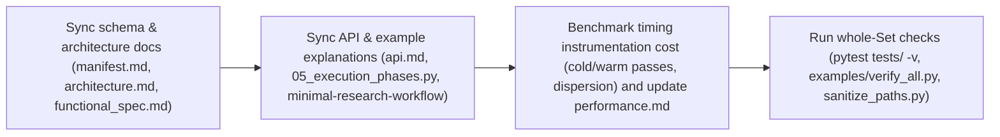

# IPD: Timing Docs Examples Benchmark and Whole-Set Verification

- Date: 2026-11-21
- Kind: child
- Concern: Specification/documentation reconciliation, understandable timing examples, timing-instrumentation cost benchmarking, and whole-Set verification.
- Scope: Reconcile `docs/manifest.md`, `docs/architecture.md`, `docs/functional_spec.md`, `docs/api.md`, and `docs/performance.md`; update `examples/05_execution_phases.py`, `examples/minimal-research-workflow/manifest_excerpt.json`, and `examples/minimal-research-workflow/README.md`; measure timing instrumentation overhead locally and execute whole-Set regression checks.
- Scope-Paths: docs/manifest.md, docs/architecture.md, docs/functional_spec.md, docs/api.md, docs/performance.md, examples/05_execution_phases.py, examples/minimal-research-workflow/manifest_excerpt.json, examples/minimal-research-workflow/README.md
- Item-Dependencies: executed:e1fwy2, executed:8co0wy, executed:vrr1fv
- Status: to-review
- Short-Description: Sync specs, docs, and examples, benchmark timing instrumentation cost, and run whole-Set verification
- Work-Kind: bug
- Priority: high
- From-Backlog: 6hp1zu
- Blocks-Release: next
- Set: timing-acc
- Order: 4
- Highest E allocated: 05
- Author: agent
- Id: 3tvesf

> Write and proofread this plan per the technical writing standard, `.aw/system/workflows/technical-writing/technical-writing.md` (`.agents/workflows/technical-writing/technical-writing.md` in a legacy-layout install), including requirement 12 (diagrams).

## Workflow history

- 2026-11-22 draft (agent): created.
- 2026-11-22 to-review (agent): authored review-ready child plan from backlog item `6hp1zu`.

## Goal

Reconcile all repository specifications, reference docs, and examples with the monotonic timing and overhead-separation contracts introduced by `e1fwy2`, `8co0wy`, and `vrr1fv`, measure and record the timing instrumentation cost itself under documented experimental conditions, and run whole-Set verification across the full test suite, examples, and path sanitizer.

### Documentation, benchmark, and verification pipeline

The text in `## Proposed changes (ordered, validatable)` is normative. This diagram summarizes the work performed in this plan after `e1fwy2`, `8co0wy`, and `vrr1fv` are executed.



## Detailed Implementation Checklist (TODO)

Execution-state rule: mark an `E-*` item complete only after performing the action. That mark is not validation. Right-sizing rule: write for a modest executor that cannot hold much in its head. Each E-item is one step (one concern, about one file, executable in one focused pass) and its V-item names each unit it covers with its own check; a plan stays at about 5 E-items and 8 work Scope-Paths, else split it into more child plans (guidance, `IPD-Z603`). Accepted execution states: blocked, failed, pending, performed; terminal gate demands 'performed'.

### Task group 1: Specification and documentation reconciliation

- [ ] E-01 Update `docs/manifest.md`, `docs/architecture.md`, and `docs/functional_spec.md` to document monotonic durations, non-overlapping versus overlapping intervals, tracked-interval scope (including late imports), `subprocess_record` durations, `phase_end` duration payloads, and legacy v1.0 compatibility.
  - Depends on: none
  - Expected outcome: All three docs remove stale statements claiming `elapsed_seconds = ended_at_utc - started_at_utc`, document every additive `timing` and `subprocesses` field accurately against `schemas/manifest.schema.json`, distinguish POSIX UTC chronology from monotonic durations, explain that overlapping background hardware capture must not be summed with `workload_seconds`, explain that `finalization_overhead_seconds` excludes the final atomic write of `manifest.json`, and follow the repository prose rule (no em or en dashes in user-facing docs).
  - Execution state: pending

- [ ] E-02 Update `docs/api.md` to document `start()`, `stop()`, `phase()`, `tracked_run`, `audit_run`, `pubrun.subprocess.*`, and `pubrun.popen` timing behavior and late-import tracked-interval semantics.
  - Depends on: E-01
  - Expected outcome: `docs/api.md` explains what each timing interval measures, states clearly that importing `pubrun` midway through a script measures the tracked interval rather than full process lifetime, documents `phase_end` monotonic duration payloads (excluding profiler dump I/O), and contains no em or en dashes.
  - Execution state: pending

### Task group 2: Examples, instrumentation benchmark, and whole-Set verification

- [ ] E-03 Update `examples/05_execution_phases.py`, `examples/minimal-research-workflow/manifest_excerpt.json`, and `examples/minimal-research-workflow/README.md` with accurate timing fields and a plain-language explanation of what is measured.
  - Depends on: E-02
  - Expected outcome: `examples/05_execution_phases.py` verifies that each `phase_end` event includes nonnegative monotonic `elapsed_seconds` and `duration_clock == "monotonic"`; `examples/minimal-research-workflow/manifest_excerpt.json` reflects the additive `timing` fields (with redacted/synthetic timestamps); `examples/minimal-research-workflow/README.md` explains what `workload_seconds`, `startup_overhead_seconds`, `finalization_overhead_seconds`, and `elapsed_seconds` measure and notes that late imports record the tracked interval rather than full application lifetime; no em or en dashes appear in user-facing prose.
  - Execution state: pending

- [ ] E-04 Benchmark the timing instrumentation cost locally and document the measurement methodology and findings in `docs/performance.md` without committing unredacted host-identifying result artifacts or publishing external submissions.
  - Depends on: E-03
  - Expected outcome: Run a reproducible local measurement using `benchmarks/harness.py` (with `--passes 3 --iterations 30` or equivalent warm/cold multi-pass run, plus an isolated microbenchmark comparing `time.perf_counter()` bookkeeping cost inside `Run`, `phase()`, and subprocess capture against baseline without timing bookkeeping), record environment (OS, Python version, CPU model/count, filesystem type), git revision, workload, baseline, repetitions, cold versus warm pass distinction, median, and dispersion (standard deviation and interquartile range (IQR)) in this plan's `V-04` evidence and in `docs/performance.md` (making no unmeasured speedup claims and leaving `benchmarks/results/` clean of unredacted files).
  - Execution state: pending

- [ ] E-05 Run whole-Set regression verification across the full test suite, all examples, and the path-sanitizer check, and record the remaining multi-OS/Python CI matrix gate.
  - Depends on: E-04
  - Expected outcome: `pytest tests/ -v`, `python examples/verify_all.py`, and `python3 scripts/sanitize_paths.py --check --all` all exit 0 with full actual runner output pasted into `V-05`; note that `.github/workflows/ci.yml` (Ubuntu/Windows/macOS across Python 3.8 through 3.14) must pass in GitHub Actions before release closure.
  - Execution state: pending

## Project conventions discovered (Step 0)

- `docs/manifest.md`, `docs/architecture.md`, and `docs/functional_spec.md` currently document `elapsed_seconds` as `ended_at_utc - started_at_utc`, which conflicts with monotonic duration semantics after `e1fwy2`.
- `examples/verify_all.py` executes every numbered script (`examples/00_*.py` through `examples/11_*.py`) plus `examples/minimal-research-workflow/analysis.py` and expects exit code 0 for all scripts.
- `scripts/sanitize_paths.py --check --all` is enforced in `.github/workflows/secret-scan.yml` to block machine-local absolute home paths or hostnames from entering tracked files.
- `benchmarks/harness.py` writes unredacted and redacted JSON outputs to `benchmarks/results/` (gitignored except committed sample files); benchmark runs must NEVER publish to GitHub Gists, open issues, or submit scheduler jobs without explicit authorization.
- `AGENTS.md` prohibits em dashes and en dashes in user-facing prose (`docs/`, `README.md`, examples).

## Findings

- **F-01 (Stale timing specifications):** `docs/manifest.md`, `docs/architecture.md`, and `docs/functional_spec.md` explicitly state `elapsed_seconds = ended_at_utc - started_at_utc` and describe `timing` as having only `started_at_utc`, `ended_at_utc`, and `elapsed_seconds`.
- **F-02 (Missing late-import and overlap explanations in docs and examples):** Neither `docs/api.md`, `docs/manifest.md`, nor `examples/minimal-research-workflow/README.md` explains that importing `pubrun` late measures only the tracked interval or that background hardware capture overlaps with workload execution.
- **F-03 (Unmeasured instrumentation cost):** `docs/performance.md` does not yet explain how `pubrun` separates its own startup and finalization overhead from workload timing or report measured timing-instrumentation cost with cold/warm passes and dispersion.

## Proposed changes (ordered, validatable)

1. **`docs/manifest.md`:**
   - Replace the `## timing` table and notes to document `started_at_utc`, `workload_started_at_utc`, `ended_at_utc`, `finalized_at_utc`, `elapsed_seconds`, `workload_seconds`, `startup_overhead_seconds`, `finalization_overhead_seconds`, `session_seconds`, `hardware_wait_seconds`, `background_hardware_seconds`, `duration_clock`, `elapsed_basis`, `interval_scope`, and `capture_state`.
   - Document clearly which intervals are disjoint (`startup_overhead_seconds`, `workload_seconds`, `finalization_overhead_seconds`), which overlap (`background_hardware_seconds` overlaps workload; `hardware_wait_seconds` is a sub-interval of `finalization_overhead_seconds`), that `finalization_overhead_seconds` excludes the final atomic write of `manifest.json`, and how legacy v1.0 manifests (lacking `duration_clock`/`elapsed_basis`) are interpreted and labeled.
   - Update the `## subprocesses` table to document optional `elapsed_seconds`, `duration_clock`, `pid`, and `error`.
2. **`docs/architecture.md` and `docs/functional_spec.md`:**
   - Reconcile timestamp and duration sections (`Timestamp Format`, `Observed vs Derived vs Inferred`, `Events`, `Subprocess Spy`, `Finalization Lifecycle`): UTC epoch floats remain the format for absolute chronology; monotonic clocks (`time.perf_counter()`) produce nonnegative durations; raw monotonic counter readings are never serialized; `phase_end` carries `elapsed_seconds` and `duration_clock`.
3. **`docs/api.md`:**
   - Document `start()`, `stop()`, `phase()`, `tracked_run`, `audit_run`, `pubrun.subprocess.*`, and `pubrun.popen` timing guarantees, including late-import tracked-interval scope and `phase()` profiler-dump exclusion.
4. **`examples/05_execution_phases.py`, `examples/minimal-research-workflow/manifest_excerpt.json`, and `examples/minimal-research-workflow/README.md`:**
   - Extend `examples/05_execution_phases.py` to assert `phase_end` records carry nonnegative `elapsed_seconds` and `duration_clock == "monotonic"`, and print a short explanation of what was measured.
   - Update `examples/minimal-research-workflow/manifest_excerpt.json` to include the new additive `timing` fields (`workload_started_at_utc`, `finalized_at_utc`, `workload_seconds`, `startup_overhead_seconds`, `finalization_overhead_seconds`, `session_seconds`, `hardware_wait_seconds`, `background_hardware_seconds`, `duration_clock`, `elapsed_basis`, `interval_scope`, `capture_state`) with consistent synthetic values.
   - Add a concise "What timing metrics measure" section to `examples/minimal-research-workflow/README.md` explaining tracked workload versus capture overhead, non-additive background capture, and late-import scope.
5. **`docs/performance.md` and local instrumentation benchmark:**
   - Measure the timing instrumentation overhead locally (using `benchmarks/harness.py` for end-to-end startup/feature scenarios plus a focused repeatable timing-bookkeeping microbenchmark comparing tracked `Run`/`phase()`/`SubprocessSpy` with `perf_counter()` instrumentation against baseline), capturing: environment (OS, Python version, CPU model/logical cores, filesystem type (with no personal paths or hostnames), git commit SHA, workload, baseline, repetitions (`N >= 30`), cold versus warm pass comparison (pass 1 vs warmest pass), median, and dispersion (stdev and IQR).
   - Add a concise section in `docs/performance.md` explaining how manifest timing separates workload time from capture overhead and summarizing the measured timing-instrumentation overhead honestly (explicitly scoped to the measured environment and revision, with no unmeasured speedup claims).
   - Remove any temporary unredacted benchmark files created outside gitignored paths so `git status` contains only declared Scope-Paths.
6. **Whole-Set verification:**
   - Run `pytest tests/ -v`, `python examples/verify_all.py`, and `python3 scripts/sanitize_paths.py --check --all`, pasting complete actual outputs and exit codes into `V-05`.
   - Confirm no em dashes (`—`) or en dashes (`–`) were introduced into the modified user-facing docs or examples.

## Deferred / out of scope (with reason)

- Running the GitHub Actions cross-OS/Python matrix (`ubuntu-latest`, `ubuntu-24.04`, `windows-latest`, `macos-latest` across Python 3.8 through 3.14 in `.github/workflows/ci.yml`) requires GitHub Actions runners after PR/push; local execution covers the host OS/Python and records the CI matrix requirement explicitly.
- Publishing benchmark results to GitHub Issues/Gists or running HPC scheduler scripts (`benchmarks/submit_bench*.sh`) is prohibited without explicit authorization.
- Optimizing startup cost (`_resolve_commit()` and config write coalescing) belongs to backlog item `t1xqpw`.

## Scope check

- Over-scope: none. Touches only the five docs files and three example files (8 Scope-Paths, 5 E-items).
- Under-scope: none. Covers documentation sync, example updates, instrumentation benchmarking, and whole-Set verification required by `6hp1zu` and orchestrator `nr63qr`.

## Required tests / validation

Run inside the repository root and capture actual runner output and exit code:

```bash
pytest tests/ -v
python examples/verify_all.py
python3 scripts/sanitize_paths.py --check --all
```

Also run the local timing-instrumentation benchmark (non-publishing, local stdout/temp output only) and paste the measured summary table (environment, revision, workload, baseline, repetitions, cold/warm passes, median, stdev, IQR) into `V-04`.

## Spec / documentation sync

This plan IS the specification, documentation, and example synchronization plan for Set `timing-acc`.

## Open questions

### OQ-01: Where to record single-machine instrumentation benchmark numbers

- Blocking: no
- Status: resolved
- Owner: maintainer (confirmed upon plan approval)
- Resolution or deferral rationale: `docs/performance.md` notes that representative cross-machine numbers live in the aggregated table only after multi-machine collection, while single-machine measurements must be labeled with their exact environment, revision, workload, baseline, repetitions, cold/warm passes, and dispersion. Record the local timing-instrumentation measurement both in `V-04` of this plan and in a clearly scoped, environment-labeled subsection of `docs/performance.md` without overwriting the multi-machine placeholder table or committing host-identifying files.

## Validation and cross-check (verify before reporting done)

Validation-state rule: inspect evidence in a separate pass. Do not mark a `V-*` item complete from memory or from the matching execution checkmark. Accepted validation results: blocked, failed, pass, pending; terminal gate demands 'pass'. Runtime-demonstration reachability rule: for each `V-*` item demanding the software be observed acting (such as a run, a dispatch, or a transition)—as distinct from items demanding a diff, a file's content, or a test result, which are reachable by construction—name the code path that produces the observation or the sibling `E-*` that creates it, else the demand is UNDER-SCOPE.

- [ ] V-01 validates E-01
  - Required evidence: Diff of `docs/manifest.md`, `docs/architecture.md`, and `docs/functional_spec.md` showing reconciled monotonic timing semantics, disjoint vs overlapping interval definitions, legacy compatibility rules, no stale `ended_at_utc - started_at_utc` claims, and zero introduced em/en dashes.
  - Observed evidence:
  - Result: pending

- [ ] V-02 validates E-02
  - Required evidence: Diff of `docs/api.md` showing documented timing behavior for `start()`, `stop()`, `phase()`, `tracked_run`, `audit_run`, `pubrun.subprocess.*`, and `pubrun.popen`, late-import tracked-interval scope, and zero introduced em/en dashes.
  - Observed evidence:
  - Result: pending

- [ ] V-03 validates E-03
  - Required evidence: Diff of `examples/05_execution_phases.py`, `examples/minimal-research-workflow/manifest_excerpt.json`, and `examples/minimal-research-workflow/README.md`, plus pasted `python examples/05_execution_phases.py` output (exit code 0) and schema/JSON parse check on `manifest_excerpt.json`.
  - Observed evidence:
  - Result: pending

- [ ] V-04 validates E-04
  - Required evidence: Pasted local benchmark runner output showing environment, git revision, workload, baseline, repetitions, cold vs warm pass results, median, stdev, and IQR for timing instrumentation overhead, plus diff of `docs/performance.md` recording the scoped measurements without committing unredacted benchmark files or invoking external publication.
  - Observed evidence:
  - Result: pending

- [ ] V-05 validates E-05
  - Required evidence: Pasted runner output and exit code 0 for `pytest tests/ -v`, `python examples/verify_all.py`, and `python3 scripts/sanitize_paths.py --check --all`, plus explicit note of the GitHub Actions OS/Python CI matrix gate required before release closure.
  - Observed evidence:
  - Result: pending

## Approval and execution gate

- Size assessment: standard
- Cohesion rationale: not required

Execution contract:
1. All open questions (OQ-01) are resolved; do not execute until prerequisites `e1fwy2`, `8co0wy`, and `vrr1fv` are `executed` and a human approves this plan (`- Status: approved`).
2. Scope fence: edit only `docs/manifest.md`, `docs/architecture.md`, `docs/functional_spec.md`, `docs/api.md`, `docs/performance.md`, `examples/05_execution_phases.py`, `examples/minimal-research-workflow/manifest_excerpt.json`, and `examples/minimal-research-workflow/README.md`. Do not expand scope; if additional files seem required, STOP and report.
3. Honesty rule: paste actual runner output and exit codes for `pytest`, `examples/verify_all.py`, `scripts/sanitize_paths.py`, and the local timing benchmark into each `V-*` `Observed evidence:` field; never claim results you did not measure or run.
4. Commit discipline: commit only the files listed in `- Scope-Paths:` using `aw commit 3tvesf -- <paths>`; never use `git add -A`, `git add .`, or `git commit -a`; never push without explicit human instruction.
5. Lifecycle move on completion: after `aw ipd lint --phase pre-transition` passes, move this plan from `.aw/records/plans/pending/` to `.aw/records/plans/executed/`, set `- Status: executed`, append a dated `## Workflow history` line, and commit the lifecycle move path-scoped.
