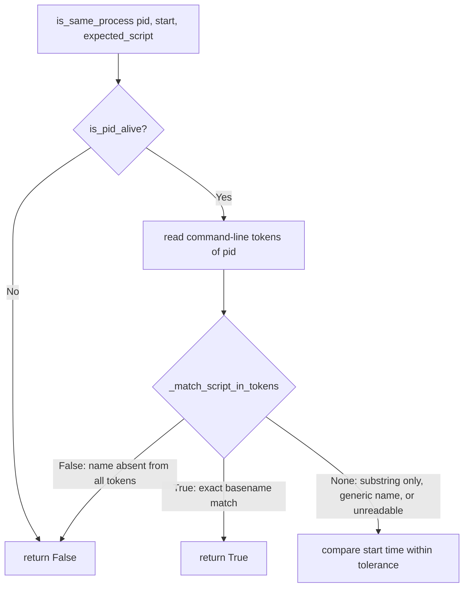

# IPD: Fix TestIsSameProcess.test_expected_script_matches under pytest-xdist

- Date: 2026-11-22
- Kind: child
- Concern: testing (a test that depends on the command line of the pytest process that runs it).
- Scope: Rewrite `TestIsSameProcess.test_expected_script_matches` in `tests/test_liveness.py` so that it checks `pubrun.capture.liveness.is_same_process(..., expected_script=...)` against a short-lived child process that runs a known script, instead of against the current pytest process. No production code changes.
- Scope-Paths: tests/test_liveness.py
- Item-Dependencies: none
- Status: to-review
- Work-Kind: bug
- Priority: low
- From-Backlog: 12rcu8
- Blocks-Release: next
- Set: 12rcu8
- Order: 1
- Highest E allocated: 02
- Author: agent
- Id: 4h2qwz

> Write and proofread this plan per the technical writing standard, `.aw/system/workflows/technical-writing/technical-writing.md` (`.agents/workflows/technical-writing/technical-writing.md` in a legacy-layout install), including requirement 12 (diagrams).

## Workflow history

- 2026-11-23 draft (agent): created.
- 2026-11-23 to-review (agent): authored from backlog item `12rcu8`; failure reproduced in the lane worktree before authoring (see Findings).

## Goal

Make `tests/test_liveness.py::TestIsSameProcess::test_expected_script_matches` pass both in a single-process pytest run and under `pytest-xdist` parallel workers (the plugin that `aw suite` uses to run 6 workers). The test must prove that `is_same_process` returns `True` when the target process command line contains the expected script name, using a process whose command line the test controls.

## Detailed Implementation Checklist (TODO)

Execution-state rule: mark an `E-*` item complete only after performing the action. That mark is not validation. Right-sizing rule: write for a modest executor that cannot hold much in its head. Each E-item is one step (one concern, about one file, executable in one focused pass) and its V-item names each unit it covers with its own check; a plan stays at about 5 E-items and 8 work Scope-Paths, else split it into more child plans (guidance, `IPD-Z603`). Accepted execution states: blocked, failed, pending, performed; terminal gate demands 'performed'.

### Task group 1: Rewrite the test and run it in both modes

- [ ] E-01 In `tests/test_liveness.py`, replace the body of `TestIsSameProcess.test_expected_script_matches` with the child-process version described in "Proposed changes" (P-01). Keep the test name, its class, and its docstring purpose ("If expected_script matches the actual process command line, it matches.").
  - Depends on: none
  - Expected outcome: The test starts a child Python process that runs a script file named `liveness_probe_script.py` in the pytest `tmp_path` directory, waits until the child prints a ready line, asserts `is_same_process(child.pid, time.time(), expected_script="liveness_probe_script.py") is True`, and always stops the child in a `finally` block. The test no longer passes `"pytest"` or `os.getpid()` to `is_same_process`.
  - Execution state: pending
- [ ] E-02 Run the rewritten test in a single process, under `pytest-xdist` with 2 workers, and run the full suite with `aw suite`.
  - Depends on: E-01
  - Expected outcome: All three runs exit 0, and the target test reports `PASSED` (not `SKIPPED`) in the single-process and xdist runs on this Linux host.
  - Execution state: pending

## Project conventions discovered (Step 0)

- Tests live in `tests/` and use plain pytest classes and functions. `tests/test_liveness.py` imports `os`, `sys`, `time`, and `pytest` at module level and imports private helpers (`_PLATFORM`, `_check_command_linux`, `_check_command_macos`, `_check_command_windows`) inside each test body.
- The tests in `TestIsSameProcess` skip with `pytest.skip("Command-line checking is not functional on this platform")` when the platform command-line reader returns `None` for the target PID. The rewritten test keeps that skip, but evaluates it against the child PID.
- `pyproject.toml` sets `addopts = "--cov=src --cov-report=term-missing --cov-report=xml -p no:randomly"`, so every pytest run prints a coverage table before the result line.
- `aw suite` runs the core test tier with a bounded number of `pytest-xdist` workers and refuses narrowed selections (file paths, `-k`, `::` node ids) with exit 2. A narrowed xdist check therefore uses plain `python3 -m pytest ... -n 2`.
- Other tests already start child processes with `subprocess.Popen` (for example `tests/test_status.py` and `tests/test_capture.py`), so starting a child process in a test follows existing practice.
- AGENTS.md forbids tests that read production source code. The rewritten test calls `is_same_process` on a live process and asserts on its return value, which is a behavior test.

## Findings

How `is_same_process` reaches its verdict when `expected_script` is given (from `pubrun.capture.liveness.is_same_process` and `_match_script_in_tokens`):

| ID | Finding | Evidence |
| --- | --- | --- |
| F-01 | The test fails under `pytest-xdist` and passes in a single process. | In the lane worktree on 2026-11-22: `python3 -m pytest tests/test_liveness.py -q -k TestIsSameProcess` printed `6 passed, 21 deselected`. The same command with `-n 2` printed `FAILED tests/test_liveness.py::TestIsSameProcess::test_expected_script_matches` and `1 failed, 5 passed`. Host: Python 3.14.6, `pytest-xdist` 3.8.0. |
| F-02 | Cause: an xdist worker is started as `python -c <execnet bootstrap>`, so its `/proc/<pid>/cmdline` has no token that matches `pytest`. `_check_command_linux(os.getpid(), "pytest")` therefore returns `False` (confirmed mismatch), not `None`. The skip guard only skips on `None`, so the test continues, and `is_same_process` short-circuits to `False` on the mismatch. | Backlog item `12rcu8` Problem section; `pubrun.capture.liveness._match_script_in_tokens` returns `False` "when the script name appears nowhere at all". |
| F-03 | The defect is in the test, not in `is_same_process`. Returning `False` for a process whose command line does not contain the expected script is the intended recycled-PID protection (documented in `_match_script_in_tokens` as IPD 20260705 EC-06). | `_match_script_in_tokens` docstring. |
| F-04 | A child process gives the test a known command line on every platform: `[sys.executable, "<tmp_path>/liveness_probe_script.py"]`. The basename `liveness_probe_script.py` is not in `_GENERIC_SCRIPT_TOKENS` and is longer than 3 characters, so `_script_is_generic` returns `False` and the token match is conclusive. | `pubrun.capture.liveness._script_is_generic`, `_GENERIC_SCRIPT_TOKENS`. |
| F-05 | A ready-line handshake removes a startup race. The child prints one line after it starts; the test reads that line before it checks the PID. The line arrives only after the interpreter has replaced the forked process image, so `/proc/<pid>/cmdline` (Linux) and `ps` or `wmic` output (macOS, Windows) already show the script path. | Design reasoning; no repository evidence is needed. |

## Proposed changes (ordered, validatable)

P-01 (performed by E-01). Rewrite `TestIsSameProcess.test_expected_script_matches` in `tests/test_liveness.py` as follows:

1. Request the `tmp_path` fixture.
2. Write `tmp_path / "liveness_probe_script.py"` with a body that prints `ready`, flushes standard output, and then blocks reading standard input (for example `import sys; print("ready", flush=True); sys.stdin.read()`). Blocking on standard input lets the test stop the child by closing the pipe, and the child cannot outlive the test.
3. Start the child with `subprocess.Popen([sys.executable, str(script)], stdin=subprocess.PIPE, stdout=subprocess.PIPE, text=True)`. Import `subprocess` inside the test body or at module level, matching the file style.
4. In a `try` block:
   - Read one line from `child.stdout` and assert that it equals `"ready"` after stripping.
   - Compute `functional` with the existing `_PLATFORM` branch, but pass `child.pid` and `"liveness_probe_script.py"` instead of `os.getpid()` and `"pytest"`. If `functional` is `False`, call `pytest.skip("Command-line checking is not functional on this platform")`.
   - Assert `is_same_process(child.pid, time.time(), expected_script="liveness_probe_script.py") is True`.
5. In the `finally` block: close `child.stdin`, call `child.wait(timeout=10)`, and call `child.kill()` followed by `child.wait()` if the wait times out. Close `child.stdout`.

The functional check in step 4 must keep the meaning "the platform reader returned a definite answer (`True` or `False`)", that is, `is not None`. With a child that runs the probe script, a working reader returns `True`, so the check no longer confuses "reader works" with "token found".

P-02 (performed by E-02). Run the test in a single process, under `pytest-xdist`, and in the full `aw suite` run. Record the output in V-02.

## Deferred / out of scope (with reason)

- `TestIsSameProcess.test_expected_script_mismatch` and `TestLivenessCharacterization.test_char_absent_script_is_mismatch` use the same `os.getpid()` and `"pytest"` skip guard. Under xdist that guard evaluates to `False is not None`, which is `True`, so these tests run and pass, because they assert a mismatch. They are not failing, and backlog item `12rcu8` names only `test_expected_script_matches`. They are left unchanged.
  - Carrier-Declined: both tests pass under pytest-xdist today because they assert a mismatch, so no defect remains to carry; backlog item 12rcu8 scopes the fix to test_expected_script_matches.
- No change to `src/pubrun/capture/liveness.py`. Finding F-03 shows its behavior is correct.
  - Carrier-Declined: the production behavior is correct (Finding F-03), so no production change is owed.

## Scope check

- Over-scope: none. The plan changes one test function in `tests/test_liveness.py`.
- Under-scope: none. Both backlog acceptance criteria map to work in this plan: passing in both run modes (E-02, V-02) and checking a real process with a known script token (E-01, V-01).

## Required tests / validation

- `python3 -m pytest tests/test_liveness.py -v` exits 0, and `TestIsSameProcess::test_expected_script_matches` reports `PASSED`.
- `python3 -m pytest tests/test_liveness.py -v -n 2` exits 0, and the same test reports `PASSED`.
- `aw suite` exits 0.

## Spec / documentation sync

N/A. The change affects one test and no user-visible behavior, configuration key, command, or API. No spec or documentation describes this test.

## Open questions

### OQ-01: Should the two sibling tests that share the `os.getpid()` and `"pytest"` guard also move to the child-process pattern?

- Blocking: no
- Status: resolved
- Owner: none
- Resolution or deferral rationale: No. Both tests pass under pytest-xdist today because they assert a mismatch (see "Deferred / out of scope"), and backlog item `12rcu8` scopes the fix to `test_expected_script_matches`. This plan changes only that test.
  - Carrier-Declined: no defect remains in the sibling tests, so no follow-up work is owed.

## Validation and cross-check (verify before reporting done)

Validation-state rule: inspect evidence in a separate pass. Do not mark a `V-*` item complete from memory or from the matching execution checkmark. Accepted validation results: blocked, failed, pass, pending; terminal gate demands 'pass'. Runtime-demonstration reachability rule: for each `V-*` item demanding the software be observed acting (such as a run, a dispatch, or a transition)—as distinct from items demanding a diff, a file's content, or a test result, which are reachable by construction—name the code path that produces the observation or the sibling `E-*` that creates it, else the demand is UNDER-SCOPE.

- [ ] V-01 validates E-01
  - Required evidence: Paste `git diff -- tests/test_liveness.py`. The diff must show that `test_expected_script_matches` starts a child with `subprocess.Popen` running `liveness_probe_script.py` from `tmp_path`, reads a `ready` line before checking, passes `child.pid` to both the functional check and `is_same_process(..., expected_script="liveness_probe_script.py")`, and stops the child in a `finally` block. The diff must not contain `expected_script="pytest"` inside `test_expected_script_matches`, and must change no other test function.
  - Observed evidence:
  - Result: pending
- [ ] V-02 validates E-02
  - Required evidence: Paste the tail of each run, including the result line and the line for `test_expected_script_matches`: (1) `python3 -m pytest tests/test_liveness.py -v` shows `test_expected_script_matches PASSED` and exits 0; (2) `python3 -m pytest tests/test_liveness.py -v -n 2` shows `test_expected_script_matches PASSED` and exits 0; (3) `aw suite` exits 0 with no failures. A `SKIPPED` result for the target test on this Linux host fails this item, because it means the child-process check did not run.
  - Observed evidence:
  - Result: pending

## Approval and execution gate

- Size assessment: standard
- Cohesion rationale: not required

A human must approve this plan before execution. The executor changes only `tests/test_liveness.py`, commits through `aw commit <this plan> -- tests/test_liveness.py`, and does not push. After every `E-*` item is `performed` and every `V-*` item is `pass` with pasted evidence, the executor runs `aw ipd lint --phase pre-transition` on this plan. Only when it conforms does the executor perform the lifecycle move of this plan to `.aw/records/plans/executed/`, as defined in `.aw/system/workflows/ipd-lifecycle/ipd-lifecycle.md`.
