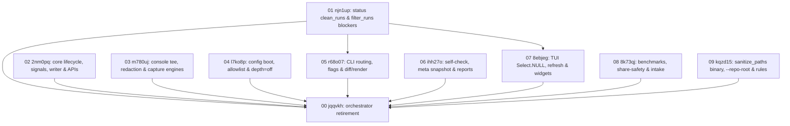

# IPD: Bugs and correctness audit remediation

- Date: 2026-11-22
- Kind: orchestrator
- Concern: Bugs and correctness audit across the pubrun package, command-line interface, Terminal User Interface, benchmarks, intake scripts, and repository path-sanitizer tooling.
- Scope: Whole repository substance (`src/pubrun/`, `benchmarks/`, `scripts/sanitize_paths.py`, `.github/scripts/`, and additive documentation sync in `docs/cli.md`, `docs/functional_spec.md`, and `docs/configuration.md`), excluding `.aw/` workflow infrastructure and work already owned by the 6 pending IPD Sets (`file-prov`, `repro-check`, `startup-perf`, `cap-isolation`, `dep-capture`, `timing-acc`).
- Scope-Paths: .aw/records/plans/pending/20261122-bugs-audit-00-jqqvkh-bugs-and-correctness-audit-remediation.ipd.md
- Item-Dependencies: executed:njn1up, executed:2nm0pq, executed:m780uj, executed:l7ko8p, executed:r68o07, executed:ihh27o, executed:8ebjeg, executed:8k73qj, executed:kqzd15
- Status: reviewed
- Readiness: go-pending-approval
- Review-Depth: orchestrator
- Coverage: pass
- Coverage-Fingerprint: beae1eeb107a7351ca7e6a301def297168adcd50c4b06b4420b7409daa6beb5e
- Coverage-Checked: 2026-11-22 by uri/its_direct/pt3-claude-opus-5.5-1m-us
- Short-Description: Orchestrate remediation of 69 active bugs (71 audited, 2 retired as already fixed) across 9 reviewed child plans
- Work-Kind: bug
- Priority: high
- Blocks-Release: next
- Set: bugs-audit
- Order: 0
- Highest E allocated: 09
- Author: Antigravity
- Id: jqqvkh

> Write and proofread this plan per the technical writing standard, `.aw/system/workflows/technical-writing/technical-writing.md`, including requirement 12 (diagrams).

## Workflow history

- 2026-11-22 coverage pass (aw oc run): fingerprint beae1eeb107a, model uri/its_direct/pt3-claude-opus-5.5-1m-us
- 2026-11-22 coverage fail (aw oc run): fingerprint 7e832cc9ba0a, model uri/its_direct/pt3-claude-opus-5.5-1m-us
- 2026-11-22 /plan-review (Gemini 4 Neon (High)): APPROVE WITH REVISIONS APPLIED; PR-001, PR-002, PR-003
- 2026-11-22 coverage pass (aw oc run): fingerprint b0cb0e4e7b90, model uri/its_direct/pt3-claude-opus-5.5-1m-us
- 2026-11-22 coverage pass (aw oc run): fingerprint 970a8bab59f0, model uri/its_direct/pt3-claude-opus-5.5-1m-us
- 2026-11-22 coverage pass (aw oc run): fingerprint 7787f4e5a6cb, model uri/its_direct/pt3-claude-opus-5.5-1m-us
- 2026-11-22 coverage pass (aw oc run): fingerprint e4559f47f333, model uri/its_direct/pt3-claude-opus-5.5-1m-us
- 2026-11-22 to-review (Antigravity): populated 9 child plans covering the `/assess-bugs` findings with zero silent deferrals.
- 2026-11-22 draft (Antigravity): created from `/assess-bugs` full-project audit.

## Goal

Remediate all 69 active correctness, data-loss, privacy-leak, crash, and tooling findings from the `/assess-bugs` audit (out of 71 audited `BUG-*` IDs, with `BUG-57` and `BUG-59` verified already fixed in `HEAD` and retired inside `kqzd15`, and `BUG-13` verified already fixed on `main` and retained as a regression guard in `8ebjeg`). Coordinate execution through 9 reviewed child Implementation Plan Documents (IPDs) with disjoint production code scopes (and serialized additive `docs/cli.md` edits from `njn1up` to `r68o07`), gating the `1.4.0` (`next`) release.

### Set dependency architecture

## Detailed Implementation Checklist (TODO)

Execution-state rule: mark an `E-*` item complete only after performing the action. That mark is not validation. Accepted execution states: blocked, failed, pending, performed; terminal gate demands 'performed'.

### Task group 1: Child plan execution confirmation

- [ ] E-01 CONFIRM njn1up REACHED executed
  - Depends on: none
  - Expected outcome: `.aw/records/plans/executed/20261122-bugs-audit-01-njn1up-fix-status-clean-runs-and-filter-runs-data-loss-and-closeout.ipd.md` exists with `- Status: executed`, all `E-*` items `performed`, and all `V-*` items `pass`.
  - Execution state: pending

- [ ] E-02 CONFIRM 2nm0pq REACHED executed
  - Depends on: none
  - Expected outcome: `.aw/records/plans/executed/20261122-bugs-audit-02-2nm0pq-fix-core-lifecycle-exit-recording-signal-deadlock-and-writer.ipd.md` exists with `- Status: executed`, all `E-*` items `performed`, and all `V-*` items `pass`.
  - Execution state: pending

- [ ] E-03 CONFIRM m780uj REACHED executed
  - Depends on: none
  - Expected outcome: `.aw/records/plans/executed/20261122-bugs-audit-03-m780uj-fix-console-tee-redaction-subprocess-spy-and-capture-engine.ipd.md` exists with `- Status: executed`, all `E-*` items `performed`, and all `V-*` items `pass`.
  - Execution state: pending

- [ ] E-04 CONFIRM l7ko8p REACHED executed
  - Depends on: none
  - Expected outcome: `.aw/records/plans/executed/20261122-bugs-audit-04-l7ko8p-fix-config-boot-discovery-and-capture-mode-or-depth-enforcem.ipd.md` exists with `- Status: executed`, all `E-*` items `performed`, and all `V-*` items `pass`.
  - Execution state: pending

- [ ] E-05 CONFIRM r68o07 REACHED executed
  - Depends on: E-01
  - Expected outcome: `.aw/records/plans/executed/20261122-bugs-audit-05-r68o07-fix-cli-subcommand-routing-argument-handling-and-diff-or-ren.ipd.md` exists with `- Status: executed`, all `E-*` items `performed`, and all `V-*` items `pass`.
  - Execution state: pending

- [ ] E-06 CONFIRM ihh27o REACHED executed
  - Depends on: none
  - Expected outcome: `.aw/records/plans/executed/20261122-bugs-audit-06-ihh27o-fix-self-check-meta-snapshot-and-report-rendering-bugs.ipd.md` exists with `- Status: executed`, all `E-*` items `performed`, and all `V-*` items `pass`.
  - Execution state: pending

- [ ] E-07 CONFIRM 8ebjeg REACHED executed
  - Depends on: E-01
  - Expected outcome: `.aw/records/plans/executed/20261122-bugs-audit-07-8ebjeg-fix-tui-widget-crashes-select-null-handling-and-sidebar-refr.ipd.md` exists with `- Status: executed`, all `E-*` items `performed`, and all `V-*` items `pass`.
  - Execution state: pending

- [ ] E-08 CONFIRM 8k73qj REACHED executed
  - Depends on: none
  - Expected outcome: `.aw/records/plans/executed/20261122-bugs-audit-08-8k73qj-fix-benchmark-redaction-intake-validation-and-aggregation-bu.ipd.md` exists with `- Status: executed`, all `E-*` items `performed`, and all `V-*` items `pass`.
  - Execution state: pending

- [ ] E-09 CONFIRM kqzd15 REACHED executed
  - Depends on: none
  - Expected outcome: `.aw/records/plans/executed/20261122-bugs-audit-09-kqzd15-fix-sanitizer-script-build-hook-and-benchmark-hotpath-worklo.ipd.md` exists with `- Status: executed`, all `E-*` items `performed`, and all `V-*` items `pass`.
  - Execution state: pending

## Child IPDs, sequence, and dependencies

| Order | Id | File | What it does | Depends on |
|---|---|---|---|---|
| 01 | `njn1up` | `20261122-bugs-audit-01-njn1up-fix-status-clean-runs-and-filter-runs-data-loss-and-closeout.ipd.md` | Fixes `BUG-01`, `BUG-02` (Blocker data loss in `clean_runs` and `filter_runs`), `BUG-41`, `BUG-60`, `BUG-67` in `src/pubrun/status.py`, plus additive `--older-than` doc sync in `docs/cli.md` (`clean` row) and `docs/functional_spec.md`. | none |
| 02 | `2nm0pq` | `20261122-bugs-audit-02-2nm0pq-fix-core-lifecycle-exit-recording-signal-deadlock-and-writer.ipd.md` | Fixes `BUG-03`, `BUG-06`, `BUG-07`, `BUG-08`, `BUG-09`, `BUG-10`, `BUG-29`, `BUG-30`, `BUG-31`, `BUG-32`, `BUG-33`, `BUG-34`, `BUG-60a` across `tracker.py`, `signals.py`, `writer.py`, `core.py`, `events.py`. | none |
| 03 | `m780uj` | `20261122-bugs-audit-03-m780uj-fix-console-tee-redaction-subprocess-spy-and-capture-engine.ipd.md` | Fixes `BUG-04`, `BUG-05`, `BUG-28`, `BUG-35`, `BUG-36`, `BUG-37`, `BUG-38`, `BUG-61`, `BUG-62` across `console.py`, `redaction.py`, `subprocesses.py`, `filesystem.py`, `resources.py`, `liveness.py`, `hardware.py`. | none |
| 04 | `l7ko8p` | `20261122-bugs-audit-04-l7ko8p-fix-config-boot-discovery-and-capture-mode-or-depth-enforcem.ipd.md` | Fixes `BUG-39`, `BUG-40`, `BUG-63` across `_config_boot.py`, `config.py`, capture collectors (`environment.py`, `git.py`, `host.py`, `process.py`, `python_runtime.py`), `default.toml`, and `docs/configuration.md` (`[capture.environment].allowlist = []`, per resolved `OQ-01`). | none |
| 05 | `r68o07` | `20261122-bugs-audit-05-r68o07-fix-cli-subcommand-routing-argument-handling-and-diff-or-ren.ipd.md` | Fixes `BUG-11`, `BUG-12`, `BUG-42`, `BUG-43`, `BUG-44`, `BUG-45`, `BUG-50`, `BUG-64`, `BUG-66`, `BUG-67a`, `BUG-68` across `__main__.py`, `analysis/diff.py`, `analysis/render.py`, catches `ValueError` from `filter_runs`/`clean_runs`, and syncs `show` defaults in `docs/cli.md`. | 01 |
| 06 | `ihh27o` | `20261122-bugs-audit-06-ihh27o-fix-self-check-meta-snapshot-and-report-rendering-bugs.ipd.md` | Fixes `BUG-16`, `BUG-17`, `BUG-46`, `BUG-47`, `BUG-48`, `BUG-49`, `BUG-64a`, `BUG-65` across `report/checks.py`, `report/meta_snapshot.py`, `report/diagnostics.py`, `report/methods.py`, `report/utils.py`. | none |
| 07 | `8ebjeg` | `20261122-bugs-audit-07-8ebjeg-fix-tui-widget-crashes-select-null-handling-and-sidebar-refr.ipd.md` | Fixes `BUG-14`, `BUG-15`, `BUG-51`, `BUG-52`, `BUG-53` across `tui/app.py` and `tui/widgets/{actions,config,diff,details,viewer}.py`, preserves and regression-guards already-fixed `BUG-13` (`ActionsPanel.rerun_command`), and handles `ValueError` from `clean_runs` in Bulk Prune. | 01 |
| 08 | `8k73qj` | `20261122-bugs-audit-08-8k73qj-fix-benchmark-redaction-intake-validation-and-aggregation-bu.ipd.md` | Fixes `BUG-18`, `BUG-19`, `BUG-20`, `BUG-21`, `BUG-22`, `BUG-23`, `BUG-24`, `BUG-54`, `BUG-55`, `BUG-56` across `benchmarks/{harness,share_safety,aggregate,pull_submissions}.py` and `.github/scripts/{extract_attachment_url,validate_benchmark_submission}.py`. | none |
| 09 | `kqzd15` | `20261122-bugs-audit-09-kqzd15-fix-sanitizer-script-build-hook-and-benchmark-hotpath-worklo.ipd.md` | Fixes `BUG-25`, `BUG-26`, `BUG-27`, `BUG-58` in `scripts/sanitize_paths.py` (retiring `BUG-57` and `BUG-59` as already fixed in `HEAD` by executed plans `4gpguy` and `4il383`). | none |

## Completion criteria (the whole Set is done only when)

- Both Blocker data-loss bugs in `status.clean_runs` and `status.filter_runs`, crashed-run closeout/display defects, and `--older-than` documentation sync are fixed and regression-tested. Owner: `njn1up`
- Core lifecycle outcome/exit recording, signal deadlock prevention, atomic writer serialization, `python -m` auto-start, and public `core.py` / `events.py` Application Programming Interfaces (APIs) are fixed and regression-tested. Owner: `2nm0pq`
- Console tee carriage-return/line-feed (CRLF) preservation, redaction heuristics/argv handling, subprocess wait-status decoding, mount precedence, Linux thread-child resources, liveness matching, and Graphics Processing Unit (GPU) capture are fixed and regression-tested. Owner: `m780uj`
- Boot-time config discovery, non-mutating config resolution, `[capture.environment].mode = "allowlist"` with `[capture.environment].allowlist = []` (including `default.toml` and `docs/configuration.md`), and per-collector `depth = "off"` handling are fixed and regression-tested. Owner: `l7ko8p`
- Command-line interface (CLI) subcommand routing, exit codes, `show`/`combined`/`diff`/`bench` argument handling, hashed-redaction diffs, path/table/array rendering, and `docs/cli.md` `show` documentation are fixed and regression-tested. Owner: `r68o07`
- `self-check` malformed Tom's Obvious Minimal Language (TOML) detection, `meta` depth mapping, Sun Grid Engine (SGE)/Portable Batch System (PBS) check precedence, multi-mount findings, Resident Set Size (RSS) labeling, null Central Processing Unit (CPU) formatting, and manifest `"host"` hydration are fixed and regression-tested. Owner: `ihh27o`
- Terminal User Interface (TUI) `Select.NULL` handling (without matching `Widget.BLANK = False`), `RefreshSidebar` delivery, GPU model display, diff blank-depth fallback and post-clear hydration warnings, degraded-run deletion, `ActionsPanel.rerun_command` preservation, and Bulk Prune `ValueError` handling are fixed and regression-tested. Owner: `8ebjeg`
- Benchmark `share_safety` `None` handling, Slurm node/job redaction, safe Personally Identifiable Information (PII) scrubbing, intake Uniform Resource Locator (URL)/schema/Not a Number (NaN) safety, corpus-safe aggregation, and idempotent `pull_submissions` are fixed and regression-tested. Owner: `8k73qj`
- `scripts/sanitize_paths.py` binary, `--repo-root`, staged `--fix`, `glob`, `home-user`, and Internet Protocol version 6 (IPv6) defects are fixed and regression-tested (with `BUG-57` and `BUG-59` verified already fixed by executed plans `4gpguy` and `4il383`). Owner: `kqzd15`

## Cross-IPD validation

- `njn1up` `filter_runs` and `clean_runs` `ValueError` and `d`/`h`/`m`/`s` duration contract is consumed cleanly without uncaught tracebacks across all filter-capable CLI commands (verified by `r68o07`) and TUI Bulk Prune (verified by `8ebjeg`), and serialized `docs/cli.md` updates remain disjoint (`njn1up` `clean` row before `r68o07` `methods`/`show` lines; verified by `njn1up` and `r68o07`).
- `r68o07`'s additive `path_split` keys (`order_changed`, `old`, `new`) preserve backwards compatibility with existing diff consumers including `src/pubrun/tui/widgets/diff.py::DiffView` (verified by `r68o07` and `8ebjeg` via their regression suites and full `pytest -q`).
- `l7ko8p`'s maintainer-approved `[capture.environment].allowlist = []` contract (`OQ-01`) is enforced and documented consistently across `src/pubrun/resources/default.toml`, `docs/configuration.md`, and `src/pubrun/capture/environment.py` (verified by `l7ko8p`).
- Full `pytest -q` regression suite passes after each child's changes without breaking existing tests across the repository (verified independently in each child plan `njn1up`, `2nm0pq`, `m780uj`, `l7ko8p`, `r68o07`, `ihh27o`, `8ebjeg`, `8k73qj`, and `kqzd15`).
- `python3 scripts/sanitize_paths.py --check --all` exits 0 after sanitizer rule fixes (verified by `kqzd15`).

## Deferred / out of scope (with reason)

- `BUG-59` (`scripts/update_commit_file.py`, `hatch_build.py`, `pyproject.toml`): already fixed in `HEAD` by commit `44cee0a` and retired in `kqzd15`.
  - Carrier-Evidence: .aw/records/plans/executed/20261121-startup-perf-02-4il383-build-stamped-and-deferred-commit-identity-resolution.ipd.md
- `BUG-57` (`benchmarks/scenarios.py`, `benchmarks/workloads/file_read.py` `hotpath-open-pubrun`): already fixed in `HEAD` by commit `c7cc2db` and retired in `kqzd15`.
  - Carrier-Evidence: .aw/records/plans/executed/20261121-file-prov-05-4gpguy-external-file-example-stat-vs-hash-benchmarks-docs-sync-and.ipd.md

## Scope check

- Over-scope: none. Every child plan targets confirmed defects verified against `HEAD` during `/plan-review`. Work already owned by the 6 existing pending IPD Sets (`file-prov`, `repro-check`, `startup-perf`, `cap-isolation`, `dep-capture`, `timing-acc`), `.aw/` workflow infrastructure, and already-fixed items `BUG-57` and `BUG-59` is excluded from this Set.
- Under-scope: none. All 71 audited `BUG-*` IDs (`BUG-01`..`BUG-68`, `BUG-60a`, `BUG-64a`, `BUG-67a`) are accounted for across the 9 reviewed child plans (`njn1up` through `kqzd15`: 69 active findings plus `BUG-57` and `BUG-59` retired with `Carrier-Evidence`). Production code scopes across all 9 children are disjoint, and the shared `docs/cli.md` file is serialized via `executed:njn1up` on `r68o07` across disjoint sections.

## Required tests / validation

This orchestrator plan runs no application tests directly. Each child plan (`njn1up`, `2nm0pq`, `m780uj`, `l7ko8p`, `r68o07`, `ihh27o`, `8ebjeg`, `8k73qj`, `kqzd15`) executes its targeted regression test module plus the full `pytest -q` suite (and `kqzd15` also runs `python3 scripts/sanitize_paths.py --check --all`, while `njn1up`, `l7ko8p`, and `r68o07` verify zero newly added em/en dashes in their doc diffs) and records actual command output in its own `V-*` items.

## Open questions

None. Child plan `l7ko8p` `OQ-01` (`[capture.environment].allowlist = []`) was resolved by the maintainer on 2026-11-22, and child plan `kqzd15` `OQ-01` (`hotpath-open-pubrun`) was resolved as superseded by executed plan `4gpguy`. All 9 child plans carry `- Status: reviewed` and `- Readiness: go-pending-approval` with zero open blocking questions.

## Validation and cross-check (verify before reporting the Set complete)

Validation-state rule: inspect evidence in a separate pass. Do not mark a `V-*` item complete from memory or from the matching execution checkmark. Accepted validation results: blocked, failed, pass, pending; terminal gate demands 'pass'.

- [ ] V-01 validates E-01
  - Required evidence: Path `.aw/records/plans/executed/20261122-bugs-audit-01-njn1up-fix-status-clean-runs-and-filter-runs-data-loss-and-closeout.ipd.md` exists, shows `- Status: executed`, has all `E-*` items `performed` and all `V-*` items `pass`, and `aw ipd lint --phase post-transition` exits 0 on it.
  - Observed evidence:
  - Result: pending

- [ ] V-02 validates E-02
  - Required evidence: Path `.aw/records/plans/executed/20261122-bugs-audit-02-2nm0pq-fix-core-lifecycle-exit-recording-signal-deadlock-and-writer.ipd.md` exists, shows `- Status: executed`, has all `E-*` items `performed` and all `V-*` items `pass`, and `aw ipd lint --phase post-transition` exits 0 on it.
  - Observed evidence:
  - Result: pending

- [ ] V-03 validates E-03
  - Required evidence: Path `.aw/records/plans/executed/20261122-bugs-audit-03-m780uj-fix-console-tee-redaction-subprocess-spy-and-capture-engine.ipd.md` exists, shows `- Status: executed`, has all `E-*` items `performed` and all `V-*` items `pass`, and `aw ipd lint --phase post-transition` exits 0 on it.
  - Observed evidence:
  - Result: pending

- [ ] V-04 validates E-04
  - Required evidence: Path `.aw/records/plans/executed/20261122-bugs-audit-04-l7ko8p-fix-config-boot-discovery-and-capture-mode-or-depth-enforcem.ipd.md` exists, shows `- Status: executed`, has all `E-*` items `performed` and all `V-*` items `pass`, and `aw ipd lint --phase post-transition` exits 0 on it.
  - Observed evidence:
  - Result: pending

- [ ] V-05 validates E-05
  - Required evidence: Path `.aw/records/plans/executed/20261122-bugs-audit-05-r68o07-fix-cli-subcommand-routing-argument-handling-and-diff-or-ren.ipd.md` exists, shows `- Status: executed`, has all `E-*` items `performed` and all `V-*` items `pass`, and `aw ipd lint --phase post-transition` exits 0 on it.
  - Observed evidence:
  - Result: pending

- [ ] V-06 validates E-06
  - Required evidence: Path `.aw/records/plans/executed/20261122-bugs-audit-06-ihh27o-fix-self-check-meta-snapshot-and-report-rendering-bugs.ipd.md` exists, shows `- Status: executed`, has all `E-*` items `performed` and all `V-*` items `pass`, and `aw ipd lint --phase post-transition` exits 0 on it.
  - Observed evidence:
  - Result: pending

- [ ] V-07 validates E-07
  - Required evidence: Path `.aw/records/plans/executed/20261122-bugs-audit-07-8ebjeg-fix-tui-widget-crashes-select-null-handling-and-sidebar-refr.ipd.md` exists, shows `- Status: executed`, has all `E-*` items `performed` and all `V-*` items `pass`, and `aw ipd lint --phase post-transition` exits 0 on it.
  - Observed evidence:
  - Result: pending

- [ ] V-08 validates E-08
  - Required evidence: Path `.aw/records/plans/executed/20261122-bugs-audit-08-8k73qj-fix-benchmark-redaction-intake-validation-and-aggregation-bu.ipd.md` exists, shows `- Status: executed`, has all `E-*` items `performed` and all `V-*` items `pass`, and `aw ipd lint --phase post-transition` exits 0 on it.
  - Observed evidence:
  - Result: pending

- [ ] V-09 validates E-09
  - Required evidence: Path `.aw/records/plans/executed/20261122-bugs-audit-09-kqzd15-fix-sanitizer-script-build-hook-and-benchmark-hotpath-worklo.ipd.md` exists, shows `- Status: executed`, has all `E-*` items `performed` and all `V-*` items `pass`, and `aw ipd lint --phase post-transition` exits 0 on it.
  - Observed evidence:
  - Result: pending

## Approval and execution gate

- Size assessment: standard
- Cohesion rationale: not required

This orchestrator plan coordinates Set `bugs-audit` (`njn1up`, `2nm0pq`, `m780uj`, `l7ko8p`, `r68o07`, `ihh27o`, `8ebjeg`, `8k73qj`, `kqzd15`) and executes no application code directly.

Execution contract:
1. Precondition: wait for human approval (`- Status: approved`) of this orchestrator and its child plans with no unresolved `Blocking: yes` open questions before execution begins.
2. Scope declaration: this orchestrator declares only its own plan file as `- Scope-Paths:` for lifecycle retirement; it executes no application code and adds no non-confirmation checklist items.
3. Validation honesty (HARD MUST): confirm child completion only by inspecting the executed child plan files on disk and running `aw ipd lint --phase post-transition`, pasting actual runner output and exit codes into each `V-*` `Observed evidence:` field; never claim a child reached `executed` without verifying its file state.
4. Commit and push discipline: retire this orchestrator via `aw commit` path-scoped to its moved plan file (or let the `aw` runner retire it); never use `git add -A`, `git add .`, or `git commit -a`; never push without explicit human instruction.
5. Lifecycle transition on completion: once all nine child plans (`njn1up`, `2nm0pq`, `m780uj`, `l7ko8p`, `r68o07`, `ihh27o`, `8ebjeg`, `8k73qj`, `kqzd15`) reach `executed` on disk, this orchestrator must reach `.aw/records/plans/executed/` with `- Status: executed` through `aw ipd finalize`. Under an `aw` runner, the runner automatically retires the orchestrator once every child is `executed` and coverage passes; in standalone execution, run `aw ipd finalize jqqvkh` directly. Never hand-roll a raw `git mv` to `.aw/records/plans/executed/`.
