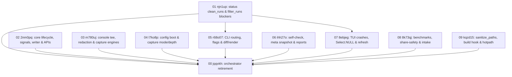

# IPD: Bugs and correctness audit remediation

- Date: 2026-11-22
- Kind: orchestrator
- Concern: Bugs and correctness audit across the pubrun package, CLI, TUI, benchmarks, intake scripts, and repository tooling.
- Scope: Whole repository substance (`src/pubrun/`, `benchmarks/`, `scripts/`, `.github/scripts/`, `hatch_build.py`, `pyproject.toml`), excluding `.aw/` workflow infrastructure and work already owned by the 6 pending IPD Sets (`file-prov`, `repro-check`, `startup-perf`, `cap-isolation`, `dep-capture`, `timing-acc`).
- Scope-Paths: .aw/records/plans/pending/20261122-bugs-audit-00-jqqvkh-bugs-and-correctness-audit-remediation.ipd.md
- Item-Dependencies: executed:njn1up, executed:2nm0pq, executed:m780uj, executed:l7ko8p, executed:r68o07, executed:ihh27o, executed:8ebjeg, executed:8k73qj, executed:kqzd15
- Status: to-review
- Coverage: pass
- Coverage-Fingerprint: b0cb0e4e7b902954bc2476b67efab8e32597e188def94b589b137e9ccbe7a7ae
- Coverage-Checked: 2026-11-22 by uri/its_direct/pt3-claude-opus-5.5-1m-us
- Short-Description: Orchestrate remediation of 69 confirmed bugs found by /assess-bugs across 9 disjoint child plans
- Work-Kind: bug
- Priority: high
- Blocks-Release: next
- Set: bugs-audit
- Order: 0
- Highest E allocated: 09
- Author: Antigravity
- Id: jqqvkh

> Write and proofread this plan per the technical writing standard, `.aw/system/workflows/technical-writing/technical-writing.md`, including requirement 12 (diagrams).

## Workflow history

- 2026-11-22 coverage pass (aw oc run): fingerprint b0cb0e4e7b90, model uri/its_direct/pt3-claude-opus-5.5-1m-us
- 2026-11-22 coverage pass (aw oc run): fingerprint 970a8bab59f0, model uri/its_direct/pt3-claude-opus-5.5-1m-us
- 2026-11-22 coverage pass (aw oc run): fingerprint 7787f4e5a6cb, model uri/its_direct/pt3-claude-opus-5.5-1m-us
- 2026-11-22 coverage pass (aw oc run): fingerprint e4559f47f333, model uri/its_direct/pt3-claude-opus-5.5-1m-us
- 2026-11-22 draft (Antigravity): created from `/assess-bugs` full-project audit.
- 2026-11-22 to-review (Antigravity): populated 9 disjoint child plans covering all 69 confirmed bugs with zero silent deferrals.

## Goal

Remediate all 69 confirmed correctness, data-loss, privacy-leak, crash, and tooling bugs discovered by `/assess-bugs` through 9 right-sized child plans with completely disjoint file scopes, gating the `1.4.0` (`next`) release.

### Set dependency architecture

## Detailed Implementation Checklist (TODO)

Execution-state rule: mark an `E-*` item complete only after performing the action. That mark is not validation. Accepted execution states: blocked, failed, pending, performed; terminal gate demands 'performed'.

### Task group 1: Child plan execution confirmation

- [ ] E-01 CONFIRM njn1up REACHED executed
  - Depends on: none
  - Expected outcome: `.aw/records/plans/executed/20261122-bugs-audit-01-njn1up-fix-status-clean-runs-and-filter-runs-data-loss-and-closeout.ipd.md` exists with `- Status: executed` and all V-items passing.
  - Execution state: pending

- [ ] E-02 CONFIRM 2nm0pq REACHED executed
  - Depends on: none
  - Expected outcome: `.aw/records/plans/executed/20261122-bugs-audit-02-2nm0pq-fix-core-lifecycle-exit-recording-signal-deadlock-and-writer.ipd.md` exists with `- Status: executed` and all V-items passing.
  - Execution state: pending

- [ ] E-03 CONFIRM m780uj REACHED executed
  - Depends on: none
  - Expected outcome: `.aw/records/plans/executed/20261122-bugs-audit-03-m780uj-fix-console-tee-redaction-subprocess-spy-and-capture-engine.ipd.md` exists with `- Status: executed` and all V-items passing.
  - Execution state: pending

- [ ] E-04 CONFIRM l7ko8p REACHED executed
  - Depends on: none
  - Expected outcome: `.aw/records/plans/executed/20261122-bugs-audit-04-l7ko8p-fix-config-boot-discovery-and-capture-mode-or-depth-enforcem.ipd.md` exists with `- Status: executed` and all V-items passing.
  - Execution state: pending

- [ ] E-05 CONFIRM r68o07 REACHED executed
  - Depends on: E-01
  - Expected outcome: `.aw/records/plans/executed/20261122-bugs-audit-05-r68o07-fix-cli-subcommand-routing-argument-handling-and-diff-or-ren.ipd.md` exists with `- Status: executed` and all V-items passing.
  - Execution state: pending

- [ ] E-06 CONFIRM ihh27o REACHED executed
  - Depends on: none
  - Expected outcome: `.aw/records/plans/executed/20261122-bugs-audit-06-ihh27o-fix-self-check-meta-snapshot-and-report-rendering-bugs.ipd.md` exists with `- Status: executed` and all V-items passing.
  - Execution state: pending

- [ ] E-07 CONFIRM 8ebjeg REACHED executed
  - Depends on: E-01
  - Expected outcome: `.aw/records/plans/executed/20261122-bugs-audit-07-8ebjeg-fix-tui-widget-crashes-select-null-handling-and-sidebar-refr.ipd.md` exists with `- Status: executed` and all V-items passing.
  - Execution state: pending

- [ ] E-08 CONFIRM 8k73qj REACHED executed
  - Depends on: none
  - Expected outcome: `.aw/records/plans/executed/20261122-bugs-audit-08-8k73qj-fix-benchmark-redaction-intake-validation-and-aggregation-bu.ipd.md` exists with `- Status: executed` and all V-items passing.
  - Execution state: pending

- [ ] E-09 CONFIRM kqzd15 REACHED executed
  - Depends on: none
  - Expected outcome: `.aw/records/plans/executed/20261122-bugs-audit-09-kqzd15-fix-sanitizer-script-build-hook-and-benchmark-hotpath-worklo.ipd.md` exists with `- Status: executed` and all V-items passing.
  - Execution state: pending

## Child IPDs, sequence, and dependencies

| Order | Id | File | What it does | Depends on |
|---|---|---|---|---|
| 01 | `njn1up` | `20261122-bugs-audit-01-njn1up-fix-status-clean-runs-and-filter-runs-data-loss-and-closeout.ipd.md` | Fixes `BUG-01`, `BUG-02` (Blocker data loss in `clean_runs` / `filter_runs`), `BUG-41`, `BUG-60`, `BUG-67` in `src/pubrun/status.py`. | none |
| 02 | `2nm0pq` | `20261122-bugs-audit-02-2nm0pq-fix-core-lifecycle-exit-recording-signal-deadlock-and-writer.ipd.md` | Fixes `BUG-03`, `BUG-06`, `BUG-07`, `BUG-08`, `BUG-09`, `BUG-10`, `BUG-29`, `BUG-30`, `BUG-31`, `BUG-32`, `BUG-33`, `BUG-34`, `BUG-60a` across `tracker.py`, `signals.py`, `writer.py`, `core.py`, `events.py`. | none |
| 03 | `m780uj` | `20261122-bugs-audit-03-m780uj-fix-console-tee-redaction-subprocess-spy-and-capture-engine.ipd.md` | Fixes `BUG-04`, `BUG-05`, `BUG-28`, `BUG-35`, `BUG-36`, `BUG-37`, `BUG-38`, `BUG-61`, `BUG-62` across `console.py`, `redaction.py`, `subprocesses.py`, `filesystem.py`, `resources.py`, `liveness.py`, `hardware.py`. | none |
| 04 | `l7ko8p` | `20261122-bugs-audit-04-l7ko8p-fix-config-boot-discovery-and-capture-mode-or-depth-enforcem.ipd.md` | Fixes `BUG-39`, `BUG-40`, `BUG-63` across `_config_boot.py`, `config.py`, and capture collectors (`environment.py`, `git.py`, `host.py`, `process.py`, `python_runtime.py`). | none |
| 05 | `r68o07` | `20261122-bugs-audit-05-r68o07-fix-cli-subcommand-routing-argument-handling-and-diff-or-ren.ipd.md` | Fixes `BUG-11`, `BUG-12`, `BUG-42`, `BUG-43`, `BUG-44`, `BUG-45`, `BUG-50`, `BUG-64`, `BUG-66`, `BUG-67a`, `BUG-68` across `__main__.py`, `analysis/diff.py`, `analysis/render.py`, plus catching `ValueError` from `filter_runs`. | 01 |
| 06 | `ihh27o` | `20261122-bugs-audit-06-ihh27o-fix-self-check-meta-snapshot-and-report-rendering-bugs.ipd.md` | Fixes `BUG-16`, `BUG-17`, `BUG-46`, `BUG-47`, `BUG-48`, `BUG-49`, `BUG-64a`, `BUG-65` across `report/checks.py`, `report/meta_snapshot.py`, `report/diagnostics.py`, `report/methods.py`, `report/utils.py`. | none |
| 07 | `8ebjeg` | `20261122-bugs-audit-07-8ebjeg-fix-tui-widget-crashes-select-null-handling-and-sidebar-refr.ipd.md` | Fixes `BUG-13`, `BUG-14`, `BUG-15`, `BUG-51`, `BUG-52`, `BUG-53` across `tui/app.py` and `tui/widgets/{actions,config,diff,details,viewer}.py`, plus catching `ValueError` from `clean_runs`. | 01 |
| 08 | `8k73qj` | `20261122-bugs-audit-08-8k73qj-fix-benchmark-redaction-intake-validation-and-aggregation-bu.ipd.md` | Fixes `BUG-18`, `BUG-19`, `BUG-20`, `BUG-21`, `BUG-22`, `BUG-23`, `BUG-24`, `BUG-54`, `BUG-55`, `BUG-56` across `benchmarks/{harness,share_safety,aggregate,pull_submissions}.py` and `.github/scripts/{extract_attachment_url,validate_benchmark_submission}.py`. | none |
| 09 | `kqzd15` | `20261122-bugs-audit-09-kqzd15-fix-sanitizer-script-build-hook-and-benchmark-hotpath-worklo.ipd.md` | Fixes `BUG-25`, `BUG-26`, `BUG-27`, `BUG-57`, `BUG-58`, `BUG-59` across `scripts/sanitize_paths.py`, `scripts/update_commit_file.py`, `hatch_build.py`, `pyproject.toml`, `benchmarks/scenarios.py`, `benchmarks/workloads/file_read.py`. | none |

## Completion criteria (the whole Set is done only when)

- Both Blocker data-loss bugs in `status.clean_runs` and `status.filter_runs` and crashed-run closeout/display defects are fixed and regression-tested. Owner: `njn1up`
- Core lifecycle outcome/exit recording, signal deadlock prevention, atomic writer serialization, `python -m` auto-start, and public `core.py` / `events.py` APIs are fixed and regression-tested. Owner: `2nm0pq`
- Console tee CRLF preservation, redaction heuristics/argv handling, subprocess wait-status decoding, mount precedence, Linux thread-child resources, liveness matching, and GPU capture are fixed and regression-tested. Owner: `m780uj`
- Boot-time config discovery, non-mutating config resolution, environment allowlist mode, and per-collector `depth = "off"` handling are fixed and regression-tested. Owner: `l7ko8p`
- CLI subcommands routing, exit codes, `show`/`combined`/`diff`/`bench` argument handling, hashed-redaction diffs, and path/table rendering are fixed and regression-tested. Owner: `r68o07`
- `self-check` malformed TOML detection, `meta` depth mapping, SGE/PBS check precedence, multi-mount findings, RSS labeling, null CPU formatting, and manifest `"host"` hydration are fixed and regression-tested. Owner: `ihh27o`
- TUI Textual 8.x `renderable` crash, `Select.NULL` handling, `RefreshSidebar` delivery, GPU model display, diff depth/hydration warnings, and degraded-run delete are fixed and regression-tested. Owner: `8ebjeg`
- Benchmark `share_safety` `None` handling, Slurm node/job redaction, safe PII scrubbing, intake URL/schema/NaN safety, corpus-safe aggregation, and idempotent `pull_submissions` are fixed and regression-tested. Owner: `8k73qj`
- `sanitize_paths.py` binary/staged/glob/home-user/IPv6 defects, non-git tarball `hatch_build.py` / `update_commit_file.py` build hook, and `hotpath-open-pubrun` workload are fixed and regression-tested. Owner: `kqzd15`

## Cross-IPD validation

- `njn1up` `filter_runs` `ValueError` contract is consumed cleanly without uncaught tracebacks by CLI `pubrun clean` / `pubrun status` (verified by `r68o07`) and TUI Bulk Prune (verified by `8ebjeg`).
- Full `pytest` regression suite passes after each child's changes without breaking existing tests across the repository (verified independently in each child plan `njn1up`, `2nm0pq`, `m780uj`, `l7ko8p`, `r68o07`, `ihh27o`, `8ebjeg`, `8k73qj`, and `kqzd15`).
- `python3 scripts/sanitize_paths.py --check --all` passes after sanitizer rule fixes (verified by `kqzd15`).

## Deferred / out of scope (with reason)

None.

## Scope check

- Over-scope: none. Every child plan targets strictly confirmed bugs with concrete reproductions or source-level proof. Work already owned by the 6 existing pending IPD Sets (`file-prov`, `repro-check`, `startup-perf`, `cap-isolation`, `dep-capture`, `timing-acc`) and `.aw/` workflow infrastructure is excluded from this Set.
- Under-scope: none. All 69 findings recorded in `.aw/workflow-artifacts/assess-bugs/20261122-050805/findings.csv` map 1-to-1 to child plans `njn1up` through `kqzd15`. Note that `2nm0pq`, `m780uj`, `r68o07`, and `ihh27o` share some target source files with those 6 existing Sets; the runner's isolated worktrees and merge-and-revalidate gate handle file overlap automatically.

## Required tests / validation

This orchestrator plan runs no tests directly. Each child plan (`njn1up`, `2nm0pq`, `m780uj`, `l7ko8p`, `r68o07`, `ihh27o`, `8ebjeg`, `8k73qj`, `kqzd15`) executes its new targeted regression test module plus the full `pytest` suite and records actual command output in its own `V-*` items.

## Open questions

None. Non-blocking design clarifications specific to individual subsystems (such as whether `hotpath-open-pubrun` keeps its scenario name or adds a versioned name) are recorded inside the owning child IPD (`kqzd15`).

## Validation and cross-check (verify before reporting the Set complete)

Validation-state rule: inspect evidence in a separate pass. Do not mark a `V-*` item complete from memory or from the matching execution checkmark. Accepted validation results: blocked, failed, pass, pending; terminal gate demands 'pass'.

- [ ] V-01 validates E-01
  - Required evidence: `ls .aw/records/plans/executed/20261122-bugs-audit-01-njn1up-*.ipd.md` succeeds and shows `- Status: executed`.
  - Observed evidence:
  - Result: pending

- [ ] V-02 validates E-02
  - Required evidence: `ls .aw/records/plans/executed/20261122-bugs-audit-02-2nm0pq-*.ipd.md` succeeds and shows `- Status: executed`.
  - Observed evidence:
  - Result: pending

- [ ] V-03 validates E-03
  - Required evidence: `ls .aw/records/plans/executed/20261122-bugs-audit-03-m780uj-*.ipd.md` succeeds and shows `- Status: executed`.
  - Observed evidence:
  - Result: pending

- [ ] V-04 validates E-04
  - Required evidence: `ls .aw/records/plans/executed/20261122-bugs-audit-04-l7ko8p-*.ipd.md` succeeds and shows `- Status: executed`.
  - Observed evidence:
  - Result: pending

- [ ] V-05 validates E-05
  - Required evidence: `ls .aw/records/plans/executed/20261122-bugs-audit-05-r68o07-*.ipd.md` succeeds and shows `- Status: executed`.
  - Observed evidence:
  - Result: pending

- [ ] V-06 validates E-06
  - Required evidence: `ls .aw/records/plans/executed/20261122-bugs-audit-06-ihh27o-*.ipd.md` succeeds and shows `- Status: executed`.
  - Observed evidence:
  - Result: pending

- [ ] V-07 validates E-07
  - Required evidence: `ls .aw/records/plans/executed/20261122-bugs-audit-07-8ebjeg-*.ipd.md` succeeds and shows `- Status: executed`.
  - Observed evidence:
  - Result: pending

- [ ] V-08 validates E-08
  - Required evidence: `ls .aw/records/plans/executed/20261122-bugs-audit-08-8k73qj-*.ipd.md` succeeds and shows `- Status: executed`.
  - Observed evidence:
  - Result: pending

- [ ] V-09 validates E-09
  - Required evidence: `ls .aw/records/plans/executed/20261122-bugs-audit-09-kqzd15-*.ipd.md` succeeds and shows `- Status: executed`.
  - Observed evidence:
  - Result: pending

## Approval and execution gate

- Size assessment: standard
- Cohesion rationale: not required

Execution does not begin until a human approves this orchestrator and its child plans (`- Status: approved`). The runner retires this orchestrator automatically once every child in `## Child IPDs, sequence, and dependencies` reaches `executed` on disk, with no agent turn spent on the orchestrator itself.
