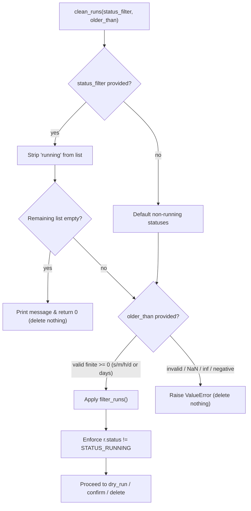

# IPD: Fix status clean_runs and filter_runs data-loss and closeout bugs

- Date: 2026-11-22
- Kind: child
- Concern: Bugs and correctness (data loss in run cleanup and age filtering, crashed-run closeout schema integrity, and status display helpers).
- Scope: `src/pubrun/status.py` and dedicated regression tests in `tests/test_status_bugs.py`.
- Scope-Paths: src/pubrun/status.py, tests/test_status_bugs.py
- Item-Dependencies: none
- Status: to-review
- Short-Description: Fix Blocker data-loss bugs in clean_runs and filter_runs plus crashed-run closeout and display defects
- Work-Kind: bug
- Priority: high
- Blocks-Release: next
- Set: bugs-audit
- Order: 1
- Highest E allocated: 04
- Author: Antigravity
- Id: njn1up

> Write and proofread this plan per the technical writing standard, `.aw/system/workflows/technical-writing/technical-writing.md`, including requirement 12 (diagrams).

## Workflow history

- 2026-11-22 draft (Antigravity): created from `/assess-bugs` audit.
- 2026-11-22 to-review (Antigravity): authored fix steps, citations, and falsifiable validation criteria.

## Goal

Eliminate two Blocker data-loss bugs in `status.clean_runs` and `status.filter_runs` where invalid or `running`-only filters silently expand cleanup to delete all runs (including active jobs), and repair crashed-run closeout schema mismatches and status parsing/formatting defects in `src/pubrun/status.py`.

### Cleanup filter decision flow (target behavior)

## Detailed Implementation Checklist (TODO)

Execution-state rule: mark an `E-*` item complete only after performing the action. That mark is not validation. Right-sizing rule: each E-item is one focused pass with its own V-item check (`IPD-Z603`). Accepted execution states: blocked, failed, pending, performed; terminal gate demands 'performed'.

### Task group 1: Blocker data-loss guards in `status.clean_runs` and `status.filter_runs`

- [ ] E-01 Guard `status.clean_runs` against empty status filters after stripping `STATUS_RUNNING` and enforce an unconditional post-filter `r.status != STATUS_RUNNING` check.
  - Depends on: none
  - Expected outcome: Calling `clean_runs(output_dir, status_filter="running")` (or `["running"]` or `""`) prints that no runs match (or that running runs cannot be cleaned) and returns `0` without passing an empty string to `filter_runs`; `STATUS_RUNNING` runs are never included in `candidates`.
  - Execution state: pending

- [ ] E-02 Make `status.filter_runs` strictly validate `older_than` instead of swallowing `ValueError`.
  - Depends on: none
  - Expected outcome: `filter_runs` parses finite non-negative durations supporting `d`, `h`, `m`, `s`, or bare numeric days, and raises `ValueError` with a clear message on unrecognized suffixes, malformed strings, negative numbers, `NaN`, or `inf` instead of silently disabling the age filter.
  - Execution state: pending

### Task group 2: Crashed-run closeout schema and status helper fixes

- [ ] E-03 Fix `status.close_out_crashed_run` to write `host.hostname` as a plain string and preserve the full `process.argv` list without dropping `argv[0]`.
  - Depends on: none
  - Expected outcome: Closed-out crash manifests store `host.hostname` as a string (matching `capture.host.get_host` and `diagnostics.print_report`) and preserve `argv[0]` when reconstructing `process.argv` from lock data.
  - Execution state: pending

- [ ] E-04 Fix `status._parse_selection`, `status.render_short_list`, and `status.RunInfo._parse_dir_name`, and add comprehensive regression tests in `tests/test_status_bugs.py`.
  - Depends on: E-01, E-02, E-03
  - Expected outcome: `_parse_selection` rejects out-of-range indices (`<= 0` or `> max_num`), deduplicates while preserving order, and clamps ranges; `render_short_list` aligns columns accurately when `NO_COLOR` / non-ANSI mode is active; `RunInfo._parse_dir_name` preserves hyphenated script names (`"-".join(parts[1:-3])`); `tests/test_status_bugs.py` exercises all five bug groups and passes under `pytest`.
  - Execution state: pending

## Project conventions discovered (Step 0)

- Run directories follow the `pubrun-<script>-<timestamp>-<pid>-<run_id>` naming convention (`status.RunInfo._parse_dir_name`).
- `status.STATUS_RUNNING` runs must never be eligible for deletion by `status.clean_runs`, even if explicitly named by the caller.
- Tests must assert observable behavior and side effects (no code-pinning via `inspect`/`ast`/source regex).
- Callers of `filter_runs` / `clean_runs` in `src/pubrun/__main__.py` and `src/pubrun/tui/widgets/actions.py` will add `ValueError` presentation handling in child plans `r68o07` and `8ebjeg`, which declare `- Item-Dependencies: njn1up`.

## Findings

| Bug ID | Severity | Remediation Risk | Location (symbol) | Defect |
|---|---|---|---|---|
| `BUG-01` | Blocker | Low | `status.clean_runs`, `status.filter_runs` | `clean_runs(status_filter="running")` strips `STATUS_RUNNING`, yielding `status_filter_str = ""`, which is falsy in `filter_runs` and disables status filtering so ALL runs (including running jobs) become eligible for deletion. |
| `BUG-02` | Blocker | Low | `status.filter_runs` | `except ValueError: pass` on `older_than` leaves `older_than_days = None`, silently disabling age filtering on typos or `30m`/`2w` so `clean --yes` deletes all runs. |
| `BUG-41` | Medium | Low | `status.close_out_crashed_run` | Writes `host.hostname` as `{"value": ...}` (diverging from string schema) and drops `argv[0]` when saving lock `argv` to manifest. |
| `BUG-60` | Low | Low | `status._parse_selection` | Does not deduplicate or bounds-check parsed selection indices against `1..max_val`. |
| `BUG-67` | Low | Low | `status.render_short_list`, `status.RunInfo._parse_dir_name` | Column alignment breaks under `NO_COLOR`; `_parse_dir_name` uses `parts[1]`, truncating hyphenated script names. |

## Proposed changes (ordered, validatable)

1. In `status.clean_runs` (`src/pubrun/status.py`): when `status_filter is not None`, after filtering out empty tokens and `STATUS_RUNNING`, if `status_filter_list` is empty, print a clear message and return `0` immediately. After calling `filter_runs(...)`, also filter `candidates = [r for r in candidates if r.status != STATUS_RUNNING]` as defense in depth.
2. In `status.filter_runs` (`src/pubrun/status.py`): replace the `except ValueError: pass` block with a dedicated `_parse_older_than_days(older_than: str) -> float` helper supporting `d`, `h`, `m`, `s`, and bare numeric days; reject empty strings, `NaN`, `inf`, negative values, and unknown units by raising `ValueError`.
3. In `status.close_out_crashed_run` (`src/pubrun/status.py`): store `hostname` as a plain `str` (or `None`) under `host.hostname` and keep the full `argv` list from `lock_data` without slicing off index `0`.
4. In `status._parse_selection`, `status.render_short_list`, and `status.RunInfo._parse_dir_name` (`src/pubrun/status.py`): clamp/deduplicate selections within `1..max_val`, compute visible column width without assuming ANSI escapes are present, and join `parts[1:-3]` when `len(parts) >= 5`.
5. Add `tests/test_status_bugs.py` testing every defect above with real temporary run directories and assertions on filesystem state, return values, raised exceptions, and rendered text.

## Deferred / out of scope (with reason)

- CLI exit-code and error-message formatting when `filter_runs` raises `ValueError` is handled in `src/pubrun/__main__.py`.
  - Carrier: r68o07
- TUI Bulk Prune `ValueError` toast notification is handled in `src/pubrun/tui/widgets/actions.py`.
  - Carrier: 8ebjeg

## Scope check

- Over-scope: none. Only `src/pubrun/status.py` and `tests/test_status_bugs.py` are modified.
- Under-scope: none. Existing tests in `tests/` that pass valid `older_than` strings (`"7d"`, `"12h"`, `"3"`) continue to work and invalid strings now fail closed.

## Required tests / validation

- Run `pytest tests/test_status_bugs.py -v` and paste actual output.
- Run full `pytest -q` and paste actual output confirming zero regressions across existing status/CLI tests.

## Spec / documentation sync

N/A: `clean_runs` already documents that running runs are never deleted, and `filter_runs` age filtering is expected to match only runs at least as old as the requested threshold; this plan brings implementation into compliance with documented behavior.

## Open questions

None.

## Validation and cross-check (verify before reporting done)

Validation-state rule: inspect evidence in a separate pass. Do not mark a `V-*` item complete from memory or from the matching execution checkmark. Accepted validation results: blocked, failed, pass, pending; terminal gate demands 'pass'.

- [ ] V-01 validates E-01
  - Required evidence: Pasted `pytest tests/test_status_bugs.py -v` output showing tests for `clean_runs(..., status_filter="running", yes=True)` and `status_filter=["running"]` returning `0` and leaving both running and completed run directories intact on disk.
  - Observed evidence:
  - Result: pending

- [ ] V-02 validates E-02
  - Required evidence: Pasted `pytest tests/test_status_bugs.py -v` output showing `filter_runs(..., older_than="30m")` filters accurately by 30 minutes, while malformed values (`"2w"`, `"abc"`, `"-5d"`, `"nan"`, `"inf"`) raise `ValueError` and `clean_runs(..., older_than="abc", yes=True)` deletes nothing.
  - Observed evidence:
  - Result: pending

- [ ] V-03 validates E-03
  - Required evidence: Pasted `pytest tests/test_status_bugs.py -v` output showing `close_out_crashed_run` writes `isinstance(manifest["host"]["hostname"], str)` and preserves `manifest["process"]["argv"][0]`.
  - Observed evidence:
  - Result: pending

- [ ] V-04 validates E-04
  - Required evidence: Pasted `pytest tests/test_status_bugs.py -v` and full `pytest -q` output confirming `_parse_selection`, `render_short_list` (with `NO_COLOR=1`), and `RunInfo._parse_dir_name` (with hyphenated script names) pass with zero regressions across the suite.
  - Observed evidence:
  - Result: pending

## Approval and execution gate

- Size assessment: standard
- Cohesion rationale: not required

Wait for human approval (`- Status: approved`) before executing. Commit only files listed in `Scope-Paths` via `aw commit njn1up -- src/pubrun/status.py tests/test_status_bugs.py`, then move this plan to `.aw/records/plans/executed/` through the post-gate lifecycle transition.
