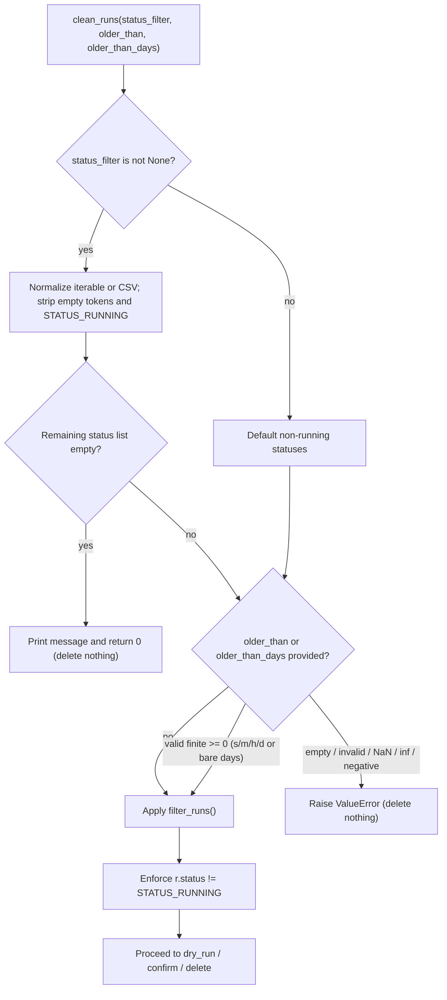

# IPD: Fix status clean_runs and filter_runs data-loss and closeout bugs

- Date: 2026-11-22
- Kind: child
- Concern: Bugs and correctness (data loss in run cleanup and age filtering, crashed-run closeout schema integrity, status display helpers, and age-filter documentation sync).
- Scope: `src/pubrun/status.py`, dedicated regression tests in `tests/test_status_bugs.py`, and additive age-filter documentation sync in `docs/cli.md` and `docs/functional_spec.md`.
- Scope-Paths: src/pubrun/status.py, tests/test_status_bugs.py, docs/cli.md, docs/functional_spec.md
- Item-Dependencies: none
- Status: reviewed
- Readiness: go-pending-approval
- Review-Depth: complex
- Short-Description: Fix Blocker data-loss bugs in clean_runs and filter_runs plus crashed-run closeout and display defects
- Work-Kind: bug
- Priority: high
- Blocks-Release: next
- Set: bugs-audit
- Order: 1
- Highest E allocated: 05
- Author: Antigravity
- Id: njn1up

> Write and proofread this plan per the technical writing standard, `.aw/system/workflows/technical-writing/technical-writing.md`, including requirement 12 (diagrams).

## Workflow history

- 2026-11-22 /plan-review (Gemini 4 Neon (High)): APPROVE WITH REVISIONS APPLIED; PR-001, PR-002, PR-003, PR-004, PR-005, PR-006
- 2026-11-22 to-review (Antigravity): authored fix steps, citations, and falsifiable validation criteria.
- 2026-11-22 draft (Antigravity): created from `/assess-bugs` audit.

## Goal

Eliminate two Blocker data-loss bugs in `src/pubrun/status.py::clean_runs` and `src/pubrun/status.py::filter_runs`, where invalid age values or `running`-only status filters silently expand cleanup to delete all runs, including active jobs. Repair crashed-run closeout manifest schema mismatches (`host.hostname` and `invocation.argv`), status selection/table/directory-name defects in `src/pubrun/status.py`, and age-filter documentation in `docs/cli.md` and `docs/functional_spec.md`.

### Cleanup filter decision flow (target behavior)

## Detailed Implementation Checklist (TODO)

Execution-state rule: mark an `E-*` item complete only after performing the action. That mark is not validation. Right-sizing rule: each E-item is one focused pass with its own V-item check (`IPD-Z603`). Accepted execution states: blocked, failed, pending, performed; terminal gate demands 'performed'.

### Task group 1: Blocker data-loss guards in `clean_runs` and `filter_runs`

- [ ] E-01 Guard `src/pubrun/status.py::clean_runs` against empty status filters after stripping empty tokens and `src/pubrun/status.py::STATUS_RUNNING`, enforce an unconditional post-filter `r.status != STATUS_RUNNING` check, and add `BUG-01` regression tests in `tests/test_status_bugs.py`.
  - Depends on: none
  - Expected outcome: Calling `clean_runs` with `status_filter="running"`, `["running"]`, `("running",)`, `""`, `"   "`, `",,,"` , or `[]` prints a clear message and returns `0` without calling `filter_runs` or deleting any directory on disk. Non-string iterables (such as lists, tuples, or sets) normalize cleanly, and `candidates` always excludes `STATUS_RUNNING` as defense in depth. Tests in `tests/test_status_bugs.py` verify both running and completed run directories remain intact.
  - Execution state: pending

- [ ] E-02 Make `src/pubrun/status.py::filter_runs` strictly validate `older_than` via a dedicated `_parse_older_than_days` helper instead of swallowing `ValueError`, propagate strict validation to `older_than_days` in `clean_runs`, and add `BUG-02` regression tests in `tests/test_status_bugs.py`.
  - Depends on: none
  - Expected outcome: `filter_runs` checks `if older_than is not None:` (not truthiness) and parses finite non-negative durations supporting `d` (days), `h` (hours), `m` (minutes), `s` (seconds), and bare numeric days. Empty strings (`""`), whitespace-only strings (`"   "`), non-string values, unrecognized suffixes (`"2w"`), malformed strings (`"abc"`), negative numbers (`"-5d"`), Not a Number (`"nan"`), and infinity (`"inf"` / `"-inf"`) raise `ValueError` with a clear message instead of silently disabling age filtering. Invalid `older_than_days` values (negative, `NaN`, `inf`, or `bool`) passed to `clean_runs` also raise `ValueError` and delete nothing. Tests in `tests/test_status_bugs.py` cover every valid and invalid case.
  - Execution state: pending

### Task group 2: Crashed-run closeout schema and status helper fixes

- [ ] E-03 Fix `src/pubrun/status.py::close_out_crashed_run` to write fallback `host.hostname` as a plain `str | None` and populate `manifest["invocation"]["argv"]` from `lock_data["sys_argv"]` (with safe fallback), unwrap legacy dict `host.hostname` in `src/pubrun/status.py::RunInfo._load_from_manifest`, and add `BUG-41` regression tests in `tests/test_status_bugs.py`.
  - Depends on: none
  - Expected outcome: When `manifest.json` does not yet exist, `close_out_crashed_run` writes `manifest["host"]["hostname"]` as a plain `str` (or `None` when absent), matching `schemas/manifest.schema.json` (`$defs.host.properties.hostname`) and `src/pubrun/capture/host.py::get_host`. It populates `manifest["invocation"]["argv"]` (never `manifest["process"]["argv"]`) from `lock_data["sys_argv"]` when present and non-empty; for legacy lock files lacking `sys_argv`, it prepends `lock_data["script"]` before `lock_data["argv"]` unless `lock_data["argv"]` already starts with the script name, so reloading via `RunInfo._load_from_manifest` preserves all CLI flags without dropping the first argument. Pre-existing manifests preserve their existing `host` section untouched (maintaining compatibility with `tests/test_tracker.py::TestManifestLifecycle::test_crashed_closeout_preserves_and_updates_manifest`), and `RunInfo._load_from_manifest` unwraps legacy `{"value": ...}` hostname dicts cleanly. Tests in `tests/test_status_bugs.py` verify fallback closeout, legacy lock fallback, existing-manifest preservation, and round-trip `RunInfo` reload.
  - Execution state: pending

- [ ] E-04 Fix `src/pubrun/status.py::_parse_selection`, `src/pubrun/status.py::render_short_list`, and `src/pubrun/status.py::RunInfo._parse_dir_name`, and add `BUG-60` and `BUG-67` regression tests in `tests/test_status_bugs.py`.
  - Depends on: none
  - Expected outcome: `_parse_selection(response, candidates)` keeps its two-argument signature and continues silently skipping out-of-range indices (`<= 0` or `> len(candidates)`, preserving `tests/test_status.py::TestParseSelection::test_out_of_bounds_skipped`), deduplicates selected indices while preserving first-seen order, and clamps range iteration bounds to `[0, len(candidates) - 1]` before looping so huge ranges such as `"1-999999999"` return immediately without hanging. `render_short_list` pads the `STATUS` column using visible text length (`max(1, 12 - len(r.status))` or exact 12-column padding for known statuses) instead of hardcoded `:<21`, so the `EXIT` and `ELAPSED` columns align identically with the header under both American National Standards Institute (ANSI) color mode and `NO_COLOR=1`. `RunInfo._parse_dir_name` joins `"-".join(parts[1:-3])` when `len(parts) >= 5 and parts[0] == "pubrun"` so hyphenated script names are preserved intact. Tests in `tests/test_status_bugs.py` cover all three helpers.
  - Execution state: pending

### Task group 3: Documentation sync and full-suite regression verification

- [ ] E-05 Synchronize `--older-than` documentation in `docs/cli.md` and `docs/functional_spec.md` and run the full `pytest` regression suite.
  - Depends on: E-01, E-02, E-03, E-04
  - Expected outcome: `docs/cli.md` (the `clean` options table) and `docs/functional_spec.md#11.12 Run Cleanup (clean)` document that `--older-than` accepts `d` (days), `h` (hours), `m` (minutes), `s` (seconds), and bare numeric days, and that invalid or negative values fail closed with an error without deleting runs. Edits remain additive to the `clean` sections only (disjoint from sibling Sets) and introduce zero em dashes (`U+2014`) or en dashes (`U+2013`) in added diff lines. Both `pytest tests/test_status_bugs.py -v` and full `pytest -q` pass with zero failures.
  - Execution state: pending

## Project conventions discovered (Step 0)

- Run directories follow the `pubrun-<script>-<timestamp>-<pid>-<run_id>` naming convention (`src/pubrun/tracker.py::Run.__init__`, where `timestamp` uses `%Y%m%dT%H%M%SZ` with no hyphens and `run_id` is an 8-character hex prefix of `uuid4().hex`; parsed in `src/pubrun/status.py::RunInfo._parse_dir_name`).
- `src/pubrun/status.py::STATUS_RUNNING` runs must never be eligible for deletion by `src/pubrun/status.py::clean_runs`, even when explicitly named by the caller.
- Lock files written by `src/pubrun/tracker.py::Run._write_lock_file` store redacted arguments in `"argv"` (`sys.argv[1:]`) and full redacted `sys.argv` in `"sys_argv"` (`list(sys.argv)`).
- `schemas/manifest.schema.json` defines `host.hostname` as `string | null` and requires `invocation.argv` (while `$defs.process` sets `additionalProperties: false` and has no `argv` property).
- `tests/test_status.py::TestParseSelection::test_out_of_bounds_skipped` pins that `_parse_selection("1,99,2", ["a", "b", "c"])` skips out-of-range indices rather than raising.
- `tests/test_tracker.py::TestManifestLifecycle::test_crashed_closeout_preserves_and_updates_manifest` pins that `close_out_crashed_run` preserves pre-existing `manifest["host"]` metadata when `manifest.json` already exists.
- Tests must assert observable behavior and side effects (no code-pinning via `inspect`, `ast`, or source regex).
- Callers of `filter_runs` and `clean_runs` in the command-line interface (CLI) (`src/pubrun/__main__.py`) and Terminal User Interface (TUI) (`src/pubrun/tui/widgets/actions.py`) add `ValueError` presentation handling in child plans `r68o07` and `8ebjeg`, which declare `- Item-Dependencies: executed:njn1up`.

## Findings

| Bug ID | Severity | Remediation Risk | Location (symbol) | Defect |
|---|---|---|---|---|
| `BUG-01` | Blocker | Low | `src/pubrun/status.py::clean_runs`, `src/pubrun/status.py::filter_runs` | `clean_runs(status_filter="running")` strips `STATUS_RUNNING`, yielding `status_filter_str = ""`, which is falsy in `filter_runs` and disables status filtering so all runs (including running jobs) become eligible for deletion. Whitespace/comma-only strings and non-list iterables also bypass safe normalization. |
| `BUG-02` | Blocker | Low | `src/pubrun/status.py::filter_runs`, `src/pubrun/status.py::clean_runs` | `except ValueError: pass` on `older_than` leaves `older_than_days = None`, silently disabling age filtering on typos or `30m`/`2w` so `clean --yes` deletes all runs; truthiness check `if older_than:` also silently skips `older_than=""`. |
| `BUG-41` | Medium | Low | `src/pubrun/status.py::close_out_crashed_run`, `src/pubrun/status.py::RunInfo._load_from_manifest` | Fallback crash manifest writes `host.hostname` as a dict `{"representation": ..., "value": ...}` (violating `string | null` schema and rendering raw dicts in `RunInfo._load_from_manifest`) and copies `lock_data["argv"]` (`sys.argv[1:]`) instead of `lock_data["sys_argv"]` into `manifest["invocation"]["argv"]`, causing `RunInfo._load_from_manifest` (`argv[1:]`) to drop the first user flag. |
| `BUG-60` | Low | Low | `src/pubrun/status.py::_parse_selection` | Does not deduplicate selected indices (causing duplicate confirmation rows and `shutil.rmtree` errors on repeat deletion) and iterates `range(start_i, end_i + 1)` without clamping to `[0, len(candidates) - 1]` (allowing huge ranges like `"1-999999999"` to hang). |
| `BUG-67` | Low | Low | `src/pubrun/status.py::render_short_list`, `src/pubrun/status.py::RunInfo._parse_dir_name` | `render_short_list` hardcodes `f"{status:<21}"` assuming 9 bytes of ANSI escape codes, shifting `EXIT` and `ELAPSED` columns 9 spaces right under `NO_COLOR=1`; `_parse_dir_name` uses `parts[1]`, truncating hyphenated script names. |

## Proposed changes (ordered, validatable)

1. In `src/pubrun/status.py::clean_runs`: when `status_filter is not None`, accept strings (comma-separated) or non-string iterables (such as `list`, `tuple`, `set`), strip whitespace, drop empty tokens, and remove `STATUS_RUNNING`. If the resulting `status_filter_list` is empty, print a clear message and return `0` immediately without calling `filter_runs`. After calling `filter_runs(...)`, also filter `candidates = [r for r in candidates if r.status != STATUS_RUNNING]` as defense in depth.
2. In `src/pubrun/status.py::filter_runs` and `src/pubrun/status.py::clean_runs`: add a dedicated `_parse_older_than_days(older_than: str) -> float` helper supporting `d`, `h`, `m`, `s`, and bare numeric days; reject non-strings, empty/whitespace strings, `NaN`, `inf`, negative values, and unknown units by raising `ValueError`. Change `if older_than:` to `if older_than is not None:` in `filter_runs`, and validate `older_than_days` in `clean_runs` (rejecting `bool`, `NaN`, `inf`, and negative numbers via `ValueError`) before converting to `older_than`.
3. In `src/pubrun/status.py::close_out_crashed_run` and `src/pubrun/status.py::RunInfo._load_from_manifest`: in the fallback manifest branch (when `manifest.json` does not exist), write `host.hostname` as a plain `str` (or `None` if missing/non-string) and write `manifest["invocation"]["argv"]` from `lock_data["sys_argv"]` when present and non-empty (otherwise prepending `lock_data["script"]` before `lock_data["argv"]` unless `lock_data["argv"]` already starts with the script name, or `[]` when neither is available). Keep the existing-manifest branch's `host` section untouched. In `RunInfo._load_from_manifest`, safely unwrap legacy `{"value": ...}` dicts if encountered under `host.hostname`.
4. In `src/pubrun/status.py::_parse_selection`, `src/pubrun/status.py::render_short_list`, and `src/pubrun/status.py::RunInfo._parse_dir_name`: track seen candidate indices to deduplicate selections while preserving order and clamp range bounds to `max(0, start_i)` through `min(len(candidates) - 1, end_i)` while continuing to skip out-of-range indices; pad the `STATUS` column in `render_short_list` from visible width (`len(r.status)` against header width `12`) rather than hardcoded `:<21`; and set `self.script = "-".join(parts[1:-3])` in `_parse_dir_name` when `len(parts) >= 5 and parts[0] == "pubrun"`.
5. Add `tests/test_status_bugs.py` testing every defect above with real temporary run directories and assertions on filesystem state, return values, raised `ValueError` exceptions, JSON manifest fields, rendered column alignment, and parsed `RunInfo` fields.
6. Update `docs/cli.md` (the `clean` `--older-than` table row) and `docs/functional_spec.md#11.12 Run Cleanup (clean)` additively to document `m` and `s` units and fail-closed error handling, with zero newly added em or en dashes.

## Deferred / out of scope (with reason)

- CLI exit-code and error-message formatting when `src/pubrun/status.py::filter_runs` raises `ValueError` is handled in `src/pubrun/__main__.py`.
  - Carrier: r68o07
- TUI Bulk Prune `ValueError` toast notification is handled in `src/pubrun/tui/widgets/actions.py`.
  - Carrier: 8ebjeg

## Scope check

- Over-scope: none. Only `src/pubrun/status.py`, `tests/test_status_bugs.py`, `docs/cli.md`, and `docs/functional_spec.md` are modified, remaining completely disjoint from all other child plans in Set `bugs-audit`.
- Under-scope: none. Existing tests in `tests/` that pass valid `older_than` strings (`"7d"`, `"12h"`, `"3"`), valid `older_than_days`, out-of-range `_parse_selection` tokens, or existing-manifest crash closeout continue to work, while invalid age strings fail closed and age-filter docs stay in sync.

## Required tests / validation

- Run `pytest tests/test_status_bugs.py -v` and paste actual output.
- Run a diff-scoped Python check over added lines of `git diff -- docs/cli.md docs/functional_spec.md` confirming zero em dashes (`U+2014`) or en dashes (`U+2013`), and paste actual output.
- Run full `pytest -q` and paste actual output confirming zero regressions across `tests/test_status.py`, `tests/test_tracker.py`, `tests/test_timing_consumers.py`, `tests/test_cli.py`, `tests/test_status_bugs.py`, and the entire suite.

## Spec / documentation sync

- `docs/cli.md` (`clean` options table, `--older-than AGE` row): add `m` (minutes) and `s` (seconds) examples and state that invalid or negative age values fail with an error without deleting runs.
- `docs/functional_spec.md#11.12 Run Cleanup (clean)`: update the `--older-than` bullet to list days (`7d`), hours (`24h`), minutes (`30m`), seconds (`90s`), and bare numeric days, plus fail-closed rejection of invalid or negative values.
- `docs/manifest.md#host` and `schemas/manifest.schema.json`: no doc change required; both already specify `host.hostname` as `string | null` and `invocation.argv` as `list[string]`, and `E-03` brings `close_out_crashed_run` into compliance with them.

## Open questions

None.

## Validation and cross-check (verify before reporting done)

Validation-state rule: inspect evidence in a separate pass. Do not mark a `V-*` item complete from memory or from the matching execution checkmark. Accepted validation results: blocked, failed, pass, pending; terminal gate demands 'pass'.

- [ ] V-01 validates E-01
  - Required evidence: Pasted `pytest tests/test_status_bugs.py -v` output showing tests for `clean_runs(..., status_filter="running", yes=True)`, `status_filter=["running"]`, `status_filter=("running",)`, `status_filter=""`, and `status_filter=" , "` returning `0` and leaving both running and completed run directories intact on disk.
  - Observed evidence:
  - Result: pending

- [ ] V-02 validates E-02
  - Required evidence: Pasted `pytest tests/test_status_bugs.py -v` output showing `filter_runs(..., older_than="30m")` and `older_than="90s"` filter accurately by age, while empty/malformed/non-finite/negative values (`""`, `"   "`, `"2w"`, `"abc"`, `"-5d"`, `"nan"`, `"inf"`) and invalid `older_than_days` (`-1.0`, `float("nan")`, `float("inf")`, `True`) raise `ValueError` and `clean_runs(..., older_than="abc", yes=True)` deletes nothing on disk.
  - Observed evidence:
  - Result: pending

- [ ] V-03 validates E-03
  - Required evidence: Pasted `pytest tests/test_status_bugs.py -v` output showing `close_out_crashed_run` on a lock-only run writes `manifest["host"]["hostname"]` as a plain `str` (or `None` when absent), preserves full `manifest["invocation"]["argv"]` (including `argv[0]` from `sys_argv` and legacy lock fallback) so reloaded `RunInfo.args` retains all CLI flags, leaves pre-existing `manifest["host"]` untouched when `manifest.json` already exists, and unwraps legacy dict `host.hostname` in `RunInfo._load_from_manifest`.
  - Observed evidence:
  - Result: pending

- [ ] V-04 validates E-04
  - Required evidence: Pasted `pytest tests/test_status_bugs.py -v` output confirming `_parse_selection` deduplicates preserving order, skips out-of-range indices without raising, and completes clamped huge ranges (`"1-999999999"`) immediately; `render_short_list` aligns `EXIT` and `ELAPSED` columns identically with the header under both `NO_COLOR=1` and ANSI color mode; and `RunInfo._parse_dir_name` preserves hyphenated script names (`my-train-script`).
  - Observed evidence:
  - Result: pending

- [ ] V-05 validates E-05
  - Required evidence: Pasted `git diff -- docs/cli.md docs/functional_spec.md` plus Python check output confirming zero `U+2014`/`U+2013` characters in added doc lines, and pasted full `pytest -q` output confirming `tests/test_status_bugs.py` and the full repository test suite pass with zero failures.
  - Observed evidence:
  - Result: pending

## Approval and execution gate

- Size assessment: standard
- Cohesion rationale: not required

Execution contract:
1. Precondition: wait for human approval (`- Status: approved`) with no unresolved `Blocking: yes` open questions before writing code or documentation.
2. Scope declaration: expected modified files are `- Scope-Paths:` (`src/pubrun/status.py`, `tests/test_status_bugs.py`, `docs/cli.md`, `docs/functional_spec.md`). If execution requires modifying an out-of-scope file, justify it with `--scope-reason` at finalization; if a declared file requires no edit, acknowledge it with `--scope-ack`. Stop only for a genuinely unsafe condition such as an unresolvable concurrent-edit conflict or missing prerequisite behavior.
3. Validation honesty (HARD MUST): run the required validation commands and paste the actual runner output verbatim into each `V-*` `Observed evidence:` field; never mark a `V-*` item `pass` without captured output from that run.
4. Commit and push discipline: commit only the paths you changed through `aw commit njn1up -- src/pubrun/status.py tests/test_status_bugs.py docs/cli.md docs/functional_spec.md` (never `git add -A` or raw `git commit`), and never push without explicit human instruction.
5. Lifecycle transition: this plan must be finalized through `aw ipd finalize njn1up` (never a hand-rolled `git mv` to `.aw/records/plans/executed/`). When executing inside a runner execution lane (`aw oc run` or `aw agy run`), the runner performs `aw ipd finalize` after the turn; when executing standalone outside a runner, the executor runs `aw ipd finalize njn1up`.
