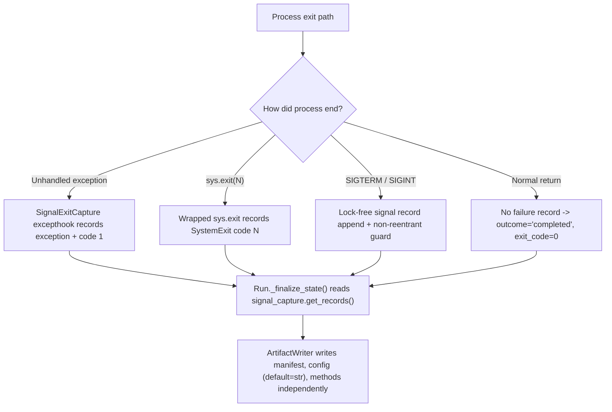

# IPD: Fix core lifecycle, exit recording, signal deadlock, and writer bugs

- Date: 2026-11-22
- Kind: child
- Concern: Bugs and correctness (run lifecycle state machine, exit/exception recording, signal safety, atomic artifact writing, and public Python APIs).
- Scope: `src/pubrun/tracker.py`, `src/pubrun/capture/signals.py`, `src/pubrun/writer.py`, `src/pubrun/core.py`, `src/pubrun/events.py`, and regression tests in `tests/test_core_lifecycle_bugs.py`.
- Scope-Paths: src/pubrun/tracker.py, src/pubrun/capture/signals.py, src/pubrun/writer.py, src/pubrun/core.py, src/pubrun/events.py, tests/test_core_lifecycle_bugs.py
- Item-Dependencies: none
- Status: to-review
- Short-Description: Fix exception/sys.exit status recording, signal re-entrancy deadlock, atomic JSON writer, python -m boot, and subprocess/phase API bugs
- Work-Kind: bug
- Priority: high
- Blocks-Release: next
- Set: bugs-audit
- Order: 2
- Highest E allocated: 05
- Author: Antigravity
- Id: 2nm0pq

> Write and proofread this plan per the technical writing standard, `.aw/system/workflows/technical-writing/technical-writing.md`, including requirement 12 (diagrams).

## Workflow history

- 2026-11-22 draft (Antigravity): created from `/assess-bugs` audit.
- 2026-11-22 to-review (Antigravity): authored fix steps, citations, and falsifiable validation criteria.

## Goal

Fix 13 confirmed correctness bugs across the core run lifecycle so that unhandled exceptions and `sys.exit(N)` record accurate failure outcomes and exit codes, `SIGTERM` handlers never deadlock on non-reentrant locks, atomic artifact writes survive `Path`/datetime config values, `python -m <pkg>` auto-starts properly, and `pubrun.subprocess`/`popen`/`print`/`phase`/`diff`/`@audit_run`/`events` behave reliably.

### Signal and exit finalization lifecycle (target behavior)

## Detailed Implementation Checklist (TODO)

Execution-state rule: mark an `E-*` item complete only after performing the action. That mark is not validation. Right-sizing rule: each E-item is one focused pass with its own V-item check (`IPD-Z603`). Accepted execution states: blocked, failed, pending, performed; terminal gate demands 'performed'.

### Task group 1: Signal safety, exit recording, and `Run` lifecycle concurrency

- [ ] E-01 Fix `capture.signals.SignalExitCapture` and `tracker.Run` for exception/`sys.exit` outcome recording, signal-handler deadlock prevention, `output_base_dir` propagation, and `start()`/`stop()` locking.
  - Depends on: none
  - Expected outcome: `SignalExitCapture` wraps `sys.exit` (identity-guarded on restore), records signal arrival without blocking on a non-reentrant lock, and guards `_finalize_active_run()` against re-entrancy. `Run._finalize_state()` consults `signal_capture.get_records()` so unhandled exceptions record `outcome = "failed"` and `exit_code = 1` and `sys.exit(N)` records `exit_code = N` (with `outcome = "failed"` when `N != 0`). `Run.__init__` sets `self.output_base_dir` so `filesystem.output_dir` appears in manifests. `Run.stop()` clears `_active_run` under `_run_lock` before finalization, and `Run._merge_and_migrate` merges new overrides onto existing `self.config` instead of wiping prior overrides.
  - Execution state: pending

### Task group 2: Atomic writer serialization and event logger safety

- [ ] E-02 Fix `writer._atomic_json_write`, `writer.ArtifactWriter`, and `events.EventLogger` to handle non-JSON-native config objects, isolate artifact failures, and eliminate file-handle TOCTOU/fd leaks.
  - Depends on: none
  - Expected outcome: `_atomic_json_write` passes `default=str` so `pathlib.Path` and TOML `date`/`datetime` values serialize cleanly; `ArtifactWriter` writes `config.resolved.json`, `manifest.json`, and `methods.md` in independent `try/except` blocks so one failure never skips subsequent artifacts; `EventLogger.emit()` and `close()` synchronize `self._file` access under a lock and close the underlying handle even if `flush()` raises `OSError`.
  - Execution state: pending

### Task group 3: Public `core.py` boot, decorators, subprocess, print, and phase APIs

- [ ] E-03 Fix `core._execute_boot_sequence`, `core.start`, `core.diff`, `core.audit_run`, and `core.tracked_run`.
  - Depends on: E-01
  - Expected outcome: `_execute_boot_sequence` skips auto-start only for pubrun's own CLI (`pubrun.__main__`), allowing `python -m <user_pkg>` to auto-start normally; `core.start` forwards `kwargs` to `_merge_and_migrate` on the double-checked active-run branch; `core.diff` reads `[diff].ignore_standard` instead of nonexistent `[diff].ignore`; `@audit_run` uses `try/finally` so `KeyboardInterrupt`/`SystemExit` still calls `stop()` and releases `ref_count`; `tracked_run.__exit__` classifies `KeyboardInterrupt` as `"interrupted"` and `SystemExit(0)` as `"completed"` instead of `"failed"`.
  - Execution state: pending

- [ ] E-04 Fix `core.subprocess` (`run`/`Popen`), `core.popen`, `core.print`, and `core.phase`.
  - Depends on: E-01
  - Expected outcome: `pubrun.subprocess.run`/`Popen` and `pubrun.popen` normalize string/tuple commands via `_safe_shlex_split`, run `redact_argv` before writing manifest records, redact exception strings, record `exc.returncode` on `CalledProcessError`, and give `_PopenPipeProxy` working `__iter__`/`__next__`; `pubrun.print` honors `file=`, avoids double-writing `stdout.log` when console tee is active, and honors `pubrun.paused()`; `pubrun.phase` sanitizes phase names for safe filenames (blocking `/`, `\`, `:`, `..`), stops `yappi` cleanly even if the run ends inside a phase, and binds `run_tracker` lazily in `__enter__`.
  - Execution state: pending

### Task group 4: Regression test suite

- [ ] E-05 Add end-to-end and unit regression tests in `tests/test_core_lifecycle_bugs.py` and verify the full `pytest` suite passes.
  - Depends on: E-01, E-02, E-03, E-04
  - Expected outcome: `tests/test_core_lifecycle_bugs.py` reproduces and asserts fixes for all 13 bugs in this plan using real subprocesses, temp directories, and in-process API calls, and `pytest -q` passes with zero regressions.
  - Execution state: pending

## Project conventions discovered (Step 0)

- Pending IPD Sets `timing-acc` and `cap-isolation` also touch `src/pubrun/tracker.py` and `src/pubrun/core.py`; keep edits strictly scoped to the bug-fix symbols listed below so merge-and-revalidate integrates cleanly.
- `capture.signals.SignalExitCapture` is restored on run stop; any `sys.exit` wrapper must verify identity before restoring so user-installed wrappers are not clobbered.
- Tests must assert observable runtime behavior (real subprocess exit codes, written `manifest.json` / `methods.md` / `config.resolved.json` contents, iterator output) and never inspect source text.

## Findings

| Bug ID | Severity | Remediation Risk | Location (symbol) | Defect |
|---|---|---|---|---|
| `BUG-03` | High | Medium | `tracker.Run._finalize_state`, `capture.signals.SignalExitCapture` | Unhandled exceptions record `outcome = "completed"`; `sys.exit(N)` records `outcome = "completed"` and `exit_code = 0`. |
| `BUG-06` | High | Low | `core.SubprocessProxy.run`, `core.SubprocessProxy.Popen`, `core.popen` | Explicit subprocess APIs log unredacted `argv`/errors, drop tuple command handling, and record `exit_code: None` on `CalledProcessError`. |
| `BUG-07` | High | Low | `core._execute_boot_sequence` | `sys0 in (..., "__main__.py", "-m")` disables auto-start for every user package executed via `python -m <pkg>`. |
| `BUG-08` | High | Medium | `capture.signals.SignalExitCapture._handle_signal`, `tracker._finalize_active_run` | Signal handler acquires non-reentrant locks (`self._lock`, `_run_lock`), risking permanent main-thread deadlock on `SIGTERM`. |
| `BUG-09` | High | Low | `writer._atomic_json_write`, `writer.ArtifactWriter` | `json.dump` raises `TypeError` on `Path`/datetime values in `run.config`, silently dropping `config.resolved.json` and skipping `methods.md`. |
| `BUG-10` | High | Medium | `tracker.Run.stop`, `tracker.Run._merge_and_migrate`, `core.start` | `_active_run` cleared after releasing `_run_lock`; `core.start` double-check drops `kwargs`; `_merge_and_migrate` wipes prior overrides. |
| `BUG-29` | Medium | Low | `tracker.Run.__init__` | `self.output_base_dir` is never assigned, so `filesystem.output_dir` is always omitted from `manifest.json`. |
| `BUG-30` | Medium | Low | `core.diff` | Reads nonexistent `[diff].ignore` instead of `[diff].ignore_standard`. |
| `BUG-31` | Medium | Low | `core.audit_run`, `core.tracked_run.__exit__` | `@audit_run` leaks `ref_count` on `BaseException`; `tracked_run` misclassifies `KeyboardInterrupt`/`SystemExit(0)` as `"failed"`. |
| `BUG-32` | Medium | Low | `core.print` | Ignores `file=`, double-writes `stdout.log` under console tee, and ignores `pubrun.paused()`. |
| `BUG-33` | Medium | Low | `core._PopenPipeProxy` | Missing `__iter__`/`__next__`, raising `TypeError` on `for line in pubrun.popen(...)`. |
| `BUG-34` | Medium | Low | `core.phase` | Unsanitized `phase.name` in filename allows path separators/`..`; `yappi` stays stuck if run stops inside phase; binds `run_tracker` in `__init__`. |
| `BUG-60a` | Low | Low | `events.EventLogger.emit`, `events.EventLogger.close` | TOCTOU race on `self._file` between threads and fd leak if `flush()` fails during `close()`. |

## Proposed changes (ordered, validatable)

1. In `src/pubrun/capture/signals.py`: replace lock acquisition inside `_handle_signal` with atomic list append and a simple re-entrancy guard before invoking finalization; wrap `sys.exit` on `install()` (restoring only if unchanged on `uninstall()`) to record `SystemExit` codes accurately.
2. In `src/pubrun/tracker.py`: set `self.output_base_dir`; clear `_active_run` under `_run_lock` at the start of `Run.stop()`; update `_merge_and_migrate` to deep-merge overrides onto `self.config`; read `signal_capture.get_records()` in `_finalize_state()` to derive accurate `outcome`, `exit_code`, and `exit_exception`.
3. In `src/pubrun/writer.py` and `src/pubrun/events.py`: pass `default=str` to `json.dump` in `_atomic_json_write`, wrap each artifact write independently, and synchronize `EventLogger.emit()`/`close()` with `try/finally` around `close()`.
4. In `src/pubrun/core.py`: refine `_execute_boot_sequence` to detect pubrun's own CLI module rather than generic `"__main__.py"`/`"-m"`, forward `kwargs` in `start()`, fix `diff()` config lookup, harden `audit_run`/`tracked_run` for `BaseException`, apply redaction and `CalledProcessError.returncode` in `pubrun.subprocess`/`popen`, add `__iter__`/`__next__` to `_PopenPipeProxy`, fix `pubrun.print()`, and sanitize/harden `pubrun.phase()`.
5. Add `tests/test_core_lifecycle_bugs.py` covering all 13 defects.

## Deferred / out of scope (with reason)

None.

## Scope check

- Over-scope: none. Only the 5 core source files and 1 new test module are touched.
- Under-scope: none. Each bug has an explicit fix step and corresponding regression test.

## Required tests / validation

- Run `pytest tests/test_core_lifecycle_bugs.py -v` and paste actual output.
- Run full `pytest -q` and paste actual output confirming zero regressions.

## Spec / documentation sync

N/A: restores documented behavior for `pubrun.start`, `pubrun.subprocess`, `pubrun.popen`, `pubrun.print`, `pubrun.phase`, `pubrun.diff`, and `python -m` execution without changing public signatures.

## Open questions

None.

## Validation and cross-check (verify before reporting done)

Validation-state rule: inspect evidence in a separate pass. Do not mark a `V-*` item complete from memory or from the matching execution checkmark. Accepted validation results: blocked, failed, pass, pending; terminal gate demands 'pass'.

- [ ] V-01 validates E-01
  - Required evidence: Pasted `pytest tests/test_core_lifecycle_bugs.py -v` output demonstrating (a) subprocess raising `RuntimeError` writes `status.outcome == "failed"` and `exit_code == 1`, (b) subprocess calling `sys.exit(42)` writes `status.outcome == "failed"` and `exit_code == 42`, (c) `SIGTERM` while `_run_lock` is held does not deadlock, (d) `filesystem.output_dir` is present in `manifest.json`, and (e) concurrent `stop()`/`start()` and `_merge_and_migrate` preserve active overrides.
  - Observed evidence:
  - Result: pending

- [ ] V-02 validates E-02
  - Required evidence: Pasted `pytest tests/test_core_lifecycle_bugs.py -v` output demonstrating `pubrun.start(output_dir=Path(tmp))` writes valid `config.resolved.json`, `manifest.json`, and `methods.md`, and `EventLogger` survives concurrent `emit()`/`close()` and `flush()` error without leaking descriptors.
  - Observed evidence:
  - Result: pending

- [ ] V-03 validates E-03
  - Required evidence: Pasted `pytest tests/test_core_lifecycle_bugs.py -v` output demonstrating `python -m <temp_pkg>` auto-starts and exposes `pubrun.get_current_run()`, `pubrun.diff` reads `[diff].ignore_standard`, `@audit_run` releases `ref_count` on `KeyboardInterrupt`, and `tracked_run` records `"interrupted"` / `"completed"` for `KeyboardInterrupt` / `SystemExit(0)`.
  - Observed evidence:
  - Result: pending

- [ ] V-04 validates E-04
  - Required evidence: Pasted `pytest tests/test_core_lifecycle_bugs.py -v` output demonstrating redacted `argv` and `CalledProcessError.returncode` in `pubrun.subprocess.run`, iteration over `pubrun.popen`, `pubrun.print(file=...)` & pause handling, and safe filename + clean `yappi` teardown in `pubrun.phase("../../bad:name")`.
  - Observed evidence:
  - Result: pending

- [ ] V-05 validates E-05
  - Required evidence: Pasted full `pytest -q` summary showing `tests/test_core_lifecycle_bugs.py` and all pre-existing tests pass with zero failures.
  - Observed evidence:
  - Result: pending

## Approval and execution gate

- Size assessment: standard
- Cohesion rationale: not required

Wait for human approval (`- Status: approved`) before executing. Commit only files listed in `Scope-Paths` via `aw commit 2nm0pq -- src/pubrun/tracker.py src/pubrun/capture/signals.py src/pubrun/writer.py src/pubrun/core.py src/pubrun/events.py tests/test_core_lifecycle_bugs.py`, then move this plan to `.aw/records/plans/executed/` through the post-gate lifecycle transition.
