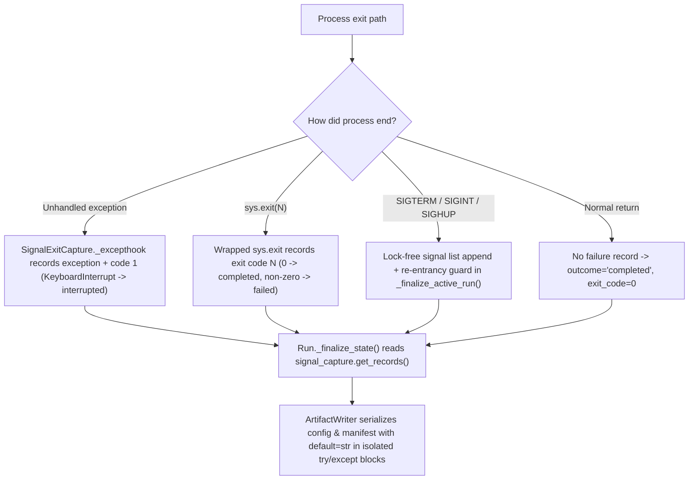

# IPD: Fix core lifecycle, exit recording, signal deadlock, and writer bugs

- Date: 2026-11-22
- Kind: child
- Concern: Bugs and correctness (run lifecycle state machine, exit/exception recording, signal safety, atomic artifact writing, and public Python APIs).
- Scope: `src/pubrun/tracker.py`, `src/pubrun/capture/signals.py`, `src/pubrun/writer.py`, `src/pubrun/core.py`, `src/pubrun/events.py`, and regression tests in `tests/test_core_lifecycle_bugs.py`.
- Scope-Paths: src/pubrun/tracker.py, src/pubrun/capture/signals.py, src/pubrun/writer.py, src/pubrun/core.py, src/pubrun/events.py, tests/test_core_lifecycle_bugs.py
- Item-Dependencies: none
- Status: approved
- Readiness: go-pending-approval
- Review-Depth: complex
- Short-Description: Fix exception/sys.exit status recording, signal re-entrancy deadlock, atomic JSON writer, python -m boot, and subprocess/phase API bugs
- Work-Kind: bug
- Priority: high
- Blocks-Release: next
- Set: bugs-audit
- Order: 2
- Highest E allocated: 05
- Author: Antigravity
- Id: 2nm0pq
- Approval: 2026-11-22, recorded via aw ipd set: status set to approved

> Write and proofread this plan per the technical writing standard, `.aw/system/workflows/technical-writing/technical-writing.md`, including requirement 12 (diagrams).

## Workflow history

- 2026-11-22 approved (aw set): status set to approved
- 2026-11-22 /plan-review (Gemini 4 Neon (High)): APPROVE WITH REVISIONS APPLIED; PR-001, PR-002, PR-003, PR-004, PR-005, PR-006
- 2026-11-22 to-review (Antigravity): authored fix steps, citations, and falsifiable validation criteria.
- 2026-11-22 draft (Antigravity): created from `/assess-bugs` audit.

## Goal

Fix 13 confirmed correctness bugs across the core run lifecycle so unhandled exceptions, `KeyboardInterrupt`, and `sys.exit(N)` record accurate outcomes and exit codes, signal handlers never deadlock on non-reentrant locks or re-enter teardown, and atomic JavaScript Object Notation (JSON) artifact writes survive `pathlib.Path` and `date`/`datetime` config values. Also restore auto-start for user packages invoked via `python -m <pkg>` (without auto-starting on `python -m pubrun`) and harden `pubrun.subprocess`, `pubrun.popen`, `pubrun.print`, `pubrun.phase`, `pubrun.diff`, `@pubrun.audit_run`, `pubrun.tracked_run`, and `EventStream`.

### Signal and exit finalization lifecycle (target behavior)

## Detailed Implementation Checklist (TODO)

Execution-state rule: mark an `E-*` item complete only after performing the action. That mark is not validation. Right-sizing rule: each E-item is one focused pass with its own V-item check (`IPD-Z603`). Accepted execution states: blocked, failed, pending, performed; terminal gate demands 'performed'.

### Task group 1: Signal safety, exit recording, and `Run` lifecycle concurrency

- [ ] E-01 Fix `src/pubrun/capture/signals.py::SignalExitCapture`, `src/pubrun/capture/signals.py::_finalize_active_run`, and `src/pubrun/tracker.py::Run` for exception/`sys.exit` outcome recording, signal-handler deadlock prevention, `output_base_dir` propagation, and `stop()`/`_merge_and_migrate()` concurrency, and add `BUG-03`, `BUG-08`, `BUG-10`, and `BUG-29` regression tests in `tests/test_core_lifecycle_bugs.py`.
  - Depends on: none
  - Expected outcome: `SignalExitCapture.install()` transactionally wraps `sys.exit` (with rollback on install failure, passive passthrough when `_active` is `False`, identity-guarded restore in `uninstall()`, and exit-code overwrite on successive `sys.exit` calls while preserving `format_safe_error_detail` redaction for non-int messages). The signal shim closure inside `SignalExitCapture._make_handler` appends to `self._signals_received` without acquiring non-reentrant `self._lock`, and `_finalize_active_run()` guards against re-entrant signal delivery via a re-entrancy latch (`try/finally`). `Run._finalize_state()` consults `signal_capture.get_records()` so unhandled exceptions record `outcome = "failed"` and `exit_code = 1`, `KeyboardInterrupt` / interruption signals record `outcome = "interrupted"`, and `sys.exit(N)` records `exit_code = N` (`outcome = "completed"` for `0`/`None`, `"failed"` for non-zero). `Run.__init__` assigns `self.output_base_dir = base_dir` so `filesystem.output_dir` is populated in `manifest.json`. `Run.stop()` updates `_outcome` and clears `_active_run` under `_run_lock` as soon as `ref_count <= 0` before finalization, and `Run._merge_and_migrate()` preserves prior API overrides (handling `_CORE_SHORTCUTS` without mutating caller dicts) and updates `self.output_base_dir` on directory migration. Tests in `tests/test_core_lifecycle_bugs.py` verify all four bug groups.
  - Execution state: pending

### Task group 2: Atomic writer serialization and event stream safety

- [ ] E-02 Fix `src/pubrun/writer.py::_serialize_config_and_digest`, `src/pubrun/writer.py::_atomic_json_write`, `src/pubrun/writer.py::ArtifactWriter.write_startup_manifest`, and `src/pubrun/events.py::EventStream`, and add `BUG-09` and `BUG-60a` regression tests in `tests/test_core_lifecycle_bugs.py`.
  - Depends on: none
  - Expected outcome: Both `_serialize_config_and_digest` (`json.dumps(..., default=str)`) and `_atomic_json_write` (`json.dump(..., default=str)`) pass `default=str` so `pathlib.Path` and Tom's Obvious Minimal Language (TOML) `date`/`datetime` values in `run.config` serialize cleanly without raising `TypeError`. `ArtifactWriter.write_artifacts()` preserves independent `try/except` isolation across `config.resolved.json`, `manifest.json`, and `methods.md`/`methods.tex`, and `ArtifactWriter.write_startup_manifest()` isolates `_write_config_if_needed()` so a config-write failure never drops a healthy run into ghost mode after `manifest.json` succeeds. `EventStream.close()` and `EventStream.migrate_directory()` preserve lock-protected `_file` detachment and wrap `f.close()` in `try/finally` so the file descriptor (fd) closes even on `OSError` or `BaseException` during `flush()`. Tests in `tests/test_core_lifecycle_bugs.py` verify `Path`/`datetime` config serialization, isolated failure recovery, and concurrent `EventStream.emit()`/`close()` plus `flush()` error descriptor cleanup.
  - Execution state: pending

### Task group 3: Public `core.py` boot, decorators, subprocess, print, and phase APIs

- [ ] E-03 Fix `src/pubrun/core.py::_execute_boot_sequence`, `src/pubrun/core.py::diff`, `src/pubrun/core.py::audit_run`, and `src/pubrun/core.py::tracked_run.__exit__`, pin `src/pubrun/core.py::start` double-checked override forwarding, and add `BUG-07`, `BUG-30`, and `BUG-31` regression tests in `tests/test_core_lifecycle_bugs.py`.
  - Depends on: E-01
  - Expected outcome: `_execute_boot_sequence` skips auto-start only when invoked as pubrun's own command-line interface (CLI): `sys.argv[0]` basename in `("pubrun", "pubrun.exe", "pbr", "pbr.exe")`, `"pubrun.__main__" in sys.modules`, `__main__.__spec__.name` in `("pubrun", "pubrun.__main__")`, or (when `sys.argv[0] == "-m"`) an active `runpy` frame whose `mod_name` is `"pubrun"` or starts with `"pubrun."`. User packages executed via `python -m <user_pkg>` (whether importing `pubrun` in `__init__.py` or `__main__.py`) auto-start normally, while `python -m pubrun ...` never auto-starts. `core.diff` reads `[diff].ignore_standard` (falling back to `[diff].ignore` only if absent) and updates its docstring accordingly. `@audit_run` uses `try`/`except BaseException`/`else` (or `try`/`finally`) so `KeyboardInterrupt` and `SystemExit` always call `stop()` and release `ref_count`. Both `@audit_run` and `tracked_run.__exit__` classify `KeyboardInterrupt` as `"interrupted"`, `SystemExit` with `code in (None, 0)` (excluding `True`) as `"completed"`, and non-zero `SystemExit` or other exceptions as `"failed"` (recording `SystemExit` code on `signal_capture` when active). Tests in `tests/test_core_lifecycle_bugs.py` cover every case plus `core.start` active-run override forwarding.
  - Execution state: pending

- [ ] E-04 Fix `src/pubrun/core.py::_PubrunSubprocessNamespace` (`run` and `Popen`), `src/pubrun/core.py::popen` (`_PopenPipeProxy`), `src/pubrun/core.py::print`, and `src/pubrun/core.py::phase`, and add `BUG-06`, `BUG-32`, `BUG-33`, and `BUG-34` regression tests in `tests/test_core_lifecycle_bugs.py`.
  - Depends on: E-01
  - Expected outcome: `pubrun.subprocess.run`, `pubrun.subprocess.Popen`, and `pubrun.popen` normalize string/list/tuple commands via `src/pubrun/capture/subprocesses.py::SubprocessSpy._safe_shlex_split`, apply `src/pubrun/capture/redaction.py::redact_argv` before storing manifest records, redact exception details via `src/pubrun/capture/redaction.py::format_safe_error_detail`, and record `getattr(exc, "returncode", None)` on `subprocess.CalledProcessError`. `_PopenPipeProxy` implements `__iter__` and `__next__` so `for line in pubrun.popen(...)` and `next(...)` work cleanly. `pubrun.print` skips writing `stdout.log` whenever `file` is neither `None` nor `sys.stdout`, whenever `src/pubrun/capture/console.py::_tee_paused()` is `True` (inside `pubrun.paused()`), or whenever an active `ConsoleInterceptor` tee is already wrapping `sys.stdout` (preventing double writes). `pubrun.phase` binds `self.run_tracker = get_current_run()` lazily in `__enter__`, sanitizes `self.name` for `profile-<safe_name>.prof` (blocking `/`, `\`, `:`, `..`, and non-`[a-zA-Z0-9_-]` characters with fallback `"phase"`, preserving raw `self.name` in event `name` and recording the sanitized filename in `profile_saved` `payload["path"]`), and always stops `yappi` and resets `phase._yappi_active = False` in `try/finally` even if the run stopped inside the phase. Tests in `tests/test_core_lifecycle_bugs.py` cover all four bug groups.
  - Execution state: pending

### Task group 4: Full-suite regression verification

- [ ] E-05 Run `tests/test_core_lifecycle_bugs.py` and the full `pytest` suite to confirm zero regressions across all core lifecycle, capture isolation, startup overhead, timing, writer, event, and CLI test suites.
  - Depends on: E-01, E-02, E-03, E-04
  - Expected outcome: `pytest tests/test_core_lifecycle_bugs.py -v` passes every regression test for all 13 bugs, and full `pytest -q` passes with zero failures across the repository.
  - Execution state: pending

## Project conventions discovered (Step 0)

- `src/pubrun/core.py::_run_lock` and `src/pubrun/writer.py::ArtifactWriter._write_lock` are already `threading.RLock()` (re-entrant); `src/pubrun/capture/signals.py::SignalExitCapture._lock` (`threading.Lock()`) is non-reentrant and is the lock that deadlocks when acquired inside the signal handler closure returned by `SignalExitCapture._make_handler`.
- `src/pubrun/capture/signals.py::SignalExitCapture` follows a transactional install/rollback, passive-passthrough (`if not self._active`), and identity-guarded restore contract (`src/pubrun/capture/signals.py:91-135,270-335`); the new `sys.exit` wrapper must preserve that exact contract.
- `src/pubrun/writer.py::_write_config_if_needed` serializes config via `src/pubrun/writer.py::_serialize_config_and_digest` before passing `pre_serialized` to `_atomic_json_write`, so `default=str` is required in both functions.
- `src/pubrun/writer.py::ArtifactWriter.write_artifacts` already isolates `config.resolved.json`, `manifest.json`, and `methods.*`, and `src/pubrun/events.py::EventStream` already synchronizes `_file` under `_lock`; `src/pubrun/core.py::start` already forwards `kwargs` to `_merge_and_migrate` on the double-checked active-run branch. Preserve those existing guarantees and pin them with tests.
- Pending IPD Sets `timing-acc` and `cap-isolation` also touch `src/pubrun/tracker.py` and `src/pubrun/core.py`; keep edits strictly scoped to the bug-fix symbols listed below so merge-and-revalidate integrates cleanly.
- Tests must assert observable runtime behavior (real subprocess exit codes, written `manifest.json`, `methods.md`, and `config.resolved.json` contents, iterator output, and file descriptors) and never inspect source text.

## Findings

| Bug ID | Severity | Remediation Risk | Location (symbol) | Defect |
|---|---|---|---|---|
| `BUG-03` | High | Medium | `src/pubrun/tracker.py::Run._finalize_state`, `src/pubrun/capture/signals.py::SignalExitCapture` | By `atexit`, `sys.exc_info()` is empty and CPython does not call `sys.excepthook` for `SystemExit`, so unhandled exceptions record `outcome = "completed"` and `sys.exit(N)` records `outcome = "completed"` and `exit_code = 0`. |
| `BUG-06` | High | Low | `src/pubrun/core.py::_PubrunSubprocessNamespace.run`, `src/pubrun/core.py::_PubrunSubprocessNamespace.Popen`, `src/pubrun/core.py::popen` | Explicit subprocess wrappers fail to split string commands via `SubprocessSpy._safe_shlex_split`, log unredacted `argv` and unredacted exception strings, and hardcode `exit_code: None` on `subprocess.CalledProcessError`. |
| `BUG-07` | High | Low | `src/pubrun/core.py::_execute_boot_sequence` | Checking `sys0 in (..., "__main__.py", "-m")` disables auto-start for every user package executed via `python -m <pkg>`, while naive removal would wrongly auto-start `python -m pubrun` during `runpy` package import before `pubrun.__main__` loads. |
| `BUG-08` | High | Medium | `src/pubrun/capture/signals.py::SignalExitCapture._make_handler`, `src/pubrun/capture/signals.py::_finalize_active_run` | Signal handler closure acquires non-reentrant `self._lock` (risking permanent main-thread deadlock if a signal arrives while `self._lock` is held), and `_finalize_active_run` lacks a re-entrancy guard against nested lethal signals. |
| `BUG-09` | High | Low | `src/pubrun/writer.py::_serialize_config_and_digest`, `src/pubrun/writer.py::_atomic_json_write`, `src/pubrun/writer.py::ArtifactWriter.write_startup_manifest` | `json.dumps` / `json.dump` lack `default=str`, raising `TypeError` on `pathlib.Path` or TOML `date`/`datetime` values in `run.config`; `write_startup_manifest` does not isolate `_write_config_if_needed`, demoting the run to ghost mode. |
| `BUG-10` | High | Medium | `src/pubrun/tracker.py::Run.stop`, `src/pubrun/tracker.py::Run._merge_and_migrate`, `src/pubrun/core.py::start` | `Run.stop` clears `_active_run` only after releasing `_run_lock` and finishing finalization; `_merge_and_migrate` calls `resolve_config(overrides)` and overwrites `self.config`, wiping prior API overrides (and leaving `output_base_dir` stale on migration). (`core.start` already forwards `kwargs` on the double-checked branch and is regression-pinned.) |
| `BUG-29` | Medium | Low | `src/pubrun/tracker.py::Run.__init__` | `self.output_base_dir` is never assigned, so `_collect_host_and_filesystem` always omits `filesystem.output_dir` from `manifest.json`. |
| `BUG-30` | Medium | Low | `src/pubrun/core.py::diff` | Reads nonexistent `[diff].ignore` instead of `[diff].ignore_standard` (and docstring cites `[diff].ignore`). |
| `BUG-31` | Medium | Low | `src/pubrun/core.py::audit_run`, `src/pubrun/core.py::tracked_run.__exit__` | `@audit_run` catches only `Exception`, leaking `ref_count` on `KeyboardInterrupt`/`SystemExit`; `tracked_run.__exit__` misclassifies `KeyboardInterrupt` and `SystemExit(0)` as `"failed"`. |
| `BUG-32` | Medium | Low | `src/pubrun/core.py::print` | Appends to `stdout.log` even when `file=` targets another stream, double-writes `stdout.log` when `ConsoleInterceptor` is active on `sys.stdout`, and ignores `pubrun.paused()` (`_tee_paused()`). |
| `BUG-33` | Medium | Low | `src/pubrun/core.py::popen` (`_PopenPipeProxy`) | Missing `__iter__` and `__next__` dunder methods (bypassing `__getattr__`), raising `TypeError` on `for line in pubrun.popen(...)`. |
| `BUG-34` | Medium | Low | `src/pubrun/core.py::phase` | Unsanitized `phase.name` in `profile-<name>.prof` allows path traversal and illegal path characters; `yappi` stays stuck if the run stops inside a phase; `run_tracker` is bound eagerly in `__init__` instead of `__enter__`. |
| `BUG-60a` | Low | Low | `src/pubrun/events.py::EventStream.emit`, `src/pubrun/events.py::EventStream.close`, `src/pubrun/events.py::EventStream.migrate_directory` | `EventStream` already detaches `_file` under `_lock`, but `close()` and `migrate_directory()` separate `flush()` and `close()` into consecutive `try/except Exception` blocks rather than `try/finally`, risking a file descriptor leak on `BaseException`, and lack concurrent `emit()`/`close()` plus `flush()`-error regression tests. |

## Proposed changes (ordered, validatable)

1. In `src/pubrun/capture/signals.py`:
   - In `SignalExitCapture._make_handler`, append signal records to `self._signals_received` without acquiring `self._lock` (lock-free atomic list append).
   - Add a re-entrancy latch (`try/finally`) in `_finalize_active_run()` so a second lethal signal (`SIGTERM`/`SIGHUP`) during teardown returns immediately.
   - Add transactional `_install_sys_exit()` and `_restore_sys_exit()` (with rollback on install failure, passive passthrough when `not self._active`, and identity-guarded restore on `uninstall()`) that records `SystemExit` exit codes (overwriting prior caught `sys.exit` values, redacting non-int messages via `format_safe_error_detail`) before delegating to the previous `sys.exit`.
2. In `src/pubrun/tracker.py`:
   - Assign `self.output_base_dir = base_dir` in `Run.__init__` and track accumulated API overrides in `self._api_overrides` (deep-copied).
   - In `Run.stop()`, update `self._outcome` and clear `_active_run = None` (when `_active_run is self`) inside `with _run_lock:` as soon as `self.ref_count <= 0`, before calling `_finalize_state()` and `write_artifacts()`.
   - In `Run._merge_and_migrate()`, deep-merge new normalized overrides (applying `_CORE_SHORTCUTS` without mutating caller dicts) into `self._api_overrides`, resolve config from the accumulated overrides so prior overrides survive, and update `self.output_base_dir = new_base` when the run directory migrates.
   - In `Run._finalize_state()`, inspect `signal_capture.get_records()` before defaulting `self._outcome` to `"completed"`: classify `KeyboardInterrupt` or interruption signals (`SIGINT`, `SIGTERM`, `SIGHUP`) as `"interrupted"`, classify recorded non-zero `exit_code` (or non-`KeyboardInterrupt` `exit_exception`) as `"failed"`, keep `exit_code == 0` as `"completed"`, and avoid overwriting an already-recorded `exit_code` with `0`.
3. In `src/pubrun/writer.py` and `src/pubrun/events.py`:
   - Pass `default=str` to `json.dumps` in `_serialize_config_and_digest` and to `json.dump` in `_atomic_json_write`.
   - Keep `ArtifactWriter.write_artifacts()` artifact isolation intact, and wrap `self._write_config_if_needed(out_dir, stage=stage)` in `ArtifactWriter.write_startup_manifest()` in its own `try/except` (recording `last_error` without returning `False` when `manifest.json` succeeded).
   - In `EventStream.close()` and `EventStream.migrate_directory()`, wrap `f.close()` in `try/finally` under `self._lock` so `f.close()` always executes even on `OSError` or `BaseException`.
4. In `src/pubrun/core.py`:
   - Add a helper `_is_pubrun_cli_invocation()` used by `_execute_boot_sequence()` checking CLI script basenames (`pubrun`, `pubrun.exe`, `pbr`, `pbr.exe`), `"pubrun.__main__" in sys.modules`, `__main__.__spec__.name in ("pubrun", "pubrun.__main__")`, and (when `sys.argv[0] == "-m"`) active `runpy` stack frames whose `mod_name` is `"pubrun"` or starts with `"pubrun."`.
   - Update `core.diff()` (and its docstring) to read `[diff].ignore_standard` (falling back to `[diff].ignore` only when `ignore_standard` is absent).
   - Update `core.audit_run` and `core.tracked_run.__exit__` to share a helper classifying `KeyboardInterrupt` as `"interrupted"`, `SystemExit` with `code in (None, 0)` (not `True`) as `"completed"`, and non-zero `SystemExit` or other `BaseException` as `"failed"`, always invoking `run_tracker.stop(outcome=...)` and recording `SystemExit` exit code on `signal_capture` when active.
   - In `_PubrunSubprocessNamespace.run`, `_PubrunSubprocessNamespace.Popen`, and `popen`, normalize commands via `SubprocessSpy._safe_shlex_split`, redact `argv` via `redact_argv`, redact exception strings via `format_safe_error_detail`, and capture `getattr(exc, "returncode", None)` on `subprocess.CalledProcessError`.
   - Add `__iter__` and `__next__` to `_PopenPipeProxy`.
   - In `core.print`, write to `stdout.log` only when `(file is None or file is sys.stdout)`, `not _tee_paused()`, and `sys.stdout` is not already wrapped by an active `ConsoleInterceptor.stdout_tee`.
   - In `core.phase`, bind `self.run_tracker = get_current_run()` in `__enter__`, sanitize `self.name` for `profile-<safe_name>.prof` (blocking `/`, `\`, `:`, `..`, and non-`[a-zA-Z0-9_-]` characters with fallback `"phase"`), and stop `yappi` / reset `phase._yappi_active = False` in `try/finally` even when the run stopped inside the phase.
5. Create `tests/test_core_lifecycle_bugs.py` with end-to-end and unit tests covering all 13 defects, co-located with `E-01`..`E-04`, and run the full `pytest -q` suite in `E-05`.

## Deferred / out of scope (with reason)

None.

## Scope check

- Over-scope: none. Only the 5 core source files (`src/pubrun/tracker.py`, `src/pubrun/capture/signals.py`, `src/pubrun/writer.py`, `src/pubrun/core.py`, `src/pubrun/events.py`) and 1 new test module (`tests/test_core_lifecycle_bugs.py`) are modified, remaining completely disjoint from all other child plans in Set `bugs-audit`.
- Under-scope: none. All 13 bugs in this child plan (`BUG-03`, `BUG-06`, `BUG-07`, `BUG-08`, `BUG-09`, `BUG-10`, `BUG-29`, `BUG-30`, `BUG-31`, `BUG-32`, `BUG-33`, `BUG-34`, `BUG-60a`) have concrete fixes and observable regression tests.

## Required tests / validation

- Run `pytest tests/test_core_lifecycle_bugs.py -v` and paste actual output.
- Run full `pytest -q` and paste actual output confirming zero regressions across `tests/test_tracker.py`, `tests/test_capture_isolation.py`, `tests/test_startup_overhead_writes.py`, `tests/test_timing_accuracy.py`, `tests/test_writer.py`, `tests/test_events.py`, `tests/test_cli.py`, `tests/test_core_lifecycle_bugs.py`, and the entire suite.

## Spec / documentation sync

- No external documentation files under `docs/` require changes: `docs/configuration.md` (`ignore_standard`), `docs/api.md` (`pubrun.phase`, `pubrun.diff`, `pubrun.print`, `pubrun.subprocess`, `pubrun.popen`), and `docs/functional_spec.md` already document the target contracts, and this plan brings implementation into compliance with them.
- In-code docstring sync: update `src/pubrun/core.py::diff` docstring (`[diff].ignore` -> `[diff].ignore_standard`) within `E-03`.

## Open questions

None.

## Validation and cross-check (verify before reporting done)

Validation-state rule: inspect evidence in a separate pass. Do not mark a `V-*` item complete from memory or from the matching execution checkmark. Accepted validation results: blocked, failed, pass, pending; terminal gate demands 'pass'.

- [ ] V-01 validates E-01
  - Required evidence: Pasted `pytest tests/test_core_lifecycle_bugs.py -v` output demonstrating (a) a subprocess raising `RuntimeError` writes `status.outcome == "failed"` and `signals.exit_code == 1`, (b) a subprocess calling `sys.exit(42)` writes `status.outcome == "failed"` and `signals.exit_code == 42` while `sys.exit(0)` writes `outcome == "completed"` and `exit_code == 0`, (c) delivering `SIGTERM` while `signal_capture._lock` is held does not deadlock and re-entrant `_finalize_active_run()` calls do not re-enter `write_artifacts()`, (d) `filesystem.output_dir` is present in `manifest.json`, and (e) `Run.stop()` clears `_active_run` before finalization and repeated `start()` calls via `_merge_and_migrate` preserve prior API overrides.
  - Observed evidence:
  - Result: pending

- [ ] V-02 validates E-02
  - Required evidence: Pasted `pytest tests/test_core_lifecycle_bugs.py -v` output demonstrating `pubrun.start(output_dir=Path(tmp))` and TOML `date`/`datetime` config values write valid `config.resolved.json`, `manifest.json`, and `methods.md` without entering ghost mode, config-write failures during startup or finalization do not drop `manifest.json`, and `EventStream` survives concurrent `emit()`/`close()` and closes its file descriptor even when `flush()` raises `OSError`.
  - Observed evidence:
  - Result: pending

- [ ] V-03 validates E-03
  - Required evidence: Pasted `pytest tests/test_core_lifecycle_bugs.py -v` output demonstrating (a) `python -m <temp_pkg>` auto-starts and exposes `pubrun.get_current_run()` (both from `__init__.py` and `__main__.py`) while `python -m pubrun status --dir <empty>` does NOT auto-start or create a run directory, (b) `core.start` active-run branch forwards overrides, (c) `pubrun.diff` reads `[diff].ignore_standard`, (d) `@audit_run` calls `stop()` and releases `ref_count` on `KeyboardInterrupt` and `SystemExit`, and (e) `tracked_run` records `"interrupted"` for `KeyboardInterrupt` and `"completed"` for `SystemExit(0)`.
  - Observed evidence:
  - Result: pending

- [ ] V-04 validates E-04
  - Required evidence: Pasted `pytest tests/test_core_lifecycle_bugs.py -v` output demonstrating (a) `pubrun.subprocess.run`/`Popen` and `pubrun.popen` split string commands, redact secret `argv` and exception messages, and record `CalledProcessError.returncode`, (b) `for line in pubrun.popen(...)` and `next(...)` iterate cleanly, (c) `pubrun.print(file=...)`, active `ConsoleInterceptor` tee (no double write), and `pubrun.paused()` all behave accurately, and (d) `pubrun.phase("../../bad:name")` binds `run_tracker` lazily in `__enter__`, writes a sanitized filename strictly inside `run_dir`, and stops `yappi` / clears `phase._yappi_active` even when `run.stop()` is called inside the phase.
  - Observed evidence:
  - Result: pending

- [ ] V-05 validates E-05
  - Required evidence: Pasted full `pytest -q` summary confirming `tests/test_core_lifecycle_bugs.py` and the full repository test suite pass with zero failures.
  - Observed evidence:
  - Result: pending

## Approval and execution gate

- Size assessment: standard
- Cohesion rationale: not required

Execution contract:
1. Precondition: wait for human approval (`- Status: approved`) with no unresolved `Blocking: yes` open questions before writing code.
2. Scope declaration: expected modified files are `- Scope-Paths:` (`src/pubrun/tracker.py`, `src/pubrun/capture/signals.py`, `src/pubrun/writer.py`, `src/pubrun/core.py`, `src/pubrun/events.py`, `tests/test_core_lifecycle_bugs.py`). If execution requires modifying an out-of-scope file, justify it with `--scope-reason` at finalization; if a declared file requires no edit, acknowledge it with `--scope-ack`. Stop only for a genuinely unsafe condition such as an unresolvable concurrent-edit conflict or missing prerequisite behavior.
3. Validation honesty (HARD MUST): run the required validation commands and paste the actual runner output verbatim into each `V-*` `Observed evidence:` field; never mark a `V-*` item `pass` without captured output from that run.
4. Commit and push discipline: commit only the paths you changed through `aw commit 2nm0pq -- src/pubrun/tracker.py src/pubrun/capture/signals.py src/pubrun/writer.py src/pubrun/core.py src/pubrun/events.py tests/test_core_lifecycle_bugs.py` (never `git add -A` or raw `git commit`), and never push without explicit human instruction.
5. Lifecycle transition: this plan must be finalized through `aw ipd finalize 2nm0pq` (never a hand-rolled `git mv` to `.aw/records/plans/executed/`). When executing inside a runner execution lane (`aw oc run` or `aw agy run`), the runner performs `aw ipd finalize` after the turn; when executing standalone outside a runner, the executor runs `aw ipd finalize 2nm0pq`.
