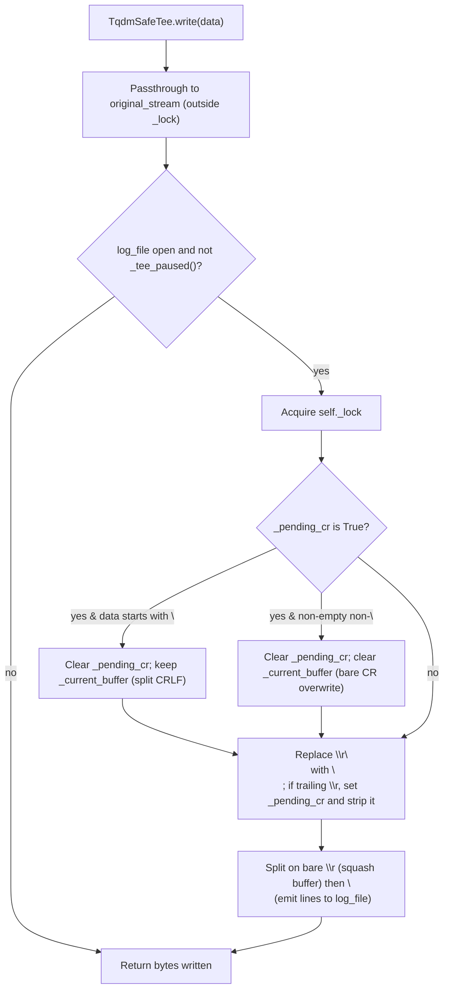

# IPD: Fix console tee, redaction, subprocess spy, and capture engine bugs

- Date: 2026-11-22
- Kind: child
- Concern: Bugs and correctness (console log integrity, secret redaction safety, subprocess wait-status decoding, filesystem mount detection, and resource/liveness/hardware capture).
- Scope: `src/pubrun/capture/console.py`, `src/pubrun/capture/redaction.py`, `src/pubrun/capture/subprocesses.py`, `src/pubrun/capture/filesystem.py`, `src/pubrun/capture/resources.py`, `src/pubrun/capture/liveness.py`, `src/pubrun/capture/hardware.py`, and regression tests in `tests/test_capture_engine_bugs.py`.
- Scope-Paths: src/pubrun/capture/console.py, src/pubrun/capture/redaction.py, src/pubrun/capture/subprocesses.py, src/pubrun/capture/filesystem.py, src/pubrun/capture/resources.py, src/pubrun/capture/liveness.py, src/pubrun/capture/hardware.py, tests/test_capture_engine_bugs.py
- Item-Dependencies: none
- Status: reviewed
- Readiness: go-pending-approval
- Review-Depth: complex
- Short-Description: Fix CRLF log erasure, boolean-flag redaction leak, wait-status decoding, mount precedence, thread-child resources, liveness, and GPU capture bugs
- Work-Kind: bug
- Priority: high
- Blocks-Release: next
- Set: bugs-audit
- Order: 3
- Highest E allocated: 05
- Author: Antigravity
- Id: m780uj

> Write and proofread this plan per the technical writing standard, `.aw/system/workflows/technical-writing/technical-writing.md`, including requirement 12 (diagrams).

## Workflow history

- 2026-11-22 /plan-review (Gemini 4 Neon (High)): APPROVE WITH REVISIONS APPLIED; PR-001, PR-002, PR-003, PR-004
- 2026-11-22 to-review (Antigravity): authored fix steps, citations, and falsifiable validation criteria.
- 2026-11-22 draft (Antigravity): created from `/assess-bugs` audit.

## Goal

Fix 9 confirmed correctness and secret-leak bugs across console teeing, argument and Uniform Resource Identifier (URI) redaction, subprocess spying, mount-table parsing, Linux thread-child resource accounting, process liveness matching, and Graphics Processing Unit (GPU) capture.

### Console tee CRLF and carriage-return handling (target behavior)

## Detailed Implementation Checklist (TODO)

Execution-state rule: mark an `E-*` item complete only after performing the action. That mark is not validation. Right-sizing rule: each E-item is one focused pass with its own V-item check (`IPD-Z603`). Accepted execution states: blocked, failed, pending, performed; terminal gate demands 'performed'.

### Task group 1: Console tee and redaction safety

- [ ] E-01 Fix `src/pubrun/capture/console.py::TqdmSafeTee.write` and `src/pubrun/capture/console.py::TqdmSafeTee.flush` to preserve Carriage Return Line Feed (CRLF) lines, synchronize concurrent log writes, and honor `pubrun.paused()`, and add `BUG-04` regression tests in `tests/test_capture_engine_bugs.py`.
  - Depends on: none
  - Expected outcome: `TqdmSafeTee` tracks `self._pending_cr` across chunk boundaries, normalizes `\r\n` to `\n` before splitting on bare `\r` progress overwrites so writing `"hello world\r\nsecond line\r\n"` (or split chunks `"hello\r"` then `"\n"`) logs `"hello world\nsecond line\n"` (while `"50%\r100%\n"` still squashes `"50%"`). Log state (`self._current_buffer`, `self._pending_cr`, `self.line_count`, and `log_file` I/O) is guarded by `self._lock = threading.Lock()` while `self.original_stream.write`/`flush` passthrough remains outside `self._lock`. `TqdmSafeTee.flush()` still flushes `self.original_stream` when paused, but skips flushing `self._current_buffer` or calling `log_file.flush()` whenever `src/pubrun/capture/console.py::_tee_paused()` is `True`. Tests in `tests/test_capture_engine_bugs.py` verify CRLF preservation, split chunks, concurrent writers, and paused `flush()`.
  - Execution state: pending

- [ ] E-02 Fix `src/pubrun/capture/redaction.py::redact_argv`, `src/pubrun/capture/redaction.py::_get_secret_pattern`, and `src/pubrun/capture/redaction.py::_redact_value_string_heuristics`, and add `BUG-05` and `BUG-37` regression tests in `tests/test_capture_engine_bugs.py`.
  - Depends on: none
  - Expected outcome: In `redact_argv`, when `redact_next` is `True` and the next token starts with `"-"` (an option flag such as `--password`), `redact_next` resets to `False` and the token is processed as a flag so `["train.py", "--use-auth", "--password", "SUPERSECRET"]` redacts `"SUPERSECRET"` instead of consuming `"--password"`. In `_get_secret_pattern`, invalid or non-string `sensitive_keys_regex` values are caught (`(re.error, TypeError)`), logged with a warning via `logging.getLogger("pubrun")`, and fall back to compiling `DEFAULT_SECRET_REGEX` without crashing host `Popen` or caching broken patterns. In `_redact_value_string_heuristics`, both user:pass and token-only URI credential patterns run sequentially (not `if/else`) using whitespace-bounded character classes (reusing `_DIAG_URI_USERPASS_RE` and `_DIAG_URI_TOKEN_RE`) so multi-URI strings redact every credential while `"see http://example.com email alice@corp.com"` is preserved intact. Tests in `tests/test_capture_engine_bugs.py` cover all cases.
  - Execution state: pending

### Task group 2: Subprocess spy and filesystem mount/probe fixes

- [ ] E-03 Fix `src/pubrun/capture/subprocesses.py::SubprocessSpy` (`_patched_os_system` and `Popen.poll` tracking) and `src/pubrun/capture/filesystem.py` (`_longest_prefix_fstype`, `_unescape_mount_field`, and `LiveProbe`), and add `BUG-28` and `BUG-38` regression tests in `tests/test_capture_engine_bugs.py`.
  - Depends on: none
  - Expected outcome: `_patched_os_system` decodes Portable Operating System Interface (POSIX) wait status via a Python 3.8+ helper (`os.waitstatus_to_exitcode` with `ValueError` guard for `-1` and `WIFEXITED`/`WEXITSTATUS`/`WIFSIGNALED`/`WTERMSIG` fallback on Python 3.8) ONLY for `rec["exit_code"]` and `rec["capture_state"]["status"]`, while returning the raw wait status unchanged to the host caller so exit code 1 records `1` instead of `256`. `SubprocessSpy.install()` and `uninstall()` transactionally patch and identity-guardedly restore `subprocess.Popen.poll` (alongside `__init__`, `wait`, and `os.system`) so children reaped via `poll()` returning non-`None` record `exit_code`, `ended_at_utc`, `elapsed_seconds`, `duration_clock`, and `capture_state.status` idempotently. In `filesystem.py`, `_longest_prefix_fstype` uses `>=` so later mounts (`nfs4`/`ext4`) override shadowed `autofs`/`rootfs` entries on the same mountpoint; `_unescape_mount_field` checks `i + 3 < len(field)` with 3 octal digits (`0`-`7`) so `"foo\\04"` stays `"foo\\04"`; and `LiveProbe.__init__` wraps `self._thread.start()` in `try/except` to release `_live_probe_sem`, set `self._acquired = False`, record `{"status": "error", ...}` in `self._slot`, and set `self._done` without raising. Tests in `tests/test_capture_engine_bugs.py` cover every case.
  - Execution state: pending

### Task group 3: Resource tree, liveness, and hardware capture fixes

- [ ] E-04 Fix `src/pubrun/capture/resources.py` Linux child enumeration (`_get_tree_rss_linux` and `_get_tree_cpu_jiffies_linux`), `src/pubrun/capture/liveness.py` (`_match_script_in_tokens` and `_get_start_time_macos`), and `src/pubrun/capture/hardware.py::_get_gpus`, and add `BUG-35`, `BUG-36`, `BUG-61`, and `BUG-62` regression tests in `tests/test_capture_engine_bugs.py`.
  - Depends on: none
  - Expected outcome: A shared helper `_get_linux_child_pids(pid)` in `resources.py` enumerates `/proc/{p}/task/*/children` across all threads and is called by both `_get_tree_rss_linux()` and `_get_tree_cpu_jiffies_linux()` so children spawned by worker threads are accounted for in tree Resident Set Size (RSS) and tree Central Processing Unit (CPU) metrics. In `liveness.py`, `_match_script_in_tokens` handles sanitized script stems (such as `"my_train"` matching `["python3", "/x/my train.py"]` and `"train"` matching `["python3", "/x/train.py"]`) and exact `.py` basenames without breaking `tests/test_liveness.py::TestIsSameProcess::test_substring_only_match_is_inconclusive` (`"train.py"` vs `"/x/train.py.bak"` must still return `None`). `_get_start_time_macos` passes `LC_ALL=C` and `LC_TIME=C` in `subprocess.run(..., env=...)` and parses the `C`-locale date string without relying on the host Python process's `locale.LC_TIME`. In `hardware.py::_get_gpus`, Windows `AdapterRAM` parses signed integers (`try: mem = int(parts[1].strip())`) before applying `mem & 0xFFFFFFFF` for negative values (replacing the dead `.isdigit()` guard), and macOS `system_profiler` flushes the previous GPU record whenever a new `Chipset Model:` line appears so multi-GPU systems retain all GPUs. Tests in `tests/test_capture_engine_bugs.py` cover all four bug groups.
  - Execution state: pending

### Task group 4: Full-suite regression verification

- [ ] E-05 Run `tests/test_capture_engine_bugs.py` and the full `pytest` suite to confirm zero regressions across all capture, redaction, hook-ownership, liveness, filesystem, resource, and hardware test suites.
  - Depends on: E-01, E-02, E-03, E-04
  - Expected outcome: `pytest tests/test_capture_engine_bugs.py -v` passes every regression test for all 9 bug groups, and full `pytest -q` passes with zero failures across the repository.
  - Execution state: pending

## Project conventions discovered (Step 0)

- `pubrun` supports Python 3.8+; `os.waitstatus_to_exitcode` was added in Python 3.9, so `src/pubrun/capture/subprocesses.py` requires a POSIX `WIFEXITED`/`WEXITSTATUS`/`WIFSIGNALED`/`WTERMSIG` fallback on Python 3.8 and must return the raw wait status to the host caller unchanged.
- `src/pubrun/capture/subprocesses.py::SubprocessSpy` enforces transactional install/rollback and identity-guarded uninstall (`_installed_*`, `state["prev_*"]`); adding `subprocess.Popen.poll` must preserve that contract.
- `src/pubrun/capture/filesystem.py::probe_filesystem_live` documents `"Never raises"`, so `LiveProbe.__init__` must capture `Thread.start()` errors into `self._slot` and release `_live_probe_sem` cleanly.
- `tests/test_liveness.py::TestIsSameProcess::test_substring_only_match_is_inconclusive` pins that `_match_script_in_tokens("train.py", ["/usr/bin/python", "/x/train.py.bak"])` returns `None`, not `True`.
- Pending IPD Set `cap-isolation` also touches `src/pubrun/capture/redaction.py` and `src/pubrun/capture/subprocesses.py`; keep edits strictly focused on the bug sites below.
- Tests must assert observable behavior and outputs, never inspect source code strings.

## Findings

| Bug ID | Severity | Remediation Risk | Location (symbol) | Defect |
|---|---|---|---|---|
| `BUG-04` | High | Low | `src/pubrun/capture/console.py::TqdmSafeTee.write`, `src/pubrun/capture/console.py::TqdmSafeTee.flush` | Splitting on `\r` before `\n` erases every `\r\n` line to `""`; `self._current_buffer` lacks `threading.Lock`; `flush()` ignores `_tee_paused()` during `pubrun.paused()`. |
| `BUG-05` | High | Low | `src/pubrun/capture/redaction.py::redact_argv` | Boolean sensitive flag (`--use-auth`) before `--password SECRET` consumes `--password` as `[REDACTED]` and leaks `SECRET` in plaintext. |
| `BUG-28` | Medium | Low | `src/pubrun/capture/filesystem.py::_longest_prefix_fstype`, `_unescape_mount_field`, `LiveProbe.__init__` | Strict `>` keeps shadowed `autofs`/`rootfs`; octal unescape off-by-one (`i + 3 < len(field) + 1`) turns `\04` into `\x04`; `LiveProbe.__init__` leaks `_live_probe_sem` on `Thread.start()` failure. |
| `BUG-35` | Medium | Low | `src/pubrun/capture/resources.py::_get_tree_rss_linux`, `_get_tree_cpu_jiffies_linux` | Both tree functions read only `/proc/{p}/task/{p}/children`, missing all child processes spawned from worker threads. |
| `BUG-36` | Medium | Low | `src/pubrun/capture/liveness.py::_match_script_in_tokens` | Fails on sanitized stems for scripts with spaces/special characters (falsely classifying live runs as `CRASHED`) and misses `.py` stem-to-basename matches. |
| `BUG-37` | Medium | Low | `src/pubrun/capture/redaction.py::_get_secret_pattern`, `_redact_value_string_heuristics` | Uncaught `re.error`/`TypeError` crashes host `Popen`; `if/else` leaks a second URI credential; `[^/:]+` spans whitespace and corrupts URL+email text. |
| `BUG-38` | Medium | Low | `src/pubrun/capture/subprocesses.py::SubprocessSpy` (`_patched_os_system`, `Popen.poll`) | `_patched_os_system` records raw POSIX wait status (`256` for exit 1); `Popen.poll()` reaping misses exit code and duration recording. |
| `BUG-61` | Low | Low | `src/pubrun/capture/hardware.py::_get_gpus` | `parts[1].isdigit()` is always `False` on negative strings so `if mem < 0:` for Windows signed-32-bit `AdapterRAM` overflow is dead code; macOS multi-GPU loop overwrites `gpu_rec["model"]`. |
| `BUG-62` | Low | Low | `src/pubrun/capture/liveness.py::_get_start_time_macos` | `ps -o lstart=` runs without `LC_ALL=C`/`LC_TIME=C` and `datetime.strptime` depends on host `locale.LC_TIME`, failing under non-English locales. |

## Proposed changes (ordered, validatable)

1. In `src/pubrun/capture/console.py::TqdmSafeTee`: add `self._lock = threading.Lock()` and `self._pending_cr = False`; keep `self.original_stream` passthrough outside `self._lock`; under `self._lock`, resolve `_pending_cr` across chunks, replace `\r\n` with `\n`, strip any trailing `\r` into `_pending_cr`, and split on bare `\r` then `\n`; in `flush()`, always flush `self.original_stream` and skip `log_file` writes/flush when `_tee_paused()` is `True`.
2. In `src/pubrun/capture/redaction.py`: import `logging`; in `redact_argv`, reset `redact_next` and process the token normally when `redact_next` is `True` and `arg_str.startswith("-")`; in `_get_secret_pattern`, catch `(re.error, TypeError)`, log a warning, and fall back to compiling `DEFAULT_SECRET_REGEX`; in `_redact_value_string_heuristics`, apply `_DIAG_URI_USERPASS_RE` and `_DIAG_URI_TOKEN_RE` sequentially (no `else`).
3. In `src/pubrun/capture/subprocesses.py` and `src/pubrun/capture/filesystem.py`: add `_decode_wait_status` (Python 3.8+ POSIX fallback + `ValueError` guard) used only for `rec["exit_code"]`/`capture_state` in `_patched_os_system` while returning raw status unchanged; transactionally patch and identity-guardedly restore `subprocess.Popen.poll` in `SubprocessSpy` sharing an idempotent completion helper with `_patched_popen_wait`; change `_longest_prefix_fstype` to `>=`; fix `_unescape_mount_field` to require `i + 3 < len(field)` and 3 octal digits (`0`-`7`); wrap `self._thread.start()` in `LiveProbe.__init__` in `try/except` to release `_live_probe_sem`, record `"error"` in `self._slot`, and set `self._done`.
4. In `src/pubrun/capture/resources.py`, `src/pubrun/capture/liveness.py`, and `src/pubrun/capture/hardware.py`: extract `_get_linux_child_pids(pid)` scanning `/proc/{p}/task/*/children` and use it in both `_get_tree_rss_linux` and `_get_tree_cpu_jiffies_linux`; update `_match_script_in_tokens` to match exact basenames and suffix-safe sanitized stems (preserving `None` for `"train.py"` vs `"/x/train.py.bak"`); pass `LC_ALL=C` and `LC_TIME=C` to macOS `ps -o lstart=` and parse English month abbreviations without host-locale dependence; replace `.isdigit()` in Windows `AdapterRAM` parsing with `try: int(parts[1].strip())` + `mem & 0xFFFFFFFF`, and flush previous `gpu_rec` entries on each `Chipset Model:` line in macOS `_get_gpus`.
5. Create `tests/test_capture_engine_bugs.py` co-located with `E-01`..`E-04`, and run the full `pytest -q` suite in `E-05`.

## Deferred / out of scope (with reason)

None.

## Scope check

- Over-scope: none. Only the 7 capture modules and 1 new test module in `Scope-Paths` are modified, remaining completely disjoint from all other child plans in Set `bugs-audit`.
- Under-scope: none. Every finding across all 9 bug groups has a concrete fix and observable regression test.

## Required tests / validation

- Run `pytest tests/test_capture_engine_bugs.py -v` and paste actual output.
- Run full `pytest -q` and paste actual output confirming zero regressions across `tests/test_capture.py`, `tests/test_redaction.py`, `tests/test_hook_ownership_rollback.py`, `tests/test_env_capture.py`, `tests/test_liveness.py`, `tests/test_pause_resume.py`, `tests/test_capture_engine_bugs.py`, and the entire suite.

## Spec / documentation sync

- No external documentation changes under `docs/` are required: `docs/architecture.md`, `docs/functional_spec.md`, and `docs/manifest.md` already specify CRLF-safe console logging, secret redaction, subprocess exit codes, network filesystem classification, tree resource tracking, liveness detection, and GPU capture; this plan repairs internal implementation defects to match documented behavior without altering public signatures or manifest schemas.

## Open questions

None.

## Validation and cross-check (verify before reporting done)

Validation-state rule: inspect evidence in a separate pass. Do not mark a `V-*` item complete from memory or from the matching execution checkmark. Accepted validation results: blocked, failed, pass, pending; terminal gate demands 'pass'.

- [ ] V-01 validates E-01
  - Required evidence: Pasted `pytest tests/test_capture_engine_bugs.py -v` output confirming `TqdmSafeTee` preserves CRLF lines (including split `\r` / `\n` writes while still squashing bare `\r` progress redraws), remains thread-safe under concurrent writers, and skips log writes on `flush()` while `pubrun.paused()` is active (while still flushing the original stream).
  - Observed evidence:
  - Result: pending

- [ ] V-02 validates E-02
  - Required evidence: Pasted `pytest tests/test_capture_engine_bugs.py -v` output confirming `redact_argv(["train.py", "--use-auth", "--password", "SUPERSECRET"], {})` redacts `SUPERSECRET` and keeps `--password`, invalid or non-string `sensitive_keys_regex` warns and falls back to `DEFAULT_SECRET_REGEX` without raising, multi-URI strings redact all credentials, and `"see http://example.com email alice@corp.com"` is preserved intact.
  - Observed evidence:
  - Result: pending

- [ ] V-03 validates E-03
  - Required evidence: Pasted `pytest tests/test_capture_engine_bugs.py -v` output confirming `os.system` exit 1 records `exit_code == 1` while returning raw status unchanged to caller, `Popen.poll()` reaping records exit code and uninstall restores `Popen.poll`, `_longest_prefix_fstype` picks `nfs4` over shadowed `autofs`, `_unescape_mount_field("foo\\04")` stays `"foo\\04"`, and `LiveProbe` releases `_live_probe_sem` and returns `status == "error"` without raising when `Thread.start()` fails.
  - Observed evidence:
  - Result: pending

- [ ] V-04 validates E-04
  - Required evidence: Pasted `pytest tests/test_capture_engine_bugs.py -v` output confirming both `_get_tree_rss_linux` and `_get_tree_cpu_jiffies_linux` traverse `/proc/{p}/task/*/children`, `_match_script_in_tokens("my_train", ["python3", "/x/my train.py"]) is True` and `_match_script_in_tokens("train.py", ["/usr/bin/python", "/x/train.py.bak"]) is None`, macOS `_get_start_time_macos` passes `LC_ALL=C`/`LC_TIME=C` and parses dates independent of host locale, and Windows negative `AdapterRAM` plus macOS multi-GPU outputs parse accurately.
  - Observed evidence:
  - Result: pending

- [ ] V-05 validates E-05
  - Required evidence: Pasted full `pytest -q` summary confirming `tests/test_capture_engine_bugs.py` and the entire test suite pass with zero failures.
  - Observed evidence:
  - Result: pending

## Approval and execution gate

- Size assessment: standard
- Cohesion rationale: not required

Execution contract:
1. Precondition: wait for human approval (`- Status: approved`) with no unresolved `Blocking: yes` open questions before writing code.
2. Scope declaration: expected modified files are `- Scope-Paths:` (`src/pubrun/capture/console.py`, `src/pubrun/capture/redaction.py`, `src/pubrun/capture/subprocesses.py`, `src/pubrun/capture/filesystem.py`, `src/pubrun/capture/resources.py`, `src/pubrun/capture/liveness.py`, `src/pubrun/capture/hardware.py`, `tests/test_capture_engine_bugs.py`). If execution requires modifying an out-of-scope file, justify it with `--scope-reason` at finalization; if a declared file requires no edit, acknowledge it with `--scope-ack`. Stop only for a genuinely unsafe condition such as an unresolvable concurrent-edit conflict or missing prerequisite behavior.
3. Validation honesty (HARD MUST): run the required validation commands and paste the actual runner output verbatim into each `V-*` `Observed evidence:` field; never mark a `V-*` item `pass` without captured output from that run.
4. Commit and push discipline: commit only the paths you changed through `aw commit m780uj -- src/pubrun/capture/console.py src/pubrun/capture/redaction.py src/pubrun/capture/subprocesses.py src/pubrun/capture/filesystem.py src/pubrun/capture/resources.py src/pubrun/capture/liveness.py src/pubrun/capture/hardware.py tests/test_capture_engine_bugs.py` (never `git add -A` or raw `git commit`), and never push without explicit human instruction.
5. Lifecycle transition: this plan must be finalized through `aw ipd finalize m780uj` (never a hand-rolled `git mv` to `.aw/records/plans/executed/`). When executing inside a runner execution lane (`aw oc run` or `aw agy run`), the runner performs `aw ipd finalize` after the turn; when executing standalone outside a runner, the executor runs `aw ipd finalize m780uj`.
