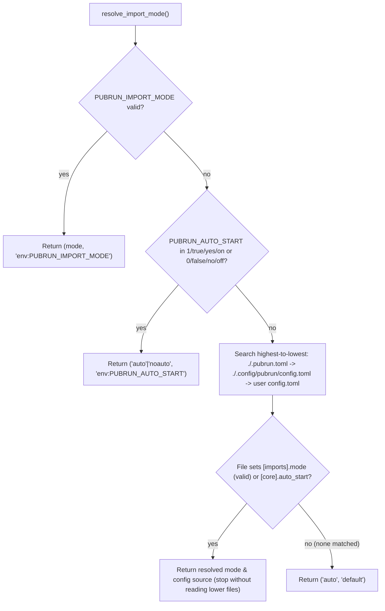

# IPD: Fix config boot discovery and capture mode or depth enforcement bugs

- Date: 2026-11-22
- Kind: child
- Concern: Bugs and correctness (configuration discovery parity at boot, non-mutating config resolution, environment allowlist mode, and per-collector `depth = "off"` enforcement).
- Scope: `src/pubrun/_config_boot.py`, `src/pubrun/config.py`, `src/pubrun/capture/environment.py`, `src/pubrun/capture/git.py`, `src/pubrun/capture/host.py`, `src/pubrun/capture/process.py`, `src/pubrun/capture/python_runtime.py`, `src/pubrun/resources/default.toml`, `docs/configuration.md`, and regression tests in `tests/test_config_capture_modes.py`.
- Scope-Paths: src/pubrun/_config_boot.py, src/pubrun/config.py, src/pubrun/capture/environment.py, src/pubrun/capture/git.py, src/pubrun/capture/host.py, src/pubrun/capture/process.py, src/pubrun/capture/python_runtime.py, src/pubrun/resources/default.toml, docs/configuration.md, tests/test_config_capture_modes.py
- Item-Dependencies: none
- Status: approved
- Readiness: go-pending-approval
- Review-Depth: complex
- Short-Description: Honor environment allowlist mode, per-collector depth=off, XDG/global boot config files, and non-mutating config resolution
- Work-Kind: bug
- Priority: medium
- Blocks-Release: next
- Set: bugs-audit
- Order: 4
- Highest E allocated: 04
- Author: Antigravity
- Id: l7ko8p
- Approval: 2026-11-22, recorded via aw ipd set: status set to approved

> Write and proofread this plan per the technical writing standard, `.aw/system/workflows/technical-writing/technical-writing.md`, including requirement 12 (diagrams).

## Workflow history

- 2026-11-22 approved (aw set): status set to approved
- 2026-11-22 /plan-review (Gemini 4 Neon (High)): APPROVE WITH REVISIONS APPLIED; PR-001 (resolved via OQ-01), PR-002, PR-003, PR-004, PR-005
- 2026-11-22 /plan-review (Gemini 4 Neon (High)): REVIEWED - OPEN QUESTIONS; PR-001, PR-002, PR-003, PR-004, PR-005
- 2026-11-22 to-review (Antigravity): authored fix steps, citations, and falsifiable validation criteria.
- 2026-11-22 draft (Antigravity): created from `/assess-bugs` audit.

## Goal

Align boot-time configuration discovery in `src/pubrun/_config_boot.py` with `src/pubrun/config.py::resolve_config` file precedence, and prevent `src/pubrun/config.py::_resolve_layers` from mutating caller override dicts or treating empty `XDG_CONFIG_HOME` as a relative path. Make all five capture collectors honor `[capture.*].depth = "off"`, enforce `[capture.environment].mode = "allowlist"` using `[capture.environment].allowlist = []` (exact names and `fnmatch.fnmatchcase` globs, fail-closed when empty, with `redact_env_vars` still applied), and document the allowlist key in `src/pubrun/resources/default.toml` and `docs/configuration.md`.

### Boot import-mode resolution flow (target behavior)



## Detailed Implementation Checklist (TODO)

Execution-state rule: mark an `E-*` item complete only after performing the action. That mark is not validation. Right-sizing rule: each E-item is one focused pass with its own V-item check (`IPD-Z603`). Accepted execution states: blocked, failed, pending, performed; terminal gate demands 'performed'.

### Task group 1: Config discovery and resolution parity

- [x] E-01 Fix `src/pubrun/config.py` (`get_global_config_dir` and `_resolve_layers`) and `src/pubrun/_config_boot.py` (`resolve_import_mode`), and add `BUG-40` and `BUG-63` regression tests in `tests/test_config_capture_modes.py`.
  - Depends on: none
  - Expected outcome: In `src/pubrun/config.py::get_global_config_dir`, empty or whitespace-only `XDG_CONFIG_HOME` (Cross-Desktop Group (XDG) base directory) and Windows `APPDATA` fall back to `~/.config/pubrun` instead of relative `./pubrun`. In `src/pubrun/config.py::_resolve_layers`, `overrides = copy.deepcopy(overrides)` ensures neither `resolve_config(overrides)` nor `resolve_config_with_provenance(overrides)` mutates nested caller dicts such as `overrides["core"]`. In `src/pubrun/_config_boot.py::resolve_import_mode`, `PUBRUN_AUTO_START` and `[core].auto_start` accept `"1"`, `"true"`, `"yes"`, `"on"` (auto) and `"0"`, `"false"`, `"no"`, `"off"` (noauto) case-insensitively, and boot config lookup walks `./.pubrun.toml`, `./.config/pubrun/config.toml`, and the user global `config.toml` (honoring non-empty `XDG_CONFIG_HOME` / `APPDATA`) in highest-to-lowest precedence order, stopping as soon as a file supplies a valid `[imports].mode` or `[core].auto_start`. Tests in `tests/test_config_capture_modes.py` isolate `HOME`/`XDG_CONFIG_HOME`/`APPDATA` with `monkeypatch` and verify all cases.
  - Execution state: performed

### Task group 2: Environment allowlist mode and `depth = "off"` enforcement

- [x] E-02 Fix `src/pubrun/capture/environment.py::get_environment` to honor `[capture.environment].depth = "off"` and `[capture.environment].mode = "allowlist"` with `[capture.environment].allowlist = []`, document the key in `src/pubrun/resources/default.toml` and `docs/configuration.md`, and add `BUG-39` environment regression tests in `tests/test_config_capture_modes.py`.
  - Depends on: none
  - Expected outcome: Setting `[capture.environment].depth = "off"` returns `{"capture_state": {"status": "suppressed"}}` (matching `mode == "off"` and `schemas/manifest.schema.json` `$defs.environment_section`) without reading `os.environ`. Setting `[capture.environment].mode = "allowlist"` reads `cfg.get("allowlist")`, filters `raw_env` using exact names and shell-style globs via `fnmatch.fnmatchcase` (ignoring non-string or empty entries), fails closed to `variables = []` when `allowlist` is empty, omitted, or not a sequence (`list`/`tuple`/`set`), and still runs `redact_env_vars` on matched entries so sensitive variables matching a glob (for example `SLURM_API_TOKEN` matching `SLURM_*`) remain redacted. `src/pubrun/resources/default.toml` (`[capture.environment]`) defines `allowlist = []`, and `docs/configuration.md` (`### [capture.environment]`) documents `allowlist` (type `list`, default `[]`, exact/`fnmatch.fnmatchcase` globs, fail-closed empty default, redaction still applied, using zero em or en dashes in newly added user-facing prose). Tests in `tests/test_config_capture_modes.py` verify `depth = "off"`, fail-closed empty/omitted/non-list allowlist, exact and case-sensitive glob matching, secret redaction on matched variables, and `resolve_config()["capture"]["environment"]["allowlist"] == []`.
  - Execution state: performed

- [x] E-03 Fix `src/pubrun/capture/git.py::get_git`, `src/pubrun/capture/host.py::get_host`, `src/pubrun/capture/process.py::get_process_info`, and `src/pubrun/capture/python_runtime.py::get_python_runtime` to honor `[capture.<section>].depth = "off"`, and add `BUG-39` collector regression tests in `tests/test_config_capture_modes.py`.
  - Depends on: none
  - Expected outcome: Each of the four collectors checks its `[capture.<section>].depth` (and `enabled is False` where applicable) at entry and returns a schema-compliant suppressed payload `{"capture_state": {"status": "suppressed"}}` (or with `"detail"` matching `host.py`) without invoking subprocesses (`git`) or collecting host, process, or Python runtime metadata when `depth == "off"`. Tests in `tests/test_config_capture_modes.py` verify all four collectors including zero `subprocess.run` calls in `get_git`.
  - Execution state: performed

### Task group 3: Full-suite regression verification

- [x] E-04 Run `tests/test_config_capture_modes.py` and the full `pytest` suite to confirm zero regressions across config, import-mode, and capture-engine tests.
  - Depends on: E-01, E-02, E-03
  - Expected outcome: `pytest tests/test_config_capture_modes.py -v` passes every regression test for `BUG-39`, `BUG-40`, and `BUG-63`, and full `pytest -q` passes with zero failures across the repository.
  - Execution state: performed

## Project conventions discovered (Step 0)

- `src/pubrun/_config_boot.py` must stay lightweight (standard library only, no heavy imports) because it runs at `import pubrun` time; keep Tom's Obvious Minimal Language (TOML) parsing minimal using the `tomllib`/`tomli` fallback already present in `_config_boot.py`.
- `src/pubrun/config.py::resolve_config` defines the canonical config file search order (lowest to highest precedence): built-in `default.toml`, user global config (`$XDG_CONFIG_HOME/pubrun/config.toml` or `~/.config/pubrun/config.toml`, or `%APPDATA%/pubrun/config.toml` on Windows), project `./.config/pubrun/config.toml`, and project `./.pubrun.toml` (`pyproject.toml` is not read by `config.py`).
- `schemas/manifest.schema.json` requires `"capture_state"` on `environment`, `git`, `host`, `process`, and `python` sections; suppressed sections return `{"capture_state": {"status": "suppressed"}}` (optionally with `"detail"`).
- Maintainer decision `OQ-01` (2026-11-22) established the `[capture.environment]` allowlist contract: `allowlist = []` in `src/pubrun/resources/default.toml` and `docs/configuration.md`, exact + `fnmatch.fnmatchcase` glob matching, fail-closed empty list, and `redact_env_vars` still applied to matched entries. Newly added prose in `docs/configuration.md` must contain no em or en dashes (`AGENTS.md`).

## Findings

| Bug ID | Severity | Remediation Risk | Location (symbol) | Defect |
|---|---|---|---|---|
| `BUG-39` | Medium | Low | `src/pubrun/capture/environment.py::get_environment`, `src/pubrun/capture/git.py::get_git`, `src/pubrun/capture/host.py::get_host`, `src/pubrun/capture/process.py::get_process_info`, `src/pubrun/capture/python_runtime.py::get_python_runtime`, `src/pubrun/resources/default.toml`, `docs/configuration.md` | Documented `[capture.environment].mode = "allowlist"` and `[capture.*].depth = "off"` settings are silently ignored, leaking unrequested env vars or executing disabled collectors; `[capture.environment].allowlist = []` (approved in `OQ-01`) must be defined, enforced, and documented. |
| `BUG-40` | Medium | Low | `src/pubrun/_config_boot.py::resolve_import_mode`, `src/pubrun/_config_boot.py::_load_local_toml` | Ignores `~/.config/pubrun/config.toml` (and `$XDG_CONFIG_HOME`) and `./.config/pubrun/config.toml` for `[imports].mode` / `[core].auto_start`, and ignores `PUBRUN_AUTO_START` values `0`/`1`/`no`/`yes`/`off`/`on`. |
| `BUG-63` | Low | Low | `src/pubrun/config.py::_resolve_layers`, `src/pubrun/config.py::get_global_config_dir` | Empty or whitespace `XDG_CONFIG_HOME=""` resolves to relative `./pubrun`; shallow `dict(overrides)` copy in `_resolve_layers` mutates caller's nested `"core"` dict in place. |

## Proposed changes (ordered, validatable)

1. In `src/pubrun/config.py`: strip `XDG_CONFIG_HOME` and Windows `APPDATA` in `get_global_config_dir` (falling back to `~/.config` when empty or whitespace), and use `copy.deepcopy(overrides)` in `_resolve_layers` so neither `resolve_config` nor `resolve_config_with_provenance` mutates caller dictionaries.
2. In `src/pubrun/_config_boot.py`: walk `./.pubrun.toml`, `./.config/pubrun/config.toml`, and the user global `config.toml` (honoring non-empty `XDG_CONFIG_HOME` / `APPDATA`) in highest-to-lowest precedence order, returning on the first file providing a valid `[imports].mode` or `[core].auto_start`; accept `"1"`, `"true"`, `"yes"`, `"on"` and `"0"`, `"false"`, `"no"`, `"off"` (case-insensitive) for both `PUBRUN_AUTO_START` and `[core].auto_start`.
3. In `src/pubrun/capture/environment.py::get_environment`, `src/pubrun/resources/default.toml`, and `docs/configuration.md`:
   - Return `{"capture_state": {"status": "suppressed"}}` when `mode == "off"` or `cfg.get("depth") == "off"` before reading `os.environ`.
   - When `mode == "allowlist"`: read `cfg.get("allowlist")`, accept only non-empty `str` patterns from a `list`/`tuple`/`set` (failing closed to `{}` when empty, omitted, or non-sequence), filter `raw_env` by `any(fnmatch.fnmatchcase(k, pat) for pat in patterns)`, and pass the filtered dict to `redact_env_vars(filtered_env, config)`.
   - Add `allowlist = []` under `[capture.environment]` in `src/pubrun/resources/default.toml` and document it in `docs/configuration.md` (`### [capture.environment]`) without em or en dashes.
4. In `src/pubrun/capture/git.py::get_git`, `src/pubrun/capture/host.py::get_host`, `src/pubrun/capture/process.py::get_process_info`, and `src/pubrun/capture/python_runtime.py::get_python_runtime`: return `{"capture_state": {"status": "suppressed"}}` (or with `"detail"` in `host.py`) at function entry whenever `cfg.get("depth") == "off"` (or `enabled is False`) before invoking any subprocess or collecting metadata.
5. Create `tests/test_config_capture_modes.py` co-located with `E-01`..`E-03`, and run full `pytest -q` in `E-04`.

## Deferred / out of scope (with reason)

None.

## Scope check

- Over-scope: none. Only the 7 config/capture source files, `src/pubrun/resources/default.toml`, `docs/configuration.md`, and 1 new test module are listed in `- Scope-Paths:`, remaining completely disjoint from all 8 sibling child plans in Set `bugs-audit`.
- Under-scope: none. `OQ-01` (`PR-001`) is resolved by the maintainer, and both `src/pubrun/resources/default.toml` and `docs/configuration.md` are now included in `- Scope-Paths:` and `E-02`.

## Required tests / validation

- Run `pytest tests/test_config_capture_modes.py -v` and paste actual output.
- Inspect `git diff -- src/pubrun/resources/default.toml docs/configuration.md` confirming `allowlist = []` is documented with zero added em or en dashes in `docs/configuration.md`.
- Run full `pytest -q` and paste actual output confirming zero regressions across `tests/test_import_modes.py`, `tests/test_capture_engines.py`, `tests/test_capture_isolation.py`, `tests/test_config_capture_modes.py`, and the entire suite.

## Spec / documentation sync

- `src/pubrun/resources/default.toml` (`[capture.environment]`) and `docs/configuration.md` (`### [capture.environment]`) are updated in `E-02` to define and document `allowlist = []` (exact and `fnmatch.fnmatchcase` glob matching, fail-closed empty list, and `[redaction]` still applied), per maintainer resolution of `OQ-01`.
- `depth = "off"`, `XDG_CONFIG_HOME`, and `PUBRUN_AUTO_START` are already documented in `src/pubrun/resources/default.toml` and `docs/configuration.md`.

## Open questions

### OQ-01: Public configuration key, matching semantics, and empty-list default for `[capture.environment].mode = "allowlist"`

- Blocking: yes
- Status: resolved
- Finding: PR-001
- Carrier: 9mxiq1
- Owner: maintainer
- Resolution or deferral rationale: `src/pubrun/resources/default.toml` (`[capture.environment]`) and `docs/configuration.md` (`### [capture.environment]`) document `mode = "allowlist"` ("Only explicitly permitted variables") without defining the configuration key name, matching rule, or empty-list default. Choosing a new public configuration key is irreversible once users write `.pubrun.toml` files and also determines whether `src/pubrun/resources/default.toml` and `docs/configuration.md` must be added to `l7ko8p`'s `- Scope-Paths:`. Recommended answer (strength: strong): define `[capture.environment].allowlist = []` in `default.toml` and `docs/configuration.md`, match variable names by exact name or shell-style glob (`fnmatch.fnmatchcase`), fail closed to `variables = []` when the allowlist is empty or omitted, and continue applying `redact_env_vars` to matched variables. RESOLVED 2026-11-22 by the user via /askme: Option 1 (Recommended): allowlist = [] with exact + fnmatch globs, fail-closed empty. No reason was given.

## Validation and cross-check (verify before reporting done)

Validation-state rule: inspect evidence in a separate pass. Do not mark a `V-*` item complete from memory or from the matching execution checkmark. Accepted validation results: blocked, failed, pass, pending; terminal gate demands 'pass'.

- [x] V-01 validates E-01
  - Required evidence: Pasted `pytest tests/test_config_capture_modes.py -v` output confirming `XDG_CONFIG_HOME=""` and whitespace fall back under `~/.config/pubrun`, `resolve_config(overrides)` and `resolve_config_with_provenance(overrides)` leave nested caller dicts unmodified, and `_config_boot.resolve_import_mode()` honors `./.pubrun.toml` > `./.config/pubrun/config.toml` > user `config.toml` and `PUBRUN_AUTO_START` values `0`/`1`/`no`/`yes`/`off`/`on`.
  - Observed evidence:
    - `python3 -m pytest tests/test_config_capture_modes.py -v --no-cov` (lane worktree, Linux, 2026-11-22): `============================== 66 passed in 1.17s ==============================`; the 44 BUG-40/BUG-63 tests in `TestGlobalConfigDir`, `TestOverridesNotMutated`, and `TestBootDiscovery` all PASSED, including:
      - `TestGlobalConfigDir::test_empty_xdg_falls_back_to_home_config[]`, `[   ]`, `[\t]` PASSED (absolute path under the isolated `HOME/.config/pubrun`); `test_empty_appdata_on_windows_falls_back[]`, `[  ]` PASSED; `test_nonempty_xdg_is_honored` PASSED.
      - `TestOverridesNotMutated::test_resolve_config_does_not_mutate_caller` PASSED, `test_resolve_config_with_provenance_does_not_mutate_caller` PASSED, `test_repeated_resolution_is_stable` PASSED (nested `overrides["core"]` equals its deep-copied snapshot after resolve).
      - `TestBootDiscovery::test_precedence_pubrun_toml_over_deep_over_user` PASSED (`noconsole` from `./.pubrun.toml`, then `nopatch` from `./.config/pubrun/config.toml`, then `minimal` from user `config.toml` as higher files are removed); `test_user_global_config_is_read`, `test_user_global_auto_start_is_read`, `test_xdg_config_home_is_honored`, `test_empty_xdg_config_home_falls_back_to_home`, `test_appdata_on_windows_is_honored`, `test_project_deep_config_is_read`, `test_higher_file_auto_start_beats_lower_file_mode`, `test_invalid_mode_in_higher_file_falls_through`, `test_malformed_higher_file_is_skipped` PASSED.
      - `test_auto_start_env_values[1-auto]`, `[true-auto]`, `[yes-auto]`, `[on-auto]`, `[YES-auto]`, `[On-auto]`, `[ TRUE -auto]`, `[0-noauto]`, `[false-noauto]`, `[no-noauto]`, `[off-noauto]`, `[NO-noauto]`, `[Off-noauto]` PASSED; `test_core_auto_start_file_values` 8 cases PASSED.
    - As a falsifiability check, with the eight pre-change source files restored from `HEAD` and the new test module kept, the same command reported `44 failed, 22 passed in 1.91s`; the new code was then restored.
    - Existing boot tests still pass, `python3 -m pytest tests/test_import_modes.py tests/test_commit_identity.py tests/test_config.py tests/test_capture_engines.py tests/test_capture_isolation.py tests/test_env_capture.py tests/test_redaction.py tests/test_show_config.py -q --no-cov`, gave `296 passed in 66.82s (0:01:06)` (includes `TestConfigBootSingleRead::test_resolve_import_mode_opens_pubrun_toml_once_on_core_fallthrough`, which keeps the at-most-once parse of `./.pubrun.toml`).
  - Result: pass

- [x] V-02 validates E-02
  - Required evidence: Pasted `pytest tests/test_config_capture_modes.py -v` output confirming `get_environment` returns `{"capture_state": {"status": "suppressed"}}` when `depth = "off"`, fails closed to `variables == []` when `mode = "allowlist"` with empty, omitted, or non-sequence `allowlist`, filters strictly by exact name and case-sensitive `fnmatch.fnmatchcase` globs while still redacting matched sensitive keys, and `resolve_config()["capture"]["environment"]["allowlist"] == []`; plus pasted `git diff -- src/pubrun/resources/default.toml docs/configuration.md` confirming `allowlist = []` documentation with zero newly added em/en dashes in `docs/configuration.md`.
  - Observed evidence:
    - `python3 -m pytest tests/test_config_capture_modes.py -v --no-cov`: `66 passed in 1.17s`; the 13 `TestEnvironmentCapture` tests PASSED: `test_default_config_defines_empty_allowlist` (`resolve_config()["capture"]["environment"]["allowlist"] == []`), `test_depth_off_suppresses_without_reading_environ` (module `os` replaced by an object whose `environ` raises; result `{"capture_state": {"status": "suppressed"}}`), `test_allowlist_fails_closed` for `[]`, omitted, `"PATH"`, `42`, `{"PATH": 1}`, `[None, 5, ""]` (`variables == []`), `test_allowlist_exact_and_glob`, `test_allowlist_glob_is_case_sensitive`, `test_allowlist_tuple_and_set_accepted`, `test_allowlist_matched_secrets_still_redacted` (`SLURM_API_TOKEN` matched by `SLURM_*` has `representation == "redacted"`, `SLURM_JOB_ID` stays plain), `test_filtered_mode_ignores_allowlist`.
    - `git diff -- src/pubrun/resources/default.toml` adds under `[capture.environment]`:
      ```
      +# Variable names captured when mode = "allowlist". Each entry is an exact
      +# name or a case-sensitive shell-style glob (fnmatch), e.g. ["PATH", "SLURM_*"].
      +# An empty list captures no variables (fail closed). Secret redaction from
      +# [redaction] still applies to matched variables. Ignored in other modes.
      +allowlist = []
      ```
    - `git diff -- docs/configuration.md` adds the `### [capture.environment]` row ``| `allowlist` | list | `[]` | Variable names captured when `mode = "allowlist"`. Each entry is an exact name or a case-sensitive shell-style glob matched with `fnmatch.fnmatchcase` ... An empty or missing list captures no variables. Secret redaction from `[redaction]` still applies ... |`` and a `depth = "off"` sentence on the environment, process, host, python, and git rows; it also updates the `PUBRUN_AUTO_START` row and the discovery section for E-01.
    - The dash check over added lines of both diffs, `git diff -- src/pubrun/resources/default.toml docs/configuration.md | grep '^+' | python3 -c "...count('\u2014')+count('\u2013')"`, printed `added em/en dashes: 0`.
  - Result: pass

- [x] V-03 validates E-03
  - Required evidence: Pasted `pytest tests/test_config_capture_modes.py -v` output confirming `get_git`, `get_host`, `get_process_info`, and `get_python_runtime` each return `capture_state.status == "suppressed"` (and `get_git` invokes zero subprocesses) when configured with `depth = "off"`.
  - Observed evidence:
    - `python3 -m pytest tests/test_config_capture_modes.py -v --no-cov`: `66 passed in 1.17s`; `TestCollectorDepthOff` PASSED: `test_git_depth_off_runs_no_subprocess` (patched `subprocess.run` recorded `calls == []`, status `suppressed`), `test_host_depth_off` (patched `platform.node` raises if called; result keys `{"capture_state"}`, status `suppressed`), `test_process_depth_off` (patched `getpass.getuser` raises if called; `{"capture_state": {"status": "suppressed"}}`), `test_python_depth_off` (`{"capture_state": {"status": "suppressed"}}`), `test_default_depth_still_collects` for host, process, python, environment (status `complete`), and `test_suppressed_payloads_validate_against_schema` (each suppressed payload validates against `git_section`, `host`, `process`, `python_runtime`, `environment_section` in `schemas/manifest.schema.json` via `jsonschema`).
  - Result: pass

- [x] V-04 validates E-04
  - Required evidence: Pasted full `pytest -q` output showing `tests/test_config_capture_modes.py` and the full repository test suite pass with zero failures.
  - Observed evidence:
    - The targeted run `python3 -m pytest tests/test_config_capture_modes.py -v --no-cov` gave `66 passed in 1.17s`.
    - The full serial suite (the plan's `pytest -q`), `python3 -m pytest -q --no-cov -p no:randomly` in the lane worktree, gave `1689 passed, 2 skipped in 530.85s (0:08:50)`.
    - Attempt 2 (recovery lane `aw/lane/l7ko8p_attempt2`, based on main `57a5489`, with attempt 1's files brought forward unchanged): `python3 -m pytest tests/test_config_capture_modes.py -v --no-cov` gave `66 passed in 2.12s`; `aw suite` gave `FAILED tests/test_liveness.py::TestIsSameProcess::test_expected_script_matches` and `1 failed, 1700 passed in 173.44s (0:02:53)`; that test alone gave `1 passed, 26 deselected in 0.14s` and alone under `-n 2` gave `1 failed in 1.78s`, so it fails only under xdist workers, independent of this plan (`git diff --name-only HEAD -- tests/test_liveness.py src/pubrun/capture/liveness.py` is empty).
    - The full parallel suite, `aw suite`, gave `FAILED tests/test_liveness.py::TestIsSameProcess::test_expected_script_matches` and `1 failed, 1690 passed in 158.52s (0:02:38)`. That test passes when run alone (`1 passed, 26 deselected in 0.26s`) and in the serial run above. It is a known failure under pytest-xdist workers, already filed as backlog `sd7kvt` and `12rcu8`: an xdist worker's command line contains no `pytest`. This plan's files do not touch it.
  - Result: pass

## Approval and execution gate

- Size assessment: standard
- Cohesion rationale: not required

Execution contract:
1. Precondition: `OQ-01` is resolved (`- Status: resolved`); wait for human approval (`- Status: approved`) with no unresolved `Blocking: yes` open questions before writing code.
2. Scope declaration: expected modified files are `- Scope-Paths:` (`src/pubrun/_config_boot.py`, `src/pubrun/config.py`, `src/pubrun/capture/environment.py`, `src/pubrun/capture/git.py`, `src/pubrun/capture/host.py`, `src/pubrun/capture/process.py`, `src/pubrun/capture/python_runtime.py`, `src/pubrun/resources/default.toml`, `docs/configuration.md`, `tests/test_config_capture_modes.py`). If execution requires modifying an out-of-scope file, justify it with `--scope-reason` at finalization; if a declared file requires no edit, acknowledge it with `--scope-ack`. Stop only for a genuinely unsafe condition such as an unresolvable concurrent-edit conflict or missing prerequisite behavior.
3. Validation honesty (HARD MUST): run the required validation commands and paste the actual runner output verbatim into each `V-*` `Observed evidence:` field; never mark a `V-*` item `pass` without captured output from that run.
4. Commit and push discipline: commit only the paths you changed through `aw commit l7ko8p -- src/pubrun/_config_boot.py src/pubrun/config.py src/pubrun/capture/environment.py src/pubrun/capture/git.py src/pubrun/capture/host.py src/pubrun/capture/process.py src/pubrun/capture/python_runtime.py src/pubrun/resources/default.toml docs/configuration.md tests/test_config_capture_modes.py` (never `git add -A` or raw `git commit`), and never push without explicit human instruction.
5. Lifecycle transition: this plan must be finalized through `aw ipd finalize l7ko8p` (never a hand-rolled `git mv` to `.aw/records/plans/executed/`). When executing inside a runner execution lane (`aw oc run` or `aw agy run`), the runner performs `aw ipd finalize` after the turn; when executing standalone outside a runner, the executor runs `aw ipd finalize l7ko8p`.
