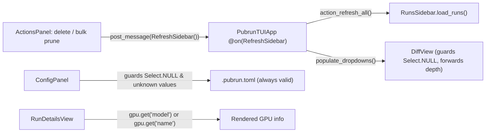

# IPD: Fix TUI widget crashes, Select.NULL handling, and sidebar refresh bugs

- Date: 2026-11-22
- Kind: child
- Concern: Bugs and correctness (TUI crashes on Textual 8.x, `Select.NULL` config corruption, broken message routing, GPU metadata display, diff depth/warnings, and degraded-run deletion).
- Scope: `src/pubrun/tui/app.py`, `src/pubrun/tui/widgets/actions.py`, `src/pubrun/tui/widgets/config.py`, `src/pubrun/tui/widgets/diff.py`, `src/pubrun/tui/widgets/details.py`, `src/pubrun/tui/widgets/viewer.py`, and regression tests in `tests/test_tui_bugs.py`.
- Scope-Paths: src/pubrun/tui/app.py, src/pubrun/tui/widgets/actions.py, src/pubrun/tui/widgets/config.py, src/pubrun/tui/widgets/diff.py, src/pubrun/tui/widgets/details.py, src/pubrun/tui/widgets/viewer.py, tests/test_tui_bugs.py
- Item-Dependencies: executed:njn1up
- Status: to-review
- Short-Description: Fix Textual 8.x renderable crash, Select.NULL corruption, RefreshSidebar handler name, GPU model display, diff depth, and degraded-run delete
- Work-Kind: bug
- Priority: high
- Blocks-Release: next
- Set: bugs-audit
- Order: 7
- Highest E allocated: 05
- Author: Antigravity
- Id: 8ebjeg

> Write and proofread this plan per the technical writing standard, `.aw/system/workflows/technical-writing/technical-writing.md`, including requirement 12 (diagrams).

## Workflow history

- 2026-11-22 draft (Antigravity): created from `/assess-bugs` audit.
- 2026-11-22 to-review (Antigravity): authored fix steps, citations, and falsifiable validation criteria.

## Goal

Eliminate all 6 confirmed TUI crash, config-corruption, stale-state, and display bugs across `PubrunTUIApp` and its five widgets, and handle `ValueError` cleanly when Bulk Prune calls `status.clean_runs` (`njn1up`).

### TUI message and widget state flow (target behavior)

## Detailed Implementation Checklist (TODO)

Execution-state rule: mark an `E-*` item complete only after performing the action. That mark is not validation. Right-sizing rule: each E-item is one focused pass with its own V-item check (`IPD-Z603`). Accepted execution states: blocked, failed, pending, performed; terminal gate demands 'performed'.

### Task group 1: App message routing and ActionsPanel fixes

- [ ] E-01 Fix `PubrunTUIApp.on_refresh_sidebar` in `src/pubrun/tui/app.py` so `RefreshSidebar` messages actually invoke `action_refresh_all()`.
  - Depends on: none
  - Expected outcome: Decorating the handler with `@on(PubrunTUIApp.RefreshSidebar)` (or renaming it to `on_pubrun_tuiapp_refresh_sidebar`) causes posting `PubrunTUIApp.RefreshSidebar()` from any widget to refresh the sidebar and diff dropdowns immediately.
  - Execution state: pending

- [ ] E-02 Fix `ActionsPanel` in `src/pubrun/tui/widgets/actions.py` for Textual 8.x `renderable` removal, `run_id is None` delete crash, and Bulk Prune `ValueError` handling.
  - Depends on: none
  - Expected outcome: `ActionsPanel` stores `self._rerun_command: str` instead of reading `Static.renderable` when copying rerun commands; deleting a degraded run with `run_id is None` safely falls back to `run_dir.name` instead of slicing `None[:8]`; Bulk Prune catches `ValueError` from `status.clean_runs` (invalid age input) and notifies the user with severity `"error"` instead of crashing.
  - Execution state: pending

### Task group 2: ConfigPanel, DiffView, RunDetailsView, and LogViewer fixes

- [ ] E-03 Fix `ConfigPanel` in `src/pubrun/tui/widgets/config.py` to guard `Select.NULL` (and `Select.BLANK`) and tolerate unknown/legacy config values on startup.
  - Depends on: none
  - Expected outcome: `ConfigPanel` never writes `"Select.NULL"` / `"Select.BLANK"` to `.pubrun.toml`; when an existing config or environment variable (such as `PUBRUN_PROFILE=standard`) holds a value outside a `Select` widget's option list, `ConfigPanel` falls back cleanly (e.g., `Select.BLANK` or default option with a warning) instead of crashing `pubrun ui` on startup.
  - Execution state: pending

- [ ] E-04 Fix `DiffView`, `RunDetailsView`, and `LogViewer` in `src/pubrun/tui/widgets/{diff,details,viewer}.py`.
  - Depends on: none
  - Expected outcome: `DiffView` treats `Select.NULL`/`Select.BLANK` as unselected (no `TypeError`), forwards the selected diff depth (`basic`/`standard`/`deep`) to `compare_manifests(..., depth=...)`, and displays hydration warnings after `output.clear()` instead of clearing them away; `RunDetailsView` reads `gpu.get("model") or gpu.get("name")` instead of only `gpu.get("name")`; `LogViewer` ignores `Select.NULL`/`Select.BLANK` selection events without printing a bogus file error.
  - Execution state: pending

### Task group 3: Regression test suite

- [ ] E-05 Add headless Textual regression tests in `tests/test_tui_bugs.py` and verify the full `pytest` suite passes.
  - Depends on: E-01, E-02, E-03, E-04
  - Expected outcome: `tests/test_tui_bugs.py` exercises all 6 TUI defects plus Bulk Prune `ValueError` handling via Textual's async test pilot or widget unit tests, and `pytest -q` passes with zero regressions.
  - Execution state: pending

## Project conventions discovered (Step 0)

- Depends on `njn1up` (Order 01) for `status.clean_runs` / `status.filter_runs` raising `ValueError` on invalid age strings.
- Textual 8.x is installed in this environment (`Static.renderable` removed; `Select.BLANK` / `Select.NULL` is a truthy sentinel object, not `None`; nested `Message` classes require `@on(Cls.Msg)` or `on_<cls_snake>_<msg_snake>`). Check `Select.BLANK` / `Select.NULL` cleanly via `getattr(Select, "BLANK", Select.NULL)` or `val in (None, Select.BLANK, Select.NULL)` for cross-version Textual safety.

## Findings

| Bug ID | Severity | Remediation Risk | Location (symbol) | Defect |
|---|---|---|---|---|
| `BUG-13` | High | Low | `tui.widgets.actions.ActionsPanel.on_button_pressed` | Reads `Static.renderable` to copy rerun command, crashing with `AttributeError` on Textual 8.x. |
| `BUG-14` | High | Low | `tui.widgets.diff.DiffView`, `tui.widgets.config.ConfigPanel`, `tui.widgets.viewer.LogViewer` | Textual `Select.NULL` is truthy and not `None`, crashing `DiffView`, writing `"Select.NULL"` to `.pubrun.toml` in `ConfigPanel` (breaking future startups; also crashes on unknown config values), and triggering bogus errors in `LogViewer`. |
| `BUG-15` | High | Low | `tui.app.PubrunTUIApp.on_refresh_sidebar` | Wrong Textual handler name for nested `PubrunTUIApp.RefreshSidebar`, so sidebar and diff dropdowns stay stale after delete/prune. |
| `BUG-51` | Medium | Low | `tui.widgets.details.RunDetailsView.display_run` | Reads `gpu.get('name')` instead of `gpu.get('model')`, always rendering `None`. |
| `BUG-52` | Medium | Low | `tui.widgets.diff.DiffView` | Ignores selected depth (`compare_manifests` defaults to `"basic"`) and wipes hydration warnings with `output.clear()`. |
| `BUG-53` | Medium | Low | `tui.widgets.actions.ActionsPanel` | Deleting a degraded run with `run_id is None` crashes on `None[:8]` (`TypeError`). |

## Proposed changes (ordered, validatable)

1. In `src/pubrun/tui/app.py`: bind `on_refresh_sidebar` with `@on(RefreshSidebar)` (importing `on` from `textual`) so `RefreshSidebar` messages trigger `action_refresh_all()`.
2. In `src/pubrun/tui/widgets/actions.py`: store `self._rerun_command` when displaying a run and copy from that attribute; format run labels safely when `run_id is None`; catch `ValueError` in Bulk Prune and show an error notification.
3. In `src/pubrun/tui/widgets/config.py`: add a helper `_is_select_empty(val)` checking `val is None or val == Select.NULL or val == getattr(Select, "BLANK", Select.NULL)`, guard TOML writes, and clamp unknown config values to a valid option on mount.
4. In `src/pubrun/tui/widgets/diff.py`, `details.py`, and `viewer.py`: guard empty `Select` values, pass `depth` to `compare_manifests`, emit hydration warnings after `output.clear()`, and read `gpu.get("model") or gpu.get("name")`.
5. Add `tests/test_tui_bugs.py`.

## Deferred / out of scope (with reason)

None.

## Scope check

- Over-scope: none.
- Under-scope: none.

## Required tests / validation

- Run `pytest tests/test_tui_bugs.py -v` and paste actual output.
- Run full `pytest -q` and paste actual output confirming zero regressions.

## Spec / documentation sync

N/A: internal TUI bug fixes preserving existing layout and keybindings.

## Open questions

None.

## Validation and cross-check (verify before reporting done)

Validation-state rule: inspect evidence in a separate pass. Do not mark a `V-*` item complete from memory or from the matching execution checkmark. Accepted validation results: blocked, failed, pass, pending; terminal gate demands 'pass'.

- [ ] V-01 validates E-01
  - Required evidence: Pasted `pytest tests/test_tui_bugs.py -v` output confirming posting `PubrunTUIApp.RefreshSidebar()` triggers `action_refresh_all()` and updates sidebar/diff dropdowns.
  - Observed evidence:
  - Result: pending

- [ ] V-02 validates E-02
  - Required evidence: Pasted `pytest tests/test_tui_bugs.py -v` output confirming Copy Rerun works on Textual 8.x without accessing `Static.renderable`, deleting a `run_id=None` run succeeds without `TypeError`, and invalid Bulk Prune age notifies cleanly without crashing.
  - Observed evidence:
  - Result: pending

- [ ] V-03 validates E-03
  - Required evidence: Pasted `pytest tests/test_tui_bugs.py -v` output confirming `ConfigPanel` never writes `"Select.NULL"` to `.pubrun.toml` and mounts cleanly when config/env holds an unknown value like `PUBRUN_PROFILE=standard`.
  - Observed evidence:
  - Result: pending

- [ ] V-04 validates E-04
  - Required evidence: Pasted `pytest tests/test_tui_bugs.py -v` output confirming `DiffView` ignores `Select.NULL`, passes selected depth to `compare_manifests`, and retains hydration warnings; `RunDetailsView` displays `gpu["model"]`; `LogViewer` ignores `Select.NULL`.
  - Observed evidence:
  - Result: pending

- [ ] V-05 validates E-05
  - Required evidence: Pasted full `pytest -q` summary confirming `tests/test_tui_bugs.py` and the full test suite pass with zero failures.
  - Observed evidence:
  - Result: pending

## Approval and execution gate

- Size assessment: standard
- Cohesion rationale: not required

Wait for human approval (`- Status: approved`) before executing. Commit only files listed in `Scope-Paths` via `aw commit 8ebjeg -- src/pubrun/tui/app.py src/pubrun/tui/widgets/actions.py src/pubrun/tui/widgets/config.py src/pubrun/tui/widgets/diff.py src/pubrun/tui/widgets/details.py src/pubrun/tui/widgets/viewer.py tests/test_tui_bugs.py`, then move this plan to `.aw/records/plans/executed/` through the post-gate lifecycle transition.
