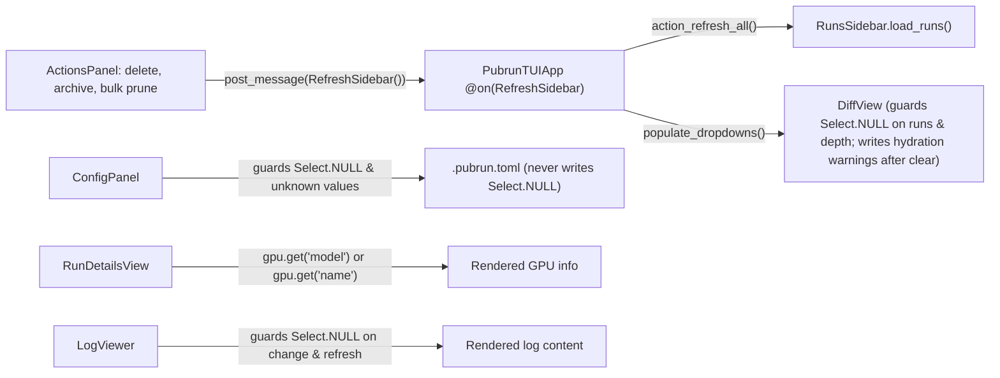

# IPD: Fix TUI widget crashes, Select.NULL handling, and sidebar refresh bugs

- Date: 2026-11-22
- Kind: child
- Concern: Bugs and correctness (Terminal User Interface widget crashes, `Select.NULL` config corruption and blank-selection handling, broken message routing, Graphics Processing Unit metadata display, diff depth fallback and warning preservation, and degraded-run deletion).
- Scope: `src/pubrun/tui/app.py`, `src/pubrun/tui/widgets/actions.py`, `src/pubrun/tui/widgets/config.py`, `src/pubrun/tui/widgets/diff.py`, `src/pubrun/tui/widgets/details.py`, `src/pubrun/tui/widgets/viewer.py`, and regression tests in `tests/test_tui_bugs.py`.
- Scope-Paths: src/pubrun/tui/app.py, src/pubrun/tui/widgets/actions.py, src/pubrun/tui/widgets/config.py, src/pubrun/tui/widgets/diff.py, src/pubrun/tui/widgets/details.py, src/pubrun/tui/widgets/viewer.py, tests/test_tui_bugs.py
- Item-Dependencies: executed:njn1up
- Status: approved
- Readiness: go-pending-approval
- Review-Depth: complex
- Short-Description: Fix TUI Select.NULL corruption, RefreshSidebar handler routing, GPU model display, diff depth/warnings, and degraded-run delete
- Work-Kind: bug
- Priority: high
- Blocks-Release: next
- Set: bugs-audit
- Order: 7
- Highest E allocated: 05
- Author: Antigravity
- Id: 8ebjeg
- Approval: 2026-11-22, recorded via aw ipd set: status set to approved

> Write and proofread this plan per the technical writing standard, `.aw/system/workflows/technical-writing/technical-writing.md`, including requirement 12 (diagrams).

## Workflow history

- 2026-11-22 approved (aw set): status set to approved
- 2026-11-22 /plan-review (Gemini 4 Neon (High)): APPROVE WITH REVISIONS APPLIED; PR-001, PR-002, PR-003, PR-004, PR-005, PR-006
- 2026-11-22 to-review (Antigravity): authored fix steps, citations, and falsifiable validation criteria.
- 2026-11-22 draft (Antigravity): created from `/assess-bugs` audit.

## Goal

Eliminate all confirmed Terminal User Interface (TUI) crash, configuration-corruption, stale-state, and display bugs across `src/pubrun/tui/app.py::PubrunTUIApp` and its five affected widgets (`actions.py`, `config.py`, `diff.py`, `details.py`, and `viewer.py`). Preserve the already-fixed `ActionsPanel.rerun_command` clipboard path on Textual 8.x, and handle `ValueError` cleanly when Bulk Prune calls `src/pubrun/status.py::clean_runs` (`njn1up`).

### TUI message and widget state flow (target behavior)

## Detailed Implementation Checklist (TODO)

Execution-state rule: mark an `E-*` item complete only after performing the action. That mark is not validation. Right-sizing rule: each E-item is one focused pass with its own V-item check (`IPD-Z603`). Accepted execution states: blocked, failed, pending, performed; terminal gate demands 'performed'.

### Task group 1: App message routing and ActionsPanel fixes

- [ ] E-01 Fix `src/pubrun/tui/app.py::PubrunTUIApp.on_refresh_sidebar` so posted `RefreshSidebar` messages invoke `action_refresh_all()`, and add regression tests in `tests/test_tui_bugs.py`.
  - Depends on: none
  - Expected outcome: `src/pubrun/tui/app.py::PubrunTUIApp.on_refresh_sidebar` is decorated with `@on(RefreshSidebar)` (importing `on` from `textual`), resolving the mismatch with Textual's derived nested-message handler name `on_pubrun_tuiapp_refresh_sidebar`. Posting `app.RefreshSidebar()` from any widget (such as after deleting, archiving with delete, or bulk pruning) invokes `action_refresh_all()` and refreshes both `#sidebar` (`RunsSidebar.load_runs()`) and `#diff-view` (`DiffView.populate_dropdowns(...)`). Tests in `tests/test_tui_bugs.py` cover `BUG-15`.
  - Execution state: pending

- [ ] E-02 Fix degraded-run deletion (`run_id is None`) and Bulk Prune `older_than` delegation and `ValueError` handling in `src/pubrun/tui/widgets/actions.py`, while preserving `ActionsPanel.rerun_command` on Textual 8.x, and add regression tests in `tests/test_tui_bugs.py`.
  - Depends on: E-01
  - Expected outcome: `src/pubrun/tui/widgets/actions.py::ActionsPanel` retains its public `self.rerun_command` attribute (already replacing `Static.renderable` and pinned by `tests/test_tui.py::TestTuiReproducibilityAndActions::test_actions_panel_redacted_advisory_clearing_and_clean_clipboard`, never renaming it to `_rerun_command`). Deleting a degraded run whose `run_id` is `None` passes `self.run_info.run_id or self.run_info.run_dir.name` into `ConfirmDeleteModal`, guards `(self.run_id or "unknown")[:8]` inside `ConfirmDeleteModal.compose`, uses `(self.run_info.run_id or self.run_info.run_dir.name)[:8]` in `handle_deletion_result` instead of slicing `None[:8]`, and clears `self.run_info` via `self.display_run(None)` after deletion. `ActionsPanel.run_bulk_prune` delegates `older_than=older_val or None` directly to `src/pubrun/status.py::clean_runs` (supporting `d`, `h`, `m`, `s`, and bare numeric days via `njn1up`'s canonical parser rather than duplicating incomplete parsing), catches `ValueError` from `clean_runs` on invalid/negative/non-finite ages (such as `"2w"`, `"abc"`, `"-5d"`, `"nan"`, `"inf"`), writes the error to `#cleanup-log-output`, notifies the user with `severity="error"`, leaves run directories untouched, and does not post `RefreshSidebar`. Tests in `tests/test_tui_bugs.py` cover `BUG-13` (regression guard), `BUG-53`, and `njn1up` Bulk Prune `ValueError` handling.
  - Execution state: pending

### Task group 2: ConfigPanel, DiffView, RunDetailsView, and LogViewer fixes

- [ ] E-03 Fix `src/pubrun/tui/widgets/config.py::ConfigPanel` to guard `Select.NULL` safely without matching `Widget.BLANK` (`False`), prevent `"Select.NULL"` Tom's Obvious Minimal Language (TOML) writes, and tolerate unknown or legacy config values on mount, adding regression tests in `tests/test_tui_bugs.py`.
  - Depends on: none
  - Expected outcome: `src/pubrun/tui/widgets/config.py` defines `_is_select_empty(val: Any) -> bool` checking `val is None or val == Select.NULL or ((blank := Select.__dict__.get("BLANK")) is not None and val == blank)` (using `Select.__dict__.get("BLANK")` so Textual 8.x's inherited `Widget.BLANK = False` is never treated as an empty sentinel and `False`/`0` are never misclassified). `ConfigPanel.save_settings` skips writing any `Select` whose value satisfies `_is_select_empty(val)` so `"Select.NULL"` is never written to `.pubrun.toml`. `ConfigPanel.load_settings` validates each loaded `Select` value (`core.profile`, `console.capture_mode`, `redaction.representation`) against that widget's allowed option values before assigning `.value`; when a config file or environment variable (such as `PUBRUN_PROFILE=standard`) supplies an unknown value, it sets the widget to `Select.NULL` (never `Select.BLANK`, which raises `InvalidSelectValueError` in Textual 8.x) and emits a warning notification so `pubrun ui` mounts cleanly without crashing and saving does not corrupt the setting. Tests in `tests/test_tui_bugs.py` cover `BUG-14` (`ConfigPanel`).
  - Execution state: pending

- [ ] E-04 Fix `Select.NULL` guards and hydration warnings in `src/pubrun/tui/widgets/diff.py::DiffView`, Graphics Processing Unit (GPU) model rendering in `src/pubrun/tui/widgets/details.py::RunDetailsView.update_general_pane`, and `Select.NULL` guards in `src/pubrun/tui/widgets/viewer.py::LogViewer`, adding regression tests in `tests/test_tui_bugs.py`.
  - Depends on: E-03
  - Expected outcome: `src/pubrun/tui/widgets/diff.py::DiffView.run_difference` uses `_is_select_empty` (imported from `pubrun.tui.widgets.config` or an equivalent helper avoiding `Widget.BLANK = False`) on `#select-diff-a`, `#select-diff-b`, and `#select-diff-depth`: blank Run A or Run B shows the "Please select both Run A and Run B" error instead of raising `TypeError` on `Path(Select.NULL)` or falsely reporting self-comparison; blank `#select-diff-depth` falls back cleanly to `"basic"` instead of passing `Select.NULL` into `ignore_deep` and `compare_manifests`; and hydration warnings `(warn_a or []) + (warn_b or [])` are passed to `render_diff_report(diff_report, warnings=...)` and written to `#diff-output-area` after `output.clear()` so warnings are preserved visibly. `src/pubrun/tui/widgets/details.py::RunDetailsView.update_general_pane` guards non-dict `host`/`hardware`/`cpu`/`gpu` entries and displays `_escape_markup(str(gpu.get("model") or gpu.get("name") or "unknown"))` alongside `gpu.get("driver_version") or "-"` so real manifests (`hardware.gpus[*].model`) render the GPU model instead of `None`. `src/pubrun/tui/widgets/viewer.py::LogViewer` guards both `on_select_changed` (`event.value`) and `on_button_pressed` (`#btn-refresh-log`, `select_widget.value`) with `_is_select_empty` so blank selections never call `load_log_file("Select.NULL")` or print a bogus missing-file error. Tests in `tests/test_tui_bugs.py` cover `BUG-14` (`DiffView`, `LogViewer`), `BUG-51`, and `BUG-52`.
  - Execution state: pending

### Task group 3: Full-suite regression verification

- [ ] E-05 Run `tests/test_tui_bugs.py`, `tests/test_tui.py`, and the full `pytest` regression suite to confirm zero regressions.
  - Depends on: E-01, E-02, E-03, E-04
  - Expected outcome: `pytest tests/test_tui_bugs.py tests/test_tui.py -v` and full `pytest -q` pass with zero failures and zero skipped regressions on Textual 8.x.
  - Execution state: pending

## Project conventions discovered (Step 0)

- Depends on `njn1up` (Order 01, `- Item-Dependencies: executed:njn1up`) for `src/pubrun/status.py::clean_runs` and `src/pubrun/status.py::filter_runs` supporting `d`/`h`/`m`/`s`/bare days and raising `ValueError` on invalid or non-finite age strings.
- Textual `8.2.8` is installed in this environment (`Static.renderable` is removed; `Select.NULL` is a truthy `textual.widgets._select.NoSelection` sentinel; `Select` does not define `BLANK`, so `Select.BLANK` inherits `textual.widget.Widget.BLANK == False` and MUST NOT be assigned to `Select.value` or compared with `==` via `getattr(Select, "BLANK", ...)`; nested `Message` classes require `@on(RefreshSidebar)` or `on_pubrun_tuiapp_refresh_sidebar`).
- `src/pubrun/tui/widgets/actions.py::ActionsPanel` already replaced `Static.renderable` with `self.rerun_command` (commit `29081f4` / `3lqtlt`), and `tests/test_tui.py::TestTuiReproducibilityAndActions::test_actions_panel_redacted_advisory_clearing_and_clean_clipboard` pins `panel.rerun_command`; keep the public attribute name intact.
- `src/pubrun/capture/hardware.py::_get_gpus` and `schemas/manifest.schema.json` (`$defs.gpu_record`) store GPU names under `"model"` (not `"name"`).
- Tests must exercise real Textual widgets via `app.run_test()` Pilot or direct widget invocations and assert observable widget outputs, notifications, files, and state (no code-pinning via `inspect`, `ast`, or source regex).

## Findings

| Bug ID | Severity | Remediation Risk | Location (symbol) | Defect |
|---|---|---|---|---|
| `BUG-13` | High | Low | `src/pubrun/tui/widgets/actions.py::ActionsPanel.on_button_pressed` | Originally read `Static.renderable` (removed in Textual 8.x); already replaced by `self.rerun_command` on `main` (pinned by `tests/test_tui.py:374,390`). Keep `self.rerun_command` intact and add a regression check in `tests/test_tui_bugs.py` covering lock-only runs too. |
| `BUG-14` | High | Low | `src/pubrun/tui/widgets/diff.py::DiffView.run_difference`, `src/pubrun/tui/widgets/config.py::ConfigPanel`, `src/pubrun/tui/widgets/viewer.py::LogViewer` | Textual `Select.NULL` is truthy (`bool(Select.NULL) is True`) and not `None`, causing `DiffView` to crash on `Path(Select.NULL)` (or falsely report self-comparison when both are blank), `ConfigPanel.save_settings` to write `"Select.NULL"` into `.pubrun.toml` (plus `load_settings` crashing with `InvalidSelectValueError` on unknown config/env values such as `PUBRUN_PROFILE=standard`), and `LogViewer` (`on_select_changed` and `#btn-refresh-log`) to call `load_log_file("Select.NULL")`. |
| `BUG-15` | High | Low | `src/pubrun/tui/app.py::PubrunTUIApp.on_refresh_sidebar` | Missing `@on(RefreshSidebar)` decorator (Textual expects `on_pubrun_tuiapp_refresh_sidebar` for nested `PubrunTUIApp.RefreshSidebar`), so sidebar and diff dropdowns stay stale after delete, archive-and-delete, or bulk prune. |
| `BUG-51` | Medium | Low | `src/pubrun/tui/widgets/details.py::RunDetailsView.update_general_pane` | Reads `gpu.get('name')` instead of `gpu.get('model')` (the key written by `src/pubrun/capture/hardware.py::_get_gpus`), always rendering `None` for real manifests. |
| `BUG-52` | Medium | Low | `src/pubrun/tui/widgets/diff.py::DiffView.run_difference`, `src/pubrun/tui/widgets/diff.py::DiffView.render_diff_report` | `depth = ...value or "basic"` fails when `#select-diff-depth` is blank (`Select.NULL` is truthy, falling into `ignore_deep` and passing `depth=Select.NULL` to `compare_manifests`); hydration warnings written before `render_diff_report` are immediately wiped by `output.clear()`. |
| `BUG-53` | Medium | Low | `src/pubrun/tui/widgets/actions.py::ConfirmDeleteModal.compose`, `src/pubrun/tui/widgets/actions.py::ActionsPanel.handle_deletion_result` | Deleting a degraded run with `run_id is None` crashes with `TypeError` on `self.run_id[:8]` inside `ConfirmDeleteModal.compose` and on `self.run_info.run_id[:8]` inside `handle_deletion_result`. |

## Proposed changes (ordered, validatable)

1. In `src/pubrun/tui/app.py`: import `on` from `textual` and decorate `PubrunTUIApp.on_refresh_sidebar` with `@on(RefreshSidebar)` so posted `RefreshSidebar` messages trigger `action_refresh_all()`.
2. In `src/pubrun/tui/widgets/actions.py`: preserve `self.rerun_command`; pass `self.run_info.run_id or self.run_info.run_dir.name` to `ConfirmDeleteModal`, guard `(self.run_id or "unknown")[:8]` in `ConfirmDeleteModal.compose`, use `(self.run_info.run_id or self.run_info.run_dir.name)[:8]` and clear `self.display_run(None)` in `handle_deletion_result`; in `run_bulk_prune`, pass `older_than=older_val or None` directly to `clean_runs` (removing duplicated incomplete `d`/`h`/float parsing) and catch `ValueError` to log to `#cleanup-log-output` and notify with `severity="error"` without posting `RefreshSidebar`.
3. In `src/pubrun/tui/widgets/config.py`: add `_is_select_empty(val)` using `Select.__dict__.get("BLANK")` (never matching inherited `Widget.BLANK = False`); skip writing empty `Select` values in `save_settings`; and validate loaded `Select` values in `load_settings` against each widget's option values, falling back to `Select.NULL` with a warning notification when an unknown value is encountered.
4. In `src/pubrun/tui/widgets/diff.py`, `src/pubrun/tui/widgets/details.py`, and `src/pubrun/tui/widgets/viewer.py`: use `_is_select_empty` in `DiffView.run_difference` (for Run A, Run B, and depth defaulting to `"basic"`), pass hydration warnings into `render_diff_report(diff_report, warnings=...)` and write them after `output.clear()`; in `RunDetailsView.update_general_pane`, guard non-dict `host`/`hardware`/`cpu`/`gpu` entries and render `_escape_markup(str(gpu.get("model") or gpu.get("name") or "unknown"))`; and use `_is_select_empty` in both `LogViewer.on_select_changed` and `LogViewer.on_button_pressed` (`#btn-refresh-log`).
5. Add `tests/test_tui_bugs.py` testing all fixes via Textual's async `app.run_test()` Pilot and widget unit tests, and run full `pytest -q`.

## Deferred / out of scope (with reason)

None.

## Scope check

- Over-scope: none. Only the 6 TUI files in `src/pubrun/tui/` and `tests/test_tui_bugs.py` are modified, remaining completely disjoint from all other child plans in Set `bugs-audit`.
- Under-scope: none. All 6 TUI findings (`BUG-13`..`BUG-15`, `BUG-51`..`BUG-53`), the `LogViewer` Refresh button `Select.NULL` bug, `ConfirmDeleteModal` + `handle_deletion_result` `None` slicing, and `njn1up` Bulk Prune `ValueError` handling are covered.

## Required tests / validation

- Run `pytest tests/test_tui_bugs.py tests/test_tui.py -v` and paste actual output.
- Run full `pytest -q` and paste actual output confirming zero regressions across the entire repository test suite.

## Spec / documentation sync

- No external documentation changes under `docs/` or `README.md` are required: `docs/cli.md` and `docs/functional_spec.md` do not document internal TUI widget event handlers, `Select.NULL` sentinels, or GPU field keys, and `njn1up` already synchronizes `--older-than` age-filter documentation in `docs/cli.md` and `docs/functional_spec.md`. This plan brings TUI behavior into alignment with existing UI controls and `njn1up`'s duration contract without changing keybindings or layout.

## Open questions

None.

## Validation and cross-check (verify before reporting done)

Validation-state rule: inspect evidence in a separate pass. Do not mark a `V-*` item complete from memory or from the matching execution checkmark. Accepted validation results: blocked, failed, pass, pending; terminal gate demands 'pass'.

- [ ] V-01 validates E-01
  - Required evidence: Pasted `pytest tests/test_tui_bugs.py -v` output confirming posting `PubrunTUIApp.RefreshSidebar()` invokes `action_refresh_all()` and updates both `#sidebar` (`RunsSidebar`) and `#diff-view` (`DiffView`) dropdowns.
  - Observed evidence:
  - Result: pending

- [ ] V-02 validates E-02
  - Required evidence: Pasted `pytest tests/test_tui_bugs.py -v` output confirming `ActionsPanel.rerun_command` works for Copy Rerun on Textual 8.x (including lock-only runs) without touching `Static.renderable`, deleting a degraded run with `run_id=None` opens `ConfirmDeleteModal` and completes `handle_deletion_result` without `TypeError`, and Bulk Prune handles valid `m`/`s` ages while invalid/negative/non-finite ages (`"2w"`, `"abc"`, `"-5d"`, `"nan"`) notify with `severity="error"`, log the failure, delete nothing, and do not crash.
  - Observed evidence:
  - Result: pending

- [ ] V-03 validates E-03
  - Required evidence: Pasted `pytest tests/test_tui_bugs.py -v` output confirming `_is_select_empty(Select.NULL)` is `True` while `_is_select_empty(False)` and `_is_select_empty(0)` are `False`, `ConfigPanel.save_settings` never writes `"Select.NULL"` to `.pubrun.toml`, and `ConfigPanel` mounts cleanly (setting `Select.NULL` with a warning, never raising `InvalidSelectValueError`) when config or environment holds an unknown value such as `PUBRUN_PROFILE=standard`.
  - Observed evidence:
  - Result: pending

- [ ] V-04 validates E-04
  - Required evidence: Pasted `pytest tests/test_tui_bugs.py -v` output confirming `DiffView` rejects blank `Select.NULL` Run A/B without `TypeError` or false self-comparison, falls back from blank `Select.NULL` depth to `"basic"` (and passes explicit `"standard"`/`"deep"` cleanly), preserves hydration warnings in `#diff-output-area` after `output.clear()`, `RunDetailsView.update_general_pane` displays `gpu["model"]` (falling back to `gpu["name"]`), and `LogViewer` ignores `Select.NULL` on both `on_select_changed` and `#btn-refresh-log`.
  - Observed evidence:
  - Result: pending

- [ ] V-05 validates E-05
  - Required evidence: Pasted `pytest tests/test_tui_bugs.py tests/test_tui.py -v` output and full `pytest -q` summary confirming all TUI tests and the full repository test suite pass with zero failures.
  - Observed evidence:
  - Result: pending

## Approval and execution gate

- Size assessment: standard
- Cohesion rationale: not required

Execution contract:
1. Precondition: wait for human approval (`- Status: approved`) with no unresolved `Blocking: yes` open questions before writing code.
2. Scope declaration: expected modified files are `- Scope-Paths:` (`src/pubrun/tui/app.py`, `src/pubrun/tui/widgets/actions.py`, `src/pubrun/tui/widgets/config.py`, `src/pubrun/tui/widgets/diff.py`, `src/pubrun/tui/widgets/details.py`, `src/pubrun/tui/widgets/viewer.py`, `tests/test_tui_bugs.py`). If execution requires modifying an out-of-scope file, justify it with `--scope-reason` at finalization; if a declared file requires no edit, acknowledge it with `--scope-ack`. Stop only for a genuinely unsafe condition such as an unresolvable concurrent-edit conflict or missing prerequisite behavior.
3. Validation honesty (HARD MUST): run the required validation commands and paste the actual runner output verbatim into each `V-*` `Observed evidence:` field; never mark a `V-*` item `pass` without captured output from that run.
4. Commit and push discipline: commit only the paths you changed through `aw commit 8ebjeg -- src/pubrun/tui/app.py src/pubrun/tui/widgets/actions.py src/pubrun/tui/widgets/config.py src/pubrun/tui/widgets/diff.py src/pubrun/tui/widgets/details.py src/pubrun/tui/widgets/viewer.py tests/test_tui_bugs.py` (never `git add -A` or raw `git commit`), and never push without explicit human instruction.
5. Lifecycle transition: this plan must be finalized through `aw ipd finalize 8ebjeg` (never a hand-rolled `git mv` to `.aw/records/plans/executed/`). When executing inside a runner execution lane (`aw oc run` or `aw agy run`), the runner performs `aw ipd finalize` after the turn; when executing standalone outside a runner, the executor runs `aw ipd finalize 8ebjeg`.
