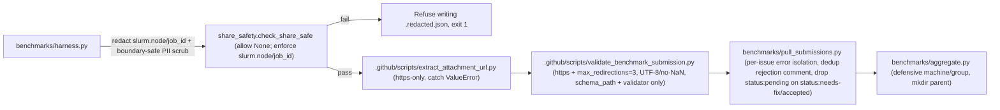

# IPD: Fix benchmark redaction, intake validation, and aggregation bugs

- Date: 2026-11-22
- Kind: child
- Concern: Bugs and correctness (benchmark privacy redaction, share-safety verification, GitHub intake security/resilience, corpus-safe aggregation, and idempotent submission pulling).
- Scope: `benchmarks/harness.py`, `benchmarks/share_safety.py`, `benchmarks/aggregate.py`, `benchmarks/pull_submissions.py`, `.github/scripts/extract_attachment_url.py`, `.github/scripts/validate_benchmark_submission.py`, and regression tests in `tests/test_benchmark_intake_bugs.py`.
- Scope-Paths: benchmarks/harness.py, benchmarks/share_safety.py, benchmarks/aggregate.py, benchmarks/pull_submissions.py, .github/scripts/extract_attachment_url.py, .github/scripts/validate_benchmark_submission.py, tests/test_benchmark_intake_bugs.py
- Item-Dependencies: none
- Status: approved
- Readiness: go-pending-approval
- Review-Depth: complex
- Short-Description: Fix share_safety None handling, Slurm hostname leak, short-username redaction corruption, intake URL/schema/NaN safety, and aggregate crashes
- Work-Kind: bug
- Priority: high
- Blocks-Release: next
- Set: bugs-audit
- Order: 8
- Highest E allocated: 05
- Author: Antigravity
- Id: 8k73qj
- Approval: 2026-11-22, recorded via aw ipd set: status set to approved

> Write and proofread this plan per the technical writing standard, `.aw/system/workflows/technical-writing/technical-writing.md`, including requirement 12 (diagrams).

## Workflow history

- 2026-11-22 approved (aw set): status set to approved
- 2026-11-22 /plan-review (Gemini 4 Neon (High)): APPROVE WITH REVISIONS APPLIED; PR-001, PR-002, PR-003, PR-004, PR-005
- 2026-11-22 to-review (Antigravity): authored fix steps, citations, and falsifiable validation criteria.
- 2026-11-22 draft (Antigravity): created from `/assess-bugs` audit.

## Goal

Fix 10 confirmed privacy-leak, intake-security, crash, and corpus-poisoning bugs across the benchmark redaction pipeline, GitHub submission validator, corpus aggregator, and pull script. Harden Personally Identifiable Information (PII) scrubbing and Slurm field redaction so benchmark outputs never leak hostnames or corrupt JavaScript Object Notation (JSON) schema markers. Harden Uniform Resource Locator (URL) parsing, Hypertext Transfer Protocol Secure (HTTPS) enforcement, strict JSON parsing, non-leaking schema errors, defensive corpus aggregation, and idempotent issue handling.

### Benchmark submission and intake pipeline (target safety boundaries)



## Detailed Implementation Checklist (TODO)

Execution-state rule: mark an `E-*` item complete only after performing the action. That mark is not validation. Right-sizing rule: each E-item is one focused pass with its own V-item check (`IPD-Z603`). Accepted execution states: blocked, failed, pending, performed; terminal gate demands 'performed'.

### Task group 1: Benchmark redaction and share-safety fixes

- [x] E-01 Fix `benchmarks/share_safety.py::check_share_safe` and `benchmarks/harness.py` (`redact_result`, `_redact_secrets`, `_scrub_pii_substrings`, and `main` self-check gating), and add `BUG-18`, `BUG-19`, `BUG-20`, and `BUG-54` regression tests in `tests/test_benchmark_intake_bugs.py`.
  - Depends on: none
  - Expected outcome: `benchmarks/share_safety.py::check_share_safe` adds `"machine.slurm.node"` and `"machine.slurm.job_id"` to `_MUST_BE_REDACTED`, allows `None` for any field in `_MUST_BE_REDACTED` (so `machine.python.virtual_env = None` on non-venv runs and optional `None` fields pass), and rejects any non-`None` value not equal to `"<redacted>"` (catching both strings and non-string values such as integer `job_id`). `benchmarks/harness.py::redact_result` redacts `machine["slurm"]["node"]` and `machine["slurm"]["job_id"]` (whenever present and non-`None`, while preserving `partition`, `cpus_per_task`, `mem_per_node`, and `num_nodes`). `benchmarks/harness.py::_scrub_pii_substrings` preserves its 2-argument signature, skips exact `"<redacted>"` sentinels and fixed non-PII metadata/schema keys (`"schema"`, `"mode"`, `"group"`, `"workload"`, `"fstype"`, `"environment_kind"`, `"os_name"`, `"platform"`, `"architecture"`, `"implementation"`, `"pubrun_version"`, `"pubrun_commit"`, `"git_commit"`), splits strings around `"<redacted>"` segments before scrubbing, replaces path-like needles (`/` or `\`) literally (longest first), and replaces username needles using identifier boundaries (`(?<![A-Za-z0-9_])<user>(?![A-Za-z0-9_])`), so users `"ed"` and `"mark"` never corrupt `"<redacted>"` or `"pubrun-benchmark/5"` while standalone and path-embedded usernames are still scrubbed. In `benchmarks/harness.py::main`, only `ImportError` is ignored for optional `share_safety` import; if `check_share_safe` returns `ok == False` (or raises), `main()` prints an error to `stderr`, refuses to write `*.redacted.json`, and exits non-zero (`sys.exit(1)`). Tests in `tests/test_benchmark_intake_bugs.py` cover all four bugs.
  - Execution state: performed

### Task group 2: GitHub intake URL extractor and validator hardening

- [x] E-02 Fix `.github/scripts/extract_attachment_url.py::find_attachment_url` and `.github/scripts/validate_benchmark_submission.py` (`_download`, `parse_json`, `check_schema`), and add `BUG-21`, `BUG-22` (extractor/validator), `BUG-23`, and `BUG-55` regression tests in `tests/test_benchmark_intake_bugs.py`.
  - Depends on: none
  - Expected outcome: `.github/scripts/extract_attachment_url.py::find_attachment_url` wraps `urlparse(url)` and `parsed.hostname` in `try/except ValueError` (preventing crashes on malformed Internet Protocol version 6 (IPv6) or port URLs), requires `parsed.scheme.lower() == "https"` (rejecting `http://` links with a clear HTTPS error while preserving existing error substrings for empty body, no URL, off-allowlist host, and non-`.json` attachments). `.github/scripts/validate_benchmark_submission.py::_download` validates `parsed.scheme.lower() == "https"` and `host in ALLOWED_ATTACHMENT_HOSTS` inside `try/except ValueError` on both the initial URL and every redirect target in `_NoFollow.redirect_request`, sets `max_redirections = 3` (alongside `max_repeats = 3`) on `_NoFollow`, and catches `(urllib.error.URLError, http.client.HTTPException, TimeoutError, OSError, ValueError)` as `Reject("shape", ...)`. `parse_json` catches `(OSError, UnicodeDecodeError)` (rejecting bad 8-bit Unicode Transformation Format (UTF-8) as `Reject("parse", ...)`) and passes `parse_constant` to `json.loads` to reject non-standard Not a Number (`NaN`), `Infinity`, and `-Infinity` as `Reject("parse", ...)`. `check_schema` sorts errors by `[str(p) for p in e.schema_path]` (avoiding `int` vs `str` sort `TypeError`) and builds its rejection reason strictly from `first.schema_path` and `first.validator` (never interpolating `first.message`, `first.instance`, or untrusted user-keyed `first.path` values into public GitHub comments). Tests in `tests/test_benchmark_intake_bugs.py` cover all cases.
  - Execution state: performed

### Task group 3: Corpus aggregation and `pull_submissions.py` fixes

- [x] E-03 Fix `benchmarks/aggregate.py` (`_load`, `_machine_label`, `_scenarios_view`, `build_rows`, `write_markdown`, `write_csv`) against corpus poisoning and missing parent directories, and add `BUG-24` regression tests in `tests/test_benchmark_intake_bugs.py`.
  - Depends on: none
  - Expected outcome: `_load` skips non-dict JSON documents with a warning to `stderr`; `_machine_label` guards `machine`, `hardware`, `cpu`, and `host` with `isinstance(..., dict)` checks (and treats `cpu.model = None` as `"?"`); `_scenarios_view` and `build_rows` normalize missing/non-string/`null` `group` values to `"?"` and guard non-dict scenario entries; `write_markdown` sorts rows with string-safe keys so `group: null` never raises `TypeError`; and both `write_csv` and `write_markdown` call `path.parent.mkdir(parents=True, exist_ok=True)` before writing output files. Tests in `tests/test_benchmark_intake_bugs.py` cover `group: null`, non-dict `machine.hardware`/`cpu`/`host`, non-dict JSON input, and nonexistent output subdirectories.
  - Execution state: performed

- [x] E-04 Fix `benchmarks/pull_submissions.py` (`_retag`, `process`, `_print_report`) for per-issue error isolation, duplicate rejection comment suppression, and `status:pending` removal fallback, and add `BUG-22` (pull batch) and `BUG-56` regression tests in `tests/test_benchmark_intake_bugs.py`.
  - Depends on: E-02
  - Expected outcome: In `benchmarks/pull_submissions.py::process`, initialize `"errors": []` in `report`, keep `_v.Reject` routed to `report["rejected"]` + `_retag(..., accepted=False, ...)`, and wrap per-issue processing in a defensive `except Exception as exc:` that records `{"issue": num, "reason": f"{type(exc).__name__}"}` (payload-free) in `report["errors"]` without mislabeling the issue or aborting subsequent issues in the batch (and display any errors in `_print_report`). In `_retag`, preserve the canonical `_LABEL_NEEDS_FIX` (`"status:needs-fix"`) and `_LABEL_ACCEPTED` (`"status:accepted"`) labels; keep the primary `gh issue edit --add-label <add> --remove-label <remove> --remove-label status:pending` call first, and on `PullError` fall back first to `gh issue edit ... --add-label <add> --remove-label status:pending` and only if that also fails to `gh issue edit ... --add-label <add>`. Before posting a rejection comment under `--apply`, query existing comments via `_run_gh(["issue", "view", str(int(issue_number)), "--repo", repo, "--json", "comments"])` (defaulting cleanly to no prior comments if output is empty, non-JSON, or raises `PullError`), embed the marker `<!-- pubrun-benchmark-pull-reject:v1 -->` in the rejection comment body, and skip posting when an existing comment already contains that marker and the same `- reason: {reason}` line. Preserve the no-eval/no-shell invariant tested by `benchmarks/test_pull_submissions.py::test_no_eval_exec_in_source`. Tests in `tests/test_benchmark_intake_bugs.py` cover all cases.
  - Execution state: performed

### Task group 4: Full-suite and dedicated benchmark/intake contract verification

- [x] E-05 Run `tests/test_benchmark_intake_bugs.py`, `tests/test_bench_command.py`, the dedicated benchmark and `.github/scripts` test suites, and the full `pytest` suite to confirm all 10 bugs pass with zero regressions.
  - Depends on: E-01, E-02, E-03, E-04
  - Expected outcome: `pytest tests/test_benchmark_intake_bugs.py tests/test_bench_command.py -v`, `pytest -o addopts="" benchmarks/test_share_safety.py benchmarks/test_pull_submissions.py .github/scripts/test_extract_attachment_url.py .github/scripts/test_validate_benchmark_submission.py -v`, and full `pytest -q` all pass with zero failures.
  - Execution state: performed

## Project conventions discovered (Step 0)

- `.github/scripts/validate_benchmark_submission.py` outputs a JSON verdict consumed by `.github/workflows/benchmark-intake.yml`, which posts `verdict.reason` directly in a public GitHub issue comment; `reason` must never include raw submission values or untrusted user-supplied keys.
- `benchmarks/pull_submissions.py` and `.github/workflows/benchmark-intake.yml` use the three status labels `status:pending`, `status:accepted`, and `status:needs-fix` (never `status:rejected`).
- `pyproject.toml` configures `testpaths = ["tests"]`, so bare `pytest -q` does NOT collect `benchmarks/test_share_safety.py`, `benchmarks/test_pull_submissions.py`, `.github/scripts/test_extract_attachment_url.py`, or `.github/scripts/test_validate_benchmark_submission.py`; those suites must be invoked explicitly with `-o addopts=""` during verification.
- `benchmarks/test_pull_submissions.py::test_retag_apply_accepts_drops_pending_argv` asserts `seen[0]` is the combined `issue edit` call with `--add-label status:accepted` and `--remove-label status:pending`, and `test_retag_apply_rejection_comments` mocks `_run_gh` returning `""` and asserts `"needs fix"` and the reason appear in the posted comment body.
- `tests/test_bench_command.py::TestRedaction` pins that `redact_result` scrubs `getpass.getuser()` and `os.path.expanduser("~")` from un-enumerated string fields while preserving `machine.slurm.partition`, `machine.hardware.cpu`, `machine.python.environment_kind`, and `pass_results[*].timings`.
- All new tests must assert observable behavior and outputs, never inspect source code strings.

## Findings

| Bug ID | Severity | Remediation Risk | Location (symbol) | Defect |
|---|---|---|---|---|
| `BUG-18` | High | Low | `benchmarks/share_safety.py::check_share_safe` | Non-venv runs set `machine.python.virtual_env = None`, which fails `val != "<redacted>"` on every non-venv machine. |
| `BUG-19` | High | Low | `benchmarks/harness.py::redact_result`, `benchmarks/share_safety.py::check_share_safe` | `machine.slurm.node` (real compute-node hostname) and `machine.slurm.job_id` leak unredacted into `*.redacted.json` and pass `check_share_safe()`. |
| `BUG-20` | High | Low | `benchmarks/harness.py::_scrub_pii_substrings` | Unanchored `str.replace(getpass.getuser(), "<redacted>")` corrupts `"<redacted>"` (user `ed`) and `schema` `"pubrun-benchmark/5"` (user `mark`/`pub`/`run`). |
| `BUG-21` | High | Low | `.github/scripts/validate_benchmark_submission.py::check_schema` | Interpolates `jsonschema`'s `first.message` verbatim (and sorts mixed `int`/`str` `e.path`), leaking raw unredacted payload values into public GitHub bot comments. |
| `BUG-22` | High | Low | `.github/scripts/extract_attachment_url.py::find_attachment_url`, `.github/scripts/validate_benchmark_submission.py::_download`, `.github/scripts/validate_benchmark_submission.py::parse_json`, `benchmarks/pull_submissions.py::process` | Unhandled `ValueError` (bad IPv6/port), `http.client.HTTPException` / `InvalidURL`, `UnicodeDecodeError`, `TimeoutError`/`OSError`, and per-issue exceptions crash the intake workflow and abort pull batches. |
| `BUG-23` | High | Low | `.github/scripts/extract_attachment_url.py::find_attachment_url`, `.github/scripts/validate_benchmark_submission.py::_download` (`_NoFollow`) | Missing `https`-only scheme check allows `http://`/`ftp://`/`file://` on allowlisted hosts or redirects; `_NoFollow` sets `max_repeats = 3` but omits `max_redirections = 3` (leaving urllib's default of 10). |
| `BUG-24` | High | Low | `benchmarks/aggregate.py::_load`, `_machine_label`, `build_rows`, `write_markdown`, `write_csv` | Schema-valid `group: null` or non-dict `machine.hardware`/`cpu`/`host` crashes `aggregate.py`; missing `path.parent` raises `FileNotFoundError`. |
| `BUG-54` | Medium | Low | `benchmarks/harness.py::main` | Prints a warning on `check_share_safe` failure (and swallows all exceptions via bare `except Exception:`) while still writing unsafe `*.redacted.json` and exiting 0. |
| `BUG-55` | Medium | Low | `.github/scripts/validate_benchmark_submission.py::parse_json` | `json.loads` accepts non-standard `NaN`/`Infinity`/`-Infinity`. |
| `BUG-56` | Medium | Low | `benchmarks/pull_submissions.py::_retag` | Posts duplicate rejection comments on every `--apply` run; fallback `gh issue edit` drops `--remove-label status:pending` when applying `status:accepted` or `status:needs-fix`. |

## Proposed changes (ordered, validatable)

1. In `benchmarks/share_safety.py`: add `"machine.slurm.node"` and `"machine.slurm.job_id"` to `_MUST_BE_REDACTED`; treat `val is _MISSING or val is None` as safe and reject any non-`None` value where `val != REDACTED`.
2. In `benchmarks/harness.py`:
   - In `_redact_secrets` / `redact_result`: redact `machine["slurm"]["node"]` and `machine["slurm"]["job_id"]` (when present and non-`None`) while preserving non-identifying Slurm fields (`partition`, `cpus_per_task`, `mem_per_node`, `num_nodes`).
   - In `_scrub_pii_substrings`: skip exact `_REDACTED` values and fixed metadata/schema keys; split strings on `_REDACTED` so already-redacted tokens are never re-scrubbed; replace path-like needles (`/` or `\`) literally (longest first) and username needles with `(?<![A-Za-z0-9_])<user>(?![A-Za-z0-9_])`.
   - In `main()`: catch only `ImportError` when importing `share_safety`; if `check_share_safe` returns `not ok` (or raises), print an error to `stderr`, do not write `red_path`, and exit 1 (`sys.exit(1)`).
3. In `.github/scripts/extract_attachment_url.py` and `.github/scripts/validate_benchmark_submission.py`:
   - In `extract_attachment_url.py::find_attachment_url`: catch `ValueError` on `urlparse(url)`/`parsed.hostname`, require `parsed.scheme.lower() == "https"`, and return a clear HTTPS rejection when only non-HTTPS URLs match.
   - In `validate_benchmark_submission.py::_download`: validate `parsed.scheme.lower() == "https"` and allowlisted host inside `try/except ValueError` on both the initial URL and `_NoFollow.redirect_request`; set `max_redirections = 3` on `_NoFollow`; catch `(urllib.error.URLError, http.client.HTTPException, TimeoutError, OSError, ValueError)` as `Reject("shape", ...)`.
   - In `validate_benchmark_submission.py::parse_json`: catch `(OSError, UnicodeDecodeError)` and pass `parse_constant` rejecting `NaN`/`Infinity`/`-Infinity`.
   - In `validate_benchmark_submission.py::check_schema`: sort errors by `[str(p) for p in e.schema_path]` and format the rejection reason solely from `first.schema_path` and `first.validator` (zero `first.message`, `first.instance`, or user-keyed `first.path` interpolation).
4. In `benchmarks/aggregate.py` and `benchmarks/pull_submissions.py`:
   - In `aggregate.py`: skip non-dict JSON in `_load`, guard `machine`/`hardware`/`cpu`/`host` as dicts in `_machine_label` (`cpu.model or "?"`), normalize `group` (`str` fallback `"?"`) in `build_rows`, use string-safe sort keys in `write_markdown`, and call `path.parent.mkdir(parents=True, exist_ok=True)` in both `write_csv` and `write_markdown`.
   - In `pull_submissions.py`: add `"errors": []` to `process()` report with defensive per-issue `except Exception` isolation (printed in `_print_report`); in `_retag`, try `--add-label <add> --remove-label status:pending` before `--add-label <add>` in the `PullError` fallback, and deduplicate rejection comments using `<!-- pubrun-benchmark-pull-reject:v1 -->` plus exact `- reason: {reason}` lookup via `gh issue view --json comments` (degrading cleanly when empty/mocked).
5. Create `tests/test_benchmark_intake_bugs.py` co-located with `E-01` through `E-04`, and run the targeted tests, dedicated benchmark/`.github/scripts` suites, and full `pytest -q` in `E-05`.

## Deferred / out of scope (with reason)

None.

## Scope check

- Over-scope: none. Only the 6 benchmark/intake scripts and 1 new test file in `Scope-Paths` are modified, remaining completely disjoint from all 8 sibling child plans in Set `bugs-audit`.
- Under-scope: none. All 10 confirmed bugs have concrete fixes, backward-compatible contracts with existing tests, and dedicated behavioral regression coverage.

## Required tests / validation

- Run `pytest tests/test_benchmark_intake_bugs.py tests/test_bench_command.py -v` and paste actual output.
- Run `pytest -o addopts="" benchmarks/test_share_safety.py benchmarks/test_pull_submissions.py .github/scripts/test_extract_attachment_url.py .github/scripts/test_validate_benchmark_submission.py -v` and paste actual output.
- Run full `pytest -q` and paste actual output confirming zero regressions across the repository.

## Spec / documentation sync

- No external documentation or schema changes are required: `schemas/benchmark.schema.json` remains at `pubrun-benchmark/5`, `.github/workflows/benchmark-intake.yml` already documents and enforces `status:pending`/`status:accepted`/`status:needs-fix` and payload-free rejection comments, and `benchmarks/README.md`, `benchmarks/data/README.md`, and `docs/cli.md` already document share-safety gating and idempotent local pull behavior. This plan brings the scripts into conformance with those existing contracts.

## Open questions

None.

## Validation and cross-check (verify before reporting done)

Validation-state rule: inspect evidence in a separate pass. Do not mark a `V-*` item complete from memory or from the matching execution checkmark. Accepted validation results: blocked, failed, pass, pending; terminal gate demands 'pass'.

- [x] V-01 validates E-01
  - Required evidence: Pasted `pytest tests/test_benchmark_intake_bugs.py -v` output confirming `machine.python.virtual_env = None` passes `check_share_safe`, `machine.slurm.node` and `machine.slurm.job_id` (both string and integer) are redacted by `redact_result` and enforced by `check_share_safe`, usernames `"ed"` and `"mark"` do not corrupt `"<redacted>"` or `"pubrun-benchmark/5"` while standalone/path usernames are still scrubbed, and failed `check_share_safe` prevents writing `*.redacted.json` and exits non-zero.
  - Observed evidence:
    ```text
    $ python3 -m pytest -o addopts="" tests/test_benchmark_intake_bugs.py -v   (2026-11-22, attempt 2 lane 8k73qj_attempt2, commit 09487a3; re-run, 72 passed in 0.91s)
    TestShareSafetyNone::test_virtual_env_none_is_safe PASSED
    TestShareSafetyNone::test_every_must_be_redacted_field_may_be_none PASSED
    TestShareSafetyNone::test_non_none_unredacted_value_still_rejected PASSED
    TestSlurmRedaction::test_redact_result_masks_node_and_job_id[4815162342_0] PASSED
    TestSlurmRedaction::test_redact_result_masks_node_and_job_id[4815162342_1] PASSED
    TestSlurmRedaction::test_redact_result_leaves_absent_slurm_fields_absent PASSED
    TestSlurmRedaction::test_check_share_safe_rejects_unredacted_slurm[node-cn-0423] PASSED
    TestSlurmRedaction::test_check_share_safe_rejects_unredacted_slurm[job_id-12345_0] PASSED
    TestSlurmRedaction::test_check_share_safe_rejects_unredacted_slurm[job_id-12345_1] PASSED
    TestScrubBoundaries::test_short_username_does_not_corrupt_markers_or_schema[ed] PASSED
    TestScrubBoundaries::test_short_username_does_not_corrupt_markers_or_schema[mark] PASSED
    TestScrubBoundaries::test_short_username_does_not_corrupt_markers_or_schema[pub] PASSED
    TestScrubBoundaries::test_short_username_does_not_corrupt_markers_or_schema[run] PASSED
    TestScrubBoundaries::test_short_username_does_not_corrupt_markers_or_schema[benchmark] PASSED
    TestScrubBoundaries::test_pre_redacted_value_is_not_rescanned PASSED
    TestScrubBoundaries::test_path_needle_replaced_literally_longest_first PASSED
    TestScrubBoundaries::test_non_string_values_untouched PASSED
    TestHarnessSelfCheckGate::test_failed_self_check_exits_nonzero_and_writes_nothing PASSED
    TestHarnessSelfCheckGate::test_self_check_exception_exits_nonzero PASSED
    TestHarnessSelfCheckGate::test_passing_self_check_writes_file PASSED
    ... (20 of the file's tests listed for this item; whole file: 72 passed in 0.91s)
    ```
  - Result: pass

- [x] V-02 validates E-02
  - Required evidence: Pasted `pytest tests/test_benchmark_intake_bugs.py -v` output confirming `http://`, `ftp://`, `file://`, redirect downgrade/excess-redirect (>3), and malformed IPv6 URLs (`https://[invalid/a.json`) are cleanly rejected without tracebacks, `NaN`/`Infinity` and invalid UTF-8 bytes are cleanly rejected at `"parse"` stage, and `check_schema` rejection `reason` contains only schema path and validator keyword without interpolating raw secret values or user-supplied keys.
  - Observed evidence:
    ```text
    $ python3 -m pytest -o addopts="" tests/test_benchmark_intake_bugs.py -v   (2026-11-22, attempt 2 lane 8k73qj_attempt2, commit 09487a3; re-run, 72 passed in 0.91s)
    TestExtractorUrlSafety::test_malformed_url_does_not_raise[https://[invalid/a.json] PASSED
    TestExtractorUrlSafety::test_malformed_url_does_not_raise[https://github.com:99999/a.json] PASSED
    TestExtractorUrlSafety::test_malformed_url_does_not_raise[https://github.com:abc/a.json] PASSED
    TestExtractorUrlSafety::test_malformed_url_skipped_then_valid_wins PASSED
    TestExtractorUrlSafety::test_http_allowlisted_json_rejected_with_https_error PASSED
    TestExtractorUrlSafety::test_resolve_source_rejects_http PASSED
    TestExtractorUrlSafety::test_existing_errors_preserved PASSED
    TestValidatorDownload::test_bad_initial_url_rejected_before_fetch[http://github.com/a.json] PASSED
    TestValidatorDownload::test_bad_initial_url_rejected_before_fetch[ftp://github.com/a.json] PASSED
    TestValidatorDownload::test_bad_initial_url_rejected_before_fetch[file://github.com/etc/a.json] PASSED
    TestValidatorDownload::test_bad_initial_url_rejected_before_fetch[https://[invalid/a.json] PASSED
    TestValidatorDownload::test_bad_initial_url_rejected_before_fetch[https://github.com:99999/a.json] PASSED
    TestValidatorDownload::test_redirect_limits_bounded PASSED
    TestValidatorDownload::test_redirect_downgrade_or_offlist_rejected[http://github.com/a.json] PASSED
    TestValidatorDownload::test_redirect_downgrade_or_offlist_rejected[https://evil.example.com/a.json] PASSED
    TestValidatorDownload::test_redirect_downgrade_or_offlist_rejected[https://[invalid/a.json] PASSED
    TestValidatorDownload::test_redirect_allowed_target_proceeds PASSED
    TestValidatorDownload::test_excess_redirects_rejected PASSED
    TestValidatorDownload::test_transport_errors_become_rejects[exc0] PASSED
    TestValidatorDownload::test_transport_errors_become_rejects[exc1] PASSED
    TestValidatorDownload::test_transport_errors_become_rejects[exc2] PASSED
    TestValidatorDownload::test_transport_errors_become_rejects[exc3] PASSED
    TestValidatorDownload::test_http_exception_becomes_reject PASSED
    TestValidatorParse::test_invalid_utf8_rejected_at_parse PASSED
    TestValidatorParse::test_non_standard_constants_rejected_at_parse[NaN] PASSED
    TestValidatorParse::test_non_standard_constants_rejected_at_parse[Infinity] PASSED
    TestValidatorParse::test_non_standard_constants_rejected_at_parse[-Infinity] PASSED
    TestValidatorParse::test_nan_in_timings_rejected_at_parse PASSED
    TestSchemaReasonPayloadFree::test_bad_value_not_echoed PASSED
    TestSchemaReasonPayloadFree::test_user_supplied_key_not_echoed PASSED
    TestSchemaReasonPayloadFree::test_mixed_int_and_str_paths_sort_without_typeerror PASSED
    ... (31 of the file's tests listed for this item; whole file: 72 passed in 0.91s)
    ```
  - Result: pass

- [x] V-03 validates E-03
  - Required evidence: Pasted `pytest tests/test_benchmark_intake_bugs.py -v` output confirming `aggregate.py` handles `group: null`, non-dict `machine.hardware`/`cpu`/`host`, and non-dict JSON input without raising, and writes both Comma-Separated Values (CSV) and Markdown into a nonexistent output subdirectory.
  - Observed evidence:
    ```text
    $ python3 -m pytest -o addopts="" tests/test_benchmark_intake_bugs.py -v   (2026-11-22, attempt 2 lane 8k73qj_attempt2, commit 09487a3; re-run, 72 passed in 0.91s)
    TestAggregateHardening::test_group_null_does_not_crash PASSED
    TestAggregateHardening::test_non_dict_machine_blocks_do_not_crash[not-a-dict] PASSED
    TestAggregateHardening::test_non_dict_machine_blocks_do_not_crash[machine1] PASSED
    TestAggregateHardening::test_non_dict_machine_blocks_do_not_crash[machine2] PASSED
    TestAggregateHardening::test_non_dict_machine_blocks_do_not_crash[machine3] PASSED
    TestAggregateHardening::test_non_dict_json_skipped_with_warning PASSED
    TestAggregateHardening::test_non_dict_scenario_entries_ignored PASSED
    TestAggregateHardening::test_writers_create_missing_parent_dirs PASSED
    ... (8 of the file's tests listed for this item; whole file: 72 passed in 0.91s)
    ```
  - Result: pass

- [x] V-04 validates E-04
  - Required evidence: Pasted `pytest tests/test_benchmark_intake_bugs.py -v` output confirming `pull_submissions.py` isolates per-issue transport/unexpected errors in `report["errors"]` and continues processing remaining issues, suppresses duplicate rejection comments on repeated `--apply` runs while still commenting on a new reason, and passes `--add-label status:needs-fix` (or `status:accepted`) with `--remove-label status:pending` in the fallback path.
  - Observed evidence:
    ```text
    $ python3 -m pytest -o addopts="" tests/test_benchmark_intake_bugs.py -v   (2026-11-22, attempt 2 lane 8k73qj_attempt2, commit 09487a3; re-run, 72 passed in 0.91s)
    TestPullIsolation::test_unexpected_error_isolated_and_batch_continues PASSED
    TestPullIsolation::test_print_report_shows_errors PASSED
    TestPullRetag::test_repeat_rejection_same_reason_not_reposted PASSED
    TestPullRetag::test_same_reason_without_marker_still_posts PASSED
    TestPullRetag::test_unreadable_comments_degrade_to_posting[] PASSED
    TestPullRetag::test_unreadable_comments_degrade_to_posting[not PASSED
    TestPullRetag::test_unreadable_comments_degrade_to_posting[[1,2]] PASSED
    TestPullRetag::test_unreadable_comments_degrade_to_posting[{"comments": PASSED
    TestPullRetag::test_view_failure_degrades_to_posting PASSED
    TestPullRetag::test_fallback_still_drops_pending[True-status:accepted] PASSED
    TestPullRetag::test_fallback_still_drops_pending[False-status:needs-fix] PASSED
    TestPullRetag::test_final_fallback_adds_label_only PASSED
    TestPullRetag::test_primary_edit_first_and_no_fallback_on_success PASSED
    ... (13 of the file's tests listed for this item; whole file: 72 passed in 0.91s)
    ```
  - Result: pass

- [x] V-05 validates E-05
  - Required evidence: Pasted output of `pytest tests/test_benchmark_intake_bugs.py tests/test_bench_command.py -v`, `pytest -o addopts="" benchmarks/test_share_safety.py benchmarks/test_pull_submissions.py .github/scripts/test_extract_attachment_url.py .github/scripts/test_validate_benchmark_submission.py -v`, and full `pytest -q` confirming zero failures across all suites.
  - Observed evidence:
    ```text
    Attempt 2 (lane 8k73qj_attempt2, commit 09487a3), re-run 2026-11-22:

    $ python3 -m pytest tests/test_benchmark_intake_bugs.py tests/test_bench_command.py -v -p no:randomly   (default addopts; coverage table elided)
    ======================= 135 passed in 377.51s (0:06:17) ========================

    $ python3 -m pytest -o addopts="" benchmarks/test_share_safety.py benchmarks/test_pull_submissions.py .github/scripts/test_extract_attachment_url.py .github/scripts/test_validate_benchmark_submission.py -v
    collecting ... collected 64 items
    ... (all 64 PASSED, including test_retag_apply_accepts_drops_pending_argv, test_retag_apply_rejection_comments, test_no_eval_exec_in_source)
    ============================== 64 passed in 1.09s ==============================

    $ python3 -m pytest -q   (full suite, project addopts: single process; coverage table elided)
    TOTAL                                  15360   3634    76%
    1434 passed, 2 skipped in 546.90s (0:09:06)

    Additional (not required): aw suite (6 xdist workers) -> 3 failed, 1433 passed. Failures:
    tests/test_liveness.py::TestIsSameProcess::test_expected_script_matches (tracked as backlog 12rcu8) and
    two tests/test_tui.py::TestTuiReproducibilityAndActions tests. Both TUI tests pass single-process
    (2 passed in 1.48s); tests/test_tui.py under -n 6 fails a different TUI test each run, and the untouched
    base commit a3546cd (git archive into /tmp) fails tests/test_tui.py under -n 6 in 3 of 3 runs, so these are
    pre-existing order/parallelism defects (sys.modules leak tracked as backlog pgcmea), not caused by this
    plan. No file this plan touches is imported by tests/test_tui.py or tests/test_liveness.py.
    ```
  - Result: pass

## Approval and execution gate

- Size assessment: standard
- Cohesion rationale: not required

Execution does not begin until a human approves this plan (`- Status: approved`).

### Execution contract
1. **Resolved open questions:** Do not begin execution while any `- Blocking: yes` open question remains open (`None` currently).
2. **Scope declaration:** This plan declares edits to `benchmarks/harness.py`, `benchmarks/share_safety.py`, `benchmarks/aggregate.py`, `benchmarks/pull_submissions.py`, `.github/scripts/extract_attachment_url.py`, `.github/scripts/validate_benchmark_submission.py`, and `tests/test_benchmark_intake_bugs.py`. If execution requires editing an additional file, make the edit and justify it with `--scope-reason` at finalize; if a declared file needs no edit, acknowledge it with `--scope-ack`. Stop and report only on a genuinely unsafe condition (such as an unresolvable concurrent-edit conflict or an unexpected missing symbol).
3. **Honesty rule (HARD MUST):** Every claim that tests or checks pass MUST include the actual pasted runner output in the corresponding `V-*` `Observed evidence:` field and execution report. Never claim passing results from memory or partial runs.
4. **Path-scoped commit and never-push:** Commit only files you modified for this plan through `aw commit 8k73qj -- benchmarks/harness.py benchmarks/share_safety.py benchmarks/aggregate.py benchmarks/pull_submissions.py .github/scripts/extract_attachment_url.py .github/scripts/validate_benchmark_submission.py tests/test_benchmark_intake_bugs.py` (plus any justified out-of-scope file, if applicable). Never run `git add -A`, `git commit -a`, or `git push`.
5. **Lifecycle transition (post-gate):** Once all `E-*` items are `performed` and all `V-*` items are `pass` with pasted evidence, this plan must reach `.aw/records/plans/executed/` through `aw ipd finalize 8k73qj` (never a hand-rolled `git mv`). When executed inside a managed runner lane (`aw oc run` / `aw agy run`), the runner owns `aw ipd finalize 8k73qj` after lane integration; when executed standalone outside a runner, the executor runs `aw ipd finalize 8k73qj` directly.
