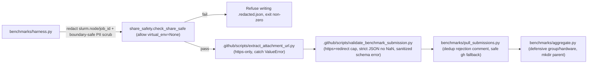

# IPD: Fix benchmark redaction, intake validation, and aggregation bugs

- Date: 2026-11-22
- Kind: child
- Concern: Bugs and correctness (benchmark privacy redaction, share-safety verification, GitHub intake security/resilience, corpus-safe aggregation, and idempotent submission pulling).
- Scope: `benchmarks/harness.py`, `benchmarks/share_safety.py`, `benchmarks/aggregate.py`, `benchmarks/pull_submissions.py`, `.github/scripts/extract_attachment_url.py`, `.github/scripts/validate_benchmark_submission.py`, and regression tests in `tests/test_benchmark_intake_bugs.py`.
- Scope-Paths: benchmarks/harness.py, benchmarks/share_safety.py, benchmarks/aggregate.py, benchmarks/pull_submissions.py, .github/scripts/extract_attachment_url.py, .github/scripts/validate_benchmark_submission.py, tests/test_benchmark_intake_bugs.py
- Item-Dependencies: none
- Status: to-review
- Short-Description: Fix share_safety None handling, Slurm hostname leak, short-username redaction corruption, intake URL/schema/NaN safety, and aggregate crashes
- Work-Kind: bug
- Priority: high
- Blocks-Release: next
- Set: bugs-audit
- Order: 8
- Highest E allocated: 05
- Author: Antigravity
- Id: 8k73qj

> Write and proofread this plan per the technical writing standard, `.aw/system/workflows/technical-writing/technical-writing.md`, including requirement 12 (diagrams).

## Workflow history

- 2026-11-22 draft (Antigravity): created from `/assess-bugs` audit.
- 2026-11-22 to-review (Antigravity): authored fix steps, citations, and falsifiable validation criteria.

## Goal

Fix 10 confirmed privacy-leak, intake-security, crash, and corpus-poisoning bugs across the benchmark redaction pipeline, GitHub submission validator, corpus aggregator, and pull script.

### Benchmark submission and intake pipeline (target safety boundaries)

## Detailed Implementation Checklist (TODO)

Execution-state rule: mark an `E-*` item complete only after performing the action. That mark is not validation. Right-sizing rule: each E-item is one focused pass with its own V-item check (`IPD-Z603`). Accepted execution states: blocked, failed, pending, performed; terminal gate demands 'performed'.

### Task group 1: Benchmark redaction and share-safety fixes

- [ ] E-01 Fix `benchmarks/share_safety.py` (`check_share_safe`) and `benchmarks/harness.py` (`redact_result`, `_scrub_pii_substrings`, and self-check failure gating).
  - Depends on: none
  - Expected outcome: `check_share_safe` accepts `machine.python.virtual_env = None` on non-venv runs while rejecting unredacted strings; `redact_result` redacts `machine.slurm.node` and `machine.slurm.job_id` (and `check_share_safe` enforces their redaction when present); `_scrub_pii_substrings` avoids corrupting `"<redacted>"` or schema identifiers (`"pubrun-benchmark/5"`) when the username is a short substring like `"ed"` or `"mark"` (using path/word-boundary matching and skipping already-redacted sentinels and fixed schema keys); when the redaction self-check fails, `harness.py` refuses to write `*.redacted.json` and exits non-zero.
  - Execution state: pending

### Task group 2: GitHub intake URL extractor and validator hardening

- [ ] E-02 Fix `.github/scripts/extract_attachment_url.py` and `.github/scripts/validate_benchmark_submission.py` for scheme enforcement, error handling, strict JSON, and non-leaking schema errors.
  - Depends on: none
  - Expected outcome: Both scripts enforce `https`-only URLs (rejecting `http://`, `ftp://`, `file://` on both initial URL and redirect targets) and cap redirects (`max_redirections = 3`); malformed URLs (`ValueError` on bad IPv6, `http.client.InvalidURL`), bad UTF-8 (`UnicodeDecodeError`), and transport errors (`HTTPException`/`TimeoutError`) return clean structured rejections instead of unhandled tracebacks; `json.loads` passes `parse_constant` that rejects `NaN`/`Infinity`/`-Infinity`; `check_schema` reports only the schema path and validator keyword/constraint without interpolating raw user payload values into public GitHub comments.
  - Execution state: pending

### Task group 3: Corpus aggregation and `pull_submissions.py` fixes

- [ ] E-03 Fix `benchmarks/aggregate.py` (`build_rows`, `write_markdown`, `write_csv`) against corpus poisoning and missing parent directories.
  - Depends on: none
  - Expected outcome: `aggregate.py` handles `group: null` (defaulting safely to `""` or `"unknown"` for sorting) and non-dict `machine.hardware` without raising `TypeError`/`AttributeError`, and creates `path.parent.mkdir(parents=True, exist_ok=True)` in `write_markdown` and `write_csv`.
  - Execution state: pending

- [ ] E-04 Fix `benchmarks/pull_submissions.py` for per-issue error isolation, duplicate rejection comment suppression, and label-removal fallback.
  - Depends on: E-02
  - Expected outcome: Network/HTTP/JSON failures on a single issue record an error for that issue instead of aborting the whole batch; `--apply` checks whether an identical rejection marker/comment already exists before posting so repeated runs do not spam duplicate comments; the `gh issue edit` fallback removes `status:pending` when applying `status:rejected`/`status:accepted`.
  - Execution state: pending

### Task group 4: Regression test suite

- [ ] E-05 Add regression tests in `tests/test_benchmark_intake_bugs.py` and verify the full `pytest` suite passes.
  - Depends on: E-01, E-02, E-03, E-04
  - Expected outcome: `tests/test_benchmark_intake_bugs.py` exercises all 10 bugs above with mocked/temporary payloads, and `pytest -q` passes with zero regressions.
  - Execution state: pending

## Project conventions discovered (Step 0)

- `.github/scripts/validate_benchmark_submission.py` outputs a JSON verdict consumed by `.github/workflows/benchmark-intake.yml`, which posts `reason` directly in a public GitHub issue comment; `reason` must never include raw unredacted submission values.
- Existing tests under `tests/` cover benchmark harness and intake; run the full suite to ensure all existing contract tests remain green.

## Findings

| Bug ID | Severity | Remediation Risk | Location (symbol) | Defect |
|---|---|---|---|---|
| `BUG-18` | High | Low | `benchmarks.share_safety.check_share_safe` | Non-venv runs set `machine.python.virtual_env = None`, which fails the unredacted check on every non-venv machine. |
| `BUG-19` | High | Low | `benchmarks.harness.redact_result`, `benchmarks.share_safety.check_share_safe` | `machine.slurm.node` (real compute-node hostname) and `job_id` leak unredacted into `*.redacted.json` and pass `check_share_safe()`. |
| `BUG-20` | High | Low | `benchmarks.harness._scrub_pii_substrings` | Unanchored `str.replace(getpass.getuser(), "<redacted>")` corrupts `"<redacted>"` (user `ed`) and `schema` `"pubrun-benchmark/5"` (user `mark`/`pub`/`run`). |
| `BUG-21` | High | Low | `validate_benchmark_submission.check_schema` | Interpolates `jsonschema`'s `first.message` verbatim, leaking raw unredacted payload values into public GitHub bot comments. |
| `BUG-22` | High | Low | `extract_attachment_url.find_attachment_url`, `validate_benchmark_submission`, `pull_submissions` | Unhandled `ValueError` (bad IPv6), `InvalidURL`, `UnicodeDecodeError`, and `HTTPException`/`TimeoutError` crash the intake workflow and abort pull batches. |
| `BUG-23` | High | Low | `extract_attachment_url.find_attachment_url`, `validate_benchmark_submission._NoFollow` | Missing `https`-only scheme check allows `http://`/`ftp://`/`file://` on allowlisted hosts/redirects; redirect handler omits `max_redirections = 3`. |
| `BUG-24` | High | Low | `benchmarks.aggregate.build_rows`, `write_markdown`, `write_csv` | Schema-valid `group: null` or non-dict `machine.hardware` crashes `aggregate.py`; missing `path.parent` raises `FileNotFoundError`. |
| `BUG-54` | Medium | Low | `benchmarks.harness` (redaction self-check) | Prints a warning on self-check failure but still writes unsafe `*.redacted.json` and exits 0. |
| `BUG-55` | Medium | Low | `validate_benchmark_submission.validate_file` | `json.loads` accepts non-standard `NaN`/`Infinity`. |
| `BUG-56` | Medium | Low | `benchmarks.pull_submissions` | Posts duplicate rejection comments on every `--apply` run; fallback `gh issue edit` fails to remove `status:pending`. |

## Proposed changes (ordered, validatable)

1. In `benchmarks/share_safety.py`: allow `val is None` for optional fields like `machine.python.virtual_env` and require `machine.slurm.node`/`job_id` redaction when non-empty strings.
2. In `benchmarks/harness.py`: redact `machine.slurm.node` and `machine.slurm.job_id` in `redact_result`, replace bare `str.replace(user, ...)` in `_scrub_pii_substrings` with boundary/path-aware scrubbing that skips `"<redacted>"` and fixed schema metadata keys, and fail closed (do not write `*.redacted.json`, exit non-zero) if `check_share_safe` fails.
3. In `.github/scripts/extract_attachment_url.py` and `.github/scripts/validate_benchmark_submission.py`: require `parsed.scheme == "https"`, wrap `urlsplit`/network/decode errors cleanly, set `max_redirections = 3`, reject `NaN`/`Infinity` via `parse_constant`, and sanitize schema error messages to exclude `first.instance`.
4. In `benchmarks/aggregate.py` and `benchmarks/pull_submissions.py`: normalize `group` and `machine.hardware` defensively, create parent directories before writing outputs, isolate per-issue pull errors, suppress duplicate rejection comments, and remove `status:pending` in the `gh issue edit` fallback.
5. Add `tests/test_benchmark_intake_bugs.py`.

## Deferred / out of scope (with reason)

None.

## Scope check

- Over-scope: none.
- Under-scope: none.

## Required tests / validation

- Run `pytest tests/test_benchmark_intake_bugs.py -v` and paste actual output.
- Run full `pytest -q` and paste actual output confirming zero regressions.

## Spec / documentation sync

N/A: strengthens privacy and validation guarantees without changing the benchmark submission JSON schema version.

## Open questions

None.

## Validation and cross-check (verify before reporting done)

Validation-state rule: inspect evidence in a separate pass. Do not mark a `V-*` item complete from memory or from the matching execution checkmark. Accepted validation results: blocked, failed, pass, pending; terminal gate demands 'pass'.

- [ ] V-01 validates E-01
  - Required evidence: Pasted `pytest tests/test_benchmark_intake_bugs.py -v` output confirming `virtual_env=None` passes `check_share_safe`, `machine.slurm.node` and `job_id` are redacted and enforced, users `"ed"` and `"mark"` do not corrupt `"<redacted>"` or `"pubrun-benchmark/5"`, and failed self-check prevents writing `*.redacted.json` and returns non-zero.
  - Observed evidence:
  - Result: pending

- [ ] V-02 validates E-02
  - Required evidence: Pasted `pytest tests/test_benchmark_intake_bugs.py -v` output confirming `http://` and `https://[invalid/a.json` are cleanly rejected, `NaN` in JSON is rejected, invalid UTF-8 is cleanly rejected, and `check_schema` rejection `reason` never contains the offending raw secret string.
  - Observed evidence:
  - Result: pending

- [ ] V-03 validates E-03
  - Required evidence: Pasted `pytest tests/test_benchmark_intake_bugs.py -v` output confirming `aggregate.py` succeeds on `group: null` and `machine.hardware: "oops"` and writes markdown/CSV into a non-existent output subdirectory.
  - Observed evidence:
  - Result: pending

- [ ] V-04 validates E-04
  - Required evidence: Pasted `pytest tests/test_benchmark_intake_bugs.py -v` output confirming `pull_submissions.py` continues after a single-issue transport error, avoids posting duplicate rejection comments on re-run, and passes `--remove-label status:pending` in the fallback path.
  - Observed evidence:
  - Result: pending

- [ ] V-05 validates E-05
  - Required evidence: Pasted full `pytest -q` summary confirming `tests/test_benchmark_intake_bugs.py` and the full test suite pass with zero failures.
  - Observed evidence:
  - Result: pending

## Approval and execution gate

- Size assessment: standard
- Cohesion rationale: not required

Wait for human approval (`- Status: approved`) before executing. Commit only files listed in `Scope-Paths` via `aw commit 8k73qj -- benchmarks/harness.py benchmarks/share_safety.py benchmarks/aggregate.py benchmarks/pull_submissions.py .github/scripts/extract_attachment_url.py .github/scripts/validate_benchmark_submission.py tests/test_benchmark_intake_bugs.py`, then move this plan to `.aw/records/plans/executed/` through the post-gate lifecycle transition.
