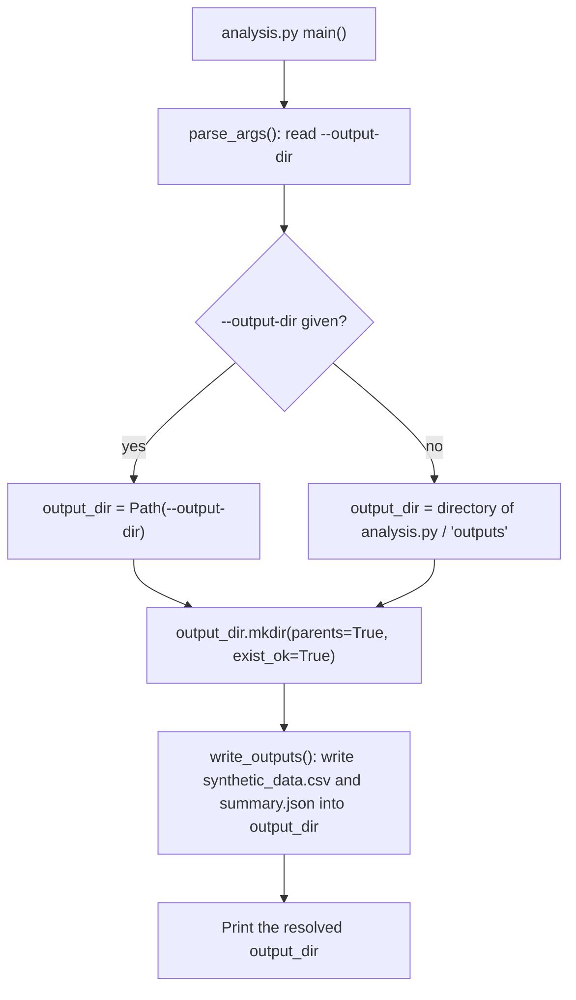

# IPD: Keep the minimal research workflow example from leaving outputs/ in the caller's directory

- Date: 2026-11-22
- Kind: child
- Concern: Bugs and correctness (example hygiene: `examples/minimal-research-workflow/analysis.py` writes its analysis outputs relative to the caller's current working directory, so running it from anywhere other than its own directory leaves an untracked `outputs/` directory behind).
- Scope: `examples/minimal-research-workflow/analysis.py` (output directory resolution and a new `--output-dir` option), `tests/test_example_minimal_research_workflow.py` (behavior tests for the new resolution), `examples/minimal-research-workflow/README.md` (where outputs go), and one `### Fixed` entry in `CHANGELOG.md`.
- Scope-Paths: examples/minimal-research-workflow/analysis.py, tests/test_example_minimal_research_workflow.py, examples/minimal-research-workflow/README.md, CHANGELOG.md
- Item-Dependencies: none
- Status: to-review
- Work-Kind: bug
- Priority: low
- From-Backlog: cp1jvn
- Blocks-Release: next
- Set: cp1jvn
- Order: 1
- Highest E allocated: 04
- Author: Claude Opus 5.5
- Id: t336id

> Write and proofread this plan per the technical writing standard, `.aw/system/workflows/technical-writing/technical-writing.md` (`.agents/workflows/technical-writing/technical-writing.md` in a legacy-layout install), including requirement 12 (diagrams).

## Workflow history

- 2026-11-23 to-review (aw set): authored from backlog cp1jvn: fix, tests, docs, validation
- 2026-11-23 draft (Claude Opus 5.5): created.

## Goal

Make `examples/minimal-research-workflow/analysis.py` write its analysis outputs (`synthetic_data.csv` and `summary.json`) to a directory that does not depend on the caller's current working directory. By default the script writes to `outputs/` next to `analysis.py`, which `.gitignore` already ignores (`examples/minimal-research-workflow/outputs/`). A new `--output-dir` option lets a caller, such as the test suite, choose another directory. After this change, running `python3 examples/verify_all.py` from the repository root leaves no `outputs/` directory at the repository root and no untracked `outputs/` path anywhere in `git status`.

### Output directory resolution (target behavior)

## Detailed Implementation Checklist (TODO)

Execution-state rule: mark an `E-*` item complete only after performing the action. That mark is not validation. Right-sizing rule: write for a modest executor that cannot hold much in its head. Each E-item is one step (one concern, about one file, executable in one focused pass) and its V-item names each unit it covers with its own check; a plan stays at about 5 E-items and 8 work Scope-Paths, else split it into more child plans (guidance, `IPD-Z603`). Accepted execution states: blocked, failed, pending, performed; terminal gate demands 'performed'.

### Task group 1: Script behavior

- [ ] E-01 In `examples/minimal-research-workflow/analysis.py`, resolve the output directory independently of the current working directory and add an `--output-dir` option.
  - Depends on: none
  - Expected outcome: `parse_args` accepts `--output-dir` (type `str`, default `None`, help text naming the default location). A new module-level default, `DEFAULT_OUTPUT_DIR = Path(__file__).resolve().parent / "outputs"`, is used when `--output-dir` is absent. `write_outputs(rows, summary, output_dir)` takes the directory as a `Path` argument, creates it with `mkdir(parents=True, exist_ok=True)`, and writes `synthetic_data.csv` and `summary.json` into it. `main` passes the resolved directory and replaces the fixed text `"Outputs written to ./outputs/"` with a line that prints the resolved directory. The docstrings of `parse_args`, `write_outputs`, and the module describe the new option and default. The `Path("outputs")` expression in `write_outputs` no longer exists. The file stays compatible with Python 3.8 (no new syntax beyond what the file already uses under `from __future__ import annotations`).
  - Execution state: pending

### Task group 2: Tests

- [ ] E-02 Rewrite `tests/test_example_minimal_research_workflow.py` so it tests the new resolution through subprocess runs and writes nothing into the repository tree.
  - Depends on: E-01
  - Expected outcome: The file contains three behavior tests. (1) `test_minimal_research_workflow_runs`: runs the repository copy of `analysis.py` with `cwd=tmp_path` and `--output-dir <tmp_path>/out`, asserts exit code 0, `"Synthetic analysis complete."` in stdout, `<tmp_path>/out/summary.json` and `<tmp_path>/out/synthetic_data.csv` exist, `<tmp_path>/outputs` does not exist, and the existing `runs/pubrun-analysis-*` manifest and `config.resolved.json` assertions still hold. (2) `test_default_output_dir_is_next_to_script`: copies `analysis.py` into `<tmp_path>/example/`, runs the copy with `cwd=<tmp_path>/caller`, asserts `<tmp_path>/example/outputs/summary.json` exists and `<tmp_path>/caller/outputs` does not exist. (3) `test_output_dir_is_created_when_missing`: passes a nested, not-yet-existing `--output-dir` such as `<tmp_path>/a/b/c`, asserts exit code 0 and that `summary.json` there parses as JSON with an `"n"` key equal to the requested `--n`. No test reads source text with `inspect`, `ast`, or a regular expression.
  - Execution state: pending

### Task group 3: Documentation

- [ ] E-03 Update `examples/minimal-research-workflow/README.md` to state where outputs are written and how to change it.
  - Depends on: E-01
  - Expected outcome: The paragraph that currently reads "The script also writes ordinary analysis outputs under:" followed by an `outputs/` code block says that the outputs go to `outputs/` inside `examples/minimal-research-workflow/`, wherever the script is run from, and that `--output-dir <path>` writes them elsewhere. The `runs/` paragraph is unchanged. Added lines contain no em dash (`U+2014`) or en dash (`U+2013`).
  - Execution state: pending

- [ ] E-04 Add one entry under `## [Unreleased]` / `### Fixed` in `CHANGELOG.md` describing the fix.
  - Depends on: E-01
  - Expected outcome: The new entry states that `examples/minimal-research-workflow/analysis.py` now writes its outputs next to the script (or to `--output-dir`) instead of the current working directory, so `examples/verify_all.py` no longer leaves an untracked `outputs/` directory. Added lines contain no em dash (`U+2014`) or en dash (`U+2013`).
  - Execution state: pending

## Project conventions discovered (Step 0)

- `examples/minimal-research-workflow/analysis.py::write_outputs` builds its directory with `output_dir = Path("outputs")`, which is relative to the process's current working directory.
- `examples/verify_all.py::main` runs every example with `subprocess.run([sys.executable, script], capture_output=True, text=True)` and passes no `cwd`, so the child inherits the caller's working directory. Run from the repository root, the analysis writes `./outputs/` at the repository root. Backlog item `g2434y` records the same symptom with `examples/` as the working directory (`examples/outputs/`).
- `.gitignore` ignores `examples/minimal-research-workflow/outputs/` and `runs/` (any `runs/` directory), but not a top-level `outputs/` or `examples/outputs/`.
- `tests/test_example_minimal_research_workflow.py::test_minimal_research_workflow_runs` runs the script with `cwd=tmp_path` and currently asserts `(tmp_path / "outputs" / "summary.json").exists()`. That assertion encodes the defective behavior and must change with E-01.
- `examples/minimal-research-workflow/README.md` ("Run the example") tells users to `cd examples/minimal-research-workflow` before running. In that case the old and new default locations are the same directory, so the documented workflow keeps its behavior.
- The CI workflow `.github/workflows/ci.yml` installs the package with `pip install -e ".[dev,tui]"` and runs `pytest tests/ -v` on Ubuntu, Windows, and macOS with Python 3.8 through 3.14. The subprocess tests therefore must use `pathlib` paths and `sys.executable`, not shell strings or POSIX-only paths.
- Repository rule (`AGENTS.md`, agent execution contract): tests assert observable behavior (exit codes, files, stdout), never source structure.
- Repository rule (`AGENTS.md`): user-facing prose (`README.md` files and `CHANGELOG.md`) contains no em or en dashes.
- Reproduction during authoring (2026-11-22, branch `aw/lane/cp1jvn` at `f632558`): running `python3 examples/verify_all.py --no-clear` with an empty scratch directory as the working directory exited 0 and left `outputs/` and `runs/` in that scratch directory.

## Findings

| ID | Location (symbol) | Defect | Effect |
|---|---|---|---|
| `F-01` | `examples/minimal-research-workflow/analysis.py::write_outputs` | Writes to `Path("outputs")`, which resolves against the current working directory. | Running the example from any directory other than its own creates `outputs/` there. The `.gitignore` entry for `examples/minimal-research-workflow/outputs/` does not cover it, so `git status` shows it as untracked. |
| `F-02` | `examples/minimal-research-workflow/analysis.py::main` | Prints the fixed text `"Outputs written to ./outputs/"`. | The message is only true when the outputs go to the working directory, and becomes false once F-01 is fixed. |
| `F-03` | `tests/test_example_minimal_research_workflow.py::test_minimal_research_workflow_runs` | Asserts that `summary.json` appears under the working directory. | The test pins F-01 and would fail after the fix. |

## Proposed changes (ordered, validatable)

1. E-01: In `analysis.py`, add `DEFAULT_OUTPUT_DIR`, add `--output-dir`, pass the resolved directory into `write_outputs`, create it with `parents=True`, and print the resolved directory.
2. E-02: Replace the working-directory assertion in `tests/test_example_minimal_research_workflow.py` and add the default-location and nested-directory tests, each running in `tmp_path` only.
3. E-03: Update the example `README.md` paragraph about outputs.
4. E-04: Add the `CHANGELOG.md` `### Fixed` entry.

## Deferred / out of scope (with reason)

- `examples/verify_all.py` is not changed. With F-01 fixed, the analysis no longer writes outputs into the working directory, so no `cwd` change or cleanup step is needed there.
  - Carrier-Declined: no follow-up needed; F-01 removes the cause, and V-01 checks the `verify_all.py` run directly.
- The analysis outputs are not deleted after the run. The example README lists "Writing ordinary analysis outputs" as one of the things the example shows, so users need the files to remain. They now land in the git-ignored `examples/minimal-research-workflow/outputs/` directory.
  - Carrier-Declined: deliberate design decision recorded in `OQ-01`; no follow-up needed.
- The `runs/` directory that `pubrun` writes into the working directory is unchanged. It is `pubrun`'s documented default output location, and `.gitignore` ignores every `runs/` directory.
  - Carrier-Declined: intended `pubrun` behavior, already git-ignored; no follow-up needed.
- Backlog item `wghq9s` describes the same root cause from the `verify_all.py` side, with the repository root as the working directory. This plan does not edit or close it. After this plan executes, the maintainer decides whether it is resolved.
  - Carrier: wghq9s
- Backlog item `g2434y` describes the same root cause with `examples/` as the working directory. This plan does not edit or close it. After this plan executes, the maintainer decides whether it is resolved.
  - Carrier: g2434y

## Scope check

- Over-scope: none. Only the four `- Scope-Paths:` files change.
- Under-scope: none. F-01, F-02, and F-03 are covered by E-01 and E-02. The repository-root symptom named in backlog item `cp1jvn` is checked directly by V-01.

## Required tests / validation

- Run `python3 examples/verify_all.py` from the repository root of the execution worktree. Then run `git status --porcelain --untracked-files=all` and `test -e outputs; echo $?`, and paste the output (V-01).
- Run `pytest tests/test_example_minimal_research_workflow.py -v -o addopts=""` and paste the output (V-02).
- Run the full suite with `pytest tests/ -q` and paste the summary (V-02).
- Run a Python check over the added lines of `git diff -- examples/minimal-research-workflow/README.md CHANGELOG.md` that counts `U+2014` and `U+2013` characters, and paste the output (V-03, V-04).
- After the push that carries this change, the CI matrix in `.github/workflows/ci.yml` should pass. This plan changes no manifest schema, capture output shape, or import path, so a green CI run is supporting evidence and not a gate on finalization.

## Spec / documentation sync

- `examples/minimal-research-workflow/README.md`: updated by E-03.
- `CHANGELOG.md`: updated by E-04.
- `docs/research-use.md` ("Public example workflow"): no change. It describes what the example demonstrates and does not name an output location.
- No `.spec.md` file describes this example, so no spec is amended.

## Open questions

### OQ-01: Should the example delete its outputs after running?

- Blocking: no
- Status: resolved
- Owner: plan author
- Resolution or deferral rationale: No. The backlog summary says the script "never removes" the directory, but the defect is the location, not the persistence. `examples/minimal-research-workflow/README.md` ("What this example shows", item 4) presents the outputs as something the user inspects, so they must remain. Writing them next to the script puts them under the existing `.gitignore` entry `examples/minimal-research-workflow/outputs/`. Human plan approval confirms this choice.

## Validation and cross-check (verify before reporting done)

Validation-state rule: inspect evidence in a separate pass. Do not mark a `V-*` item complete from memory or from the matching execution checkmark. Accepted validation results: blocked, failed, pass, pending; terminal gate demands 'pass'. Runtime-demonstration reachability rule: for each `V-*` item demanding the software be observed acting (such as a run, a dispatch, or a transition)—as distinct from items demanding a diff, a file's content, or a test result, which are reachable by construction—name the code path that produces the observation or the sibling `E-*` that creates it, else the demand is UNDER-SCOPE.

- [ ] V-01 validates E-01
  - Required evidence: Pasted output, from the repository root of the execution worktree, of (a) `python3 examples/verify_all.py` ending in `[SUCCESS] All examples passed.` with exit code 0, (b) `test -e outputs; echo $?` printing `1`, (c) `git status --porcelain --untracked-files=all` containing no line with an `outputs/` path, and (d) `ls examples/minimal-research-workflow/outputs` listing `summary.json` and `synthetic_data.csv`. The observed run is produced by `examples/verify_all.py::main` invoking `analysis.py::main`, whose output path E-01 changes. Also paste `git diff -- examples/minimal-research-workflow/analysis.py` showing `Path("outputs")` removed, `--output-dir` added, and the fixed `./outputs/` message replaced.
  - Observed evidence:
  - Result: pending

- [ ] V-02 validates E-02
  - Required evidence: Pasted `pytest tests/test_example_minimal_research_workflow.py -v -o addopts=""` output showing `test_minimal_research_workflow_runs`, `test_default_output_dir_is_next_to_script`, and `test_output_dir_is_created_when_missing` each `PASSED`. Pasted `git status --porcelain --untracked-files=all` after that run, showing no new path under `examples/minimal-research-workflow/`. Pasted final summary line of `pytest tests/ -q` showing zero failures.
  - Observed evidence:
  - Result: pending

- [ ] V-03 validates E-03
  - Required evidence: Pasted `git diff -- examples/minimal-research-workflow/README.md` showing the outputs paragraph names `examples/minimal-research-workflow/outputs/` and `--output-dir`, and pasted output of a Python check over the added lines of that diff reporting `0` characters `U+2014` and `0` characters `U+2013`.
  - Observed evidence:
  - Result: pending

- [ ] V-04 validates E-04
  - Required evidence: Pasted `git diff -- CHANGELOG.md` showing exactly one new bullet under `## [Unreleased]` / `### Fixed` that names `examples/minimal-research-workflow/analysis.py` and `--output-dir`, and pasted output of a Python check over the added lines of that diff reporting `0` characters `U+2014` and `0` characters `U+2013`.
  - Observed evidence:
  - Result: pending

## Approval and execution gate

- Size assessment: standard
- Cohesion rationale: not required

Execution does not begin until a human approves this plan (`- Status: approved`).

### Execution contract
1. **Resolved open questions:** Do not begin execution while any `- Blocking: yes` open question remains open. `OQ-01` is resolved and non-blocking.
2. **Scope declaration:** This plan declares edits to `examples/minimal-research-workflow/analysis.py`, `tests/test_example_minimal_research_workflow.py`, `examples/minimal-research-workflow/README.md`, and `CHANGELOG.md`. If execution requires editing another file, make the edit and justify it with `--scope-reason` at finalize. If a declared file needs no edit, acknowledge it with `--scope-ack`. Stop and report only on a genuinely unsafe condition, such as an unresolvable concurrent-edit conflict.
3. **Honesty rule (HARD MUST):** Every claim that tests or checks pass MUST include the actual pasted runner output in the matching `V-*` `Observed evidence:` field. Never mark a `V-*` item `pass` from memory or from a partial run.
4. **Path-scoped commit and never-push:** Commit only files you modified for this plan through `aw commit t336id -- examples/minimal-research-workflow/analysis.py tests/test_example_minimal_research_workflow.py examples/minimal-research-workflow/README.md CHANGELOG.md` (plus any justified out-of-scope file). Never run `git add -A`, `git commit -a`, or `git push`.
5. **Lifecycle transition (post-gate):** Once every `E-*` item is `performed` and every `V-*` item is `pass` with pasted evidence, this plan reaches `.aw/records/plans/executed/` through `aw ipd finalize t336id`, never a hand-rolled `git mv`. Inside a runner lane (`aw oc run` or `aw agy run`), the runner performs `aw ipd finalize t336id` after lane integration. When executing standalone, the executor runs `aw ipd finalize t336id`.
