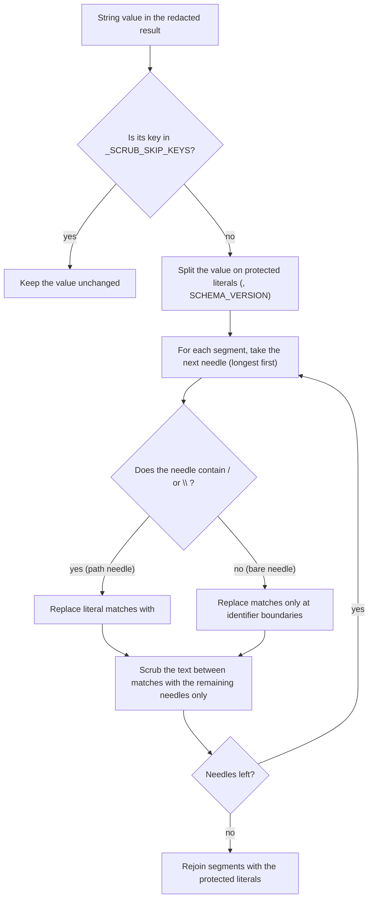

# IPD: Make the startup-breakdown username scrub boundary-safe

- Date: 2026-11-22
- Kind: child
- Concern: Bugs and correctness (privacy redaction in the startup-breakdown benchmark): a short username corrupts `<redacted>` markers and the schema string, and makes the share-safety self-check refuse valid output.
- Scope: `benchmarks/startup_breakdown.py` (`_scrub_substrings`, `scrub_text`, `validate_redacted_output`, and new private scrub helpers) and regression tests in `tests/test_startup_benchmark.py`.
- Scope-Paths: benchmarks/startup_breakdown.py, tests/test_startup_benchmark.py
- Item-Dependencies: none
- Status: reviewed
- Readiness: go-pending-approval
- Review-Depth: standard
- Short-Description: Port the boundary-safe, marker-preserving scrub from benchmarks/harness.py into benchmarks/startup_breakdown.py so a short username cannot corrupt <redacted> markers or schema strings
- Work-Kind: bug
- Priority: medium
- From-Backlog: ggaok0
- Blocks-Release: next
- Set: ggaok0
- Order: 1
- Highest E allocated: 04
- Author: Claude Opus 5.5
- Id: 0vwc5z

> Write and proofread this plan per the technical writing standard, `.aw/system/workflows/technical-writing/technical-writing.md` (`.agents/workflows/technical-writing/technical-writing.md` in a legacy-layout install), including requirement 12 (diagrams).

## Workflow history

- 2026-11-23 /plan-review (Claude Opus 5.5): APPROVE WITH REVISIONS APPLIED; PR-001, PR-002, PR-003, PR-004, PR-005, PR-006
- 2026-11-23 to-review (aw set): authored from backlog ggaok0: reproduction, port plan, falsifiable validation
- 2026-11-23 draft (Claude Opus 5.5): created.

## Goal

`benchmarks/startup_breakdown.py` is a local benchmark script. It writes a redacted JavaScript Object Notation (JSON) report (schema `pubrun-startup-breakdown/1`) and prints a redacted Markdown summary. Before it emits either one, it replaces identifying strings ("needles": the hostname, the username, the home directory, the repository root, and `--workdir`) with the marker `<redacted>`. The replacement uses plain `str.replace`, so a short username also matches inside other words. This plan ports the boundary-safe scrub that plan `8k73qj` (`BUG-20`) added to `benchmarks/harness.py`. After the fix, a username such as `ed`, `pub`, or `startup` does not corrupt `<redacted>` markers, the schema string, or fixed metadata values, and the script's own share-safety self-check does not refuse correct output.

### Target scrub behavior

An identifier boundary means that the character before and the character after the match are not in `[A-Za-z0-9_]`. This is the regular expression `(?<![A-Za-z0-9_])<needle>(?![A-Za-z0-9_])` that `benchmarks/harness.py::_scrub_segment` uses.

## Detailed Implementation Checklist (TODO)

Execution-state rule: mark an `E-*` item complete only after performing the action. That mark is not validation. Right-sizing rule: write for a modest executor that cannot hold much in its head. Each E-item is one step (one concern, about one file, executable in one focused pass) and its V-item names each unit it covers with its own check; a plan stays at about 5 E-items and 8 work Scope-Paths, else split it into more child plans (guidance, `IPD-Z603`). Accepted execution states: blocked, failed, pending, performed; terminal gate demands 'performed'.

### Task group 1: Boundary-safe scrub in `benchmarks/startup_breakdown.py`

- [ ] E-01 Port the boundary-safe, marker-preserving scrub into `benchmarks/startup_breakdown.py` and use it in `_scrub_substrings` and `scrub_text`.
  - Depends on: none
  - Expected outcome: `benchmarks/startup_breakdown.py` defines private helpers equivalent to `benchmarks/harness.py::_is_path_needle`, `_scrub_segment`, and `_scrub_string`. A needle that contains `/` or `\` is replaced literally. Any other needle is replaced only at identifier boundaries. Text between matches is scrubbed with the remaining needles only, so a marker produced by one needle is never rescanned. The script defines a module-level `_SCRUB_SKIP_KEYS` frozenset with exactly these keys, whose string values the script generates from fixed vocabulary: `schema`, `generated_utc`, `generated_local`, `category`, `layout`, `workload`, `durability_policy`, `kind`, `label`, `baseline_scenario`, `auto_scenario`, `phased_scenario`, `git_commit`, `pubrun_version`, `python_version`, `system`, `platform`, `architecture`, `fstype`, `status` (20 keys). `environment.os.release` is deliberately NOT a skip key: `platform.release()` is a host-controlled free-form string (a custom kernel build can embed a user or host name), so it stays scrubbed with the boundary rule; the worst case is over-redaction of a non-contract value. `_scrub_substrings` leaves a string value under a key in `_SCRUB_SKIP_KEYS` unchanged. Both `_scrub_substrings` (for every other string value) and `scrub_text` treat `<redacted>` and `SCHEMA_VERSION` as protected literals: they split the text on them, scrub only the text between them with the ported helpers, and rejoin with the same literals. `_collect_redaction_needles` and the key-based masking in `_redact_keys_recursive` are unchanged.
  - Execution state: pending

- [ ] E-02 Make `benchmarks/startup_breakdown.py::validate_redacted_output` use the same boundary rule and skip keys as the scrub.
  - Depends on: E-01
  - Expected outcome: `validate_redacted_output` still calls `share_safety.check_share_safe` and still skips a bare needle shorter than 3 characters, exactly as today. For the JSON check, it no longer searches `json.dumps(result)` with unanchored `in`. Instead it walks the result. It checks every string value whose key is not in `_SCRUB_SKIP_KEYS` with the matcher from E-01 (literal for a path needle, identifier boundary for a bare needle), applied only to the text between protected literals: it splits the value on `<redacted>` and `SCHEMA_VERSION` exactly as the scrub does and checks each remaining segment, so a marker the scrub produced is never itself reported (for example, a bare needle `redacted` would otherwise match inside every `<redacted>` marker, because `<` and `>` are boundaries). It checks every dict key for path needles only. For the Markdown check, it removes the protected literals (`<redacted>` and `SCHEMA_VERSION`) from the text, then applies the same matcher. The `_HOME_PATH_RE` check on Markdown is unchanged. The issue strings `identifying substring remains in JSON payload` and `identifying substring remains in Markdown output` are unchanged.
  - Execution state: pending

### Task group 2: Regression tests and full-suite verification

- [ ] E-03 Add a `TestBreakdownScrubBoundaries` class to `tests/test_startup_benchmark.py` with behavioral regression tests for E-01 and E-02.
  - Depends on: E-01, E-02
  - Expected outcome: The class loads the script with the file's existing `_load_module` helper and contains these tests. (1) A test parametrized over usernames `ed`, `pub`, `run`, `startup`, and `benchmark`. It uses `monkeypatch` to set `getpass.getuser`, `platform.node` (to `box`), and the `USER`, `USERNAME`, and `LOGNAME` environment variables, and sets `HOME` to `/nonexistent-home-for-test`. It calls `redact_breakdown` on a result whose `schema` is `SCHEMA_VERSION`, whose `environment.hostname` is `box`, which has a scenario with `workload` `noop.py`, `layout` `installed-nested`, and a pass `label` `cold`, whose `environment.os.release` is `f"6.8.0-{user}"`, and which has `environment.note` set to `f"started by {user} in /data/{user}/work; marked as edited"`. It asserts that `schema`, `workload`, `layout`, and `label` are unchanged, that `hostname` is `<redacted>`, that `release` equals `"6.8.0-<redacted>"`, that `note` equals `"started by <redacted> in /data/<redacted>/work; marked as edited"`, that removing every `<redacted>` from `json.dumps` of the result leaves no `<` or `>` character, and that `validate_redacted_output` returns `(True, [])`. (2) A test that `scrub_text` with username `ed` keeps a pre-existing `<redacted>` marker intact and turns a standalone `ed` into `<redacted>`. (3) A test that `scrub_text` with username `startup` keeps a Markdown line ``- Schema: `pubrun-startup-breakdown/1` `` unchanged. (4) A test that `validate_redacted_output` with username `pub` returns `ok == False` for a result whose non-skipped value is `"owner pub"`. (5) A command-line interface (CLI) test parametrized over `pub` and `ed`. It runs `benchmarks/startup_breakdown.py --iterations 1 --passes 1 --warmup 0 --out <tmp>.json` in a subprocess whose environment sets `LOGNAME`, `USER`, and `USERNAME` to the username. It passes `timeout=180` (the file's convention for CLI runs). It asserts exit code 0, asserts that the JSON `schema` equals `SCHEMA_VERSION`, asserts that the set of scenario `layout` values in the JSON equals `{"checkout", "installed", "installed-nested", "none"}`, asserts that stdout contains `import-minimal-installed-nested`, and asserts that no `<` or `>` character remains in the JSON file text or in stdout after every `<redacted>` is removed. The `layout` and scenario-name assertions are what make the `ed` case fail on the current code: a 2026-11-23 review run of the unfixed script with `USER=ed` exited 0 with an intact schema, but wrote layouts `install<redacted>` and `install<redacted>-nest<redacted>`, which leave no angle bracket once `<redacted>` is removed. (The Markdown summary emits no other angle brackets: 2026-11-23 review runs of the unfixed script with the default user and with `USER=ed`, and of a prototype of this design with `USER=pub`, `ed`, and `run`, printed summaries with zero `<` or `>` outside `<redacted>`.) No test reads production source code.
  - Execution state: pending

- [ ] E-04 Run the new tests, the existing startup-breakdown tests, the `BUG-20` harness tests, and the full test suite.
  - Depends on: E-03
  - Expected outcome: `python3 -m pytest tests/test_startup_benchmark.py -v`, `python3 -m pytest tests/test_benchmark_intake_bugs.py -v`, and `python3 -m pytest -q` each finish with zero failures. Running `LOGNAME=pub USER=pub USERNAME=pub python3 benchmarks/startup_breakdown.py --iterations 1 --passes 1 --warmup 0 --out /tmp/opencode/ggaok0-pub.json` exits 0, where it exits 1 before this plan. The executor records that the `.github/workflows/ci.yml` matrix (Ubuntu, Windows, macOS; Python 3.8 through 3.14) runs these tests and remains the gate before release: on Windows `getpass.getuser` reads `LOGNAME`, `USER`, `LNAME`, then `USERNAME`, and `os.path.expanduser` reads `USERPROFILE` rather than `HOME`, so local Linux green does not prove the Windows cases.
  - Execution state: pending

## Project conventions discovered (Step 0)

- The reference implementation is `benchmarks/harness.py::_scrub_pii_substrings` with its helpers `_is_path_needle`, `_scrub_segment`, and `_scrub_string` and its `_SCRUB_SKIP_KEYS` frozenset (comment: "Keys whose string values are fixed, non-PII metadata or schema markers"). Plan `8k73qj` (`.aw/records/plans/executed/20261122-bugs-audit-08-8k73qj-fix-benchmark-redaction-intake-validation-and-aggregation-bu.ipd.md`, finding `BUG-20`) added them and filed this backlog item as out of its scope. Its tests are `tests/test_benchmark_intake_bugs.py::TestScrubBoundaries`; this plan mirrors their parametrized usernames and the `note` assertion.
- `benchmarks/startup_breakdown.py` already imports `benchmarks/share_safety.py` as `_share_safety` through a `sys.path` insert. It does not import `benchmarks/harness.py`. This plan ports the helpers into the script, as the backlog item says, instead of adding an import of the harness.
- `_collect_redaction_needles` returns needles longest first and adds the hostname, the short hostname (3 or more characters), `getpass.getuser()`, `USER`, `USERNAME`, `LOGNAME`, the home directory, the repository root, and each `extra_needles` entry with its resolved path. The home directory and repository root contain `/` and stay literal path needles. The hostname and username contain no separator and become bare needles.
- `run_breakdown` calls `redact_breakdown`, then `scrub_text(format_markdown_report(redacted))`, then `validate_redacted_output`, and raises `RuntimeError("share-safety check failed on redacted output: ...")` on failure. `main` repeats `scrub_text` and `validate_redacted_output` and returns 1 with `error: share-safety check failed; refusing to emit output: ...` on failure.
- Tests in `tests/test_startup_benchmark.py` load the script with `_load_module(mod_name, rel_path)` and call functions or run the script with `subprocess.run`. Tests must assert observable behavior (no `inspect`, `ast`, or source regex).

## Findings

Reproduction on the current `main`, recorded 2026-11-22 by calling `redact_breakdown` after monkeypatching `getpass.getuser`, `USER`, `USERNAME`, `LOGNAME`, and `HOME`:

| Username | Observed defect |
|---|---|
| `ed` | `environment.hostname` becomes `<r<redacted>act<redacted>>` (the marker is rescanned and corrupted), and `"edited"` becomes `<redacted>it<redacted>`. `validate_redacted_output` returns `(True, [])` because it skips needles shorter than 3 characters, so the corrupted output is emitted. |
| `pub` | `schema` becomes `<redacted>run-startup-breakdown/1`. `scrub_text` turns ``- Schema: `pubrun-startup-breakdown/1` `` into ``- Schema: `<redacted>run-startup-breakdown/1` ``. `validate_redacted_output` returns `(False, ['identifying substring remains in JSON payload'])` because the JSON key `pubrun_version` contains `pub`. The CLI `python3 benchmarks/startup_breakdown.py --iterations 1 --passes 1 --warmup 0` run with `USER=pub LOGNAME=pub USERNAME=pub` exits 1 with `error: share-safety check failed on redacted output: identifying substring remains in JSON payload`. |
| `startup` | `schema` becomes `pubrun-<redacted>-breakdown/1`. |

Root cause: `_scrub_substrings` and `scrub_text` call `s.replace(needle, _REDACTED)` for every needle with no boundary check, and each later needle scans the markers that earlier needles produced. `validate_redacted_output` searches `json.dumps(result)` with unanchored `needle in blob`, which also matches dict keys and fixed metadata.

## Proposed changes (ordered, validatable)

1. In `benchmarks/startup_breakdown.py`, add the private helpers ported from `benchmarks/harness.py` and the `_SCRUB_SKIP_KEYS` frozenset listed in E-01. Rewrite `_scrub_substrings` to skip string values under those keys and scrub every other string with the helpers. Rewrite `scrub_text` to protect `<redacted>` and `SCHEMA_VERSION` and scrub the text between them with the helpers (E-01).
2. In `benchmarks/startup_breakdown.py::validate_redacted_output`, replace the unanchored blob search with a walk that uses the same matcher and skip keys, check dict keys for path needles only, and strip the protected literals from Markdown before checking it (E-02).
3. In `tests/test_startup_benchmark.py`, add `TestBreakdownScrubBoundaries` with the unit and CLI tests listed in E-03.
4. Run the targeted tests, the full suite, and the `USER=pub` CLI reproduction (E-04).

## Deferred / out of scope (with reason)

- Moving the scrub helpers into one shared module (for example `benchmarks/share_safety.py`) used by both `benchmarks/harness.py` and `benchmarks/startup_breakdown.py`. Reason: the backlog item asks for a port, and a shared module would also change `benchmarks/harness.py`, which plan `8k73qj` just fixed and tested. A later backlog item can propose the consolidation.
  - Carrier-Declined: an optional refactor with no defect behind it; after this plan both copies behave the same and each has its own regression tests (`tests/test_benchmark_intake_bugs.py::TestScrubBoundaries`, `tests/test_startup_benchmark.py::TestBreakdownScrubBoundaries`).
- Fixed words in the Markdown summary other than `<redacted>` and the schema string, such as scenario names (`auto-noop-default`) or labels (`Python:`). If the username equals a whole word in them, `scrub_text` still replaces that word. Reason: this over-redacts (it hides more, never less), it does not make the self-check fail, and the JSON report keeps those values because they are dict keys (never scrubbed) or values under `_SCRUB_SKIP_KEYS`.
  - Carrier-Declined: accepted behavior, not a defect; over-redaction of a whole-word match in the Markdown summary leaks nothing and breaks no contract value.
- The rule that skips a bare needle shorter than 3 characters in `validate_redacted_output`. Reason: changing it changes what the self-check refuses, which the backlog item does not ask for.
  - Carrier-Declined: existing intended behavior kept unchanged; the scrub itself still redacts a short username, so the skip only limits the self-check and records no outstanding defect.

## Scope check

- Over-scope: none. Only `benchmarks/startup_breakdown.py` and `tests/test_startup_benchmark.py` change.
- Under-scope: none. The JSON scrub, the Markdown scrub, and the self-check all used the unanchored match. All three are covered, because fixing only the scrub would still leave the `USER=pub` CLI run failing in `validate_redacted_output`.

## Required tests / validation

- Run `python3 -m pytest tests/test_startup_benchmark.py -v` and paste the output (covers E-01, E-02, E-03).
- Run `python3 -m pytest tests/test_benchmark_intake_bugs.py -v` and paste the output (confirms `benchmarks/harness.py` behavior is unchanged).
- Run `LOGNAME=pub USER=pub USERNAME=pub python3 benchmarks/startup_breakdown.py --iterations 1 --passes 1 --warmup 0 --out /tmp/opencode/ggaok0-pub.json`, then print its exit code and the JSON `schema` value, and paste the output.
- Run `python3 -m pytest -q` and paste the summary.

## Spec / documentation sync

N/A. `benchmarks/README.md` ("Redaction and share-safety") says the script scrubs the hostname, username, home directory, `--workdir`, and repository root substrings and validates the output before writing or printing. That statement stays true. No spec under `.aw/records/specs/` and no page under `docs/` describes the scrub algorithm.

## Open questions

### OQ-01: Should the self-check stop scanning dict keys for bare needles?

- Blocking: no
- Status: resolved
- Owner: none
- Resolution or deferral rationale: Yes, for bare needles only. Every dict key in the result is generated by the script from fixed vocabulary: schema field names, scenario names, durability-policy names, and `manifest_timing` field names copied from pubrun's own manifest. No key is derived from the hostname, username, or a path. A bare-needle scan of keys therefore only produces false refusals (the `pubrun_version` key for username `pub`). E-02 keeps scanning keys for path needles, so a key that ever embedded a path would still be refused.

## Validation and cross-check (verify before reporting done)

Validation-state rule: inspect evidence in a separate pass. Do not mark a `V-*` item complete from memory or from the matching execution checkmark. Accepted validation results: blocked, failed, pass, pending; terminal gate demands 'pass'. Runtime-demonstration reachability rule: for each `V-*` item demanding the software be observed acting (such as a run, a dispatch, or a transition), as distinct from items demanding a diff, a file's content, or a test result (which are reachable by construction), name the code path that produces the observation or the sibling `E-*` that creates it, else the demand is UNDER-SCOPE.

- [ ] V-01 validates E-01
  - Required evidence: Pasted `python3 -m pytest tests/test_startup_benchmark.py -v -o addopts=""` output with zero failures, plus the test source lines (re-derived at execution time) that pin each E-01 behavior by calling `redact_breakdown` or `scrub_text` and asserting on the returned value: (a) for each of the usernames `ed`, `pub`, `run`, `startup`, and `benchmark`, `schema`, `workload`, `layout`, and `label` come back unchanged, `release` and the `note` come back with only the standalone and path-embedded username replaced, and no `<` or `>` survives outside `<redacted>`; (b) `scrub_text` keeps a pre-existing `<redacted>` marker intact and still redacts a standalone `ed`; (c) `scrub_text` keeps the `- Schema:` line intact for username `startup`; (d) the pre-existing home/host/user/workdir/repo redaction test still passes. Also paste the `git diff -- benchmarks/startup_breakdown.py` hunks that show `_SCRUB_SKIP_KEYS` with the 20 keys listed in E-01 (and no `release`) and the rewritten `_scrub_substrings` and `scrub_text`. Test names in E-03 are pointers, not the bar.
  - Observed evidence:
  - Result: pending

- [ ] V-02 validates E-02
  - Required evidence: From the same pasted run, the test source lines (re-derived at execution time) that pin each E-02 behavior by calling `validate_redacted_output` and asserting on its return value: (a) it returns `(True, [])` for the redacted result of every username case in V-01 (the self-check accepts correct output, including the `pubrun_version` key for `pub`); (b) it returns `ok == False` for a non-skipped value `"owner pub"` with username `pub` (it still refuses a standalone username); (c) it still refuses a leaked home path (the pre-existing test). Test names are pointers, not the bar.
  - Observed evidence:
  - Result: pending

- [ ] V-03 validates E-03
  - Required evidence: Pasted `python3 -m pytest tests/test_startup_benchmark.py -v -o addopts="" -k ScrubBoundaries` output with zero failures and at least one selected test, plus the CLI test source lines (re-derived at execution time) showing a `subprocess.run` of `benchmarks/startup_breakdown.py` with `LOGNAME`, `USER`, and `USERNAME` set to `pub` and to `ed`, asserting exit code 0, `schema == SCHEMA_VERSION`, the four `layout` values, `import-minimal-installed-nested` in stdout, and no `<` or `>` outside `<redacted>`. Reachability: the subprocess runs `benchmarks/startup_breakdown.py::main`, which calls `run_breakdown` (and through it `redact_breakdown`, `scrub_text`, and `validate_redacted_output`), then `scrub_text` and `validate_redacted_output` again before writing. Test names are pointers, not the bar.
  - Observed evidence:
  - Result: pending

- [ ] V-04 validates E-04
  - Required evidence: Pasted output of `python3 -m pytest tests/test_benchmark_intake_bugs.py -v` with zero failures; pasted output of the `LOGNAME=pub USER=pub USERNAME=pub python3 benchmarks/startup_breakdown.py --iterations 1 --passes 1 --warmup 0 --out /tmp/opencode/ggaok0-pub.json` run followed by `echo exit=$?` showing `exit=0`, and of `python3 -c "import json; print(json.load(open('/tmp/opencode/ggaok0-pub.json'))['schema'])"` showing `pubrun-startup-breakdown/1`; the pasted `python3 -m pytest -q` summary line with zero failures; and one line recording that the `.github/workflows/ci.yml` matrix (Ubuntu, Windows, macOS; Python 3.8 through 3.14) has not yet run these tests locally and remains the gate before release (or, if a CI run on the pushed commit exists, its run URL and conclusion).
  - Observed evidence:
  - Result: pending

## Approval and execution gate

- Size assessment: standard
- Cohesion rationale: not required

Execution contract:
1. Precondition: wait for human approval (`- Status: approved`) with no unresolved `Blocking: yes` open question before you change code.
2. Scope declaration: the expected modified files are the `- Scope-Paths:` entries (`benchmarks/startup_breakdown.py`, `tests/test_startup_benchmark.py`). If execution requires an out-of-scope file, justify it with `--scope-reason` at finalization. If a declared file needs no edit, acknowledge it with `--scope-ack`.
3. Validation honesty: run each required validation command and paste its actual output into the matching `V-*` `Observed evidence:` field. Do not mark a `V-*` item `pass` without output captured from that run.
4. Commit discipline: commit only the paths you changed with `aw commit 0vwc5z -- benchmarks/startup_breakdown.py tests/test_startup_benchmark.py`. Do not use `git add -A` or raw `git commit`. Do not push without an explicit human instruction.
5. Lifecycle transition: finalize this plan with `aw ipd finalize 0vwc5z`, never with a hand-written `git mv` to `.aw/records/plans/executed/`. Inside a runner lane (`aw oc run` or `aw agy run`), the runner finalizes after the turn. Outside a runner, the executor runs `aw ipd finalize 0vwc5z`.
