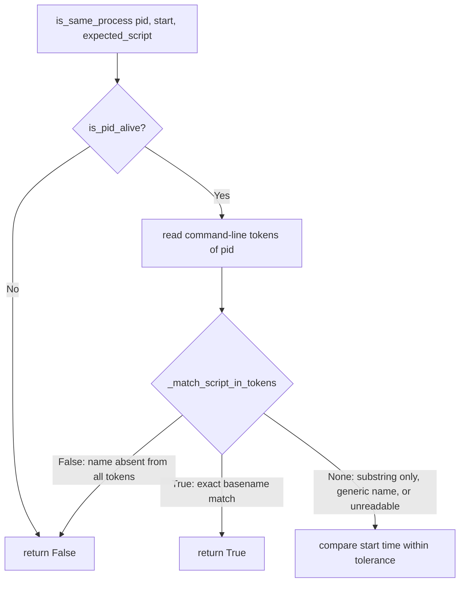

# IPD: Make the parallel test suite pass: fix test_expected_script_matches under pytest-xdist and confirm the TUI mock-leak fix

- Date: 2026-11-22
- Kind: child
- Concern: testing (one test depends on the command line of the pytest process that runs it, and two TUI tests depended on a test-module leak that is already fixed on HEAD).
- Scope: Rewrite `TestIsSameProcess.test_expected_script_matches` in `tests/test_liveness.py` so that it checks `pubrun.capture.liveness.is_same_process(..., expected_script=...)` against a short-lived child process that runs a known script, instead of against the current pytest process. Confirm, without editing `tests/test_tui.py`, that the two `TestTuiReproducibilityAndActions` tests named by backlog item `ivpkar` pass in the test order that exposed the `PubrunTUIApp` mock leak. Confirm that the full parallel suite (`aw suite`) passes. No production code changes.
- Scope-Paths: tests/test_liveness.py
- Item-Dependencies: none
- Status: to-review
- Work-Kind: bug
- Priority: medium
- From-Backlog: ivpkar
- Blocks-Release: next
- Set: ivpkar
- Order: 1
- Highest E allocated: 03
- Author: agent
- Id: vv4vdd

> Write and proofread this plan per the technical writing standard, `.aw/system/workflows/technical-writing/technical-writing.md` (`.agents/workflows/technical-writing/technical-writing.md` in a legacy-layout install), including requirement 12 (diagrams).

## Workflow history

- 2026-11-23 draft (agent): created.
- 2026-11-23 to-review (agent): authored from backlog item `ivpkar`; both failures reproduced in the lane worktree before authoring (see Findings).

## Goal

Make the parallel test suite pass. `aw suite` runs pytest with `pytest-xdist`, a plugin that runs tests in several worker processes at once. Under it, `tests/test_liveness.py::TestIsSameProcess::test_expected_script_matches` must pass, and the two `tests/test_tui.py::TestTuiReproducibilityAndActions` tests named by backlog item `ivpkar` must stay passing. The liveness test must prove that `is_same_process` returns `True` when the target process command line contains the expected script name, using a process whose command line the test controls.

## Detailed Implementation Checklist (TODO)

Execution-state rule: mark an `E-*` item complete only after performing the action. That mark is not validation. Right-sizing rule: write for a modest executor that cannot hold much in its head. Each E-item is one step (one concern, about one file, executable in one focused pass) and its V-item names each unit it covers with its own check; a plan stays at about 5 E-items and 8 work Scope-Paths, else split it into more child plans (guidance, `IPD-Z603`). Accepted execution states: blocked, failed, pending, performed; terminal gate demands 'performed'.

### Task group 1: Fix the liveness test

- [ ] E-01 In `tests/test_liveness.py`, replace the body of `TestIsSameProcess.test_expected_script_matches` with the child-process version described in "Proposed changes" (P-01). Keep the test name, its class, and its docstring purpose ("If expected_script matches the actual process command line, it matches."). Before editing, check whether the test body already uses a child process (see Finding F-07); if it does, record that fact in V-01 and make no edit.
  - Depends on: none
  - Expected outcome: The test starts a child Python process that runs a script file named `liveness_probe_script.py` in the pytest `tmp_path` directory, waits until the child prints a ready line, asserts `is_same_process(child.pid, time.time(), expected_script="liveness_probe_script.py") is True`, and always stops the child in a `finally` block. The test no longer passes `"pytest"` or `os.getpid()` to `is_same_process` or to the platform command-line check.
  - Execution state: pending

### Task group 2: Confirm the TUI tests and the full parallel suite

- [ ] E-02 Run the `tests/test_tui.py` checks listed in P-02, which put `test_tui_cli_parser_and_run` before the `TestTuiReproducibilityAndActions` tests in the same process. Do not edit `tests/test_tui.py`. If any listed run fails, set this item to `blocked`, record the failing output in V-02, and file a backlog item with `aw backlog new` that names the failing test; do not widen this plan's scope.
  - Depends on: none
  - Expected outcome: Every run in P-02 exits 0, and both `TestTuiReproducibilityAndActions` tests report `PASSED` in every run.
  - Execution state: pending
- [ ] E-03 Run the targeted liveness checks and the full suite listed in P-03: `tests/test_liveness.py` serially and with 2 xdist workers, and `aw suite --no-cache`.
  - Depends on: E-01
  - Expected outcome: All runs exit 0. `test_expected_script_matches` reports `PASSED` (not `SKIPPED`) in the serial and xdist runs on this Linux host. `aw suite --no-cache` reports 0 failed.
  - Execution state: pending

## Project conventions discovered (Step 0)

- Tests live in `tests/` and use plain pytest classes and functions. `tests/test_liveness.py` imports `os`, `sys`, `time`, and `pytest` at module level, and each `TestIsSameProcess` test imports the private helpers `_PLATFORM`, `_check_command_linux`, `_check_command_macos`, and `_check_command_windows` from `pubrun.capture.liveness` inside its body.
- The `TestIsSameProcess` tests skip with `pytest.skip("Command-line checking is not functional on this platform")` when the platform command-line reader returns `None` for the target PID. The rewritten test keeps that skip, but evaluates it against the child PID.
- `pyproject.toml` (`[tool.pytest.ini_options]`) sets `addopts = "--cov=src --cov-report=term-missing --cov-report=xml -p no:randomly"`. Every pytest run therefore prints a coverage table before the result line, and `pytest-randomly` (a plugin that shuffles test order) is off unless a run passes `-p randomly`.
- `aw suite` runs the core test tier with a bounded number of `pytest-xdist` workers (it appends `-n <workers>` to `PYTEST_ADDOPTS`) and refuses narrowed selections (file paths, `-k`, `-m`, `::` node ids) with exit 2. Narrowed checks therefore use plain `python3 -m pytest`.
- Other tests already start child processes with `subprocess.Popen`, for example in `tests/test_status.py`. Starting a child process in a test follows existing practice.
- `AGENTS.md` forbids tests that read production source code. The rewritten test calls `is_same_process` on a live process and asserts on its return value, which is a behavior test.

## Findings

How `is_same_process` reaches its verdict when `expected_script` is given (from `pubrun.capture.liveness.is_same_process` and `_match_script_in_tokens`):

| ID | Finding | Evidence |
| --- | --- | --- |
| F-01 | The liveness test fails under `pytest-xdist` on HEAD `7163edf` and passes serially. | In the lane worktree on 2026-11-22: `python -m pytest -n 4 -p no:cacheprovider --no-cov -q tests/test_liveness.py tests/test_tui.py` printed `FAILED tests/test_liveness.py::TestIsSameProcess::test_expected_script_matches` and `1 failed, 37 passed`. `aw suite --no-cache` printed `1 failed, 1762 passed in 140.23s` with the same single failure. Host: Linux, Python 3.14.6, `pytest-xdist` 3.8.0. |
| F-02 | Cause of F-01: an xdist worker is started as `python -u -c "import sys;exec(eval(sys.stdin.readline()))"`, so its `/proc/<pid>/cmdline` has no token that matches `pytest`. `_check_command_linux(os.getpid(), "pytest")` therefore returns `False` (confirmed mismatch), not `None`. The skip guard only skips on `None`, so the test continues, and `is_same_process` returns `False` on the mismatch. | A probe test run with `-n 1` printed its own cmdline as `'<venv>/bin/python\x00-u\x00-c\x00import sys;exec(eval(sys.stdin.readline()))\x00'`. `_match_script_in_tokens` returns `False` "when the script name appears nowhere at all". |
| F-03 | The defect is in the test, not in `is_same_process`. Returning `False` for a process whose command line does not contain the expected script is the intended recycled-PID protection (documented in `_match_script_in_tokens` as IPD 20260705 EC-06). | `pubrun.capture.liveness._match_script_in_tokens` docstring. |
| F-04 | A child process gives the test a known command line on every platform: `[sys.executable, "<tmp_path>/liveness_probe_script.py"]`. The basename `liveness_probe_script.py` is not in `_GENERIC_SCRIPT_TOKENS` and is longer than 3 characters, so `_script_is_generic` returns `False` and the token match is conclusive. | `pubrun.capture.liveness._script_is_generic`, `_GENERIC_SCRIPT_TOKENS`, `_script_name_forms`. |
| F-05 | A ready-line handshake removes a startup race. The child prints one line after the interpreter starts; the test reads that line before it checks the PID. By then the interpreter has replaced the forked process image, so `/proc/<pid>/cmdline` (Linux) and `ps` output (macOS) already show the script path. | Design reasoning; no repository evidence is needed. |
| F-06 | The TUI failures named by the backlog item are already fixed on HEAD. Commit `25dd11b` ("test(tui): restore sys.modules['pubrun.tui.app'] after test_tui_cli_parser_and_run", committed after `a3546cd`) wraps the injected `mock.Mock` module in `mock.patch.dict(sys.modules, ...)`, so the real `pubrun.tui.app` module returns after the test. Before that fix, the leaked mock made later `PubrunTUIApp` tests in the same process import a `MagicMock`. | Running the `a3546cd` copy of `tests/test_tui.py` in one process with `-p no:xdist` printed `3 failed, 7 passed, 1 deselected`, failing `TestTuiResourceView::test_resource_view_populates_and_degrades` and both `TestTuiReproducibilityAndActions` tests. The HEAD copy with the same command printed `10 passed, 1 deselected`. `aw suite --no-cache` on HEAD reported no `tests/test_tui.py` failure. Open backlog item `pgcmea` describes the same leak. |
| F-07 | Overlapping work exists outside this tree. Backlog items `sd7kvt` and `12rcu8` describe the same liveness failure. Plan `4h2qwz` (authored from `12rcu8`) proposes the same child-process rewrite, but it exists only on branch `aw/lane/12rcu8`, not on HEAD or `main`, and that branch moved `12rcu8` back to `open`. Whether `4h2qwz` will land is unknown. This plan therefore does not depend on it, and E-01 checks the test body before editing. | `git log 7163edf..aw/lane/12rcu8` shows commits `3fd18c2`, `9df0fc0`, and `4e0ad9d`; `.aw/records/backlog/open/` contains `sd7kvt`, `12rcu8`, and `pgcmea`. |

## Proposed changes (ordered, validatable)

P-01 (performed by E-01). Rewrite `TestIsSameProcess.test_expected_script_matches` in `tests/test_liveness.py` as follows:

1. Request the `tmp_path` fixture.
2. Write `tmp_path / "liveness_probe_script.py"` with a body that prints `ready`, flushes standard output, and then blocks reading standard input (for example `import sys; print("ready", flush=True); sys.stdin.read()`). Blocking on standard input lets the test stop the child by closing the pipe, so the child cannot outlive the test.
3. Start the child with `subprocess.Popen([sys.executable, str(script)], stdin=subprocess.PIPE, stdout=subprocess.PIPE, text=True)`. Import `subprocess` at module level next to the existing `os`, `sys`, and `time` imports.
4. In a `try` block:
   - Read one line from `child.stdout` and assert that it equals `"ready"` after stripping.
   - Compute `functional` with the existing `_PLATFORM` branch, but pass `child.pid` and `"liveness_probe_script.py"` instead of `os.getpid()` and `"pytest"`. If `functional` is `False`, call `pytest.skip("Command-line checking is not functional on this platform")`.
   - Assert `is_same_process(child.pid, time.time(), expected_script="liveness_probe_script.py") is True`.
5. In the `finally` block: close `child.stdin`, call `child.wait(timeout=10)`, and, if that wait raises `subprocess.TimeoutExpired`, call `child.kill()` followed by `child.wait()`. Close `child.stdout`.

The functional check in step 4 keeps the meaning "the platform reader returned a definite answer (`True` or `False`)", that is, `is not None`. With a child that runs the probe script, a working reader returns `True`, so the check no longer confuses "the reader works" with "the token was found".

P-02 (performed by E-02). Confirm the TUI fix in the orders that exposed the leak. Run each command from the repository root:

1. `python3 -m pytest tests/test_tui.py -v -p no:xdist -p no:cacheprovider` (file order, one process: `test_tui_cli_parser_and_run` runs before `TestTuiReproducibilityAndActions`).
2. `python3 -m pytest tests/test_tui.py -v -n 2 --dist loadfile -p no:cacheprovider` (xdist; `--dist loadfile` sends the whole file to one worker, so the leak order is reproduced inside a worker).
3. `python3 -m pytest tests/test_tui.py -v -p no:xdist -o addopts="" -p randomly --randomly-seed=<seed> -p no:cacheprovider`, run three times with `<seed>` set to `1`, `2`, and `3`. `-o addopts=""` clears the `-p no:randomly` default from `pyproject.toml`, and `-p randomly` turns on shuffled test order (the order in which backlog item `pgcmea` first observed the leak).

P-03 (performed by E-03). Run the liveness test and the full suite:

1. `python3 -m pytest tests/test_liveness.py -v -p no:xdist`.
2. `python3 -m pytest tests/test_liveness.py -v -n 2`.
3. `aw suite --no-cache`.

## Deferred / out of scope (with reason)

- `TestIsSameProcess.test_expected_script_mismatch` and `TestLivenessCharacterization.test_char_absent_script_is_mismatch` use the same `os.getpid()` and `"pytest"` skip guard. Under xdist that guard evaluates to `False is not None`, which is `True`, so these tests run and pass, because they assert a mismatch. They are not failing, and backlog item `ivpkar` names only `test_expected_script_matches` in `tests/test_liveness.py`. They are left unchanged.
  - Carrier-Declined: both tests pass under pytest-xdist today because they assert a mismatch, so no defect remains to carry.
- No change to `src/pubrun/capture/liveness.py`. Finding F-03 shows its behavior is correct.
  - Carrier-Declined: the production behavior is correct (Finding F-03), so no production change is owed.
- No edit to `tests/test_tui.py`. Commit `25dd11b` already fixed the leak (Finding F-06); this plan only confirms the fix in E-02. Closing open backlog item `pgcmea`, which describes the same leak, is a backlog lifecycle act for the maintainer and is not part of this plan.
  - Carrier-Declined: the code fix already exists on HEAD, so no further test change is owed; pgcmea remains its own backlog item.
- Validation on the full CI matrix (3 operating systems and Python 3.8 to 3.14, per the `AGENTS.md` matrix-validation section) needs a push, and this plan's executor must not push without a human request. The rewritten test keeps the `pytest.skip` path for platforms whose command-line reader returns `None`, so a platform without a working reader skips instead of failing.
  - Carrier-Declined: a push is a human act; the CI matrix runs when the maintainer pushes the integrated change.

## Scope check

- Over-scope: none. The plan changes one test function in `tests/test_liveness.py` and runs checks.
- Under-scope: none. The backlog item names three failing tests. `test_expected_script_matches` is fixed by E-01 and checked by E-03. The two `TestTuiReproducibilityAndActions` tests are already fixed on HEAD (Finding F-06) and are checked by E-02. The parallel suite as a whole is checked by E-03.

## Required tests / validation

- `python3 -m pytest tests/test_tui.py -v -p no:xdist -p no:cacheprovider` and `python3 -m pytest tests/test_tui.py -v -n 2 --dist loadfile -p no:cacheprovider` exit 0, and both `TestTuiReproducibilityAndActions` tests report `PASSED` (E-02).
- `python3 -m pytest tests/test_tui.py -v -p no:xdist -o addopts="" -p randomly --randomly-seed=<seed> -p no:cacheprovider` exits 0 for seeds `1`, `2`, and `3` (E-02).
- `python3 -m pytest tests/test_liveness.py -v -p no:xdist` exits 0, and `TestIsSameProcess::test_expected_script_matches` reports `PASSED` (E-03).
- `python3 -m pytest tests/test_liveness.py -v -n 2` exits 0, and the same test reports `PASSED` (E-03).
- `aw suite --no-cache` exits 0 with 0 failed (E-03).

## Spec / documentation sync

N/A. The change affects one test and no user-visible behavior, configuration key, command, or API. No spec or documentation describes this test.

## Open questions

### OQ-01: Should this plan also edit `tests/test_tui.py` to fix the `PubrunTUIApp` mock leak?

- Blocking: no
- Status: resolved
- Owner: none
- Resolution or deferral rationale: No. Commit `25dd11b` already restores `sys.modules["pubrun.tui.app"]` with `mock.patch.dict`, and the HEAD copy of `tests/test_tui.py` passes in the order that failed on `a3546cd` (Finding F-06). E-02 confirms this; if E-02 finds a failure, its executor files a new backlog item instead of widening this plan.

### OQ-02: Does plan `4h2qwz` on branch `aw/lane/12rcu8` make this plan redundant?

- Blocking: no
- Status: resolved
- Owner: none
- Resolution or deferral rationale: Not on this tree. `4h2qwz` is absent from HEAD and `main`, and its branch moved `12rcu8` back to `open` (Finding F-07). If `4h2qwz` lands first, E-01 finds the child-process body already present, records that in V-01, and makes no edit; E-02 and E-03 still run, because they also cover the TUI tests and the full suite.

## Validation and cross-check (verify before reporting done)

Validation-state rule: inspect evidence in a separate pass. Do not mark a `V-*` item complete from memory or from the matching execution checkmark. Accepted validation results: blocked, failed, pass, pending; terminal gate demands 'pass'. Runtime-demonstration reachability rule: for each `V-*` item demanding the software be observed acting (such as a run, a dispatch, or a transition)—as distinct from items demanding a diff, a file's content, or a test result, which are reachable by construction—name the code path that produces the observation or the sibling `E-*` that creates it, else the demand is UNDER-SCOPE.

- [ ] V-01 validates E-01
  - Required evidence: Paste `git diff -- tests/test_liveness.py`. The diff must show that `test_expected_script_matches` starts a child with `subprocess.Popen` running `liveness_probe_script.py` from `tmp_path`, reads a `ready` line before checking, passes `child.pid` to both the functional check and `is_same_process(..., expected_script="liveness_probe_script.py")`, and stops the child in a `finally` block. The diff must not contain `expected_script="pytest"` inside `test_expected_script_matches`, and must change no other test function. If E-01 found the child-process body already present (Finding F-07), paste the current body of `test_expected_script_matches` and the commit that introduced it (`git log -1 --format='%h %s' -S liveness_probe_script -- tests/test_liveness.py`) instead of a diff.
  - Observed evidence:
  - Result: pending
- [ ] V-02 validates E-02
  - Required evidence: Paste the tail of each P-02 run, including the result line and the lines for `test_details_reproducibility_markup_safety_running_and_no_live_preflight` and `test_actions_panel_redacted_advisory_clearing_and_clean_clipboard`: (1) the `-p no:xdist` run, (2) the `-n 2 --dist loadfile` run, and (3) the three `-p randomly --randomly-seed=<seed>` runs for seeds `1`, `2`, and `3`. Every run must exit 0 with both tests `PASSED`. Paste `git diff --stat -- tests/test_tui.py`, which must be empty. A `SKIPPED` result for either TUI test fails this item, because it means `textual` is missing and the check did not run.
  - Observed evidence:
  - Result: pending
- [ ] V-03 validates E-03
  - Required evidence: Paste the tail of each P-03 run, including the result line: (1) `python3 -m pytest tests/test_liveness.py -v -p no:xdist` shows `test_expected_script_matches PASSED` and exits 0; (2) `python3 -m pytest tests/test_liveness.py -v -n 2` shows `test_expected_script_matches PASSED` and exits 0; (3) `aw suite --no-cache` exits 0 and its result line reports no failed tests. A `SKIPPED` result for the target test on this Linux host fails this item, because it means the child-process check did not run.
  - Observed evidence:
  - Result: pending

## Approval and execution gate

- Size assessment: standard
- Cohesion rationale: not required

A human must approve this plan before execution. The executor changes only `tests/test_liveness.py`, commits through `aw commit <this plan> -- tests/test_liveness.py`, and does not push. After every `E-*` item is `performed` and every `V-*` item is `pass` with pasted evidence, the executor runs `aw ipd lint --phase pre-transition` on this plan. Only when it conforms does the executor perform the lifecycle move of this plan to `.aw/records/plans/executed/`, as defined in `.aw/system/workflows/ipd-lifecycle/ipd-lifecycle.md`.
