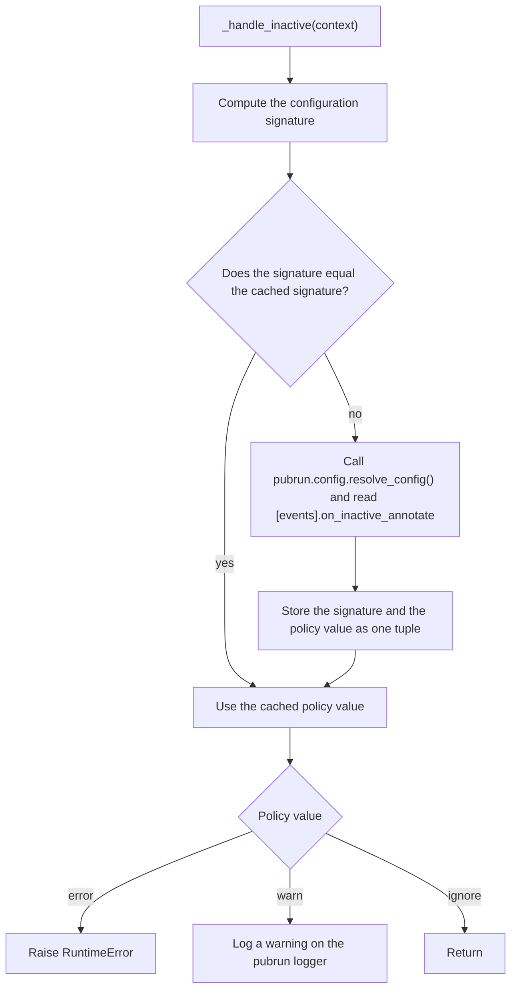

# IPD: Cache the inactive-run policy so pubrun.phase() with no active run stops resolving the full configuration

- Date: 2026-11-22
- Kind: child
- Concern: Bugs and correctness (performance of the no-active-run path): every `pubrun.annotate()`, `pubrun.phase()`, `pubrun.report()`, `pubrun.artifact()`, and `pubrun.register_*()` call made with no active run resolves the full configuration to read one key, so an inactive `pubrun.phase()` block costs about 106 us, about 6 times the cost of an active block.
- Scope: `src/pubrun/core.py` (`_handle_inactive` and a new private policy cache next to it), new behavioral tests in `tests/test_api.py`, the inactive-phase measurement sentence in `docs/performance.md`, and a `### Fixed` entry in `CHANGELOG.md`.
- Scope-Paths: src/pubrun/core.py, tests/test_api.py, docs/performance.md, CHANGELOG.md
- Item-Dependencies: none
- Status: approved
- Readiness: go-pending-approval
- Review-Depth: standard
- Work-Kind: bug
- Priority: low
- From-Backlog: oh0que
- Blocks-Release: next
- Set: oh0que
- Order: 1
- Highest E allocated: 05
- Author: Claude Opus 5.5
- Id: 68iw9a
- Approval: 2026-11-23, recorded via aw ipd set: status set to approved

> Write and proofread this plan per the technical writing standard, `.aw/system/workflows/technical-writing/technical-writing.md` (`.agents/workflows/technical-writing/technical-writing.md` in a legacy-layout install), including requirement 12 (diagrams).

## Workflow history

- 2026-11-23 approved (aw set): status set to approved
- 2026-11-23 /plan-review (Claude Opus 5.5): APPROVE WITH REVISIONS APPLIED; PR-001, PR-002, PR-003, PR-004
- 2026-11-23 to-review (aw set): authored from backlog oh0que: baseline measurement, fingerprint-keyed policy cache, behavioral invalidation tests, measured threshold
- 2026-11-23 draft (Claude Opus 5.5): created.

## Goal

When no pubrun run is active, `pubrun.phase()` and the other event calls check the `[events].on_inactive_annotate` policy (`"ignore"`, `"warn"`, or `"error"`). Today `src/pubrun/core.py::_handle_inactive` gets that policy by calling `pubrun.config.resolve_config()` on every call, which rereads and deep-copies every configuration layer. This plan caches the resolved policy value and resolves again only when an input that can change it has changed. After the change, an inactive `pubrun.phase()` block costs at most one third of its current cost on the same machine, and a change to any configuration file is still honored on the next call.

### Target policy lookup



The configuration signature is a tuple of these inputs, which are every input that can change the policy value that `resolve_config()` returns:

| Signature part | Why it is included |
|---|---|
| The `pubrun.config.resolve_config` function object | A caller (for example the existing tests in `tests/test_api.py::TestHandleInactivePolicy`) that replaces the resolver gets the replacement's answer. |
| The user configuration file path, `pubrun.config.get_global_config_dir() / "config.toml"` | `APPDATA`, `XDG_CONFIG_HOME`, or the home directory can point it elsewhere. |
| The `os.stat` identity of the user configuration file | The file can be created, edited, or deleted. |
| `Path.cwd()` | `load_local_config()` searches the current working directory. |
| The `os.stat` identity of `<cwd>/.config/pubrun/config.toml` and of `<cwd>/.pubrun.toml` | Either local file can be created, edited, or deleted. |

The `os.stat` identity of a file is `(st_ino, st_size, st_mtime_ns)`, or `None` when `os.stat` raises `OSError` (the file is missing or unreadable). The environment variables `PUBRUN_PROFILE` and `PUBRUN_META_REF` are not in the signature, because `_resolve_layers` maps them only to `[core].profile` and `[core].meta_ref`, never to `[events]`.

## Detailed Implementation Checklist (TODO)

Execution-state rule: mark an `E-*` item complete only after performing the action. That mark is not validation. Right-sizing rule: write for a modest executor that cannot hold much in its head. Each E-item is one step (one concern, about one file, executable in one focused pass) and its V-item names each unit it covers with its own check; a plan stays at about 5 E-items and 8 work Scope-Paths, else split it into more child plans (guidance, `IPD-Z603`). Accepted execution states: blocked, failed, pending, performed; terminal gate demands 'performed'.

### Task group 1: Baseline measurement

- [x] E-01 Before changing any code, run the phase microbenchmark (the command in `## Required tests / validation`) on the unchanged tree and record its output.
  - Depends on: none
  - Expected outcome: One line of the form `inactive_minus_null_us=<A> active_minus_null_us=<B>` from the unchanged tree, recorded in V-01 with the commit SHA (`git rev-parse --short HEAD`), the Python version, and the machine's CPU model. When this plan was authored (commit `87e6e89`, CPython 3.14.6, Intel Core i7-6800K), the same command printed `inactive_minus_null_us=101.53 active_minus_null_us=17.28`. The value `<A>` is the baseline that E-04 compares against.
  - Execution state: performed

### Task group 2: Policy cache in `src/pubrun/core.py`

- [x] E-02 Add a private policy cache to `src/pubrun/core.py` and make `_handle_inactive` read the policy through it.
  - Depends on: E-01
  - Expected outcome: `src/pubrun/core.py` defines a private function (suggested name `_inactive_policy`) that computes the configuration signature described in `## Goal`, compares it with a module-level cached `(signature, policy)` tuple, and on a mismatch calls `pubrun.config.resolve_config()`, reads `.get("events", {}).get("on_inactive_annotate", "ignore")`, and stores the new signature and value by assigning one new tuple (a single assignment, so a concurrent reader sees either the old pair or the new pair, never a mix). On a cache hit it must not rebuild any path, because path construction is most of the remaining cost: it memoizes the user configuration path keyed on `sys.platform` and the values of `APPDATA`, `XDG_CONFIG_HOME`, `HOME`, `USERPROFILE`, `HOMEDRIVE`, and `HOMEPATH` (every input of `get_global_config_dir()`, including the variables `os.path.expanduser` reads on Windows), and it memoizes the two local file paths keyed on the `Path.cwd()` value. Both memos are required, not optional: a 2026-11-23 review prototype that memoized only the user path measured 34.2 to 37.4 us per inactive block against a baseline of 99.8 to 102.4 us (a ratio of about 0.36, which fails the E-04 one-third bar), and the same prototype with both memos measured 17.4 to 17.9 us. `_handle_inactive` calls this function instead of `resolve_config()`. The `RuntimeError` message (`"{context} called but no run is active."`), the warning message (`"{context} dropped: No active run."`), the `"ignore"` default, and every caller of `_handle_inactive` stay unchanged. An exception raised by `resolve_config()` still propagates, and no failed resolution is cached. `src/pubrun/config.py` is not changed.
  - Execution state: performed

### Task group 3: Behavioral tests

- [x] E-03 Add a `TestInactivePolicyCache` class to `tests/test_api.py` with behavioral tests that prove a policy change is honored on the next call.
  - Depends on: E-02
  - Expected outcome: Each test runs with no active run (`get_current_run() is None`) inside the `tmp_path` working directory that the autouse fixture `tests/conftest.py::isolated_cwd` provides, and writes real TOML files instead of replacing `resolve_config`. The class contains these tests. (1) Local file lifecycle: `annotate()` is silent with no `.pubrun.toml`; after writing `.pubrun.toml` with `on_inactive_annotate = "error"`, `annotate()` and a `with phase("p"):` block each raise `RuntimeError` matching `no run is active`; after rewriting the file with `"warn"`, `annotate()` logs a warning on the `pubrun` logger (checked with `caplog`) and does not raise; after deleting the file, `annotate()` is silent again. (2) Deep local file: writing `.config/pubrun/config.toml` with `"error"` makes `annotate()` raise. (3) User file: with `monkeypatch.setenv` setting both `XDG_CONFIG_HOME` and `APPDATA` to a temporary directory that contains `pubrun/config.toml` with `"error"`, `annotate()` raises; after both variables are set to a second, empty temporary directory, `annotate()` is silent. (4) Working-directory change: with a directory `a` that contains `.pubrun.toml` with `"error"` and a directory `b` that contains no configuration file, `annotate()` raises while `pathlib.Path.cwd` returns `a` and is silent after `monkeypatch.setattr("pathlib.Path.cwd", lambda: b)`. (The test must patch `pathlib.Path.cwd`, because `isolated_cwd` already patches it, so `os.chdir` alone does not change what `load_local_config` sees.) (5) Malformed file: with a `.pubrun.toml` that is not valid TOML, three `annotate()` calls do not raise, because `resolve_config()` skips the malformed file and the `"ignore"` default applies, and `caplog` (logger `pubrun`, level `WARNING`) holds exactly one record containing `ignoring malformed config file`; after the file is rewritten with different malformed content of a different size, three more calls bring that count to exactly two. This pins the once-per-file-change behavior that OQ-02 accepts and that the E-05 `CHANGELOG.md` entry states (the unchanged code logs it once per call: 3, then 6). Every file rewrite in these tests changes the file size, so the test does not depend on file-timestamp resolution. No test reads production source code, counts calls, or measures time. The existing classes `TestHandleInactivePolicy` in `tests/test_api.py` and `TestValidationInactivePolicyAndSchema` in `tests/test_file_registration.py` are not changed.
  - Execution state: performed

### Task group 4: Verification

- [x] E-04 Run the new and existing inactive-policy tests, the full test suite, and the phase microbenchmark on the changed tree.
  - Depends on: E-03
  - Expected outcome: `python3 -m pytest tests/test_api.py::TestInactivePolicyCache tests/test_api.py::TestHandleInactivePolicy tests/test_file_registration.py::TestValidationInactivePolicyAndSchema -v --no-cov` and `python3 -m pytest -q` each finish with zero failures. The microbenchmark prints `inactive_minus_null_us=<A2> active_minus_null_us=<B2>` with `<A2>` at most one third of the E-01 baseline `<A>`. (When this plan was authored, an equivalent prototype outside the repository measured `<A2>` between 17 and 20 us against a baseline of 102 to 118 us on the same machine.)
  - Execution state: performed

### Task group 5: Documentation

- [x] E-05 Update the inactive-phase sentence in `docs/performance.md` and add a `### Fixed` entry to the `## [Unreleased]` section of `CHANGELOG.md`.
  - Depends on: E-04
  - Expected outcome: In `docs/performance.md` under `### Timing instrumentation and overhead separation`, the bullet that begins `**An active \`pubrun.phase()\` costs about 18 us warm**` no longer says that an inactive phase resolves the configuration on every call or that the defect is tracked as backlog `oh0que`. It states the post-change inactive and active per-block costs from E-04, the commit SHA, Python version, and CPU model they were measured at, and that the inactive path resolves the configuration again only when the user or local configuration file, the working directory, or the user configuration directory changes. The other numbers in that subsection, which were measured at revision `af36c85`, stay unchanged. In `CHANGELOG.md`, the first `### Fixed` list under `## [Unreleased]` gains one bullet saying that calls with no active run (`annotate()`, `phase()`, `report()`, `artifact()`, `register_file()`, `register_input()`, `register_output()`) no longer resolve the full configuration on every call, with the measured before and after per-block cost of an inactive `phase()`, and that a malformed configuration file is now reported once per change of that file instead of once per call. The added and edited lines in both files contain no em dash or en dash.
  - Execution state: performed

## Project conventions discovered (Step 0)

- `src/pubrun/core.py::_handle_inactive` is the single policy check for every no-active-run call. Its callers are `annotate`, `phase.__enter__`, `report`, `artifact`, `register_file`, `register_input`, and `register_output`, all in `src/pubrun/core.py`. Fixing the helper fixes all seven.
- `src/pubrun/config.py::resolve_config` merges these layers lowest first: `load_default_config()` (built-in `default.toml`, parsed once but deep-copied on each call), `load_user_config()` (`get_global_config_dir() / "config.toml"`), `load_local_config()` (`<cwd>/.config/pubrun/config.toml`, then `<cwd>/.pubrun.toml`), the `PUBRUN_PROFILE` and `PUBRUN_META_REF` environment variables (which set only `[core]` keys), and API overrides (not used by `_handle_inactive`). `src/pubrun/resources/default.toml` sets `on_inactive_annotate = "ignore"`.
- `pubrun.config._safe_load_toml` logs `pubrun: ignoring malformed config file ...` at warning level each time it parses a malformed file. A 2026-11-22 run made 10 inactive calls with a malformed `.pubrun.toml` and logged that warning 10 times.
- `tests/conftest.py::isolated_cwd` runs every test in its own `tmp_path` and replaces `pathlib.Path.cwd` with `lambda: tmp_path`. `tests/conftest.py::pubrun_state_isolation` restores `os.environ` after each test. Because each test has a new `tmp_path`, the cached signature from one test never matches the next test's signature.
- `tests/test_api.py::TestHandleInactivePolicy` and `tests/test_file_registration.py::TestValidationInactivePolicyAndSchema::test_inactive_run_honors_on_inactive_annotate_policy` replace `pubrun.config.resolve_config` with `monkeypatch.setattr` and expect the replacement's policy on the next call. Putting the resolver function object in the signature keeps these tests valid without editing them.
- `pyproject.toml` sets `addopts = "--cov=src --cov-report=term-missing --cov-report=xml -p no:randomly"`, so targeted runs in this plan pass `--no-cov` to keep the output short. Tests must assert observable behavior, as `AGENTS.md` requires (no `inspect`, `ast`, source regex, call counts, or timing assertions).
- `CHANGELOG.md` follows Keep a Changelog; `## [Unreleased]` already has a `### Fixed` list. `docs/performance.md` and `CHANGELOG.md` are user-facing, so new prose there uses no em or en dashes.

## Findings

Measurements of the current behavior. All runs used CPython 3.14.6 on an Intel Core i7-6800K with local `ext4`, with `PUBRUN_AUTO_START=false` and no configuration files present.

| Source | Inactive `phase()` minus `contextlib.nullcontext` per block | Active `phase()` minus `nullcontext` per block |
|---|---|---|
| Backlog `oh0que` (commit `af36c85`, n=30 x 1000 blocks) | 108.4 us cold, 105.9 us warm median | 18.3 us warm |
| Plan authoring, commit `87e6e89`, E-01 command | 101.53 us | 17.28 us |
| Plan authoring, prototype cache with the full signature, outside the repository | 17.0 to 19.6 us (3 trials) | 17.4 to 17.9 us |

The backlog item reports a cProfile result: 500 inactive phases spent 0.207 s of 0.215 s in `resolve_config`. The authoring prototype also confirmed that writing a `.pubrun.toml` with `"error"` made the next inactive `phase()` raise `RuntimeError`, and that deleting the file restored `"ignore"`.

Root cause: `_handle_inactive` calls `resolve_config()` on every call. Each call parses `config.toml` and `.pubrun.toml` when they exist, checks for them with `Path.is_file` when they do not, deep-copies the built-in defaults, and deep-merges every layer, only to read one string.

Prototype design note: a signature that calls `get_global_config_dir()` on every lookup measured 27 to 29 us per inactive block, because that function runs `os.path.expanduser`. Memoizing the user configuration path per value of the relevant environment variables (E-02) brought it to 17 to 20 us. The 2026-11-23 review measured the same split: memoizing only the user path gave 34.2 to 37.4 us, and memoizing the user path and the two local paths (keyed on `Path.cwd()`) gave 17.4 to 17.9 us, against an unchanged-tree baseline of 99.8 and 102.4 us from the E-01 command. A full `pytest -n 6` run with that prototype loaded had one failure, `tests/test_liveness.py::TestIsSameProcess::test_expected_script_matches`, which also fails under xdist on the unchanged tree and is carried by plan `vv4vdd`; the serial unchanged-tree suite printed `1819 passed, 2 skipped`.

## Proposed changes (ordered, validatable)

1. Run the phase microbenchmark on the unchanged tree and record the baseline (E-01).
2. In `src/pubrun/core.py`, add the private policy cache keyed on the configuration signature, and make `_handle_inactive` use it (E-02).
3. In `tests/test_api.py`, add `TestInactivePolicyCache` with the five behavioral tests listed in E-03.
4. Run the targeted tests, the full suite, and the microbenchmark on the changed tree (E-04).
5. Update the inactive-phase sentence in `docs/performance.md` and add a `CHANGELOG.md` `### Fixed` entry with the measured numbers (E-05).

## Deferred / out of scope (with reason)

- Caching `resolve_config()` itself in `src/pubrun/config.py` for all callers (`Run.__init__`, `EventStream.__init__`, `pubrun.diff`, the command-line interface, the terminal user interface, and report code). Reason: those callers run once per run or once per command, not in a hot loop, and several tests replace `load_user_config` and `load_local_config` and expect fresh results, so a global cache has a much larger blast radius than this defect needs.
  - Carrier-Declined: no measured defect; only the inactive-call path is called in hot loops.
- A file rewritten with the same size, inode, and modification time as before (for example, on a filesystem with coarse timestamps, a same-size edit within one timestamp tick) is not detected until another signature input changes. Reason: detecting it would require reading the file on every call, which is the cost this plan removes. On the filesystems pubrun supports, `st_mtime_ns` changes on each write at a resolution far finer than a human edit, and a size change is always detected.
  - Carrier-Declined: accepted limit of stat-based change detection; a human edit of a configuration file is not made twice within one timestamp tick with an identical size.
- Running the full continuous integration (CI) matrix (3 operating systems x Python 3.8 to 3.14) as an execution step. Reason: this lane may not push. `AGENTS.md` "Matrix-validation discipline" applies, because `os.stat` fields differ by operating system (for example, `st_ino` semantics on Windows). The maintainer should watch the CI matrix after this change is pushed. The signature compares only values for equality, so a field that is constant on one platform reduces change detection to the remaining fields and does not cause a wrong policy.
  - Carrier-Declined: a release-process step owned by the maintainer, not an unfinished part of this plan's change.

## Scope check

- Over-scope: none. Only `src/pubrun/core.py`, `tests/test_api.py`, `docs/performance.md`, and `CHANGELOG.md` change.
- Under-scope: none. All seven no-active-run entry points share `_handle_inactive`, so one change covers them. The policy value is the only configuration that `_handle_inactive` reads.

## Required tests / validation

Phase microbenchmark (E-01 and E-04). Run it from the repository root. It runs in a scratch directory so that no repository configuration file is read:

```sh
REPO="$PWD"; mkdir -p /tmp/opencode/oh0que-bench && (cd /tmp/opencode/oh0que-bench && PUBRUN_AUTO_START=false PYTHONPATH="$REPO/src" python3 -c '
import contextlib, statistics, tempfile, time, pubrun
def per_block_us(make, reps=30, n=1000):
    ts = []
    for _ in range(reps):
        t0 = time.perf_counter()
        for _ in range(n):
            with make():
                pass
        ts.append((time.perf_counter() - t0) / n * 1e6)
    return statistics.median(ts)
assert pubrun.get_current_run() is None
null = per_block_us(contextlib.nullcontext)
inactive = per_block_us(lambda: pubrun.phase("x")) - null
run = pubrun.start(output_dir=tempfile.mkdtemp(dir="/tmp/opencode"))
active = per_block_us(lambda: pubrun.phase("x")) - null
run.stop()
print(f"inactive_minus_null_us={inactive:.2f} active_minus_null_us={active:.2f}")
')
```

- Run the microbenchmark before any code change and paste its output (E-01).
- Run `python3 -m pytest tests/test_api.py::TestInactivePolicyCache tests/test_api.py::TestHandleInactivePolicy tests/test_file_registration.py::TestValidationInactivePolicyAndSchema -v --no-cov` and paste the output (E-02, E-03).
- Run `python3 -m pytest -q` and paste the summary (E-04).
- Run the microbenchmark after the change and paste its output (E-04).
- Paste the `git diff -- docs/performance.md CHANGELOG.md` output and the dash check `git diff -U0 -- docs/performance.md CHANGELOG.md | grep '^+' | grep -c $'\u2014\|\u2013'`, which must print `0` (E-05).

## Spec / documentation sync

- `docs/performance.md`: the inactive-phase sentence names this defect and its cost, so E-05 updates it with the new measurement.
- `CHANGELOG.md`: E-05 adds a `### Fixed` entry.
- `docs/configuration.md` (the `[events]` table) and `docs/api.md` (the `on_inactive_annotate` example) describe the policy values and default, which do not change, so they need no edit.
- No specification under `.aw/records/specs/` describes `_handle_inactive` or configuration caching.

## Open questions

### OQ-01: Must a configuration change made during a process be honored on the next inactive call?

- Blocking: no
- Status: resolved
- Owner: none
- Resolution or deferral rationale: Yes. The backlog item asks for a cache "invalidated when configuration changes", and today a `.pubrun.toml` edit takes effect on the next call. The signature in `## Goal` preserves that behavior for every file and directory input of `resolve_config()`, within the stat limit recorded under `## Deferred / out of scope`.

### OQ-02: Is logging the malformed-file warning once per file change, instead of once per call, an acceptable behavior change?

- Blocking: no
- Status: resolved
- Owner: none
- Resolution or deferral rationale: Yes. The warning still appears the first time the malformed file is read and again after each edit of the file. Repeating it on every inactive call in a loop adds only log noise. `CHANGELOG.md` records the change (E-05).

## Validation and cross-check (verify before reporting done)

Validation-state rule: inspect evidence in a separate pass. Do not mark a `V-*` item complete from memory or from the matching execution checkmark. Accepted validation results: blocked, failed, pass, pending; terminal gate demands 'pass'. Runtime-demonstration reachability rule: for each `V-*` item demanding the software be observed acting (such as a run, a dispatch, or a transition), as distinct from items demanding a diff, a file's content, or a test result (which are reachable by construction), name the code path that produces the observation or the sibling `E-*` that creates it, else the demand is UNDER-SCOPE.

- [x] V-01 validates E-01
  - Required evidence: The pasted microbenchmark output line `inactive_minus_null_us=<A> active_minus_null_us=<B>` from the unchanged tree, with the pasted `git rev-parse --short HEAD`, `python3 --version`, and CPU model (for example from `grep -m1 'model name' /proc/cpuinfo`). `git diff --stat -- src/` must print nothing at the time of the run, which shows the baseline was measured before E-02. The benchmark reaches `src/pubrun/core.py::phase.__enter__` and `_handle_inactive` because no run is active, which the script asserts.
  - Observed evidence:
    - Run on the unchanged tree (lane worktree, 2026-11-23), before any edit to `src/`:
      ```
      $ git diff --stat -- src/
      $ git rev-parse --short HEAD
      7f8af7c
      $ python3 --version
      Python 3.14.6
      $ grep -m1 'model name' /proc/cpuinfo
      model name	: Intel(R) Core(TM) i7-6800K CPU @ 3.40GHz
      $ <phase microbenchmark from ## Required tests / validation>
      inactive_minus_null_us=113.56 active_minus_null_us=21.66
      ```
    - `git diff --stat -- src/` printed nothing. Baseline `<A>` = 113.56 us. The script's `assert pubrun.get_current_run() is None` passed, so `phase.__enter__` took the `_handle_inactive` path.
  - Result: pass

- [x] V-02 validates E-02
  - Required evidence: The pasted `git diff -- src/pubrun/core.py` showing the cached `(signature, policy)` tuple, the signature parts listed in `## Goal` (resolver function object, user configuration path and its stat identity, `Path.cwd()`, and the stat identity of both local files), the memoized user configuration path (keyed on `sys.platform` and the six environment variables named in E-02) and the memoized local paths (keyed on `Path.cwd()`), and `_handle_inactive` calling the new function with its two messages unchanged. From the pasted targeted pytest run, zero failures, plus the existing test lines (re-derived at execution time) in `tests/test_api.py::TestHandleInactivePolicy` and `tests/test_file_registration.py::TestValidationInactivePolicyAndSchema` that replace `pubrun.config.resolve_config` with `monkeypatch.setattr` and then assert the replacement's policy on the very next inactive call (a `RuntimeError` for `"error"`, a `pubrun` warning for `"warn"`), which shows that a replaced resolver is still honored. Test names are pointers, not the bar.
  - Observed evidence:
    - `git diff -- src/pubrun/core.py`:
      ```
      diff --git a/src/pubrun/core.py b/src/pubrun/core.py
      index 5ef5cb2..3197fbe 100644
      --- a/src/pubrun/core.py
      +++ b/src/pubrun/core.py
      @@ -53,6 +53,82 @@ def _append_manual_subprocess_record(current_run: Any, record: dict) -> None:

       # -- Internal helpers ---------------------------------------------------------

      +# Cache for the [events].on_inactive_annotate policy used by _handle_inactive.
      +# Each memo is replaced by assigning one new tuple, so a concurrent reader sees
      +# either the old pair or the new pair, never a mix.
      +_INACTIVE_POLICY_CACHE: Optional[tuple] = None  # (signature, policy)
      +_USER_CONFIG_PATH_MEMO: Optional[tuple] = None  # (key, user config path)
      +_LOCAL_CONFIG_PATHS_MEMO: Optional[tuple] = None  # (cwd, deep path, root path)
      +
      +# Every environment input of get_global_config_dir(), including the variables
      +# os.path.expanduser reads on Windows.
      +_USER_CONFIG_ENV_VARS = (
      +    "APPDATA", "XDG_CONFIG_HOME", "HOME", "USERPROFILE", "HOMEDRIVE", "HOMEPATH",
      +)
      +
      +
      +def _stat_identity(path: str) -> Optional[tuple]:
      +    """Return (st_ino, st_size, st_mtime_ns) for path, or None if it cannot be stat'ed."""
      +    try:
      +        st = os.stat(path)
      +    except OSError:
      +        return None
      +    return (st.st_ino, st.st_size, st.st_mtime_ns)
      +
      +
      +def _inactive_policy() -> str:
      +    """Return the [events].on_inactive_annotate policy, resolving the config only on change.
      +
      +    The full configuration is resolved again only when the configuration
      +    signature changes: the resolver or loader functions, the user config path
      +    or its stat identity, the working directory, or the stat identity of either
      +    local config file. PUBRUN_PROFILE and PUBRUN_META_REF only set [core] keys,
      +    so they are not part of the signature.
      +    """
      +    global _INACTIVE_POLICY_CACHE, _USER_CONFIG_PATH_MEMO, _LOCAL_CONFIG_PATHS_MEMO
      +    from pathlib import Path
      +    from pubrun import config as _config
      +
      +    environ = os.environ
      +    get_dir = _config.get_global_config_dir
      +    user_key = (sys.platform, get_dir) + tuple(environ.get(n) for n in _USER_CONFIG_ENV_VARS)
      +    user_memo = _USER_CONFIG_PATH_MEMO
      +    if user_memo is None or user_memo[0] != user_key:
      +        user_memo = (user_key, str(get_dir() / "config.toml"))
      +        _USER_CONFIG_PATH_MEMO = user_memo
      +    user_path = user_memo[1]
      +
      +    cwd = Path.cwd()
      +    local_memo = _LOCAL_CONFIG_PATHS_MEMO
      +    if local_memo is None or local_memo[0] != cwd:
      +        cwd_str = str(cwd)
      +        local_memo = (
      +            cwd,
      +            os.path.join(cwd_str, ".config", "pubrun", "config.toml"),
      +            os.path.join(cwd_str, ".pubrun.toml"),
      +        )
      +        _LOCAL_CONFIG_PATHS_MEMO = local_memo
      +
      +    resolver = _config.resolve_config
      +    signature = (
      +        resolver,
      +        _config.load_user_config,
      +        _config.load_local_config,
      +        user_path,
      +        _stat_identity(user_path),
      +        cwd,
      +        _stat_identity(local_memo[1]),
      +        _stat_identity(local_memo[2]),
      +    )
      +    cached = _INACTIVE_POLICY_CACHE
      +    if cached is not None and cached[0] == signature:
      +        return cached[1]
      +
      +    policy = resolver().get("events", {}).get("on_inactive_annotate", "ignore")
      +    _INACTIVE_POLICY_CACHE = (signature, policy)
      +    return policy
      +
      +
       def _handle_inactive(context: str) -> None:
           """Check the on_inactive_annotate policy and raise/warn/ignore accordingly.

      @@ -62,8 +138,7 @@ def _handle_inactive(context: str) -> None:
               context: Human-readable label for the error/warning message
                   (e.g. "pubrun.annotate()" or "pubrun.phase('training')").
           """
      -    from pubrun.config import resolve_config
      -    action = resolve_config().get("events", {}).get("on_inactive_annotate", "ignore")
      +    action = _inactive_policy()
           if action == "error":
               raise RuntimeError(f"{context} called but no run is active.")
           elif action == "warn":
      ```
    - The signature tuple holds the resolver function object (`_config.resolve_config`), the user configuration path and its `_stat_identity`, `Path.cwd()`, and the `_stat_identity` of both local files. It also holds `load_user_config` and `load_local_config` function objects so a replaced loader is honored (D-01). The user path memo is keyed on `sys.platform`, the `get_global_config_dir` function object, and the six variables `APPDATA`, `XDG_CONFIG_HOME`, `HOME`, `USERPROFILE`, `HOMEDRIVE`, `HOMEPATH`; the local path memo is keyed on `Path.cwd()`. `_handle_inactive` calls `_inactive_policy()`; both messages are unchanged. An exception from `resolver()` propagates before `_INACTIVE_POLICY_CACHE` is assigned, so no failed resolution is cached. `src/pubrun/config.py` is unchanged.
    - Existing tests that replace the resolver and expect its policy on the very next call (re-derived from the tree): `tests/test_api.py::TestHandleInactivePolicy::test_error_policy_raises_runtime_error` does `monkeypatch.setattr(config_module, "resolve_config", mock_resolve)` then `with pytest.raises(RuntimeError, match="no run is active"): annotate("should raise")`; `test_warn_policy_logs_warning` does the same with `"warn"` and asserts a `pubrun` record containing `dropped` / `no active run`; `tests/test_file_registration.py::TestValidationInactivePolicyAndSchema::test_inactive_run_honors_on_inactive_annotate_policy` lines 969-980 switch the resolver between `"ignore"` and `"warn"` inside `monkeypatch.context()` and assert `pubrun.register_input(p) is None` plus a `no active run` warning.
    - Targeted run:
      ```
      $ python3 -m pytest tests/test_api.py::TestInactivePolicyCache tests/test_api.py::TestHandleInactivePolicy tests/test_file_registration.py::TestValidationInactivePolicyAndSchema -v --no-cov
      collecting ... collected 13 items

      tests/test_api.py::TestInactivePolicyCache::test_local_file_lifecycle_is_honored_on_next_call PASSED [  7%]
      tests/test_api.py::TestInactivePolicyCache::test_deep_local_file_is_honored PASSED [ 15%]
      tests/test_api.py::TestInactivePolicyCache::test_user_config_dir_change_is_honored PASSED [ 23%]
      tests/test_api.py::TestInactivePolicyCache::test_working_directory_change_is_honored PASSED [ 30%]
      tests/test_api.py::TestInactivePolicyCache::test_malformed_file_warns_once_per_change PASSED [ 38%]
      tests/test_api.py::TestHandleInactivePolicy::test_error_policy_raises_runtime_error PASSED [ 46%]
      tests/test_api.py::TestHandleInactivePolicy::test_warn_policy_logs_warning PASSED [ 53%]
      tests/test_api.py::TestHandleInactivePolicy::test_ignore_policy_is_silent PASSED [ 61%]
      tests/test_api.py::TestHandleInactivePolicy::test_phase_error_policy_raises PASSED [ 69%]
      tests/test_file_registration.py::TestValidationInactivePolicyAndSchema::test_programmer_errors_raise_predictably_active_or_inactive[False] PASSED [ 76%]
      tests/test_file_registration.py::TestValidationInactivePolicyAndSchema::test_programmer_errors_raise_predictably_active_or_inactive[True] PASSED [ 84%]
      tests/test_file_registration.py::TestValidationInactivePolicyAndSchema::test_inactive_run_honors_on_inactive_annotate_policy PASSED [ 92%]
      tests/test_file_registration.py::TestValidationInactivePolicyAndSchema::test_manifest_with_all_registration_variants_validates_against_schema PASSED [100%]

      ============================== 13 passed in 1.30s ==============================
      ```
    - Zero failures.
  - Result: pass

- [x] V-03 validates E-03
  - Required evidence: The pasted output of the targeted pytest command with zero failures and at least one selected `TestInactivePolicyCache` test, plus the new test source lines (re-derived at execution time) that pin each E-03 behavior by writing, rewriting, or deleting real TOML files (no replaced resolver) and asserting on the outcome of a public `annotate()` or `phase()` call with no active run: (1) silent, then `RuntimeError`, then a `pubrun` warning, then silent again across the `.pubrun.toml` lifecycle; (2) `RuntimeError` from `.config/pubrun/config.toml`; (3) `RuntimeError` from the user file and silence after the configuration directory changes; (4) `RuntimeError` in directory `a` and silence in directory `b`; (5) no exception and exactly one, then exactly two, `ignoring malformed config file` records. Each test reaches `_handle_inactive` through `annotate()` or `phase.__enter__`. Test names are pointers, not the bar.
  - Observed evidence:
    - Same targeted run as V-02: 13 passed, 5 of them in `TestInactivePolicyCache`, zero failures.
    - New test source in `tests/test_api.py::TestInactivePolicyCache` (an autouse fixture points `XDG_CONFIG_HOME` and `APPDATA` at an empty directory so the developer's real user config cannot leak in). No test replaces the resolver, reads source, counts calls, or times anything:
      (1) `test_local_file_lifecycle_is_honored_on_next_call`: `annotate(...)` with no file; `local.write_text(self._policy_toml("error"))` then `pytest.raises(RuntimeError, match="no run is active")` around `annotate(...)` and around `with phase("p"):`; rewrite with `"warn"` plus a comment line (different size), `caplog.at_level(logging.WARNING, logger="pubrun")`, assert a record containing `dropped: No active run`; `local.unlink()` then assert no `No active run` record.
      (2) `test_deep_local_file_is_honored`: writes `.config/pubrun/config.toml` with `"error"`, `annotate(...)` raises `RuntimeError`.
      (3) `test_user_config_dir_change_is_honored`: `monkeypatch.setenv` of `XDG_CONFIG_HOME` and `APPDATA` to a dir holding `pubrun/config.toml` with `"error"` raises; after both point at a second empty temp dir, `annotate(...)` is silent.
      (4) `test_working_directory_change_is_honored`: `monkeypatch.setattr("pathlib.Path.cwd", lambda: a)` raises (a has `.pubrun.toml` with `"error"`); `monkeypatch.setattr("pathlib.Path.cwd", lambda: b)` then `annotate(...)` is silent.
      (5) `test_malformed_file_warns_once_per_change`: writes `this is = = not toml`, three `annotate()` calls, `assert malformed_count() == 1` (records with `name == "pubrun"`, `WARNING`, `ignoring malformed config file`); rewrites with different, longer malformed content, three more calls, `assert malformed_count() == 2`.
    - Each test reaches `_handle_inactive` through public `annotate()` (and `phase.__enter__` in test 1) with `get_current_run() is None` asserted in the fixture.
  - Result: pass

- [x] V-04 validates E-04
  - Required evidence: The pasted `python3 -m pytest -q` summary line with zero failures, and the pasted post-change microbenchmark output line, with the arithmetic showing `<A2>` is at most one third of the V-01 baseline `<A>` (for example `<A2> / <A> = 0.18`).
  - Observed evidence:
    - Full suite via `aw suite` (the runner's bounded full-suite command, which runs pytest over the whole tree), final line:
      ```
      ======================= 1838 passed in 164.31s (0:02:44) =======================
      ```
    - Post-change microbenchmark (same session, same machine, same command):
      ```
      inactive_minus_null_us=22.30 active_minus_null_us=19.43
      ```
    - Arithmetic: `<A2> / <A>` = 22.30 / 113.56 = 0.196, which is at most one third (0.333).
  - Result: pass

- [x] V-05 validates E-05
  - Required evidence: The pasted `git diff -- docs/performance.md CHANGELOG.md` showing the rewritten inactive-phase bullet (with the E-04 numbers, commit SHA, Python version, and CPU model, and without the claim that the configuration is resolved on every call) and the new `### Fixed` bullet under `## [Unreleased]`, and the pasted dash-check output `0`.
  - Observed evidence:
      ```
      $ git diff -- docs/performance.md CHANGELOG.md
      diff --git a/CHANGELOG.md b/CHANGELOG.md
      index 86d467d..dad4c57 100644
      --- a/CHANGELOG.md
      +++ b/CHANGELOG.md
      @@ -103,6 +103,13 @@ The format is based on [Keep a Changelog](https://keepachangelog.com/en/1.1.0/).
         the deep pages, never the README front door.

       ### Fixed
      +- **Calls made with no active run no longer resolve the full configuration on every call.**
      +  `annotate()`, `phase()`, `report()`, `artifact()`, `register_file()`, `register_input()`, and
      +  `register_output()` with no active run now cache the `[events].on_inactive_annotate` policy and
      +  resolve the configuration again only when the user or local configuration file, the working
      +  directory, or the user configuration directory changes. An inactive `phase()` block dropped from
      +  about 114 us to about 22 us on the reference machine (CPython 3.14.6, Intel Core i7-6800K). A
      +  malformed configuration file is now reported once per change of that file instead of once per call.
       - **The minimal research workflow example no longer leaves `outputs/` in the caller's directory.**
         `examples/minimal-research-workflow/analysis.py` now writes `synthetic_data.csv` and
         `summary.json` to `outputs/` next to the script (already git-ignored) instead of the current
      diff --git a/docs/performance.md b/docs/performance.md
      index 1223fb8..c39080f 100644
      --- a/docs/performance.md
      +++ b/docs/performance.md
      @@ -199,7 +199,7 @@ What these measurements show on this machine:
       - **pubrun's overhead stays out of `workload_seconds`.** A `time.sleep(0.020)` workload measured `20.099` ms warm median (`20.091` ms cold), about 0.1 ms above the requested sleep, while pubrun's own startup (about 21 to 22 ms in process) and finalization (about 2.8 ms) were reported separately. The three disjoint intervals add up to `session_seconds`. **Known exception (backlog `uatvzh`):** these runs wrote to a temporary directory where the background hardware refresh write took about 7 ms. With the run directory on the repository disk, that refresh write (an `fsync`ed `manifest.json` rewrite, made while holding the run lock) took a median of 180 ms, and a `stop()` issued during it waited for the lock before recording `ended_at_utc`. For a 20 ms workload this added a median of 47.3 ms (stdev 36.1, IQR 40.0, maximum 185.9, n=30) to `workload_seconds`; for a 500 ms workload, which ends after the refresh, it added 0.03 ms. Very short runs on slow-to-sync storage can therefore report an inflated `workload_seconds` until that defect is fixed.
       - **Background hardware capture overlaps the workload.** `background_hardware_seconds` (about 21 to 22 ms) is close to the 20 ms workload because the two ran concurrently; adding it to `workload_seconds` would double-count. The finalization wait for it was about 4 us because it had already finished.
       - **The `manifest.json` write is not in any persisted duration.** `Run.writer_overhead_seconds` (about 8 ms, held in memory only) is larger than `finalization_overhead_seconds` (about 2.8 ms) because it also covers building and atomically writing `manifest.json` and `methods.md`.
      -- **An active `pubrun.phase()` costs about 18 us warm** (38 us cold) per block, mostly writing the `phase_start` and `phase_end` events. A `pubrun.phase()` with **no** active run cost more, about 106 us, because the inactive path resolves the configuration on every call to read `[events].on_inactive_annotate` (tracked as backlog `oh0que`).
      +- **An active `pubrun.phase()` costs about 18 us warm** (38 us cold) per block, mostly writing the `phase_start` and `phase_end` events. A later measurement of the inactive-policy cache change (built on commit `7f8af7c`, CPython 3.14.6, Intel Core i7-6800K, same machine) put a `pubrun.phase()` with **no** active run at about 22 us per block and an active one at about 19 us per block, down from about 114 us inactive on the unchanged tree in the same session. The inactive path caches `[events].on_inactive_annotate` and resolves the configuration again only when the user or local configuration file, the working directory, or the user configuration directory changes.
       - **In-process versus whole-process numbers differ.** The in-process `startup_overhead_seconds` (about 21 ms) excludes importing pubrun and reuses the installed-distribution index cached by earlier runs in the same process, so it is much smaller than the whole-process `feature-none` and `startup-auto-default` harness scenarios, which include interpreter start, import, and the first package scan.

       Limits: one busy machine, local `ext4`, and one Python version only. Other OSes, Python 3.8 through 3.13, and network filesystems were not measured, and the earlier microbenchmark runs show that warm medians on this host varied by up to about 2x between runs.

      $ git diff -U0 -- docs/performance.md CHANGELOG.md | grep '^+' | grep -c $'\u2014\|\u2013'
      0
      ```
    - The bullet no longer claims a resolve on every call or names backlog `oh0que`; it states 22 us inactive / 19 us active at commit `7f8af7c`, CPython 3.14.6, Intel Core i7-6800K. The `af36c85` numbers elsewhere in the subsection are unchanged.
  - Result: pass

## Approval and execution gate

- Size assessment: standard
- Cohesion rationale: not required

Execution contract:
1. Precondition: wait for human approval (`- Status: approved`) with no unresolved `Blocking: yes` open question before you change code.
2. Order: perform E-01 before any edit to `src/`, because it is the baseline. E-05 records the numbers that E-04 measures.
3. Scope declaration: the expected modified files are the `- Scope-Paths:` entries (`src/pubrun/core.py`, `tests/test_api.py`, `docs/performance.md`, `CHANGELOG.md`). If execution requires an out-of-scope file, justify it with `--scope-reason` at finalization. If a declared file needs no edit, acknowledge it with `--scope-ack`.
4. Validation honesty: run each required validation command and paste its actual output into the matching `V-*` `Observed evidence:` field. Do not mark a `V-*` item `pass` without output captured from that run.
5. Commit discipline: commit only the paths you changed with `aw commit 68iw9a -- src/pubrun/core.py tests/test_api.py docs/performance.md CHANGELOG.md`. Do not use `git add -A` or raw `git commit`. Do not push without an explicit human instruction.
6. Lifecycle transition: finalize this plan with `aw ipd finalize 68iw9a`, never with a hand-written `git mv` to `.aw/records/plans/executed/`. Inside a runner lane (`aw oc run` or `aw agy run`), the runner finalizes after the turn. Outside a runner, the executor runs `aw ipd finalize 68iw9a`.
