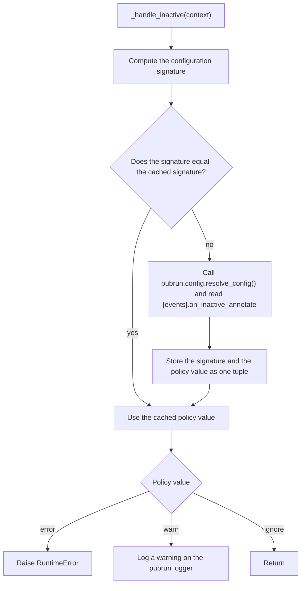

# IPD: Cache the inactive-run policy so pubrun.phase() with no active run stops resolving the full configuration

- Date: 2026-11-22
- Kind: child
- Concern: Bugs and correctness (performance of the no-active-run path): every `pubrun.annotate()`, `pubrun.phase()`, `pubrun.report()`, `pubrun.artifact()`, and `pubrun.register_*()` call made with no active run resolves the full configuration to read one key, so an inactive `pubrun.phase()` block costs about 106 us, about 6 times the cost of an active block.
- Scope: `src/pubrun/core.py` (`_handle_inactive` and a new private policy cache next to it), new behavioral tests in `tests/test_api.py`, the inactive-phase measurement sentence in `docs/performance.md`, and a `### Fixed` entry in `CHANGELOG.md`.
- Scope-Paths: src/pubrun/core.py, tests/test_api.py, docs/performance.md, CHANGELOG.md
- Item-Dependencies: none
- Status: to-review
- Work-Kind: bug
- Priority: low
- From-Backlog: oh0que
- Blocks-Release: next
- Set: oh0que
- Order: 1
- Highest E allocated: 05
- Author: Claude Opus 5.5
- Id: 68iw9a

> Write and proofread this plan per the technical writing standard, `.aw/system/workflows/technical-writing/technical-writing.md` (`.agents/workflows/technical-writing/technical-writing.md` in a legacy-layout install), including requirement 12 (diagrams).

## Workflow history

- 2026-11-23 to-review (aw set): authored from backlog oh0que: baseline measurement, fingerprint-keyed policy cache, behavioral invalidation tests, measured threshold
- 2026-11-23 draft (Claude Opus 5.5): created.

## Goal

When no pubrun run is active, `pubrun.phase()` and the other event calls check the `[events].on_inactive_annotate` policy (`"ignore"`, `"warn"`, or `"error"`). Today `src/pubrun/core.py::_handle_inactive` gets that policy by calling `pubrun.config.resolve_config()` on every call, which rereads and deep-copies every configuration layer. This plan caches the resolved policy value and resolves again only when an input that can change it has changed. After the change, an inactive `pubrun.phase()` block costs at most one third of its current cost on the same machine, and a change to any configuration file is still honored on the next call.

### Target policy lookup



The configuration signature is a tuple of these inputs, which are every input that can change the policy value that `resolve_config()` returns:

| Signature part | Why it is included |
|---|---|
| The `pubrun.config.resolve_config` function object | A caller (for example the existing tests in `tests/test_api.py::TestHandleInactivePolicy`) that replaces the resolver gets the replacement's answer. |
| The user configuration file path, `pubrun.config.get_global_config_dir() / "config.toml"` | `APPDATA`, `XDG_CONFIG_HOME`, or the home directory can point it elsewhere. |
| The `os.stat` identity of the user configuration file | The file can be created, edited, or deleted. |
| `Path.cwd()` | `load_local_config()` searches the current working directory. |
| The `os.stat` identity of `<cwd>/.config/pubrun/config.toml` and of `<cwd>/.pubrun.toml` | Either local file can be created, edited, or deleted. |

The `os.stat` identity of a file is `(st_ino, st_size, st_mtime_ns)`, or `None` when `os.stat` raises `OSError` (the file is missing or unreadable). The environment variables `PUBRUN_PROFILE` and `PUBRUN_META_REF` are not in the signature, because `_resolve_layers` maps them only to `[core].profile` and `[core].meta_ref`, never to `[events]`.

## Detailed Implementation Checklist (TODO)

Execution-state rule: mark an `E-*` item complete only after performing the action. That mark is not validation. Right-sizing rule: write for a modest executor that cannot hold much in its head. Each E-item is one step (one concern, about one file, executable in one focused pass) and its V-item names each unit it covers with its own check; a plan stays at about 5 E-items and 8 work Scope-Paths, else split it into more child plans (guidance, `IPD-Z603`). Accepted execution states: blocked, failed, pending, performed; terminal gate demands 'performed'.

### Task group 1: Baseline measurement

- [ ] E-01 Before changing any code, run the phase microbenchmark (the command in `## Required tests / validation`) on the unchanged tree and record its output.
  - Depends on: none
  - Expected outcome: One line of the form `inactive_minus_null_us=<A> active_minus_null_us=<B>` from the unchanged tree, recorded in V-01 with the commit SHA (`git rev-parse --short HEAD`), the Python version, and the machine's CPU model. When this plan was authored (commit `87e6e89`, CPython 3.14.6, Intel Core i7-6800K), the same command printed `inactive_minus_null_us=101.53 active_minus_null_us=17.28`. The value `<A>` is the baseline that E-04 compares against.
  - Execution state: pending

### Task group 2: Policy cache in `src/pubrun/core.py`

- [ ] E-02 Add a private policy cache to `src/pubrun/core.py` and make `_handle_inactive` read the policy through it.
  - Depends on: E-01
  - Expected outcome: `src/pubrun/core.py` defines a private function (suggested name `_inactive_policy`) that computes the configuration signature described in `## Goal`, compares it with a module-level cached `(signature, policy)` tuple, and on a mismatch calls `pubrun.config.resolve_config()`, reads `.get("events", {}).get("on_inactive_annotate", "ignore")`, and stores the new signature and value by assigning one new tuple (a single assignment, so a concurrent reader sees either the old pair or the new pair, never a mix). It may memoize the user configuration path per value of the `APPDATA`, `XDG_CONFIG_HOME`, `HOME`, and `USERPROFILE` environment variables, so that `get_global_config_dir()` is not called on every lookup. `_handle_inactive` calls this function instead of `resolve_config()`. The `RuntimeError` message (`"{context} called but no run is active."`), the warning message (`"{context} dropped: No active run."`), the `"ignore"` default, and every caller of `_handle_inactive` stay unchanged. An exception raised by `resolve_config()` still propagates, and no failed resolution is cached. `src/pubrun/config.py` is not changed.
  - Execution state: pending

### Task group 3: Behavioral tests

- [ ] E-03 Add a `TestInactivePolicyCache` class to `tests/test_api.py` with behavioral tests that prove a policy change is honored on the next call.
  - Depends on: E-02
  - Expected outcome: Each test runs with no active run (`get_current_run() is None`) inside the `tmp_path` working directory that the autouse fixture `tests/conftest.py::isolated_cwd` provides, and writes real TOML files instead of replacing `resolve_config`. The class contains these tests. (1) Local file lifecycle: `annotate()` is silent with no `.pubrun.toml`; after writing `.pubrun.toml` with `on_inactive_annotate = "error"`, `annotate()` and a `with phase("p"):` block each raise `RuntimeError` matching `no run is active`; after rewriting the file with `"warn"`, `annotate()` logs a warning on the `pubrun` logger (checked with `caplog`) and does not raise; after deleting the file, `annotate()` is silent again. (2) Deep local file: writing `.config/pubrun/config.toml` with `"error"` makes `annotate()` raise. (3) User file: with `monkeypatch.setenv` setting both `XDG_CONFIG_HOME` and `APPDATA` to a temporary directory that contains `pubrun/config.toml` with `"error"`, `annotate()` raises; after both variables are set to a second, empty temporary directory, `annotate()` is silent. (4) Working-directory change: with a directory `a` that contains `.pubrun.toml` with `"error"` and a directory `b` that contains no configuration file, `annotate()` raises while `pathlib.Path.cwd` returns `a` and is silent after `monkeypatch.setattr("pathlib.Path.cwd", lambda: b)`. (The test must patch `pathlib.Path.cwd`, because `isolated_cwd` already patches it, so `os.chdir` alone does not change what `load_local_config` sees.) (5) Malformed file: with a `.pubrun.toml` that is not valid TOML, three `annotate()` calls do not raise, because `resolve_config()` skips the malformed file and the `"ignore"` default applies. Every file rewrite in these tests changes the file size, so the test does not depend on file-timestamp resolution. No test reads production source code, counts calls, or measures time. The existing classes `TestHandleInactivePolicy` in `tests/test_api.py` and `TestValidationInactivePolicyAndSchema` in `tests/test_file_registration.py` are not changed.
  - Execution state: pending

### Task group 4: Verification

- [ ] E-04 Run the new and existing inactive-policy tests, the full test suite, and the phase microbenchmark on the changed tree.
  - Depends on: E-03
  - Expected outcome: `python3 -m pytest tests/test_api.py::TestInactivePolicyCache tests/test_api.py::TestHandleInactivePolicy tests/test_file_registration.py::TestValidationInactivePolicyAndSchema -v --no-cov` and `python3 -m pytest -q` each finish with zero failures. The microbenchmark prints `inactive_minus_null_us=<A2> active_minus_null_us=<B2>` with `<A2>` at most one third of the E-01 baseline `<A>`. (When this plan was authored, an equivalent prototype outside the repository measured `<A2>` between 17 and 20 us against a baseline of 102 to 118 us on the same machine.)
  - Execution state: pending

### Task group 5: Documentation

- [ ] E-05 Update the inactive-phase sentence in `docs/performance.md` and add a `### Fixed` entry to the `## [Unreleased]` section of `CHANGELOG.md`.
  - Depends on: E-04
  - Expected outcome: In `docs/performance.md` under `### Timing instrumentation and overhead separation`, the bullet that begins `**An active \`pubrun.phase()\` costs about 18 us warm**` no longer says that an inactive phase resolves the configuration on every call or that the defect is tracked as backlog `oh0que`. It states the post-change inactive and active per-block costs from E-04, the commit SHA, Python version, and CPU model they were measured at, and that the inactive path resolves the configuration again only when the user or local configuration file, the working directory, or the user configuration directory changes. The other numbers in that subsection, which were measured at revision `af36c85`, stay unchanged. In `CHANGELOG.md`, the first `### Fixed` list under `## [Unreleased]` gains one bullet saying that calls with no active run (`annotate()`, `phase()`, `report()`, `artifact()`, `register_file()`, `register_input()`, `register_output()`) no longer resolve the full configuration on every call, with the measured before and after per-block cost of an inactive `phase()`, and that a malformed configuration file is now reported once per change of that file instead of once per call. The added and edited lines in both files contain no em dash or en dash.
  - Execution state: pending

## Project conventions discovered (Step 0)

- `src/pubrun/core.py::_handle_inactive` is the single policy check for every no-active-run call. Its callers are `annotate`, `phase.__enter__`, `report`, `artifact`, `register_file`, `register_input`, and `register_output`, all in `src/pubrun/core.py`. Fixing the helper fixes all seven.
- `src/pubrun/config.py::resolve_config` merges these layers lowest first: `load_default_config()` (built-in `default.toml`, parsed once but deep-copied on each call), `load_user_config()` (`get_global_config_dir() / "config.toml"`), `load_local_config()` (`<cwd>/.config/pubrun/config.toml`, then `<cwd>/.pubrun.toml`), the `PUBRUN_PROFILE` and `PUBRUN_META_REF` environment variables (which set only `[core]` keys), and API overrides (not used by `_handle_inactive`). `src/pubrun/resources/default.toml` sets `on_inactive_annotate = "ignore"`.
- `pubrun.config._safe_load_toml` logs `pubrun: ignoring malformed config file ...` at warning level each time it parses a malformed file. A 2026-11-22 run made 10 inactive calls with a malformed `.pubrun.toml` and logged that warning 10 times.
- `tests/conftest.py::isolated_cwd` runs every test in its own `tmp_path` and replaces `pathlib.Path.cwd` with `lambda: tmp_path`. `tests/conftest.py::pubrun_state_isolation` restores `os.environ` after each test. Because each test has a new `tmp_path`, the cached signature from one test never matches the next test's signature.
- `tests/test_api.py::TestHandleInactivePolicy` and `tests/test_file_registration.py::TestValidationInactivePolicyAndSchema::test_inactive_run_honors_on_inactive_annotate_policy` replace `pubrun.config.resolve_config` with `monkeypatch.setattr` and expect the replacement's policy on the next call. Putting the resolver function object in the signature keeps these tests valid without editing them.
- `pyproject.toml` sets `addopts = "--cov=src --cov-report=term-missing --cov-report=xml -p no:randomly"`, so targeted runs in this plan pass `--no-cov` to keep the output short. Tests must assert observable behavior, as `AGENTS.md` requires (no `inspect`, `ast`, source regex, call counts, or timing assertions).
- `CHANGELOG.md` follows Keep a Changelog; `## [Unreleased]` already has a `### Fixed` list. `docs/performance.md` and `CHANGELOG.md` are user-facing, so new prose there uses no em or en dashes.

## Findings

Measurements of the current behavior. All runs used CPython 3.14.6 on an Intel Core i7-6800K with local `ext4`, with `PUBRUN_AUTO_START=false` and no configuration files present.

| Source | Inactive `phase()` minus `contextlib.nullcontext` per block | Active `phase()` minus `nullcontext` per block |
|---|---|---|
| Backlog `oh0que` (commit `af36c85`, n=30 x 1000 blocks) | 108.4 us cold, 105.9 us warm median | 18.3 us warm |
| Plan authoring, commit `87e6e89`, E-01 command | 101.53 us | 17.28 us |
| Plan authoring, prototype cache with the full signature, outside the repository | 17.0 to 19.6 us (3 trials) | 17.4 to 17.9 us |

The backlog item reports a cProfile result: 500 inactive phases spent 0.207 s of 0.215 s in `resolve_config`. The authoring prototype also confirmed that writing a `.pubrun.toml` with `"error"` made the next inactive `phase()` raise `RuntimeError`, and that deleting the file restored `"ignore"`.

Root cause: `_handle_inactive` calls `resolve_config()` on every call. Each call parses `config.toml` and `.pubrun.toml` when they exist, checks for them with `Path.is_file` when they do not, deep-copies the built-in defaults, and deep-merges every layer, only to read one string.

Prototype design note: a signature that calls `get_global_config_dir()` on every lookup measured 27 to 29 us per inactive block, because that function runs `os.path.expanduser`. Memoizing the user configuration path per value of the relevant environment variables (E-02) brought it to 17 to 20 us.

## Proposed changes (ordered, validatable)

1. Run the phase microbenchmark on the unchanged tree and record the baseline (E-01).
2. In `src/pubrun/core.py`, add the private policy cache keyed on the configuration signature, and make `_handle_inactive` use it (E-02).
3. In `tests/test_api.py`, add `TestInactivePolicyCache` with the five behavioral tests listed in E-03.
4. Run the targeted tests, the full suite, and the microbenchmark on the changed tree (E-04).
5. Update the inactive-phase sentence in `docs/performance.md` and add a `CHANGELOG.md` `### Fixed` entry with the measured numbers (E-05).

## Deferred / out of scope (with reason)

- Caching `resolve_config()` itself in `src/pubrun/config.py` for all callers (`Run.__init__`, `EventStream.__init__`, `pubrun.diff`, the command-line interface, the terminal user interface, and report code). Reason: those callers run once per run or once per command, not in a hot loop, and several tests replace `load_user_config` and `load_local_config` and expect fresh results, so a global cache has a much larger blast radius than this defect needs.
  - Carrier-Declined: no measured defect; only the inactive-call path is called in hot loops.
- A file rewritten with the same size, inode, and modification time as before (for example, on a filesystem with coarse timestamps, a same-size edit within one timestamp tick) is not detected until another signature input changes. Reason: detecting it would require reading the file on every call, which is the cost this plan removes. On the filesystems pubrun supports, `st_mtime_ns` changes on each write at a resolution far finer than a human edit, and a size change is always detected.
  - Carrier-Declined: accepted limit of stat-based change detection; a human edit of a configuration file is not made twice within one timestamp tick with an identical size.
- Running the full continuous integration (CI) matrix (3 operating systems x Python 3.8 to 3.14) as an execution step. Reason: this lane may not push. `AGENTS.md` "Matrix-validation discipline" applies, because `os.stat` fields differ by operating system (for example, `st_ino` semantics on Windows). The maintainer should watch the CI matrix after this change is pushed. The signature compares only values for equality, so a field that is constant on one platform reduces change detection to the remaining fields and does not cause a wrong policy.
  - Carrier-Declined: a release-process step owned by the maintainer, not an unfinished part of this plan's change.

## Scope check

- Over-scope: none. Only `src/pubrun/core.py`, `tests/test_api.py`, `docs/performance.md`, and `CHANGELOG.md` change.
- Under-scope: none. All seven no-active-run entry points share `_handle_inactive`, so one change covers them. The policy value is the only configuration that `_handle_inactive` reads.

## Required tests / validation

Phase microbenchmark (E-01 and E-04). Run it from the repository root. It runs in a scratch directory so that no repository configuration file is read:

```sh
REPO="$PWD"; mkdir -p /tmp/opencode/oh0que-bench && (cd /tmp/opencode/oh0que-bench && PUBRUN_AUTO_START=false PYTHONPATH="$REPO/src" python3 -c '
import contextlib, statistics, tempfile, time, pubrun
def per_block_us(make, reps=30, n=1000):
    ts = []
    for _ in range(reps):
        t0 = time.perf_counter()
        for _ in range(n):
            with make():
                pass
        ts.append((time.perf_counter() - t0) / n * 1e6)
    return statistics.median(ts)
assert pubrun.get_current_run() is None
null = per_block_us(contextlib.nullcontext)
inactive = per_block_us(lambda: pubrun.phase("x")) - null
run = pubrun.start(output_dir=tempfile.mkdtemp(dir="/tmp/opencode"))
active = per_block_us(lambda: pubrun.phase("x")) - null
run.stop()
print(f"inactive_minus_null_us={inactive:.2f} active_minus_null_us={active:.2f}")
')
```

- Run the microbenchmark before any code change and paste its output (E-01).
- Run `python3 -m pytest tests/test_api.py::TestInactivePolicyCache tests/test_api.py::TestHandleInactivePolicy tests/test_file_registration.py::TestValidationInactivePolicyAndSchema -v --no-cov` and paste the output (E-02, E-03).
- Run `python3 -m pytest -q` and paste the summary (E-04).
- Run the microbenchmark after the change and paste its output (E-04).
- Paste the `git diff -- docs/performance.md CHANGELOG.md` output and the dash check `git diff -U0 -- docs/performance.md CHANGELOG.md | grep '^+' | grep -c $'\u2014\|\u2013'`, which must print `0` (E-05).

## Spec / documentation sync

- `docs/performance.md`: the inactive-phase sentence names this defect and its cost, so E-05 updates it with the new measurement.
- `CHANGELOG.md`: E-05 adds a `### Fixed` entry.
- `docs/configuration.md` (the `[events]` table) and `docs/api.md` (the `on_inactive_annotate` example) describe the policy values and default, which do not change, so they need no edit.
- No specification under `.aw/records/specs/` describes `_handle_inactive` or configuration caching.

## Open questions

### OQ-01: Must a configuration change made during a process be honored on the next inactive call?

- Blocking: no
- Status: resolved
- Owner: none
- Resolution or deferral rationale: Yes. The backlog item asks for a cache "invalidated when configuration changes", and today a `.pubrun.toml` edit takes effect on the next call. The signature in `## Goal` preserves that behavior for every file and directory input of `resolve_config()`, within the stat limit recorded under `## Deferred / out of scope`.

### OQ-02: Is logging the malformed-file warning once per file change, instead of once per call, an acceptable behavior change?

- Blocking: no
- Status: resolved
- Owner: none
- Resolution or deferral rationale: Yes. The warning still appears the first time the malformed file is read and again after each edit of the file. Repeating it on every inactive call in a loop adds only log noise. `CHANGELOG.md` records the change (E-05).

## Validation and cross-check (verify before reporting done)

Validation-state rule: inspect evidence in a separate pass. Do not mark a `V-*` item complete from memory or from the matching execution checkmark. Accepted validation results: blocked, failed, pass, pending; terminal gate demands 'pass'. Runtime-demonstration reachability rule: for each `V-*` item demanding the software be observed acting (such as a run, a dispatch, or a transition)—as distinct from items demanding a diff, a file's content, or a test result, which are reachable by construction—name the code path that produces the observation or the sibling `E-*` that creates it, else the demand is UNDER-SCOPE.

- [ ] V-01 validates E-01
  - Required evidence: The pasted microbenchmark output line `inactive_minus_null_us=<A> active_minus_null_us=<B>` from the unchanged tree, with the pasted `git rev-parse --short HEAD`, `python3 --version`, and CPU model (for example from `grep -m1 'model name' /proc/cpuinfo`). `git diff --stat -- src/` must print nothing at the time of the run, which shows the baseline was measured before E-02. The benchmark reaches `src/pubrun/core.py::phase.__enter__` and `_handle_inactive` because no run is active, which the script asserts.
  - Observed evidence:
  - Result: pending

- [ ] V-02 validates E-02
  - Required evidence: The pasted `git diff -- src/pubrun/core.py` showing the cached `(signature, policy)` tuple, the signature parts listed in `## Goal` (resolver function object, user configuration path and its stat identity, `Path.cwd()`, and the stat identity of both local files), and `_handle_inactive` calling the new function with its two messages unchanged. The pasted output of the targeted pytest command in which every test in `TestHandleInactivePolicy` and `TestValidationInactivePolicyAndSchema` passes, which shows that a replaced resolver is still honored.
  - Observed evidence:
  - Result: pending

- [ ] V-03 validates E-03
  - Required evidence: The pasted output of the targeted pytest command listing the five tests of `TestInactivePolicyCache` named in E-03 (local file lifecycle, deep local file, user file, working-directory change, malformed file), all passing. Each test reaches `_handle_inactive` through the public `annotate()` or `phase()` call with no active run.
  - Observed evidence:
  - Result: pending

- [ ] V-04 validates E-04
  - Required evidence: The pasted `python3 -m pytest -q` summary line with zero failures, and the pasted post-change microbenchmark output line, with the arithmetic showing `<A2>` is at most one third of the V-01 baseline `<A>` (for example `<A2> / <A> = 0.18`).
  - Observed evidence:
  - Result: pending

- [ ] V-05 validates E-05
  - Required evidence: The pasted `git diff -- docs/performance.md CHANGELOG.md` showing the rewritten inactive-phase bullet (with the E-04 numbers, commit SHA, Python version, and CPU model, and without the claim that the configuration is resolved on every call) and the new `### Fixed` bullet under `## [Unreleased]`, and the pasted dash-check output `0`.
  - Observed evidence:
  - Result: pending

## Approval and execution gate

- Size assessment: standard
- Cohesion rationale: not required

Execution contract:
1. Precondition: wait for human approval (`- Status: approved`) with no unresolved `Blocking: yes` open question before you change code.
2. Order: perform E-01 before any edit to `src/`, because it is the baseline. E-05 records the numbers that E-04 measures.
3. Scope declaration: the expected modified files are the `- Scope-Paths:` entries (`src/pubrun/core.py`, `tests/test_api.py`, `docs/performance.md`, `CHANGELOG.md`). If execution requires an out-of-scope file, justify it with `--scope-reason` at finalization. If a declared file needs no edit, acknowledge it with `--scope-ack`.
4. Validation honesty: run each required validation command and paste its actual output into the matching `V-*` `Observed evidence:` field. Do not mark a `V-*` item `pass` without output captured from that run.
5. Commit discipline: commit only the paths you changed with `aw commit 68iw9a -- src/pubrun/core.py tests/test_api.py docs/performance.md CHANGELOG.md`. Do not use `git add -A` or raw `git commit`. Do not push without an explicit human instruction.
6. Lifecycle transition: finalize this plan with `aw ipd finalize 68iw9a`, never with a hand-written `git mv` to `.aw/records/plans/executed/`. Inside a runner lane (`aw oc run` or `aw agy run`), the runner finalizes after the turn. Outside a runner, the executor runs `aw ipd finalize 68iw9a`.
