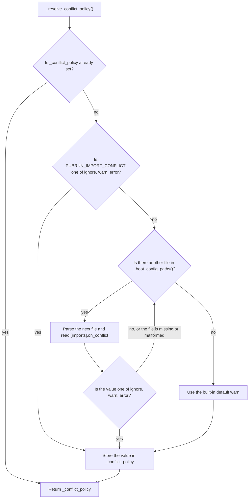

# IPD: Read the boot import-conflict policy from every config file that the boot import-mode resolver searches

- Date: 2026-11-22
- Kind: child
- Concern: Bugs and correctness (configuration discovery): `[imports].on_conflict` takes effect only when it is set in `./.pubrun.toml`. The same key set in `./.config/pubrun/config.toml` or in the user config file `config.toml` is silently ignored, and the policy stays at the built-in `"warn"`, although `resolve_import_mode` already reads the import mode from all three files.
- Scope: `src/pubrun/_config_boot.py` (a new multi-file key reader next to `_read_local_toml_key`), `src/pubrun/_bootstrap.py` (`_resolve_conflict_policy` calls the new reader), new behavioral tests in `tests/test_config_capture_modes.py`, the boot-discovery paragraph of `docs/configuration.md`, and a `### Fixed` entry in `CHANGELOG.md`.
- Scope-Paths: src/pubrun/_config_boot.py, src/pubrun/_bootstrap.py, tests/test_config_capture_modes.py, docs/configuration.md, CHANGELOG.md
- Item-Dependencies: none
- Status: reviewed
- Readiness: go-pending-approval
- Review-Depth: standard
- Work-Kind: bug
- Priority: low
- From-Backlog: ql671s
- Blocks-Release: next
- Set: ql671s
- Order: 1
- Highest E allocated: 05
- Author: Claude Opus 5.5
- Id: 2e6xfq

> Write and proofread this plan per the technical writing standard, `.aw/system/workflows/technical-writing/technical-writing.md` (`.agents/workflows/technical-writing/technical-writing.md` in a legacy-layout install), including requirement 12 (diagrams).

## Workflow history

- 2026-11-23 /plan-review (Claude Opus 5.5): APPROVE WITH REVISIONS APPLIED; PR-001, PR-002, PR-003, PR-004
- 2026-11-23 to-review (Claude Opus 5.5): authored from backlog ql671s: reproduction, multi-file boot key reader, conflict-policy switch, behavioral tests, documentation.
- 2026-11-23 draft (Claude Opus 5.5): created.

## Goal

When two imports in one process request different pubrun import modes (for example `import pubrun` and then `import pubrun.minimal`), `src/pubrun/_bootstrap.py::select_mode` applies the import-conflict policy: `"ignore"` (do nothing), `"warn"` (emit `PubrunImportModeConflictWarning`), or `"error"` (raise `PubrunImportModeConflictError`). `_bootstrap._resolve_conflict_policy` reads that policy from the `PUBRUN_IMPORT_CONFLICT` environment variable and then from `[imports].on_conflict`, but it reads the key only from `./.pubrun.toml` (through `pubrun._config_boot._read_local_toml_key`).

This plan makes `_resolve_conflict_policy` search the same three files, in the same order, that `pubrun._config_boot.resolve_import_mode` searches for `[imports].mode`: `./.pubrun.toml`, then `./.config/pubrun/config.toml`, then the user config file (`_config_boot._global_config_dir() / "config.toml"`). After the change, `on_conflict = "error"` in any of those files makes a conflicting import raise, and the documented precedence holds.

### Target conflict-policy resolution



The file order is `./.pubrun.toml`, then `./.config/pubrun/config.toml`, then the user config file. The first file whose `[imports].on_conflict` value is valid (case-insensitive) decides. A missing file, a malformed file, or an invalid value falls through to the next file. This is the same "first valid value wins" rule that `resolve_import_mode` applies to `[imports].mode`, and it gives the same answer as `pubrun.config.resolve_config` whenever every value is valid, because `resolve_config` also lets `./.pubrun.toml` override `./.config/pubrun/config.toml`, which overrides the user file.

## Detailed Implementation Checklist (TODO)

Execution-state rule: mark an `E-*` item complete only after performing the action. That mark is not validation. Right-sizing rule: write for a modest executor that cannot hold much in its head. Each E-item is one step (one concern, about one file, executable in one focused pass) and its V-item names each unit it covers with its own check; a plan stays at about 5 E-items and 8 work Scope-Paths, else split it into more child plans (guidance, `IPD-Z603`). Accepted execution states: blocked, failed, pending, performed; terminal gate demands 'performed'.

### Task group 1: Reproduce the defect

- [ ] E-01 Before changing any code, run the reproduction command in `## Required tests / validation` on the unchanged tree and record its output.
  - Depends on: none
  - Expected outcome: The command prints `deep exit=0 policy=warn` and `user exit=0 policy=warn`, which shows that `on_conflict = "error"` in `./.config/pubrun/config.toml` and in the user config file is ignored. When this plan was authored (commit `296feab`, CPython 3.14.6), the command printed exactly those two lines.
  - Execution state: pending

### Task group 2: Multi-file key reader in `src/pubrun/_config_boot.py`

- [ ] E-02 Add a private function `_read_boot_toml_key(section, key, valid)` to `src/pubrun/_config_boot.py` that returns the first acceptable value of `[section].key` across `_boot_config_paths()`.
  - Depends on: E-01
  - Expected outcome: The function iterates `_boot_config_paths()` in order, parses each file at most once with `_load_toml_file`, and extracts the value with `_extract_toml_key`. `valid` is a required collection of lowercase strings; the function has no "accept any value" mode, because no caller needs one. It returns the first value whose `.strip().lower()` is in `valid`, already normalized to that lowercase form, and skips other values. Because of `.strip()`, a value with surrounding spaces such as `" error "` is now accepted, as `resolve_import_mode` already accepts `[imports].mode`. It returns `None` when no file supplies an acceptable value. It never raises: a missing file, an unreadable file, a malformed file, or a non-dict section falls through, as `_load_toml_file` and `_extract_toml_key` already guarantee. The module docstring's resolution-order list gains one sentence stating that `[imports].on_conflict` is read from the same files in the same order by this function. `_read_local_toml_key`, `_load_local_toml`, and `resolve_import_mode` keep their current behavior, so the existing test `tests/test_commit_identity.py::TestConfigBootSingleRead::test_read_local_toml_key_preserved_for_bootstrap_conflict_policy` still passes unchanged.
  - Execution state: pending

### Task group 3: Switch the conflict policy in `src/pubrun/_bootstrap.py`

- [ ] E-03 Make `_bootstrap._resolve_conflict_policy` read the config value through `_read_boot_toml_key("imports", "on_conflict", valid=("ignore", "warn", "error"))` instead of `_read_local_toml_key("imports", "on_conflict")`.
  - Depends on: E-02
  - Expected outcome: The environment variable `PUBRUN_IMPORT_CONFLICT` is still checked first and still wins. The config lookup is the multi-file reader, so the flow in `## Goal` holds. The default stays `"warn"`. The result is still cached in the module global `_conflict_policy`, and `reset_state()` still clears it. The import of the reader stays lazy (inside the function), as it is today, so module import cost does not change. The messages of `PubrunImportModeConflictWarning` and `PubrunImportModeConflictError` do not change.
  - Execution state: pending

### Task group 4: Behavioral tests

- [ ] E-04 Add a `TestBootConflictPolicyDiscovery` class to `tests/test_config_capture_modes.py` that proves the policy is read from each file and in the documented precedence.
  - Depends on: E-03
  - Expected outcome: Every test uses the existing `isolated_home` fixture and `_write` helper in that file, deletes `PUBRUN_IMPORT_CONFLICT` with `monkeypatch.delenv(..., raising=False)`, calls `pubrun._bootstrap.reset_state()` before it acts, and triggers a conflict through the public bootstrap calls `select_mode("auto", "pubrun", "default")` followed by `select_mode("minimal", "pubrun.minimal", "explicit")`. The class contains these tests. (1) Project deep file: `on_conflict = "error"` in `tmp_path / ".config" / "pubrun" / "config.toml"` makes the second `select_mode` raise `PubrunImportModeConflictError`. (2) User file: with `_non_windows(monkeypatch)`, `on_conflict = "error"` in `isolated_home / ".config" / "pubrun" / "config.toml"` makes it raise. (3) User file under `XDG_CONFIG_HOME`: with `_non_windows(monkeypatch)` and `XDG_CONFIG_HOME` set to a temporary directory containing `pubrun/config.toml` with `"error"`, it raises. (4) Windows user file: with `sys.platform` patched to `"win32"` and `APPDATA` set to a temporary directory containing `pubrun/config.toml` with `"error"`, it raises. (5) Precedence: `./.pubrun.toml` with `"ignore"` and the deep file with `"error"` produce no `PubrunImportModeConflictWarning` and no exception (checked with `warnings.catch_warnings(record=True)` and `simplefilter("always")`). The test then deletes `.pubrun.toml`, calls `reset_state()`, repeats both `select_mode` calls, and asserts that the second call raises. (6) Fall-through: `./.pubrun.toml` with `on_conflict = "bogus"` and the deep file with `"error"` raise. (7) Malformed higher file: a `./.pubrun.toml` that is not valid TOML and the deep file with `"error"` raise. (8) Environment wins: `PUBRUN_IMPORT_CONFLICT=ignore` with the deep file set to `"error"` produces no `PubrunImportModeConflictWarning` and no exception. (9) Default: with no config file, the conflict emits exactly one `PubrunImportModeConflictWarning`. (10) End to end in a subprocess: with the deep file set to `"error"`, `PUBRUN_AUTO_START=false`, `PUBRUN_IMPORT_CONFLICT` and `PUBRUN_IMPORT_MODE` removed, `HOME`/`XDG_CONFIG_HOME` pointing at the isolated home, and this repository's `src` directory (`Path(__file__).resolve().parents[1] / "src"`) prepended to `PYTHONPATH`, running `[sys.executable, "-c", "import pubrun, pubrun.minimal"]` with `cwd=tmp_path` and a timeout exits nonzero and its stderr contains `PubrunImportModeConflictError`. The `PYTHONPATH` prefix is required because pytest's `pythonpath = ["src"]` setting does not reach a child process: without it, the child imports whatever `pubrun` is installed (for example, an editable install of a different checkout), not the code under test. `tests/test_capture_isolation.py::_worktree_env` uses the same prefix. No test reads production source code, counts calls, or measures time.
  - Execution state: pending

### Task group 5: Verification and documentation

- [ ] E-05 Run the targeted and full test suites and the reproduction command on the changed tree, then update `docs/configuration.md` and `CHANGELOG.md`.
  - Depends on: E-04
  - Expected outcome: `python3 -m pytest tests/test_config_capture_modes.py tests/test_import_modes.py tests/test_commit_identity.py -v --no-cov` and `python3 -m pytest -q` each finish with zero failures. The reproduction command prints `deep exit=1 policy=error` and `user exit=1 policy=error`. In `docs/configuration.md`, the paragraph under `## Configuration Discovery` that begins "The import mode chosen at `import pubrun` time" gains one sentence stating that `[imports].on_conflict` is read from the same files in the same order, that the first file with a valid value decides, and that `PUBRUN_IMPORT_CONFLICT` overrides all files. In `CHANGELOG.md`, the first `### Fixed` list under `## [Unreleased]` gains one bullet stating that `[imports].on_conflict` set in `./.config/pubrun/config.toml` or in the user config file is no longer ignored. The added lines in both files contain no em dash or en dash.
  - Execution state: pending

## Project conventions discovered (Step 0)

- `src/pubrun/_config_boot.py` is the lightweight boot-time config reader. It avoids importing `pubrun.config` so that `import pubrun` stays cheap and free of circular imports. Its helpers are `_boot_config_paths` (the three candidate files, highest precedence first), `_load_toml_file` (parse one file, `None` on any failure), and `_extract_toml_key` (safe scalar extraction that tolerates non-dict sections). `resolve_import_mode` already uses all three helpers; commit `4bd4552` (plan `l7ko8p`, BUG-39) added the multi-file search but left `_resolve_conflict_policy` on `_read_local_toml_key`.
- `src/pubrun/_bootstrap.py::_resolve_conflict_policy` is the only reader of `[imports].on_conflict` in `src/`. Its only caller is `select_mode`, when a later import requests a mode that differs from the selected one. `src/pubrun/resources/default.toml` sets `on_conflict = "warn"`, which matches the hard-coded fallback.
- `pubrun.config.load_local_config` applies `./.config/pubrun/config.toml` and then `./.pubrun.toml`, so `./.pubrun.toml` wins; `resolve_config` layers the user file below the local files. `docs/configuration.md` `## Configuration Discovery` documents that order.
- `tests/test_config_capture_modes.py::TestBootDiscovery` tests the boot import-mode search with the `isolated_home` fixture (which sets `HOME` and `USERPROFILE` and clears `XDG_CONFIG_HOME`, `APPDATA`, `PUBRUN_IMPORT_MODE`, and `PUBRUN_AUTO_START`), the `_write` helper, and `_non_windows(monkeypatch)`. The new class follows that pattern. The fixture does not clear `PUBRUN_IMPORT_CONFLICT`, so each new test clears it.
- `tests/conftest.py::isolated_cwd` runs every test in its own `tmp_path` and replaces `pathlib.Path.cwd` with `lambda: tmp_path`, so `_boot_config_paths` sees `tmp_path` as the project directory. `tests/conftest.py::pubrun_state_isolation` calls `_bootstrap.reset_state()` around every test and restores `os.environ`.
- `pyproject.toml` sets `addopts` with `--cov`, so targeted runs pass `--no-cov`. `AGENTS.md` requires tests that assert observable behavior (no `inspect`, `ast`, source regex, or call counts). `CHANGELOG.md` and `docs/configuration.md` are user-facing, so new prose there uses no em or en dashes.

## Findings

| Config file holding `on_conflict = "error"` | Policy resolved today (commit `296feab`) | Conflicting `import pubrun, pubrun.minimal` today |
|---|---|---|
| `./.pubrun.toml` | `error` | raises `PubrunImportModeConflictError` |
| `./.config/pubrun/config.toml` | `warn` | emits a warning only; exit status 0 |
| User config file (`$XDG_CONFIG_HOME/pubrun/config.toml`) | `warn` | emits a warning only; exit status 0 |

Root cause: `_resolve_conflict_policy` calls `_read_local_toml_key("imports", "on_conflict")`, and `_read_local_toml_key` reads only `Path.cwd() / ".pubrun.toml"` through `_load_local_toml`. The other two files that `_boot_config_paths` lists are never parsed for this key.

## Proposed changes (ordered, validatable)

1. Run the reproduction command on the unchanged tree and record the output (E-01).
2. In `src/pubrun/_config_boot.py`, add `_read_boot_toml_key` over `_boot_config_paths()` with a required collection of valid values (E-02).
3. In `src/pubrun/_bootstrap.py`, make `_resolve_conflict_policy` use the new reader (E-03).
4. In `tests/test_config_capture_modes.py`, add `TestBootConflictPolicyDiscovery` with the ten behavioral tests listed in E-04.
5. Run the targeted tests, the full suite, and the reproduction command, then update `docs/configuration.md` and `CHANGELOG.md` (E-05).

## Deferred / out of scope (with reason)

- Removing `_config_boot._read_local_toml_key` and `_load_local_toml`, which have no caller in `src/` after this change. Reason: `tests/test_commit_identity.py` tests `_read_local_toml_key` directly, and removing a helper is a cleanup that this defect does not need.
  - Carrier-Declined: no defect; an unused private helper does no harm and its removal belongs to a cleanup change.
- Reading the other `[imports]` keys (`record_provenance`, `provenance_depth`, `provenance_path_mode`, `max_requests`) at boot. Reason: `_bootstrap` does not read them from config at all today (`_max_requests` is a module constant), and the backlog item names only `on_conflict`.
  - Carrier-Declined: outside the reported defect; no boot-time reader of those keys exists to fix.
- Running the full continuous integration (CI) matrix (3 operating systems x Python 3.8 to 3.14) as an execution step. Reason: this lane may not push. `AGENTS.md` "Matrix-validation discipline" applies, because the user config directory differs on Windows (`APPDATA`). The maintainer should watch the CI matrix after the change is pushed. Test (4) in E-04 covers the Windows path selection on every platform by patching `sys.platform`.
  - Carrier-Declined: a release-process step owned by the maintainer, not an unfinished part of this plan's change.

## Scope check

- Over-scope: none. Only the five `- Scope-Paths:` files change.
- Under-scope: none. `_resolve_conflict_policy` is the only reader of `[imports].on_conflict` in `src/`, and the new reader uses the same path list as `resolve_import_mode`, so both boot-time config reads search the same files.

## Required tests / validation

Reproduction command (E-01 and E-05). Run it from the repository root. It uses a scratch directory, so no repository or user config file is read:

```sh
REPO="$PWD"; R=/tmp/opencode/ql671s-repro; rm -rf "$R"; mkdir -p "$R/proj/.config/pubrun" "$R/xdg/pubrun" "$R/home" && (cd "$R/proj" && for where in deep user; do rm -f .config/pubrun/config.toml ../xdg/pubrun/config.toml; if [ $where = deep ]; then f=.config/pubrun/config.toml; else f=../xdg/pubrun/config.toml; fi; printf '[imports]\non_conflict = "error"\n' > "$f"; env -u PUBRUN_IMPORT_CONFLICT -u PUBRUN_IMPORT_MODE -u APPDATA PUBRUN_AUTO_START=false HOME="$R/home" XDG_CONFIG_HOME="$R/xdg" PYTHONPATH="$REPO/src" python3 -c 'import pubrun, pubrun.minimal' >/dev/null 2>&1; echo "$where exit=$? policy=$(env -u PUBRUN_IMPORT_CONFLICT HOME="$R/home" XDG_CONFIG_HOME="$R/xdg" PUBRUN_AUTO_START=false PYTHONPATH="$REPO/src" python3 -c 'from pubrun import _bootstrap as b; b.reset_state(); print(b._resolve_conflict_policy())')"; done)
```

- Run the reproduction command before any code change and paste its output (E-01).
- Run `python3 -m pytest tests/test_config_capture_modes.py tests/test_import_modes.py tests/test_commit_identity.py -v --no-cov` and paste the output (E-02, E-03, E-04).
- Run `python3 -m pytest -q` and paste the summary (E-05).
- Run the reproduction command after the change and paste its output (E-05).
- Paste `git diff -- docs/configuration.md CHANGELOG.md` and the dash check `git diff -U0 -- docs/configuration.md CHANGELOG.md | grep '^+' | grep -c $'\u2014\|\u2013'`, which must print `0` (E-05).

## Spec / documentation sync

- `docs/configuration.md`: the `## Configuration Discovery` paragraph on boot-time import-mode discovery gains the `on_conflict` sentence (E-05). The `[imports]` table row for `on_conflict` and the `PUBRUN_IMPORT_CONFLICT` row already describe the values and the override correctly and need no edit.
- `CHANGELOG.md`: E-05 adds a `### Fixed` entry.
- No specification under `.aw/records/specs/` describes `_resolve_conflict_policy` or boot config discovery, so no spec is amended.

## Open questions

### OQ-01: Should an invalid `on_conflict` value in a higher-precedence file fall through to a lower file, or stop the search?

- Blocking: no
- Status: resolved
- Owner: plan author
- Resolution or deferral rationale: Fall through. `resolve_import_mode` already skips an invalid `[imports].mode` and continues to the next file (`tests/test_config_capture_modes.py::TestBootDiscovery::test_invalid_mode_in_higher_file_falls_through`), and today's `_resolve_conflict_policy` already ignores an invalid value. Using the same rule keeps the two boot-time reads consistent. E-04 test (6) pins the behavior.

## Validation and cross-check (verify before reporting done)

Validation-state rule: inspect evidence in a separate pass. Do not mark a `V-*` item complete from memory or from the matching execution checkmark. Accepted validation results: blocked, failed, pass, pending; terminal gate demands 'pass'. Runtime-demonstration reachability rule: for each `V-*` item demanding the software be observed acting (such as a run, a dispatch, or a transition), as distinct from items demanding a diff, a file's content, or a test result (which are reachable by construction), name the code path that produces the observation or the sibling `E-*` that creates it, else the demand is UNDER-SCOPE.

- [ ] V-01 validates E-01
  - Required evidence: The pasted reproduction output showing `deep exit=0 policy=warn` and `user exit=0 policy=warn`, with the pasted `git rev-parse --short HEAD`, and an empty `git diff --stat -- src/` captured at the same time, which shows the reproduction ran before any code change. The command reaches `_bootstrap.select_mode` through the `import pubrun.minimal` conflict and `_bootstrap._resolve_conflict_policy` through the direct call.
  - Observed evidence:
  - Result: pending

- [ ] V-02 validates E-02
  - Required evidence: The pasted `git diff -- src/pubrun/_config_boot.py` showing `_read_boot_toml_key` iterating `_boot_config_paths()` with `_load_toml_file` and `_extract_toml_key`, the required `valid` filter with `.strip().lower()` normalization, the `None` return, the module docstring sentence, and no change to `_read_local_toml_key`, `_load_local_toml`, or `resolve_import_mode`. The pasted targeted pytest output, re-derived at execution time, showing passing tests that pin two unchanged behaviors: `_read_local_toml_key` still reads `[imports].on_conflict` from `./.pubrun.toml` (pointer, not a bar: `tests/test_commit_identity.py::TestConfigBootSingleRead`), and `resolve_import_mode` still searches the three files with the same precedence and fall-through (pointer: `tests/test_config_capture_modes.py::TestBootDiscovery`).
  - Observed evidence:
  - Result: pending

- [ ] V-03 validates E-03
  - Required evidence: The pasted `git diff -- src/pubrun/_bootstrap.py` showing `_resolve_conflict_policy` calling `_read_boot_toml_key("imports", "on_conflict", valid=("ignore", "warn", "error"))` after the unchanged `PUBRUN_IMPORT_CONFLICT` check, with the `"warn"` default and the `_conflict_policy` cache unchanged. The pasted targeted pytest output, re-derived at execution time, showing that the existing conflict-detection tests still pass, which pins the unchanged environment-variable policy, default warning, and same-mode no-conflict behavior (pointer, not a bar: `tests/test_import_modes.py::TestConflictDetection`).
  - Observed evidence:
  - Result: pending

- [ ] V-04 validates E-04
  - Required evidence: The pasted targeted pytest `-v` output, re-derived at execution time, with each of the ten behaviors in E-04 mapped to the passing test that pins it (test names are pointers, not the bar): project deep file raises, user file raises, `XDG_CONFIG_HOME` user file raises, Windows `APPDATA` user file raises, `./.pubrun.toml` `"ignore"` beats the deep file `"error"` and the deep file decides once `./.pubrun.toml` is removed, an invalid higher value falls through, a malformed higher file falls through, `PUBRUN_IMPORT_CONFLICT` beats every file, the default emits one `PubrunImportModeConflictWarning`, and a child process with the deep file set to `"error"` exits nonzero with `PubrunImportModeConflictError` in stderr. The pasted test source for behavior (10) showing that the child's `PYTHONPATH` starts with this repository's `src` directory. Tests (1) to (9) reach `_resolve_conflict_policy` through the public `select_mode` call; test (10) reaches it through a real `import pubrun.minimal` in a child process.
  - Observed evidence:
  - Result: pending

- [ ] V-05 validates E-05
  - Required evidence: The pasted `python3 -m pytest -q` summary line with zero failures. The pasted post-change reproduction output showing `deep exit=1 policy=error` and `user exit=1 policy=error`. The pasted `git diff -- docs/configuration.md CHANGELOG.md` showing the new `on_conflict` sentence under `## Configuration Discovery` and the new `### Fixed` bullet under `## [Unreleased]`, and the pasted dash-check output `0`.
  - Observed evidence:
  - Result: pending

## Approval and execution gate

- Size assessment: standard
- Cohesion rationale: not required

Execution contract:
1. Precondition: wait for human approval (`- Status: approved`) with no unresolved `Blocking: yes` open question before you change code.
2. Order: perform E-01 before any edit to `src/`, because it records the defect. Perform E-02 before E-03, because E-03 calls the function E-02 adds.
3. Scope declaration: the expected modified files are the `- Scope-Paths:` entries (`src/pubrun/_config_boot.py`, `src/pubrun/_bootstrap.py`, `tests/test_config_capture_modes.py`, `docs/configuration.md`, `CHANGELOG.md`). If execution requires an out-of-scope file, justify it with `--scope-reason` at finalization. If a declared file needs no edit, acknowledge it with `--scope-ack`.
4. Validation honesty: run each required validation command and paste its actual output into the matching `V-*` `Observed evidence:` field. Do not mark a `V-*` item `pass` without output captured from that run.
5. Commit discipline: commit only the paths you changed with `aw commit 2e6xfq -- src/pubrun/_config_boot.py src/pubrun/_bootstrap.py tests/test_config_capture_modes.py docs/configuration.md CHANGELOG.md`. Do not use `git add -A` or raw `git commit`. Do not push without an explicit human instruction.
6. Lifecycle transition: finalize this plan with `aw ipd finalize 2e6xfq`, never with a hand-written `git mv` to `.aw/records/plans/executed/`. Inside a runner lane (`aw oc run` or `aw agy run`), the runner finalizes after the turn. Outside a runner, the executor runs `aw ipd finalize 2e6xfq`.
