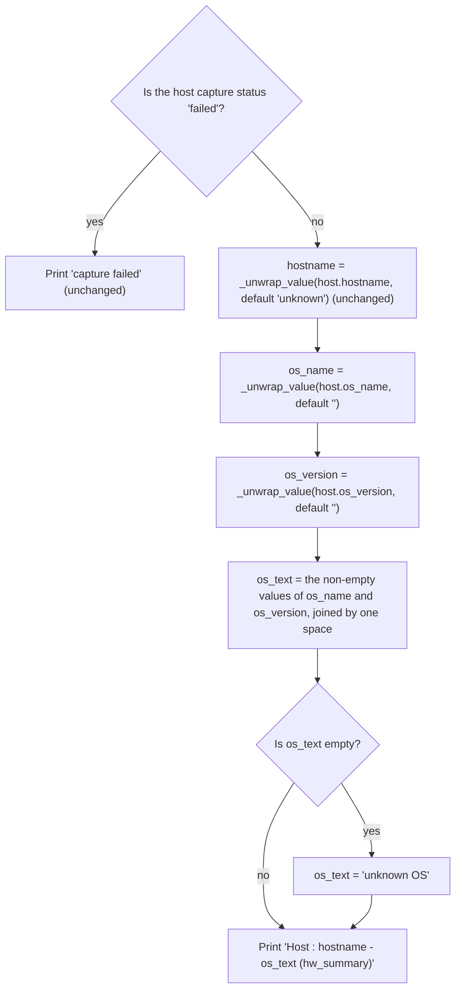

# IPD: Guard missing host OS fields in the print_report Host line

- Date: 2026-11-22
- Kind: child
- Concern: Bugs and correctness (report rendering): `pubrun show` prints the literal word `None` in the Host line when the manifest's `host.os_version` or `host.os_name` is missing or null.
- Scope: `src/pubrun/report/diagnostics.py` (the Host line in `print_report`) and regression tests in `tests/test_report_checks_bugs.py`.
- Scope-Paths: src/pubrun/report/diagnostics.py, tests/test_report_checks_bugs.py
- Item-Dependencies: none
- Status: approved
- Readiness: go-pending-approval
- Review-Depth: simple
- Work-Kind: bug
- Priority: low
- From-Backlog: rmssqd
- Blocks-Release: next
- Set: rmssqd
- Order: 1
- Highest E allocated: 03
- Author: OpenCode agent
- Id: 6bgkyj
- Approval: 2026-11-23, recorded via aw ipd set: status set to approved

> Write and proofread this plan per the technical writing standard, `.aw/system/workflows/technical-writing/technical-writing.md` (`.agents/workflows/technical-writing/technical-writing.md` in a legacy-layout install), including requirement 12 (diagrams).

## Workflow history

- 2026-11-23 approved (aw set): status set to approved
- 2026-11-23 /plan-review (Claude Opus 5.5): APPROVE WITH REVISIONS APPLIED; PR-001, PR-002, PR-003, PR-004
- 2026-11-23 to-review (OpenCode agent): authored from backlog rmssqd: reproduction, guarded Host line, behavioral regression tests.
- 2026-11-23 draft (OpenCode agent): created.

## Goal

`src/pubrun/report/diagnostics.py::print_report` renders the human-readable run report that `pubrun show` prints. Its "Standard Information" block contains a Host line built from the manifest's `host` section. That line interpolates `host.get('os_name')` and `host.get('os_version')` directly into an f-string, so a missing or null field prints as the literal word `None`. This plan makes the Host line omit a missing OS field, print `unknown OS` when both OS fields are missing, and never print `None`.

### Target Host line behavior



## Detailed Implementation Checklist (TODO)

Execution-state rule: mark an `E-*` item complete only after performing the action. That mark is not validation. Right-sizing rule: write for a modest executor that cannot hold much in its head. Each E-item is one step (one concern, about one file, executable in one focused pass) and its V-item names each unit it covers with its own check; a plan stays at about 5 E-items and 8 work Scope-Paths, else split it into more child plans (guidance, `IPD-Z603`). Accepted execution states: blocked, failed, pending, performed; terminal gate demands 'performed'.

### Task group 1: Guard the Host line

- [ ] E-01 In `src/pubrun/report/diagnostics.py::print_report`, build the OS part of the Host line from guarded values instead of raw `host.get(...)` calls.
  - Depends on: none
  - Expected outcome: In the `else` branch that follows `if host_status == "failed":`, the code computes `os_name = _unwrap_value(host.get("os_name"), default="")` and `os_version = _unwrap_value(host.get("os_version"), default="")`. It sets `os_text` to the non-empty values among `os_name` and `os_version`, in that order, joined by one space, and sets `os_text` to `"unknown OS"` when both are empty. The printed line is `f"{cyan}Host{rst}        : {hostname} - {os_text} ({hw_summary})"`. The `capture failed` branch, the `hostname` computation, and `hw_summary` are unchanged. When both OS fields are non-empty strings, the printed line is byte-identical to the current output (for example `Host        : arm-01 - Linux 6.8.0 (unknown, 8.0 GB RAM)` with `NO_COLOR=1`). No other line of `print_report` changes.
  - Execution state: pending

### Task group 2: Regression tests and verification

- [ ] E-02 Add a `TestHostLineNeverRendersNone` class to `tests/test_report_checks_bugs.py` with behavioral tests that call `print_report` on manifests with missing or null OS fields.
  - Depends on: E-01
  - Expected outcome: The class reuses the file's existing `_report_manifest(tmp_path)` helper, edits the returned manifest's `host` section, and rewrites `manifest.json` at the returned path before each call. Each test sets `NO_COLOR=1` with `monkeypatch`, calls `print_report(path, "standard")`, and selects the single output line that starts with `Host`. One test is parametrized over these `host` cases and asserts the exact OS text between `"arm-01 - "` and `" ("` in that line, and that `"None"` is not in the line: (1) `os_version` key removed, expected `Linux`; (2) `os_version` set to `None`, expected `Linux`; (3) `os_name` key removed, expected `6.8.0`; (4) `os_name` set to `None`, expected `6.8.0`; (5) both keys removed, expected `unknown OS`; (6) both set to `""`, expected `unknown OS`; (7) `os_name` set to `{"representation": "redacted"}`, expected `<REDACTED> 6.8.0` (the same rendering `_unwrap_value` gives a redacted hostname; before the fix this case printed the raw dict text `{'representation': 'redacted'} 6.8.0`). A separate test asserts that the unmodified `_report_manifest` manifest still prints a Host line that contains `arm-01 - Linux 6.8.0 (`. The existing `TestNullCpuModelPins::test_print_report_never_renders_none` is unchanged. No test reads production source code.
  - Execution state: pending

- [ ] E-03 Run the new tests, the existing report tests, and the full test suite.
  - Depends on: E-02
  - Expected outcome: `python3 -m pytest tests/test_report_checks_bugs.py -v`, `python3 -m pytest tests/test_show_sections.py tests/test_reports.py -q`, and `python3 -m pytest -q` each finish with zero failures. Running the reproduction script described in `## Findings` prints no line that contains `None`.
  - Execution state: pending

## Project conventions discovered (Step 0)

- `src/pubrun/report/diagnostics.py::_unwrap_value(val, default)` already normalizes manifest values for display. It returns `default` for `None` and for an empty string, returns a string unchanged, unwraps a `{"representation": "plain", "value": ...}` dict, renders any other representation as `<REPRESENTATION>` (for example `<REDACTED>`), and applies `str()` to other types. `print_report` already uses it for `host.hostname` and `git.remote_url`. E-01 reuses it with `default=""`, so a redacted or wrapped OS value renders the same way the hostname does.
- `schemas/manifest.schema.json` declares `host.os_name` and `host.os_version` as type `["string", "null"]` and requires only `capture_state`, so a valid manifest may omit either field or set it to null. `docs/manifest.md` describes `os_version` as "Kernel or OS version string." `src/pubrun/capture/host.py::get_host` writes both fields from `platform.system()` and `platform.release()` on success, and writes only `capture_state` when host capture is suppressed or fails.
- Executed plan `ihh27o` (`.aw/records/plans/executed/20261122-bugs-audit-06-ihh27o-fix-self-check-meta-snapshot-and-report-rendering-bugs.ipd.md`, finding `BUG-64a`) pinned the same "never render literal `None`" rule for `hardware.cpu.model` in `print_report` and filed this backlog item as an adjacent defect. Its tests live in `tests/test_report_checks_bugs.py` (`_report_manifest` helper, `TestNullCpuModelPins`). This plan adds its tests to the same file.
- Tests in this repository assert observable behavior. They call functions or run commands and inspect output; they do not read source with `inspect`, `ast`, or regex. `pyproject.toml` sets `pythonpath = ["src"]` for pytest.

## Findings

Reproduction on the lane base (commit `e5189cf`), recorded 2026-11-22. The script below writes a minimal manifest for each case, with `host.capture_state.status` set to `complete`, calls `print_report(path, "standard")` with `NO_COLOR=1`, and prints the Host line. Save it as `/tmp/opencode/rmssqd_repro.py` and run it from the repository root with `PYTHONPATH=src python3 /tmp/opencode/rmssqd_repro.py`.

```python
import contextlib, io, json, os, pathlib, tempfile
os.environ["NO_COLOR"] = "1"
from pubrun.report.diagnostics import print_report
for label, host in [
    ("version-missing", {"os_name": "Linux", "hostname": "arm-01"}),
    ("version-null", {"os_name": "Linux", "os_version": None, "hostname": "arm-01"}),
    ("name-missing", {"os_version": "6.8.0", "hostname": "arm-01"}),
    ("both-missing", {"hostname": "arm-01"}),
]:
    host["capture_state"] = {"status": "complete"}
    d = pathlib.Path(tempfile.mkdtemp()) / "runs" / "pubrun-r1"
    d.mkdir(parents=True)
    m = {"run": {"run_id": "r1"}, "timing": {"started_at_utc": 1780250000.0, "elapsed_seconds": 1.0},
         "invocation": {"argv": ["t.py"], "script": {"basename": "t.py"}},
         "status": {"outcome": "completed"}, "host": host}
    (d / "manifest.json").write_text(json.dumps(m))
    buf = io.StringIO()
    with contextlib.redirect_stdout(buf):
        print_report(str(d / "manifest.json"), "standard")
    print(label, "|", [l for l in buf.getvalue().splitlines() if l.startswith("Host")][0])
```

Observed output, one row per case:

| `host` fields | Observed Host line |
|---|---|
| `os_name: "Linux"`, no `os_version` | `Host        : arm-01 - Linux None (unknown, 0.0 GB RAM)` |
| `os_name: "Linux"`, `os_version: null` | `Host        : arm-01 - Linux None (unknown, 0.0 GB RAM)` |
| no `os_name`, `os_version: "6.8.0"` | `Host        : arm-01 - None 6.8.0 (unknown, 0.0 GB RAM)` |
| neither field | `Host        : arm-01 - None None (unknown, 0.0 GB RAM)` |

Root cause: the Host line in `print_report` is `f"... {hostname} - {host.get('os_name')} {host.get('os_version')} ({hw_summary})"`. `dict.get` returns `None` for a missing key, and the f-string renders `None` as the text `None`. The backlog item names `os_version`; `os_name` has the same defect on the same line, so E-01 guards both. The same raw interpolation also prints a wrapped value as Python dict text: with `os_name` set to `{"representation": "redacted"}` the line reads `arm-01 - {'representation': 'redacted'} 6.8.0 (...)`. Routing both fields through `_unwrap_value` renders it as `<REDACTED>`, which E-02 case (7) pins.

Re-checked at review on 2026-11-23: the script above printed the four `None` lines on this tree; a scratch copy of `src/` with the E-01 change printed `arm-01 - Linux (`, `arm-01 - Linux (`, `arm-01 - 6.8.0 (`, and `arm-01 - unknown OS (`. On the unmodified tree, `python3 -m pytest -q` printed `1819 passed, 2 skipped in 517.10s`, so V-03's zero-failure bar starts from a green suite. The pytest `pythonpath = ["src"]` setting makes pytest import this checkout's `src/`, but a bare `python3` resolves `pubrun` to whatever editable install the interpreter has, so the reproduction script needs `PYTHONPATH=src` as written.

## Proposed changes (ordered, validatable)

1. In `src/pubrun/report/diagnostics.py::print_report`, replace the raw `host.get('os_name')` and `host.get('os_version')` interpolation in the Host line with the guarded `os_text` described in E-01.
2. In `tests/test_report_checks_bugs.py`, add `TestHostLineNeverRendersNone` with the parametrized missing-field test and the unchanged-output test described in E-02.
3. Run the targeted tests, the neighboring report tests, the full suite, and the reproduction script (E-03).

## Deferred / out of scope (with reason)

- The Terminal User Interface (TUI) details pane, `src/pubrun/tui/widgets/details.py::RunDetailsView.update_general_pane`, has the same defect class in its OS line (`{host.get('os_name')} ({host.get('os_release')})`). Reason: it is a different module and display surface than the one the backlog item names.
  - Carrier: zen6hs
- A host section whose capture status is `suppressed` has no hostname or OS fields. After E-01 its Host line reads `unknown - unknown OS (...)` instead of `unknown - None None (...)`. Reason: the backlog item asks only that `None` not appear; adding a distinct "suppressed" label to the Host line is a presentation change the item does not request.
  - Carrier-Declined: accepted behavior after the fix; the line no longer shows `None`, and a suppressed host has no OS data to show.
- `CHANGELOG.md`. Reason: the sibling bug-fix plans in Set `bugs-audit` (for example `ihh27o`) did not edit `CHANGELOG.md`; the `release-notes` workflow drafts entries from the commit history at release time.
  - Carrier-Declined: changelog entries are produced by the release-notes workflow, not by individual bug-fix plans.

## Scope check

- Over-scope: none. Only `src/pubrun/report/diagnostics.py` and `tests/test_report_checks_bugs.py` change.
- Under-scope: none. The only `print_report` output built from `host.os_name` or `host.os_version` is the Host line; `grep -n "os_version" src/pubrun/report/diagnostics.py` returns that one line.

## Required tests / validation

- Run `python3 -m pytest tests/test_report_checks_bugs.py -v` and paste the output (covers E-01 and E-02).
- Run `python3 -m pytest tests/test_show_sections.py tests/test_reports.py -q` and paste the summary (confirms other `print_report` output is unchanged).
- Run the reproduction script from `## Findings` and paste its four Host lines.
- Run `python3 -m pytest -q` and paste the summary line.

## Spec / documentation sync

N/A. No spec under `.aw/records/specs/` and no page under `docs/` describes the Host line format; `grep -rn "os_version" docs README.md` finds only the field table in `docs/manifest.md`, which this plan does not change. The manifest schema is unchanged, so the cross-platform matrix rule in `AGENTS.md` does not apply.

## Open questions

### OQ-01: What should the Host line show when one or both OS fields are missing?

- Blocking: no
- Status: resolved
- Owner: none
- Resolution or deferral rationale: Omit a missing field and show `unknown OS` when both are missing. This follows existing conventions. In the same function, `hostname` and `cpu_model` fall back to `unknown`. In `src/pubrun/report/methods.py::generate_report`, a missing `os_name` renders as `an unknown OS`. Omitting a single missing field avoids output such as `Linux unknown`, which reads as if `unknown` were a version.

## Validation and cross-check (verify before reporting done)

Validation-state rule: inspect evidence in a separate pass. Do not mark a `V-*` item complete from memory or from the matching execution checkmark. Accepted validation results: blocked, failed, pass, pending; terminal gate demands 'pass'. Runtime-demonstration reachability rule: for each `V-*` item demanding the software be observed acting (such as a run, a dispatch, or a transition), as distinct from items demanding a diff, a file's content, or a test result (which are reachable by construction), name the code path that produces the observation or the sibling `E-*` that creates it, else the demand is UNDER-SCOPE.

- [ ] V-01 validates E-01
  - Required evidence: The pasted `git diff -- src/pubrun/report/diagnostics.py` hunk, showing that only the Host line `else` branch changed and that it uses `_unwrap_value(..., default="")` for both OS fields and the `"unknown OS"` fallback. Also the pasted output of the reproduction script from `## Findings` (it calls `print_report`, the code path E-01 changes), showing the four Host lines `arm-01 - Linux (`, `arm-01 - Linux (`, `arm-01 - 6.8.0 (`, and `arm-01 - unknown OS (`, none containing `None`.
  - Observed evidence:
  - Result: pending

- [ ] V-02 validates E-02
  - Required evidence: Pasted `python3 -m pytest tests/test_report_checks_bugs.py -v -k HostLine` output on the fixed tree in which every `TestHostLineNeverRendersNone` case reports PASSED: the seven `host` cases from E-02 (missing or null `os_version`, missing or null `os_name`, both missing, both empty, redacted `os_name`) and the unchanged complete-host case. Also pasted output of the same command run against the pre-fix code, in which every one of the seven `host` cases reports FAILED and the unchanged complete-host case reports PASSED; this shows the tests detect the defect and do not reject correct output. To get it, before committing, create a temporary worktree of the commit the lane started from with `git worktree add /tmp/opencode/6bgkyj-prefix HEAD`, copy the new `tests/test_report_checks_bugs.py` into it, run the command from that worktree's root, then run `git worktree remove --force /tmp/opencode/6bgkyj-prefix`, and paste `git worktree list` showing it is gone. Do not use `git stash` in the shared checkout.
  - Observed evidence:
  - Result: pending

- [ ] V-03 validates E-03
  - Required evidence: Pasted summary lines of `python3 -m pytest tests/test_report_checks_bugs.py -v`, `python3 -m pytest tests/test_show_sections.py tests/test_reports.py -q`, and `python3 -m pytest -q`, each with zero failures.
  - Observed evidence:
  - Result: pending

## Approval and execution gate

- Size assessment: standard
- Cohesion rationale: not required

Execution contract:
1. Precondition: wait for human approval (`- Status: approved`) with no unresolved `Blocking: yes` open question before you change code. OQ-01 is resolved and non-blocking.
2. Scope declaration: the expected modified files are the `- Scope-Paths:` entries (`src/pubrun/report/diagnostics.py`, `tests/test_report_checks_bugs.py`). If execution requires an out-of-scope file, justify it with `--scope-reason` at finalization. If a declared file needs no edit, acknowledge it with `--scope-ack`.
3. Validation honesty: run each required validation command and paste its actual output into the matching `V-*` `Observed evidence:` field. Do not mark a `V-*` item `pass` without output captured from that run.
4. Commit discipline: commit only the paths you changed with `aw commit 6bgkyj -- src/pubrun/report/diagnostics.py tests/test_report_checks_bugs.py`. Do not use `git add -A` or raw `git commit`. Do not push without an explicit human instruction.
5. Lifecycle transition: after every `E-*` item is `performed` and every `V-*` item is `pass`, `aw ipd lint --phase pre-transition` must conform. Then finalize this plan with `aw ipd finalize 6bgkyj`, never with a hand-written `git mv` to `.aw/records/plans/executed/`. Inside a runner lane (`aw oc run` or `aw agy run`), the runner finalizes after the turn. Outside a runner, the executor runs `aw ipd finalize 6bgkyj`.
