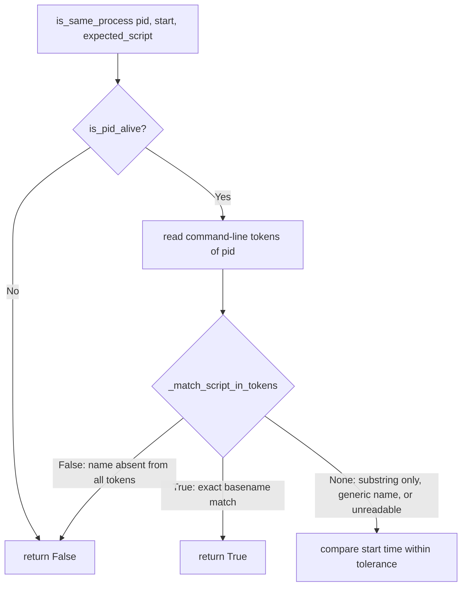
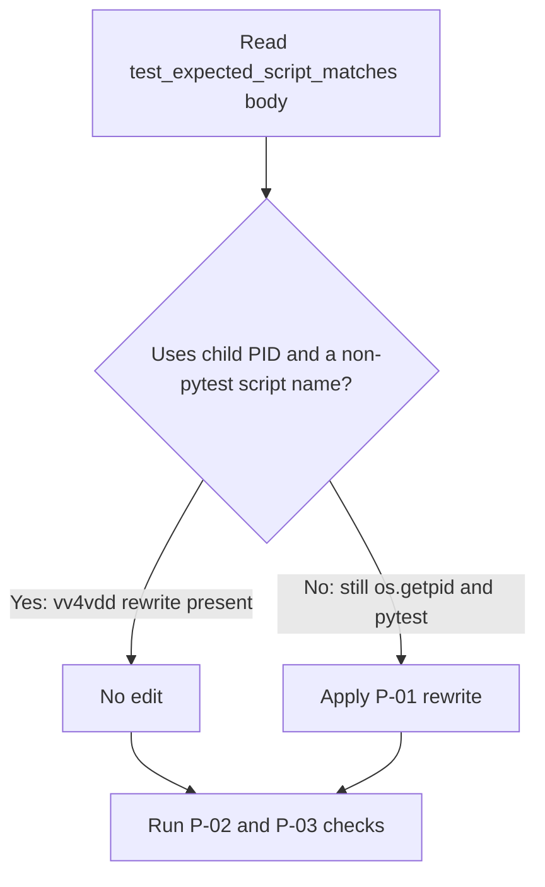

# IPD: Confirm test_expected_script_matches passes under pytest-xdist after plan vv4vdd

- Date: 2026-11-22
- Kind: child
- Concern: testing (one liveness test checks the command line of the pytest process that runs it, and that command line differs under pytest-xdist).
- Scope: After plan `vv4vdd` has executed, confirm that `tests/test_liveness.py::TestIsSameProcess::test_expected_script_matches` no longer depends on the command line of the pytest process, and that it passes serially, under pytest-xdist, and in the full parallel suite (`aw suite`). Edit `tests/test_liveness.py` only in the fallback case where the rewrite from plan `vv4vdd` is absent. No production code changes.
- Scope-Paths: tests/test_liveness.py
- Item-Dependencies: executed:vv4vdd
- Status: to-review
- Work-Kind: bug
- Priority: low
- From-Backlog: sd7kvt
- Blocks-Release: next
- Set: sd7kvt
- Order: 1
- Highest E allocated: 03
- Author: agent
- Id: ig2etn

> Write and proofread this plan per the technical writing standard, `.aw/system/workflows/technical-writing/technical-writing.md` (`.agents/workflows/technical-writing/technical-writing.md` in a legacy-layout install), including requirement 12 (diagrams).

## Workflow history

- 2026-11-23 draft (agent): created.
- 2026-11-23 to-review (agent): authored from backlog item `sd7kvt`; the failure was reproduced in the lane worktree before authoring (see Findings F-01).

## Goal

Close backlog item `sd7kvt`: `tests/test_liveness.py::TestIsSameProcess::test_expected_script_matches` must pass when pytest runs it in a pytest-xdist worker. pytest-xdist is a pytest plugin that runs tests in several worker processes at once; `aw suite` uses it. Pending plan `vv4vdd` (Set `ivpkar`) already rewrites this test. This plan waits for `vv4vdd`, confirms its rewrite is present, and records independent pass evidence for `sd7kvt`, so that two plans do not make the same edit to the same test function.

## Detailed Implementation Checklist (TODO)

Execution-state rule: mark an `E-*` item complete only after performing the action. That mark is not validation. Right-sizing rule: write for a modest executor that cannot hold much in its head. Each E-item is one step (one concern, about one file, executable in one focused pass) and its V-item names each unit it covers with its own check; a plan stays at about 5 E-items and 8 work Scope-Paths, else split it into more child plans (guidance, `IPD-Z603`). Accepted execution states: blocked, failed, pending, performed; terminal gate demands 'performed'.

### Task group 1: Confirm or apply the test rewrite

- [ ] E-01 Read the body of `TestIsSameProcess.test_expected_script_matches` in `tests/test_liveness.py`. If it already starts a child process and passes the child PID (not `os.getpid()`) and a non-`"pytest"` script name to `is_same_process`, make no edit. If it still passes `os.getpid()` and `expected_script="pytest"`, apply the child-process rewrite described in P-01.
  - Depends on: none
  - Expected outcome: The test body checks `is_same_process(<child pid>, time.time(), expected_script=<probe script basename>)` against a child process whose command line the test controls. The test body contains no `expected_script="pytest"` and no `os.getpid()` call. Either no edit was needed (the normal case after `vv4vdd`) or exactly this one test function changed.
  - Execution state: pending

### Task group 2: Run the checks

- [ ] E-02 Run the targeted liveness checks listed in P-02: `tests/test_liveness.py` serially, with 2 xdist workers, and with 4 xdist workers, and repeat the 2-worker run 5 times.
  - Depends on: E-01
  - Expected outcome: Every run exits 0. `test_expected_script_matches` reports `PASSED` (not `SKIPPED`) in every run on this Linux host.
  - Execution state: pending
- [ ] E-03 Run the full parallel suite with `aw suite --no-cache` (P-03).
  - Depends on: E-01
  - Expected outcome: The run exits 0 and its result line reports 0 failed.
  - Execution state: pending

## Project conventions discovered (Step 0)

- Tests live in `tests/` and use plain pytest classes. Each `TestIsSameProcess` test imports the private helpers `_PLATFORM`, `_check_command_linux`, `_check_command_macos`, and `_check_command_windows` from `pubrun.capture.liveness` inside its body, and skips with `pytest.skip("Command-line checking is not functional on this platform")` when the platform reader returns `None`.
- `pyproject.toml` (`[tool.pytest.ini_options]`) sets `addopts = "--cov=src --cov-report=term-missing --cov-report=xml -p no:randomly"`. Each pytest run therefore prints a coverage table before its result line. Targeted runs in this plan pass `--no-cov` to keep the output short.
- `aw suite` runs the core test tier with a bounded number of pytest-xdist workers and refuses narrowed selections (file paths, `-k`, `-m`, `::` node ids) with exit 2. Targeted checks therefore use plain `python3 -m pytest`.
- CI (`.github/workflows/ci.yml`) runs `pytest tests/ -v` serially, without `-n`, which is why CI never exposed this failure.
- `AGENTS.md` forbids tests that read production source code. The rewritten test calls `is_same_process` on a live child process and asserts on its return value, which tests behavior.

## Findings

How `is_same_process` decides when `expected_script` is given (from `pubrun.capture.liveness.is_same_process` and `_match_script_in_tokens`):

| ID | Finding | Evidence |
| --- | --- | --- |
| F-01 | The test fails under pytest-xdist on HEAD `d5f7f55`. | In the lane worktree on 2026-11-22, `python3 -m pytest tests/test_liveness.py -n 2 -q -p no:cacheprovider --no-cov` printed `FAILED tests/test_liveness.py::TestIsSameProcess::test_expected_script_matches` and `1 failed, 26 passed`. Host: Linux, pytest-xdist 3.8.0. The backlog item records 15 of 15 serial passes and a full serial run of `1492 passed, 2 skipped`. |
| F-02 | Cause: an xdist worker runs as `<python> -u -c import sys;exec(eval(sys.stdin.readline()))`, so `/proc/<pid>/cmdline` contains no token that matches `pytest`. `_check_command_linux(os.getpid(), "pytest")` returns `False` (a definite mismatch), not `None`. The skip guard tests `is not None`, so the test does not skip, and `is_same_process` returns `False` because the script name is absent. | Backlog item `sd7kvt` body; `pubrun.capture.liveness._match_script_in_tokens` docstring ("False when the script name appears nowhere at all"). |
| F-03 | The defect is in the test, not in `is_same_process`. Returning `False` when the expected script is absent from the command line is the intended recycled-PID protection (IPD 20260705 EC-06). | `pubrun.capture.liveness._match_script_in_tokens` docstring. |
| F-04 | Pending plan `vv4vdd` (`.aw/records/plans/pending/20261122-ivpkar-01-vv4vdd-make-the-parallel-test-suite-pass-fix-test-expected-script-m.ipd.md`, Status `to-review`, From-Backlog `ivpkar`) rewrites this test to use a child process running `liveness_probe_script.py` from `tmp_path`, and verifies it under `-n 2` and `aw suite`. A second independent edit of the same function would duplicate that work and risk a merge conflict, so this plan depends on `vv4vdd` (`- Item-Dependencies: executed:vv4vdd`). | The `vv4vdd` plan file, section "Proposed changes", P-01. |
| F-05 | Open backlog item `12rcu8` describes the same failure. Its plan `4h2qwz` exists only on branch `aw/lane/12rcu8`, which moved `12rcu8` back to `open`. It is not on HEAD, so this plan does not depend on it. | `git log --oneline -3 aw/lane/12rcu8` shows `4e0ad9d transition(backlog): move 12rcu8 -> open`. |
| F-06 | The backlog item's alternative fix ("skip when `PYTEST_XDIST_WORKER` is set") would turn the failure into a skip under `aw suite`, so the test would no longer run in the suite. The child-process rewrite keeps the test running everywhere the platform reader works. This plan therefore uses the child-process rewrite and not the skip. | Backlog item `sd7kvt` body ("Fix direction (unverified)"). |

## Proposed changes (ordered, validatable)

The executor follows this decision for E-01:

P-01 (performed by E-01, fallback only). This is the same rewrite that plan `vv4vdd` P-01 specifies. Apply it only if the body still uses `os.getpid()` and `"pytest"`:

1. Request the `tmp_path` fixture.
2. Write `tmp_path / "liveness_probe_script.py"` with the body `import sys; print("ready", flush=True); sys.stdin.read()`. The child blocks on standard input, so the test stops it by closing the pipe.
3. Start the child with `subprocess.Popen([sys.executable, str(script)], stdin=subprocess.PIPE, stdout=subprocess.PIPE, text=True)`. Import `subprocess` at module level next to `os`, `sys`, and `time`.
4. In a `try` block: read one line from `child.stdout` and assert that it equals `"ready"` after stripping; compute `functional` with the existing `_PLATFORM` branch, passing `child.pid` and `"liveness_probe_script.py"`; call `pytest.skip("Command-line checking is not functional on this platform")` if `functional` is `False`; assert `is_same_process(child.pid, time.time(), expected_script="liveness_probe_script.py") is True`.
5. In the `finally` block: close `child.stdin`; call `child.wait(timeout=10)`; if that raises `subprocess.TimeoutExpired`, call `child.kill()` and then `child.wait()`; close `child.stdout`.

P-02 (performed by E-02). Run from the repository root:

1. `python3 -m pytest tests/test_liveness.py -v -p no:xdist -p no:cacheprovider --no-cov`.
2. `python3 -m pytest tests/test_liveness.py -v -n 2 -p no:cacheprovider --no-cov`.
3. `python3 -m pytest tests/test_liveness.py -v -n 4 -p no:cacheprovider --no-cov`.
4. `for i in 1 2 3 4 5; do python3 -m pytest tests/test_liveness.py -q -n 2 -p no:cacheprovider --no-cov -k test_expected_script_matches || echo "RUN $i FAILED"; done`. The failure was deterministic before the fix (Finding F-01), so 5 passes show it is gone and not intermittent.

P-03 (performed by E-03). Run `aw suite --no-cache`.

## Deferred / out of scope (with reason)

- `TestIsSameProcess.test_expected_script_mismatch` and `TestLivenessCharacterization.test_char_absent_script_is_mismatch` use the same `os.getpid()` and `"pytest"` guard. Under xdist they pass, because they assert a mismatch. Backlog item `sd7kvt` names only `test_expected_script_matches`.
  - Carrier-Declined: both tests pass under pytest-xdist today, so no defect remains to carry.
- No change to `src/pubrun/capture/liveness.py`, because its behavior is correct (Finding F-03).
  - Carrier-Declined: the production behavior is correct, so no production change is owed.
- Closing open backlog item `12rcu8`, which describes the same failure (Finding F-05), is a backlog lifecycle act for the maintainer and is not part of this plan.
  - Carrier-Declined: `12rcu8` is its own backlog item with its own lifecycle; the maintainer decides whether to close it as a duplicate.
- Validation on the full CI matrix (3 operating systems, Python 3.8 to 3.14) needs a push, and the executor must not push without a human request. The rewritten test keeps the `pytest.skip` path for platforms whose reader returns `None`.
  - Carrier-Declined: a push is a human act; CI runs when the maintainer pushes the integrated change.

## Scope check

- Over-scope: none. The plan edits at most one test function and runs checks.
- Under-scope: none. The backlog item names one failing test. E-01 confirms or applies its fix, E-02 checks it under xdist, and E-03 checks the full parallel suite that first reported the failure.

## Required tests / validation

- `python3 -m pytest tests/test_liveness.py -v -p no:xdist -p no:cacheprovider --no-cov` exits 0 and `TestIsSameProcess::test_expected_script_matches` reports `PASSED` (E-02).
- The `-n 2` and `-n 4` runs of `tests/test_liveness.py` exit 0 and the same test reports `PASSED` (E-02).
- The 5-run loop in P-02 step 4 prints no `RUN <i> FAILED` line and each run reports `1 passed` (E-02).
- `aw suite --no-cache` exits 0 with 0 failed (E-03).

## Spec / documentation sync

N/A. The change affects one test and no user-visible behavior, configuration key, command, or API. No spec or documentation describes this test.

## Open questions

### OQ-01: Should this plan make its own edit instead of depending on plan `vv4vdd`?

- Blocking: no
- Status: resolved
- Owner: none
- Resolution or deferral rationale: No. Plan `vv4vdd` specifies the same rewrite and is pending on HEAD (Finding F-04). Depending on it avoids two edits to the same function. If `vv4vdd` executes without the rewrite landing, E-01 applies P-01 as a fallback, so this plan still closes `sd7kvt`.

## Validation and cross-check (verify before reporting done)

Validation-state rule: inspect evidence in a separate pass. Do not mark a `V-*` item complete from memory or from the matching execution checkmark. Accepted validation results: blocked, failed, pass, pending; terminal gate demands 'pass'. Runtime-demonstration reachability rule: for each `V-*` item demanding the software be observed acting (such as a run, a dispatch, or a transition)—as distinct from items demanding a diff, a file's content, or a test result, which are reachable by construction—name the code path that produces the observation or the sibling `E-*` that creates it, else the demand is UNDER-SCOPE.

- [ ] V-01 validates E-01
  - Required evidence: Paste the current body of `test_expected_script_matches` from `tests/test_liveness.py`. It must start a child process with `subprocess.Popen`, pass the child PID to both the functional check and `is_same_process`, pass a script name other than `"pytest"` as `expected_script`, and stop the child in a `finally` block. Paste `git diff -- tests/test_liveness.py`: it must be empty when no edit was needed, or change only `test_expected_script_matches` and the module imports when the P-01 fallback was applied. When no edit was needed, also paste `git log -1 --format='%h %s' -S liveness_probe_script -- tests/test_liveness.py` to show the commit that introduced the rewrite.
  - Observed evidence:
  - Result: pending
- [ ] V-02 validates E-02
  - Required evidence: Paste the tail of each P-02 run, including the line for `test_expected_script_matches` and the result line: the serial run, the `-n 2` run, the `-n 4` run, and the full output of the 5-run loop. Every run must exit 0 and report the test `PASSED` or `1 passed`; the loop output must contain no `RUN <i> FAILED` line. A `SKIPPED` result for the test on this Linux host fails this item, because it means the check did not run.
  - Observed evidence:
  - Result: pending
- [ ] V-03 validates E-03
  - Required evidence: Paste the tail of `aw suite --no-cache`, including its result line and exit status. It must exit 0 and report no failed tests.
  - Observed evidence:
  - Result: pending

## Approval and execution gate

- Size assessment: standard
- Cohesion rationale: not required

A human must approve this plan before execution, and plan `vv4vdd` must be `executed` first (the runner re-checks `- Item-Dependencies: executed:vv4vdd` at dispatch). The executor changes at most `tests/test_liveness.py`, commits any change through `aw commit <this plan> -- tests/test_liveness.py`, and does not push. After every `E-*` item is `performed` and every `V-*` item is `pass` with pasted evidence, the executor runs `aw ipd lint --phase pre-transition` on this plan. Only when it conforms does the executor move this plan to `.aw/records/plans/executed/`, as defined in `.aw/system/workflows/ipd-lifecycle/ipd-lifecycle.md`.
