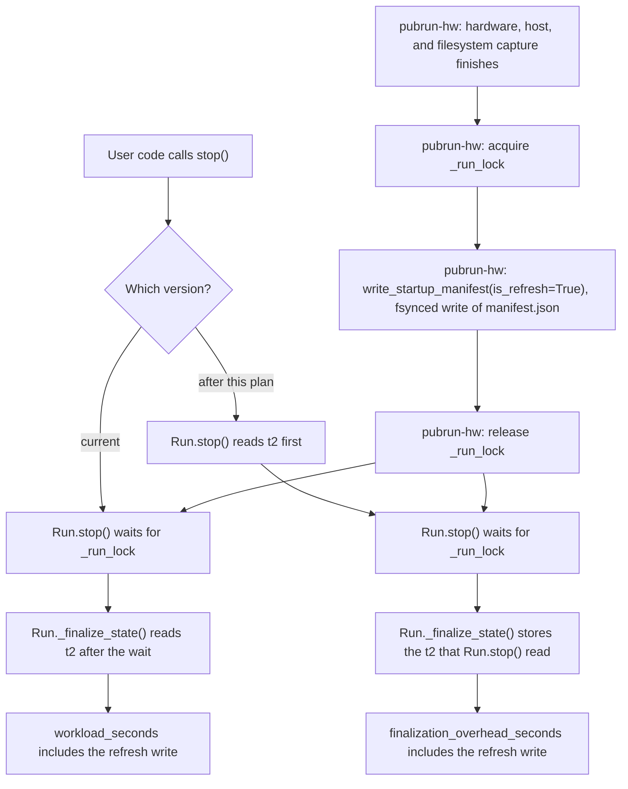

# IPD: Read the workload-end anchor before stop() waits on _run_lock so an in-flight hardware refresh cannot inflate workload_seconds

- Date: 2026-11-22
- Kind: child
- Concern: Bugs and correctness (timing accuracy): `Run.stop()` and `Run._finalize_state()` in `src/pubrun/tracker.py` read the workload-end anchor `t2` only after they acquire `_run_lock`. The background `pubrun-hw` thread holds `_run_lock` across its coalesced refresh of `manifest.json`, which is fsynced by default. A `stop()` call made during that refresh therefore waits for the write, and `workload_seconds` counts the wait as user workload.
- Scope: `src/pubrun/tracker.py` (`Run.__init__`, `Run.stop`, `Run._finalize_state`), a behavioral regression test in `tests/test_timing_accuracy.py`, the `t2` descriptions in `docs/architecture.md` and `docs/functional_spec.md`, and a `### Fixed` entry in `CHANGELOG.md`.
- Scope-Paths: src/pubrun/tracker.py, tests/test_timing_accuracy.py, docs/architecture.md, docs/functional_spec.md, CHANGELOG.md
- Item-Dependencies: none
- Status: to-review
- Short-Description: Take t2 before acquiring _run_lock in Run.stop() and Run._finalize_state() so a coalesced hardware refresh write is counted as finalization overhead, not workload
- Work-Kind: bug
- Priority: medium
- From-Backlog: uatvzh
- Blocks-Release: next
- Set: uatvzh
- Order: 1
- Highest E allocated: 05
- Author: OpenCode agent
- Id: 3aalwv

> Write and proofread this plan per the technical writing standard, `.aw/system/workflows/technical-writing/technical-writing.md` (`.agents/workflows/technical-writing/technical-writing.md` in a legacy-layout install), including requirement 12 (diagrams).

## Workflow history

- 2026-11-23 to-review (aw set): authored from backlog uatvzh: reproduction on 276236b, fix trial in a scratch copy, fake-clock regression test shown to fail on the base and pass with the fix
- 2026-11-23 draft (OpenCode agent): created.

## Goal

`pubrun` splits each run into three consecutive intervals: startup overhead (`t0` to `t1`), the user's workload (`t1` to `t2`), and finalization overhead (`t2` to `t3`). The manifest field `workload_seconds` is `t2 - t1` and must exclude `pubrun`'s own capture work (`docs/manifest.md`, `workload_seconds` row). Today a `stop()` call that arrives while the background `pubrun-hw` thread rewrites `manifest.json` waits for that write before it reads `t2`, so the write time is reported as workload. This plan makes `Run.stop()` and `Run._finalize_state()` read `t2` before they wait on `_run_lock`. The wait then falls into `finalization_overhead_seconds`, where `pubrun`'s own work belongs.

Terms used in this plan:

- `_run_lock`: the process-wide reentrant lock defined in `src/pubrun/core.py` that guards `Run` state shared with background threads.
- `_write_lock`: the reentrant lock on `ArtifactWriter` in `src/pubrun/writer.py` that serializes artifact writes. Code always takes `_run_lock` before `_write_lock` to avoid deadlock.
- Coalesced refresh: after background hardware, host, and filesystem capture finishes, the nested `_collect_hardware` function inside `Run._bootstrap_engines` rewrites the startup `manifest.json` once (`ArtifactWriter.write_startup_manifest(is_refresh=True)`) so the file on disk contains the hardware data. It skips the rewrite when the first startup write already contained that data.
- `artifact_durability`: the `[core]` configuration key that controls whether artifact writes call `os.fsync()`. The default is `"fsync"`.

### Current and fixed order of events when stop() overlaps the refresh



## Detailed Implementation Checklist (TODO)

Execution-state rule: mark an `E-*` item complete only after performing the action. That mark is not validation. Right-sizing rule: write for a modest executor that cannot hold much in its head. Each E-item is one step (one concern, about one file, executable in one focused pass) and its V-item names each unit it covers with its own check; a plan stays at about 5 E-items and 8 work Scope-Paths, else split it into more child plans (guidance, `IPD-Z603`). Accepted execution states: blocked, failed, pending, performed; terminal gate demands 'performed'.

### Task group 1: Fix the anchor

- [ ] E-01 In `src/pubrun/tracker.py`, read the `t2` clocks before `Run.stop()` and `Run._finalize_state()` acquire `_run_lock`, and store the reading that `Run.stop()` took.
  - Depends on: none
  - Expected outcome: Four changes, and no others. (1) The `typing` import at the top of the file adds `Tuple` (`from typing import Any, Dict, Optional, Tuple`). (2) `Run.__init__` initializes `self._stop_anchor: Optional[Tuple[float, float]] = None` next to the other timing anchors (after `self._finalize_end_mono`). (3) `Run.stop()` reads `stop_mono = time.perf_counter()` and `stop_utc = time.time()` immediately before its first `with _run_lock:` block. Inside that block, after the `if self.ref_count > 0: return` check, it sets `self._stop_anchor = (stop_mono, stop_utc)` only when `self._stop_anchor` is `None`. A nested `stop()` that only decrements `ref_count` therefore records nothing, and a repeated `stop()` keeps the first reading. A two-line comment above the reads states that the `pubrun-hw` refresh holds `_run_lock` across a durable manifest write. (4) `Run._finalize_state()` reads `end_mono = time.perf_counter()` and `end_utc = time.time()` immediately before its first `with _run_lock:` block. Inside that block, in the existing `if self.is_active:` branch, it replaces `end_mono` and `end_utc` with `self._stop_anchor` when that attribute is not `None`, assigns them to `self._workload_end_mono` and `self.ended_at_utc`, and sets `self.is_active = False` as before. The comment above that block changes from "under _run_lock" to say that `t2` is read before `_run_lock` is acquired and the latch is set under it. The latch (`self._finalized = True`), the early return when already finalized, the hardware wait, and the `_run_lock` before `_write_lock` order are unchanged. The existing `_run_lock` import line in each method is left as it is (plan `updt75` in Set `tmngjn` may change it to `from pubrun.core import _run_lock`; this plan does not depend on which form is present).
  - Execution state: pending

### Task group 2: Regression test

- [ ] E-02 Add a parametrized regression test to `tests/test_timing_accuracy.py` that stalls the coalesced refresh write and asserts that `workload_seconds` stays equal to the simulated workload.
  - Depends on: E-01
  - Expected outcome: The file gains two helpers and one test, all using the file's existing `FakeClock`, `_install_fake_clock`, and `_read_manifest`. (1) `_stall_refresh_write(monkeypatch, clock, stall_seconds)` replaces `writer_mod.ArtifactWriter.write_startup_manifest` with a wrapper that, only when `is_refresh` is true, sets a `refresh_entered` event, waits up to 5 s on a `release_refresh` event, advances the fake clock by `stall_seconds`, and then calls the original method. It returns both events. (2) `_start_with_pending_hardware(monkeypatch)` stubs `tracker_mod.get_hardware` to block on an event until after `start()` returns, stubs `tracker_mod.get_host` and `pubrun.capture.filesystem.get_filesystem` to return `{"capture_state": {"status": "complete"}}`, calls `start()`, releases the hardware stub, and returns the run. Because hardware is still pending when the startup manifest is written, the refresh always runs. (3) `test_stalled_hardware_refresh_write_isolated_from_workload` is parametrized over `entry` in `["run_stop", "write_artifacts"]`. It installs the fake clock, stalls the refresh by 0.40 s, starts the run, waits for `refresh_entered`, advances the clock by 0.02 s, and calls `run.stop(outcome="completed")` (for `run_stop`) or `run.writer.write_artifacts()` (for `write_artifacts`, the `atexit` and signal path) on a separate thread. It asserts that this thread has not finished 0.2 s later, which proves the call is blocked behind the refresh. It then sets `release_refresh`, joins the thread and `run._hardware_thread`, and asserts from the written manifest that `workload_seconds` and `elapsed_seconds` equal `0.02`, `finalization_overhead_seconds` equals `0.40` (each with `pytest.approx(..., abs=1e-9)`), and `session_seconds` equals the sum of the three disjoint intervals. A `finally` block sets `release_refresh` and joins `run._hardware_thread` so a failure cannot leave a thread waiting. No test reads production source code, counts calls, or inspects private lock state.
  - Execution state: pending

### Task group 3: Documentation

- [ ] E-03 Update the `t2` descriptions in `docs/architecture.md` and `docs/functional_spec.md`.
  - Depends on: E-01
  - Expected outcome: In `docs/architecture.md`, section "Timing anchors", the `t2` bullet states that `stop()` (or `_finalize_state()` when it is reached without `stop()`, as from the `atexit` safety net) reads `t2` before acquiring `_run_lock`, and that `_finalize_state()` then latches `_finalized` under `_run_lock` before waiting for background hardware capture. It keeps the sentence "`t2 - t1` is `workload_seconds`, the observed tracked workload." In `docs/functional_spec.md`, section "19.2 Finalization Lifecycle", item 2, the first sub-bullet states the same order: `t2` (`ended_at_utc` plus an in-memory monotonic reading) is read before `_run_lock` is acquired, so neither waiting for `_run_lock` (for example behind a background hardware manifest refresh) nor teardown latency inflates `workload_seconds`; `_finalized = True` is still latched under `_run_lock`. No other line in either file changes.
  - Execution state: pending

### Task group 4: Changelog

- [ ] E-04 Add a `### Fixed` entry to the `## [Unreleased]` section of `CHANGELOG.md`.
  - Depends on: E-01
  - Expected outcome: The `### Fixed` list under `## [Unreleased]` gains an entry with a bold one-line title followed by two to four sentences. The entry states that a `stop()` call made while the background hardware capture was rewriting `manifest.json` could add that write (tens to hundreds of milliseconds with the default fsynced durability on a slow disk) to `workload_seconds`, that the time is now reported in `finalization_overhead_seconds`, and that a regression test covers both `stop()` and the `atexit` write path. The added lines contain no em or en dash, because `CHANGELOG.md` is user-facing.
  - Execution state: pending

### Task group 5: Verification

- [ ] E-05 Run the new test, the neighboring timing and lifecycle suites, the reproduction script, the example, and the full test suite.
  - Depends on: E-02, E-03, E-04
  - Expected outcome: `python3 -m pytest tests/test_timing_accuracy.py -v --no-cov` passes every case, including both `test_stalled_hardware_refresh_write_isolated_from_workload` cases. `python3 -m pytest tests/test_timing_accuracy.py tests/test_startup_overhead_writes.py tests/test_capture_isolation.py tests/test_core_lifecycle_bugs.py tests/test_tracker.py tests/test_writer.py tests/test_status.py -q --no-cov` and `python3 -m pytest -q` finish with zero failures, or with only failures that also occur on the unchanged base commit and that `V-05` names. The reproduction script from `## Findings`, run with its run directory on the repository disk, prints a `workload excess ms` median below 1 ms. Eight runs of `python3 examples/05_execution_phases.py` print a tracked workload below 40 ms each.
  - Execution state: pending

## Project conventions discovered (Step 0)

- `Run` keeps each timing anchor as a pair: a UTC float from `time.time()` for chronology and a private `time.perf_counter()` reading for durations (`Run.__init__`, comment "Timing anchors and interval state"). `Run._build_timing_dict` computes `workload_seconds` as `_workload_end_mono - _workload_start_mono`. `Run.to_manifest_dict` freezes the timing dictionary on its first call after `_finalized` is set.
- `Run.stop()` takes `_run_lock` first to apply the outcome, decrement `ref_count`, return early for a nested stop, and unpublish `_active_run`. It then calls `self._finalize_state()` and `writer.write_artifacts()`. `ArtifactWriter.write_artifacts()` also calls `self.run._finalize_state()` before it takes `_write_lock`; that is the path used by the `atexit` handler and by `pubrun.capture.signals` on a lethal signal, where `Run.stop()` is never called.
- The nested `_collect_hardware` function in `Run._bootstrap_engines` holds `_run_lock` while it checks `is_active`, `_finalized`, and `writer._startup_included_hardware` and calls `writer.write_startup_manifest(is_refresh=True)`, which takes `_write_lock` and writes `manifest.json` with `_atomic_json_write`. With durability `"fsync"` that write calls `os.fsync()` before `os.replace()`.
- `tests/test_timing_accuracy.py` drives real `Run` objects with a thread-safe `FakeClock` patched onto `pubrun.tracker.time` and `pubrun.writer.time`, so durations are exact and no test depends on real elapsed time. `test_hardware_worker_delay_isolated_from_workload` and `test_writer_delay_isolated_from_workload_and_single_manifest_write` are the closest existing tests. `test_nested_ref_counted_start_stop_freezes_only_on_outer_stop` already asserts that an inner `stop()` does not set `_workload_end_mono`, which also covers the nested-stop rule in E-01.
- `pyproject.toml` sets `addopts` with coverage options, so targeted runs pass `--no-cov`. Tests assert observable behavior as `AGENTS.md` requires.
- `CHANGELOG.md` follows Keep a Changelog, and `## [Unreleased]` already has a `### Fixed` list.
- Cite code by symbol: `Run.stop`, `Run._finalize_state`, `Run._bootstrap_engines` (nested `_collect_hardware`), `ArtifactWriter.write_startup_manifest`, `ArtifactWriter.write_artifacts`.

## Findings

Reproduction on the lane base (commit `276236b`), recorded 2026-11-22 with CPython 3.14.6 on Linux. The repository disk is the one the backlog item measured. Save the script below as `/tmp/opencode/uatvzh_repro.py` and run `PYTHONPATH=src python3 /tmp/opencode/uatvzh_repro.py <runs-dir>` from the repository root. It runs 30 tracked 20 ms workloads with the `minimal` profile and prints how far `workload_seconds` exceeds 20 ms. Delete `<runs-dir>` afterwards.

```python
import os, statistics, sys, time
os.environ["PUBRUN_AUTO_START"] = "false"
import pubrun

runs_root = sys.argv[1] if len(sys.argv) > 1 else os.path.join(os.getcwd(), "uatvzh-runs")
excess, fin = [], []
for _ in range(30):
    run = pubrun.start(output_dir=runs_root, profile="minimal")
    time.sleep(0.020)
    run.stop()
    t = run.to_manifest_dict()["timing"]
    excess.append((t["workload_seconds"] - 0.020) * 1000)
    fin.append(t["finalization_overhead_seconds"] * 1000)
print(f"workload excess ms: median={statistics.median(excess):.2f} max={max(excess):.2f}")
print(f"finalization overhead ms: median={statistics.median(fin):.2f} max={max(fin):.2f}")
```

| Configuration | `workload excess ms` | `finalization overhead ms` |
|---|---|---|
| Base `276236b`, run directory on the repository disk | median 47.58, max 2358.47 | median 5.05, max 7.86 |
| Base `276236b`, run directory under `/tmp/opencode` | median 0.12, max 0.24 | median 2.89, max 6.17 |
| Fix trial, run directory on the repository disk | median 0.14, max 0.37 | median 49.11, max 98.20 |

`examples/05_execution_phases.py` (two 10 ms phases) printed a tracked workload of 45.2, 63.3, 58.5, 161.1, 64.8, 98.2, 45.4, and 78.6 ms on the base, and 20.8, 20.5, 26.7, 20.6, 20.8, 21.0, 30.2, and 35.8 ms with the fix trial.

| Observation | Explanation |
|---|---|
| The excess appears only when the run directory is on a slow disk. | The refresh write calls `os.fsync()`. On the faster `/tmp` mount the write finishes before the 20 ms workload ends, so `stop()` never waits. This matches the backlog item's measurements (median 47.3 ms on the repository disk, 0.02 ms on `/tmp`). |
| With the fix, the same wait moves from the workload column to the finalization column. | `stop()` still waits for the refresh to release `_run_lock`; only the point where `t2` is read changes. `session_seconds` is unchanged in total. |
| The fix must cover `Run.stop()` as well as `Run._finalize_state()`. | `Run.stop()` acquires `_run_lock` before it calls `_finalize_state()`, so a reading taken only in `_finalize_state()` would still come after the wait. `_finalize_state()` needs its own pre-lock reading for the `atexit` and signal paths, which call `ArtifactWriter.write_artifacts()` without `Run.stop()`. |

Fix trial: in a scratch copy of `src/` and `tests/` under `/tmp/opencode/`, the E-01 change plus the E-02 test gave `17 passed` for `tests/test_timing_accuracy.py`. The same test file run against the unchanged base `src/` failed both new cases with `assert 0.4199999999999591 == 0.02 ± 1.0e-09` (the 0.40 s stalled refresh plus the 0.02 s workload). The neighboring suites listed in E-05 gave `214 passed, 2 skipped` with the fix and `212 passed, 2 skipped` on the base, the difference being the two new cases.

Choice of fix: the backlog item suggests two possible fixes. This plan reads `t2` before `_run_lock` is acquired. The other fix, writing the refresh outside `_run_lock` after re-checking the latch, is deferred (see `## Deferred / out of scope`).

## Proposed changes (ordered, validatable)

1. In `src/pubrun/tracker.py`, add `_stop_anchor`, read the `t2` clocks before `_run_lock` in `Run.stop()` and `Run._finalize_state()`, and use the `stop()` reading when present (E-01).
2. In `tests/test_timing_accuracy.py`, add the stalled-refresh helpers and the parametrized regression test (E-02).
3. In `docs/architecture.md` and `docs/functional_spec.md`, describe the new `t2` order (E-03).
4. In `CHANGELOG.md`, add the `### Fixed` entry (E-04).
5. Run the targeted tests, the neighboring suites, the reproduction script, the example, and the full suite (E-05).

## Deferred / out of scope (with reason)

- Performing the coalesced refresh write outside `_run_lock`. Reason: `stop()` would no longer wait for the refresh, but the refresh could then run after `write_artifacts()` has written the final manifest and overwrite it with an unfinalized one. Preventing that needs a new check inside `ArtifactWriter.write_startup_manifest` (for example refusing a refresh once `_artifacts_written` is set) and new concurrency tests. With this plan the refresh time is already reported in the correct interval, so the extra risk buys only a shorter `stop()`.
  - Carrier-Declined: not needed to meet the backlog item's expected result, which is that `workload_seconds` excludes `pubrun`'s own capture work.
- Shortening the refresh write itself, for example by using `"atomic"` durability for the refresh stage. Reason: that changes the durability contract of `[core].artifact_durability`, which is a user-facing configuration decision outside this bug.
  - Carrier-Declined: a separate design question about durability policy, not part of this timing fix.
- Running the full continuous integration (CI) matrix (3 operating systems x Python 3.8 to 3.14) as an execution step. Reason: this lane may not push. The change uses only `time.perf_counter()`, `time.time()`, and existing locks, and the regression test uses the fake clock, so it does not depend on the platform. The maintainer should still watch the CI matrix after the change is pushed, as `AGENTS.md` "Matrix-validation discipline" asks for timing-related changes.
  - Carrier-Declined: a release-process step owned by the maintainer, not an unfinished part of this plan's change.

## Scope check

- Over-scope: none. Only the five `- Scope-Paths:` files change. `docs/manifest.md` describes `ended_at_utc` as "the moment finalization began (`stop()`, the end of `tracked_run()` / `audit_run()`, or the `atexit` safety net), before `pubrun` waits for background hardware capture", which stays accurate, so it is not edited.
- Under-scope: none. `grep -n "_workload_end_mono = \|ended_at_utc = " src/pubrun/*.py src/pubrun/capture/*.py` on the base lists the two assignments in `Run._finalize_state` and one line in `src/pubrun/status.py`, which reads `ended_at_utc` from an existing manifest's `timing` section and does not record a run. `Run.__init__` initializes both attributes to `None` with annotated assignments. `src/pubrun/writer.py` and `src/pubrun/capture/signals.py` reach `t2` only through `Run._finalize_state`.

## Required tests / validation

- Run `python3 -m pytest tests/test_timing_accuracy.py -v --no-cov` and paste the output. Both `test_stalled_hardware_refresh_write_isolated_from_workload` cases and every existing case must be PASSED (E-01, E-02).
- Show that the new test fails on the unchanged base: create a temporary `git worktree` of the base commit under `/tmp/opencode/`, copy the new `tests/test_timing_accuracy.py` into it, run `python3 -m pytest tests/test_timing_accuracy.py -k stalled -v --no-cov` there, paste the output, and remove that worktree. Do not use `git stash` in the shared checkout (E-02).
- Paste `git diff -- docs/architecture.md docs/functional_spec.md` (E-03).
- Paste `git diff -- CHANGELOG.md` and the output of `git diff -U0 -- CHANGELOG.md | grep '^+' | grep -c $'\u2014\|\u2013'`, which must print `0` (E-04).
- Run the neighboring-suite command from E-05 and `python3 -m pytest -q`, and paste each summary line. Run the reproduction script from `## Findings` with a run directory on the repository disk and paste its two lines. Run `python3 examples/05_execution_phases.py` eight times and paste the eight "tracked workload" lines (E-05).

## Spec / documentation sync

- `docs/architecture.md` and `docs/functional_spec.md`: E-03 updates the description of when `t2` is read, because both state that `t2` is recorded under `_run_lock`, which becomes false.
- `CHANGELOG.md`: E-04 adds a `### Fixed` entry.
- `docs/manifest.md`: no edit; its `ended_at_utc` and `workload_seconds` rows already state the intended behavior that this plan restores.
- No specification under `.aw/records/specs/` describes the timing anchors or `_run_lock`. The manifest schema and field set do not change.

## Open questions

### OQ-01: Read t2 before the lock, or move the refresh write outside the lock?

- Blocking: no
- Status: resolved
- Owner: none
- Resolution or deferral rationale: Read `t2` before the lock. The backlog item lists both as possible fixes. Reading `t2` earlier changes one file, leaves the lock order and the refresh latch untouched, and the fix trial in `## Findings` showed that it removes the excess from `workload_seconds` on the slow disk. Moving the write outside the lock opens a manifest-overwrite race that needs further writer changes; it is recorded under `## Deferred / out of scope`.

### OQ-02: Should the stop() reading or the _finalize_state() reading win when both exist?

- Blocking: no
- Status: resolved
- Owner: none
- Resolution or deferral rationale: The `stop()` reading wins. It is the earliest point at which the user's code has handed control back to `pubrun`, and `docs/manifest.md` defines `ended_at_utc` as the moment finalization began with `stop()`. `_finalize_state()` uses its own reading only when `stop()` did not record one (the `atexit` and signal paths).

## Validation and cross-check (verify before reporting done)

Validation-state rule: inspect evidence in a separate pass. Do not mark a `V-*` item complete from memory or from the matching execution checkmark. Accepted validation results: blocked, failed, pass, pending; terminal gate demands 'pass'. Runtime-demonstration reachability rule: for each `V-*` item demanding the software be observed acting (such as a run, a dispatch, or a transition)—as distinct from items demanding a diff, a file's content, or a test result, which are reachable by construction—name the code path that produces the observation or the sibling `E-*` that creates it, else the demand is UNDER-SCOPE.

- [ ] V-01 validates E-01
  - Required evidence: The pasted `git diff -- src/pubrun/tracker.py`, showing only the `Tuple` import, the `_stop_anchor` initialization in `Run.__init__`, the pre-lock reads and anchor assignment in `Run.stop`, and the pre-lock reads and anchor use in `Run._finalize_state`, with the `_finalized` latch, the early return, and the hardware wait unchanged.
  - Observed evidence:
  - Result: pending

- [ ] V-02 validates E-02
  - Required evidence: Pasted `python3 -m pytest tests/test_timing_accuracy.py -v --no-cov` output listing `test_stalled_hardware_refresh_write_isolated_from_workload[run_stop]` and `test_stalled_hardware_refresh_write_isolated_from_workload[write_artifacts]` as PASSED with no failed case. Also the pasted output of the `-k stalled` run in a temporary worktree of the base commit, showing both cases FAILED on the `workload_seconds` assertion. The test reaches the changed code through `Run.stop` and `ArtifactWriter.write_artifacts`, which call `Run._finalize_state`.
  - Observed evidence:
  - Result: pending

- [ ] V-03 validates E-03
  - Required evidence: The pasted `git diff -- docs/architecture.md docs/functional_spec.md`, showing only the `t2` bullet in "Timing anchors" and the first sub-bullet of item 2 in "19.2 Finalization Lifecycle" changed, each stating that `t2` is read before `_run_lock` is acquired.
  - Observed evidence:
  - Result: pending

- [ ] V-04 validates E-04
  - Required evidence: The pasted `git diff -- CHANGELOG.md` hunk, showing the entry under `## [Unreleased]` / `### Fixed` with the facts E-04 lists, and the pasted dash count `0`.
  - Observed evidence:
  - Result: pending

- [ ] V-05 validates E-05
  - Required evidence: Pasted summary lines of the neighboring-suite command and of `python3 -m pytest -q`, each with zero failures; any failure must also be shown to occur on the base commit, with its pasted base-commit output. The pasted two lines of the reproduction script with a `workload excess ms` median below 1 ms, and the eight pasted "tracked workload" lines from `examples/05_execution_phases.py`, each below 40 ms. Both programs call `pubrun.start()` and `Run.stop()`, which reach the `Run.stop` and `Run._finalize_state` code that E-01 changes.
  - Observed evidence:
  - Result: pending

## Approval and execution gate

- Size assessment: standard
- Cohesion rationale: not required

Execution contract:
1. Precondition: wait for human approval (`- Status: approved`) with no unresolved `Blocking: yes` open question before you change code.
2. Scope declaration: the expected modified files are the `- Scope-Paths:` entries (`src/pubrun/tracker.py`, `tests/test_timing_accuracy.py`, `docs/architecture.md`, `docs/functional_spec.md`, `CHANGELOG.md`). If execution requires an out-of-scope file, justify it with `--scope-reason` at finalization. If a declared file needs no edit, acknowledge it with `--scope-ack`.
3. Validation honesty: run each required validation command and paste its actual output into the matching `V-*` `Observed evidence:` field. Do not mark a `V-*` item `pass` without output captured from that run.
4. Commit discipline: commit only the paths you changed with `aw commit 3aalwv -- src/pubrun/tracker.py tests/test_timing_accuracy.py docs/architecture.md docs/functional_spec.md CHANGELOG.md`. Do not use `git add -A` or raw `git commit`. Do not push without an explicit human instruction.
5. Lifecycle transition: finalize this plan with `aw ipd finalize 3aalwv`, never with a hand-written `git mv` to `.aw/records/plans/executed/`. Inside a runner lane (`aw oc run` or `aw agy run`), the runner finalizes after the turn. Outside a runner, the executor runs `aw ipd finalize 3aalwv`.
