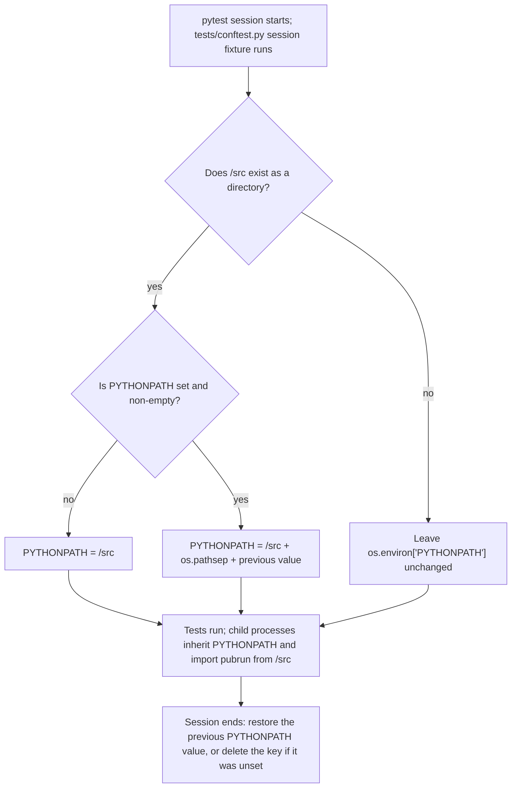

# IPD: Prepend the repository src directory to PYTHONPATH for test subprocesses

- Date: 2026-11-22
- Kind: child
- Concern: Test isolation (bug): child Python processes that tests spawn without an explicit `PYTHONPATH` import `pubrun` from whatever checkout the active environment's editable install points to, not from the checkout under test. Inside an isolated git worktree this validates the wrong code.
- Scope: A session-scoped autouse fixture in `tests/conftest.py` that prepends the repository `src` directory to `os.environ["PYTHONPATH"]` for the test session, plus a new behavioral regression test module `tests/test_subprocess_pythonpath.py`.
- Scope-Paths: tests/conftest.py, tests/test_subprocess_pythonpath.py
- Item-Dependencies: none
- Status: approved
- Readiness: go-pending-approval
- Review-Depth: standard
- Work-Kind: bug
- Priority: medium
- From-Backlog: zdkdyg
- Blocks-Release: next
- Set: zdkdyg
- Order: 1
- Highest E allocated: 04
- Author: OpenCode agent
- Id: 4cy3ft
- Approval: 2026-11-23, recorded via aw ipd set: status set to approved

> Write and proofread this plan per the technical writing standard, `.aw/system/workflows/technical-writing/technical-writing.md` (`.agents/workflows/technical-writing/technical-writing.md` in a legacy-layout install), including requirement 12 (diagrams).

## Workflow history

- 2026-11-23 approved (aw set): status set to approved
- 2026-11-23 /plan-review (Claude Opus 5.5): APPROVE WITH REVISIONS APPLIED; PR-001, PR-002, PR-003
- 2026-11-23 to-review (OpenCode agent): authored from backlog zdkdyg: reproduction with a subprocess import probe, session fixture design, behavioral regression test.
- 2026-11-23 draft (OpenCode agent): created.

## Goal

`pyproject.toml` sets `[tool.pytest.ini_options] pythonpath = ["src"]`. That setting adds the repository `src` directory to `sys.path` of the pytest process only; it does not change the `PYTHONPATH` environment variable. A child process started with `subprocess.run([sys.executable, ...])` that inherits the environment unchanged therefore resolves `import pubrun` through the interpreter's own `sys.path`, which includes the editable install's `.pth` entry. This plan makes every test subprocess that inherits the environment import `pubrun` from the `src` directory of the checkout that contains the running `tests/conftest.py`.

### Target behavior of the session fixture



## Detailed Implementation Checklist (TODO)

Execution-state rule: mark an `E-*` item complete only after performing the action. That mark is not validation. Right-sizing rule: write for a modest executor that cannot hold much in its head. Each E-item is one step (one concern, about one file, executable in one focused pass) and its V-item names each unit it covers with its own check; a plan stays at about 5 E-items and 8 work Scope-Paths, else split it into more child plans (guidance, `IPD-Z603`). Accepted execution states: blocked, failed, pending, performed; terminal gate demands 'performed'.

### Task group 1: Session-level PYTHONPATH setup

- [ ] E-01 Add a session-scoped autouse fixture named `_subprocess_pythonpath` to `tests/conftest.py` that prepends the repository `src` directory to `os.environ["PYTHONPATH"]` for the test session.
  - Depends on: none
  - Expected outcome: `tests/conftest.py` defines a module constant `SRC_DIR = pathlib.Path(__file__).resolve().parents[1] / "src"` and a fixture decorated with `@pytest.fixture(scope="session", autouse=True)`. The fixture behaves as the `## Goal` flowchart shows. When `SRC_DIR.is_dir()` is false, it yields without changing anything. Otherwise it records the previous value with `os.environ.get("PYTHONPATH")`, sets `PYTHONPATH` to `str(SRC_DIR)` when the previous value is `None` or empty, and to `f"{SRC_DIR}{os.pathsep}{previous}"` otherwise. After `yield` it restores the previous value, or removes the key with `os.environ.pop("PYTHONPATH", None)` when the previous value was `None`. The fixture sets `os.environ` directly; it does not use `monkeypatch`, because `monkeypatch` is function-scoped. The existing function-scoped fixtures `isolated_cwd`, `clean_active_run`, and `pubrun_state_isolation` are unchanged. `pubrun_state_isolation` snapshots `os.environ` after session fixtures run, so it keeps the prepended value between tests. A docstring states the reason: `pythonpath = ["src"]` changes `sys.path` only, and child processes would otherwise import an editable install from another checkout.
  - Execution state: pending

### Task group 2: Regression test

- [ ] E-02 Create `tests/test_subprocess_pythonpath.py` with behavioral tests that start child Python processes from the session environment and check where they import `pubrun` from.
  - Depends on: E-01
  - Expected outcome: The module defines `_REPO_SRC = pathlib.Path(__file__).resolve().parents[1] / "src"`. Test `test_inherited_env_child_imports_pubrun_from_this_checkout` runs `subprocess.run([sys.executable, "-c", "import os, pubrun; print(os.path.realpath(pubrun.__file__))"], capture_output=True, text=True, timeout=60)` with no `env=` argument. It asserts return code 0 and that the printed path equals `os.path.realpath(_REPO_SRC / "pubrun" / "__init__.py")`. That test detects the defect only where the active interpreter's installed `pubrun` comes from another checkout; in CI the editable install is the checkout under test, so it passes there with or without the fixture. Test `test_child_prefers_this_checkout_over_a_later_pythonpath_entry` therefore detects the defect in every environment, including CI. It writes a decoy package `tmp_path / "decoy" / "pubrun" / "__init__.py"` containing `DECOY = True`, copies `os.environ`, and APPENDS `tmp_path / "decoy"` to the copied `PYTHONPATH` (after the inherited value, joined with `os.pathsep`). It then runs the same child command with that `env=`, `cwd=str(tmp_path)`, and `timeout=60`, and asserts return code 0 and that the printed path equals `os.path.realpath(_REPO_SRC / "pubrun" / "__init__.py")`. Without the fixture the inherited `PYTHONPATH` has no `src` entry, and `PYTHONPATH` entries precede the editable install's `.pth` entry on `sys.path`, so the child imports the decoy and the test fails. Test `test_pythonpath_starts_with_this_checkout_src` asserts that `os.environ["PYTHONPATH"].split(os.pathsep)[0]` resolves (with `os.path.realpath`) to `os.path.realpath(_REPO_SRC)`. The first test also passes `cwd=str(tmp_path)`. Every child runs in `tmp_path` because `import pubrun` with the default `auto_start = true` writes a `runs/` directory into the child's working directory, and with `--noconftest` the `isolated_cwd` fixture does not move the pytest process out of the repository root. No test reads production source with `inspect`, `ast`, or regex.
  - Execution state: pending

### Task group 3: Verification

- [ ] E-03 Run the backlog item's acceptance command inside a git worktree with the subprocess import probe described in `## Findings`, and confirm every child process imports `pubrun` from the worktree.
  - Depends on: E-01
  - Expected outcome: Executed from the root of a git worktree of this repository (an `aw` runner lane qualifies), with the active Python's editable `pubrun` install pointing at a different checkout, the probe command from `## Findings` reports `passed` with zero failures, and every line of the probe log is the realpath of that worktree's `src/pubrun/__init__.py`. If the executor's environment has no editable install pointing at another checkout, the executor records that fact in V-03 and still records the probe log.
  - Execution state: pending

- [ ] E-04 Run the new regression tests and the full test suite.
  - Depends on: E-02, E-03
  - Expected outcome: `python3 -m pytest tests/test_subprocess_pythonpath.py -v`, `python3 -m pytest -q`, and `env -u PYTHONPATH python3 -m pytest -q` each finish with zero failures. The last command reproduces the CI condition in which `PYTHONPATH` is unset at session start (see OQ-02).
  - Execution state: pending

## Project conventions discovered (Step 0)

- `pyproject.toml` `[tool.pytest.ini_options]` sets `testpaths = ["tests"]`, `pythonpath = ["src"]`, and `addopts = "--cov=src --cov-report=term-missing --cov-report=xml -p no:randomly"`. The `pythonpath` option inserts into `sys.path` of the pytest process; it does not export `PYTHONPATH`.
- `tests/conftest.py` holds three function-scoped autouse fixtures: `isolated_cwd`, `clean_active_run`, and `pubrun_state_isolation`. `pubrun_state_isolation` snapshots `dict(os.environ)` before each test and restores it exactly afterwards. A session fixture that runs before it is part of every snapshot and is never removed by that restore.
- Several helpers already prepend `src` to `PYTHONPATH` individually, using the same `f"{src_dir}{os.pathsep}{existing}"` pattern: `tests/test_checks_commands.py::run_pubrun`, `tests/test_import_modes.py::TestModeAliasApiParity._clean_env`, `tests/test_show_sections.py` (`test_cli_show_standard_and_deep_with_no_color_and_all_badges`), `tests/test_capture_isolation.py::_worktree_env`, `tests/test_core_lifecycle_bugs.py`, `tests/test_package_lifecycle.py`, `tests/test_package_transitive.py`, and `tests/test_report_checks_bugs.py`, `tests/test_cli.py`, `tests/test_cli_diff_bugs.py`, and `tests/test_reproducibility_e2e.py`. Helpers that do not prepend include `tests/test_report_subpackage_integrity.py::_run`, `tests/test_bench_command.py::run_pubrun`, and the remaining `subprocess.run` calls in `tests/test_import_modes.py` (for example the calls that pass `env={**os.environ, "PUBRUN_AUTO_START": "true"}`).
- `tests/test_commit_identity.py::_run_python_isolated` deliberately sets `env["PYTHONPATH"] = str(pythonpath)` to a chosen directory and strips this checkout's `src` from the child's `sys.path` when the chosen directory differs. Because it replaces the value, the session fixture does not affect it.
- CI (`.github/workflows/ci.yml`) runs `pip install -e ".[dev,tui]"` and then `pytest tests/ -v` inside the same checkout, so in CI the editable install and the checkout under test agree, and the defect does not appear there.
- Tests in this repository assert observable behavior. They run code or subprocesses and inspect output; they do not read source with `inspect`, `ast`, or regex (`AGENTS.md`, "NO CODE-PINNING TESTS").

## Findings

Reproduction in this lane worktree (`.aw/worktrees/zdkdyg`, base commit `5283dee`), recorded 2026-11-22. The active interpreter (Python 3.14) has `_editable_impl_pubrun.pth` in its `site-packages`, and that file points at the main checkout's `src` directory, not at the worktree.

1. A one-test file that ran `subprocess.run([sys.executable, "-c", "import pubrun; print(pubrun.__file__)"])` inside the worktree printed the main checkout's `src/pubrun/__init__.py` for the child, and the worktree's `src/pubrun/__init__.py` for the pytest process itself.
2. A subprocess import probe measured the backlog item's acceptance command. The probe is a directory containing one file, `sitecustomize.py`, that records the realpath of `sys.modules["pubrun"].__file__` at interpreter exit, for every Python process that imported `pubrun`:

   ```python
   import atexit, os, sys
   def _log():
       m = sys.modules.get("pubrun")
       if m is not None:
           with open(os.environ["ZDKDYG_PROBE_LOG"], "a") as f:
               f.write(os.path.realpath(m.__file__) + "\n")
   atexit.register(_log)
   ```

   To run it, save that file as `/tmp/opencode/zdkdyg/probe/sitecustomize.py`, then run this command from the worktree root:

   ```sh
   rm -f /tmp/opencode/zdkdyg/probe.log
   ZDKDYG_PROBE_LOG=/tmp/opencode/zdkdyg/probe.log PYTHONPATH="/tmp/opencode/zdkdyg/probe${PYTHONPATH:+:$PYTHONPATH}" \
     python3 -m pytest tests/test_import_modes.py tests/test_report_subpackage_integrity.py -q -p no:cacheprovider
   sort /tmp/opencode/zdkdyg/probe.log | uniq -c
   ```

   The probe directory travels through `PYTHONPATH` to every child that inherits or prepends to it. Child processes whose helper already prepends `src` keep the probe entry after `src`. Observed on the base commit: `79 passed in 55.51s`, and the log contained:

   | Count | Realpath of the imported `pubrun/__init__.py` |
   |---|---|
   | 10 | the worktree's `src/pubrun/__init__.py` |
   | 37 | the main checkout's `src/pubrun/__init__.py` |

   All 79 tests passed while 37 child processes tested the main checkout's code, which is the false-pass case the backlog item describes.

Root cause: `pythonpath = ["src"]` changes only the pytest process's `sys.path`. A child that inherits `os.environ` unchanged has no `PYTHONPATH` entry for the worktree's `src`, so its `sys.path` reaches the editable install's `.pth` entry and imports the other checkout.

## Proposed changes (ordered, validatable)

1. In `tests/conftest.py`, add the `SRC_DIR` constant and the session-scoped autouse fixture `_subprocess_pythonpath` (E-01).
2. Add `tests/test_subprocess_pythonpath.py` with the three behavioral tests, including the decoy test that fails without the fixture in every environment (E-02).
3. Run the subprocess import probe in a git worktree (E-03).
4. Run the new tests and the full suite, with and without an inherited `PYTHONPATH` (E-04).

The backlog item allows either a session-level setup in `tests/conftest.py` or a consistent prepend in every subprocess helper. This plan uses the session-level setup: one change covers every helper that inherits the environment, including helpers added later, while the per-helper approach needs an edit in each of at least three files that do not prepend today and repeats for every new helper.

## Deferred / out of scope (with reason)

- Removing the existing per-helper `PYTHONPATH` prepends listed in `## Project conventions discovered (Step 0)`. Reason: with the session fixture in place they add a duplicate `src` entry at the front of `PYTHONPATH`, which does not change import resolution. Removing them edits eleven test files that this bug does not require changing.
  - Carrier-Declined: duplicate leading `src` entries are harmless, and the item's acceptance criteria are met without the edit.
- `tests/test_commit_identity.py::_run_python_isolated`, which replaces `PYTHONPATH` with a chosen directory. Reason: it intentionally controls the child's import path, and the session fixture must not override that.
  - Carrier-Declined: intended behavior; no change needed.
- `CHANGELOG.md`. Reason: this change affects only the test suite, not shipped behavior; the `release-notes` workflow drafts entries from commit history at release time.
  - Carrier-Declined: test-only change with no user-visible effect.

## Scope check

- Over-scope: none. Only `tests/conftest.py` changes, and `tests/test_subprocess_pythonpath.py` is added.
- Under-scope: none. Every `subprocess.run` call in `tests/` that passes no `env=`, or passes a copy of `os.environ`, inherits the session value. The new test and the probe in E-03 observe the result directly instead of relying on a list of call sites.

## Required tests / validation

- Run `python3 -m pytest tests/test_subprocess_pythonpath.py -v`, and the same command with `--noconftest`, and paste both outputs (E-02).
- Run the probe command from `## Findings` in a git worktree and paste the pytest summary line and the `sort | uniq -c` output (E-03, backlog acceptance criterion 2).
- Run `python3 -m pytest -q` and `env -u PYTHONPATH python3 -m pytest -q` and paste both summary lines (E-04).

## Spec / documentation sync

N/A. No spec under `.aw/records/specs/` covers the test harness. `CONTRIBUTING.md`, `README.md`, and `docs/` do not mention `PYTHONPATH` for running tests (`grep -rn "PYTHONPATH" CONTRIBUTING.md README.md docs/` returns no match). No manifest schema, capture output, or import path of the shipped package changes, so the cross-platform matrix rule in `AGENTS.md` does not apply; `os.pathsep` keeps the fixture correct on Windows.

## Open questions

### OQ-01: Use one session fixture or a prepend in every subprocess helper?

- Blocking: no
- Status: resolved
- Owner: plan author
- Resolution or deferral rationale: Use the session fixture in `tests/conftest.py`. The backlog item's first acceptance criterion permits either approach. The session fixture covers every helper that inherits `os.environ`, including future helpers, with one edit. `pubrun_state_isolation` takes its environment snapshot after session fixtures run, so the per-test restore keeps the prepended value (see `## Project conventions discovered (Step 0)`).

### OQ-02: Does a test-session `PYTHONPATH` value leak into manifests or assertions that read the environment?

- Blocking: no
- Status: resolved
- Owner: plan author
- Resolution or deferral rationale: No test found asserts on the session's `PYTHONPATH` value. `grep -rn PYTHONPATH tests/` finds only helpers that set it and one unit test of `_is_path_var("environment.PYTHONPATH")` in `tests/test_quality.py`. Two environments differ, though. The development shell that produced `## Findings` already exports a non-empty `PYTHONPATH`. CI runs with it unset, and after this change CI gets a value that contains the runner's checkout path. To cover the CI case, E-04 runs the full suite twice: once with the shell's `PYTHONPATH`, and once with `env -u PYTHONPATH`, which starts the session with the variable unset.

## Validation and cross-check (verify before reporting done)

Validation-state rule: inspect evidence in a separate pass. Do not mark a `V-*` item complete from memory or from the matching execution checkmark. Accepted validation results: blocked, failed, pass, pending; terminal gate demands 'pass'. Runtime-demonstration reachability rule: for each `V-*` item demanding the software be observed acting (such as a run, a dispatch, or a transition), as distinct from items demanding a diff, a file's content, or a test result (which are reachable by construction), name the code path that produces the observation or the sibling `E-*` that creates it, else the demand is UNDER-SCOPE.

- [ ] V-01 validates E-01
  - Required evidence: The pasted `git diff -- tests/conftest.py` hunk, showing the `SRC_DIR` constant, the `@pytest.fixture(scope="session", autouse=True)` fixture with the `is_dir()` guard, the prepend using `os.pathsep`, and the restore or `pop` after `yield`, with the three existing fixtures unchanged.
  - Observed evidence:
  - Result: pending

- [ ] V-02 validates E-02
  - Required evidence: Pasted `python3 -m pytest tests/test_subprocess_pythonpath.py -v` output showing all three behaviors of E-02 passing (test names are pointers, not the bar): a child with the inherited environment imports this checkout's `pubrun`; a child whose `PYTHONPATH` ends with a decoy `pubrun` still imports this checkout's `pubrun`; and the session `PYTHONPATH` starts with this checkout's `src`. Also the pasted output of `python3 -m pytest tests/test_subprocess_pythonpath.py -v --noconftest`, which skips `tests/conftest.py` and so reproduces the pre-fix condition in any environment, showing the decoy behavior FAILING with the decoy's path in the assertion message. Do not use `git stash` or edit `tests/conftest.py` to produce this run.
  - Observed evidence:
  - Result: pending

- [ ] V-03 validates E-03
  - Required evidence: The pasted path of the git worktree used (from `git rev-parse --show-toplevel`), the pasted pytest summary line of the probe command from `## Findings`, and the pasted `sort /tmp/opencode/zdkdyg/probe.log | uniq -c` output in which every line names that worktree's `src/pubrun/__init__.py` and no line names another checkout. Also the pasted output of `python3 -c "import pubrun; print(pubrun.__file__)"` run from `/tmp/opencode`, showing where the editable install points. The fixture added by E-01 produces this observation; the probe only records it.
  - Observed evidence:
  - Result: pending

- [ ] V-04 validates E-04
  - Required evidence: The pasted summary lines of `python3 -m pytest tests/test_subprocess_pythonpath.py -v`, `python3 -m pytest -q`, and `env -u PYTHONPATH python3 -m pytest -q`, each with zero failures.
  - Observed evidence:
  - Result: pending

## Approval and execution gate

- Size assessment: standard
- Cohesion rationale: not required

Execution contract:
1. Precondition: wait for human approval (`- Status: approved`) with no unresolved `Blocking: yes` open question before you change code.
2. Scope declaration: the expected modified files are the `- Scope-Paths:` entries (`tests/conftest.py`, `tests/test_subprocess_pythonpath.py`). If execution requires an out-of-scope file, justify it with `--scope-reason` at finalization. If a declared file needs no edit, acknowledge it with `--scope-ack`.
3. Validation honesty: run each required validation command and paste its actual output into the matching `V-*` `Observed evidence:` field. Do not mark a `V-*` item `pass` without output captured from that run.
4. Commit discipline: commit only the paths you changed with `aw commit 4cy3ft -- tests/conftest.py tests/test_subprocess_pythonpath.py`. Do not use `git add -A` or raw `git commit`. Do not push without an explicit human instruction.
5. Lifecycle transition: finalize this plan with `aw ipd finalize 4cy3ft`, never with a hand-written `git mv` to `.aw/records/plans/executed/`. Inside a runner lane (`aw oc run` or `aw agy run`), the runner finalizes after the turn. Outside a runner, the executor runs `aw ipd finalize 4cy3ft`.
