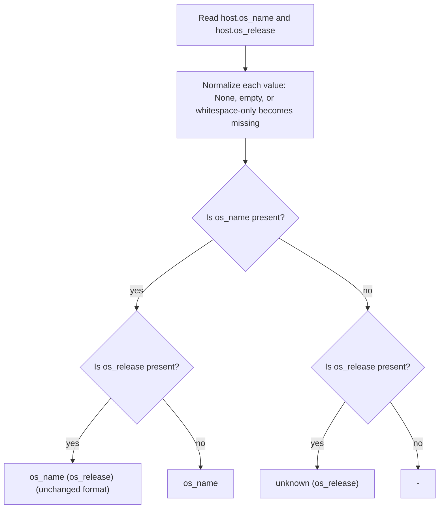

# IPD: Guard missing host OS fields in the TUI details OS line

- Date: 2026-11-22
- Kind: child
- Concern: Bugs and correctness (Terminal User Interface (TUI) rendering): the General Info tab of the `pubrun ui` run details pane prints the literal word `None` in its OS line when the manifest's `host.os_name` or `host.os_release` is missing or null.
- Scope: `src/pubrun/tui/widgets/details.py` (a new module-level OS-text helper and the OS line in `RunDetailsView.update_general_pane`) and regression tests in `tests/test_tui_bugs.py`.
- Scope-Paths: src/pubrun/tui/widgets/details.py, tests/test_tui_bugs.py
- Item-Dependencies: none
- Status: approved
- Readiness: go-pending-approval
- Review-Depth: simple
- Short-Description: The TUI run details pane prints the literal word None in its OS line when host.os_name or host.os_release is missing or null.
- Work-Kind: bug
- Priority: low
- From-Backlog: zen6hs
- Blocks-Release: next
- Set: zen6hs
- Order: 1
- Highest E allocated: 03
- Author: OpenCode agent
- Id: 46fixy
- Approval: 2026-11-23, recorded via aw ipd set: status set to approved

> Write and proofread this plan per the technical writing standard, `.aw/system/workflows/technical-writing/technical-writing.md` (`.agents/workflows/technical-writing/technical-writing.md` in a legacy-layout install), including requirement 12 (diagrams).

## Workflow history

- 2026-11-23 approved (aw set): status set to approved
- 2026-11-23 /plan-review (Claude Opus 5.5): APPROVE WITH REVISIONS APPLIED; PR-001, PR-002, PR-003
- 2026-11-23 to-review (OpenCode agent): authored from backlog zen6hs: reproduction, guarded OS line, behavioral regression tests.
- 2026-11-23 draft (OpenCode agent): created.

## Goal

`src/pubrun/tui/widgets/details.py::RunDetailsView.update_general_pane` builds the General Info tab of the TUI run details pane. Its "HOST & HARDWARE SPECS" section contains an OS line that interpolates `host.get('os_name')` and `host.get('os_release')` directly into an f-string, so a missing or null field prints as the literal word `None`. This plan makes the OS line omit a missing release, show `unknown` for a missing OS name, show `-` when both are missing, and never print `None`.

### Target OS line behavior

The text below is the OS text that follows the `OS:` label. "Present" means a non-empty value after the normalization rule in E-01, which also treats a whitespace-only value as missing.



## Detailed Implementation Checklist (TODO)

Execution-state rule: mark an `E-*` item complete only after performing the action. That mark is not validation. Right-sizing rule: write for a modest executor that cannot hold much in its head. Each E-item is one step (one concern, about one file, executable in one focused pass) and its V-item names each unit it covers with its own check; a plan stays at about 5 E-items and 8 work Scope-Paths, else split it into more child plans (guidance, `IPD-Z603`). Accepted execution states: blocked, failed, pending, performed; terminal gate demands 'performed'.

### Task group 1: Guard the OS line

- [ ] E-01 In `src/pubrun/tui/widgets/details.py`, add a module-level helper `_format_os_text(host: Any) -> str` and use it for the OS line in `RunDetailsView.update_general_pane`.
  - Depends on: none
  - Expected outcome: The helper sits beside `_filter_package_rows` and `_format_subprocess_rows` and has no `textual` dependency. It returns `"-"` when `host` is not a dict. Otherwise it normalizes `host.get("os_name")` and `host.get("os_release")` with one rule: a string is kept, `None` becomes `""`, and any other type is converted with `str()`; the result is then passed through `.strip()`, so a whitespace-only value counts as empty. (Measured on the lane base: `os_release` set to `"  "` renders `Linux (  )` today.) Then it returns, in this order of checks: `f"{name} ({release})"` when both are non-empty; `name` when only the name is non-empty; `f"unknown ({release})"` when only the release is non-empty; `"-"` when both are empty. It applies `_escape_markup` to `name` and to `release` before it formats them, so a bracketed token such as `[PREEMPT_DYNAMIC]` or `[/]` in a kernel build string is shown literally and does not raise `textual.markup.MarkupError`. In `update_general_pane`, the OS line becomes `lines.append(f"  [bold]OS:[/]            {_format_os_text(host)}")`. When both fields are non-empty strings without `[`, the rendered OS line is identical to the current output (for example `OS:            Linux (#101-Ubuntu SMP)`). No other line of `update_general_pane` changes; the CPU model line is out of scope (see `## Deferred / out of scope`).
  - Execution state: pending

### Task group 2: Regression tests and verification

- [ ] E-02 Add a `TestRunDetailsOsLine` class to `tests/test_tui_bugs.py` with behavioral tests that render the General Info tab for manifests with missing or null OS fields.
  - Depends on: E-01
  - Expected outcome: The class follows the pattern of the existing `TestRunDetailsGpu._render` helper: it writes a manifest with the file's `_write_manifest(run_dir, run_id, extra=...)` helper, passing a `host` section whose `capture_state` is `{"status": "complete"}` and whose `hostname` is `arm-01`. It then starts `PubrunTUIApp(output_dir=...)` under `app.run_test()`, calls `RunDetailsView.display_run(RunInfo(run_dir))`, awaits `pilot.pause()`, and reads `str(details.query_one("#lbl-general-info").render())`. Each test selects the single rendered line whose stripped text starts with `OS:` and asserts the exact text after the label (the stripped line with the leading `OS:` and following spaces removed). One test is parametrized over these `host` cases and also asserts that `"None"` is not in the OS line: (1) `os_release` key removed, expected `Linux`; (2) `os_release` set to `None`, expected `Linux`; (3) `os_name` key removed, `os_release` `#101-Ubuntu SMP`, expected `unknown (#101-Ubuntu SMP)`; (4) `os_name` set to `None`, same release, expected `unknown (#101-Ubuntu SMP)`; (5) both keys removed, expected `-`; (6) both set to `""`, expected `-`; (7) `os_release` set to `"  "`, expected `Linux`. A second test asserts that `os_name` `Linux` with `os_release` `#101-Ubuntu SMP` still renders `Linux (#101-Ubuntu SMP)`. A third test asserts that `os_release` `#1 SMP [PREEMPT_DYNAMIC] [/]` renders `Linux (#1 SMP [PREEMPT_DYNAMIC] [/])` without raising. The existing `TestRunDetailsGpu` tests are unchanged. No test reads production source code.
  - Execution state: pending

- [ ] E-03 Run the new tests, the existing TUI tests, and the full test suite.
  - Depends on: E-02
  - Expected outcome: `python3 -m pytest tests/test_tui_bugs.py -v`, `python3 -m pytest tests/test_tui.py tests/test_timing_consumers.py -q`, and `python3 -m pytest -q` each finish with zero failures. Running the reproduction script described in `## Findings` prints four OS lines, none of which contains `None`.
  - Execution state: pending

## Project conventions discovered (Step 0)

- `src/pubrun/tui/widgets/details.py` already keeps pure, `textual`-free helpers at module level (`_filter_package_rows`, `_format_subprocess_rows`). Their docstrings say this keeps them testable without the optional TUI packages. E-01 adds `_format_os_text` in the same style.
- In `update_general_pane`, absent scalar values render as `-` (for example `Hostname:`, `Exit Code:`, and the GPU `Driver:`), and an absent GPU model renders as `unknown`. E-01 follows both conventions: `-` for a wholly absent OS, `unknown` for an absent OS name next to a present release.
- `update_general_pane` passes manifest-derived free text through `_escape_markup` (script, arguments, run directory, GPU model, driver) because the pane is a Textual `Static` that parses markup. The current OS line does not escape. A real `platform.version()` value on this machine is `#149-Ubuntu SMP PREEMPT_DYNAMIC Fri Oct 23 13:21:10 UTC 2026`; some kernels put bracketed tokens in this string.
- `schemas/manifest.schema.json` declares `host.os_name`, `host.os_version`, and `host.os_release` as type `["string", "null"]` and requires only `capture_state`, so a valid manifest may omit either field or set it to null. `src/pubrun/capture/host.py::get_host` writes `os_name` from `platform.system()` and `os_release` from `platform.version()` on success, and writes only `capture_state` when host capture is suppressed or fails. `docs/manifest.md` describes `os_release` as "OS release details."
- Sibling plan `6bgkyj` (Set `rmssqd`, `.aw/records/plans/pending/20261122-rmssqd-01-6bgkyj-guard-missing-host-os-fields-in-the-print-report-host-line.ipd.md`) fixes the same defect class in the `pubrun show` Host line in `src/pubrun/report/diagnostics.py`. It names this backlog item, `zen6hs`, as the carrier for the TUI line. The two plans change disjoint files.
- `tests/test_tui_bugs.py` holds TUI regression tests; it calls `pytest.importorskip("textual")` and isolates user configuration with an autouse fixture. `TestRunDetailsGpu` already drives `RunDetailsView` and reads `#lbl-general-info`. Tests in this repository assert observable behavior; they do not read source with `inspect`, `ast`, or regex.

## Findings

Reproduction on the lane base (commit `f6cfea2`), recorded 2026-11-23. The script below writes a manifest for each case with `host.capture_state.status` set to `complete`, renders the General Info tab with `RunDetailsView.display_run`, and prints the OS line. Save it as `/tmp/opencode/zen6hs_repro.py` and run it from the repository root with `PUBRUN_AUTO_START=false PYTHONPATH=src python3 /tmp/opencode/zen6hs_repro.py`. `PUBRUN_AUTO_START=false` stops `import pubrun` from recording the script itself as a run, which would otherwise write a `runs/` directory into the repository root. It needs the optional `textual` dependency.

```python
import asyncio, json, pathlib, tempfile, time
from pubrun.status import RunInfo
from pubrun.tui.app import PubrunTUIApp
from pubrun.tui.widgets.details import RunDetailsView

CASES = [
    ("release-missing", {"os_name": "Linux", "hostname": "arm-01"}),
    ("release-null", {"os_name": "Linux", "os_release": None, "hostname": "arm-01"}),
    ("name-missing", {"os_release": "#101-Ubuntu SMP", "hostname": "arm-01"}),
    ("both-missing", {"hostname": "arm-01"}),
]

async def render(runs, run_dir):
    app = PubrunTUIApp(output_dir=str(runs))
    async with app.run_test() as pilot:
        details = app.query_one("#details-view", RunDetailsView)
        details.display_run(RunInfo(run_dir))
        await pilot.pause()
        return str(details.query_one("#lbl-general-info").render())

for label, host in CASES:
    host["capture_state"] = {"status": "complete"}
    runs = pathlib.Path(tempfile.mkdtemp()) / "runs"
    run_dir = runs / "pubrun-r1"
    run_dir.mkdir(parents=True)
    m = {"schema_version": "1.0", "run": {"run_id": "r1"},
         "status": {"outcome": "completed", "exit_code": 0},
         "timing": {"started_at_utc": time.time()},
         "invocation": {"rerun_command": "python r1.py"}, "host": host}
    (run_dir / "manifest.json").write_text(json.dumps(m))
    text = asyncio.run(render(runs, run_dir))
    print(label, "|", [l.strip() for l in text.splitlines() if l.strip().startswith("OS:")][0])
```

Observed output:

| `host` fields | Observed OS line |
|---|---|
| `os_name: "Linux"`, no `os_release` | `OS:            Linux (None)` |
| `os_name: "Linux"`, `os_release: null` | `OS:            Linux (None)` |
| no `os_name`, `os_release: "#101-Ubuntu SMP"` | `OS:            None (#101-Ubuntu SMP)` |
| neither field | `OS:            None (None)` |

Root cause: the OS line is `f"  [bold]OS:[/]            {host.get('os_name')} ({host.get('os_release')})"`. `dict.get` returns `None` for a missing key, and the f-string renders `None` as the text `None`.

Related observation on the same line: the values are not escaped. With `os_release` set to `#1 SMP [/]`, `display_run` raised `textual.markup.MarkupError: auto closing tag ('[/]') has nothing to close`. With `#1 SMP [PREEMPT_DYNAMIC]`, the pane silently dropped `[PREEMPT_DYNAMIC]` and showed `Linux (#1 SMP )`. Passing the value through `_escape_markup` rendered it literally in a separate probe. E-01 rewrites this line, so it escapes the values as the rest of the pane already does.

## Proposed changes (ordered, validatable)

1. In `src/pubrun/tui/widgets/details.py`, add `_format_os_text(host)` and replace the raw `host.get('os_name')` and `host.get('os_release')` interpolation in the OS line with a call to it (E-01).
2. In `tests/test_tui_bugs.py`, add `TestRunDetailsOsLine` with the parametrized missing-field test, the unchanged-output test, and the bracket-escaping test (E-02).
3. Run the targeted tests, the neighboring TUI tests, the full suite, and the reproduction script (E-03).

## Deferred / out of scope (with reason)

- The CPU model line that follows the OS line in `update_general_pane` (`{cpu.get('model')} ({cpu.get('logical_cores')} cores, {cpu.get('architecture')})`) has the same defect: the reproduction manifests, which have no `hardware` section, render `CPU model:     None (None cores, None)`. Reason: the backlog item names only the OS line, and the CPU line needs its own display decisions for three fields.
  - Carrier: 0mnekm
- A host section whose capture status is `suppressed` or `failed` has no OS fields. After E-01 its OS line reads `-` instead of `None (None)`. Reason: the backlog item asks only that `None` not appear; a distinct "suppressed" or "capture failed" label is a presentation change the item does not request.
  - Carrier-Declined: accepted behavior after the fix; `-` is the pane's existing marker for an absent value.
- `CHANGELOG.md`. Reason: sibling bug-fix plans (for example `6bgkyj`) do not edit `CHANGELOG.md`; the `release-notes` workflow drafts entries from the commit history at release time.
  - Carrier-Declined: changelog entries are produced by the release-notes workflow, not by individual bug-fix plans.

## Scope check

- Over-scope: none. Only `src/pubrun/tui/widgets/details.py` and `tests/test_tui_bugs.py` change. Escaping the two OS values is part of rewriting the same line, not a separate feature.
- Under-scope: none. `grep -rn "os_release" src/pubrun` returns only `src/pubrun/capture/host.py::get_host` (the writer) and this OS line, so no other TUI output reads `host.os_release`.

## Required tests / validation

- Run `python3 -m pytest tests/test_tui_bugs.py -v` and paste the output (covers E-01 and E-02).
- Run `python3 -m pytest tests/test_tui.py tests/test_timing_consumers.py -q` and paste the summary (confirms other details-pane output is unchanged).
- Run the reproduction script from `## Findings` and paste its four OS lines.
- Run `python3 -m pytest -q` and paste the summary line.

## Spec / documentation sync

N/A. No spec under `.aw/records/specs/` and no page under `docs/` or `README.md` describes the TUI OS line; `grep -rn "OS:" docs README.md` finds no TUI reference. The manifest schema and `docs/manifest.md` are unchanged, so the cross-platform matrix rule in `AGENTS.md` does not apply.

## Open questions

### OQ-01: What should the OS line show when one or both OS fields are missing?

- Blocking: no
- Status: resolved
- Owner: plan author
- Resolution or deferral rationale: Omit a missing release, show `unknown` for a missing name next to a present release, and show `-` when both are missing. This follows the conventions already in `update_general_pane`: `-` marks an absent value (`Hostname:`, `Exit Code:`, GPU `Driver:`) and `unknown` marks an absent GPU model. Omitting only the parenthesized release keeps the common case readable (`Linux`) and avoids output such as `Linux (-)`.

## Validation and cross-check (verify before reporting done)

Validation-state rule: inspect evidence in a separate pass. Do not mark a `V-*` item complete from memory or from the matching execution checkmark. Accepted validation results: blocked, failed, pass, pending; terminal gate demands 'pass'. Runtime-demonstration reachability rule: for each `V-*` item demanding the software be observed acting (such as a run, a dispatch, or a transition), as distinct from items demanding a diff, a file's content, or a test result (which are reachable by construction), name the code path that produces the observation or the sibling `E-*` that creates it, else the demand is UNDER-SCOPE.

- [ ] V-01 validates E-01
  - Required evidence: The pasted `git diff -- src/pubrun/tui/widgets/details.py` output, showing the new `_format_os_text` helper (with the four-way result and `_escape_markup` on both values) and that the only changed line in `update_general_pane` is the OS line. Also the pasted output of the reproduction script from `## Findings` (it calls `RunDetailsView.display_run`, which calls `update_general_pane`, the code path E-01 changes), showing the four OS lines `Linux`, `Linux`, `unknown (#101-Ubuntu SMP)`, and `-`, none containing `None`.
  - Observed evidence:
  - Result: pending

- [ ] V-02 validates E-02
  - Required evidence: Pasted `python3 -m pytest tests/test_tui_bugs.py -v -k OsLine` output listing all seven parametrized cases, the unchanged-output test, and the bracket-escaping test of `TestRunDetailsOsLine` as PASSED. Also pasted output showing that the parametrized test fails on the pre-fix code. To get it, create a temporary `git worktree` of the pre-fix commit under `/tmp/opencode/`, copy the new `tests/test_tui_bugs.py` into it, run the same `-k OsLine` command there, and remove that worktree afterwards. Do not use `git stash` in the shared checkout.
  - Observed evidence:
  - Result: pending

- [ ] V-03 validates E-03
  - Required evidence: Pasted summary lines of `python3 -m pytest tests/test_tui_bugs.py -v`, `python3 -m pytest tests/test_tui.py tests/test_timing_consumers.py -q`, and `python3 -m pytest -q`, each with zero failures.
  - Observed evidence:
  - Result: pending

## Approval and execution gate

- Size assessment: standard
- Cohesion rationale: not required

Execution contract:
1. Precondition: wait for human approval (`- Status: approved`) with no unresolved `Blocking: yes` open question before you change code.
2. Scope declaration: the expected modified files are the `- Scope-Paths:` entries (`src/pubrun/tui/widgets/details.py`, `tests/test_tui_bugs.py`). If execution requires an out-of-scope file, justify it with `--scope-reason` at finalization. If a declared file needs no edit, acknowledge it with `--scope-ack`.
3. Validation honesty: run each required validation command and paste its actual output into the matching `V-*` `Observed evidence:` field. Do not mark a `V-*` item `pass` without output captured from that run.
4. Commit discipline: commit only the paths you changed with `aw commit 46fixy -- src/pubrun/tui/widgets/details.py tests/test_tui_bugs.py`. Do not use `git add -A` or raw `git commit`. Do not push without an explicit human instruction.
5. Lifecycle transition: finalize this plan with `aw ipd finalize 46fixy`, never with a hand-written `git mv` to `.aw/records/plans/executed/`. Inside a runner lane (`aw oc run` or `aw agy run`), the runner finalizes after the turn. Outside a runner, the executor runs `aw ipd finalize 46fixy`.
