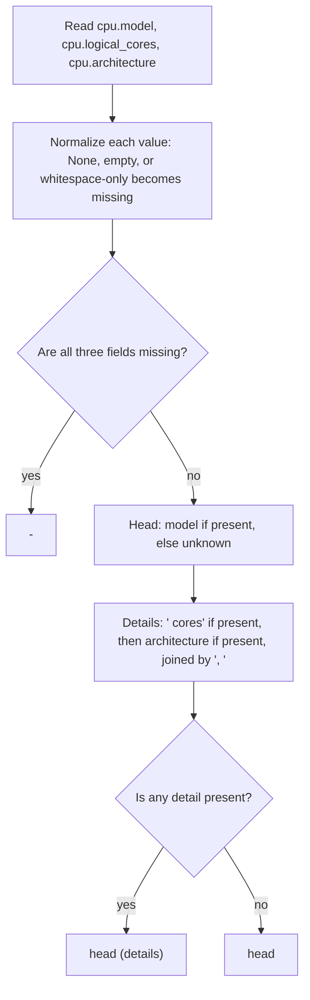

# IPD: Guard missing CPU fields in the TUI details CPU model line

- Date: 2026-11-23
- Kind: child
- Concern: Bugs and correctness (Terminal User Interface (TUI) rendering): the General Info tab of the `pubrun ui` run details pane prints the literal word `None` in its CPU model line when the manifest's `hardware.cpu.model`, `hardware.cpu.logical_cores`, or `hardware.cpu.architecture` is missing or null.
- Scope: `src/pubrun/tui/widgets/details.py` (a new module-level CPU-text helper and the CPU model line in `RunDetailsView.update_general_pane`) and regression tests in `tests/test_tui_bugs.py`.
- Scope-Paths: src/pubrun/tui/widgets/details.py, tests/test_tui_bugs.py
- Item-Dependencies: none
- Status: approved
- Readiness: go-pending-approval
- Review-Depth: simple
- Short-Description: The TUI run details pane prints the literal word None in its CPU model line when hardware.cpu.model, logical_cores, or architecture is missing or null.
- Work-Kind: bug
- Priority: low
- From-Backlog: 0mnekm
- Blocks-Release: next
- Set: 0mnekm
- Order: 1
- Highest E allocated: 03
- Author: OpenCode agent
- Id: 67hcid
- Approval: 2026-11-24, recorded via aw ipd set: status set to approved

> Write and proofread this plan per the technical writing standard, `.aw/system/workflows/technical-writing/technical-writing.md` (`.agents/workflows/technical-writing/technical-writing.md` in a legacy-layout install), including requirement 12 (diagrams).

## Workflow history

- 2026-11-24 approved (aw set): status set to approved
- 2026-11-24 /plan-review (Claude Opus 5.5): APPROVE WITH REVISIONS APPLIED; PR-001, PR-002, PR-003
- 2026-11-24 to-review (OpenCode agent): authored from backlog 0mnekm: reproduction, guarded CPU model line, behavioral regression tests.
- 2026-11-24 draft (OpenCode agent): created.

## Goal

`src/pubrun/tui/widgets/details.py::RunDetailsView.update_general_pane` builds the General Info tab of the TUI run details pane. Its "HOST & HARDWARE SPECS" section contains a CPU model line that interpolates `cpu.get('model')`, `cpu.get('logical_cores')`, and `cpu.get('architecture')` directly into an f-string, so each missing or null field prints as the literal word `None`. This plan makes the CPU model line show `unknown` for a missing model, leave a missing core count or architecture out of the parenthesized details, show `-` when all three fields are missing, and never print `None`.

### Target CPU model line behavior

The text below is the CPU text that follows the `CPU model:` label. "Present" means a non-empty value after the normalization rule in E-01, which also treats a whitespace-only string as missing.



## Detailed Implementation Checklist (TODO)

Execution-state rule: mark an `E-*` item complete only after performing the action. That mark is not validation. Right-sizing rule: write for a modest executor that cannot hold much in its head. Each E-item is one step (one concern, about one file, executable in one focused pass) and its V-item names each unit it covers with its own check; a plan stays at about 5 E-items and 8 work Scope-Paths, else split it into more child plans (guidance, `IPD-Z603`). Accepted execution states: blocked, failed, pending, performed; terminal gate demands 'performed'.

### Task group 1: Guard the CPU model line

- [x] E-01 In `src/pubrun/tui/widgets/details.py`, add a module-level helper `_format_cpu_text(cpu: Any) -> str` and use it for the CPU model line in `RunDetailsView.update_general_pane`.
  - Depends on: none
  - Expected outcome: The helper sits directly after `_format_os_text`, has no `textual` dependency, and carries a docstring in the style of `_format_os_text` that states the `-`, `unknown`, and omitted-detail rules. It returns `"-"` when `cpu` is not a dict. Otherwise it normalizes `cpu.get("model")`, `cpu.get("logical_cores")`, and `cpu.get("architecture")` with one rule, the same rule `_format_os_text` uses: a string is kept, `None` becomes `""`, and any other type is converted with `str()`; the result is then passed through `.strip()`, so a whitespace-only value counts as empty. An integer `0` for `logical_cores` is therefore present and renders as `0 cores`. The helper then builds its result in this order: (1) when all three normalized values are empty, return `"-"`; (2) the head is the model when it is non-empty, else `unknown`; (3) the details list holds `f"{cores} cores"` when the core count is non-empty, followed by the architecture when it is non-empty; (4) return `f"{head} ({', '.join(details)})"` when the details list is non-empty, else return `head`. It applies `_escape_markup` to the model, the core count, and the architecture before it formats them, so a bracketed token such as `[Rev 2]` or `[/]` in a CPU model string is shown literally and does not raise `textual.markup.MarkupError`. In `update_general_pane`, the CPU model line becomes `lines.append(f"  [bold]CPU model:[/]     {_format_cpu_text(cpu)}")`. When all three fields are present and the model contains no `[`, the rendered line is identical to the current output (for example `CPU model:     Intel(R) Xeon(R) Gold 6248 (8 cores, x86_64)`). No other line of `update_general_pane` changes; the `cpu` local, which `update_general_pane` already coerces to `{}` when `hardware.cpu` is not a dict, is passed unchanged.
  - Execution state: performed

### Task group 2: Regression tests and verification

- [x] E-02 Add a `TestRunDetailsCpuLine` class to `tests/test_tui_bugs.py` with behavioral tests that render the General Info tab for manifests with missing or null CPU fields.
  - Depends on: E-01
  - Expected outcome: The class sits directly after `TestRunDetailsOsLine`, under a section banner comment naming `0mnekm`, and follows the pattern of `TestRunDetailsOsLine._os_line`. Its helper writes a manifest with the file's `_write_manifest(run_dir, run_id, extra=...)` helper. When the test passes a CPU dict, `extra` holds `{"hardware": {"capture_state": {"status": "complete"}, "cpu": <cpu dict>}}`; when the test passes the `_DROP` sentinel for the whole CPU dict, `extra` holds no `hardware` key. The helper then starts `PubrunTUIApp(output_dir=...)` under `app.run_test()`, calls `RunDetailsView.display_run(RunInfo(run_dir))`, awaits `pilot.pause()`, reads `str(details.query_one("#lbl-general-info").render())`, asserts that exactly one rendered line has stripped text starting with `CPU model:`, and returns the text after that label with leading spaces removed. Each CPU dict below starts from `{"model": "Intel(R) Xeon(R) Gold 6248", "logical_cores": 8, "architecture": "x86_64"}` and changes only the named fields. One test is parametrized over these cases and asserts both the exact text and that `"None"` is not in it: (1) `model` key removed, expected `unknown (8 cores, x86_64)`; (2) `model` set to `None`, expected `unknown (8 cores, x86_64)`; (3) `logical_cores` key removed, expected `Intel(R) Xeon(R) Gold 6248 (x86_64)`; (4) `logical_cores` set to `None`, same expected text as case 3; (5) `architecture` key removed, expected `Intel(R) Xeon(R) Gold 6248 (8 cores)`; (6) `architecture` set to `None`, same expected text as case 5; (7) `logical_cores` and `architecture` both set to `None`, expected `Intel(R) Xeon(R) Gold 6248`; (8) `model` set to `"  "` and `logical_cores` set to `None`, expected `unknown (x86_64)`; (9) all three set to `None`, expected `-`; (10) the CPU dict is `{}`, expected `-`; (11) no `hardware` section in the manifest, expected `-`; (12) `logical_cores` set to `0`, expected `Intel(R) Xeon(R) Gold 6248 (0 cores, x86_64)`, which pins that a zero core count is present and is not dropped by a truthiness test. A second test asserts that the unchanged full CPU dict still renders `Intel(R) Xeon(R) Gold 6248 (8 cores, x86_64)`. A third test asserts that `model` `Vendor [Rev 2] [/]` with the other two fields unchanged renders `Vendor [Rev 2] [/] (8 cores, x86_64)` without raising. The existing `TestRunDetailsGpu` and `TestRunDetailsOsLine` tests are unchanged. No test reads production source code.
  - Execution state: performed

- [x] E-03 Run the new tests, the existing TUI tests, the full test suite, and the reproduction script.
  - Depends on: E-02
  - Expected outcome: `python3 -m pytest tests/test_tui_bugs.py -v`, `python3 -m pytest tests/test_tui.py tests/test_timing_consumers.py -q`, and `python3 -m pytest -q` each finish with zero failures. The reproduction script in `## Findings` prints seven CPU model lines, none of which contains `None`, and the `bracket-model` case no longer raises.
  - Execution state: performed

## Project conventions discovered (Step 0)

- `src/pubrun/tui/widgets/details.py` keeps pure, `textual`-free helpers at module level (`_filter_package_rows`, `_format_subprocess_rows`, `_format_os_text`) so they are testable without the optional TUI packages. E-01 adds `_format_cpu_text` in the same style.
- Plan `46fixy` (Set `zen6hs`, `.aw/records/plans/executed/20261122-zen6hs-01-46fixy-guard-missing-host-os-fields-in-the-tui-details-os-line.ipd.md`) fixed the same defect class in the OS line directly above the CPU model line. Its `## Deferred / out of scope` section names this backlog item, `0mnekm`, as the carrier for the CPU model line. This plan reuses its normalization rule, its `-` and `unknown` markers, its markup escaping, and its test structure.
- In `update_general_pane`, absent scalar values render as `-` (for example `Hostname:`, `Exit Code:`, `Total RAM:` through `pubrun.status._format_bytes`, and the GPU `Driver:`), and an absent model or name renders as `unknown` (the GPU model, and the OS name in `_format_os_text`). E-01 follows both conventions.
- `update_general_pane` passes manifest-derived free text through `_escape_markup`, because the pane is a Textual `Static` that parses markup. The current CPU model line does not escape.
- `schemas/manifest.schema.json` (`$defs.cpu_record`) declares `model` and `architecture` as `["string", "null"]` and `logical_cores` as `["integer", "null"]` with minimum 0, and requires none of them. `$defs.hardware_section` requires only `capture_state`, so a valid manifest may omit `cpu` entirely. `src/pubrun/capture/hardware.py::get_hardware` writes `architecture` from `platform.machine()`, `logical_cores` from `os.cpu_count()` (which can return `None`), and `model` from `_get_cpu_model` (which returns `None` on failure or timeout). It writes only `capture_state` when hardware depth is `off`. `docs/manifest.md` (`### hardware.cpu`) documents the three fields.
- `tests/test_tui_bugs.py` holds TUI regression tests. It calls `pytest.importorskip("textual")`, isolates user configuration with an autouse fixture, and defines the `_DROP` sentinel used by `TestRunDetailsOsLine`. Tests in this repository assert observable behavior; they do not read source with `inspect`, `ast`, or regex.
- Pending plan `bwoyan` (Set `test-audit`) also lists `src/pubrun/tui/widgets/details.py` in its Scope-Paths. It changes the git `remote_url` handling, not the CPU model line, and its tests go to a different file (`tests/test_tui_widgets.py`). The runner gives each plan its own worktree and merges through its revalidation gate, so no ordering edge is needed.

## Findings

Reproduction on the lane base (commit `8ac3407`), recorded 2026-11-23. The script below writes a manifest for each case, with a complete `host` section and, except for the first case, a `hardware` section whose `capture_state.status` is `complete`. It renders the General Info tab with `RunDetailsView.display_run` and prints the CPU model line. Save it as `/tmp/opencode/0mnekm_repro.py` and run it from the repository root with `PUBRUN_AUTO_START=false PYTHONPATH=src python3 /tmp/opencode/0mnekm_repro.py`. `PUBRUN_AUTO_START=false` stops `import pubrun` from recording the script itself as a run. The script needs the optional `textual` dependency.

```python
import asyncio, json, pathlib, tempfile, time
from pubrun.status import RunInfo
from pubrun.tui.app import PubrunTUIApp
from pubrun.tui.widgets.details import RunDetailsView

FULL = {"model": "Intel(R) Xeon(R) Gold 6248", "logical_cores": 8, "architecture": "x86_64"}
CASES = [
    ("no-hardware-section", None),
    ("model-missing", {"logical_cores": 8, "architecture": "x86_64"}),
    ("cores-null", {"model": FULL["model"], "logical_cores": None, "architecture": "x86_64"}),
    ("arch-missing", {"model": FULL["model"], "logical_cores": 8}),
    ("all-null", {"model": None, "logical_cores": None, "architecture": None}),
    ("full", FULL),
    ("bracket-model", {"model": "Vendor [Rev 2] [/]", "logical_cores": 8, "architecture": "x86_64"}),
]

async def render(runs, run_dir):
    app = PubrunTUIApp(output_dir=str(runs))
    async with app.run_test() as pilot:
        details = app.query_one("#details-view", RunDetailsView)
        details.display_run(RunInfo(run_dir))
        await pilot.pause()
        return str(details.query_one("#lbl-general-info").render())

for label, cpu in CASES:
    runs = pathlib.Path(tempfile.mkdtemp()) / "runs"
    run_dir = runs / "pubrun-r1"
    run_dir.mkdir(parents=True)
    m = {"schema_version": "1.0", "run": {"run_id": "r1"},
         "status": {"outcome": "completed", "exit_code": 0},
         "timing": {"started_at_utc": time.time()},
         "invocation": {"rerun_command": "python r1.py"},
         "host": {"capture_state": {"status": "complete"}, "hostname": "arm-01",
                  "os_name": "Linux", "os_release": "#101-Ubuntu SMP"}}
    if cpu is not None:
        m["hardware"] = {"capture_state": {"status": "complete"}, "cpu": cpu}
    (run_dir / "manifest.json").write_text(json.dumps(m))
    text = asyncio.run(render(runs, run_dir))
    print(label, "|", [l.strip() for l in text.splitlines() if l.strip().startswith("CPU model:")][0])
```

Observed output:

| Case | Observed CPU model line |
|---|---|
| `no-hardware-section` | `CPU model:     None (None cores, None)` |
| `model-missing` | `CPU model:     None (8 cores, x86_64)` |
| `cores-null` | `CPU model:     Intel(R) Xeon(R) Gold 6248 (None cores, x86_64)` |
| `arch-missing` | `CPU model:     Intel(R) Xeon(R) Gold 6248 (8 cores, None)` |
| `all-null` | `CPU model:     None (None cores, None)` |
| `full` | `CPU model:     Intel(R) Xeon(R) Gold 6248 (8 cores, x86_64)` |
| `bracket-model` | the script stops with `textual.markup.MarkupError: auto closing tag ('[/]') has nothing to close` |

Root cause: the CPU model line is `f"  [bold]CPU model:[/]     {cpu.get('model')} ({cpu.get('logical_cores')} cores, {cpu.get('architecture')})"`. `dict.get` returns `None` for a missing key, and the f-string renders `None` as the text `None`. The same line does not escape the model string, so Textual parses bracketed text in it as markup.

## Proposed changes (ordered, validatable)

1. In `src/pubrun/tui/widgets/details.py`, add `_format_cpu_text(cpu)` and replace the raw interpolation in the CPU model line with a call to it (E-01).
2. In `tests/test_tui_bugs.py`, add `TestRunDetailsCpuLine` with the parametrized missing-field test, the unchanged-output test, and the bracket-escaping test (E-02).
3. Run the targeted tests, the neighboring TUI tests, the full suite, and the reproduction script (E-03).

## Deferred / out of scope (with reason)

- A hardware section whose capture status is `suppressed` or `timeout` has no CPU fields. After E-01 its CPU model line reads `-` instead of `None (None cores, None)`. Reason: the backlog item asks only that `None` not appear; a distinct "suppressed" or "timed out" label is a presentation change the item does not request.
  - Carrier-Declined: accepted behavior after the fix; `-` is the pane's existing marker for an absent value, and plan `46fixy` made the same choice for the OS line.
- A core count of 1 renders as `1 cores`, as it does today. Reason: pluralization is unrelated to the `None` defect, and E-01 keeps the present-field output identical.
  - Carrier-Declined: cosmetic; not part of the defect this backlog item records.
- `CHANGELOG.md`. Reason: sibling bug-fix plans (for example `46fixy` and `6bgkyj`) do not edit `CHANGELOG.md`; the `release-notes` workflow drafts entries from the commit history at release time.
  - Carrier-Declined: changelog entries are produced by the release-notes workflow, not by individual bug-fix plans.

## Scope check

- Over-scope: none. Only `src/pubrun/tui/widgets/details.py` and `tests/test_tui_bugs.py` change. Escaping the CPU values is part of rewriting the same line, not a separate feature.
- Under-scope: none. `grep -rn "logical_cores" src/pubrun --include=*.py` returns only `src/pubrun/capture/hardware.py::get_hardware` (the writer) and this CPU model line, so no other output reads `hardware.cpu.logical_cores`. The other CPU model readers already guard a missing model: `src/pubrun/report/diagnostics.py` (the `pubrun show` hardware summary) uses `... .get("model") or "unknown"`, and `src/pubrun/report/methods.py` falls back to `"unknown CPU"`.

## Required tests / validation

- Run `python3 -m pytest tests/test_tui_bugs.py -v -k CpuLine` and paste the output (covers E-01 and E-02), plus the pre-fix failure run that V-02 describes.
- Run `python3 -m pytest tests/test_tui_bugs.py -v`, `python3 -m pytest tests/test_tui.py tests/test_timing_consumers.py -q`, and `python3 -m pytest -q` and paste each summary line (confirms other details-pane output is unchanged).
- Run the reproduction script from `## Findings` and paste its seven CPU model lines.

## Spec / documentation sync

N/A. No spec under `.aw/records/specs/` and no page under `docs/` or `README.md` describes the TUI CPU model line; `grep -rn "CPU model" docs README.md` finds no TUI reference. The manifest schema and `docs/manifest.md` are unchanged, so the cross-platform matrix rule in `AGENTS.md` does not apply.

## Open questions

### OQ-01: What should the CPU model line show when one or more CPU fields are missing?

- Blocking: no
- Status: resolved
- Owner: plan author
- Resolution or deferral rationale: Show `unknown` for a missing model, leave a missing core count or architecture out of the parenthesized details (and drop the parentheses when both are missing), and show `-` when all three are missing. This follows the conventions already in `update_general_pane` and in `_format_os_text` from plan `46fixy`: `-` marks an absent value and `unknown` marks an absent model or name. Leaving out only the missing detail keeps the common partial case readable (`Intel(R) Xeon(R) Gold 6248 (x86_64)`) and avoids output such as `(- cores, x86_64)`.

## Validation and cross-check (verify before reporting done)

Validation-state rule: inspect evidence in a separate pass. Do not mark a `V-*` item complete from memory or from the matching execution checkmark. Accepted validation results: blocked, failed, pass, pending; terminal gate demands 'pass'. Runtime-demonstration reachability rule: for each `V-*` item demanding the software be observed acting (such as a run, a dispatch, or a transition), as distinct from items demanding a diff, a file's content, or a test result (which are reachable by construction), name the code path that produces the observation or the sibling `E-*` that creates it, else the demand is UNDER-SCOPE.

- [x] V-01 validates E-01
  - Required evidence: The pasted `git diff -- src/pubrun/tui/widgets/details.py` output, showing the new `_format_cpu_text` helper (with the `-` result, the `unknown` head, the optional details list, and `_escape_markup` on all three values) and that the only changed line in `update_general_pane` is the CPU model line. Also the pasted output of the reproduction script from `## Findings` (it calls `RunDetailsView.display_run`, which calls `update_general_pane`, the code path E-01 changes), showing these seven CPU model lines in order: `-`, `unknown (8 cores, x86_64)`, `Intel(R) Xeon(R) Gold 6248 (x86_64)`, `Intel(R) Xeon(R) Gold 6248 (8 cores)`, `-`, `Intel(R) Xeon(R) Gold 6248 (8 cores, x86_64)`, and `Vendor [Rev 2] [/] (8 cores, x86_64)`, none containing `None`.
  - Observed evidence:
    ```
    $ git diff -- src/pubrun/tui/widgets/details.py
    diff --git a/src/pubrun/tui/widgets/details.py b/src/pubrun/tui/widgets/details.py
    index 3ba4ace..8c9f93a 100644
    --- a/src/pubrun/tui/widgets/details.py
    +++ b/src/pubrun/tui/widgets/details.py
    @@ -162,6 +162,40 @@ def _format_os_text(host: Any) -> str:
         return "-"


    +def _format_cpu_text(cpu: Any) -> str:
    +    """Format manifest ``hardware.cpu`` fields for the CPU model line.
    +
    +    Pure helper with no ``textual`` dependency. Missing, null, or
    +    whitespace-only fields never render as ``None``: when all three fields
    +    are missing the result is ``-``, a missing model becomes ``unknown``,
    +    and a missing core count or architecture is omitted from the
    +    parenthesized details. Values are markup-escaped because the pane
    +    parses Textual markup.
    +    """
    +    if not isinstance(cpu, dict):
    +        return "-"
    +
    +    def _norm(value: Any) -> str:
    +        text = value if isinstance(value, str) else ("" if value is None else str(value))
    +        return text.strip()
    +
    +    model = _norm(cpu.get("model"))
    +    cores = _norm(cpu.get("logical_cores"))
    +    arch = _norm(cpu.get("architecture"))
    +    if not model and not cores and not arch:
    +        return "-"
    +
    +    head = _escape_markup(model) if model else "unknown"
    +    details: List[str] = []
    +    if cores:
    +        details.append(f"{_escape_markup(cores)} cores")
    +    if arch:
    +        details.append(_escape_markup(arch))
    +    if details:
    +        return f"{head} ({', '.join(details)})"
    +    return head
    +
    +
     class RunDetailsView(Vertical):
         """Component to display all metadata groups for a single selected run."""

    @@ -324,7 +358,7 @@ class RunDetailsView(Vertical):
                 gpus = hw.get("gpus")
                 gpus = [g for g in gpus if isinstance(g, dict)] if isinstance(gpus, list) else []
                 lines.append(f"  [bold]OS:[/]            {_format_os_text(host)}")
    -            lines.append(f"  [bold]CPU model:[/]     {cpu.get('model')} ({cpu.get('logical_cores')} cores, {cpu.get('architecture')})")
    +            lines.append(f"  [bold]CPU model:[/]     {_format_cpu_text(cpu)}")
                 lines.append(f"  [bold]Total RAM:[/]     {_format_bytes(hw.get('memory_total_bytes'))}")
                 if gpus:
                     lines.append("  [bold]GPUs Detected:[/]")

    $ PUBRUN_AUTO_START=false PYTHONPATH=src python3 /tmp/opencode/0mnekm_repro.py
    no-hardware-section | CPU model:     -
    model-missing | CPU model:     unknown (8 cores, x86_64)
    cores-null | CPU model:     Intel(R) Xeon(R) Gold 6248 (x86_64)
    arch-missing | CPU model:     Intel(R) Xeon(R) Gold 6248 (8 cores)
    all-null | CPU model:     -
    full | CPU model:     Intel(R) Xeon(R) Gold 6248 (8 cores, x86_64)
    bracket-model | CPU model:     Vendor [Rev 2] [/] (8 cores, x86_64)
    ```
  - Result: pass

- [x] V-02 validates E-02
  - Required evidence: Pasted `python3 -m pytest tests/test_tui_bugs.py -v -k CpuLine` output listing all twelve parametrized cases, the unchanged-output test, and the bracket-escaping test of `TestRunDetailsCpuLine` as PASSED. Also pasted output showing that, on the pre-fix code, parametrized cases (1) to (11) and the bracket-escaping test fail, while case (12) and the unchanged-output test pass (the pre-fix line already renders a present `0` core count and a full CPU dict correctly). To get it, create a temporary `git worktree` (with `git worktree add --detach`) of the pre-fix commit, which is the parent of the commit that carries the E-01 change, under `/tmp/opencode/`, copy the new `tests/test_tui_bugs.py` into it, run the same `-k CpuLine` command there with `PYTHONPATH=src`, and remove that worktree afterwards. Do not use `git stash` in the shared checkout.
  - Observed evidence:
    ```
    $ python3 -m pytest tests/test_tui_bugs.py -v -k CpuLine --no-cov   (post-fix lane)
    tests/test_tui_bugs.py::TestRunDetailsCpuLine::test_missing_fields_never_render_none[model-missing] PASSED [  7%]
    tests/test_tui_bugs.py::TestRunDetailsCpuLine::test_missing_fields_never_render_none[model-null] PASSED [ 14%]
    tests/test_tui_bugs.py::TestRunDetailsCpuLine::test_missing_fields_never_render_none[cores-missing] PASSED [ 21%]
    tests/test_tui_bugs.py::TestRunDetailsCpuLine::test_missing_fields_never_render_none[cores-null] PASSED [ 28%]
    tests/test_tui_bugs.py::TestRunDetailsCpuLine::test_missing_fields_never_render_none[arch-missing] PASSED [ 35%]
    tests/test_tui_bugs.py::TestRunDetailsCpuLine::test_missing_fields_never_render_none[arch-null] PASSED [ 42%]
    tests/test_tui_bugs.py::TestRunDetailsCpuLine::test_missing_fields_never_render_none[cores-and-arch-null] PASSED [ 50%]
    tests/test_tui_bugs.py::TestRunDetailsCpuLine::test_missing_fields_never_render_none[model-whitespace-cores-null] PASSED [ 57%]
    tests/test_tui_bugs.py::TestRunDetailsCpuLine::test_missing_fields_never_render_none[all-null] PASSED [ 64%]
    tests/test_tui_bugs.py::TestRunDetailsCpuLine::test_missing_fields_never_render_none[empty-cpu-dict] PASSED [ 71%]
    tests/test_tui_bugs.py::TestRunDetailsCpuLine::test_missing_fields_never_render_none[no-hardware-section] PASSED [ 78%]
    tests/test_tui_bugs.py::TestRunDetailsCpuLine::test_missing_fields_never_render_none[cores-zero] PASSED [ 85%]
    tests/test_tui_bugs.py::TestRunDetailsCpuLine::test_all_present_unchanged PASSED [ 92%]
    tests/test_tui_bugs.py::TestRunDetailsCpuLine::test_bracketed_model_rendered_literally PASSED [100%]
    ====================== 14 passed, 33 deselected in 8.14s =======================

    $ git worktree add --detach /tmp/opencode/0mnekm-prefix 7afaf65f25220e47aa56dabaa55588702c698359 && cp tests/test_tui_bugs.py /tmp/opencode/0mnekm-prefix/tests/test_tui_bugs.py
    $ (cd /tmp/opencode/0mnekm-prefix && PYTHONPATH=src python3 -m pytest tests/test_tui_bugs.py -v -k CpuLine --no-cov -p no:cacheprovider)   (pre-fix)
    tests/test_tui_bugs.py::TestRunDetailsCpuLine::test_missing_fields_never_render_none[model-missing] FAILED [  7%]
    tests/test_tui_bugs.py::TestRunDetailsCpuLine::test_missing_fields_never_render_none[model-null] FAILED [ 14%]
    tests/test_tui_bugs.py::TestRunDetailsCpuLine::test_missing_fields_never_render_none[cores-missing] FAILED [ 21%]
    tests/test_tui_bugs.py::TestRunDetailsCpuLine::test_missing_fields_never_render_none[cores-null] FAILED [ 28%]
    tests/test_tui_bugs.py::TestRunDetailsCpuLine::test_missing_fields_never_render_none[arch-missing] FAILED [ 35%]
    tests/test_tui_bugs.py::TestRunDetailsCpuLine::test_missing_fields_never_render_none[arch-null] FAILED [ 42%]
    tests/test_tui_bugs.py::TestRunDetailsCpuLine::test_missing_fields_never_render_none[cores-and-arch-null] FAILED [ 50%]
    tests/test_tui_bugs.py::TestRunDetailsCpuLine::test_missing_fields_never_render_none[model-whitespace-cores-null] FAILED [ 57%]
    tests/test_tui_bugs.py::TestRunDetailsCpuLine::test_missing_fields_never_render_none[all-null] FAILED [ 64%]
    tests/test_tui_bugs.py::TestRunDetailsCpuLine::test_missing_fields_never_render_none[empty-cpu-dict] FAILED [ 71%]
    tests/test_tui_bugs.py::TestRunDetailsCpuLine::test_missing_fields_never_render_none[no-hardware-section] FAILED [ 78%]
    tests/test_tui_bugs.py::TestRunDetailsCpuLine::test_missing_fields_never_render_none[cores-zero] PASSED [ 85%]
    tests/test_tui_bugs.py::TestRunDetailsCpuLine::test_all_present_unchanged PASSED [ 92%]
    tests/test_tui_bugs.py::TestRunDetailsCpuLine::test_bracketed_model_rendered_literally FAILED [100%]
    E           textual.markup.MarkupError: auto closing tag ('[/]') has nothing to close
    ================= 12 failed, 2 passed, 33 deselected in 7.89s ==================
    $ git worktree remove --force /tmp/opencode/0mnekm-prefix   -> removed
    ```
  - Result: pass

- [x] V-03 validates E-03
  - Required evidence: Pasted summary lines of `python3 -m pytest tests/test_tui_bugs.py -v`, `python3 -m pytest tests/test_tui.py tests/test_timing_consumers.py -q`, and `python3 -m pytest -q`, each with zero failures.
  - Observed evidence:
    ```
    $ python3 -m pytest tests/test_tui_bugs.py -v --no-cov
    ============================= 47 passed in 32.49s ==============================
    $ python3 -m pytest tests/test_tui.py tests/test_timing_consumers.py -q --no-cov
    38 passed in 5.76s
    $ aw suite   (full suite, per the runner's instruction in place of bare `python3 -m pytest -q`)
    TOTAL                                  16128   3308    79%
    ======================= 1898 passed in 147.32s (0:02:27) =======================
    ```
  - Result: pass

## Approval and execution gate

- Size assessment: standard
- Cohesion rationale: not required

Execution contract:
1. Precondition: wait for human approval (`- Status: approved`) with no unresolved `Blocking: yes` open question before you change code.
2. Scope declaration: the expected modified files are the `- Scope-Paths:` entries (`src/pubrun/tui/widgets/details.py`, `tests/test_tui_bugs.py`). If execution requires an out-of-scope file, justify it with `--scope-reason` at finalization. If a declared file needs no edit, acknowledge it with `--scope-ack`.
3. Validation honesty: run each required validation command and paste its actual output into the matching `V-*` `Observed evidence:` field. Do not mark a `V-*` item `pass` without output captured from that run.
4. Commit discipline: commit only the paths you changed with `aw commit 67hcid -- src/pubrun/tui/widgets/details.py tests/test_tui_bugs.py`. Do not use `git add -A` or raw `git commit`. Do not push without an explicit human instruction.
5. Lifecycle transition: finalize this plan with `aw ipd finalize 67hcid`, never with a hand-written `git mv` to `.aw/records/plans/executed/`. Inside a runner lane (`aw oc run` or `aw agy run`), the runner finalizes after the turn. Outside a runner, the executor runs `aw ipd finalize 67hcid`.
