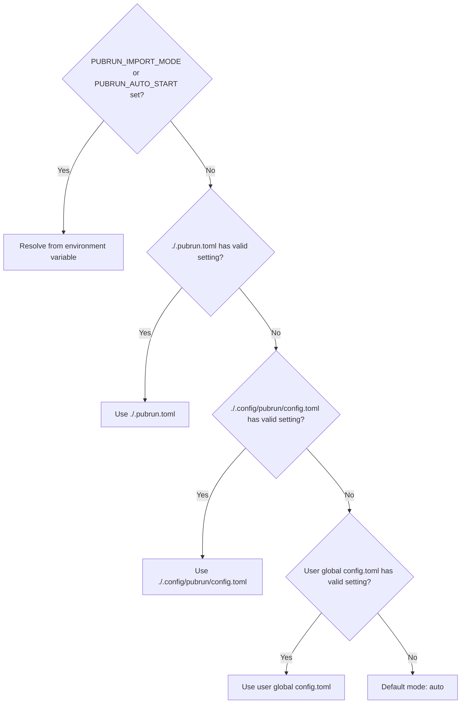

# IPD: Sync functional spec and architecture docs with multi-file boot config and PUBRUN_AUTO_START values

- Date: 2026-11-23
- Kind: child
- Concern: Documentation accuracy for boot-time configuration and environment-variable parsing
- Scope: Update `docs/functional_spec.md` and `docs/architecture.md` to match the multi-file boot configuration search order and accepted `PUBRUN_AUTO_START` boolean values implemented in `src/pubrun/_config_boot.py` (landed in `l7ko8p`).
- Scope-Paths: docs/functional_spec.md, docs/architecture.md
- Item-Dependencies: none
- Status: to-review
- Work-Kind: followup
- Priority: low
- From-Backlog: 2rhs16
- Set: 2rhs16
- Order: 1
- Highest E allocated: 02
- Author: Antigravity
- Id: mspqm6

> Write and proofread this plan per the technical writing standard, `.aw/system/workflows/technical-writing/technical-writing.md` (`.agents/workflows/technical-writing/technical-writing.md` in a legacy-layout install), including requirement 12 (diagrams).

## Workflow history

- 2026-11-24 draft (Antigravity): created.
- 2026-11-24 to-review (Antigravity): graduated from backlog item `2rhs16` into a review-ready plan.

## Goal

Align `docs/functional_spec.md` and `docs/architecture.md` with the current implementation in `src/pubrun/_config_boot.py` so readers get accurate documentation for the multi-file boot configuration precedence order and the accepted `PUBRUN_AUTO_START` boolean values.

## Detailed Implementation Checklist (TODO)

Execution-state rule: mark an `E-*` item complete only after performing the action. That mark is not validation. Right-sizing rule: write for a modest executor that cannot hold much in its head. Each E-item is one step (one concern, about one file, executable in one focused pass) and its V-item names each unit it covers with its own check; a plan stays at about 5 E-items and 8 work Scope-Paths, else split it into more child plans (guidance, `IPD-Z603`). Accepted execution states: blocked, failed, pending, performed; terminal gate demands 'performed'.

### Task group 1: Update user-facing design and architecture documentation

- [ ] E-01 Update `docs/functional_spec.md` Section 3.2 (`Single-read boot configuration`) and Section 3.3 (`Auto-Start Behavior`) to match `src/pubrun/_config_boot.py`.
  - Depends on: none
  - Expected outcome: Section 3.2 documents the multi-file precedence search (`./.pubrun.toml`, `./.config/pubrun/config.toml`, then the user global `config.toml` at `%APPDATA%/pubrun/config.toml` on Windows or `$XDG_CONFIG_HOME/pubrun/config.toml` / `~/.config/pubrun/config.toml` on POSIX), explains that each candidate file is opened and parsed at most once, states that `[imports].mode` wins over `[core].auto_start` within a single file and search stops at the first file defining a valid setting, and notes that `[imports].on_conflict` uses the same precedence order. Section 3.3 documents all accepted case-insensitive `PUBRUN_AUTO_START` false values (`"0"`, `"false"`, `"no"`, `"off"`) and true values (`"1"`, `"true"`, `"yes"`, `"on"`). All edited lines use plain punctuation with zero em or en dashes.
  - Execution state: pending

- [ ] E-02 Update `docs/architecture.md` Section 3 (`Initialization`) to match `src/pubrun/_config_boot.py`.
  - Depends on: none
  - Expected outcome: Section 3 replaces the outdated claim that `_config_boot.py` reads only `./.pubrun.toml` with the accurate three-tier boot config search (`./.pubrun.toml`, `./.config/pubrun/config.toml`, user global `config.toml`), notes that each candidate is opened and parsed at most once without importing `pubrun.config`, and lists the accepted `PUBRUN_AUTO_START` boolean tokens. All edited lines use plain punctuation with zero em or en dashes.
  - Execution state: pending

## Project conventions discovered (Step 0)

- Cite code by SYMBOL (`module.function`) or by a quoted content string, with a line number only appended to one of those and never alone (`IPD-C801`).
- Authoritative implementation in `src/pubrun/_config_boot.py`:
  - `_AUTO_START_TRUE = ("1", "true", "yes", "on")` and `_AUTO_START_FALSE = ("0", "false", "no", "off")`, matched after `.strip().lower()`.
  - `_boot_config_paths()` returns candidates in highest-precedence-first order: `./.pubrun.toml`, `./.config/pubrun/config.toml`, then user global `config.toml` (`%APPDATA%/pubrun/config.toml` on Windows; `$XDG_CONFIG_HOME/pubrun/config.toml` or `~/.config/pubrun/config.toml` on POSIX).
  - `_read_boot_toml_key` searches those same files in the same order for `[imports].on_conflict`.
- Agent execution contract: user-facing documentation (`docs/*.md`) must contain zero em dashes or en dashes in authored or edited prose.

## Findings

Two user-facing docs still describe pre-`l7ko8p` boot-config behavior:

1. `docs/functional_spec.md` Section 3.2 (`"Single-read boot configuration"`) states that `_config_boot.py` `"opens and parses ./.pubrun.toml at most once"`, omitting `./.config/pubrun/config.toml` and the user global `config.toml`.
2. `docs/functional_spec.md` Section 3.3 (`"Auto-Start Behavior"`) states only that `PUBRUN_AUTO_START` is set to `"false"`, omitting the full accepted false set (`"0"`, `"false"`, `"no"`, `"off"`) and true set (`"1"`, `"true"`, `"yes"`, `"on"`).
3. `docs/architecture.md` Section 3 (`"Initialization"`) still states that `"_config_boot.py reads and parses ./.pubrun.toml at most once"`, omitting the multi-file search order.

## Proposed changes (ordered, validatable)

1. **`docs/functional_spec.md` (E-01):**
   - Rewrite the `"Single-read boot configuration"` bullet in Section 3.2 to describe the three-tier precedence search (`./.pubrun.toml`, `./.config/pubrun/config.toml`, user global `config.toml`), per-file single-parse guarantee, within-file `[imports].mode` precedence over `[core].auto_start`, and matching precedence for `[imports].on_conflict`.
   - Update Section 3.3 (`"Auto-Start Behavior"`) to state that `PUBRUN_AUTO_START` accepts case-insensitive false values (`"0"`, `"false"`, `"no"`, `"off"`) to disable auto-start and true values (`"1"`, `"true"`, `"yes"`, `"on"`) to enable it.
2. **`docs/architecture.md` (E-02):**
   - Update Section 3 (`"Initialization"`) to reflect `_boot_config_paths()` searching `./.pubrun.toml`, `./.config/pubrun/config.toml`, and user global `config.toml` (parsing each candidate at most once without loading `pubrun.config`), and summarize the accepted `PUBRUN_AUTO_START` values.

## Deferred / out of scope (with reason)

None.

## Scope check

- Over-scope: none. Only `docs/functional_spec.md` and `docs/architecture.md` are edited; `src/pubrun/_config_boot.py` is read-only reference.
- Under-scope: none. Both stale doc locations named in backlog item `2rhs16` are updated.

## Required tests / validation

- Inspect the diffs for `docs/functional_spec.md` and `docs/architecture.md` against `src/pubrun/_config_boot.py` to confirm exact parity of paths, precedence, and boolean tokens.
- Verify zero em dashes (`—`) and en dashes (`–`) in the added/edited lines of both files.
- Run `python3 scripts/sanitize_paths.py --check --all` and confirm exit code 0.

## Spec / documentation sync

This plan is the documentation sync for `src/pubrun/_config_boot.py` (`l7ko8p`), updating `docs/functional_spec.md` and `docs/architecture.md`.

## Open questions

None.

## Validation and cross-check (verify before reporting done)

Validation-state rule: inspect evidence in a separate pass. Do not mark a `V-*` item complete from memory or from the matching execution checkmark. Accepted validation results: blocked, failed, pass, pending; terminal gate demands 'pass'. Runtime-demonstration reachability rule: for each `V-*` item demanding the software be observed acting (such as a run, a dispatch, or a transition), name the code path that produces the observation or the sibling `E-*` that creates it, else the demand is UNDER-SCOPE.

- [ ] V-01 validates E-01
  - Required evidence: Paste `git diff docs/functional_spec.md` confirming Sections 3.2 and 3.3 accurately state the three-tier boot config paths, per-file single-parse rule, `[imports].on_conflict` precedence, and all `PUBRUN_AUTO_START` true/false tokens, with zero em or en dashes in added lines.
  - Observed evidence:
  - Result: pending

- [ ] V-02 validates E-02
  - Required evidence: Paste `git diff docs/architecture.md` confirming Section 3 accurately reflects `_boot_config_paths()` and `PUBRUN_AUTO_START` values with zero em or en dashes in added lines, plus the output of `python3 scripts/sanitize_paths.py --check --all`.
  - Observed evidence:
  - Result: pending

## Approval and execution gate

- Size assessment: standard
- Cohesion rationale: not required

Execution begins only after this plan reaches `approved`. Execute `E-01` and `E-02`, verify `V-01` and `V-02` with pasted evidence, commit only the scoped files through `aw commit`, and complete the post-gate lifecycle transition under `ipd-lifecycle`.
